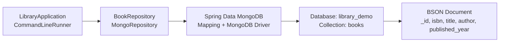

# Creating Your First @Document and MongoRepository

## 1. Objectives and Big Picture

In Spring Data MongoDB, we can persist a Java object into MongoDB and read it back without writing manual field-by-field conversion code. To get started, you need to understand two building blocks:

- **`@Document`** marks a Java class as mapped to a MongoDB **collection**. The Java object is commonly called an *entity*; when saved, its data is converted into a **BSON document**.
- **`MongoRepository<T, ID>`** is a Spring Data interface providing built-in data access operations such as `save`, `findById`, `findAll`, and `deleteById`. You only declare a repository interface for your entity.

This hands-on lesson builds a minimal book management application with entity `Book`, collection `books`, and repository `BookRepository`. We will run a test to **create and find a book**, inspect the stored data in MongoDB, and see which CRUD and query capabilities can be built next.



Crucially, **`BookRepository` lives in the Java application**, while the `books` collection and its documents live in MongoDB. A repository is not a collection or a database table.

## 2. Preparing the Environment and Spring Boot Project

The example below uses **Spring Boot 3.x**, Java 17 or newer, Maven, and MongoDB running at `localhost:27017`. Choose a Spring Boot 3.x release supported by your project and a compatible JDK; if using another Spring Boot generation, verify its configuration property names and version requirements.

### 2.1. Starting MongoDB for Local Learning

If you already have MongoDB running locally, you can skip this step. If using Docker, open a terminal and run:

```bash
docker run -d --name mongodb-learning -p 127.0.0.1:27017:27017 mongo:7
```

This creates a MongoDB container named `mongodb-learning` and binds port `27017` to the local host. This is an **isolated local learning setup without authentication**; real deployments must configure proper connectivity, authentication, and authorization.

Verify MongoDB responds:

```bash
docker exec mongodb-learning mongosh --quiet --eval "db.adminCommand({ ping: 1 })"
```

Expected output includes `ok: 1`. If the container already exists but is stopped, run `docker start mongodb-learning` instead of creating another container with the same name.

### 2.2. Creating the Project and Dependency

Create a project via Spring Initializr or an equivalent tool with these settings:

| Option | Sample Value |
| --- | --- |
| Project | Maven |
| Language | Java |
| Spring Boot | A 3.x version suited to your project |
| Group | `com.example` |
| Artifact / Name | `library` |
| Package | `com.example.library` |
| Dependency | **Spring Data MongoDB** |

In a Maven project, the core dependency is:

```xml
<dependency>
    <groupId>org.springframework.boot</groupId>
    <artifactId>spring-boot-starter-data-mongodb</artifactId>
</dependency>
```

This is a **snippet inside the `<dependencies>` section** of the `pom.xml` generated by Spring Initializr, not the full `pom.xml`. Spring Boot manages compatible versions of Spring Data and the MongoDB Java Driver via dependency management. This lesson uses `CommandLineRunner`, so it does **not yet need** `spring-boot-starter-web`, REST controllers, Lombok, or Reactive MongoDB.

After generating the project, the main files will have this layout:

```text
library/
├── pom.xml
└── src/
    └── main/
        ├── java/
        │   └── com/example/library/
        │       ├── LibraryApplication.java
        │       └── book/
        │           ├── Book.java
        │           └── BookRepository.java
        └── resources/
            └── application.properties
```

Place the main application class in package `com.example.library`, and place the entity and repository in the subpackage `com.example.library.book`. With this layout, Spring Boot discovers components and repositories using default scanning rules.

## 3. Configuring the MongoDB Connection

Open `src/main/resources/application.properties`:

```properties
spring.data.mongodb.uri=mongodb://localhost:27017/library_demo
```

This is the URI property commonly used with Spring Boot **3.x**. The URI specifies:

- `localhost:27017`: MongoDB host and port.
- `library_demo`: the database the application operates on.

Configuring the connection alone **does not mean** MongoDB has written any documents, created the database, or created the collection. In standard MongoDB usage, databases and collections are created lazily when the application writes the first document. There is no need to pre-create tables as in some relational databases.

If Spring Boot and MongoDB run in **two separate containers**, `localhost` inside the application container points to that container itself, not the MongoDB container. In that setup, use the hostname reachable over the container network.

## 4. Writing the `Book` Entity with `@Document`

Create `src/main/java/com/example/library/book/Book.java`:

```java
package com.example.library.book;

import org.springframework.data.annotation.Id;
import org.springframework.data.mongodb.core.mapping.Document;
import org.springframework.data.mongodb.core.mapping.Field;

@Document(collection = "books")
public class Book {

    @Id
    private String id;

    private String isbn;
    private String title;
    private String author;

    @Field("published_year")
    private Integer publishedYear;

    protected Book() {
        // Used by Spring Data when instantiating objects from documents.
    }

    public Book(String isbn, String title, String author, Integer publishedYear) {
        this.isbn = isbn;
        this.title = title;
        this.author = author;
        this.publishedYear = publishedYear;
    }

    public String getId() {
        return id;
    }

    public String getIsbn() {
        return isbn;
    }

    public String getTitle() {
        return title;
    }

    public String getAuthor() {
        return author;
    }

    public Integer getPublishedYear() {
        return publishedYear;
    }

    public void changeTitle(String newTitle) {
        this.title = newTitle;
    }
}
```

### Explaining Each Component

| Component | Role |
| --- | --- |
| `@Document(collection = "books")` | Maps the `Book` entity to the collection named `books`. |
| `@Id` on `id` | Maps the Java `id` property to MongoDB's special `_id` field. |
| `String id` | The repository will use `String` as the ID type. When a `String` ID matches a valid ObjectId format, Spring Data MongoDB typically converts between `String` and BSON `ObjectId` per default mapping rules. |
| `isbn`, `title`, `author` | Java property names match MongoDB field names when no custom mapping is specified. |
| `@Field("published_year")` | Maps the `publishedYear` Java property to the `published_year` MongoDB field. |
| `protected` no-arg constructor | Provides an instantiation path for mapping. |
| Getters and `changeTitle` | Allow application code to read fields and update the book title before re-saving. |

**`@Id` must be imported from `org.springframework.data.annotation.Id`** in this example. Do not accidentally import JPA's `jakarta.persistence.Id`. Likewise, `@Document` here is the Spring Data MongoDB annotation, not a MongoDB shell annotation.

When creating a new instance with `new Book(...)`, `id` starts as `null`. Normally, saving a new entity generates an identifier for the document, and Spring Data populates that generated ID back onto the entity. In this `String id` example, the application receives a string ID while `_id` in BSON may be stored as an `ObjectId`. Do not assume every string ID automatically converts to an ObjectId: conversion depends on the ID type and value.

This example keeps the entity simple to focus on mapping mechanics. In real applications, add input validation, ISBN uniqueness rules if required by business logic, and immutable constructors where appropriate.

## 5. Declaring `BookRepository`

Create `src/main/java/com/example/library/book/BookRepository.java`:

```java
package com.example.library.book;

import java.util.List;
import java.util.Optional;
import org.springframework.data.mongodb.repository.MongoRepository;

public interface BookRepository extends MongoRepository<Book, String> {

    Optional<Book> findByIsbn(String isbn);

    List<Book> findByAuthor(String author);
}
```

This interface contains no method implementations. At application startup, **Spring Data generates the repository implementation** from entity metadata and query method names.

`MongoRepository<Book, String>` takes two type arguments:

1. `Book`: the managed entity type.
2. `String`: the type of the `Book.id` identifier property.

Do not confuse the second type parameter with the collection name, database name, or the type of `isbn`.

Built-in repository methods include:

| Method | Meaning |
| --- | --- |
| `save(book)` | Persists the entity; inserts a new document or saves updates for an existing ID. |
| `findById(id)` | Finds a single document by `_id`; returns `Optional<Book>`. |
| `findAll()` | Fetches all documents as `Book` objects; consider data size carefully in real systems. |
| `count()` | Counts documents in the collection. |
| `deleteById(id)` | Deletes a document by identifier. |

The two methods we declared are **derived queries**:

- `findByIsbn("...")`: queries by the `isbn` property. Returns `Optional<Book>`, assuming at most one matching record.
- `findByAuthor("...")`: finds all books whose `author` property matches the given value.

If the collection contains multiple documents with the same ISBN, `Optional<Book>` does not enforce uniqueness; the query may fail due to multiple results. To enforce unique ISBNs, design and create a **real unique index in MongoDB** once data meets the constraint. Declaring `findByIsbn` does not create a unique index automatically.

In this simple Spring Boot layout, you do not need `@Repository` on an interface extending `MongoRepository`, provided Spring Data MongoDB is configured and the repository package falls within Spring Boot's component scan scope.

## 6. Running the Test with `CommandLineRunner`

Open `src/main/java/com/example/library/LibraryApplication.java` and replace the main class contents with:

```java
package com.example.library;

import com.example.library.book.Book;
import com.example.library.book.BookRepository;
import org.springframework.boot.CommandLineRunner;
import org.springframework.boot.SpringApplication;
import org.springframework.boot.autoconfigure.SpringBootApplication;
import org.springframework.context.annotation.Bean;

@SpringBootApplication
public class LibraryApplication {

    public static void main(String[] args) {
        SpringApplication.run(LibraryApplication.class, args);
    }

    @Bean
    CommandLineRunner firstMongoExample(BookRepository bookRepository) {
        return args -> {
            String isbn = "978-604-001-001-0";

            Book book = bookRepository.findByIsbn(isbn)
                .orElseGet(() -> bookRepository.save(
                    new Book(
                        isbn,
                        "Introduction to Spring Data MongoDB",
                        "Nguyen Minh",
                        2026
                    )
                ));

            System.out.println("Saved ID: " + book.getId());

            bookRepository.findByIsbn(isbn).ifPresent(found ->
                System.out.println("Found by ISBN: " + found.getTitle())
            );

            bookRepository.findByAuthor("Nguyen Minh").forEach(found ->
                System.out.println("Author's book: " + found.getTitle())
            );

            System.out.println("Total books: " + bookRepository.count());
        };
    }
}
```

The purpose of `findByIsbn(...).orElseGet(...)` is to avoid creating another demo record **each time the application is run sequentially** when that ISBN already exists. It is not a concurrency-safe duplicate prevention mechanism when multiple processes write simultaneously; real uniqueness constraints must be enforced by the database when required.

**Execution flow:**

1. `SpringApplication.run` initializes the Spring context, configures the MongoDB connection, and registers the `BookRepository` implementation.
2. Spring injects `BookRepository` into the `CommandLineRunner` bean.
3. The runner queries by ISBN. If absent, the repository saves a new `Book` into the `books` collection.
4. The repository reads documents back into Java entities; the app prints the title, ID, and total record count.

Run from the root directory of the Maven project:

```bash
./mvnw spring-boot:run
```

On Windows PowerShell, use the corresponding Maven Wrapper:

```powershell
.\mvnw.cmd spring-boot:run
```

The console output printed by the program will look similar to:

```text
Saved ID: 507f1f77bcf86cd799439011
Found by ISBN: Introduction to Spring Data MongoDB
Author's book: Introduction to Spring Data MongoDB
Total books: 1
```

**Note:** The ID above is illustrative; each newly created document receives a generated value from MongoDB. The `count()` value also depends on the actual collection state and is not guaranteed to always equal 1.

Because this is a one-shot `CommandLineRunner` program without a web server, the application exits once the runner finishes. That is normal.

## 7. Inspecting the Document in MongoDB Shell

Once `CommandLineRunner` saves successfully, open `mongosh` inside the container:

```bash
docker exec -it mongodb-learning mongosh
```

Then run each command:

```javascript
use library_demo

show collections

db.books.find(
  { isbn: "978-604-001-001-0" }
).pretty()
```

MongoDB returns a document shaped like:

```javascript
{
  _id: ObjectId("507f1f77bcf86cd799439011"),
  isbn: "978-604-001-001-0",
  title: "Introduction to Spring Data MongoDB",
  author: "Nguyen Minh",
  published_year: 2026
}
```

Side-by-side comparison:

| Java entity `Book` | MongoDB document |
| --- | --- |
| `@Document(collection = "books")` | `books` collection in `library_demo` |
| `String id` and `@Id` | `_id` field, typically a BSON `ObjectId` when auto-generated |
| `isbn` | `isbn` |
| `title` | `title` |
| `author` | `author` |
| `publishedYear` and `@Field("published_year")` | `published_year` |

That is the core document-mapping mechanism in this lesson: **in Java we work with `Book`; in MongoDB data is stored as a BSON document**. Spring Data MongoDB handles the property-to-field conversion.

## 8. Trying Additional CRUD Operations and Watching `save` Behavior

Once `BookRepository` is in place, you can invoke additional operations from a service or runner:

```java
// Read: find the book by the previously saved ID
bookRepository.findById(book.getId()).ifPresent(found -> {
    System.out.println(found.getTitle());
});

// Update: mutate the entity and save it back under its existing ID
book.changeTitle("Spring Data MongoDB - Updated Edition");
Book updated = bookRepository.save(book);

// Delete: run only when you truly want to remove the demo data
// bookRepository.deleteById(updated.getId());
```

This snippet can be **added inside the `CommandLineRunner` lambda from Section 6**, where `bookRepository` and `book` are already in scope. If you want to observe the original title in Section 6 logs first, run that version before adding the update code.

Important distinctions:

- `save` persists an entity according to Spring Data semantics; it does not always mean calling `insertOne`. For a new entity without an ID, it typically inserts a new document. For an entity with an existing ID, it saves the state against that ID.
- MongoDB guarantees uniqueness of `_id` within a collection. If the repository declares the wrong ID type relative to the entity, `findById` may fail to match the target document.
- In new features, avoid using `findAll()` to serve screens that could hold millions of records. Define filters, limits, and pagination driven by business requirements.
- `MongoRepository` here is a **synchronous (blocking)** API. When learning reactive flows, Spring Data MongoDB offers `ReactiveMongoRepository` and a reactive driver; switching requires appropriate application architecture, not just renaming the interface.

## 9. Common Errors in Your First Practice Run

| Symptom | Causes to Check | Resolution |
| --- | --- | --- |
| `Connection refused` or cannot connect to MongoDB | Container stopped, wrong port, app on different container network | Check `docker ps`, the ping command in Section 2, and URI host/port |
| App starts up, but no document appears | Runner didn't execute, write didn't happen, checking wrong database | Check `Saved ID` log; confirm `library_demo` and `books` in `mongosh` |
| Cannot inject `BookRepository` | Repository outside scan scope, missing starter, or wrong import | Match the package layout in Section 2; check dependency and `MongoRepository` package |
| `findById` returns `Optional.empty()` | ID does not exist or ID type/value mismatch | Inspect `_id` stored in MongoDB; pass the exact ID returned by `save` |
| `publishedYear` field not found under that name in MongoDB | Entity has `@Field("published_year")` | Look up `published_year` in the document |
| `findByIsbn` throws error due to multiple results | Collection holds multiple documents with the same ISBN | Clean up duplicate data and create a unique index if ISBN must be unique |
| Restarting still shows old content | Demo intentionally skips saving when ISBN already exists | Check `orElseGet`; use the update code in Section 8 to modify data |
| Authentication error on another server | Account/`authSource` or privileges misconfigured | Verify URI and permission settings on the target environment |

A very common misconception is thinking `@Document` creates data by itself. In reality, the annotation only declares mapping metadata. A write operation such as `save` or another data-insertion step must occur before the collection appears in this example.

## 10. Verifying Results and Next Steps

Before considering this lab complete, verify both the **Java side** and the **MongoDB side**:

1. The project starts cleanly via Maven Wrapper with no connection or mapping errors.
2. `BookRepository` is injected by Spring into `CommandLineRunner`.
3. `save` creates a `Book` with an ID, and `findByIsbn` queries the book title.
4. In `mongosh`, the `library_demo` database contains the `books` collection with the matching document.
5. The Java field `publishedYear` is stored as `published_year` in MongoDB.
6. Rerunning the program does not create duplicate demo books for the same ISBN if the initial document still exists.

Once this succeeds, you can progress along the Spring Data MongoDB learning path: document design driven by business queries, querying with repositories or `MongoTemplate`, aggregation, indexes, transactions, reactive reads and writes, integration testing, and performance analysis with `explain`. All of those topics build on the same three layers you just practiced: **Java entity → repository or MongoTemplate → document in MongoDB**.

### Self-Check

**Question 1.** Why does `MongoRepository<Book, String>` declare `String` even though the collection is named `books`?  
**Answer:** Because `String` is the type of the identifier property `Book.id`, not the collection name.

**Question 2.** If `@Field("published_year")` is removed without other mapping customization, what field name will typically be stored?  
**Answer:** `publishedYear`, matching the Java property name.

**Question 3.** Why can we call `findByIsbn` after declaring only the `BookRepository` interface without writing an implementation class?  
**Answer:** Spring Data MongoDB generates the repository implementation and derives the query from the entity's property names.

**Question 4.** If you only add `@Document` without calling `save`, is the `books` collection guaranteed to contain data?  
**Answer:** No. The annotation defines mapping; data only appears after a successful write operation.

**Key takeaway:** This first lesson only needs a working MongoDB connection, an entity with `@Document` and `@Id`, a `MongoRepository`, calling `save` followed by `findByIsbn`, and inspecting the real document in MongoDB. Once you control this flow, subsequent lessons on queries, indexes, and performance become much easier to follow.
