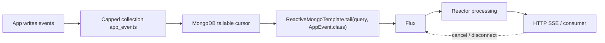
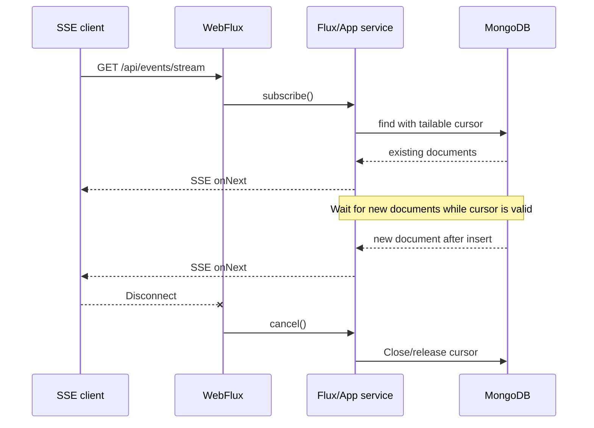

# Reading with `ReactiveMongoTemplate.tail`

> **Chapter:** Tailable cursor  
> **Platform:** Spring Data MongoDB  
> **Objective:** Use `ReactiveMongoTemplate.tail(Query, Class<T>)` to continuously read documents from a **capped collection**, process the `Flux` with Reactor, cancel subscriptions properly, and recognize limitations in real-world systems.

## Learning Objectives

After completing this lesson, you will be able to:

1. Explain why `tail` differs from `find` and when a MongoDB tailable cursor is an appropriate choice.
2. Create and verify a capped collection, and prepare documents so the query does not terminate prematurely.
3. Map documents with Spring Data MongoDB and consume `Flux<T>` from `ReactiveMongoTemplate.tail`.
4. Stream data over HTTP Server-Sent Events (SSE) or consume via `subscribe` with explicit lifecycle management.
5. Analyze scenarios involving closed cursors, overwritten data, non-matching filters, slow subscribers, disconnects, and multiple subscribers.
6. Distinguish tailable cursors from Change Streams, `@Tailable` repositories, and message broker systems.

## 1. How Does a Tailable Cursor Work?

A regular `find` query retrieves a finite result set. Once all data is read, the cursor closes; documents written afterward do **not** automatically appear in the previous query. A tailable cursor behaves similarly to `tail -f` on a log file: after returning existing documents, the cursor keeps its position at the end of the collection and waits for newly written documents.

MongoDB only allows tailable cursors on **capped collections** — size-bounded collections operating like a circular buffer: when full, the oldest documents are replaced to make room for new ones.



Key differences:

| Criterion | `find` / `findAll` | `ReactiveMongoTemplate.tail` |
|---|---|---|
| Stream type | Finite once results are exhausted | Can remain open continuously while valid |
| Collection | Regular or capped | **Must be capped** |
| New documents after query | Not delivered on the same cursor | Can be pushed to subscribers |
| Initial results | Documents matching the query | Can also emit **already existing** documents before waiting for new ones |
| Termination | Completes after reading all results | Cancellation, error, cursor invalidation, or edge conditions |
| Index access | Per query plan | Tailable cursors do not use indexes; read in natural order |
| Spring Data return type | Finite `Flux<T>` | Potentially non-terminating `Flux<T>` |

**Do not equate "tailable" with "only receive new events from the moment we start."** Upon subscribing, the cursor can read existing documents matching the query. Consumer design must account for this initial phase of reading existing data.

MongoDB documentation also notes: if a query relies primarily on an indexed field and requires key-based retrieval, a better approach may be a regular query with a checkpoint filtering for values greater than the last read key. MongoDB tailable cursors do not use indexes.

## 2. When Should You Use It?

Suitable examples:

- Following application logs or short-lived notifications written continuously where **losing older records** when the buffer fills is acceptable.
- Displaying an activity feed in an internal demo without requiring durable replay or strong delivery guarantees.
- Sequentially consuming data from a capped collection with controlled throughput and read speed.

Consider alternative solutions if requirements include:

- **Capturing every change** (insert/update/delete) on regular collections: use **MongoDB Change Streams** and evaluate resume token support and deployment topology.
- **Queues with consumer groups, durable retries, offset tracking, and long-term replay:** use a dedicated event/messaging system when those features are required.
- **Indexed reads, pagination, and large historical queries:** use regular `find` or aggregation queries.
- **Storing data with flexible retention policies:** capped collections do not replace TTL indexes on regular collections in all cases.

MongoDB capped collections do not support sharding and cannot be written to inside transactions; these constraints must be evaluated before business design.

## 3. Prerequisites Before Calling `tail`

### 3.1. Dependency Configuration

In a Spring Boot project using Java 17+, configure the **reactive** MongoDB starter. To stream data via HTTP SSE, add WebFlux:

```xml
<dependencies>
    <dependency>
        <groupId>org.springframework.boot</groupId>
        <artifactId>spring-boot-starter-data-mongodb-reactive</artifactId>
    </dependency>
    <dependency>
        <artifactId>org.springframework.boot</artifactId>
        <artifactId>spring-boot-starter-webflux</artifactId>
    </dependency>
</dependencies>
```

Select versions through your Spring Boot BOM to keep MongoDB Reactive Streams Driver and Spring Data MongoDB aligned. `ReactiveMongoTemplate` requires proper reactive connection configuration; do not assume this bean is always available in an application configured solely for synchronous `MongoTemplate`.

Example development configuration:

```yaml
spring:
  data:
    mongodb:
      uri: mongodb://localhost:27017/spring_tail_demo
```

In production environments, credentials, TLS, connection pools, and URIs should be managed via secure configuration without embedding credentials in source code.

### 3.2. Creating a Capped Collection

You can create it via `mongosh`:

```javascript
use spring_tail_demo

db.createCollection("app_events", {
  capped: true,
  size: 4 * 1024 * 1024,
  max: 20000
});
```

Meaning:

- `capped: true`: size-bounded collection.
- `size`: buffer threshold in bytes, here 4 MiB; not the size of individual documents.
- `max`: additional document-count limit (optional). Byte capacity may be reached before document count.

**If `app_events` already exists as a regular collection, calling `createCollection` again will not convert its type.** In practice exercises, create a dedicated database/collection, verify version-specific behavior, and avoid deleting real data for experiments.

Inspect properties:

```javascript
db.getCollectionInfos({ name: "app_events" });
```

In the output, verify `options.capped` is `true` and confirm the configured size. You can run `db.runCommand({ collStats: "app_events" })` to inspect statistics when needed.

Spring Data MongoDB also supports collection creation via `CollectionOptions`; the following example uses `ReactiveMongoTemplate` in a provisioning flow separate from the read path:

```java
import org.springframework.data.mongodb.core.CollectionOptions;
import org.springframework.data.mongodb.core.ReactiveMongoTemplate;
import reactor.core.publisher.Mono;

Mono<Void> createCappedCollection(ReactiveMongoTemplate mongo) {
    return mongo.createCollection(
        "app_events",
        CollectionOptions.empty().capped().size(4L * 1024 * 1024)
    ).then();
}
```

Invoke creation only if the collection does not exist yet; multi-instance deployments need centralized schema initialization to avoid race conditions and duplicate-name errors. For the remainder of this walkthrough, assume the collection was already created via `mongosh`.

### 3.3. Inserting a Matching Document Before Subscribing

Spring Data warns that a tailable cursor can become **dead/invalid** if the query returns no matching documents when the cursor opens. To reproduce stable behavior in this lesson, seed at least one document matching the filter you plan to use:

```javascript
db.app_events.insertOne({
  tenantId: "demo",
  kind: "ORDER_CREATED",
  payload: "Order #1001",
  createdAt: new Date()
});
```

You can then insert additional documents with the same `tenantId`/`kind` to observe new events. If you change the filter to `kind: "PAYMENT_RECEIVED"` when no matching record exists yet, the stream may terminate immediately upon startup; this is not a WebFlux bug.

## 4. The `ReactiveMongoTemplate.tail` API

In Spring Data MongoDB, the core API is:

```java
<T> Flux<T> tail(Query query, Class<T> entityClass);

<T> Flux<T> tail(Query query, Class<T> entityClass, String collectionName);
```

`query` specifies criteria (and optional field projection); `entityClass` specifies the target type for mapping BSON documents to Java. The three-argument overload specifies the collection name explicitly instead of deriving it from `@Document`.

This is a **reactive API**: creating a `Flux` does not immediately open a cursor or query MongoDB. The driver performs the read operation only upon subscription; each independent subscription normally opens an independent cursor.

### 4.1. Document Mapping

Example using a Java record (Java 17+). You can replace it with a Java class having constructors/getters if the project uses an older Java version.

```java
package example.tail;

import java.time.Instant;
import org.springframework.data.annotation.Id;
import org.springframework.data.mongodb.core.mapping.Document;

@Document("app_events")
public record AppEvent(
    @Id String id,
    String tenantId,
    String kind,
    String payload,
    Instant createdAt
) {}
```

The `@Id` field maps to `_id`, `tenantId` and `kind` are used for filtering, and `payload` holds the display content. The record assumes documents share a matching structure and that your Spring Data MongoDB version supports record mapping.

### 4.2. Continuous-Reading Service

```java
package example.tail;

import org.slf4j.Logger;
import org.slf4j.LoggerFactory;
import org.springframework.data.mongodb.core.ReactiveMongoTemplate;
import org.springframework.data.mongodb.core.query.Criteria;
import org.springframework.data.mongodb.core.query.Query;
import org.springframework.stereotype.Service;
import reactor.core.publisher.Flux;

@Service
public class AppEventTailService {
    private static final Logger log =
        LoggerFactory.getLogger(AppEventTailService.class);

    private final ReactiveMongoTemplate mongo;

    public AppEventTailService(ReactiveMongoTemplate mongo) {
        this.mongo = mongo;
    }

    public Flux<AppEvent> followOrderCreated() {
        Query query = Query.query(
            Criteria.where("tenantId").is("demo")
                    .and("kind").is("ORDER_CREATED")
        );

        return mongo.tail(query, AppEvent.class)
            .doOnSubscribe(s -> log.info("Subscribed to app_events tail"))
            .doOnNext(event -> log.debug("Received event {}", event.id()))
            .doOnError(error -> log.error("Tail failed", error))
            .doFinally(signal -> log.info("Tail ended: {}", signal));
    }
}
```

In this example:

- `mongo.tail(query, AppEvent.class)` returns `Flux<AppEvent>`; no manual `while` loop or `getMore` calls are needed.
- Reactor delivers each newly read document to `onNext`.
- `doOnError` only observes errors; it does not recover from or swallow them. `doFinally` can receive `CANCEL`, `ON_COMPLETE`, or `ON_ERROR` (among other signals).
- The hardcoded `tenantId` filter is for lab demonstration. In multi-tenant applications, **tenant and read permissions must come from server-side authentication**, never trusting arbitrary user-supplied query parameters.
- Filtering does not match the efficiency of indexed queries: MongoDB tailable cursors scan in natural order without using indexes.

You can specify the collection explicitly when `@Document` is not used:

```java
Flux<AppEvent> events = mongo.tail(
    Query.query(Criteria.where("kind").is("ORDER_CREATED")),
    AppEvent.class,
    "app_events"
);
```

### 4.3. Do You Need to Call `subscribe` Manually?

In services returning a `Flux` to other reactive components, **you usually do not call `subscribe()` manually**. WebFlux subscribes to stream data to the client and cancels when the connection closes.

For an active background consumer, you can manage the subscription explicitly:

```java
import reactor.core.Disposable;

Disposable subscription = tailService.followOrderCreated()
    .subscribe(
        event -> process(event),
        error -> log.error("Consumer stopped", error),
        () -> log.info("Consumer completed")
    );

// On application shutdown / worker stop:
subscription.dispose();
```

The snippet above illustrates lifecycle ownership; `process` and `log` belong to the consumer. Never call `subscribe()` per HTTP request and forget to dispose it: each subscription can hold cursor and connection resources. If downstream processing is asynchronous, compose with `flatMap`/`concatMap` and bound concurrency instead of making blocking calls directly on a Reactor thread.

## 5. Streaming Data via SSE with Spring WebFlux

An application streaming activity in real time can return `Flux<ServerSentEvent<AppEvent>>`:

```java
package example.tail;

import org.springframework.http.MediaType;
import org.springframework.http.codec.ServerSentEvent;
import org.springframework.web.bind.annotation.GetMapping;
import org.springframework.web.bind.annotation.RequestMapping;
import org.springframework.web.bind.annotation.RestController;
import reactor.core.publisher.Flux;

@RestController
@RequestMapping("/api/events")
public class AppEventStreamController {
    private final AppEventTailService service;

    public AppEventStreamController(AppEventTailService service) {
        this.service = service;
    }

    @GetMapping(path = "/stream",
                produces = MediaType.TEXT_EVENT_STREAM_VALUE)
    public Flux<ServerSentEvent<AppEvent>> stream() {
        return service.followOrderCreated()
            .map(event -> ServerSentEvent.<AppEvent>builder()
                .id(event.id())
                .event("order-created")
                .data(event)
                .build());
    }
}
```

Here `.id(event.id())` only populates the ID field for **HTTP SSE**. MongoDB tailable cursors **have no Change Streams-style resume token**; a browser sending `Last-Event-ID` will not automatically make this endpoint replay missed events accurately. Supporting ID-based resumption requires designing your own checkpoint and storage layer.

### Manual Testing

1. Create the capped collection and seed an `ORDER_CREATED` document as in Section 3.
2. Start the Spring Boot application; open a terminal and run:

   ```bash
   curl -N http://localhost:8080/api/events/stream
   ```

3. In another `mongosh` session, run:

   ```javascript
   db.app_events.insertOne({
     tenantId: "demo",
     kind: "ORDER_CREATED",
     payload: "Order #1002",
     createdAt: new Date()
   });

   db.app_events.insertOne({
     tenantId: "demo",
     kind: "PAYMENT_RECEIVED",
     payload: "Payment #1002",
     createdAt: new Date()
   });
   ```

4. Observe SSE output: you should see the existing `Order #1001` record followed by `Order #1002`. The `PAYMENT_RECEIVED` record does not match `kind`, so it is excluded from this stream's output.
5. Press `Ctrl+C` to close `curl`. Closing the connection causes WebFlux to cancel the subscription, releasing read resources per the reactive lifecycle.

**For easy observation:** seed a document matching the filter *before* opening SSE; if no matching record exists yet, the cursor may die before receiving the next insert. Processing order across multiple writers should not be treated as a global ordering guarantee.

## 6. `Flux` Lifecycle, Backpressure, and Unsubscription

A tailable cursor can be long-lived. Three key phases must be understood:



- **Cold publisher:** calling `followOrderCreated()` builds the pipeline; each new subscription performs a read. Concurrent clients typically create independent cursors, each potentially receiving existing matching data.
- **Backpressure:** Reactor propagates consumer demand down the reactive chain; it regulates data requests but **does not stop MongoDB from accepting writes**. If writers outpace the consumer and the capped collection wraps past the read position, the cursor can become invalid and data can be missed.
- **Cancel:** when an HTTP client closes its connection, or a consumer calls `Disposable.dispose()`, the subscription is cancelled; confirm via monitoring that driver and application release cursors.
- **onComplete:** under ideal conditions the cursor may stay open long-term, yet it can still complete when a query has no match or the cursor becomes invalid. Never interpret `onComplete` as "the system will definitely never have new events."
- **onError:** MongoDB connectivity issues, non-capped collections, or mapping errors can emit `onError`, requiring logging/monitoring and a recovery policy.

Several Reactor operators can inadvertently terminate tailing:

| Operator | Effect | Guidance |
|---|---|---|
| `.take(10)` | Reads 10 elements then cancels upstream | Use when sampling or in tests |
| `.take(Duration.ofSeconds(30))` | Caps observation window | Suitable for experiments |
| `.collectList()` / `.blockLast()` | Waits for stream completion; may block indefinitely | Do not use to return results of an infinite stream in a synchronous request |
| `.timeout(...)` | Emits error if no data arrives within timeout | Distinguish idle periods from connection errors; consider SSE heartbeats |
| `.publishOn(...)` | Switches processing to an appropriate scheduler | Useful for CPU-bound work; isolate and bound blocking I/O |
| `.share()` | Shares one upstream across multiple subscribers when appropriate | Requires clear data scope, security, and lifecycle rules |

**Avoid unbounded `cache()` on infinite event streams** because memory can grow continuously storing history. If sharing data across many clients is needed, design a bounded fan-out, enforce per-client authorization, and define a reconnection policy.

## 7. Error Handling and Recovery

### 7.1. Situations That Invalidate a Tailable Cursor

Spring Data and MongoDB documentation highlight two main scenarios:

1. **The query matches no documents** when opening the tailable cursor: the stream can terminate early. In labs, seed a matching record; in production, control lifecycle and startup strategy.
2. **The cursor position is overwritten** when the capped collection evicts old documents due to reaching capacity: slow consumers can miss data and must reopen the cursor.

Additional common failures: non-existent or non-capped collection; wrong database; document mapping failure; driver disconnect; subscriber closure; resource limits.

### 7.2. `retryWhen` Does Not Handle All Forms of Termination

Example for errors **emitted via `onError`**:

```java
import java.time.Duration;
import reactor.core.publisher.Flux;
import reactor.util.retry.Retry;

Flux<AppEvent> resilientErrorsOnly = service.followOrderCreated()
    .retryWhen(Retry.backoff(5, Duration.ofSeconds(1)));
```

The snippet caps retries at 5 attempts (with backoff). In production, filter to retry only transient errors and add logging and alerts; configuration errors such as "collection is not capped" must be fixed at the root cause—infinite retries will not help.

`retryWhen` **does not trigger when a Flux finishes with `onComplete`**. You can use `repeatWhen`/`repeatWhenEmpty` or supervisor orchestration to resubscribe after completion, but it must have explicit delays, bounds, and observability: resubscribing opens a new cursor, which may re-read historical documents or miss overwritten ones. Never attach an unbounded `repeat()` on an empty stream, as it creates a tight loop continuously opening cursors.

### 7.3. Checkpointing, Replay, and Consistency

Suppose a consumer reads events A, B, and C, then loses connectivity. The capped collection meanwhile inserts D and E while overwriting A and B. Upon reconnecting, a new cursor **has no resume token**; it cannot guarantee resuming cleanly at D. Storing C's `_id` or timestamp in the application also does not automatically turn the cursor into a reliable resume mechanism, especially with identical timestamps, evicted data, or concurrent writers.

For workflows requiring recovery:

- Design stable event IDs and **idempotent** consumers to handle duplicates.
- Store checkpoints externally and retain durable storage that can be re-queried on gaps; add a catch-up query if needed.
- Collect metrics for outages, processing latency, resubscribe counts, and capped collection overwrite frequency.
- If the problem involves resumable tracking of MongoDB data changes, evaluate `ReactiveMongoTemplate.changeStream(...)` and Change Streams on a supported deployment. Do not conflate Change Streams resume tokens with `tail`.

## 8. Diagnostics and Performance Tuning

### 8.1. Technical Checklist

| Symptom | Possible Cause | Verification / Resolution |
|---|---|---|
| Completes immediately on subscribe | Filter matches no existing documents | Seed a matching record; check `tenantId`, `kind`, and cursor open logic |
| Reports invalid `tailable` error | Collection is not capped | Inspect `getCollectionInfos`; create the collection properly |
| New records do not appear | Wrong database/collection or mismatched filter | Check URI, insert logs, run a regular `find` with the same filter |
| Receives old documents too | Tailable cursor reads existing records at startup | Design initialization behavior; do not assume post-subscription-only delivery |
| Running stream stops | Cursor invalidated by rollover, connection error, or client cancel | Log `doFinally`/`doOnError`; check MongoDB metrics and read/write rates |
| Multiple SSE clients increase load | Each subscription opens its own cursor | Measure cursor/connection count; limit clients and consider fan-out |
| Consumer lags or loses events | Slow downstream, too small capped size, fast writers | Intentionally increase buffer, optimize handling, add durable storage if required |
| High CPU when filtering | Tailable cursor does not use indexes, scans in natural order | Simplify filters or choose a different query model |
| HTTP stream closed by proxy | Idle timeout without data | Configure timeouts appropriately; consider SSE heartbeats |

### 8.2. Metrics to Monitor

- **Open cursor count** and number of connections/HTTP clients, segmented by stream and tenant.
- **Frequency of onError, onComplete, cancel, resubscribe**; especially unexpected stream stops.
- **Elapsed time from `createdAt` to consumer receipt**; watch out for clock skew between writers and consumers.
- **Insert rate, processing rate, capped collection size**, and signs of overwrite/eviction.
- **Resource limits**: CPU, heap, buffers, downstream subscriber count, proxy timeouts.

A capped collection is finite in size; increasing `size` extends how long data stays in the buffer but does not turn it into an infinite durable log. Size capacity based on peak throughput, average document size, and maximum tolerable consumer outage.

## 9. Comparison with Related APIs

| Tool | Source Type | Spring Data API | Use Case |
|---|---|---|---|
| Reactive tailable cursor | Capped collection; emits documents in natural read order | `ReactiveMongoTemplate.tail(...)` | Tailing short-lived logs/journals, simple streams |
| Reactive repository tailable | Capped collection | `@Tailable` + `Flux<T>` in `ReactiveMongoRepository` | Declarative tailable queries in repositories |
| MongoDB Change Streams | MongoDB change events on supported deployments | `ReactiveMongoTemplate.changeStream(...)` | Tracking inserts/updates/deletes; supports resume tokens |
| Reactive `find` | Regular collection | `ReactiveMongoTemplate.find(...)` | Finite queries with indexes and rich predicates |
| Message broker | Topics/queues with dedicated storage and delivery semantics | Corresponding adapter/reactive client | Consumer groups, retries, replay, high load, delivery guarantees |

A repository can be written as:

```java
import org.springframework.data.mongodb.repository.ReactiveMongoRepository;
import org.springframework.data.mongodb.repository.Tailable;
import reactor.core.publisher.Flux;

public interface AppEventRepository
        extends ReactiveMongoRepository<AppEvent, String> {

    @Tailable
    Flux<AppEvent> findByKind(String kind);
}
```

Choose `ReactiveMongoTemplate.tail` when you need to construct dynamic `Query` objects and control criteria in the service layer. `@Tailable` is concise for fixed repository queries. Regardless of API choice, the capped collection requirement and tailable cursor limitations **remain unchanged**.

## 10. Verified Hands-On Exercises

**Exercise A — Basic stream.** Create a capped `app_events` collection, seed an `ORDER_CREATED` document, open `curl -N`, and insert two more matching events. Verify you receive both the initial document and the new events; a `PAYMENT_RECEIVED` event must be filtered out.

**Exercise B — Cancel and cleanup.** Open an SSE client and observe the `Subscribed` log; close the client, verify `doFinally` logs `cancel`, and confirm cursor count returns to normal. Open two clients concurrently and explain why cursor count may increase.

**Exercise C — Non-matching query.** Change the filter to `kind=UNKNOWN_KIND` when no such document exists in the collection; observe `onComplete`/cursor behavior. Explain why `retryWhen` alone is insufficient to auto-recover the stream.

**Exercise D — Capped rollover.** In a test database, configure a small collection size and write enough documents to force eviction. Introduce an intentionally slow consumer and record when the cursor stops or loses data. Propose ways to detect, alert on, and handle duplicates/gaps upon reopening.

**Exercise E — Technology selection.** For requirements (i) a log dashboard needing no replay, (ii) syncing all mutations with resume capability, and (iii) payment processing requiring durable delivery, choose among `tail`, Change Streams, or a message broker and explain the constraints.

### Self-Check Questions

1. Why does `tail` require a capped collection, and why can't it be used directly on a regular collection?
2. Does `Flux<AppEvent>` begin executing when building the pipeline or when a subscription is created?
3. What happens when you call `.take(5)` on `tail(...)`?
4. Why can documents inserted before opening an SSE connection still appear?
5. How does the difference between `onError` and `onComplete` affect `retryWhen`?
6. Why does backpressure not guarantee zero lost events when a capped collection fills up?
7. When should you switch to Change Streams or an event-queuing system?

## References

- [Spring Data MongoDB — Tailable Cursors](https://docs.spring.io/spring-data/mongodb/reference/mongodb/tailable-cursors.html)
- [Spring Data MongoDB — ReactiveMongoTemplate API](https://docs.spring.io/spring-data/mongodb/reference/api/java/org/springframework/data/mongodb/core/ReactiveMongoTemplate.html)
- [MongoDB Manual — Tailable Cursors](https://www.mongodb.com/docs/manual/core/tailable-cursors/)
- [MongoDB Manual — Capped Collections](https://www.mongodb.com/docs/manual/core/capped-collections/)
- [MongoDB Manual — `cursor.tailable()`](https://www.mongodb.com/docs/manual/reference/method/cursor.tailable/)
- [Reactor Core — Reference Guide](https://projectreactor.io/docs/core/release/reference/)
