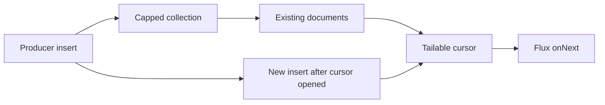

# @Tailable on ReactiveMongoRepository Methods

**Spring Data MongoDB** supports reactive repository methods that return a stream of documents newly inserted into a **capped collection**. When you annotate a `ReactiveMongoRepository` method with `@Tailable` and declare a `Flux<T>` return type, Spring Data opens a MongoDB **tailable cursor**, which can continue reading data after existing documents are consumed. This is a way to follow an append-only log or feed, similar to the Unix `tail -f` command.

This lesson belongs to the **Tailable cursor** chapter of the `SPRING_DATA_MONGODB` module. The module covers connectivity, document mapping, operations via `MongoTemplate`/repositories, querying, aggregation, indexing, transactions, reactive access, testing, and data performance diagnostics. The specific topic here is **`@Tailable` on `ReactiveMongoRepository` methods**, from MongoDB configuration and entity/repository definitions to subscriptions, error handling, testing, and operations.

> **Important:** `@Tailable` **does not create a capped collection**, **has no resume token**, and **does not guarantee the stream lives forever**. A capped collection retains only finite history; a tailable cursor can die if the initial query has no match or if the read position is overwritten. Tailable cursors can be used on standalone MongoDB and do not require a replica set like change streams do.

## 1. Learning Objectives

After this lesson, you will be able to:

1. Distinguish a regular cursor from a tailable cursor.
2. Explain why a **capped collection** must be used.
3. Create a capped collection with `size` in bytes and an optional `max`.
4. Verify a collection is capped rather than relying only on `@Document`.
5. Understand natural order, collection scans, and why tailable cursors do not use indexes.
6. Understand `tailable`, `awaitData`, `getMore`, and empty batches.
7. Identify causes of invalid/dead cursors when queries do not match or data is overwritten.
8. Define `@Tailable Flux<Entity>` on a `ReactiveMongoRepository`.
9. Use derived queries, `@Query`, and named parameters safely.
10. Avoid using `Mono`/`List` for infinite streams.
11. Distinguish `@Tailable` from `ReactiveMongoTemplate.tail` and change streams.
12. Organize producers/consumers with Reactor without hidden `subscribe()` calls.
13. Control subscriptions, cancellation, retries, and backpressure.
14. Build a WebFlux/SSE endpoint with tenant authorization.
15. Understand why multiple subscribers can open multiple cursors.
16. Design tests using a seed event, `take(2)`, and `StepVerifier`.
17. Distinguish standalone MongoDB testing from replica set testing.
18. Understand capped limits: no sharding, no transaction writes, no durable replay.
19. Evaluate sensitive data warnings, retention, and overload conditions.
20. Know when to switch to change streams or a message broker.

## 2. Regular Cursors vs. Tailable Cursors

With a regular query, once MongoDB returns all existing documents, the cursor closes and the `Flux` emits `onComplete`. Inserting a document afterward **does not deliver additional data to the old subscription**.

A tailable cursor on a capped collection keeps tracking the end of the collection so it can continue receiving newly inserted documents:



| Aspect | Regular query cursor | Tailable cursor |
| --- | --- | --- |
| Collection | Regular or capped | **Capped only** |
| Once results are exhausted | Completes | Can keep waiting |
| Index | Query planner may use indexes | **Does not use indexes** |
| Ordering | Query/sort plan | Natural order |
| Receives subsequent inserts | Not after completion | Yes, while cursor remains alive |
| Resume token | No | No |
| Durability | Query result at invocation time | Not durable delivery |
| Termination | Finite | Can complete, error, or cancel |

### 2.1. Infinite Stream Does Not Mean Immortal

Spring Data docs describe these `Flux` streams as **infinite streams** by design, yet both MongoDB and the `@Tailable` Javadoc warn that a cursor can die: if the query finds no matches, the read position is overwritten, the connection drops, or the subscription is cancelled. Never assume `onComplete` is an event that can never happen.

### 2.2. Cursors Can Read Old Data First

When subscribing to a capped collection that already contains documents, the cursor can emit **existing documents** before continuing to watch for new inserts. `@Tailable` has no `fromNow` attribute or durable consumer-group offset like a message broker.

## 3. What Is a Capped Collection?

A capped collection is a collection with **fixed capacity** that behaves like a circular buffer: when full, MongoDB gradually evicts the oldest documents to make room for new inserts. It is suited for append-only feeds and short-term history.

```javascript
use reactive_feed_demo

db.createCollection("app_event_feed", {
  capped: true,
  size: 8 * 1024 * 1024,
  max: 10000
})
```

`size` is the limit in **bytes** (8 MiB in this example); `max` is an **optional** document count limit. The byte size can fill up before reaching 10,000 records, so there is no promise that the collection always retains 10,000 records.

### 3.1. Verifying It Is Capped

```javascript
const collections = db.getCollectionInfos({
  name: "app_event_feed"
})

printjson(collections.map(c => ({
  name: c.name,
  capped: c.options.capped,
  size: c.options.size,
  max: c.options.max
})))
```

An existing regular collection **does not automatically become capped** simply because you add `@Tailable` or `@Document`. Check metadata before subscribing.

### 3.2. Limitations of Capped Collections

- **Cannot shard** a capped collection.
- **Cannot write** to a capped collection inside a multi-document transaction.
- `$out` cannot write results into a capped collection.
- Capped collections are not part of MongoDB Stable API V1; check client Stable API strict configuration.
- Avoid updates that grow document size; design as append-only.
- Avoid arbitrary deletes, and do not use capped collections as ACK/delete-per-item queues.
- Reading from a tailable cursor performs a collection scan and is not index-optimized like a regular query.
- When producers write faster than readers can keep up, old data is evicted and the cursor may become invalid.

### 3.3. Comparison with TTL Indexes

Regular collections paired with a TTL index are well suited for time-based retention, but **do not** support tailable cursors. Conversely, capped collections bound byte capacity rather than guaranteeing data is kept for X minutes. Choose the tool to match requirements instead of treating the two mechanisms as equivalent.

## 4. Creating a Capped Collection with Spring Data

`ReactiveMongoTemplate` provides a `createCollection` API accepting `CollectionOptions`:

```java
import org.springframework.data.mongodb.core.CollectionOptions;
import reactor.core.publisher.Mono;

Mono<Void> create = reactiveMongoTemplate
    .createCollection(
        "app_event_feed",
        CollectionOptions.empty()
            .capped()
            .size(8L * 1024 * 1024))
    .then();
```

`reactiveMongoTemplate` is an injected bean. Because this returns a reactive Publisher, the command runs only when **subscribed**. Execute this via controlled **migration, application bootstrap, or test fixtures**, not on every HTTP request.

### 4.1. What If the Collection Already Exists?

`createCollection` can fail if the namespace already exists. Do not swallow all errors and claim the collection is valid; an existing regular collection **remains invalid** for tailable cursors. Plan migrations to handle existing data, permissions, and rollover. Never call `dropCollection` directly in production to work around this error.

### 4.2. Creating with Imperative MongoTemplate

If the application has a `MongoTemplate` bean:

```java
mongoTemplate.createCollection(
    "app_event_feed",
    CollectionOptions.empty()
        .capped()
        .size(8L * 1024 * 1024)
);
```

This is a synchronous provisioning operation; repository code in this lesson still uses the reactive driver at runtime.

## 5. Dependencies and MongoDB Topology

In Spring Boot, use the reactive MongoDB starter:

```groovy
dependencies {
    implementation "org.springframework.boot:spring-boot-starter-data-mongodb-reactive"
    implementation "org.springframework.boot:spring-boot-starter-webflux"
    implementation "org.springframework.boot:spring-boot-starter-security"
    testImplementation "org.springframework.boot:spring-boot-starter-test"
    testImplementation "io.projectreactor:reactor-test"
}
```

The Spring Boot BOM should manage compatible versions of Spring Data MongoDB, Project Reactor, and the MongoDB Reactive Streams Driver.

### 5.1. Is a Replica Set Required?

**No**. A tailable cursor on a capped collection can run on standalone MongoDB, a replica set, or any topology supporting that collection. This differs from MongoDB **change streams**, which require a replica set or sharded cluster.

However, a **capped collection cannot be sharded**, so if your application requires a sharded event feed, do not use `@Tailable` as a sharded queue strategy.

### 5.2. Connection String Only Configures Connectivity

Spring Boot 3.x example:

```yaml
spring:
  data:
    mongodb:
      uri: mongodb://localhost:27017/reactive_feed_demo
```

Verify the property namespace against your Spring Boot major version. The URI does not create capped collections, does not turn queries into tailable ones, and does not grant read/write privileges.

## 6. Sample Domain Entity

Suppose the event feed stores append-only records:

```java
package dev.learning.feed;

import java.time.Instant;
import org.springframework.data.annotation.Id;
import org.springframework.data.mongodb.core.mapping.Document;

@Document("app_event_feed")
public record FeedEvent(
    @Id String id,
    String tenantId,
    String channel,
    String kind,
    String message,
    Instant createdAt
) {}
```

Java records work on Spring Data/Java versions supporting constructor mapping. If older Java compatibility is needed, use a class with valid constructors/properties.

### 6.1. @Document Is Not @Capped

`@Document("app_event_feed")` declares the collection name for mapping; it **does not** create `capped: true` storage options. Spring Data has no standard `@Capped` repository annotation that replaces MongoDB migrations.

### 6.2. Why Does the Entity Have No Acknowledged Flag?

A capped collection is not an ACK-based queue. Updating per-item status does not fit append-oriented storage, and capped collections restrict updates and deletes. If you need per-consumer offsets, durability, retries, or backfill, pick an appropriate broker or event store.

## 7. Defining @Tailable on ReactiveMongoRepository

```java
package dev.learning.feed;

import org.springframework.data.mongodb.repository.ReactiveMongoRepository;
import org.springframework.data.mongodb.repository.Tailable;
import reactor.core.publisher.Flux;

public interface FeedEventRepository
        extends ReactiveMongoRepository<FeedEvent, String> {

    @Tailable
    Flux<FeedEvent> findByChannel(String channel);
}
```

Meaning:

1. `ReactiveMongoRepository<FeedEvent,String>` is the reactive repository for the entity.
2. `findByChannel` is translated by Spring Data into a query on the `channel` field.
3. `@Tailable` causes the query to use a tailable cursor.
4. `Flux<FeedEvent>` represents a stream that can emit **multiple** documents.
5. The `app_event_feed` collection must be created as **capped beforehand**.
6. MongoDB executes the operation when the Publisher is subscribed to, not simply when calling the Java method.
7. Callers must handle `onNext`, `onError`, `onComplete`, and `cancel`.

### 7.1. Exact Import

```java
import org.springframework.data.mongodb.repository.Tailable;
```

The annotation is placed **on the method** (`Target: METHOD, ANNOTATION_TYPE`), not on the entity. It has been available since Spring Data MongoDB 2.0.

### 7.2. Do Not Use Mono as the Return Type

```java
// INAPPROPRIATE: Mono holds at most one item.
@Tailable
Mono<FeedEvent> findFirstByChannel(String channel);
```

The `@Tailable` Javadoc states that a reactive type capable of emitting **multiple elements**, such as `Flux`, must be used. If you need to read one current record, use `Mono`/`findFirst...` **without** `@Tailable`.

### 7.3. @Query Can Be Used

```java
import org.springframework.data.mongodb.repository.Query;

@Tailable
@Query("{ 'channel': ?0, 'tenantId': ?1 }")
Flux<FeedEvent> tailForTenant(
    String channel, String tenantId);
```

Place this method in the same repository interface. `?0` and `?1` are Spring Data query parameter bindings; `tenantId` must originate from the security context or trusted service identity.

## 8. Writing Events via Repository

```java
package dev.learning.feed;

import java.time.Clock;
import java.time.Instant;
import java.util.UUID;
import org.springframework.stereotype.Service;
import reactor.core.publisher.Mono;

@Service
public class FeedPublisher {

    private final FeedEventRepository repository;
    private final Clock clock;

    public FeedPublisher(FeedEventRepository repository, Clock clock) {
        this.repository = repository;
        this.clock = clock;
    }

    public Mono<FeedEvent> publish(
            String trustedTenantId,
            String channel,
            String kind,
            String safeMessage) {

        FeedEvent event = new FeedEvent(
            UUID.randomUUID().toString(),
            trustedTenantId, channel, kind,
            safeMessage, Instant.now(clock));

        return repository.insert(event);
    }
}
```

`Clock` is provided via Spring configuration (e.g., `Clock.systemUTC()`), or instantiated in the service per policy. If injecting `Clock` as shown, declare a dedicated bean:

```java
import java.time.Clock;
import org.springframework.context.annotation.Bean;
import org.springframework.context.annotation.Configuration;

@Configuration
public class FeedClockConfiguration {
    @Bean
    Clock clock() {
        return Clock.systemUTC();
    }
}
```

The Security starter in the Gradle example is needed when using `@AuthenticationPrincipal` in an SSE controller; you must still configure application authentication and authorization rather than just adding the dependency.

- Use `insert` for append-only events. `save` implies insert/update and might attempt to modify an existing record.
- `Mono<FeedEvent>` must be returned/composed so insert errors propagate.
- **Never write to a capped collection inside a transaction**: MongoDB does not support transactional writes to capped collections.
- Do not call `repository.insert(event).subscribe()` inside a service and return `Mono.empty()`: that is fire-and-forget and makes outcome tracking difficult.

### 8.1. Need to Sync Events with Another Transaction?

If payment processing updates orders inside a transaction and must publish events atomically, you cannot include a write to a capped collection in that same transaction. Consider a **transactional outbox** in a regular collection, then relay events to the capped feed or message bus with retries and idempotency.

## 9. Consumers Return Flux Instead of Hidden Subscriptions

```java
package dev.learning.feed;

import org.springframework.stereotype.Service;
import reactor.core.publisher.Flux;

@Service
public class FeedTailService {

    private final FeedEventRepository repository;

    public FeedTailService(FeedEventRepository repository) {
        this.repository = repository;
    }

    public Flux<FeedEvent> follow(
            String authorizedTenantId, String channel) {

        if (authorizedTenantId == null
                || authorizedTenantId.isBlank()
                || channel == null || channel.isBlank()) {
            return Flux.error(new IllegalArgumentException(
                "Invalid tenant or channel"));
        }

        return repository.tailForTenant(
            channel, authorizedTenantId);
    }
}
```

The stream is a Publisher subscribed to by the framework or client at the application boundary. **Do not** call `subscribe()` inside the service without a clear lifecycle owner. Remember that a `tenantId + channel` query with no initial match **can complete before a new event arrives**; this is explained in the next section.

## 10. Biggest Pitfall: No Matching Document at Startup

According to the Spring Data MongoDB Reference and `@Tailable` Javadoc, **a tailable cursor can die if the query finds no matching records**.

Example:

```text
T0: capped collection only has channel=billing
T1: subscriber calls findByChannel("shipping")
T2: query has no initial match -> cursor may complete/become invalid
T3: producer later inserts channel=shipping
T4: old subscription does not receive the event at T3
```

Therefore, `@Tailable` cannot be treated as a permanently active event subscription for every filter. The more selective the query is by tenant/channel, the higher the chance of **no initial match**.

### 10.1. Seeding in Demos and Tests

Before subscribing, insert an event matching the filter:

```java
FeedEvent seed = new FeedEvent(
    "SEED-" + java.util.UUID.randomUUID(),
    "tenant-a",
    "billing",
    "SEED",
    "stream ready",
    java.time.Instant.now());

Mono<FeedEvent> seedWrite = repository.insert(seed);
```

In tests, **wait for `seedWrite` to finish** before opening the tailable Flux. Seeding stabilizes demos/tests but does not prevent production consumers from dying: once the capped collection fills, older history is evicted.

### 10.2. Server-Side Filter vs. Reactor Filter

A `@Tailable @Query` filters `tenantId` on the server:

```java
Flux<FeedEvent> scope =
    repository.tailForTenant("billing", "tenant-a");
```

This restricts data by predicate, though it can hit **no initial match**. Conversely, tailing the entire collection and calling `Flux.filter(...)` reads events for all tenants; that incurs higher overhead and data-access risks. **Do not** casually drop a tenant predicate just to keep a cursor alive.

### 10.3. Design Options When Subscribers Must Always Be Ready

- In a single-channel demo, seed a record early.
- In systems with few channels, a heartbeat/marker can maintain an initial match, though it still does not solve overwrites or replay.
- With many dynamic tenants/channels, consider **change streams** on a regular collection or an event broker with durable offsets.
- If still using tailable cursors, handle completion/errors, reopen with backoff, deduplicate, and reconcile. Resubscribing **has no resume token**, risking missed or duplicate events.

## 11. Invalid Cursors When Data Is Overwritten

A capped collection is a circular buffer. MongoDB warns that **the cursor position can be overwritten** when producers write faster than consumers read.

```text
Producer: e100 -> e101 -> ... -> e9000
Consumer: e100 -> e101 -> e102 (reading too slowly)
Capped collection fills -> old records are evicted
Cursor points to lost position -> cursor may become invalid
```

### 11.1. Capacity Is the History Limit

Rough estimate:

\[
\text{bytesNeeded} \approx
\text{eventsPerSecond} \times
\text{averageEventBytes} \times
\text{retentionSeconds}
\]

At 100 events/second, 1 KiB average per event, and a target retention of 600 seconds, raw payload is roughly **60 MiB** before overhead/variance. Capped size still **does not guarantee time-based retention**, so measure ingest rate and monitor carefully.

### 11.2. Natural Order Is Not Strict Global Order

MongoDB notes that with **multiple concurrent writers**, capped collections do not guarantee documents are returned in the exact insert order you might infer from timestamps. If strict ordering across multiple producers is required, enforce a sequence/partition contract or use a broker with explicit ordering semantics.

## 12. awaitData and getMore

MongoDB tailable cursors have two key flags:

- `tailable: true` keeps the cursor able to read more after exhausting current data.
- `awaitData: true` lets a `getMore` call wait for a period before returning.
- `maxAwaitTimeMS` bounds how long the server waits on **one `getMore` call**, not the entire cursor lifetime.

`mongosh` example:

```javascript
const cursor = db.app_event_feed.find({
  channel: "billing"
})
.tailable({ awaitData: true })
.maxAwaitTimeMS(1000);

// Example inspection in a dev terminal:
while (cursor.hasNext()) {
  printjson(cursor.next())
}
```

Use this loop only after seeding and when testing against a dev database. Never run a blocking loop like this on an HTTP request thread.

### 12.1. An Empty Batch Is Not onComplete

The MongoDB Driver Specification states that `getMore` can return an empty `nextBatch` for `tailable+awaitData` while the cursor remains active. The driver and Spring Data must not treat an empty batch as end-of-stream while the server still holds an open cursor.

### 12.2. Timeout Differs from Waiting for New Events

`maxAwaitTimeMS(1000)` tells the server to wait up to roughly 1 second per `getMore`. It does not mean the stream should close after one second of silence. Reactor's `Flux.timeout(Duration)` **cancels the stream** when no event arrives, and must be used intentionally.

### 12.3. @Tailable Does Not Expose All Driver Options

`@Tailable` is only a query-method declaration. If you need low-level cursor options absent from the repository API, inspect `ReactiveMongoTemplate.tail` or the Reactive Streams Driver for your Spring Data version. Do not invent nonexistent attributes on the annotation.

## 13. Subscriptions and Cancellation

`Flux<FeedEvent>` is a lazy Publisher. Creating it **does not** open a cursor:

```java
Flux<FeedEvent> stream =
    repository.findByChannel("billing");

// No subscriber yet; query has not executed.
```

For a **background worker** actively managing its subscription:

```java
import reactor.core.Disposable;

Disposable handle = repository.findByChannel("billing")
    .doOnNext(this::handleEvent)
    .doOnError(this::recordFailure)
    .doFinally(signal -> recordStop(signal))
    .subscribe();

// Close the stream on shutdown:
handle.dispose();
```

`handleEvent`, `recordFailure`, and `recordStop` are application-provided methods. In production, store `handle` inside a Spring-managed lifecycle owner with error and reconnect policies. Never create a local `Disposable` and forget to call `dispose()`.

### 13.1. Hidden Subscribe Is an Anti-Pattern

```java
public Flux<FeedEvent> wrong() {
    repository.findByChannel("billing")
        .subscribe(event -> logEvent(event));
    return Flux.empty();
}
```

This creates a hidden subscription whose cancellation and errors the caller cannot manage. Services should normally **return a `Flux`** and let WebFlux or a background component with clear lifecycle ownership subscribe.

### 13.2. Two Subscribers Can Open Two Cursors

```java
Flux<FeedEvent> events =
    repository.findByChannel("billing");

Disposable a = events.subscribe(this::handleA);
Disposable b = events.subscribe(this::handleB);
```

Two subscriptions normally open **two separate MongoDB tailable cursors**, potentially reading the same data. Tailable cursors have no consumer group to partition events and no independent per-subscriber ACKs or offsets.

### 13.3. Distinguishing Terminal Signals

| Signal | Meaning | Action Needed |
| --- | --- | --- |
| `onNext` | A new/existing document was emitted | Process quickly and safely |
| `onComplete` | Cursor stopped emitting | Evaluate dead/no-match cursor vs. intentional `take` |
| `onError` | Driver/mapping/connection/query error | Classify, record metrics, retry if appropriate |
| `cancel` | Downstream stopped actively | Release cursor and resources |

`doFinally` is suited for updating metrics on complete/error/cancel. Never interpret a tailable cursor's `onComplete` as "received all history forever."

## 14. Retry/Resubscribe and Their Limits

Example retry for transient **`onError`**:

```java
import java.time.Duration;
import reactor.util.retry.Retry;

Flux<FeedEvent> resilient = repository
    .findByChannel("billing")
    .doOnError(this::reportFailure)
    .retryWhen(
        Retry.backoff(3, Duration.ofSeconds(1))
            .maxBackoff(Duration.ofSeconds(10))
    );
```

- `retryWhen` only handles **`onError`**; it does not recover from `onComplete` on a dead cursor.
- Re-running the query starts fresh under new cursor semantics, **with no resume token**.
- You may receive **duplicate** old documents or **miss** documents already overwritten by the capped buffer.
- Permanent errors (non-capped collection, unauthorized, invalid query) cannot be fixed by retrying.

### 14.1. repeatWhen Does Not Provide a Replay Guarantee

`repeatWhen` can resubscribe after completion, but each new cursor starts from currently available results rather than an old server-saved position. If business rules demand guaranteed event delivery, you need a durable watermark/event store, reconciliation, or a broker.

### 14.2. Never Swallow All Errors into Flux.empty

```java
Flux<FeedEvent> unsafe =
    repository.findByChannel("billing")
        .onErrorResume(error -> Flux.empty());
```

This hides failures and lets upstream complete silently. For important event sync, report DEGRADED health, alert, and execute a recovery plan.

## 15. Reactor Operators to Avoid on Infinite Streams

A tailable `Flux` may never complete while the cursor is healthy and producers keep writing. Evaluate operators by their **terminal behavior**.

| Operator | Risk / Behavior | Recommendation |
| --- | --- | --- |
| `collectList()` | Accumulates until source completes; unbounded RAM growth | Do not use on long-lived streams |
| `last()` | Waits for final element on completion | Unsuitable for tailable |
| `count()` | Waits for entire stream to complete | Use a separate stats query |
| `blockLast()` | Can block thread indefinitely | Avoid in reactive services |
| `take(2)` | Consumes two items then cancels upstream | Useful in tests/demos |
| `next()` | Takes one item then cancels | Only when genuinely wanting one event |
| `timeout(Duration)` | Emits `TimeoutException`/cancels if no event arrives within duration | Only per explicit inactivity policy |
| `limitRate(n)` | Throttles Reactor demand | Does not change capped retention |
| `onBackpressureBuffer` | Can consume massive RAM if unbounded | Use bounded only, with metrics |
| `concatMap` | Serial processing of inner publishers | Good for ordering, but monitor lag |
| `flatMap(f,n)` | Processes up to `n` events concurrently | Does not preserve natural completion order |

### 15.1. Silence Does Not Mean a Broken Stream

A channel with no events for 10 minutes can be completely normal. Using `Flux.timeout(Duration.ofSeconds(30))` can cancel a healthy cursor merely because **no data arrived**, not because the connection dropped. Monitor driver/cursor health and intentional heartbeats instead of treating silence as failure by default.

### 15.2. Do Not Assume Backpressure Throttles MongoDB Producers

Subscriber demand regulates reading from the cursor, **but never blocks other services from inserting into the capped collection**. Old records are still overwritten once the buffer fills. That is a crucial distinction between Reactor flow control and durable storage/retention.

## 16. Integrating WebFlux and Server-Sent Events

One way to expose a feed is returning `Flux<ServerSentEvent<FeedEvent>>`:

```java
package dev.learning.feed;

import org.springframework.http.MediaType;
import org.springframework.http.codec.ServerSentEvent;
import org.springframework.security.core.annotation.AuthenticationPrincipal;
import org.springframework.web.bind.annotation.GetMapping;
import org.springframework.web.bind.annotation.RequestMapping;
import org.springframework.web.bind.annotation.RequestParam;
import org.springframework.web.bind.annotation.RestController;
import reactor.core.publisher.Flux;

@RestController
@RequestMapping("/api/feed")
public class FeedSseController {

    private final FeedTailService service;

    public FeedSseController(FeedTailService service) {
        this.service = service;
    }

    @GetMapping(
        value = "/stream",
        produces = MediaType.TEXT_EVENT_STREAM_VALUE
    )
    public Flux<ServerSentEvent<FeedEvent>> stream(
            @AuthenticationPrincipal(expression = "tenantId")
            String tenantId,
            @RequestParam String channel) {

        return service.follow(tenantId, channel)
            .map(event -> ServerSentEvent
                .<FeedEvent>builder(event)
                .event("feed")
                .id(event.id())
                .build());
    }
}
```

This assumes the Spring Security principal exposes a `tenantId` property/getter and the controller requires authentication. Configure real security/authorization and validate `channel`. **Never accept an arbitrary `tenantId` from a request query parameter.**

### 16.1. SSE ID Differs from MongoDB Resume Token

`ServerSentEvent.id(event.id())` creates an application-defined SSE event ID. Tailable cursors **provide no MongoDB resume token**. A browser may send `Last-Event-ID` on reconnect, but the application must implement its own watermark/replay/reconciliation; `@Tailable` alone cannot provide exactly-once delivery.

### 16.2. HTTP Disconnect and Cancel

WebFlux generally propagates cancellation when a client closes an SSE connection. Test and monitor active cursors/subscribers to ensure no hidden subscriptions leak. Returning a `Flux` to the framework gives clearer lifecycle control than calling `subscribe()` manually inside a service.

### 16.3. Each SSE Connection Can Cost One Cursor

If 1,000 clients subscribe directly to the repository method, the system can open roughly 1,000 tailable cursors, raising connection/`getMore` and MongoDB scan costs. For high traffic, consider **one managed consumer** fanning out filtered and authorized events, or an event bus with consumer groups.

## 17. Backpressure, Throughput, and Memory

Because capped collections have fixed capacity, backpressure **does not protect** against continuous producer writes.

```text
Producer: 5000 events/s
   |
   v
Capped collection: 8 MiB
   |
   v
Consumer: handles only 50 events/s
   |
   +--> lag grows and old data is evicted
   +--> cursor may lose its position
   +--> no resume token for clean replay
```

### 17.1. Bounded Concurrency and Ordering

If each event calls an external API:

```java
Flux<ProcessingResult> pipeline = repository
    .findByChannel("billing")
    .flatMap(event -> process(event), 4);
```

`process` is an application reactive method. `flatMap` with concurrency 4 increases throughput but **does not guarantee completion order**. When order matters:

```java
Flux<ProcessingResult> ordered = repository
    .findByChannel("billing")
    .concatMap(event -> process(event));
```

`concatMap` processes serially, which can cause the consumer to lag behind the producer; measure lag and size the architecture to sustain load.

### 17.2. Avoid Blocking on the Event Loop

Never call `Thread.sleep()` or blocking JDBC/driver APIs directly inside `map`. Switch to non-blocking clients, or isolate unavoidable blocking work onto `Schedulers.boundedElastic()`. Adding threads **cannot recover** overwritten documents.

### 17.3. Avoid Unbounded Buffers

Unbounded `onBackpressureBuffer()` can trigger `OutOfMemoryError`. If using a bounded buffer, define drop/fail policies, collect metrics, and explicitly decide whether event loss is tolerable. For business events that must not be lost, use a system with durable retention and ACKs.

## 18. Low-Level Alternative: ReactiveMongoTemplate.tail

`@Tailable` is convenient on repositories, and Spring Data also provides the reactive template:

```java
import org.springframework.data.mongodb.core.ReactiveMongoTemplate;
import org.springframework.data.mongodb.core.query.Criteria;
import org.springframework.data.mongodb.core.query.Query;
import reactor.core.publisher.Flux;

Query query = Query.query(
    Criteria.where("channel").is("billing"));

Flux<FeedEvent> events =
    reactiveMongoTemplate.tail(query, FeedEvent.class);
```

`ReactiveMongoTemplate.tail(Query, Class)` lets code build dynamic `Query` instances without creating separate repository methods for every filter. Still, it carries **the exact same requirements for capped collections, no-match handling, cursor invalidation, cancellation, and resources**; the template does not turn a tailable cursor into a change stream.

### 18.1. How Does Repository @Tailable Differ from Template tail?

| Usage | Strengths | Common Risks |
| --- | --- | --- |
| `@Tailable Flux<T> findBy...` | Declarative, concise, typed mapping | No-match, capped overwrite |
| `@Tailable @Query(...)` | Explicit query, bound parameters | No-match, query security |
| `ReactiveMongoTemplate.tail(query,T.class)` | Flexible query builder, easy reuse | Still a tailable cursor |
| Raw reactive Driver `find` + cursor options | Lower-level control than framework | More lifecycle/driver boilerplate |

### 18.2. Do Not Confuse with Imperative MongoTemplate

Spring Data offers `TailableCursorRequest`/`DefaultMessageListenerContainer` for the imperative API. That involves long-running blocking tasks and executor/lifecycle management. For WebFlux/reactive applications, Spring Data recommends the reactive variant because it uses fewer resources across many streams.

## 19. Capped Collections Lack Transaction Writes, Sharding, or Durable ACKs

Several misconceptions to clear up:

| Property | Tailable cursor | Change streams |
| --- | --- | --- |
| Requires capped collection | **Yes** | No, uses regular collections |
| Runs on standalone MongoDB | **Yes** | **No** |
| Requires replica set/sharded cluster | Not required | **Yes** |
| Emits content on insert | Yes, from capped collection | Yes, event envelope |
| Tracks updates/deletes on regular collection | No | Yes |
| Official resume token | **No** | Yes, within oplog window |
| Exactly-once delivery | No | Does not auto-guarantee exactly-once side effects |
| Capped supports sharding | **No** | Change streams can watch sharded collections |
| Write capped inside transaction | **Not supported** | Writes to regular collections can be transactional |
| Consumer groups/ACKs | No | Not a message broker on its own |
| Ordering | Natural order; note concurrent writes | Per change event/cluster semantics |

### 19.1. Why Not Use @Tailable for Reliable CDC?

If a consumer stays offline too long, the capped buffer evicts old documents; the cursor also has no official resume token. Re-querying by `createdAt`/`_id` can break due to clock skew, concurrent writers, non-monotonic IDs, and overwritten records. If the goal is updating search indexes, auditing mutations, or publishing critical integration events, consider **change streams + checkpoints** or a **transactional outbox + durable broker**.

### 19.2. When Does @Tailable Still Make Sense?

- Monitoring **dev/test logs** or ephemeral operational dashboards.
- Append-only live feeds where dropping old events for slow subscribers is acceptable.
- Explicitly provisioned capped collections with moderate throughput.
- Needs limited to tailing new documents, **not reading every update/delete**.
- Consumers with proper lifecycle, metrics, and resource bounds.

## 20. Multiple Consumers Do Not Form a Consumer Group

Suppose two replicas of the same Spring Boot service both subscribe:

```text
Pod A -> @Tailable -> Cursor A -> e1,e2,e3
Pod B -> @Tailable -> Cursor B -> e1,e2,e3
```

This is **broadcast-like independent reading**, not workload partitioning. If both send an email for the same event, it risks sending duplicates. Solutions:

1. A single application-scoped consumer with clear ownership.
2. Leader election/lease + idempotent handlers when failover is needed.
3. An event bus/queue with consumer group semantics for high throughput.
4. Shared fan-out after processing, with per-client filtering and authorization.

### 20.1. Leader Lease Does Not Guarantee Exactly-Once

There can be a window where an old leader has not yet detected lease expiration while a new leader starts running. Use fencing/idempotency or downstream unique keys rather than relying solely on an expiring lock.

### 20.2. Never Share One Cursor Across All Tenants Without Access Control

If a shared consumer reads events across multiple tenants, enforce tenant isolation **before fan-out**. Never let an arbitrary subscriber view the whole collection and filter in the browser; that is a security flaw.

## 21. Logging, Metrics, and Performance Diagnostics

Metrics to measure:

- Number of active tailable cursors/subscriptions.
- Number of `getMore` operations and wait latency.
- Consumer lag if reliable business sequences/timestamps exist.
- Total producer and consumer events/s.
- Capped collection size/storage usage and rollover rate.
- Unexpected cursor completions, errors, and restarts.
- Subscriber counts and SSE disconnects.
- Driver connection pool pressure and server resources.
- Mapping failures and handler retry/drop counts.
- Event processing duration and backpressure/memory pressure.

`db.currentOp()` (subject to permissions) exposes `tailable`, `awaitData`, command, namespaces, and active cursor state. Do not enable cluster-wide profiling indefinitely just to debug a dev stream.

### 21.1. Tailable Cursors Do Not Use Indexes

The MongoDB Manual confirms tailable cursors **do not use indexes** and return documents in natural order. If a query needs to filter on an indexed field and performance suffers, consider regular polling using a **last seen indexed value** or change streams, rather than expecting `@Indexed` to make a tailable query as fast as an indexed range query.

### 21.2. Capacity Planning

Track average event size, peak write rate, how long records survive before eviction, and the rate of slow subscribers. Claims like "8 MiB lasts 1 hour" must be proven under realistic load, not extrapolated from a single small seed record.

## 22. Security and Data Governance

Event feeds may contain tenant IDs, financial data, customer notices, or sensitive payloads. Ensure:

- Only authenticated principals can read authorized channels/tenants.
- Never trust raw unvalidated `tenantId` query parameters.
- Never accept raw MongoDB `Query`/`$where` expressions from clients.
- Validate `channel`/`kind`/IDs and bound `message` size.
- Do not log raw payloads, PII, or JWTs on every event.
- Govern retention, backups, and read permissions on capped collections.
- For SSE, cap active subscriptions and enforce rate limits/quotas.
- Define a policy for missing/replayed events on stream restarts.
- Follow least privilege for producer and consumer accounts; never use admin credentials.
- Separate audit records or critical events from short-lived capped ring buffers.

### 22.1. Tailable Does Not Replace Authorization or Encryption

Even when the MongoDB driver connects successfully, a `findByChannel` repository method does not enforce tenant isolation on its own. Query filters and security rules must align. For data security at rest and in transit, configure MongoDB TLS/encryption and policies; `@Tailable` does not supply those features.

## 23. Designing Lifecycle-Accurate Integration Tests

To prove `@Tailable` actually works, test against a **real MongoDB**, not just a mocked `Flux`. A thorough test verifies storage, subscription, and cancellation:

1. Create `app_event_feed` with explicit `capped:true` and `size`.
2. Insert a **seed** matching the query before subscribing.
3. Start `repository.findByChannel(channel)`.
4. Wait for `onNext` to emit the seed, proving the cursor is active.
5. Insert a second event.
6. Verify `onNext` emits the new event.
7. Use `take(2)` or cancel the subscription so the cursor is released.

Never rely on `Thread.sleep(100)` to guess when a cursor is ready. Under CI load, fixed sleeps cause flaky tests.

### 23.1. Standalone MongoDB Tests Are Also Valid

Tailable cursors **do not require a replica set**. A standalone MongoDB test with a capped collection is sufficient. If the project already runs a replica-set `MongoDBContainer` for change streams/transactions, you may reuse it, but do not document that a replica set is required for `@Tailable`.

### 23.2. Use Unique Channels and IDs

A `"test-" + UUID` channel and unique IDs prevent parallel tests from mixing events. When suites run concurrently on the same collection, isolate by database or appropriate filters. Never run `deleteAll` on a shared collection for test cleanup.

## 24. Testcontainers + StepVerifier: Reading Seed and Subsequent Inserts

Example for **Spring Boot 3.x, Testcontainers 1.x**, using `ReactiveMongoRepository` and the entity from Sections 6–7:

```java
package dev.learning.feed;

import static org.assertj.core.api.Assertions.assertThat;

import java.time.Instant;
import java.util.UUID;
import org.junit.jupiter.api.BeforeEach;
import org.junit.jupiter.api.Test;
import org.springframework.beans.factory.annotation.Autowired;
import org.springframework.boot.test.context.SpringBootTest;
import org.springframework.data.mongodb.core.CollectionOptions;
import org.springframework.data.mongodb.core.ReactiveMongoTemplate;
import org.springframework.test.context.DynamicPropertyRegistry;
import org.springframework.test.context.DynamicPropertySource;
import org.testcontainers.containers.MongoDBContainer;
import org.testcontainers.junit.jupiter.Container;
import org.testcontainers.junit.jupiter.Testcontainers;
import org.testcontainers.utility.DockerImageName;
import reactor.test.StepVerifier;

@Testcontainers
@SpringBootTest
class FeedTailableIntegrationTest {

    @Container
    static final MongoDBContainer mongo =
        new MongoDBContainer(
            DockerImageName.parse("mongo:7.0"));

    @DynamicPropertySource
    static void mongodbProperties(DynamicPropertyRegistry registry) {
        // Spring Boot 3.x; verify property namespace for Boot 4+.
        registry.add(
            "spring.data.mongodb.uri",
            mongo::getReplicaSetUrl);
    }

    @Autowired ReactiveMongoTemplate template;
    @Autowired FeedEventRepository repository;

    @BeforeEach
    void prepareCappedCollection() {
        Boolean exists =
            template.collectionExists("app_event_feed").block();

        if (!Boolean.TRUE.equals(exists)) {
            template.createCollection(
                "app_event_feed",
                CollectionOptions.empty()
                    .capped()
                    .size(8L * 1024 * 1024)
            ).block();
        }
    }

    @Test
    void seesExistingSeedAndLaterInsert() {
        String channel = "test-" + UUID.randomUUID();

        FeedEvent first = new FeedEvent(
            UUID.randomUUID().toString(),
            "tenant-test", channel, "SEED", "initial",
            Instant.parse("2026-11-20T00:00:00Z"));

        FeedEvent second = new FeedEvent(
            UUID.randomUUID().toString(),
            "tenant-test", channel, "NEW", "later",
            Instant.parse("2026-11-20T00:00:01Z"));

        template.insert(first).block();

        StepVerifier.create(
            repository.findByChannel(channel).take(2))
            .assertNext(event ->
                assertThat(event.id()).isEqualTo(first.id()))
            .then(() -> template.insert(second).block())
            .assertNext(event ->
                assertThat(event.id()).isEqualTo(second.id()))
            .verifyComplete();
    }
}
```

### 24.1. Why Use block() in the Test?

`block()` appears only in the JUnit fixture/test thread to ensure the collection and seed are ready before subscribing. Never copy `block()` into a production WebFlux controller or reactive service.

### 24.2. Why Does the Test Use take(2)?

A tailable `Flux` may not complete naturally. `take(2)` takes two events and **cancels upstream**, letting `StepVerifier.verifyComplete()` finish without hanging indefinitely. This is a test contract, not a pattern for arbitrarily capping production event streams.

### 24.3. Verifying Test Isolation

The test assumes an isolated database without a pre-existing regular collection named `app_event_feed`. If the collection already exists, checking `collectionExists` alone **does not prove** `capped:true`; the test suite should inspect collection options or provision via a test migration. When tests run concurrently, guard against creation races across fixtures.

### 24.4. Testcontainers Version and Environment

`MongoDBContainer` here uses Testcontainers Java 1.x; 2.x may change module/package names. Follow your active BOM. Running this test requires Docker or an equivalent test MongoDB service; never point it at a production database.

### 24.5. Additional Tests

- Open `@Tailable` on a **regular collection** and verify it is unsupported without hardcoding exact error message text.
- Open a channel **without a seed** and verify the cursor may complete/become invalid; do not assert it will wait forever.
- Test `dispose()`/cancellation when a subscriber stops.
- Insert many records into a small capped collection to observe rollover without letting the test run indefinitely.
- Verify tenant filtering never leaks events from another tenant.
- Measure resource usage when opening multiple concurrent subscriptions.

## 25. MongoDB Observability and Performance Diagnostics

Inspect capped metadata in `mongosh`:

```javascript
db.getCollectionInfos({ name: "app_event_feed" })
```

Open a tailable cursor in `mongosh` against a test database:

```javascript
const cursor = db.app_event_feed
    .find({ channel: "billing" })
    .tailable({ awaitData: true })
    .maxAwaitTimeMS(1000);
```

Administrators can inspect `db.currentOp()` where permitted; relevant fields include `cursor.tailable`, `cursor.awaitData`, originating command, namespace, state, and `getMore` durations.

### 25.1. No Index Scan Optimization for @Tailable

The MongoDB Manual states that tailable cursors **do not use indexes** and return records in natural order. If filtering on an indexed field requires high performance, consider **regular polling** with a last-seen indexed value or change streams, rather than adding `@Indexed` expecting a tailable query to use it.

### 25.2. Avoid Arbitrary Pageable/Sort

Tailable cursors have natural-order semantics. `Sort.by("createdAt")` or deep pagination will not turn them into streams with durable business ordering or offsets. When sorting or pagination is required, use regular queries or aggregations.

### 25.3. Measure Throughput and Rollover Risk

Monitor active cursors, `getMore` counts, producer events/s, consumer processing rate, capped storage size, lag, cursor restarts, duplicates, and overwrite indicators. Base capacity on real metrics rather than assuming 8 MiB always retains a fixed number of minutes.

## 26. Common Pitfalls

| Symptom | Possible Cause | Resolution |
| --- | --- | --- |
| Tailable query fails immediately | Collection is not capped | Provision/migrate properly |
| `@Document` is present yet query still fails | Annotation does not create capped storage | Use `CollectionOptions`/migration |
| Method returning `Mono` is invalid | Tailable requires a multi-value type | Return `Flux<T>` |
| Subsequent inserts are not received | Initial query had no match; cursor died | Seed/test or change architecture |
| Cursor becomes invalid under high traffic | Data at current read position was overwritten | Monitor capacity/consumer lag |
| No events arrive yet no errors occur | `awaitData` is waiting | Inspect producer and query |
| Tenant-filtered query completes | Tenant/channel has no seed yet | Design scope and startup |
| Reactive mapping fails | Field/constructor mismatch | Check entity and BSON structure |
| Multiple pods process the same event | Multiple independent cursors | Dedup/leader/broker |
| `collectList()` hangs or OOMs | Stream is unbounded | Process events incrementally |
| `verifyComplete()` test hangs | No terminal event | Use `take(n)`/cancel |
| `Thread.sleep` causes flaky tests | Unsynchronized cursor readiness | Wait for seed `onNext` |
| `retryWhen` still loses events | No resume token; capped rolled over | Reconciliation/switch tools |
| WebFlux holds too many cursors | Each SSE client opens a subscription | Quota/fan-out/lifecycle |
| `timeout` fires on quiet streams | Inactivity treated as an error | Use dedicated heartbeat policy |
| Tailable misses updates/deletes | Follows appended documents in capped only | Use Change Streams |
| Write inside transaction fails | MongoDB forbids capped writes in transactions | Use transactional outbox |
| Cannot shard capped collection | Storage restriction | Redesign with broker/regular collection |
| Index does not speed up tail query | Tailable does not use indexes | Indexed polling/change streams |
| Natural order differs from timestamps | Concurrent writers/clock skew | Explicit sequence/ordering policy |
| Missing tenant authorization | Repository only filters by channel | Trusted principal + scoped query |
| DTO leaks entire event | Accidental PII/tenant data exposure | Projection DTOs and access control |
| Test runs on real MongoDB yet wrong collection | Regular collection with same name | Verify `listCollections` options |

### 26.1. Debugging Sequence

1. Are you connected to the right MongoDB database and collection?
2. Does collection metadata show `capped:true` and a valid `size`?
3. Is `@Tailable` placed on the right repository method returning `Flux`?
4. Does the query match at least one document at startup?
5. Did the producer actually insert and receive acknowledgement?
6. Was a `subscription` created, or only a Publisher constructed?
7. Did `take`, `timeout`, `onErrorResume`, or `dispose` terminate the stream?
8. Did the capped collection roll over and invalidate the cursor?
9. Are multiple consumers causing duplicate processing?
10. Does the handler have blocking, lag, or backpressure issues?
11. Are return type, mapping, filter, and security accurate?
12. Do actual requirements demand durable offsets or update/delete CDC?

## 27. Hands-On Exercises

**Exercise 1 — Collection.** Create an 8 MiB capped collection with a 10,000-record limit; verify via `getCollectionInfos`.

**Exercise 2 — Entity.** Design `FeedEvent` with ID, `tenantId`, `channel`, `kind`, `message`, and `createdAt`.

**Exercise 3 — Repository.** Write `@Tailable Flux<FeedEvent> findByChannel(String channel)`.

**Exercise 4 — Query.** Use `@Tailable @Query` binding `channel` and `tenantId`.

**Exercise 5 — Return type.** Explain why `Mono<FeedEvent>` is inappropriate.

**Exercise 6 — No-match.** Open a cursor when no events exist yet for a channel and analyze why the stream may complete.

**Exercise 7 — Seed.** Insert a seed before subscribing; only after receiving the seed, insert the next event.

**Exercise 8 — Test.** Use `StepVerifier.create(repo.findByChannel(...).take(2))` to verify two IDs.

**Exercise 9 — awaitData.** Open a `tailable awaitData` cursor in `mongosh` and distinguish an empty batch from completion.

**Exercise 10 — Rollover.** Write rapidly into a small capped collection to observe invalid cursors/old-data eviction.

**Exercise 11 — Lifecycle.** Hold `Disposable` in a managed component and dispose it on shutdown.

**Exercise 12 — Backpressure.** Explain why limiting Reactor demand does not force producers to stop inserting.

**Exercise 13 — SSE.** Create a `text/event-stream` controller supplying `tenantId` from an authenticated principal.

**Exercise 14 — Security.** Analyze the risks of tailing all tenants and filtering only in the browser.

**Exercise 15 — Throughput.** Compare `flatMap` concurrency against `concatMap` ordering.

**Exercise 16 — Multi-pod.** If two pods tail the same channel, why do both process the same event?

**Exercise 17 — Resume.** Why does resubscribing not guarantee receiving the exact next event? Propose idempotency/reconciliation.

**Exercise 18 — Transaction.** Design an outbox when you cannot write to a capped collection inside an order-update transaction.

**Exercise 19 — Comparison.** Compare tailable cursors, change streams, and Kafka regarding topology, event types, replay, and ACKs.

**Exercise 20 — Capacity.** At 200 events/s, 1 KiB per event, and a 15-minute backlog, estimate capacity and add overhead/safety margin; explain why this is not a retention guarantee.

## 28. Checklist and Official References

- [ ] Collection provisioned with `capped:true` and explicit `size`.
- [ ] Regular collections/TTL not confused with capped collections.
- [ ] Aware that capped collections cannot be sharded or written inside transactions.
- [ ] `@Tailable` declared on repository method, not on entity.
- [ ] Method returns `Flux<T>` or an appropriate multi-value reactive type.
- [ ] `@Document` matches the actual capped collection name.
- [ ] Derived/`@Query` queries properly bind parameters without raw BSON string concatenation.
- [ ] Tenant/channel values come from authorized sources.
- [ ] Strategy exists for no initial match.
- [ ] Seed is not mistaken for a guarantee that the cursor lives forever.
- [ ] Monitoring exists for invalid cursors due to overwrite.
- [ ] Understood `awaitData`/`getMore` empty batches.
- [ ] Not expecting tailable queries to use indexes.
- [ ] Not using pageable, `collectList`, or `blockLast` on infinite streams.
- [ ] Service avoids hidden `subscribe()`, and a lifecycle owner manages cancellation.
- [ ] SSE disconnects do not leak cursors.
- [ ] Subscribers, MongoDB resources, and application resources are bounded.
- [ ] Consumer throughput, backpressure, and capacity are balanced.
- [ ] Tailable cursors are not mistaken for consumer groups or CDC with resume tokens.
- [ ] Idempotency/reconciliation exists if downstream side effects matter.
- [ ] Real MongoDB test covers capped collection + seed + new insert + `take(n)`.
- [ ] Replica set is not documented as mandatory for tailable cursors.
- [ ] Critical data is never stored exclusively in a capped collection.
- [ ] Privacy, authorization, logs, and retention are controlled.
- [ ] `WRITTEN` marks completion of the drafting step, not Content QA.

### Official References

1. [Spring Data MongoDB — Tailable Cursors](https://docs.spring.io/spring-data/mongodb/reference/mongodb/tailable-cursors.html): repository `@Tailable`, template `tail`, and cursor lifecycle.
2. [Spring Data MongoDB — Tailable Annotation Javadoc](https://docs.spring.io/spring-data/mongodb/docs/current/api/org/springframework/data/mongodb/repository/Tailable.html): return types, no-match behavior, and disposal.
3. [Spring Data MongoDB — Collection Management](https://docs.spring.io/spring-data/mongodb/reference/mongodb/template-collection-management.html): `CollectionOptions` and `createCollection`.
4. [Spring Data MongoDB — ReactiveMongoTemplate Javadoc](https://docs.spring.io/spring-data/mongodb/docs/current/api/org/springframework/data/mongodb/core/ReactiveMongoTemplate.html): reactive `tail`.
5. [Spring Data MongoDB — Repositories](https://docs.spring.io/spring-data/mongodb/reference/mongodb/repositories/repositories.html): derived methods and query annotations.
6. [MongoDB Manual — Tailable Cursors](https://www.mongodb.com/docs/manual/core/tailable-cursors/): natural order and constraints.
7. [MongoDB Manual — Capped Collections](https://www.mongodb.com/docs/manual/core/capped-collections/): ring buffer, sharding, and transaction restrictions.
8. [MongoDB Manual — cursor.tailable](https://www.mongodb.com/docs/manual/reference/method/cursor.tailable/): `tailable`/`awaitData`.
9. [MongoDB Manual — cursor.maxAwaitTimeMS](https://www.mongodb.com/docs/manual/reference/method/cursor.maxawaittimems/): `getMore` wait duration.
10. [MongoDB Driver Specification — find/getMore/killCursors](https://specifications.readthedocs.io/en/latest/find_getmore_killcursors_commands/find_getmore_killcursors_commands/): tailable empty batches.
11. [MongoDB Manual — MongoDB Cursors](https://www.mongodb.com/docs/manual/core/cursors/): cursor lifecycle.
12. [MongoDB Manual — Create Collection](https://www.mongodb.com/docs/manual/reference/method/db.createCollection/): `capped`, `size`, `max`.
13. [MongoDB Manual — Transactions and Operations](https://www.mongodb.com/docs/manual/core/transactions-operations/): prohibition on capped writes inside transactions.
14. [MongoDB Manual — Change Streams](https://www.mongodb.com/docs/manual/changestreams/): comparing CDC/resume tokens.
15. [Project Reactor — Mono and Flux](https://projectreactor.io/docs/core/release/reference/coreFeatures/mono-flux.html): multi-value publishers.
16. [Project Reactor — Testing](https://projectreactor.io/docs/core/release/reference/testing.html): `StepVerifier` and cancellation.
17. [Testcontainers — MongoDB](https://java.testcontainers.org/modules/databases/mongodb/): real MongoDB testing.
18. [Spring Framework — WebFlux Controller Return Types](https://docs.spring.io/spring-framework/reference/web/webflux/controller/ann-methods/return-types.html): reactive SSE.

**Conclusion:** `@Tailable` on `ReactiveMongoRepository` enables a method returning `Flux<T>` to continuously follow documents inserted into a **capped collection**, much like `tail -f`. Using it properly requires provisioning a capped collection, choosing a multi-value reactive return type, and handling **initial no-match**, invalid cursors from rollover, subscription/cancellation, backpressure, and resource limits. Tailable cursors lack resume tokens and consumer groups, so they are not a durable CDC solution. Test with a real MongoDB, seed records, and `StepVerifier`; if you need updates/deletes, exact replay, or durable delivery, evaluate change streams, a transactional outbox, or an appropriate message broker.
