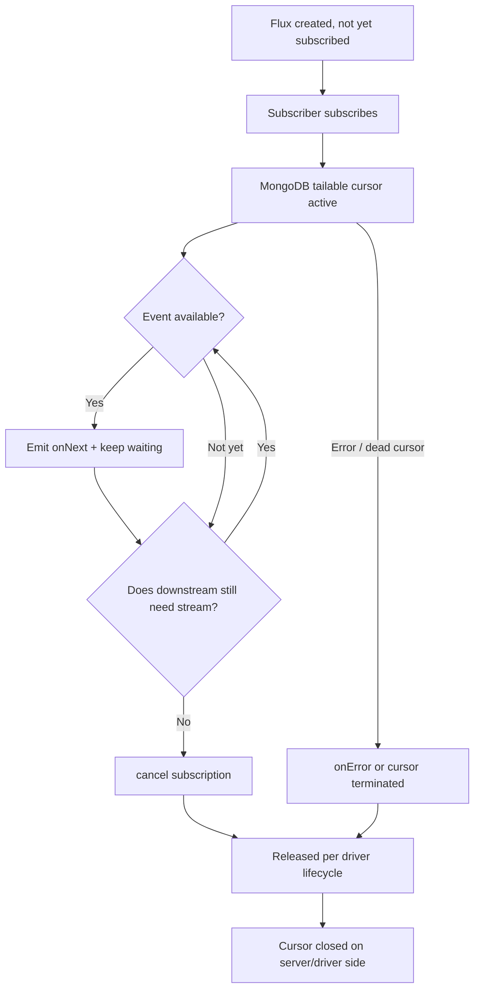
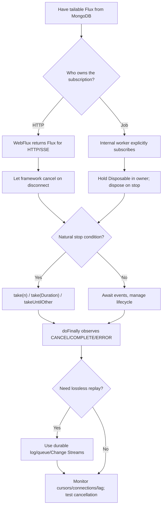

# Cancelling Subscriptions and Releasing Resources

An application tracking order events can use a **tailable cursor** on a MongoDB **capped collection** to receive newly appended documents. With Spring Data MongoDB Reactive, the application can receive data continuously as a `Flux<Event>` instead of polling `find()` periodically. However, such a stream does not stop automatically after returning one batch: it may wait a long time for new events, holding a MongoDB server cursor, associated connection/session state, and application processing resources.

Thus, the important question is not only **"how do I open a tailable cursor?"**, but also **"who owns cancelling the subscription, when are resources actually released, and how do we verify cancellation occurred?"**

Scenario example:

```text
MongoDB capped collection: order_events
             │
             ▼
ReactiveMongoTemplate.tail(...)
             │
             ▼
Flux<OrderEvent>
             │
      HTTP Server-Sent Events
             │
             ▼
      User opens dashboard
             │
      User closes tab
             ▼
WebFlux cancels subscription
             │
             ▼
Driver receives cancellation
             │
             ▼
Cursor/connection resources are reclaimed
  via asynchronous driver and server lifecycle
```

If an application calls `subscribe()` and discards the `Disposable`, the cursor can remain alive even when nobody is consuming it anymore. If you treat `doOnComplete` as the sole cleanup hook, the application misses **cancellation**—which is very common for intentionally long-lived tailable `Flux` streams.

This lesson belongs to the **Tailable cursor** chapter of the **SPRING_DATA_MONGODB** module: using Spring Data MongoDB to connect, map documents, and work with MongoDB via `MongoTemplate` or repositories, while practicing querying, indexing, transactions, reactive access, testing, and data performance diagnostics. The direct focus of this lesson is **cancelling subscriptions and releasing resources**. Examples prioritize the reactive API because `Flux` manages cancellation via Reactive Streams, while also pointing out differences from blocking cursors/streams.

After this lesson, you will be able to:

- Describe the **subscribe → request → onNext → cancel/complete/error** lifecycle of a tailable `Flux`.
- Understand the difference between **Reactor cancellation** and **when the cursor actually closes on the MongoDB server**.
- Use `Disposable.dispose()`, `take(n)`, `takeUntilOther(...)`, `doOnCancel(...)`, and `doFinally(...)` for their intended purposes.
- Return `Flux` directly from WebFlux SSE endpoints so the framework manages subscription cancellation on client disconnect without fire-and-forget.
- Attach shutdown hooks for subscriptions actively owned by the application.
- Prevent leaked connections/cursors when combining `retryWhen`, `repeatWhen`, `share`, and backpressure operators.
- Use `mongosh` to create an isolated test capped collection, inspect new data, and observe cursor limits.
- Write `StepVerifier.thenCancel()` tests proving the cancellation signal without assuming `killCursors` executes synchronously.
- Know when to switch to **MongoDB Change Streams** if updates/deletes, resume tokens, or more durable events are required.

## 1. What Is a Tailable Cursor and Why Must It Be Cancelled?

### 1.1. How Does It Differ from Regular `find()`?

A regular `find()` queries a snapshot of documents at execution time and the cursor normally **completes** once existing results are exhausted. With a tailable cursor on a **capped collection**, once it reaches the end of existing documents, the cursor can **stay open** to follow newly inserted documents.

```text
Regular cursor:
  subscribe → read A, B, C → onComplete

Tailable cursor:
  subscribe → read A, B, C → wait → read D → wait → read E → ...
                                       └─ stops only on cancel,
                                          error, or cursor closure
```

A tailable cursor is not an application-written polling loop. The driver and MongoDB provide a cursor that tracks the natural write position of a capped collection; depending on configuration, it can use **tailable await** mode to wait for new data.

### 1.2. A Capped Collection Is the Foundational Requirement

A capped collection has a size limit, stores documents in natural insertion order, and evicts old documents once full. For example:

```javascript
db.createCollection("order_events_demo", {
  capped: true,
  size: 1024 * 1024,
  max: 1000
});
```

Key characteristics:

- Tailable cursors operate only on an appropriate **capped collection**.
- When space fills, old documents are replaced per the capped lifecycle; this is **not a durable queue with per-consumer ACKs**.
- New records can be missed if a consumer falls too far behind or if the cursor closes when its read position is overwritten.
- Do not design updates that arbitrarily grow document sizes in a capped collection.
- You cannot arbitrarily delete individual documents from a capped collection like a regular collection; to clean up practice runs, drop only the **isolated collection created by your practice session**.
- The cursor does not provide a durable resume token like Change Streams.

### 1.3. Capped Collections Differ from Transaction Logs or Queues

| Requirement | Tailable cursor on capped collection | Better-suited alternative |
| --- | --- | --- |
| Observe sequentially inserted documents | Suitable | — |
| Watch updates/deletes on regular collections | Not primary purpose | Change Streams |
| Reliable replay after long downtime | Not guaranteed | Durable log/queue |
| Resume at a verified position | No resume token like Change Streams | Change Streams with resume token |
| Consumer backpressure | Yes via Publisher, within driver limits | Queue with flow control/ACKs |
| Consumer groups, retry delivery, dead-letter | Not built-in | Kafka/RabbitMQ or queue infrastructure |
| Stop stream when client exits | Requires cancelling subscription | WebFlux/Reactive Streams |

If business rules require **zero lost events**, never equate "tailable" with "lossless." Design dedicated storage, checkpointing, gap detection, and recovery.

## 2. Reactive Streams Lifecycle from Subscribe to Cancel

### 2.1. Signal Types

A Reactive Streams `Publisher<T>` defines core signals:

| Signal / Event | Who Emits or Calls? | Meaning |
| --- | --- | --- |
| `onSubscribe(Subscription)` | Publisher → Subscriber | Subscriber receives handle to request/cancel |
| `request(n)` | Subscriber → Subscription | Requests up to n elements (demand) |
| `onNext(value)` | Publisher → Subscriber | Emits a document/entity |
| `onComplete()` | Publisher → Subscriber | Source ended normally |
| `onError(error)` | Publisher → Subscriber | Source ended with an error |
| `cancel()` | Subscriber → Subscription | Subscriber no longer wants data |

**Cancel differs from onComplete.** Cancellation is requested by downstream, **not** a terminal `onComplete` signal pushed downstream. If you log resource cleanup only in `doOnComplete`, you will miss client disconnects.

### 2.2. Who Subscribes to a Tailable Cursor?

Three common patterns:

1. **WebFlux controller returning a `Flux`:** WebFlux subscribes to write the SSE/HTTP response and cancels when the response closes.
2. **Internal job/worker calling `subscribe` deliberately:** code owns the `Disposable` and cancels it as part of job lifecycle.
3. **`StepVerifier` integration tests:** the verifier acts as subscriber and can call `thenCancel()` to end an infinite stream.

Without a subscriber, a cold tailable `Flux` **does not open a cursor merely by being assigned to a variable**:

```java
Flux<OrderEvent> events = reactiveMongoTemplate
    .tail(new Query(), OrderEvent.class, collectionName);

// Creating the Flux does not mean the cursor is open.
// The cursor activates upon subscription.
```

### 2.3. Tailable Streams Do Not Promise to Self-Complete

A tailable cursor waiting for new documents may emit no `onNext` and **no `onComplete`** for a very long time. This is valid behavior.

Do not write a test like:

```java
// WRONG for a potentially infinite stream:
StepVerifier.create(tailableFlux)
    .expectNextCount(2)
    .verifyComplete();
```

To stop after two elements, **impose an explicit bound**:

```java
StepVerifier.create(tailableFlux.take(2))
    .expectNextCount(2)
    .verifyComplete();
```

Here `take(2)` stops the stream after two elements; from downstream's perspective, the bounded `Flux` completes successfully while the **upstream tailable subscription is cancelled** once no longer needed.

### 2.4. Basic State Transitions



This diagram illustrates resource-management semantics. In practice, server cursor closure may be asynchronous or network-dependent; **do not assume a `killCursors` command appears instantaneously after every cancellation**.

## 3. Opening a Tailable Cursor with Spring Data MongoDB Reactive

### 3.1. Sample Entity Used in Examples

Suppose the application has a capped collection `order_events_lab` storing event documents. Entity:

```java
package com.example.mongo.tailable;

import java.time.Instant;
import org.bson.types.ObjectId;
import org.springframework.data.annotation.Id;
import org.springframework.data.mongodb.core.mapping.Document;

@Document(collection = "order_events_lab")
public class OrderEvent {

    @Id
    private ObjectId id;
    private String tenantId;
    private String eventType;
    private String orderId;
    private Instant createdAt;

    protected OrderEvent() {}

    public OrderEvent(
            String tenantId,
            String eventType,
            String orderId,
            Instant createdAt) {
        this.tenantId = tenantId;
        this.eventType = eventType;
        this.orderId = orderId;
        this.createdAt = createdAt;
    }

    public ObjectId getId() { return id; }
    public String getTenantId() { return tenantId; }
    public String getEventType() { return eventType; }
    public String getOrderId() { return orderId; }
    public Instant getCreatedAt() { return createdAt; }
}
```

Sample event:

```javascript
{
  _id: ObjectId("..."),
  tenantId: "T1",
  eventType: "ORDER_CREATED",
  orderId: "O-100",
  createdAt: ISODate("2026-11-20T09:00:00Z")
}
```

In multi-tenant environments, `tenantId` must come from authentication/authorization; a tailable cursor does not enforce access boundaries on its own. A capped collection may hold data for multiple tenants; when strong isolation is required, verify filtering and routing rules, including newly appended documents.

### 3.2. Create the Capped Collection Before Opening a Cursor

Example creating the collection via `ReactiveMongoTemplate` during **application bootstrap/migration**, not per HTTP request:

```java
import org.springframework.data.mongodb.core.CollectionOptions;
import org.springframework.data.mongodb.core.ReactiveMongoTemplate;
import reactor.core.publisher.Mono;

public Mono<Void> initializeCappedCollection(
        ReactiveMongoTemplate template,
        String collectionName) {

    return template.createCollection(
        collectionName,
        CollectionOptions.empty()
            .capped()
            .size(4L * 1024 * 1024)
            .maxDocuments(10000)
    ).then();
}
```

`CollectionOptions.empty().capped().size(...)` specifies a capped collection and its byte limit; `maxDocuments` adds a document-count limit. Exact APIs may vary by Spring Data MongoDB version; verify against your active dependencies. If the collection already exists, creation can fail; migrations should **verify existence, collection type, and size** rather than silently overwriting configuration.

**Never** create/drop a capped collection on every streaming API call. It is a shared database resource; a client disconnecting should cancel only its cursor, not delete the collection.

### 3.3. `ReactiveMongoTemplate.tail(...)` Returns `Flux<T>`

```java
import org.springframework.data.mongodb.core.ReactiveMongoTemplate;
import org.springframework.data.mongodb.core.query.Criteria;
import org.springframework.data.mongodb.core.query.Query;
import reactor.core.publisher.Flux;

public Flux<OrderEvent> tailTenantEvents(
        ReactiveMongoTemplate template,
        String trustedTenantId,
        String collectionName) {

    if (trustedTenantId == null || trustedTenantId.isBlank()) {
        return Flux.error(
            new IllegalArgumentException("Tenant is required")
        );
    }

    Query query = Query.query(
        Criteria.where("tenantId").is(trustedTenantId)
    );

    return template.tail(
        query, OrderEvent.class, collectionName
    );
}
```

`tail(query, domainType, collectionName)` returns a **`Flux` of root entities** via the reactive MongoDB driver. Once a subscriber requests and begins receiving data, MongoDB uses an appropriate cursor to tail the capped collection.

**Note on criteria and start position:** MongoDB tailable cursors have limitations compared to regular finds. Overly narrow filter criteria may fail to position the cursor as expected or close if no initial results exist. Do not assume a tailable query acts like a broker topic that "waits for a tenant's very first document to appear" under all collection states. When you need tailing from the end of a dataset, exact replay, or many parallel tenants, design and verify those requirements specifically.

### 3.4. Tailable Repository Methods with `@Tailable`

Spring Data MongoDB also supports annotating reactive repository methods:

```java
package com.example.mongo.tailable;

import org.bson.types.ObjectId;
import org.springframework.data.mongodb.repository.ReactiveMongoRepository;
import org.springframework.data.mongodb.repository.Tailable;
import reactor.core.publisher.Flux;

public interface OrderEventRepository
        extends ReactiveMongoRepository<OrderEvent, ObjectId> {

    @Tailable
    Flux<OrderEvent> findByTenantId(String tenantId);
}
```

If the domain entity maps to `order_events_lab` and that collection is properly capped, the method can return a tailable `Flux`. With this repository annotation, **do not assume the method completes after existing records**; subscribers require explicit cancellation lifecycles.

Choose the template when you want dynamic control over collection names or queries; choose repositories when derived queries and mapping fit cleanly. Avoid sprinkling `@Tailable` onto ordinary repository methods.

### 3.5. When Can a Cursor Close on Its Own?

Beyond cancellation, a tailable cursor can terminate due to:

- The collection being dropped, converted, or deleted.
- The server closing/killing the cursor or a network interruption.
- Capped collection wraparound invalidating the cursor's position.
- An invalid query/cursor or lack of a valid starting position.
- Process/server failover or closed connections.
- The subscriber stopping via `take(n)`/`timeout`/downstream error.

Depending on driver and scenario, downstream may observe **`onComplete` or `onError`**. Never build auto-reconnect assuming every dead cursor produces the exact same exception; test against your application's actual infrastructure and versions.

## 4. `doOnCancel`, `doOnComplete`, and `doFinally`

### 4.1. Choosing the Hook for the Right Signal

| Reactor hook | When Invoked | Excluded |
| --- | --- | --- |
| `doOnCancel(action)` | When downstream cancels subscription | Normal completion / error |
| `doOnComplete(action)` | When source completes normally | Cancel / error |
| `doOnError(action)` | When source errors | Complete / cancel |
| `doOnTerminate(action)` | On complete or error | Cancel |
| `doFinally(consumer)` | When chain stops via COMPLETE, ERROR, or CANCEL | None of those three |
| `doOnDiscard(...)` | When values are discarded by supporting operators | Not a cursor-close callback |

**`doFinally` is usually the right place for general lifecycle instrumentation** because a tailable `Flux` can terminate along any path. Even then, it is only an observation/cleanup callback you register: **you do not need to call `killCursors` manually when `ReactiveMongoTemplate`/the driver owns the cursor**.

### 4.2. Observing Signals with `SignalType`

```java
import java.util.concurrent.atomic.AtomicLong;
import reactor.core.publisher.Flux;
import reactor.core.publisher.SignalType;

public Flux<OrderEvent> observeLifecycle(
        Flux<OrderEvent> source,
        AtomicLong cancels) {

    return source
        .doOnCancel(() ->
            cancels.incrementAndGet()
        )
        .doFinally(signal -> {
            if (signal == SignalType.CANCEL) {
                // Record metric by signal; do not log sensitive info.
            } else if (signal == SignalType.ON_COMPLETE) {
                // Source completed normally.
            } else if (signal == SignalType.ON_ERROR) {
                // Source emitted an error.
            }
        });
}
```

`doFinally` receives a `SignalType` such as `CANCEL`, `ON_COMPLETE`, or `ON_ERROR`. This code only **observes**; it does not start a new subscription.

Never attach per-event `OrderEvent` or `tenantId` values as unbounded-cardinality metric tags; if measuring per tenant, enforce security policies and tag-cardinality limits.

### 4.3. Which Hook Fires on `take(2)`?

```java
Flux<OrderEvent> tail =
    template.tail(new Query(), OrderEvent.class, collection);

Flux<OrderEvent> limited = tail
    .doFinally(signal -> {
        // Hook near source sees CANCEL once take receives enough items.
    })
    .take(2)
    .doFinally(signal -> {
        // Downstream hook sees ON_COMPLETE after receiving two items.
    });
```

When two items arrive:

```text
tail source → doFinally(upstream: CANCEL)
       → take(2) → doFinally(downstream: ON_COMPLETE)
```

This is **not contradictory**: `take` completes the output `Flux` while **cancelling upstream** because it does not want a third document.

### 4.4. `doFinally` May Execute After Downstream Sees the Terminal Signal

Do not write a test like:

```java
StepVerifier.create(stream.take(1))
    .expectNextCount(1)
    .verifyComplete();
assertEquals(SignalType.CANCEL, lastSignal.get());
```

and assume the assertion is race-free. The `doFinally` hook can run after the signal has already been forwarded downstream. Use a `CountDownLatch` or synchronization aid in tests to wait for hook completion before asserting. Even then, this **does not mean the MongoDB server cursor has already vanished at the exact instant the latch releases**.

### 4.5. Hooks Must Never Perform Blocking I/O

Wrong:

```java
return source.doFinally(signal -> {
    // WRONG: blocking call inside a Reactive Streams hook.
    auditRepository.save(audit).block();
});
```

Hooks execute within the reactive lifecycle, sometimes on sensitive threads. Blocking or throwing inside a hook can complicate signal propagation and cleanup.

If you need asynchronous cleanup for an **application-owned resource**, look at `Flux.usingWhen` or reactive orchestration with clear ownership. If cleanup involves critical business work (e.g., committing an event), never place it in a fire-and-forget callback and assume completion.

## 5. `Disposable.dispose()`: The Subscription Owner Decides When to Stop

### 5.1. When Code Calls `subscribe()` Explicitly

If an internal service genuinely must subscribe rather than returning a `Publisher`, `subscribe()` returns a `Disposable`:

```java
import reactor.core.Disposable;

Disposable handle = template
    .tail(new Query(), OrderEvent.class, collectionName)
    .subscribe(
        event -> processEvent(event),
        error -> reportError(error)
    );

// When the job stops or owner no longer needs the stream:
handle.dispose();
```

This illustrates **ownership**, not that every class should call `subscribe`. `processEvent` and `reportError` are application-supplied methods; if `processEvent` performs I/O or blocks, `subscribe(Consumer)` may be unsuitable—use proper reactive orchestration, backpressure, and failure handling.

### 5.2. What Happens When `dispose()` Is Called?

`dispose()` requests subscription cancellation; `doOnCancel`/`doFinally(CANCEL)` operators may fire. The reactive MongoDB driver is notified that downstream no longer wants results and cleans up cursor/connection resources via its internal mechanisms.

**Things NOT guaranteed merely because `dispose()` returned:**

- MongoDB has already synchronously received and processed `killCursors`.
- All in-flight network packets have been recalled.
- A just-emitted document finished consumer processing.
- Zero concurrent work remains racing between `onNext` and cancellation.
- No new events will exist if another subscriber is also tailing the collection.
- Documents were deleted from the capped collection (cancellation does not delete documents).

`Disposable.isDisposed()` reflects Reactor-side disposal state, **not a server query reporting open cursor counts**.

### 5.3. Owner Lifecycle Is the Natural Boundary

| Owner | When Opened | When Cancelled |
| --- | --- | --- |
| WebFlux HTTP SSE response | Client subscribes when response starts | Client disconnect / response timeout / cancel |
| Internal job | Job starts and subscriber is created | Job stop / completion / application shutdown |
| Shared-stream component | First subscriber per policy | Last subscriber leaves or component stops |
| Integration test | `StepVerifier.create` subscribes | `thenCancel()` or operator limit |
| CLI debug | Command explicitly subscribes | User requests stop or command exits |

Whenever creating a subscription manually, answer: **who holds the handle, who calls `dispose`, and what happens on second start, failure, and shutdown?**

## 6. WebFlux SSE: Let the Framework Own HTTP Response Subscriptions

### 6.1. Return `Flux`, Never Call `subscribe` in a Controller

A dashboard can consume events via Server-Sent Events:

```java
package com.example.mongo.tailable;

import org.springframework.http.MediaType;
import org.springframework.http.codec.ServerSentEvent;
import org.springframework.web.bind.annotation.GetMapping;
import org.springframework.web.bind.annotation.RequestMapping;
import org.springframework.web.bind.annotation.RestController;
import reactor.core.publisher.Flux;

@RestController
@RequestMapping("/api/events")
public class OrderEventsController {

    private final OrderEventsService eventsService;
    private final TrustedTenantResolver tenantResolver;

    public OrderEventsController(
            OrderEventsService eventsService,
            TrustedTenantResolver tenantResolver) {
        this.eventsService = eventsService;
        this.tenantResolver = tenantResolver;
    }

    @GetMapping(
        path = "/stream",
        produces = MediaType.TEXT_EVENT_STREAM_VALUE
    )
    public Flux<ServerSentEvent<OrderEvent>> stream() {
        return tenantResolver.requireTenant()
            .flatMapMany(eventsService::tailForTenant)
            .map(event -> ServerSentEvent
                .<OrderEvent>builder()
                .event("order-event")
                .id(event.getId().toHexString())
                .data(event)
                .build());
    }
}
```

In this example, `TrustedTenantResolver` is an application-implemented interface returning `Mono<String>` resolved from **verified authentication/authorization**. Never take a tenant directly from a client query parameter and open an unauthorized cursor. `OrderEventsService` is defined in Section 6.2.

When WebFlux subscribes to write the response, it owns the response's subscription. When the client closes the connection or WebFlux cancels the response, cancellation propagates upstream to the tailable `Flux`. You **neither need nor should** call `subscribe()` inside the controller.

### 6.2. Service Providing a Cold Publisher

```java
package com.example.mongo.tailable;

import java.util.concurrent.atomic.AtomicLong;
import org.springframework.data.mongodb.core.ReactiveMongoTemplate;
import org.springframework.data.mongodb.core.query.Criteria;
import org.springframework.data.mongodb.core.query.Query;
import org.springframework.stereotype.Service;
import reactor.core.publisher.Flux;
import reactor.core.publisher.SignalType;

@Service
public class OrderEventsService {

    private final ReactiveMongoTemplate template;
    private final AtomicLong cancelledStreams =
        new AtomicLong();

    public OrderEventsService(ReactiveMongoTemplate template) {
        this.template = template;
    }

    public Flux<OrderEvent> tailForTenant(
            String trustedTenantId) {

        if (trustedTenantId == null
                || trustedTenantId.isBlank()) {
            return Flux.error(
                new IllegalArgumentException("Missing tenant")
            );
        }

        Query scoped = Query.query(
            Criteria.where("tenantId").is(trustedTenantId)
        );

        return template.tail(
                scoped, OrderEvent.class, "order_events_lab"
            )
            .doFinally(signal -> {
                if (signal == SignalType.CANCEL) {
                    cancelledStreams.incrementAndGet();
                }
            });
    }

    public long cancelledStreamCount() {
        return cancelledStreams.get();
    }
}
```

This example counts subscriptions ending with a `CANCEL` signal. In production, use formal metrics/tracing with low-cardinality tags rather than an in-instance counter alone.

### 6.3. Tenant Resolver Sits on the Security Boundary

Assume `TrustedTenantResolver` has the contract:

```java
package com.example.mongo.tailable;

import reactor.core.publisher.Mono;

public interface TrustedTenantResolver {
    Mono<String> requireTenant();
}
```

Implementations should use reactive Spring Security and verify tenant authorization; `Mono.empty()` should never default to "all tenants." For authenticated routes, emit an appropriate error when no valid tenant exists before opening a cursor.

In a multi-tenant capped collection, a tenant-filtered tailable cursor faces cursor-positioning and notification constraints when matching documents are sparse. If reliable per-tenant streams are needed, design partitioning, distribution pipelines, or Change Streams per business requirements; never assume a tenant-filtered query creates an isolated queue.

### 6.4. Client Disconnects Are Not Always Detected Instantly

In browsers, `EventSource.close()` or closing a tab usually ends the SSE connection. In practice, however, you also encounter:

- Reverse proxy buffering or timeouts.
- Load balancers holding TCP connections open.
- Network drops the server has not yet detected.
- Clients sleeping/switching networks and auto-reconnecting.
- HTTP headers already sent, preventing changing the HTTP status code afterward like a normal response.

Therefore, **do not promise every tab close triggers `doFinally(CANCEL)` instantaneously**. Configure HTTP/proxy timeouts and heartbeats properly, monitor open stream counts, and implement server shutdown lifecycles.

### 6.5. SSE Heartbeats Help Detect Dead Connections

A tailable stream may see no events for hours. SSE heartbeats keep connections alive and detect dead networks sooner without altering how the tailable cursor works:

```java
import java.time.Duration;
import org.springframework.http.codec.ServerSentEvent;
import reactor.core.publisher.Flux;

public Flux<ServerSentEvent<OrderEvent>> withHeartbeat(
        Flux<OrderEvent> source) {

    Flux<ServerSentEvent<OrderEvent>> events =
        source.map(e ->
            ServerSentEvent.<OrderEvent>builder()
                .event("order-event")
                .data(e)
                .build()
        );

    Flux<ServerSentEvent<OrderEvent>> heartbeats =
        Flux.interval(Duration.ofSeconds(15))
            .map(tick ->
                ServerSentEvent.<OrderEvent>builder()
                    .comment("heartbeat")
                    .build()
            );

    return Flux.merge(events, heartbeats);
}
```

`Flux.merge` cancels the remaining sources when downstream cancels, following composition semantics. An error from the tail source also fails the merged `Flux` unless a dedicated error policy is applied. **Heartbeats are not change events and do not create resume tokens.** If a client is very slow, heartbeats and data can add pressure; define suitable backpressure/timeout policies.

### 6.6. SSE `id` Is Not a MongoDB Resume Token

`ServerSentEvent.id(...)` sets the HTTP/SSE event ID so a client can send `Last-Event-ID` on reconnect. However, tailable cursors **do not automatically support exact replay** from that ID. To support resumption:

- Define event IDs/sequences, retention, and safe lookup positioning.
- Detect gaps when the capped collection has already overwritten replayable documents.
- Never trust client-sent IDs to bypass tenant/authorization checks.
- If standardized resumption plus insert/update/delete tracking is required, consider **Change Streams**.

Never add `.id(event.getId().toHexString())` and claim the system provides at-least-once or exactly-once delivery.

## 7. Deliberate Stopping on Application Shutdown

### 7.1. `takeUntilOther` Terminates the Stream on a Control Signal

When all SSE subscriptions of a component must stop before application shutdown, use `Sinks.One<Void>`:

```java
package com.example.mongo.tailable;

import jakarta.annotation.PreDestroy;
import org.springframework.data.mongodb.core.ReactiveMongoTemplate;
import org.springframework.data.mongodb.core.query.Query;
import org.springframework.stereotype.Service;
import reactor.core.publisher.Flux;
import reactor.core.publisher.Sinks;

@Service
public class ShutdownAwareTailService {

    private final ReactiveMongoTemplate template;
    private final Sinks.One<Void> stopSignal = Sinks.one();

    public ShutdownAwareTailService(
            ReactiveMongoTemplate template) {
        this.template = template;
    }

    public Flux<OrderEvent> events() {
        return template.tail(
                new Query(), OrderEvent.class, "order_events_lab"
            )
            .takeUntilOther(stopSignal.asMono());
    }

    @PreDestroy
    public void stop() {
        stopSignal.tryEmitEmpty();
    }
}
```

This uses `jakarta.annotation.PreDestroy` (Spring Boot 3+). For older versions using `javax.annotation`, choose imports matching your dependencies.

`takeUntilOther` completes the main `Flux` when the companion `Publisher` emits or completes per the Reactor contract. Active `events()` subscriptions are instructed to stop when `stopSignal` completes. This is an **intentional cancellation** mechanism, not a synchronous wait for MongoDB to confirm `killCursors`.

### 7.2. Do Not Share One Stop Signal for All Requests When Stopping One Client

`stopSignal` above is **service-wide**. Calling `stop()` stops **every subscription** on that service.

If only one user closes a tab, WebFlux cancellation suffices; **never call `service.stop()` from an HTTP cancel hook**, as it would disconnect every other client.

Distinguish:

```text
Client A closes SSE  → cancel subscription A
Client B stays open  → subscription B continues running
Application shutdown → stopSignal stops A/B/remaining streams
```

### 7.3. Graceful Shutdown Requires Infrastructure Coordination

When the process receives SIGTERM:

1. Stop accepting new requests and start server graceful shutdown.
2. Signal streams that do not need to stay open to stop.
3. Each downstream receives completion/cancellation along the operator chain.
4. The driver gets a chance to clean up cursors and connections.
5. Wait within a **finite shutdown grace period** configured by runtime.
6. Close MongoDB clients/connection pools via Spring lifecycle; never close a shared client from a single request.

**Never** hold a process open indefinitely waiting for a tailable cursor to emit `onComplete`. It is designed to keep awaiting data, so an explicit stop signal is mandatory.

### 7.4. Cleaning Up Self-Managed Resources with `usingWhen`

`ReactiveMongoTemplate.tail` lets the driver/template own the cursor, so most applications **do not need** to implement server cursor closure manually. If you allocate a separate asynchronous resource (such as a feed registration lease, external session, or dedicated connection), Reactor provides `Flux.usingWhen`:

```java
import reactor.core.publisher.Flux;
import reactor.core.publisher.Mono;

// FeedLease is an application-defined resource.
// acquire/closeAsync are non-blocking application APIs.
Flux<OrderEvent> stream = Flux.usingWhen(
    leaseProvider.acquire(),
    lease -> lease.openEvents(),
    lease -> lease.closeAsync(),          // complete
    (lease, error) -> lease.closeAsync(), // error
    lease -> lease.closeAsync()           // cancel
);
```

This is a **structural pattern**; `leaseProvider` and `FeedLease` are not built-in Spring Data classes. `usingWhen` lets you define cleanup for completion, error, and cancellation via Publishers, though it cannot turn a non-closable resource into one that closes instantaneously.

Specifically, **never wrap `ReactiveMongoTemplate.tail` in a resource wrapper that calls `MongoClient.close()` after every HTTP request**: `MongoClient` is normally a shared application-wide resource.

## 8. Internal Workers: `Disposable` Must Be Managed Like a Resource

When no HTTP response owns the subscription, create a component responsible for explicit start/stop:

```java
package com.example.mongo.tailable;

import jakarta.annotation.PreDestroy;
import org.springframework.data.mongodb.core.ReactiveMongoTemplate;
import org.springframework.data.mongodb.core.query.Query;
import org.springframework.stereotype.Component;
import reactor.core.Disposable;
import reactor.core.publisher.Mono;

@Component
public final class OrderEventsWorker {

    private final ReactiveMongoTemplate template;
    private Disposable subscription;

    public OrderEventsWorker(ReactiveMongoTemplate template) {
        this.template = template;
    }

    public synchronized void start() {
        if (subscription != null && !subscription.isDisposed()) {
            return;
        }

        subscription = template.tail(
                new Query(), OrderEvent.class, "order_events_lab"
            )
            .concatMap(this::handleEvent)
            .subscribe(
                ignored -> {},
                error -> reportFailure(error)
            );
    }

    private Mono<Void> handleEvent(OrderEvent event) {
        // Non-blocking method implemented by the application.
        return Mono.empty();
    }

    private void reportFailure(Throwable error) {
        // Safe logging/metrics and restart decision in owner.
    }

    @PreDestroy
    public synchronized void stop() {
        if (subscription != null) {
            subscription.dispose();
            subscription = null;
        }
    }
}
```

**Important:** `start()` must be called by a reliable lifecycle hook (such as application ready or job controller) and `stop()` by the owner. This is a minimal ownership example; when the Publisher terminates naturally or errors, the `Disposable` may already be disposed even without the owner calling `dispose()` manually. For auto-reconnect, design an explicit restart policy with backoff, bounds, and error observation.

`concatMap(this::handleEvent)` preserves per-event order during application processing, yet **does not turn a capped collection into an ACK/replay queue**. If the handler is too slow, the capped collection can roll over and lose unread events.

## 9. Idle Timeouts, Time Limits, and Reconnects

### 9.1. No New Events Does Not Mean Cursor Error

A tailable cursor can stay **waiting for appends** for long stretches without emitting `onNext`. Therefore:

```java
source.timeout(Duration.ofSeconds(30));
```

means if **30 seconds pass without an `onNext` signal satisfying the timeout condition**, Reactor may emit `TimeoutException` **even when MongoDB and the cursor are completely healthy**. That is a **Publisher-level** timeout, not an accurate test of "server cursor died."

If UX requires "no new orders in 30 seconds means treat the system as unhealthy," state clearly that this is a **business policy**, not a technical property of tailable cursors.

### 9.2. Distinguish Three Kinds of Time

| Mechanism | Controls | Not Guaranteed |
| --- | --- | --- |
| Driver/server `maxAwaitTime` or cursor await config | How long one `getMore` waits for data | Does not mean the tailable `Flux` will self-complete |
| Reactor `timeout(Duration)` | How long downstream waits without a signal | Does not distinguish valid quiet periods from outages |
| Reactor `take(Duration)` | Maximum stream lifetime per application rule | Does not guarantee all business events were received |
| HTTP/proxy idle timeout | Connection idle age / I/O latency | Does not accurately reflect MongoDB state |
| Shutdown grace period | How long the process has to clean up | Does not prove server cursors were killed at an exact instant |

A system may use multiple timeout layers, provided they do not conflict. For instance, SSE heartbeats keep HTTP connections alive even when the **MongoDB tail stream sees no new events**.

### 9.3. Limiting a Stream Session with `take(Duration)`

If policy caps each SSE connection at 15 minutes:

```java
import java.time.Duration;
import reactor.core.publisher.Flux;

Flux<OrderEvent> session = source
    .take(Duration.ofMinutes(15));
```

When that duration expires, the downstream `Flux` completes and upstream receives cancellation. Never cut off every connection at 15 minutes without accounting for browser/proxy reconnect behavior; simultaneous client reconnects can cause a **thundering herd**. Jitter and connection limits may be needed.

### 9.4. Retrying Transient Errors

`retryWhen` applies when the Publisher emits `onError`. Bounded policy example:

```java
import com.mongodb.MongoSocketException;
import com.mongodb.MongoTimeoutException;
import java.time.Duration;
import reactor.util.retry.Retry;

Flux<OrderEvent> retrying = template
    .tail(new Query(), OrderEvent.class, collectionName)
    .retryWhen(
        Retry.backoff(3, Duration.ofSeconds(1))
            .maxBackoff(Duration.ofSeconds(8))
            .filter(error ->
                error instanceof MongoSocketException
                || error instanceof MongoTimeoutException
            )
    );
```

This **illustrates a potentially transient error filter**, not an exhaustive list of safe-to-retry errors across every deployment. Enforce a business retry budget and fail visibly when exhausted. Authentication, permission, missing-collection, or invalid-query errors should generally never be retried blindly.

**Important:** retrying a cold tailable Publisher creates a **new subscription/cursor**. It does not automatically restore the previous read position. You may miss documents written during downtime or receive duplicates depending on queries and capped wraparound.

### 9.5. `retryWhen` Does Not Handle Normal `onComplete`

A tailable cursor can finish without an error depending on conditions. In Reactor:

- `retryWhen`: retries when an accepted **`onError`** occurs.
- `repeatWhen`: resubscribes on **`onComplete`**.
- Downstream `cancel`: **does not automatically become a retry/repeat trigger**.

Delayed repeat example:

```java
Flux<OrderEvent> restarting = template
    .tail(new Query(), OrderEvent.class, collectionName)
    .repeatWhen(completions ->
        completions.delayElements(Duration.ofSeconds(2))
    );
```

Do not drop this snippet straight into production. If the cursor completes immediately due to an empty collection, misconfigured permissions, or capped rollover, continuous repeats increase load, duplicate old events, or mask root causes. Add **bounds, state tracking, observability, delays, and stop policies**. Using `repeatWhen` does not create durable resumption.

### 9.6. Never Retry After Intentional Downstream Cancellation

If a user closes SSE, upstream must stop rather than reconnecting infinitely because another hook logged "stream ended." Do not write:

```java
source.doFinally(signal ->
    startAnotherSubscriptionWithoutOwner()
);
```

This is a dangerous pattern: even on `SignalType.CANCEL`, it spawns a new unowned subscription after the original owner disconnected. **Never subscribe/reconnect inside `doFinally`**; if restarts are required, owner logic must distinguish intentional shutdown/cancel from transient failures.

### 9.7. Proper Recovery Requires Gap Detection

One approach uses a monotonically increasing `eventSequence` per partition:

```text
Consumer processed: 1001, 1002
Cursor errored
Producer kept writing: 1003, 1004, 1005
Consumer reconnects, sees only: 1005, 1006
                                ↑ gap 1003–1004
```

When a gap is detected, resolve it using a more durable source (history API, separate log, queue, or appropriate Change Streams). Never infer "no gap" merely because an `ObjectId` after reconnect is "greater than" the last ID; `ObjectId` is not a gap-free sequence and does not solve replay semantics.

## 10. Backpressure: Early Cancellation Does Not Replace Rate Control

### 10.1. `request(n)` Is Not MongoDB `limit(n)`

Reactive Streams lets subscribers request the number of items they want. However, while a tailable cursor remains open, it can continue **waiting** for new documents even after fulfilling existing demand without completing.

Distinguish:

- `limitRate(32)`: shapes Reactor upstream demand; **does not limit the source to 32 events total**.
- `take(32)`: consumes at most 32 events, then cancels upstream.
- MongoDB query `limit(32)` (where applicable): caps server results per query semantics, not a general lifetime strategy for tailable streams.
- `onBackpressureBuffer`: buffers unprocessed downstream items in memory; does not create durable storage.

### 10.2. When the Consumer Is Slower Than the Producer

```text
MongoDB capped append:   A B C D E F G H I ...
Reactive cursor:         A B C D E ...
Slow consumer:           A ... B ... C ...
Capped wraparound:       A/B/C may be overwritten
```

At least three pressure layers exist:

1. **Application backpressure:** downstream cannot process emitted items fast enough.
2. **Connection/driver buffering:** batch, memory, and scheduling limits apply.
3. **Capped collection retention:** producers keep writing, so old documents can vanish while the consumer lags.

No Reactor operator can force MongoDB producers to slow down. Thus **never promise lossless delivery merely because you use `Flux`**.

### 10.3. Avoid Unbounded Buffers

Wrong:

```java
Flux<OrderEvent> stream = source
    .onBackpressureBuffer(); // Memory can grow without bound.
```

If clients are weak or disconnect slowly, RAM usage can climb. For dashboards displaying only the latest state, consider a **loss-tolerant** operator like `onBackpressureLatest`, while explicitly documenting its semantics:

```java
Flux<OrderEvent> latestOnly = source
    .onBackpressureLatest();
```

It **can drop intermediate events**, making it unsuitable for accounting, immutable auditing, or payment processing. For guaranteed events, use a durable queue/log instead of hoping an unbounded Reactor buffer holds everything.

### 10.4. `concatMap` Preserves Order Without Extending Retention

```java
Flux<Void> handled = source
    .concatMap(event -> handler.handle(event));
```

`handler.handle` is assumed to return a non-blocking `Mono<Void>`. `concatMap` processes items sequentially in emission order. Still, if each handler call takes 5 seconds while producers emit 100 events/second, records will still roll off the capped collection before being read.

When every event must be processed, design **sufficient retention or durable ingestion** and monitor consumer lag/gaps; never treat `concatMap` as protection against data loss.

### 10.5. `onBackpressureDrop` and `onBackpressureLatest` Require an Explicit Contract

| Use case | Dropping items allowed? | Guidance |
| --- | --- | --- |
| Live dashboard caring only about latest value | Potentially | Controlled latest/drop with lag reporting |
| Non-critical UI notifications | Per SLA | Clear backpressure policy with deduplication |
| Balance/order updates requiring full processing | No | Durable queue/replay and idempotency |
| Audit/compliance events | No | Immutable event log, Change Streams/outbox per architecture |
| Short-lived debug stream | Potentially | `take(n)`, deliberate timeout, cancel |

**Cancelling a subscription** stops delivery and frees resources when no consumer remains, yet it does not solve throughput/durability problems while consumers are active.

## 11. Multiple Subscribers: One Cursor per Subscription or Shared Source?

### 11.1. Cold Publishers Usually Open Independent Subscriptions

```java
Flux<OrderEvent> source = template
    .tail(new Query(), OrderEvent.class, collectionName);

Disposable a = source.subscribe(e -> handleA(e));
Disposable b = source.subscribe(e -> handleB(e));
```

Under normal cold semantics, **two subscriptions can open two separate cursors**, adding server and driver load. Calling `a.dispose()` does not stop `b`. If thousands of HTTP clients open SSE simultaneously, one cursor per client can exhaust resources.

Never deploy that pattern at tens of thousands of clients without capacity planning.

### 11.2. `share()` / `refCount` Reduces Cursors but Changes Semantics

```java
Flux<OrderEvent> shared = template
    .tail(new Query(), OrderEvent.class, collectionName)
    .publish()
    .refCount(1);
```

This creates a shared publisher: the first subscriber activates upstream; when **no subscribers remain**, `refCount` cancels upstream. Instead of one cursor per consumer, consumers share one stream **within a designed scope**.

Trade-offs:

- Late-arriving subscribers do not automatically receive all older events replayed.
- Slow consumers can affect shared flow and buffering/backpressure for the group.
- Once the last subscriber leaves and a new one arrives, upstream may be re-subscribed.
- Never share one system-wide `shared` stream across tenants while bypassing security scopes.
- Test error/completion sharing and re-subscription behavior for your Reactor version.

### 11.3. Never Share Data Before Authorization

Security boundary violation:

```java
Flux<OrderEvent> allEvents = template
    .tail(new Query(), OrderEvent.class, collectionName)
    .share();

// Then exposing allEvents unfiltered/unauthorized
// directly to all WebFlux clients.
```

A multi-tenant fan-out architecture must separate eligibility, distribution, and authorization properly:

- Partition per tenant and maintain per-tenant streams/buses.
- Or maintain a protected internal source, then filter and reauthorize **before every delivery** by design.
- Account for index/retention lag when permissions change.
- Never allow a shared stream to leak the existence of another tenant's documents through metadata or logs.

### 11.4. `cache()` Is Not a Universal Solution

```java
Flux<OrderEvent> cached = source.cache();
```

Unbounded `cache()` retains every emitted item in memory, **which is especially dangerous on an unbounded stream**. Bounded `replay(n)`/caching is also purely in-memory, providing neither exactly-once nor durable replay; apply only intentionally and test memory usage.

For live dashboards, `share()/refCount` can fit provided disconnect, error, subscription, and security policies are explicit.

## 12. Resource Observability: Do Not Rely on a Single Cancellation Log

### 12.1. What Should You Monitor?

A tailable stream impacts:

- **MongoDB cursors** open or awaiting `getMore`.
- **Connection pools** and driver network activity.
- **Subscriber counts** in WebFlux or background jobs.
- Memory/buffers in Reactor and HTTP serialization.
- CPU from event processing, logging, and retry/reconnect loops.
- Capped collection retention and **consumer lag**.

Minimum metric set:

| Metric | Meaning |
| --- | --- |
| `tailable_subscriptions_active` | Subscriptions considered active by the application |
| `tailable_subscriptions_started_total` | Total subscriptions started |
| `tailable_subscriptions_cancelled_total` | Observed upstream/downstream cancellations |
| `tailable_subscriptions_completed_total` | Observed completions |
| `tailable_subscriptions_failed_total` | Observed errors |
| `tailable_reconnect_attempts_total` | New subscriptions created by retry/repeat |
| `tailable_events_received_total` | Events emitted at the observed stage |
| `tailable_delivery_lag_ms` | Delay from `createdAt` to receipt, assuming synced clocks |
| `tailable_gap_detected_total` | Gaps detected via `eventSequence`, if present |
| `sse_clients_active` | Currently active HTTP SSE subscriptions |

Keep metric names/tags **low-cardinality**. Never expose `orderId`, `tenantId`, or `cursorId` as public metric tags—doing so inflates cardinality and risks leaking data.

### 12.2. Instrumenting Metrics at the Right Lifecycle Point

Illustrative example without Micrometer dependencies:

```java
import java.util.concurrent.atomic.AtomicInteger;
import java.util.concurrent.atomic.AtomicLong;
import reactor.core.publisher.Flux;
import reactor.core.publisher.SignalType;

public final class TailMetrics {

    private final AtomicInteger active = new AtomicInteger();
    private final AtomicLong cancels = new AtomicLong();
    private final AtomicLong errors = new AtomicLong();
    private final AtomicLong completed = new AtomicLong();

    public <T> Flux<T> observe(Flux<T> source) {
        return source
            .doOnSubscribe(s -> active.incrementAndGet())
            .doFinally(signal -> {
                active.decrementAndGet();
                if (signal == SignalType.CANCEL) {
                    cancels.incrementAndGet();
                } else if (signal == SignalType.ON_ERROR) {
                    errors.incrementAndGet();
                } else if (signal == SignalType.ON_COMPLETE) {
                    completed.incrementAndGet();
                }
            });
    }

    public int active() { return active.get(); }
    public long cancels() { return cancels.get(); }
    public long errors() { return errors.get(); }
    public long completed() { return completed.get(); }
}
```

In production code, ensure each subscription pairs with exactly one `doFinally`; placing instrumentation both before and after `take`/`share` operators **measures different lifecycles**. Standardize where instrumentation sits in the pipeline and test your metrics.

`active==0` means **zero active subscriptions at the instrumented layer**, not proof that the server has already closed every cursor opened by the app. Those are two distinct observation layers.

### 12.3. Observing MongoDB Cursors on the Server Side

MongoDB exposes `serverStatus` and cursor/operation diagnostic tools, though permissions, metrics, and field names vary by version and infrastructure:

```javascript
// Run only in authorized observability environments; typically requires admin privileges.
db.serverStatus().metrics.cursor
```

Counters like open cursors are **server-wide or scoped to the metrics subsystem**, not proof of which request owns a specific cursor. `$currentOp` or driver command monitoring can reveal `getMore` activity in appropriate environments, though waiting operations may appear intermittently; not seeing one does not always prove a cursor is closed.

In particular, a test that does:

```text
1. Application disposes handle
2. Run db.serverStatus().metrics.cursor
3. Notice count did not drop immediately
4. Conclude Reactor cancel does not work
```

draws an unsupported conclusion. Cursor cleanup can be asynchronous, and the server may hold cursors from other clients simultaneously.

### 12.4. Use Driver Command Monitoring Only When Needed

The MongoDB Java driver provides command monitoring for commands like `find`, `getMore`, and `killCursors` when issued, yet:

- There is no guarantee of **one `killCursors` command per cancel**.
- Cursors can expire or close via other mechanisms.
- Monitoring can incur latency/races and capture sensitive query metadata.
- Configure sampling and redaction; never leave verbose command logging enabled indefinitely in production.

To verify application-layer lifecycle, use `StepVerifier.thenCancel()` and `doFinally(CANCEL)`; to detect real resource leaks, monitor **cursor/connection/subscription trends** under controlled load.

### 12.5. Risk of Accidentally Closing Shared Resources

When an SSE client disconnects:

**Do:** cancel that subscription and let the driver clean up its cursor.

**Do not:** call `mongoClient.close()`, shut down the connection pool, drop the capped collection, or kill all server cursors. Those shared resources may be serving hundreds of other requests.

**Reminder:** every resource has an **owner**. A subscription/cursor is owned by its subscriber/driver; `MongoClient` is normally owned by the Spring application context.

## 13. `mongosh` Lab: Creating, Observing, and Closing a Cursor on a Capped Collection

This section uses `mongosh` to examine **server cursors**, while Reactor cancellation is tested in Section 14. Treat these as two separate perspectives rather than identical mechanisms.

**Prerequisites:** a learning MongoDB database with privileges to create/drop your own collection and execute `find/getMore/killCursors` within that collection's scope. Never run against production.

### 13.1. Create a Dedicated Random Collection for the Session

In **mongosh session A**:

```javascript
use spring_data_training

const suffix = new ObjectId().toHexString();
const name = "tail_cancel_lab_" + suffix;
const tenant = "T1-" + suffix;

db.createCollection(name, {
  capped: true,
  size: 1024 * 1024,
  max: 1000
});

const events = db.getCollection(name);

events.insertMany([
  {
    _id: new ObjectId(),
    tenantId: tenant,
    eventType: "READY",
    orderId: "O-1",
    createdAt: new Date()
  },
  {
    _id: new ObjectId(),
    tenantId: tenant,
    eventType: "ORDER_CREATED",
    orderId: "O-2",
    createdAt: new Date()
  }
]);

printjson({
  collection: name,
  tenant,
  count: events.countDocuments({})
});
// Expected count = 2.
```

The `READY` document provides initial data for the cursor to start. Never assume a tailable cursor on a completely empty collection always waits for the first document identically across every access path and server version.

### 13.2. Verify the Collection Is Actually Capped

```javascript
const info = db.getCollectionInfos({ name });
printjson(info);

if (info.length !== 1
    || info[0].options.capped !== true) {
  throw new Error("Lab collection is not capped");
}
```

Use only a **verified capped collection** for tailable cursors. Accidentally targeting a regular collection can raise errors or lack the semantics this lab demonstrates.

### 13.3. Open a Tailable Cursor via the MongoDB `find` Command

In session A:

```javascript
const opened = db.runCommand({
  find: name,
  filter: { tenantId: tenant },
  tailable: true,
  awaitData: true,
  batchSize: 2
});

printjson({
  ok: opened.ok,
  firstBatch: opened.cursor?.firstBatch,
  cursorId: opened.cursor?.id?.toString()
});

if (opened.ok !== 1) {
  throw new Error("Cannot open tailable cursor");
}

const cursorId = opened.cursor.id;
```

`tailable:true` asks the cursor to follow the capped collection, and `awaitData:true` lets `getMore` wait for new documents. `cursorId` is used to request subsequent batches or close the cursor. If `cursorId` is 0, the cursor is no longer open; recheck initial data, query, permissions, and server behavior.

### 13.4. Insert a New Event from Another Session

In **mongosh session B**, switch to the same database and use the **exact collection name and tenant** printed in session A:

```javascript
use spring_data_training

// Replace both strings with the actual values printed by session A.
const collectionFromA = "tail_cancel_lab_<suffix-from-A>";
const tenantFromA = "T1-<suffix-from-A>";
const feed = db.getCollection(collectionFromA);

feed.insertOne({
  _id: new ObjectId(),
  tenantId: tenantFromA,
  eventType: "ORDER_PAID",
  orderId: "O-2",
  createdAt: new Date()
});
```

Replace the placeholders with the exact lab values you generated. **Do not use a different collection name** and conclude the cursor missed the new event.

### 13.5. Read the New Batch with `getMore`

Switch back to session A:

```javascript
if (cursorId.toString() !== "0") {
  const next = db.runCommand({
    getMore: cursorId,
    collection: name,
    batchSize: 10,
    maxTimeMS: 2000
  });

  printjson(next);
}
```

If session B inserted a new document and the cursor remained valid, `getMore` returns that event. If no event arrived, a tailable-await `getMore` may time out with an empty batch while the **cursor remains open**; never equate `empty batch = closed cursor`. Inspect `cursor.id` in the response.

### 13.6. Close Only Your Lab Cursor

In session A, after finishing the exercise:

```javascript
if (cursorId.toString() !== "0") {
  const killed = db.runCommand({
    killCursors: name,
    cursors: [cursorId]
  });

  printjson(killed);
}
```

This is a **server-side command intentionally closing the cursor created by this lab session**. It illustrates MongoDB's server resource model, though it is **not** how you close a Reactor subscription from WebFlux. In Java, cancel/`dispose()` the application-owned subscription and let the driver/template manage the cursor.

A cursor may already have closed before `killCursors` runs; MongoDB may report the cursor no longer exists. Do not treat that as a lab failure once you have confirmed query/cursor lifecycle.

### 13.7. Clean Up Your Isolated Collection

```javascript
printjson({
  collection: name,
  count: events.countDocuments({})
});

// Run ONLY when certain that name is the
// random collection created in Section 13.1.
events.drop();
```

`drop()` removes the entire capped collection and its indexes; **never run it on shared collections**. Also avoid `deleteMany({})` to clear a capped collection—that is not an appropriate cleanup mechanism for capped collections.

### 13.8. Lessons from the Lab

| Observation | Valid Conclusion |
| --- | --- |
| `find` returns a non-zero cursor ID | A server cursor exists for follow-up queries |
| `getMore` returns empty batch yet ID remains | Likely just no new data yet |
| `getMore` returns newly inserted event | Cursor is properly tailing appends |
| `killCursors` closes the lab cursor | Server provides an explicit cursor-close mechanism |
| `events.drop()` removes the collection | Collection lifecycle is separate from subscription lifecycle |
| MongoDB `currentOp` does not show waiting cursor | Insufficient evidence on its own to prove cursor closed |
| Reactor `dispose()` returns | Client-side cancellation requested; does not prove immediate server ACK |

## 14. Testing with `StepVerifier`: Cancellation Is Verifiable

### 14.1. Distinguish Test Categories

| Test Type | Environment | What It Proves |
| --- | --- | --- |
| Reactor unit test | No MongoDB | `doFinally(CANCEL)`, `take(n)`, `Disposable.dispose()`, cancellation signal |
| MongoDB integration test | Real test capped collection | Spring Data tail receives documents; cancellation flows through pipeline |
| WebFlux/SSE integration test | WebFlux test server + test DB | Closing HTTP response cancels subscription properly |
| Resource/load test | Driver metrics + MongoDB monitoring | Cursors/connections/active subscriptions do not grow unbounded |
| Failover/rollover test | Dedicated controlled infrastructure | Errors/completion/reconnect and gap risks |

A pure Reactor unit test **does not prove MongoDB received `killCursors`**. Conversely, a MongoDB test "reading one event" does not prove cancellation propagated.

### 14.2. Unit Test: `StepVerifier.thenCancel()`

```java
package com.example.mongo.tailable;

import static org.junit.jupiter.api.Assertions.*;

import java.time.Duration;
import java.util.concurrent.CountDownLatch;
import java.util.concurrent.TimeUnit;
import java.util.concurrent.atomic.AtomicReference;
import org.junit.jupiter.api.Test;
import reactor.core.publisher.Flux;
import reactor.core.publisher.SignalType;
import reactor.test.StepVerifier;

class ReactiveCancellationTest {

    @Test
    void cancellingNeverEndingFluxSendsCancelSignal()
            throws InterruptedException {

        AtomicReference<SignalType> finalSignal =
            new AtomicReference<>();
        CountDownLatch finished = new CountDownLatch(1);

        Flux<String> neverEnding = Flux.<String>never()
            .doFinally(signal -> {
                finalSignal.set(signal);
                finished.countDown();
            });

        StepVerifier.create(neverEnding)
            .expectSubscription()
            .thenCancel()
            .verify(Duration.ofSeconds(3));

        assertTrue(
            finished.await(3, TimeUnit.SECONDS),
            "doFinally must observe cancellation"
        );
        assertEquals(SignalType.CANCEL, finalSignal.get());
    }
}
```

`Flux.never()` emits neither data nor terminal signals. `StepVerifier.thenCancel()` requests cancellation; `doFinally` observes `SignalType.CANCEL`. `CountDownLatch` avoids races when checking the hook after verification.

### 14.3. Unit Test: `take(2)` Completes Output While Cancelling Upstream

```java
@Test
void takeCompletesDownstreamAndCancelsUpstream()
        throws InterruptedException {

    AtomicReference<SignalType> upstream =
        new AtomicReference<>();
    AtomicReference<SignalType> downstream =
        new AtomicReference<>();
    CountDownLatch hooks = new CountDownLatch(2);

    Flux<Integer> flow = Flux.range(1, 100)
        .doFinally(signal -> {
            upstream.set(signal);
            hooks.countDown();
        })
        .take(2)
        .doFinally(signal -> {
            downstream.set(signal);
            hooks.countDown();
        });

    StepVerifier.create(flow)
        .expectNext(1, 2)
        .verifyComplete();

    assertTrue(hooks.await(3, TimeUnit.SECONDS));
    assertEquals(SignalType.CANCEL, upstream.get());
    assertEquals(SignalType.ON_COMPLETE, downstream.get());
}
```

This method lives inside the same `ReactiveCancellationTest` class with the imports from Section 14.2. It demonstrates **multiple observation points in one pipeline**: in the same run, upstream is cancelled while downstream receives a valid `ON_COMPLETE`.

### 14.4. Unit Test: Disposing a Self-Managed Subscriber

```java
import reactor.core.Disposable;

@Test
void disposedSubscriptionReleasesLogicalOwnership()
        throws InterruptedException {

    CountDownLatch cancelled = new CountDownLatch(1);

    Flux<String> source = Flux.<String>never()
        .doOnCancel(cancelled::countDown);

    Disposable handle = source.subscribe();
    assertFalse(handle.isDisposed());

    handle.dispose();

    assertTrue(cancelled.await(3, TimeUnit.SECONDS));
    assertTrue(handle.isDisposed());
}
```

This tests **Reactor cancellation**, without the MongoDB driver. `isDisposed()` does not answer "has the server closed the cursor yet?".

### 14.5. Unit Test: doOnComplete Does Not Run on Cancellation

```java
import java.util.concurrent.atomic.AtomicBoolean;

@Test
void cancelDoesNotCallDoOnComplete() {
    AtomicBoolean completed = new AtomicBoolean(false);

    Flux<String> source = Flux.<String>never()
        .doOnComplete(() -> completed.set(true));

    StepVerifier.create(source)
        .thenCancel()
        .verify(Duration.ofSeconds(3));

    assertFalse(completed.get());
}
```

If cleanup lives only inside `doOnComplete`, it will not run in this test. Use a proper owner/resource mechanism or `doFinally` when observing all termination paths.

### 14.6. Creating a Capped Collection for Integration Tests

With Spring Boot/Spring Data MongoDB Reactive configured against an isolated test MongoDB:

```java
package com.example.mongo.tailable;

import static org.junit.jupiter.api.Assertions.*;

import java.time.Duration;
import java.time.Instant;
import java.util.UUID;
import java.util.concurrent.CountDownLatch;
import java.util.concurrent.TimeUnit;
import java.util.concurrent.atomic.AtomicReference;
import org.junit.jupiter.api.AfterEach;
import org.junit.jupiter.api.BeforeEach;
import org.junit.jupiter.api.Test;
import org.springframework.beans.factory.annotation.Autowired;
import org.springframework.boot.test.autoconfigure.data.mongo.DataMongoTest;
import org.springframework.data.mongodb.core.CollectionOptions;
import org.springframework.data.mongodb.core.ReactiveMongoTemplate;
import org.springframework.data.mongodb.core.query.Query;
import reactor.core.publisher.Flux;
import reactor.core.publisher.SignalType;
import reactor.test.StepVerifier;

@DataMongoTest
class TailableCursorIntegrationTest {

    @Autowired
    ReactiveMongoTemplate template;

    private String collection;

    @BeforeEach
    void setup() {
        collection = "tail_cancel_006_" +
            UUID.randomUUID().toString().replace("-", "");

        StepVerifier.create(
            template.createCollection(
                collection,
                CollectionOptions.empty()
                    .capped()
                    .size(1024 * 1024)
                    .maxDocuments(1000)
            )
        )
        .expectNextCount(1)
        .verifyComplete();

        StepVerifier.create(
            template.insert(
                new OrderEvent(
                    "T1", "READY", "O-1", Instant.now()
                ),
                collection
            )
        )
        .expectNextCount(1)
        .verifyComplete();
    }

    @AfterEach
    void cleanup() {
        // Drop only the random collection created by this test.
        StepVerifier.create(
            template.dropCollection(collection)
        ).verifyComplete();
    }

    @Test
    void tailReceivesSeedAndCanBeCancelled()
            throws InterruptedException {

        AtomicReference<SignalType> finalSignal =
            new AtomicReference<>();
        CountDownLatch signalSeen = new CountDownLatch(1);

        Flux<OrderEvent> source = template
            .tail(new Query(), OrderEvent.class, collection)
            .doFinally(signal -> {
                finalSignal.set(signal);
                signalSeen.countDown();
            });

        StepVerifier.create(source)
            .assertNext(event -> {
                assertEquals("T1", event.getTenantId());
                assertEquals("READY", event.getEventType());
            })
            .thenCancel()
            .verify(Duration.ofSeconds(10));

        assertTrue(signalSeen.await(5, TimeUnit.SECONDS));
        assertEquals(SignalType.CANCEL, finalSignal.get());
    }
}
```

Run against a MongoDB test instance supporting capped collections. `@DataMongoTest` slices and auto-configuration vary by Spring Boot version; import or configure reactive driver/template/test database beans explicitly if needed. This code **was not executed during authoring**; it serves as a test plan and integration template for your project.

### 14.7. Testing `take(1)` Instead of Waiting for `onComplete` on Tail

In the same class:

```java
@Test
void takeOneCompletesWithoutHangingForever() {
    StepVerifier.create(
        template.tail(
            new Query(), OrderEvent.class, collection
        ).take(1)
    )
    .assertNext(event ->
        assertEquals("READY", event.getEventType())
    )
    .verifyComplete();
}
```

`take(1)` is a **consumer-imposed bound** allowing the test to finish. Calling `verifyComplete()` directly on `template.tail(...)` without a stop condition can block forever or time out precisely because the tailable cursor is working properly.

### 14.8. Testing Appends After the Subscriber Is Ready

Against real test MongoDB, a test should verify an open tailable cursor receives a subsequently inserted document. To minimize races:

1. Seed `READY` **before subscribing**.
2. Subscribe and assert `READY` was received.
3. From an independent test producer/publisher, insert `ORDER_PAID`.
4. Assert `ORDER_PAID` arrives within a finite timeout.
5. Call `thenCancel()` or `take(2)` and verify the appropriate cancellation hook.
6. Clean up the scoped collection.

Never use `Thread.sleep(100)` as proof the cursor has opened. A reliable test synchronizes/latches on **receiving `READY`** or uses test infrastructure allowed to observe operations. Never trigger the insert with a fire-and-forget `subscribe()` lacking error handling and hope timing works out.

### 14.9. Do Not Assert Instantaneous Server Cursor Closure with Insufficient Data

`StepVerifier.thenCancel()` proves **the Publisher received cancellation**. To genuinely test for resource leaks:

- Open multiple subscriptions in an isolated test environment.
- Cancel all of them through their owners.
- Observe open cursor/connection levels before, during, and after the test.
- Allow a finite deadline for asynchronous cleanup.
- Eliminate noise from unrelated clients/queries and shared connection pools.
- If cursor counts steadily climb across cycles, investigate command monitoring, driver version, and ownership.

Never assert "within the same millisecond after `dispose()`, `serverStatus.cursor.open.total` must decrease by exactly 1." That expectation is overly brittle due to asynchronous execution and shared resources.

### 14.10. Testing WebFlux Disconnects

An HTTP integration test should simulate a client subscribing to SSE, receiving at least one event, **cancelling the HTTP response body subscription**, and then:

- Verify service `doFinally(CANCEL)` / gauge metrics reflect cancellation.
- Verify other subscriptions remain alive when using one cursor per client.
- Verify no hidden replacement consumer is spawned by retry hooks.
- Observe cursor/connection stability across repeated connect–disconnect cycles.

Proxies or load balancers can affect when the server notices disconnects; local WebFlux tests do not replace end-to-end tests in real deployments.

## 15. Diagnosing Cancellation and Cursor-Release Issues

### 15.1. Symptoms and Causes Table

| Symptom | Common Cause | Resolution |
| --- | --- | --- |
| No events after opening tail | Collection not capped, no starting position, overly narrow filter | Verify `getCollectionInfos`, seed initial record, check query |
| `$sort` or pagination fails expectations | Tailable is not an arbitrary sorted/skipped find query | Use natural insertion order; design separate sequence/query |
| `tail(...)` builds Flux yet nothing happens | Not subscribed yet | Return Publisher to WebFlux or test with `StepVerifier` |
| Dashboard keeps receiving data after "stopping" job | Owner lost or failed to dispose handle | Manage `Disposable` per lifecycle |
| SSE client closes tab yet app keeps cursor | Proxy/network hasn't detected disconnect, or separate `subscribe()` exists | Check HTTP cancellation, connection lifetime, fire-and-forget |
| Closing one client kills all clients' streams | Invoked shared `stopSignal` or closed shared `MongoClient` | Cancel only that subscription; trigger global shutdown only on app stop |
| `doOnComplete` does not run on client close | Cancel is not `onComplete` | Use `doOnCancel`/`doFinally` |
| `doOnTerminate` also skips on cancel | Terminate hook covers complete/error only | Watch `SignalType.CANCEL` |
| `doFinally` sees `ON_COMPLETE` while upstream still cancels | Hook placed **after** `take(n)` | Inspect hooks before/after `take` |
| Test `verifyComplete()` hangs | Tailable cursor intentionally waits indefinitely | Use `thenCancel()` or `take(n)` |
| `Disposable.isDisposed()==true` while cursor metrics stay high | Driver async cleanup or other clients' cursors | Monitor trends over time/owner rather than instantaneously |
| Cursor not cleaned up on app shutdown | Subscription owner lacks stop hook | Graceful lifecycle, `dispose()`, or stop signal |
| `retryWhen` loops forever on infra outage | Unbounded retries / unfiltered errors | Backoff, retry budget, error classification |
| Tailable cursor completes without retrying | `retryWhen` handles errors only | Consider `repeatWhen` with clear policy and gap detection |
| User disconnects yet app reopens cursor | `doFinally` restarts unconditionally regardless of `CANCEL` | Never reconnect after intentional cancel |
| Events lost after reconnect | No durable checkpoint; capped wrapped around | Sequence/gap detection, durable log/Change Streams |
| Same event processed twice | Resubscribed from indeterminate position | Event-ID idempotency; review replay policy |
| Memory grows with slow client | Unbounded `onBackpressureBuffer()` or `cache()` | Bounded policy, limits, proper fan-out |
| `limitRate(32)` does not stop stream | Only throttles demand | Use `take(n)` or explicit cancel |
| `onBackpressureLatest` drops business events | Operator is allowed to drop items | Never use for lossless streams |
| 1,000 SSE clients spike cursor counts | Each cold subscription opens its own cursor | Capacity planning, scoped sharing/fan-out |
| Two tenants see each other's data | Shared stream lacks proper filtering/re-authorization | Partition/authorize on every delivery path |
| `Flux.merge(events,heartbeat)` stays open after HTTP close | Manual subscription created outside WebFlux | Remove manual `subscribe()`, check ownership |
| `timeout(30s)` errors during quiet periods | 30s without `onNext` is normal | Separate heartbeat/timeout policy; don't blame DB |
| `doFinally` logs yet resources leak | Hook only logs; another owner/resource unclosed | Check driver monitoring and connection/cursor metrics |
| Capped cursor dies on rapid writes | Read position overwritten by rollover | Increase retention or use replayable system |
| App expects tail to emit updates/deletes | Tailable follows appended docs, not Change Streams | Choose Change Streams for mutation events |
| Client sends `Last-Event-ID` yet misses data | SSE ID has no built-in tailable replay | Design durable-store replay or use change stream resume tokens |
| Raw `killCursors` breaks clients | Server cursor killed outside driver lifecycle | Never use admin commands to kill other clients' cursors |
| No `killCursors` visible after cancel | Cursor closed another way or monitoring missed it | Don't rely on a single command log as sole evidence |
| MongoDB test runs yet collection isn't capped | Setup called default `createCollection` | Use `CollectionOptions.capped` or proper fixture |
| `@Tailable` does not behave as expected | Non-reactive return type, non-capped collection, mapping mismatch | Verify `Flux`, annotation package, and underlying collection |

### 15.2. Debugging Procedure When SSE Fails to Release Resources

1. Identify **who is the final subscriber** to the tailable `Flux`: WebFlux or an internal `subscribe()`.
2. Search for fire-and-forget `subscribe()` calls in controllers, services, startup hooks, and callbacks.
3. Attach `doFinally` **at the tail source** and **after downstream operators** to distinguish termination types.
4. Close a test SSE client and trace `SignalType.CANCEL` for that request.
5. Check whether `share/refCount` or `cache/replay` keeps upstream alive after subscribers leave.
6. Check whether `retryWhen`/`repeatWhen` or callbacks spawn new streams automatically.
7. Verify shutdown signals use the right per-client vs. global scope.
8. Sample connection/cursor metrics periodically rather than a single millisecond after disconnect.
9. Inspect reverse proxies, SSE heartbeats, idle timeouts, and disconnect detection.
10. Run repeated connect–cancel cycles under controlled load and verify active subscriptions return to baseline without upward drift.

If `doFinally(CANCEL)` ran, that proves **cancellation was observed at the Reactor layer**. If cursor metrics still do not drop as expected, investigate driver timing, connection pooling, and unrelated cursors before blaming one layer.

### 15.3. Debugging Procedure When the Stream Receives No New Events

1. Verify the collection is capped and still exists.
2. Verify new documents are being **inserted**, not merely updating existing documents.
3. Check whether query/tenant filters match new events.
4. Check whether the cursor opened with a valid starting position.
5. Check whether `take/timeout/cancel` or downstream already terminated the source.
6. Inspect error/reconnect logs for that subscription ID.
7. Check networking, failover, and cursor invalidation from capped rollover.
8. If a gap exists between producer and consumer, evaluate data loss before resubscribing.

Never "fix" missing events by **removing tenant filters** or over-granting MongoDB permissions. Security boundaries are independent of cursor lifecycle.

### 15.4. Debugging Procedure When Memory/Connections Grow

Check:

- Concurrent SSE client counts and connection/session retention.
- Whether `Flux.share/refCount` genuinely cancels upstream when the last subscriber leaves.
- Whether unbounded `cache()` or `onBackpressureBuffer()` is present.
- Whether multiple subscriptions attach to the same cold publisher.
- Whether blocking downstream work causes cursor/buffer accumulation.
- Whether custom operators violate the Reactive Streams cancellation contract.
- Whether application shutdown cleans up owners before closing the shared `MongoClient`.
- Whether MongoDB driver pool metrics stabilize after load-test cycles.

For thousands of live clients, you may need a **fan-out gateway** or message broker instead of one tailable cursor per client.

## 16. Shutdown Selection Workflow and Review Checklist

### 16.1. Decision Flowchart



### 16.2. Lifecycle Checklist

1. **Collection:** Is the data source verified as capped?
2. **Semantics:** Does the consumer need an insert-only tail or change events?
3. **Owner:** Do you know exactly who subscribes and who cancels?
4. **Cold/hot:** Does each subscriber open its own cursor or share a stream?
5. **Connection budget:** Does expected concurrency fit driver/DB pools?
6. **SSE:** Does the controller return `Flux` rather than calling `subscribe()` itself?
7. **Disconnect:** Is cancellation from HTTP responses observed?
8. **Hooks:** Is `doFinally` used rather than `doOnComplete` alone for lifecycle measurement?
9. **Take:** Are count/time bounds placed at the right pipeline stage?
10. **Shutdown:** Do global services and job owners have stop signals/`dispose`?
11. **Scope:** Does closing one client leave other clients unaffected?
12. **Cursor cleanup:** Does no request ever close the shared `MongoClient`?
13. **Retry:** Are only transient errors retried with bounded backoff/budgets?
14. **Repeat:** Does cursor completion follow an explicit policy rather than an infinite loop?
15. **Cancellation:** Are intentional cancels prevented from turning into reconnects?
16. **Backpressure:** Are unbounded buffers/caches and unapproved event drops avoided?
17. **Retention:** Does the capped collection hold enough history for consumer lag?
18. **Gaps:** Where critical, are event IDs/sequences/reconciliation present?
19. **Security:** Are tenant/ACL checks preserved in streams and fan-out?
20. **Tests:** Do `StepVerifier.thenCancel()`, `take(n)`, and WebFlux disconnect tests exist?
21. **Observability:** Are active/cancel/error/reconnect/cursor resource metrics properly scoped?
22. **Graceful shutdown:** Does infrastructure allow enough time for best-effort cleanup?
23. **Versions:** Have Spring Data, Reactor, MongoDB driver, and server behaviors been verified?
24. **Delivery guarantees:** Are potential losses/duplicates on reconnect honestly documented?
25. **Fallback:** When tailable falls short, is a Change Streams/queue alternative ready?

### 16.3. Incident Priority Order

When facing excessive cursors or memory spikes:

1. Protect the system: cap SSE subscriptions, reject requests over quota, stop opening uncontrolled cursors.
2. Check for **orphan subscriptions** from code calling `subscribe()` without retaining handles.
3. Inspect `cache/buffer/share/retry` inflating retention or cursor counts.
4. Confirm disconnects are actually detected and cancelled by WebFlux.
5. Measure cursor/connection metrics before and after controlled load tests.
6. Fix ownership/cancellation logic—never "fix" by dropping collections.
7. Evaluate moving to a shared fan-out stream or durable event bus.

For critical data workflows, **prioritize delivery correctness and authorization** over reducing cursors by stripping security filters or dropping events unintentionally.

## 17. Practice Exercises

**Exercise 1 — Trace the lifecycle.** Trace the path from `ReactiveMongoTemplate.tail` to a WebFlux SSE client. Mark when the Publisher is created, when the subscriber subscribes, when `onNext` emits, and when the client disconnects. Who owns the subscription?

**Exercise 2 — Capped collection.** Write a `mongosh` command creating a 1 MiB capped collection limited to 1,000 documents. Explain why `deleteMany({})` is not normal cleanup and why old documents can vanish when full.

**Exercise 3 — A tail method.** Create an `OrderEvent` entity and a `Flux<OrderEvent> tailForTenant(String trustedTenantId)` method using `ReactiveMongoTemplate.tail`. State where the tenant ID must be authenticated.

**Exercise 4 — `@Tailable` repository.** Write `@Tailable Flux<OrderEvent> findByTenantId(String tenantId)`. If the underlying collection is regular rather than capped, what can happen? Why must you not assume it behaves like a finite `findBy...` derived query?

**Exercise 5 — Signal callbacks.** Compare `onComplete`, `onError`, and `cancel`. When a client closes its browser tab, is `doOnComplete` guaranteed to run? Name the hook to observe all termination reasons.

**Exercise 6 — `take(n)`.** Given a tailable `Flux` and `take(3)`, after three items arrive, what signal types will `doFinally` placed **before** `take` and **after** `take` respectively see?

**Exercise 7 — `Disposable`.** A job calls `subscribe()` and ignores the return value. Why does this easily create an orphan subscription? Write a class retaining `Disposable` and calling `dispose()` on job stop.

**Exercise 8 — HTTP cancellation.** A controller calls `source.subscribe(...)` and returns `Flux.empty()`. Does closing the client response cancel the service's subscription? Rewrite the controller to return `Flux<ServerSentEvent<OrderEvent>>` directly.

**Exercise 9 — One user closes a tab.** Two SSE clients A and B are connected. A disconnects. If code triggers a global `stopSignal.tryEmitEmpty()` inside A's `doOnCancel`, what happens to B? Fix ownership so only A is cancelled.

**Exercise 10 — Shutdown.** Use `Sinks.One<Void>` and `takeUntilOther` to stop streams when the bean is destroyed. Why should `MongoClient.close()` never be called per client?

**Exercise 11 — Observation-only hook.** Write `Flux<OrderEvent>.doFinally(signal -> log(...))`. If that callback only logs, does it close an application-managed connection pool on its own? Distinguish driver-owned cursors from app-owned resources.

**Exercise 12 — `usingWhen`.** A custom adapter creates a `FeedLease` with `closeAsync()`. Write `Flux.usingWhen` declaring cleanup for complete/error/cancel. Explain why cleanup callbacks must be non-blocking.

**Exercise 13 — Timeout during quiet periods.** A stream can legitimately see no events for 2 hours. A developer adds `timeout(Duration.ofSeconds(30))` and logs "MongoDB down." Critique this reasoning and propose alternative connectivity/heartbeat monitoring.

**Exercise 14 — Maximum session duration.** Business rules cap each SSE session at 15 minutes. Use `take(Duration.ofMinutes(15))` to enforce it and explain the impact on client reconnection policies.

**Exercise 15 — Retry and cancel.** Why shouldn't `retryWhen` reconnect after an intentional client cancel? What risk arises if a `doFinally` callback re-subscribes to the source?

**Exercise 16 — Retry vs. repeat.** When tail emits `onError`, which operator retries per policy? When tail emits `onComplete`, which operator reopens? Why does neither provide durable replay?

**Exercise 17 — Capped rollover.** A consumer receives sequences 1001–1002, disconnects, and sees 1005–1006 after reconnecting. Design gap detection and recovery. Why doesn't `ObjectId` provide a gap-free sequence?

**Exercise 18 — Backpressure.** Compare `limitRate(32)`, `take(32)`, `onBackpressureBuffer()`, and `onBackpressureLatest()`. Which operator terminates the stream? Which can drop events? Which risks unbounded memory growth?

**Exercise 19 — Slow consumer.** Producers write 100 events/second while the handler processes 1 event/second. Does `concatMap` prevent losing events? Propose an appropriate durable/capacity solution.

**Exercise 20 — Shared stream.** Two subscribers share a cold `Flux` from `template.tail`. How many cursors can be opened? If you add `publish().refCount(1)`, what changes in ownership, replay, and resources?

**Exercise 21 — Unbounded cache.** Why is `source.cache()` dangerous for a tailable `Flux` that runs for days? Propose a bounded strategy only if the use case permits, still paired with a cancellation policy.

**Exercise 22 — Tenants and fan-out.** An application wants one shared cursor fanning out events to multiple tenants. Design secure authorization and routing; what must never be done with a system-wide shared `Flux`?

**Exercise 23 — SSE heartbeat.** Merge a 15-second heartbeat `Flux` into an event `Flux`. When the client disconnects, which sources must be cancelled? Does a heartbeat cause MongoDB to emit `onNext`?

**Exercise 24 — SSE Event ID.** If you set `ServerSentEvent.id(event.getId().toHexString())`, does the client automatically resume cleanly from that ID after reconnecting? Design the additional components required for true replay.

**Exercise 25 — `StepVerifier`.** Write a unit test for `Flux.never().doFinally(...)` using `thenCancel()`, `CountDownLatch`, and asserting `SignalType.CANCEL`. Why shouldn't you use `verifyComplete()` on `Flux.never()`?

**Exercise 26 — Capped integration test.** Create a random collection via `CollectionOptions.empty().capped().size(...)`, seed `READY`, then tail. Use `StepVerifier` to receive one event and `thenCancel()`. Ensure cleanup touches only the test collection.

**Exercise 27 — Server cursor ID.** In `mongosh`, issue `find` with `tailable:true`/`awaitData:true`, then `getMore`. If the batch is empty while `cursor.id` remains non-zero, can you conclude the cursor closed? Why?

**Exercise 28 — Server-side release.** A test calls `Disposable.dispose()` and observes MongoDB cursor metrics haven't dropped immediately. List at least three explanations before concluding a resource leak, and describe an appropriate load test.

**Exercise 29 — When to use Change Streams?** A system needs inserts, updates, deletes, resume tokens, and tolerance for multi-day downstream outages. Why is a capped tailable collection insufficient? Compare Change Streams deployment requirements.

**Exercise 30 — End-to-end design.** Design a multi-tenant dashboard with 5,000 SSE clients and a MongoDB event source. Specify capped retention, tail/fan-out strategy, subscription/cancellation ownership, shutdown stopping, connection/cursor limits, backpressure policy, gap detection, and load/security testing before rollout.

### Reference Hints

- **Exercise 1:** WebFlux owns the HTTP subscription when the controller returns `Flux`; the cursor opens on subscription per the publisher lifecycle.
- **Exercise 5:** Cancellation does not necessarily emit `onComplete`; `doFinally` observes `CANCEL`/`ERROR`/`COMPLETE`.
- **Exercise 6:** A hook before `take(n)` sees `CANCEL`; a hook after `take(n)` sees `ON_COMPLETE`.
- **Exercise 7:** Retain the `Disposable` in its owner and dispose at the right time; never discard the handle.
- **Exercise 9:** A global stop signal halts both A and B; let HTTP A's cancellation propagate on its own.
- **Exercise 13:** Quiet periods can be valid; idle timeouts alone do not prove MongoDB failed.
- **Exercise 16:** `retryWhen` handles `onError`, `repeatWhen` handles `onComplete`; both need bounded policies.
- **Exercise 17:** If sequences 1003/1004 are lost, tailable cursors lack a standard replay token to recover them.
- **Exercise 18:** `take(32)` stops after 32 events; `limitRate` changes demand only; unbounded buffer risks OOM; latest can drop items.
- **Exercise 20:** A cold source subscribed twice can open two cursors; `refCount` shares within scope without durable replay.
- **Exercise 24:** SSE event IDs are an HTTP mechanism, not a MongoDB tailable resume token.
- **Exercise 27:** An empty batch does not mean a dead cursor if the ID remains non-zero and the query is awaiting data.
- **Exercise 28:** Asynchronous driver cleanup, unrelated cursors, and delayed metrics can explain the observation.
- **Exercise 29:** Change Streams target mutation events and resumption, subject to supported deployments and proper handling of retention/resume failures.

## 18. Summary

**Tailable cursors** follow documents inserted into a **MongoDB capped collection**. With Spring Data MongoDB Reactive, `ReactiveMongoTemplate.tail(...)` or `@Tailable` repositories return a `Flux<T>` that can wait indefinitely for new data. The core takeaway is that **long-lived streams require clear subscription ownership and cancellation mechanisms**.

When a WebFlux SSE client leaves, let the framework cancel the response subscription; **never call `subscribe()` manually and discard the `Disposable`**. When an internal job owns a subscription, retain its handle and call `dispose()` on stop. During application shutdown, combine `takeUntilOther` with a stop signal and graceful shutdown so streams terminate cleanly.

`doOnCancel` observes cancellation requests; `doFinally` distinguishes `CANCEL`, `ON_COMPLETE`, and `ON_ERROR`; `doOnComplete` does not run simply because a client cancelled. `take(n)` can complete downstream while cancelling upstream, and `timeout(Duration)` does not prove MongoDB is broken when a source is simply waiting for data.

**Reactor-side cancellation does not mean the server cursor closed instantaneously.** The driver/template manages cursor resources for its subscription; MongoDB may clean up asynchronously. Test with `StepVerifier.thenCancel()` to verify signals, then use proper resource/load testing and monitoring to catch real leaks. Never close a shared `MongoClient`, drop collections, or kill unrelated cursors merely to "free resources."

Finally, `retryWhen`/`repeatWhen` can open fresh cursors yet **do not provide durable replay** across rollovers or downtime. Reactor backpressure likewise cannot stop capped collections from overwriting old documents. When requirements call for capturing all updates/deletes or resuming from checkpoints, evaluate **MongoDB Change Streams** or an appropriate durable event/queue architecture.

**Key reminder:** *Cancel the right subscription in the right owner, observe signals at the right stage, and measure cleanup at the right layer*. Only when all three are verified independently can an application run many tailable streams without confusing "client closed connection" with "all resources were safely released."

### API References

- Spring Data MongoDB — Tailable Cursors: https://docs.spring.io/spring-data/mongodb/reference/mongodb/tailable-cursors.html
- Spring Data MongoDB — ReactiveMongoTemplate: https://docs.spring.io/spring-data/mongodb/reference/api/java/org/springframework/data/mongodb/core/ReactiveMongoTemplate.html
- MongoDB Manual — Tailable Cursors: https://www.mongodb.com/docs/manual/core/tailable-cursors/
- MongoDB Manual — Capped Collections: https://www.mongodb.com/docs/manual/core/capped-collections/
- MongoDB Manual — Change Streams: https://www.mongodb.com/docs/manual/changeStreams/
- Project Reactor — Reference Guide: https://projectreactor.io/docs/core/release/reference/

Capabilities, method signatures, and driver cleanup details may vary across versions of Spring Data MongoDB, Reactor, the MongoDB Java Driver, server, and topology. When integrating, check documentation **for your exact deployed versions** and verify separately against a test database before releasing to production.
