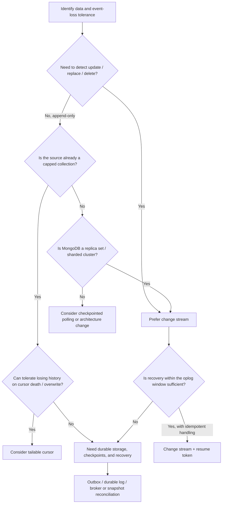

# Choosing Between Tailable Cursors and Change Streams Based on Tracked Data

In **Spring Data MongoDB**, two mechanisms can deliver near-real-time data streams, yet they answer two different questions:

- **Tailable cursor**: "Which *newly appended documents* have been added to a specific **capped collection**?" It closely resembles `tail -f` on a log file.
- **Change stream**: "Which *data mutation operations* just occurred in MongoDB?" It provides `insert`, `update`, `replace`, `delete`, and related events, built on replica set or sharded cluster change tracking.

For the `SPRING_DATA_MONGODB` module, this choice determines how you use `ReactiveMongoTemplate`, repositories, collection types, recovery strategies, and overall application reliability. Do not pick one simply because both return a `Flux`: **identify the type of data being observed and event semantics first**.

## 1. Start from the Data Model, Not the API

Consider two illustrative collections:

```javascript
// Continuous append-only log stream; each document records an immutable event.
db.audit_feed_capped.insertOne({
  type: "LOGIN",
  message: "user u42 logged in",
  occurredAt: new Date()
});

// Business document whose state changes over time.
db.orders.insertOne({ _id: "o-101", status: "CREATED", total: 250000 });
db.orders.updateOne({ _id: "o-101" }, { $set: { status: "PAID" } });
db.orders.deleteOne({ _id: "o-101" });
```

With `audit_feed_capped`, consumers typically want to read new log lines as they are written. With `orders`, consumers need to distinguish when an order is created, transitions state, and is deleted. A tailable cursor does not turn an `updateOne` into a "new row"; conversely, a change stream describes those mutations.

| Criterion | Tailable cursor | Change stream |
|---|---|---|
| Observed subject | Documents streamed from a **capped collection** | Change events of a supported collection/database/deployment |
| Source collection | **Must be a capped collection** | Typically a regular collection; no need to convert to capped |
| Suitable operations | Primarily append-only `insert` | `insert`, `update`, `replace`, `delete`; plus special events depending on scope and version |
| Returned payload | Document content matching the query | Operation type, document key, timestamp, resume token; document content per operation and options |
| MongoDB topology | Works on standalone if collection is capped | Requires a **replica set or sharded cluster**; does not work on plain standalone |
| Multi-collection watching | Each cursor is bound to one collection | Can watch at collection or database level; MongoDB driver also supports deployment level |
| Reconnect recovery | No built-in resume token for read position | Has resume token, subject to oplog history and recovery conditions |
| Storage limits | Capped collection has fixed size and evicts old records | Oplog also has a finite history window; not a permanent event store |
| Scale and constraints | Capped collections **cannot be sharded** or written in transactions | Works with replica sets or sharded clusters; incurs watcher maintenance and event-handling overhead |

**Quick rule of thumb:** If the data is an *append-only* sequence of records and live log-like reading suffices, consider a tailable cursor. If you need to know when **existing documents are modified, replaced, or deleted**, prefer a change stream. If every event must be retained and processed reliably over long periods, neither mechanism alone is enough—they are only one piece of the architecture and do not replace a durable queue/event log and business checkpoints.

## 2. When to Choose a Tailable Cursor?

A tailable cursor uses a special MongoDB cursor mode to keep waiting for new documents after reaching the end of a capped collection. A capped collection behaves much like a **circular buffer**: when full, the oldest data is evicted to make room for new entries. This makes it well suited for internal live log UIs, short-lived technical notifications, or event feeds where missing some history is acceptable.

For example, a system writes an immutable log entry each time a device sends a signal:

```javascript
// Run once during environment initialization; do not repeat if it already exists.
db.createCollection("audit_feed_capped", {
  capped: true,
  size: 10 * 1024 * 1024,
  max: 100000
});

// A bootstrap document can help readers start on an otherwise empty collection.
db.audit_feed_capped.insertOne({
  type: "BOOTSTRAP",
  message: "feed initialized",
  occurredAt: new Date()
});

db.audit_feed_capped.isCapped(); // true
```

`size` is the byte limit; `max` limits document count. Data can be evicted once **either threshold** is reached, so actual capacity must be sized around write rate, document size, and tolerable reader outage duration. Collection creation must be managed as a controlled deployment step; a regular collection does not become capped just by calling `tail()`.

Key conditions and trade-offs:

1. **Records are append-only in business terms.** Each new state is written as a new document rather than updated in place. Capped collections are unsuitable for updates that grow documents and do not support arbitrary deletes like regular collections.
2. **Old data is allowed to expire by capacity.** If a reader stays offline too long, records may be overwritten before being read. Simply reconnecting does not guarantee recovering lost records.
3. **Do not rely on indexes to keep up with the stream.** Tailable cursors primarily scan in the capped collection's natural order. If the requirement is "fetch records newer than `lastSeenId` via an index," a regular query with checkpointing may be more appropriate.
4. **Handle cursor lifecycle.** Cursors can terminate or become invalid, including when the initial query matches no documents. Monitor unexpected completions, errors, lag, and cursor reopening; when testing empty collections, you can use a bootstrap document and filter it out at the application layer.
5. **Do not assume strict global ordering.** With concurrent writers, observed order does not automatically match business chronological order; use `sequence` or `occurredAt` and explicit ordering rules if order matters.

Good fit example: a dashboard displaying the **latest 100 log lines**, where missing updates while the dashboard is closed is acceptable, and logs are already persisted in another storage system for long-term queries. A tailable cursor can supply the live feed from a capped collection. Conversely, "an audit log required to preserve every single record" should **not** rely solely on this capped ring buffer.

## 3. When to Choose a Change Stream?

Change streams use MongoDB's replication/change infrastructure to emit **operation events**, making them suitable for collections modeling *current state*: orders, inventory, profiles, product catalogs, configurations, or job execution statuses.

For an `orders` document, a typical event stream might look like:

```text
insert  { _id: "o-101", status: "CREATED" }
update  { documentKey: { _id: "o-101" },
          updateDescription: { updatedFields: { status: "PAID" } } }
delete  { documentKey: { _id: "o-101" } }
```

This is a simplified representation for illustration; actual payloads contain additional metadata and a resume token. By default, `update` **typically provides only the changed delta** in `updateDescription`, meaning the full document is not always included. You can enable `updateLookup` to request the updated document, though the returned value reflects the majority-committed state at lookup time—which may differ from the state immediately after that specific operation, or the document may already have been deleted. Pre-images (*before* the change) require separate configuration where supported by the feature and MongoDB version.

Change streams are appropriate when:

- You must react to state transitions like `CREATED → PAID → SHIPPED`, not merely observe new documents.
- You need to invalidate caches on `update`, remove entries from a search index on `delete`, or update projections based on mutations in business collections.
- You need to watch multiple entity types or multiple collections within the same database, with per-document-type mapping strategies.
- You need to persist a **resume token** to attempt resuming from the last processed position after an application restart.

Verify before designing:

- **Topology:** Change streams require a replica set or sharded cluster. Development setups running standalone `mongod` will not work; you can run a single-node replica set to test the API, though it does not fully simulate production failover.
- **Supported scope:** Not all namespaces or collection types can be watched with change streams. For example, MongoDB **does not support change streams directly on time series collections**; system collections and special databases also have restrictions.
- **Oplog window:** A resume token is only usable while MongoDB still retains enough oplog history to locate that position. If downtime exceeds the oplog retention window or the token is invalidated, a resynchronization procedure is required.
- **Overhead:** Each watcher holds resources and a connection awaiting `getMore`. Spawning watchers indiscriminately can strain connection pools and latency. Filter events early, bound watcher counts, and monitor system load.

A change stream is not an infinite event-sourcing log: it reflects committed data operations in MongoDB and does not automatically grant the application *exactly-once* processing at destination systems.

## 4. Decision Tree Based on Tracked Data



### Typical Scenarios

| Problem | Which Approach? | Rationale and Key Caveats |
|---|---|---|
| Live operations log monitor where missing entries when closed is fine | **Tailable cursor** if logs reside in a capped collection | Append-only model; no `update`/`delete` handling needed; buffer limits accepted |
| Tracking order status transitions and cancellations | **Change stream** | Must distinguish `insert`, `update`, `delete`, with document key and recovery token |
| Updating a cache when product details are edited | **Change stream** | With a tailable cursor, edits to an existing document do not become newly appended records |
| Syncing MongoDB to a search index | **Change stream + initial snapshot + checkpoint** | Must apply creates, updates, deletes and handle the overlap window between snapshot and change stream |
| Immutable audit log requiring lossless retention and multi-month lookup | **Durable store / outbox or broker**; use streams as delivery pipes where fitting | Capped evicts old data; oplog is also finite; requires dedicated retention and replay |
| Sensors using native **time series collections** | **Neither directly** | Time series collections are not capped and do not support change streams directly; consider parallel ingest streams, a broker, or watermark queries |
| Standalone MongoDB wanting to see new documents in a regular collection | **Checkpointed polling**, or change topology/design | Regular collections do not support tailable; change streams require replica set/sharded cluster |
| Watching changes across multiple business collections in one database | **Database-level change stream** | A tailable cursor follows only a single capped collection; read raw payload or map per entity |

An often overlooked question: **"Do I want to receive new documents, or do I want to receive all changes to documents?"** Those two answers alone determine most of the choice. Only then should you evaluate topology, loss tolerance, latency, and recovery policy.

## 5. Implementation Example with Spring Data MongoDB Reactive

Spring Data MongoDB lets you create both streams using `ReactiveMongoTemplate`. The example below uses `Document` to focus on stream semantics; in real applications you can substitute Spring Data-mapped domain classes.

```java
import org.bson.Document;
import org.springframework.data.mongodb.core.ChangeStreamEvent;
import org.springframework.data.mongodb.core.ChangeStreamOptions;
import org.springframework.data.mongodb.core.ReactiveMongoTemplate;
import org.springframework.data.mongodb.core.query.Query;
import org.springframework.stereotype.Service;
import reactor.core.publisher.Flux;

@Service
public class MongoFeedService {

    private final ReactiveMongoTemplate mongo;

    public MongoFeedService(ReactiveMongoTemplate mongo) {
        this.mongo = mongo;
    }

    // Source: capped collection audit_feed_capped, appended documents.
    public Flux<Document> followAuditFeed() {
        return mongo.tail(new Query(), Document.class, "audit_feed_capped")
                .filter(doc -> !"BOOTSTRAP".equals(doc.getString("type")));
    }

    // Source: regular orders collection on replica set/sharded cluster.
    // Each element is an operation event rather than just the document body.
    public Flux<ChangeStreamEvent<Document>> watchOrderChanges() {
        return mongo.changeStream(
                null,                           // template's default database
                "orders",
                ChangeStreamOptions.empty(),
                Document.class);
    }
}
```

Consuming the results:

```java
// Illustrative handling; real consumers need dedicated error handling and checkpointing.
mongoFeedService.followAuditFeed()
        .subscribe(log -> System.out.println(log.toJson()));

mongoFeedService.watchOrderChanges()
        .subscribe(event -> {
            System.out.println("operation = " + event.getOperationType());
            System.out.println("documentKey = " +
                    (event.getRaw() != null ? event.getRaw().getDocumentKey() : null));
            System.out.println("resumeToken = " + event.getResumeToken());
            System.out.println("fullDocument = " + event.getBody());
        });
```

The snippets above **do not automatically turn `subscribe()` into a managed background process**. In long-running services, manage `Disposable`/bean lifecycles, cancel subscriptions on shutdown, record errors, and define stream reopening policies. For reactive workloads, do not block read threads with synchronous slow I/O; use asynchronous pipelines and tune backpressure as needed.

If you only want documents with `type = LOGIN`, you can filter in Reactor after receiving from `tail()` as shown with `BOOTSTRAP` above. A tailable query whose initial predicate matches nothing may cause the cursor to close, so weigh server-side filtering carefully against keeping the cursor alive when no matching records exist yet.

### Watching Changes with Full Document Lookup

When an `update` operation reports only modified fields, you can opt to return the full document as well:

```java
ChangeStreamOptions options = ChangeStreamOptions.builder()
        .returnFullDocumentOnUpdate() // corresponds to fullDocument: updateLookup
        .build();

Flux<ChangeStreamEvent<Document>> events = mongo.changeStream(
        null, "orders", options, Document.class);
```

Do not rely on `event.getBody()` as the sole data source across all operation types: `delete` generally has no post-delete document; `updateLookup` may return no document or a state modified by subsequent operations. Inspect `getOperationType()` and `getRaw()`/`documentKey` and design target actions per event type.

### Resuming a Change Stream from a Resume Token

From `event.getResumeToken()` you obtain a `BsonValue`. After persisting a durable checkpoint, restart using that token:

```java
import org.bson.BsonValue;

// Call only when the checkpoint store has returned a valid BSON token.
public Flux<ChangeStreamEvent<Document>> resumeOrders(
        BsonValue tokenFromCheckpoint) {
    ChangeStreamOptions resumeOptions = ChangeStreamOptions.builder()
            .resumeAfter(tokenFromCheckpoint)
            .build();

    return mongo.changeStream(
            null, "orders", resumeOptions, Document.class);
}
```

This illustrative method belongs inside `MongoFeedService` from the example above; `tokenFromCheckpoint` must come from an actual checkpoint store. This shows **API configuration**, not a complete checkpoint implementation. Preserve the BSON token intact along with namespace scope, pipeline, and related options to resume the exact stream. `resumeAfter` cannot resume past an `invalidate` event such as `drop`/`rename`; where supported, evaluate `startAfter` and target-data rebuild policies. If the token has fallen outside the oplog window, handle the error and trigger reconciliation/snapshot rebuild instead of retrying forever with the same token.

## 6. Recovery Design and Deduplication

The biggest operational difference is that **change streams have a resume token**, while tailable cursors have no equivalent change-tracking token. Even so, a token does not replace business checkpointing.

### For Tailable Cursors

- Understand capped capacity and write rate: for example, 10 MiB at an average of 1 KiB/document holds roughly ten thousand documents before subtracting overhead; actual retention time depends on write load.
- Tracking an application-level position like `sequence` or timestamp only helps with **gap detection and reconciliation** while the source still retains history; it does not turn a capped collection into an infinitely replayable log.
- Handle unexpected `onError` and `onComplete`, reconnect with backoff, and alert when gaps are detected. Re-reading a range can produce duplicates; use event identifiers if the consumer performs side effects.

### For Change Streams

Consumer pipelines generally need to enforce this order:

1. Receive an event containing operation type, `documentKey`, and `resumeToken`.
2. Apply the change to the target system in an **idempotent** manner (re-processing the same event does not corrupt results); key and event identifiers help control duplicates.
3. **After** the side effect succeeds, persist the checkpoint token in durable storage. When target system and checkpoint do not share a transaction, accept potential event replay and design idempotency accordingly.
4. On restart, read the token, open the change stream from there, retry transient errors with backoff, and alert if the token becomes invalid.

If you persist the token **before** updating the target system, a failure during the update can permanently skip the event. If the target update succeeds but persisting the token fails, the event may be replayed. This is why "having a resume token" **does not equal** "exactly once."

For financial workflows, mandatory auditing, or zero-loss synchronization, consider a **transactional outbox** on the business source, a broker/log with suitable retention, or periodic reconciliation alongside change streams. If syncing existing state is required, take an initial snapshot and design the **snapshot–stream boundary** carefully: running `findAll()` and then subscribing to a change stream afterward can miss changes occurring between the two steps. Select a recoverable stream start point, merge snapshot and overlapping events, and deduplicate before transitioning the system to steady-state watching.

## 7. Performance, Resources, and Common Misconceptions

| Claim | Reality to Apply |
|---|---|
| "Putting `@Tailable` on any repository gives realtime." | Tailable repositories are only valid on **capped collections**; the API does not alter underlying storage. Spring Data supports `@Tailable` on reactive multi-element methods such as `Flux`. |
| "Tailable cursors return every document edit." | They read document streams from capped collections and do not emit `update`/`delete` events like change streams. |
| "Change streams always return the newest and oldest documents." | Consider `operationType`, deltas, `fullDocument`, and pre-image options; many cases omit full documents. |
| "Resume tokens allow infinite replay." | The oplog is finite. Incompatible tokens/pipelines or purged history prevent resuming from old positions. |
| "A watcher is basically free." | Watchers consume connections and server resources; many watchers or heavy lookups can impact latency. |
| "Just opening a listener automatically load-balances events across all instances." | Each independent subscriber may receive the same events; coordinate ownership, work partitioning, or idempotency across instances. |
| "Using a capped collection for automatic log cleanup is equivalent to TTL." | Capped bounds by size/record count while TTL deletes by time; querying, update behavior, and data governance differ. |

Metrics to monitor include: age of the most recently processed event, cursor close/error counts, reconnect counts, read/write rates, event processing error rate, checkpoint age relative to the oplog window, connection pool size, and lookup/target-write latency. For tailable cursors, add alerts comparing outage duration against capped collection data lifetime.

## 8. Hands-On Verification of Your Decision

**Exercise A — Append-only feed:** Create `audit_feed_capped` as in Section 2, insert a `BOOTSTRAP` record, open `followAuditFeed()`, then `insertOne` three new log entries. Confirm the subscriber sees the three new lines. Stop the subscriber, insert enough records for the capped collection to evict older logs, then reopen. Inspect which records remain to see why tailable cursors cannot be relied on for mandatory history.

**Exercise B — Business state:** Run MongoDB as a replica set, create a regular `orders` collection, open `watchOrderChanges()`, and sequentially run `insertOne`, `updateOne`, and `deleteOne` on the same key. Compare `getOperationType()` against received events. Enable `returnFullDocumentOnUpdate()` and compare the `update` delta against `getBody()`; for `delete`, use `documentKey` to remove the corresponding projection.

**Exercise C — Recovery:** Save the token after successfully processing an event in Exercise B, cancel the subscription, generate more events, and re-subscribe via `resumeAfter(token)`. Verify the stream resumes after the token while oplog history remains sufficient. Simulate target processing succeeding while checkpoint persistence fails to verify idempotency. Do not intentionally corrupt the oplog; document the resynchronization plan for expired tokens.

**Self-assessment question:** A team wants to sync `inventory.quantity` state and evict deleted products from a cache. They currently use a capped collection for access logs. Can they reuse the log's tailable cursor to guarantee inventory updates? **No**, because access logs and inventory state are two sources with different semantics; watch the inventory collection with a change stream (or emit dedicated business events), handle `update`/`delete`, store tokens, and reconcile if needed.

## References

- [Spring Data MongoDB — Tailable Cursors](https://docs.spring.io/spring-data/mongodb/reference/mongodb/tailable-cursors.html)
- [Spring Data MongoDB — Change Streams](https://docs.spring.io/spring-data/mongodb/reference/mongodb/change-streams.html)
- [MongoDB — Tailable Cursors](https://www.mongodb.com/docs/manual/core/tailable-cursors/)
- [MongoDB — Capped Collections](https://www.mongodb.com/docs/manual/core/capped-collections/)
- [MongoDB — Change Streams](https://www.mongodb.com/docs/manual/changestreams/)

When making a decision, state clearly in your design: **(1)** whether documents are immutable or updated/deleted, **(2)** the actual collection type and topology, **(3)** tolerance for gaps/duplicates, and **(4)** restart and history resynchronization procedures. These four facts ensure the right choice between tailable cursors, change streams, and a more durable event architecture.
