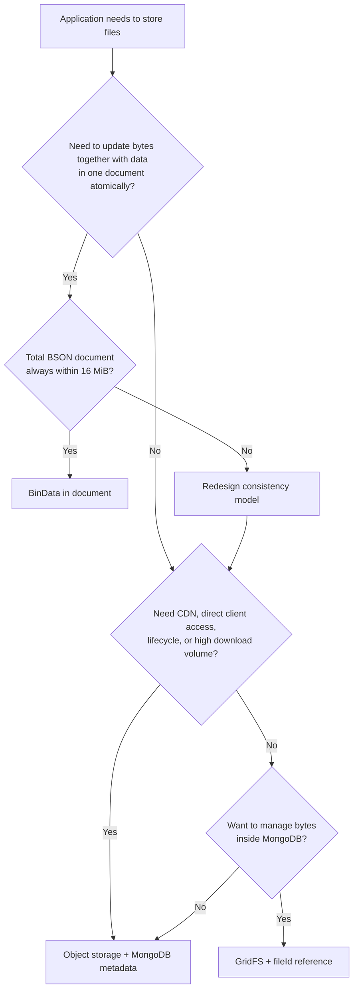

# When should you store files with GridFS instead of a single document or object storage?

## 1. The problem to solve

When building applications with **Spring Data MongoDB**, binary data such as images, PDF contracts, audio recordings, attachments, or exported reports can be stored in three common ways:

1. Placing binary data (`BinData`) inside **a single MongoDB document**.
2. Storing file contents in **MongoDB GridFS**, letting MongoDB manage parts of the file across multiple documents.
3. Writing files to **object storage** (for example, Amazon S3 or a compatible service), while MongoDB only holds the object key and business metadata.

No single option is optimal for every scenario. You need to evaluate **file size, access patterns, coupling with business data, user delivery capabilities, operational cost, and consistency**. In particular, **16 MiB is the size limit of an *entire BSON document***, not a threshold below which every file should be embedded in a document.

Lesson goal: know when to choose GridFS, when to choose a single document, and when to use object storage; understand the trade-offs to apply in Spring Data MongoDB's `GridFsTemplate`, `GridFsOperations`, or `ReactiveGridFsTemplate`.

## 2. Where do the three options actually store data?

### 2.1. Embedding content in a single document

For example, a small receipt stored together with its metadata:

```javascript
// Illustrative example: the bytes field uses BSON Binary, not a Base64 string.
{
  _id: ObjectId("691a00000000000000000001"),
  ownerId: "customer-42",
  filename: "receipt.pdf",
  contentType: "application/pdf",
  content: BinData(0, "<base64-payload>"),
  createdAt: ISODate("2026-11-20T03:00:00Z")
}
```

A single document read can retrieve both metadata and bytes; a single document update is MongoDB's atomic unit. In return, large binary data increases transfer volume, memory/cache pressure, and read cost if queries accidentally fetch the `content` field. You can use projections to omit the binary field when only metadata is needed, but the data is still stored in that document.

**Use when:** files are relatively small, there is a safe margin below the document size limit, read count/frequency is appropriate, and there is a clear reason to update bytes together with related fields in one document. A 15.9 MiB file can still push a document over 16 MiB after adding metadata or schema changes, so you must calculate *total BSON size* and leave headroom for growth.

### 2.2. GridFS: a file as multiple documents in MongoDB

**GridFS** is a MongoDB driver convention that splits file contents into **chunks**, defaulting to at most **255 KiB** per chunk. With the default bucket `fs`, the driver works with two collections:

- `fs.files`: one metadata document per file, containing `_id`, `filename`, `length`, `chunkSize`, `uploadDate`, and `metadata` if present.
- `fs.chunks`: documents carrying the actual bytes, linked back to the file via `files_id`, with sequence number `n` and a binary `data` field.

```text
                        GridFS Bucket: fs
  ┌────────────────────────────────────────────────────────┐
  │ fs.files                                              │
  │ { _id: file-123, filename: "contract.pdf",            │
  │   length: 25000000, chunkSize: 261120,               │
  │   metadata: { ownerId: "customer-42" } }              │
  └───────────────────────┬────────────────────────────────┘
                          │ files_id = file-123
             ┌────────────┼────────────┐
             ▼            ▼            ▼
         fs.chunks     fs.chunks     fs.chunks ...
         {n: 0, data}  {n: 1, data}  {n: 2, data}
                          │
                      Driver reassembles
                      when reading file
```

`261120` bytes equals 255 KiB. The bucket name is a collection prefix, not necessarily always `fs`; `filename` is also **not a unique key**, because different versions of a file can share the same name. When reading, the application should prefer the file identifier `_id` stored in business data.

GridFS lets you store files **exceeding the 16 MiB single-document limit** while still using existing MongoDB infrastructure, replica sets, backups, access controls, and MongoDB monitoring tools. Driver APIs support sequential streaming reads/writes so the application does not have to allocate a single `byte[]` holding the entire file.

**Important limitation:** GridFS **does not support multi-document transactions**. Adding, deleting, or replacing multiple chunks cannot be treated as an atomic update like an operation on a single document. MongoDB also recommends **not using GridFS when atomic updates of the entire file content are required**. You can create a new version, verify it completely, and then swap the `currentFileId` pointer in a business document using an atomic update; collecting old versions happens afterward.

### 2.3. Object storage: MongoDB only keeps a reference

With object storage, the application stores bytes in a dedicated object-serving system; the MongoDB document only contains information to locate and control the file:

```javascript
{
  _id: ObjectId("691a00000000000000000002"),
  ownerId: "customer-42",
  storage: "OBJECT",
  bucket: "private-attachments",
  objectKey: "customer-42/contracts/8f2d.../contract.pdf",
  originalFilename: "contract.pdf",
  contentType: "application/pdf",
  sizeBytes: NumberLong("25000000"),
  sha256: "<sha256-hex>",
  status: "READY"
}
```

The application can issue time-limited upload/download URLs for direct transfers between the client and the storage service (if security requirements are met). This architecture typically fits large capacity, high download volume, CDN delivery, lifecycle/storage-tier management, and scaling independently of MongoDB. On the other hand, **writing the object and writing to MongoDB are two operations across two systems**: you need a workflow to handle cases where one succeeds and the other fails.

## 3. Decision table: document, GridFS, or object storage?

| Criterion | Single MongoDB document (`BinData`) | MongoDB GridFS | Object storage + MongoDB metadata |
|---|---|---|---|
| Size | Total document **must be less than or equal to the 16 MiB limit**; keep a safety margin | Suitable for files over 16 MiB; also usable for small files when justified | Works for small or very large files, depending on service limits |
| Read/write pattern | Read/write the whole binary field, can project metadata | Streaming read/write via GridFS API; file split into chunks | Object upload/download; often supports direct access and HTTP range depending on service |
| Atomicity | Updates within **a single document** are atomic | **No** multi-document transactions across the whole file/chunks; prefer immutable files and versioning | No shared ACID transaction with MongoDB; requires state tracking and compensation |
| Infrastructure | MongoDB only | MongoDB only, reusing driver, backup, and MongoDB authorization | Adds object storage service; manage permissions, keys, lifecycle, and metadata sync |
| Delivery capability | Application usually has to serve bytes | Application usually streams files from MongoDB to clients | Well-suited for presigned URLs, CDN, and high-fanout client delivery |
| Impact on MongoDB | Large binaries can bloat documents | Chunks consume MongoDB storage, replication, I/O, backups, and index size | MongoDB stays lighter since it usually stores metadata only |
| Typical use cases | Small images/digital signatures tightly bound to one record | Large internal records accessed via business APIs and managed inside MongoDB | Product images, videos, public files, large archives, or high-download workloads |

**Initial selection rules:**

1. If bytes and metadata must be updated **atomically within the same document**, and total document size is small with plenty of safety margin: consider `BinData`.
2. If you have decided to store bytes *in MongoDB* but a file may exceed 16 MiB, or you want streaming read/write through the driver: consider **GridFS**.
3. If files serve many users, require a CDN, direct client downloads, long-term retention, lifecycle policies, or storage growth independent of the database: evaluate **object storage** first.
4. If unclear, measure on a real workload: average/P95 size, reads per file, network egress, retention period, backup/replica cost, and acceptable latency.



The diagram is a starting point for an architectural decision. It does not mean files larger than 16 MiB *must* use GridFS: that limit only forces a change in storage mechanism if you want to keep placing bytes inside MongoDB.

## 4. Scenarios for choosing

### Scenario A — Small form requiring synchronous updates

An internal system stores small signature images of around 40 KiB along with signature status and timestamp for a request. Each page load typically needs both the signature and metadata; the total document is far below 16 MiB. **A single document** can be simple and allows updating the data and status in one atomic operation. Even so, if a list view only needs status, always use a projection to exclude bytes and reduce load.

### Scenario B — 25 MiB PDF contracts in an internal system

Contracts are downloaded through an API after authentication, with no need for a CDN or direct download links. Operations wants backups and access control handled through existing MongoDB. **GridFS** is a reasonable choice: store files as chunks, keep `fileId` in the `Contract` document, and read via stream on download. You still need to verify access rights against `contract.ownerId`, because `fileId` itself is not an authorization token.

### Scenario C — Publicly served product images and videos

Millions of images and videos are downloaded repeatedly, some streamed via HTTP Range, with users spread across multiple regions. **Object storage + CDN** is usually a better fit. MongoDB holds `objectKey`, version, permissions, and search metadata; clients download through a CDN or presigned URL. Choosing GridFS solely because videos exceed 16 MiB can push most bandwidth and backup load onto the MongoDB cluster unnecessarily.

### Scenario D — Versioned evidence archive

An 80 MiB file is downloaded only a few times per month, requires history tracking, SHA-256 verification, and immutability of old files. Either GridFS or object storage is viable. If full management inside MongoDB is desired and traffic is low, GridFS can be convenient. If retention is long, volume grows rapidly, or tiered cost storage is needed, object storage is usually worth evaluating more closely. **Business-layer versioning** matters more than the name of the byte-storage technology.

## 5. How to use GridFS in Spring Data MongoDB

Spring Data MongoDB provides `GridFsOperations`/`GridFsTemplate` for imperative applications and `ReactiveGridFsOperations`/`ReactiveGridFsTemplate` for reactive applications. The section below uses the imperative style to illustrate the concept. Dependencies, MongoDB connection configuration, and GridFS beans must be configured appropriately for the Spring Data version in use.

### 5.1. Storing content from an `InputStream`

```java
import java.io.InputStream;
import java.io.OutputStream;
import java.io.IOException;
import java.util.NoSuchElementException;

import org.bson.Document;
import org.bson.types.ObjectId;
import org.springframework.data.mongodb.gridfs.GridFsOperations;
import org.springframework.data.mongodb.core.query.Criteria;
import org.springframework.data.mongodb.core.query.Query;
import org.springframework.stereotype.Service;

import com.mongodb.client.gridfs.model.GridFSFile;

@Service
public class ContractFileStore {
    private final GridFsOperations gridFs;

    public ContractFileStore(GridFsOperations gridFs) {
        this.gridFs = gridFs;
    }

    public ObjectId save(InputStream source, String filename,
                         String contentType, String contractId,
                         String sha256) {
        Document metadata = new Document("contractId", contractId)
                .append("sha256", sha256);

        // Driver writes the chunks; method returns _id in fs.files.
        return gridFs.store(source, filename, contentType, metadata);
    }

    public void copyTo(ObjectId fileId, OutputStream destination)
            throws IOException {
        GridFSFile file = gridFs.findOne(
                Query.query(Criteria.where("_id").is(fileId)));

        if (file == null) {
            throw new NoSuchElementException("File not found: " + fileId);
        }

        // Stream read without buffering the entire file into byte[].
        try (InputStream source = gridFs.getResource(file).getInputStream()) {
            source.transferTo(destination);
        }
    }
}
```

The `save` method accepts an open stream; **the caller is responsible for closing the input stream** after the operation completes. Example with `MultipartFile`:

```java
try (InputStream in = multipartFile.getInputStream()) {
    ObjectId fileId = contractFileStore.save(
        in, multipartFile.getOriginalFilename(),
        multipartFile.getContentType(), contractId, calculatedSha256);
    // Save fileId into the business document after GridFS upload succeeds.
}
```

The snippet only illustrates the store/read API. In a real application, you must validate size, actual MIME type, filename, permissions on `contractId`, quota, upload errors, and malware scanning policies when accepting user content. Do not trust a user-supplied `contractId` as an authorization basis without verification.

### 5.2. Storing fileId in the business document

```javascript
{
  _id: "contract-2026-42",
  ownerId: "customer-42",
  title: "Service Lease Contract",
  currentFileId: ObjectId("691a00000000000000000003"),
  version: 3,
  status: "SIGNED"
}
```

`currentFileId` links to `fs.files._id`, keeping business queries compact and independent of file size. To update, **write the new file first**, verify its checksum, and then swap `currentFileId` using a conditional update or optimistic locking on the `Contract` document. Only afterward should old files be deleted according to retention policy; multiple versions can be retained for audit or rollback. If the pointer update fails, a mechanism is needed to clean up unreferenced versions.

### 5.3. Queries, indexes, and metadata

The default bucket has standard GridFS indexes on `fs.chunks(files_id, n)` and `fs.files(filename, uploadDate)` ensured by driver support during operation. When filtering by `metadata.contractId` in `fs.files`, consider an application index based on measured queries:

```javascript
db.fs.files.createIndex({ "metadata.contractId": 1, uploadDate: -1 });
```

Business indexes add write and storage overhead, so do not create them unconditionally for every metadata field. `GridFsOperations.find(Query)` has its own limitations: certain `Sort` criteria in `Query` are not applied to GridFS retrieval according to Spring Data documentation. If version selection is required, the application should rely on stored identifiers/versions and test retrieval ordering in the specific API version.

`filename` can be duplicated across uploads; `metadata` can contain tenant ID, document classification, checksum, or version. Do not rely on GridFS's legacy `md5` field for integrity requirements: that field is deprecated; you can compute **SHA-256 at the application layer** and store it in `metadata`.

### 5.4. When using Reactive Spring Data MongoDB

In a reactive pipeline, use `ReactiveGridFsTemplate` and a `Publisher<DataBuffer>` input to avoid forcing the entire content into memory. You must manage backpressure, release `DataBuffer` instances per the API contract when required, propagate errors, and handle upload cancellation properly. **Reactive does not change** the `files/chunks` model or GridFS's transaction limitations; it changes how the application executes I/O.

## 6. Operational risks often overlooked

### 6.1. Storage capacity, backups, and bandwidth

GridFS places bytes on the same MongoDB infrastructure, so file growth brings replication, snapshot/backup, restore, inter-replica bandwidth, IOPS, and recovery time costs. For example, **10,000 files × 20 MiB ≈ 195 GiB** of binary data before overhead; with three replicas, the data portion alone can amount to roughly **586 GiB** across nodes. This is a capacity calculation example, not a cost prediction for every cluster; compression, indexes, and actual backup policies must also be factored in.

For object storage, you must factor in request fees, egress data, network/CDN, versioning, storage tiers, and retrieval operations. Do not conclude which option is cheaper based solely on per-GB storage price.

### 6.2. Access control and data paths

- **Document / GridFS:** every file retrieval request should pass through business authorization checks before accessing bytes. Managing `ObjectId` and buckets does not replace owner/tenant authorization.
- **Object storage:** configure private bucket permissions, issue narrowly scoped temporary URLs when needed, and control expiration and cache/CDN behavior; do not use hard-to-guess object keys as a security mechanism.
- **All three:** validate real file types, enforce size and count limits, log access appropriately, store checksums, and protect sensitive data both in transit and at rest.

### 6.3. Failed uploads, orphan data, and file deletion

In GridFS, one file consists of many chunks, so you must handle failed uploads, timeouts, and crashes before business metadata is updated. Use `fileId` and business status for reconciliation; prefer the GridFS API when deleting so the driver handles both the file and its associated chunks. Do not arbitrarily delete a document in `fs.files` and assume `fs.chunks` will disappear automatically. If manual intervention or crashes occur, operational procedures may need to scan for orphan chunks/files.

With object storage, a `PENDING_UPLOAD → READY` lifecycle is commonly used after upload and verification succeed. If object creation succeeds but the MongoDB update fails, enqueue the object for cleanup. If metadata already exists but the upload fails, mark the error and allow retries. This is **application-level consistency**, not a single transaction spanning two systems.

### 6.4. Updates, streaming, and file delivery

GridFS fits an **immutable-after-write file** model. When modifying contents, write a new version and then swap the reference. Portions of a file can be accessed using driver capabilities, but **HTTP Range/206, adaptive video streaming, and CDN do not appear automatically just by using GridFS**: the application must implement those layers if needed. Streaming reduces the need to hold the entire file in RAM; it does not automatically reduce network volume or eliminate MongoDB bottlenecks.

## 7. Design checklist before finalizing the approach

Answer the following questions using real data or verified assumptions:

1. What are the maximum, average, and P95 file sizes? Can total BSON document size approach 16 MiB?
2. How often are files read, and do they require a CDN, direct downloads, metadata search, or partial-range access?
3. Must bytes and metadata be updated **atomically**? If so, how do GridFS and object storage limitations affect this?
4. Are files immutable? How many versions must be kept, for how long, and when should they be deleted?
5. Which tenant owns the file? Who is allowed to upload/download? Where is authorization enforced?
6. With GridFS, are backup, restore, replica, index, and throughput costs on the MongoDB cluster still acceptable?
7. With object storage, what is the recovery plan when MongoDB metadata and the object become out of sync?
8. Have p95 latency, application memory, throughput, total operational cost, and failure handling been measured with a representative workload?

**Conclusion:** Choose **a single document** when content is small and simplicity/atomicity within that document itself is needed. Choose **GridFS** when you want to manage files with MongoDB, especially for files exceeding 16 MiB or requiring streaming I/O through Spring Data, while accepting MongoDB overhead and transaction limits. Choose **object storage** when file delivery, storage scaling, lifecycle management, and independent storage economics outweigh keeping bytes inside the database. For both GridFS and object storage, store **stable references, checksums, and version status** in business data.

## References

- [MongoDB Manual — GridFS, use cases and limits](https://www.mongodb.com/docs/manual/core/gridfs/)
- [MongoDB GridFS Specification — bucket, files, and chunks model](https://github.com/mongodb/specifications/blob/master/source/gridfs/gridfs-spec.md)
- [Spring Data MongoDB — GridFS Support](https://docs.spring.io/spring-data/mongodb/reference/mongodb/template-gridfs.html)
- [Spring Data MongoDB — `GridFsTemplate` API](https://docs.spring.io/spring-data/mongodb/reference/api/java/org/springframework/data/mongodb/gridfs/GridFsTemplate.html)
- [Amazon S3 — Presigned URLs (example object storage access mechanism)](https://docs.aws.amazon.com/AmazonS3/latest/userguide/using-presigned-url.html)
