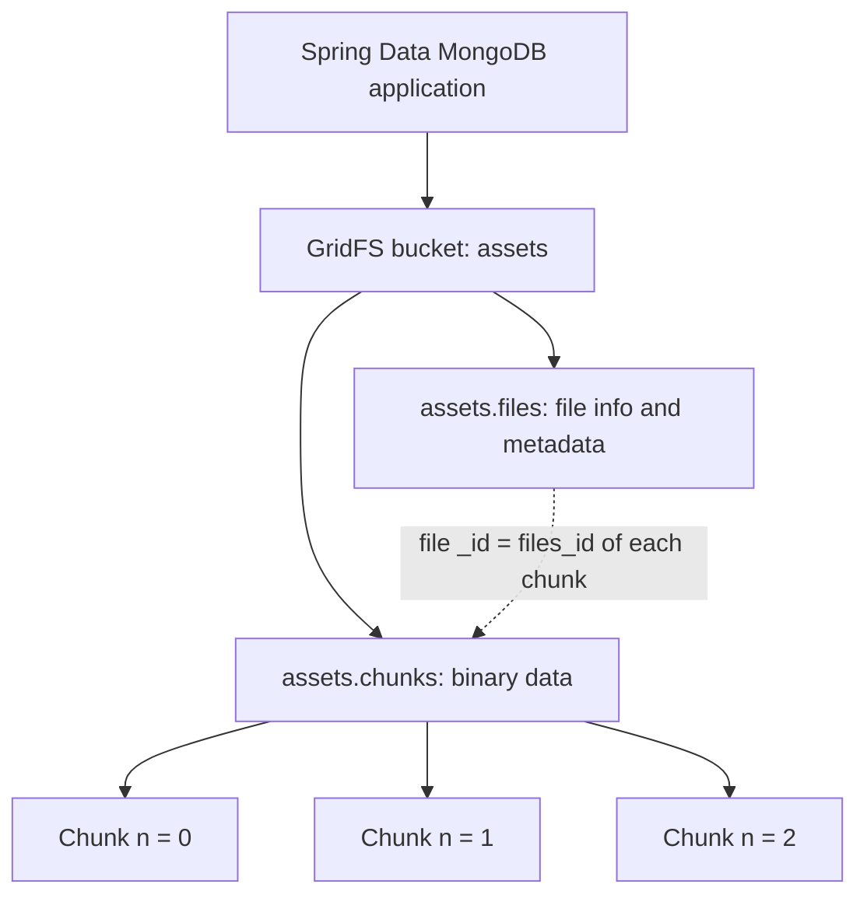

# Buckets, files/chunks collections, and metadata in GridFS

## Learning Objectives

After this lesson, you will be able to:

- Explain what a GridFS bucket is and why each bucket uses two collections, `files` and `chunks`.
- Read the structure of a file record, trace chunks back to the parent file, and calculate the expected number of chunks.
- Design metadata for lookup, authorization, and data lifecycle without confusing metadata with binary content.
- Configure buckets, store/read files with Spring Data MongoDB, inspect indexes, and identify orphan data.

## 1. Why does GridFS need buckets?

A MongoDB document has a BSON size limit of **16 MiB**. GridFS is a convention for storing files by splitting binary content into small **chunks** stored in MongoDB while maintaining a document describing the file. As a result, applications can store and read files larger than the limit of a regular document.

In the **SPRING_DATA_MONGODB** module, Java applications typically use **`GridFsTemplate`** or **`ReactiveGridFsTemplate`** to access GridFS, alongside `MongoTemplate` and repositories used for business data.

A **bucket** is a logical storage group name in GridFS, not a separate collection on its own or a physical directory. A bucket named `assets` corresponds to two collections:

| Component | Collection for bucket `assets` | Role |
|---|---|---|
| File records | `assets.files` | Each document represents one file; contains identifier, name, length, chunk size, upload timestamp, and metadata. |
| Binary chunks | `assets.chunks` | Each document holds a slice of binary data and its sequence number within the file. |

The default bucket name is usually **`fs`**, creating `fs.files` and `fs.chunks`. Other buckets such as `avatars`, `reports`, or `assets` can be defined to separate file groups according to application needs. Buckets within the same database are distinguished by collection name.



**When should you use it?** GridFS is appropriate when data consists of binary files that need to be stored, streamed, and managed within the same MongoDB system, especially when files may exceed 16 MiB. For very small files, a binary field inside a document can be simpler. If the primary requirement is very high public download throughput, transfer and object storage costs should be evaluated alongside object storage solutions.

## 2. Structure of the `<bucket>.files` collection

Each file is described by **one document** in the `assets.files` collection. The following example describes a 700,000-byte PDF file:

```javascript
// Illustrative document in db.assets.files
{
  _id: ObjectId("66aa00bb11cc22dd33ee44ff"),
  length: NumberLong("700000"),
  chunkSize: 261120,
  uploadDate: ISODate("2026-11-20T04:00:00Z"),
  filename: "bao-cao-quy-4.pdf",
  metadata: {
    ownerId: "u-42",
    category: "quarterly-report",
    contentType: "application/pdf",
    sha256: "calculated-sha256-value-for-file",
    schemaVersion: 1
  }
}
```

| Field | Meaning and notes |
|---|---|
| `_id` | Unique identifier of the file within the bucket. Usually an `ObjectId`, though the GridFS protocol allows other BSON identifier types if supported by the driver. |
| `length` | Total number of bytes in the file content, not the chunk count or metadata size. |
| `chunkSize` | Nominal chunk size at upload time; the last chunk is usually smaller. For example, 261,120 bytes = 255 KiB. |
| `uploadDate` | Upload timestamp recorded by GridFS, typically represented in UTC when viewed as `ISODate`. |
| `filename` | Suggested name for display or search; **not guaranteed to be unique**. |
| `metadata` | Optional document for business data, such as owner, file category, MIME type, checksum, and metadata schema version. |

Fields such as `contentType` or `md5` may appear in older GridFS documentation or data. In new designs, place application-needed fields inside `metadata` and manage a reliable checksum yourself, such as SHA-256. Do not assume GridFS always provides an MD5 field.

**Distinguishing `_id` and `filename`:** Two uploads with the same `filename` can still produce two distinct documents with two different `_id` values. Therefore, APIs retrieving a specific file should use the identifier, along with ownership/access checks, rather than relying solely on the filename.

## 3. Structure of the `<bucket>.chunks` collection

File content is split across multiple documents in `assets.chunks`. Each chunk has three core fields (plus `_id`):

| Field | Role |
|---|---|
| `_id` | Unique identifier of the chunk document. |
| `files_id` | Logical reference to the `_id` of the document in `assets.files`. |
| `n` | Chunk sequence number, **starting from 0**, to reassemble in the right order. |
| `data` | Binary content (`BinData`) of the chunk. |

Abbreviated example for the 700,000-byte file from the previous section:

```javascript
// Three distinct documents in db.assets.chunks.
// data is described with comments, not executable BSON syntax.
{
  _id: ObjectId("66aa00bb11cc22dd33ee4501"),
  files_id: ObjectId("66aa00bb11cc22dd33ee44ff"),
  n: 0,
  data: /* 261120 binary bytes */
}
{
  _id: ObjectId("66aa00bb11cc22dd33ee4502"),
  files_id: ObjectId("66aa00bb11cc22dd33ee44ff"),
  n: 1,
  data: /* 261120 binary bytes */
}
{
  _id: ObjectId("66aa00bb11cc22dd33ee4503"),
  files_id: ObjectId("66aa00bb11cc22dd33ee44ff"),
  n: 2,
  data: /* 177760 binary bytes */
}
```

Given length **`L`** and chunk size **`S`**, the expected number of chunks for a non-empty file is:

```text
chunkCount = ceil(L / S)

L = 700000 bytes
S = 261120 bytes (255 KiB)
chunkCount = ceil(700000 / 261120) = 3

261120 + 261120 + 177760 = 700000 bytes
```

The standard default size commonly used in GridFS is **255 KiB** (261,120 bytes), though applications can choose another value when uploading. Chunk size affects document count and access cost: smaller chunks create more documents; larger chunks make each chunk read/write heavier. Do not modify `chunkSize` in a stored document without rewriting the file content according to the protocol.

GridFS uses a **logical** link; MongoDB does not enforce a foreign key between `files_id` and `_id`. The driver must read chunks in ascending order of `n`, detect missing or duplicate chunks, and reassemble the data into a byte stream. Applications should use the built-in GridFS API rather than manually concatenating `data` documents.

## 4. Upload and download workflows

### 4.1. Upload

A typical upload proceeds as follows:

1. Select the bucket and generate a file identifier.
2. Read the `InputStream`; sequentially write chunks with the same `files_id` and `n` incrementing from 0.
3. After all content has been written, write the `files` document with `length`, `chunkSize`, `uploadDate`, `filename`, and `metadata`.
4. Return the file's `_id` to the application to store in the business record.

Key point to remember: a regular upload **is not a single atomic operation across all chunks and the file document**. If the process is interrupted, some chunks may already exist while the document in `files` has not yet been created. This is a source of **orphan chunks** that must be monitored. Incomplete files may not yet appear in `files` query results.

### 4.2. Download

When downloading by identifier, the GridFS client:

1. Finds the file document in `files`.
2. Using `_id` and `chunkSize`, reads chunks with matching `files_id` ordered by `n`.
3. Reassembles the content in order and returns the data via stream.

Streaming reads prevent the application from holding the entire file in memory. This is especially important when serving large files over HTTP. The web layer should stream the response and close resources on completion or client disconnect.

## 5. Metadata: business information attached to a file

`metadata` enables the application to search and govern files without reading binary content. For example, a document management application might store:

```javascript
metadata: {
  ownerId: "u-42",
  tenantId: "org-7",
  category: "invoice",
  contentType: "application/pdf",
  originalFilename: "hoa-don-11-2026.pdf",
  sha256: "valid-sha256-value",
  schemaVersion: 1,
  retentionUntil: ISODate("2031-12-31T00:00:00Z")
}
```

Several design principles:

- **Store only necessary metadata:** `ownerId`, `tenantId`, file category, or processing status can be useful; do not put entire content bodies or large business payloads inside `metadata`.
- **Define stable field names and types:** for instance, `metadata.ownerId` should always be a string or always be an `ObjectId`, avoiding mixed types that cause inconsistent queries.
- **Enforce authorization at the application layer:** storing `ownerId` or `tenantId` does not automatically create an authorization mechanism. Every view, download, or delete query must check real access rights.
- **Distinguish declared MIME type from actual content:** `contentType` helps HTTP and UI, but it does not prove a file is safe. For user-uploaded files, validate file type and size limits before processing.
- **Intentional checksums:** you can compute SHA-256 while receiving an upload and store it in metadata for verification when needed; only store real computed values, and do not assume GridFS provides checksums automatically.
- **Version metadata schemas:** `schemaVersion` helps evolve metadata structure over time without immediately rewriting all files.

Metadata is stored in the `files` document, so it can be queried and indexed like standard MongoDB document fields. It is **not the file body**, so updating metadata does not mean modifying bytes in `chunks`.

## 6. Indexes and bucket queries

GridFS typically requires two basic indexes:

| Collection | Index | Purpose |
|---|---|---|
| `assets.files` | `{ filename: 1, uploadDate: 1 }` | Supports looking up files by name and upload time. |
| `assets.chunks` | `{ files_id: 1, n: 1 }`, **unique** | Enables reading chunks by file and order while preventing duplicate `n` within a file. |

The GridFS driver may create standard indexes when the bucket is first used, depending on conditions and driver version. Always **check existing indexes** before creating or modifying them yourself, especially on collections that already contain data.

Use `mongosh` to inspect a bucket:

```javascript
// View actual index list:
db.getCollection("assets.files").getIndexes()
db.getCollection("assets.chunks").getIndexes()

// Look up a file's metadata:
db.getCollection("assets.files").findOne({
  _id: ObjectId("66aa00bb11cc22dd33ee44ff")
})

// Find files belonging to user u-42, newest first:
db.getCollection("assets.files")
  .find({ "metadata.ownerId": "u-42" })
  .sort({ uploadDate: -1 })

// Check chunk count and sequence for a file:
db.getCollection("assets.chunks")
  .find(
    { files_id: ObjectId("66aa00bb11cc22dd33ee44ff") },
    { n: 1, files_id: 1 }
  )
  .sort({ n: 1 })
```

When the system frequently queries by owner and time, you can add an application index:

```javascript
db.getCollection("assets.files").createIndex({
  "metadata.ownerId": 1,
  uploadDate: -1
})
```

Metadata indexes make filtering more efficient, though they also consume disk space and write overhead. Only create indexes for real query patterns, and observe with `explain()` once data volume is large enough. Do not treat `filename` as a unique key; if the business requires a unique name per organization, define rules and indexes compatible with your versioning policy.

## 7. Spring Data MongoDB example with a custom bucket

Spring Data MongoDB provides `GridFsTemplate` for synchronous GridFS operations. The example below configures the `assets` bucket using the application's converter and database factory:

```java
import org.springframework.context.annotation.Bean;
import org.springframework.context.annotation.Configuration;
import org.springframework.data.mongodb.MongoDatabaseFactory;
import org.springframework.data.mongodb.core.convert.MongoConverter;
import org.springframework.data.mongodb.gridfs.GridFsTemplate;

@Configuration
public class GridFsConfiguration {

    @Bean("assetsGridFs")
    public GridFsTemplate assetsGridFs(
            MongoDatabaseFactory databaseFactory,
            MongoConverter converter) {
        return new GridFsTemplate(databaseFactory, converter, "assets");
    }
}
```

When using this bean, files are managed in `assets.files` and `assets.chunks`. If the application also has a default bucket, explicitly specify the injected bean to avoid mixing buckets.

Example service storing a file with metadata and reading it back by `_id` **with an ownership condition**:

```java
import java.io.FileNotFoundException;
import java.io.IOException;
import java.io.InputStream;

import com.mongodb.client.gridfs.model.GridFSFile;
import org.bson.Document;
import org.bson.types.ObjectId;
import org.springframework.beans.factory.annotation.Qualifier;
import org.springframework.data.mongodb.core.query.Criteria;
import org.springframework.data.mongodb.core.query.Query;
import org.springframework.data.mongodb.gridfs.GridFsTemplate;
import org.springframework.stereotype.Service;

@Service
public class AssetStorageService {
    private final GridFsTemplate gridFs;

    public AssetStorageService(
            @Qualifier("assetsGridFs") GridFsTemplate gridFs) {
        this.gridFs = gridFs;
    }

    public ObjectId upload(
            InputStream source,
            String filename,
            String contentType,
            String ownerId) {

        Document metadata = new Document("ownerId", ownerId)
                .append("category", "report")
                .append("contentType", contentType)
                .append("schemaVersion", 1);

        return gridFs.store(source, filename, contentType, metadata);
    }

    public InputStream download(ObjectId fileId, String ownerId)
            throws IOException {

        Query query = Query.query(
                Criteria.where("_id").is(fileId)
                        .and("metadata.ownerId").is(ownerId));

        GridFSFile file = gridFs.findOne(query);
        if (file == null) {
            throw new FileNotFoundException("File not found or inaccessible");
        }

        // Caller must close the stream after use.
        return gridFs.getResource(file).getInputStream();
    }
}
```

In this example:

- `store(...)` takes an input stream, filename, MIME type, and metadata; the result is the file identifier.
- `findOne(...)` queries the `assets.files` collection. The `metadata.ownerId` condition demonstrates scoping data access, though a real system must derive `ownerId` from a trusted authentication session rather than trusting a user-supplied value.
- `getResource(file).getInputStream()` streams content from the chunks. The caller must close the stream using `try-with-resources` or HTTP response lifecycle management.
- Metadata can be constructed with `Document` or an object mappable by `MongoConverter`; keep data types consistent between writes and queries.

For reactive applications, Spring Data provides `ReactiveGridFsTemplate` to implement reads/writes via publishers, fitting WebFlux pipelines. Choosing synchronous or reactive does not change GridFS's two-collection model; it only changes how the API moves data through the processing stream.

## 8. Metadata operations to distinguish

**Renaming a file:** modify the `filename` field of the file document or use a rename operation supported by the GridFS API. Renaming does not require rewriting chunk contents.

**Updating metadata:** you can update subfields of `metadata` in `assets.files` independently, such as adding a moderation label:

```javascript
db.getCollection("assets.files").updateOne(
  { _id: ObjectId("66aa00bb11cc22dd33ee44ff") },
  { $set: { "metadata.category": "approved-report" } }
)
```

In a real application, the update query must also include scoping conditions or undergo an appropriate authorization check.

**Changing content:** upload a new file version and update the business reference to the new `_id` once complete. Do not directly edit `data`, `length`, `chunkSize`, `files_id`, or `n` arbitrarily, as this can corrupt the file structure.

**Deleting a file:** use the GridFS API to delete both the file and its corresponding chunks. Deleting only the `files` document with a regular MongoDB command will not automatically remove associated chunks. Design error handling and leftover data checks for the deletion workflow.

## 9. Common errors and diagnostics

| Symptom | Cause to check | Resolution |
|---|---|---|
| Chunks exist but file cannot be found | Upload interrupted before the `files` document finished; or delete did not finish cleaning chunks. | Cross-check `files_id` against `files._id`, inspect upload logs, and confirm the file is no longer being written before cleaning up data. |
| Download fails or data is missing | Missing chunk, duplicate `n` sequence, invalid file structure metadata, or data corruption. | Check `length`, `chunkSize`, chunk count, and sequence; verify checksum if stored. |
| User file queries are slow | Missing index on the `metadata` field being filtered or sorted. | Inspect `getIndexes()` and `explain()`; add an index matching the query pattern. |
| Wrong file returned when names collide | Using `filename` instead of `_id` and access control conditions. | Store `_id` in the business record, combined with owner/tenant query filters. |
| Application memory spikes sharply | Reading the entire file into `byte[]` instead of streaming. | Use `InputStream`/reactive streams, enforce size limits, and close resources. |
| Files written to an unintended bucket | Misconfigured or wrongly injected `GridFsTemplate`. | Verify the bucket name and bean being used, and inspect the corresponding pair of collections. |

### Detecting orphan chunks cautiously

A diagnostic check can look for chunks whose `files_id` does not match any document in `assets.files`:

```javascript
db.getCollection("assets.chunks").aggregate([
  {
    $lookup: {
      from: "assets.files",
      localField: "files_id",
      foreignField: "_id",
      as: "matchingFiles"
    }
  },
  { $match: { matchingFiles: { $size: 0 } } },
  { $project: { _id: 1, files_id: 1, n: 1 } },
  { $limit: 20 }
])
```

The output is only a **suspect list**: chunks from an in-progress upload may not yet have a `files` document either. Running `$lookup` across many chunks can be resource-intensive, so limit the scope, run during low traffic, and correlate with upload logs or write-session tracking. Only clean up after confirming the data no longer belongs to a valid upload; avoid auto-deleting purely from an instantaneous check result.

## 10. Hands-on exercise: inspecting the bucket of a PDF file

Suppose the application uploads `bao-cao-quy-4.pdf` of length **700,000 bytes** into bucket `assets`, with chunk size **261,120 bytes** and metadata containing `ownerId = "u-42"`.

Perform these steps in order:

1. Upload using `GridFsTemplate` and store the returned `ObjectId` in a business record.
2. Query `assets.files` by the received `_id`. Confirm `length = 700000`, `filename`, `chunkSize`, and `metadata.ownerId`.
3. Query `assets.chunks` by `files_id` sorted ascending by `n`. Expect **3 chunks**, numbered **0, 1, 2**, with total binary data length equal to **700,000 bytes**.
4. Use the GridFS API to download the content again, compute SHA-256, and compare it against the value calculated from the source file (if the application stores checksums).
5. Inspect indexes on `assets.files` and `assets.chunks`; explain why the unique index `{ files_id: 1, n: 1 }` is important and when an index on `metadata.ownerId` is needed.
6. Try uploading another file with the same `filename`. Observe the two different `_id` values, then access each file by its respective identifier.

**Knowledge self-check:**

- If a 700,000-byte file has 3 chunks, which document holds the total length and which documents hold the actual bytes?
- Which field links a chunk to a file, and which field determines the reassembly order?
- Why is having `metadata.ownerId` alone insufficient to guarantee authorization?
- If an upload fails after writing two chunks, what may remain in MongoDB and what must be checked before deleting?

## Conclusion

In GridFS, a **bucket** is a pair of collections: `<bucket>.files` and `<bucket>.chunks`. `files` holds file identifiers, attributes, and metadata; `chunks` holds binary parts linked to the file via `files_id` and sequence `n`. Understanding this structure helps you design queries, indexes, authorization, streaming, and error-handling workflows accurately when using Spring Data MongoDB.
