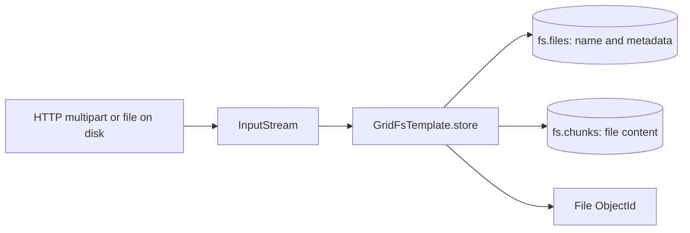

# Storing files from an `InputStream` with filename and metadata in GridFS

## Objectives

In Spring Data MongoDB, `GridFsTemplate` lets you write binary content from an `InputStream` into MongoDB GridFS while attaching a **filename** (`filename`), **content type** (`contentType`), and **metadata** for business use. After this lesson, you will be able to:

- Explain why GridFS ingests data via streams instead of forcing the application to hold the entire file in memory.
- Use `GridFsTemplate.store(InputStream, String, String, Object)` and obtain the `_id` of the stored file.
- Build structured metadata, convert `MultipartFile` to an `InputStream`, and manage stream lifecycles properly.
- Inspect GridFS records and handle duplicate filenames, failed files, and security risks when receiving user files.

## 1. What does GridFS store?

MongoDB enforces a size limit on a single BSON document. **GridFS** splits file content into multiple chunks and manages them in dedicated collections. With the default bucket `fs`:

| Collection | Main data | Role |
| --- | --- | --- |
| `fs.files` | `_id`, `filename`, `length`, `chunkSize`, `uploadDate`, `metadata` | Describes an uploaded file. |
| `fs.chunks` | `files_id`, `n`, `data` | Stores the binary data parts belonging to that file. |

`InputStream` is the byte source that GridFS reads incrementally and splits into chunks. The application does not need to call `readAllBytes()` or `MultipartFile.getBytes()` to allocate an array containing the entire payload before saving. However, HTTP multipart handling, the driver, and the server still use internal buffers; *streaming* does not mean using 0 bytes of RAM.



**Key distinction:** `filename` is a display/search name, not a unique key. Two saves can use the exact same name and still generate two distinct `_id` values. Always use `_id` as the stable identifier when downloading or deleting.

## 2. Preparing Spring Data MongoDB

The examples below use Java, Spring Boot, Spring Data MongoDB, and the **blocking** `GridFsTemplate` API. With Gradle, a web application can declare:

```groovy
dependencies {
    implementation 'org.springframework.boot:spring-boot-starter-data-mongodb'
    implementation 'org.springframework.boot:spring-boot-starter-web'
}
```

Configure the MongoDB connection appropriately for your environment, for example:

```yaml
spring:
  data:
    mongodb:
      uri: ${MONGODB_URI}
  servlet:
    multipart:
      max-file-size: 50MB
      max-request-size: 55MB
```

If the application does not yet have a `GridFsTemplate` bean, declare it explicitly:

```java
import org.springframework.context.annotation.Bean;
import org.springframework.context.annotation.Configuration;
import org.springframework.data.mongodb.MongoDatabaseFactory;
import org.springframework.data.mongodb.core.convert.MongoConverter;
import org.springframework.data.mongodb.gridfs.GridFsTemplate;

@Configuration
public class GridFsConfig {

    @Bean
    GridFsTemplate gridFsTemplate(MongoDatabaseFactory factory,
                                  MongoConverter converter) {
        return new GridFsTemplate(factory, converter);
    }
}
```

If existing configuration already creates the bean, reuse it to avoid duplicate declarations. `GridFsTemplate` defaults to the `fs` bucket; when another bucket is configured, the collection names change according to the bucket prefix.

## 3. Understanding the `store(...)` signature

A commonly used form is:

```java
ObjectId id = gridFsTemplate.store(
    inputStream,
    "hop-dong-2026.pdf",
    "application/pdf",
    metadata
);
```

| Argument | Meaning | Key takeaways |
| --- | --- | --- |
| `InputStream inputStream` | Byte source read to write into GridFS. | Pass an open, readable stream positioned at the start of the data to write. |
| `String filename` | Filename stored with the GridFS record. | Can repeat; sanitize names received from clients. |
| `String contentType` | MIME type, such as `application/pdf`. | Useful when serving downloads; client-sent values are unverified. |
| `Object metadata` | Business information supplied by the application. | Can be `org.bson.Document` or an object convertible by `MongoConverter`. |
| Return value `ObjectId` | New `_id` of the file in GridFS. | Store or return this ID for subsequent operations. |

Spring Data also offers overloads with fewer parameters, such as `store(inputStream, filename)`. Use the four-argument form when you want to persist name, content type, and metadata in a single call.

Metadata **does not replace** system properties like `length` and `uploadDate` managed by GridFS. Prefer useful business fields such as `ownerId`, `category`, `documentId`, or `source`; avoid putting passwords, tokens, unnecessary personal data, or unvalidated user input into metadata.

## 4. Building a service to store an `InputStream`

Suppose a document management system needs to store attachments and track their owner. The service below accepts an open stream, attaches server-side metadata, and returns the ID once writing finishes:

```java
import java.io.InputStream;
import java.time.Instant;
import java.util.Date;

import org.bson.Document;
import org.bson.types.ObjectId;
import org.springframework.data.mongodb.gridfs.GridFsTemplate;
import org.springframework.stereotype.Service;

@Service
public class GridFsFileService {

    private final GridFsTemplate gridFsTemplate;

    public GridFsFileService(GridFsTemplate gridFsTemplate) {
        this.gridFsTemplate = gridFsTemplate;
    }

    public ObjectId save(InputStream input,
                         String filename,
                         String contentType,
                         String ownerId) {
        if (input == null) {
            throw new IllegalArgumentException("InputStream must not be null");
        }
        if (filename == null || filename.isBlank()) {
            throw new IllegalArgumentException("Invalid filename");
        }
        if (ownerId == null || ownerId.isBlank()) {
            throw new IllegalArgumentException("Missing owner ID");
        }

        Document metadata = new Document("ownerId", ownerId)
                .append("category", "attachment")
                .append("uploadedAt", Date.from(Instant.now()));

        String mimeType = (contentType == null || contentType.isBlank())
                ? "application/octet-stream"
                : contentType;

        return gridFsTemplate.store(input, filename, mimeType, metadata);
    }
}
```

In this example, `metadata.ownerId` supports per-user lookup or access checks; `category` provides business classification. `uploadedAt` is an application-level timestamp, while GridFS also automatically records `uploadDate`. Metadata fields are constructed **on the server**, rather than accepting an arbitrary document sent by the client.

### Who is responsible for closing the `InputStream`?

The service above **does not close** the stream because the stream is created and managed by the caller. Callers should use `try-with-resources` to close it on both success and exception paths. `store(...)` here is a blocking call that consumes the stream during invocation; do not close the stream before `store(...)` returns.

Example with a file already on disk:

```java
import java.io.InputStream;
import java.nio.file.Files;
import java.nio.file.Path;
import org.bson.types.ObjectId;

Path path = Path.of("./documents/hop-dong.pdf");

try (InputStream input = Files.newInputStream(path)) {
    ObjectId id = fileService.save(
            input,
            "hop-dong.pdf",
            "application/pdf",
            "user-123");
    System.out.println("Saved GridFS ID: " + id.toHexString());
}
```

The example assumes `fileService` has been injected into a Spring component. Do not reuse an already-exhausted `InputStream` for a second save without recreating the stream or resetting its read position appropriately.

## 5. Receiving a `MultipartFile` from HTTP and streaming it

In Spring MVC, `MultipartFile.getInputStream()` directly connects an upload request to the GridFS service. The controller below assumes the endpoint is protected by authentication so that `Principal` is present:

```java
import java.io.IOException;
import java.io.InputStream;
import java.security.Principal;

import org.bson.types.ObjectId;
import org.springframework.http.HttpStatus;
import org.springframework.http.MediaType;
import org.springframework.http.ResponseEntity;
import org.springframework.web.bind.annotation.PostMapping;
import org.springframework.web.bind.annotation.RequestMapping;
import org.springframework.web.bind.annotation.RequestParam;
import org.springframework.web.bind.annotation.RestController;
import org.springframework.web.multipart.MultipartFile;
import org.springframework.web.server.ResponseStatusException;

@RestController
@RequestMapping("/api/files")
public class FileUploadController {

    private final GridFsFileService fileService;

    public FileUploadController(GridFsFileService fileService) {
        this.fileService = fileService;
    }

    @PostMapping(consumes = MediaType.MULTIPART_FORM_DATA_VALUE)
    public ResponseEntity<UploadResult> upload(
            @RequestParam("file") MultipartFile file,
            Principal principal) throws IOException {

        if (file.isEmpty()) {
            throw new ResponseStatusException(HttpStatus.BAD_REQUEST, "Empty file");
        }

        String filename = safeFilename(file.getOriginalFilename());

        try (InputStream input = file.getInputStream()) {
            ObjectId id = fileService.save(
                    input, filename, file.getContentType(), principal.getName());

            return ResponseEntity.status(HttpStatus.CREATED)
                    .body(new UploadResult(id.toHexString(), filename));
        }
    }

    private static String safeFilename(String original) {
        if (original == null || original.isBlank()) {
            throw new ResponseStatusException(HttpStatus.BAD_REQUEST, "Missing filename");
        }

        String normalized = original.replace('\\', '/');
        String name = normalized.substring(normalized.lastIndexOf('/') + 1).trim();
        if (name.isBlank() || name.equals(".") || name.equals("..")) {
            throw new ResponseStatusException(HttpStatus.BAD_REQUEST, "Invalid filename");
        }
        return name;
    }

    public record UploadResult(String id, String filename) { }
}
```

The data flow proceeds in order: receive multipart → validate basic inputs → open `InputStream` → write to GridFS with metadata → receive `ObjectId` → return HTTP `201 Created`. Calling `getInputStream()` avoids copying the entire file into a `byte[]`; multipart limits must still be configured at the HTTP layer.

Example request (substitute token and path for your application):

```bash
curl -X POST "http://localhost:8080/api/files" \
  -H "Authorization: Bearer <ACCESS_TOKEN>" \
  -F "file=@./documents/hop-dong.pdf;type=application/pdf"
```

Example response:

```json
{
  "id": "656ed5ba8508c96f2d952e01",
  "filename": "hop-dong.pdf"
}
```

The ID in the JSON only illustrates format. The actual value is generated by MongoDB on each upload.

## 6. Inspecting stored files and metadata

After `save(...)` returns an `ObjectId`, you can query the record back to confirm its name and metadata with Spring Data:

```java
import com.mongodb.client.gridfs.model.GridFSFile;
import org.bson.types.ObjectId;
import org.springframework.data.mongodb.core.query.Criteria;
import org.springframework.data.mongodb.core.query.Query;

ObjectId id = new ObjectId("656ed5ba8508c96f2d952e01");
GridFSFile stored = gridFsTemplate.findOne(
        Query.query(Criteria.where("_id").is(id)));

if (stored != null) {
    System.out.println(stored.getFilename());
    System.out.println(stored.getLength());
    System.out.println(stored.getMetadata());
}
```

Or inspect using `mongosh` when using the default bucket:

```javascript
const id = ObjectId("656ed5ba8508c96f2d952e01");

db.fs.files.findOne(
  { _id: id },
  { filename: 1, length: 1, uploadDate: 1, metadata: 1 }
);

db.fs.chunks.countDocuments({ files_id: id });
```

You will see `filename` in `fs.files`, metadata fields like `ownerId` and `category` inside `metadata`, and chunks whose `files_id` references the file. The chunk count depends on file size and `chunkSize`; a small file may still fit inside a single chunk. You can query by business attributes using `metadata.ownerId`, but you must verify user permissions before returning file contents.

## 7. Common errors and how to avoid them

| Situation | Cause or consequence | Solution |
| --- | --- | --- |
| Large file upload spikes RAM | Reading the entire file with `getBytes()`/`readAllBytes()` before saving. | Use `getInputStream()` and pass it directly to `store(...)`; configure upload limits. |
| Stored file has length 0 | Empty stream, already exhausted, or wrong data source. | Verify input data and read position before calling `store(...)`. |
| Multiple files share `filename` | GridFS does not enforce unique filenames. | Store `_id` for retrieval; apply separate version/naming rules if the business requires them. |
| Metadata missing or wrong type | Passing an unconvertible object or omitting the metadata argument. | Use `Document` or types supported by MongoConverter; inspect actual records in `fs.files`. |
| `413 Payload Too Large` error | Multipart request limits at web server, proxy, or Spring. | Check limits across the entire path and apply suitable quotas. |
| Cannot download despite having ID | Querying the wrong bucket, wrong ID type, or missing permissions. | Check bucket, construct a valid `ObjectId`, and verify ownership. |
| Write interrupted | Connection error, source data error, or storage capacity issue. | Confirm success only when `store(...)` returns; monitor errors and check incomplete data when needed. |

**Security and operational boundaries:**

- `getOriginalFilename()` may contain path segments or unusual names. `safeFilename` only illustrates stripping path components; real systems also need character restrictions, length limits, Unicode normalization, and protection against misleading names.
- `getContentType()` is client-supplied and therefore only a hint. For risky file types, verify the format based on content, apply malware scanning, and enforce size limits and access control.
- Do not let clients decide `ownerId` in metadata if that attribute is used for authorization; obtain it from the server-side authentication context.
- Changes spanning business documents and GridFS collections need proper error-handling/rollback mechanisms. Never assume GridFS storage and business document writes form an atomic transaction.
- `GridFsTemplate` is a blocking API; reactive applications should consider `ReactiveGridFsTemplate` and `Publisher<DataBuffer>`/`Flux<DataBuffer>` per the reactive API instead of running blocking calls on the event loop.

## 8. Hands-on exercises

1. Create a PDF upload endpoint using `MultipartFile.getInputStream()`, storing it with a sanitized filename and metadata containing `ownerId`, `category`, and `uploadedAt`.
2. Upload two files with the same name and observe the two distinct `_id` values in `fs.files`.
3. Use the returned `_id` to query the GridFS record and verify `filename`, `length`, and metadata fields. Compare chunk counts by file size.
4. Test uploading an empty file, an oversized file, and an invalid request. Check HTTP status codes, error messages, and verify no success ID is returned on failure.

**Key takeaway:** `GridFsTemplate.store(inputStream, filename, contentType, metadata)` combines file content with descriptive metadata in one call. The caller manages closing the stream, the server controls metadata and authorization, and the `_id` returned by GridFS is the identifier to retain for subsequent operations.
