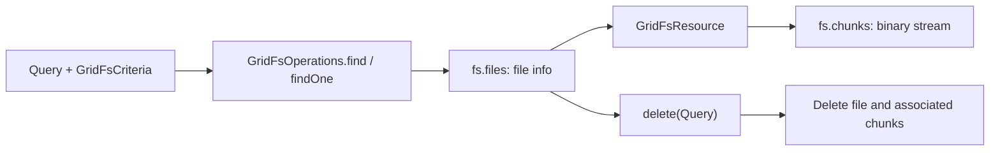

# Finding, downloading, and deleting files with `GridFsCriteria`

## Lesson Objectives

In applications using **Spring Data MongoDB**, GridFS lets you store files as multiple data parts (chunks) in MongoDB, while `GridFsTemplate`/`GridFsOperations` provide the Java API to work with them. This lesson focuses on three common tasks: **finding files by criteria, downloading file content, and deleting the right file**. The emphasis is on building `Query` instances with `GridFsCriteria` and safely selecting a file when multiple files share the same name.

After this lesson, you will be able to:

- Distinguish file metadata from binary content and know which fields to filter on.
- Use `whereFilename()`, `whereContentType()`, and `whereMetaData()` to query files.
- Combine `find()`/`findOne()` with `getResource(GridFSFile)` to download data as a stream.
- Delete files using `delete(Query)` filtered by `_id` and access-control scope.
- Avoid errors such as selecting the wrong duplicate-named copy, loading entire files into memory, or unintentionally deleting multiple files.

## 1. What does GridFS store and where does `GridFsCriteria` query?

Each GridFS bucket uses two collections. With the default bucket `fs`:

| Collection | Main data | Role |
| --- | --- | --- |
| `fs.files` | `_id`, `filename`, `length`, `chunkSize`, `uploadDate`, `metadata` | Describes files and serves as the target for file listing queries |
| `fs.chunks` | `files_id`, `n`, `data` | Contains the binary chunks of each file |

Example of an illustrative document in `fs.files`:

```json
{
  "_id": { "$oid": "6560d2a4a1b2c3d4e5f60718" },
  "filename": "hoa-don-11-2026.pdf",
  "length": 7340032,
  "chunkSize": 261120,
  "uploadDate": { "$date": "2026-11-15T10:00:00Z" },
  "metadata": {
    "tenantId": "cong-ty-a",
    "documentType": "invoice"
  }
}
```

Corresponding chunks have `files_id` pointing to the file's `_id` and `n` as the chunk sequence number. On download, GridFS reassembles content from chunks; when listing files, most queries only need to read metadata in `fs.files`.



**Core point:** `GridFsCriteria` is a helper class for constructing query criteria (extending `Criteria`), not an API for reading bytes or deleting files. You pass the `Query` containing those criteria into `GridFsOperations`, typically backed by `GridFsTemplate`.

## 2. Preparing a sample file

The examples below assume a Spring Boot project connected to MongoDB with a `GridFsOperations`/`GridFsTemplate` bean. If the application has not declared a template yet, you can configure:

```java
@Configuration
class GridFsConfig {

    @Bean
    GridFsTemplate gridFsTemplate(
            MongoDatabaseFactory factory,
            MongoConverter converter) {
        return new GridFsTemplate(factory, converter);
    }
}
```

The corresponding types are `org.springframework.data.mongodb.MongoDatabaseFactory`, `org.springframework.data.mongodb.core.convert.MongoConverter`, and `org.springframework.data.mongodb.gridfs.GridFsTemplate`. If the application already provides a suitable bean, do not declare another bean with a conflicting name.

So that the criteria in later sections have data, suppose we upload a file as follows:

```java
Document metadata = new Document("tenantId", "cong-ty-a")
        .append("documentType", "invoice");

try (InputStream stream = Files.newInputStream(
        Path.of("hoa-don-11-2026.pdf"))) {
    ObjectId id = gridFs.store(
            stream,
            "hoa-don-11-2026.pdf",
            "application/pdf",
            metadata
    );
    System.out.println("GridFS id: " + id.toHexString());
}
```

In this snippet, `gridFs` is an injected `GridFsOperations`; `Document` is from `org.bson`. `tenantId` and `documentType` are application-defined business metadata. `store(...)` returns an `ObjectId` when using the standard upload path; save this ID to access the exact file version.

Filenames are **not unique keys**: uploading twice with the same `filename` can still create two GridFS records with different `_id` values. That shapes how download and delete APIs are designed in the sections below.

## 3. Writing a `Query` with `GridFsCriteria`

Key factory methods:

| Criterion | Java example | Meaning |
| --- | --- | --- |
| Exact name | `GridFsCriteria.whereFilename().is("hoa-don-11-2026.pdf")` | Filters by `filename` |
| Pattern name | `GridFsCriteria.whereFilename().regex("^hoa-don-.*[.]pdf$")` | Filters by regular expression |
| MIME type | `GridFsCriteria.whereContentType().is("application/pdf")` | Filters by content type managed by Spring Data GridFS |
| Specific metadata | `GridFsCriteria.whereMetaData("tenantId").is("cong-ty-a")` | Filters by key inside `metadata` |
| Other metadata | `GridFsCriteria.whereMetaData("documentType").is("invoice")` | Combines business rules |
| File ID | `Criteria.where("_id").is(new ObjectId(fileId))` | Selects a specific file by ID |

The examples above require importing `org.springframework.data.mongodb.gridfs.GridFsCriteria`, `org.springframework.data.mongodb.core.query.Criteria`, and `org.springframework.data.mongodb.core.query.Query`.

Find all invoice PDFs within a tenant scope:

```java
Query query = Query.query(
        GridFsCriteria.whereMetaData("tenantId").is("cong-ty-a")
);
query.addCriteria(
        GridFsCriteria.whereMetaData("documentType").is("invoice")
);
query.addCriteria(
        GridFsCriteria.whereContentType().is("application/pdf")
);

List<GridFSFile> files = gridFs.find(query)
        .limit(50)
        .into(new ArrayList<>());
```

`GridFSFile` belongs to `com.mongodb.client.gridfs.model`; the result of `find(query)` is a `GridFSFindIterable` from the MongoDB Java Driver. This is file descriptor data; **it has not loaded the file's bytes**.

### Filtering filenames and combining conditions

```java
Query query = Query.query(
        GridFsCriteria.whereFilename().is("hoa-don-11-2026.pdf")
);
query.addCriteria(
        GridFsCriteria.whereMetaData("tenantId").is("cong-ty-a")
);

for (GridFSFile file : gridFs.find(query)) {
    System.out.printf("%s - %s - %d bytes%n",
            file.getObjectId().toHexString(),
            file.getFilename(),
            file.getLength());
}
```

In this example, `getObjectId()` fits because files created via `store(...)` have `ObjectId` IDs. If the system allows custom IDs of other BSON types, use `getId()` and handle the type properly rather than assuming every ID is an `ObjectId`.

When filtering by user-supplied names, prefer `is(...)` if an exact match is needed. If using `regex(...)`, limit input length and escape special characters with `Pattern.quote(...)` before composing a pattern, preventing user input from acting as an arbitrary regular expression.

### Fetching one file or many files?

- `find(query)` returns an iterable of matching `GridFSFile` records, useful for listing and filtering.
- `findOne(query)` returns a single `GridFSFile` or `null` if no match exists. With non-unique names, do not rely on it to identify a desired version.
- `getResource(String filename)`/`getResources(String pattern)` are convenient when accessing by name or name pattern; to enforce tenant and specific version control, use `findOne(query)` by ID and access permissions, then call `getResource(GridFSFile)`.

**Note on ordering:** `Sort` properties attached to a `Query` passed to `GridFsOperations.find(...)` are not applied by Spring Data when querying GridFS. If sorting is required, call `sort(...)` directly on `GridFSFindIterable`:

```java
import com.mongodb.client.model.Sorts;

List<GridFSFile> newestFirst = gridFs.find(query)
        .sort(Sorts.descending("uploadDate"))
        .limit(20)
        .into(new ArrayList<>());
```

`limit(...)` bounds the number of returned results. For large lists, consider pagination (`skip/limit` or another strategy suited to data scale), indexes on filtered fields, and deterministic sort tie-breakers.

## 4. Complete service example: find, open stream, delete

Example using **Java 17+**, Spring Data MongoDB, and IDs generated by `store(...)` (`ObjectId` type). Suppose each file carries `metadata.tenantId`; input `tenantId` must come from an authenticated context and be authorized by the application.

```java
import com.mongodb.client.gridfs.model.GridFSFile;
import org.bson.types.ObjectId;
import org.springframework.data.mongodb.core.query.Criteria;
import org.springframework.data.mongodb.core.query.Query;
import org.springframework.data.mongodb.gridfs.GridFsCriteria;
import org.springframework.data.mongodb.gridfs.GridFsOperations;
import org.springframework.data.mongodb.gridfs.GridFsResource;
import org.springframework.stereotype.Service;

import java.util.ArrayList;
import java.util.List;
import java.util.Optional;

@Service
public class GridFsFileService {

    private final GridFsOperations gridFs;

    public GridFsFileService(GridFsOperations gridFs) {
        this.gridFs = gridFs;
    }

    // Find up to 50 files belonging to tenant; filename is an optional filter.
    public List<GridFSFile> search(String tenantId, String filename) {
        Query query = Query.query(
                GridFsCriteria.whereMetaData("tenantId").is(tenantId)
        );
        if (filename != null && !filename.isBlank()) {
            query.addCriteria(
                    GridFsCriteria.whereFilename().is(filename)
            );
        }
        return gridFs.find(query).limit(50).into(new ArrayList<>());
    }

    // Return resource for the exact ID belonging to tenant; does not read full file.
    public Optional<GridFsResource> findForDownload(
            String tenantId, String fileId) {

        GridFSFile file = gridFs.findOne(queryForId(tenantId, fileId));
        if (file == null) {
            return Optional.empty();
        }
        return Optional.of(gridFs.getResource(file));
    }

    // Delete all records matching Query; here Query contains a unique _id.
    public void deleteById(String tenantId, String fileId) {
        gridFs.delete(queryForId(tenantId, fileId));
    }

    private Query queryForId(String tenantId, String fileId) {
        if (tenantId == null || tenantId.isBlank()) {
            throw new IllegalArgumentException("tenantId is required");
        }
        if (!ObjectId.isValid(fileId)) {
            throw new IllegalArgumentException("Invalid GridFS ObjectId");
        }

        Query query = Query.query(
                Criteria.where("_id").is(new ObjectId(fileId))
        );
        query.addCriteria(
                GridFsCriteria.whereMetaData("tenantId").is(tenantId)
        );
        return query;
    }
}
```

Notable characteristics of the service:

1. `search(...)` reads metadata only, supports optional filename filtering, and always scopes by tenant.
2. `findForDownload(...)` selects the file using two conditions: `_id` **and** `metadata.tenantId`. Two users can have files with the same name without cross-access.
3. `getResource(file)` binds the download stream to the exact validated `GridFSFile`.
4. `deleteById(...)` uses a precise ID-scoped query. If no matching file exists, `delete(Query)` returns `void`; distinguishing `404` from a successful delete requires dedicated existence checking/status handling.

Real applications should map `GridFSFile` to a DTO (`id`, `filename`, `length`, `uploadDate`, ...) rather than exposing driver types directly in REST APIs.

## 5. Downloading files: stream without loading everything into RAM

After querying and checking permissions, `GridFsResource` provides `getInputStream()` to read content. Download example inside an HTTP handler (where `tenantId` is resolved from authenticated credentials):

```java
GridFsResource resource = service
        .findForDownload(tenantId, fileId)
        .orElseThrow(() ->
                new ResponseStatusException(HttpStatus.NOT_FOUND));

response.setContentType("application/octet-stream");
response.setContentLengthLong(resource.contentLength());
response.setHeader(
        HttpHeaders.CONTENT_DISPOSITION,
        ContentDisposition.attachment()
                .filename(resource.getFilename(), StandardCharsets.UTF_8)
                .build()
                .toString()
);

try (InputStream input = resource.getInputStream()) {
    input.transferTo(response.getOutputStream());
}
```

The snippet illustrates using `HttpServletResponse` (Spring MVC/Servlet), `ContentDisposition`, `HttpHeaders`, `HttpStatus`, `ResponseStatusException`, and `StandardCharsets`; `service` is `GridFsFileService`. `resource.contentLength()` obtains the file size, while `getInputStream()` reads chunks incrementally as data is sent to the client.

**Why stream?** Files can be much larger than available RAM. Approaches like `input.readAllBytes()` or buffering all bytes into `byte[]` easily cause sharp memory spikes. For REST APIs, stream to output and close the stream on completion; if an error occurs after HTTP has already flushed part of the body, you cannot assume the status code can still be changed.

If you need to return the file's real MIME type, validate the value stored by the application in metadata and map it to the appropriate header; `application/octet-stream` is a safe default for general downloads. Do not infer file content from filename extensions. `ContentDisposition.attachment()` instructs browsers to treat the payload as a downloadable file while UTF-8 encoding the filename.

### Difference between finding a file and opening a file

| Method | Result | When to use? |
| --- | --- | --- |
| `gridFs.find(query)` | `GridFSFindIterable` | Listing results / filtering metadata |
| `gridFs.findOne(query)` | `GridFSFile` or `null` | Selecting the exact file after checking scope |
| `gridFs.getResource(file)` | `GridFsResource` | Opening the located file to read content |
| `gridFs.getResource(filename)` | `GridFsResource` | Downloading by name when uniqueness/scope is already handled |
| `gridFs.getResources("*.pdf")` | `GridFsResource[]` | Retrieving multiple resources by filename pattern |

Do not use `getResources(...)` as an authorization mechanism or replacement for tenant filtering. Filename patterns do not tell you whom a file belongs to.

## 6. Deleting with `GridFsCriteria`: narrow the selection before calling `delete`

`GridFsOperations.delete(Query)` can delete **every file matching the criteria**; GridFS deletion must handle both the metadata document and associated chunks. Use the GridFS API rather than deleting only the `fs.files` document with regular CRUD operations, as doing so can leave orphan chunks behind.

Risky example:

```java
// Dangerous: if multiple versions share filename, all of them may be deleted.
gridFs.delete(Query.query(
        GridFsCriteria.whereFilename().is("hoa-don-11-2026.pdf")
));
```

Example deleting the exact file the user is authorized to manage:

```java
Query scope = Query.query(
        Criteria.where("_id").is(new ObjectId(fileId))
);
scope.addCriteria(
        GridFsCriteria.whereMetaData("tenantId").is(tenantId)
);

gridFs.delete(scope);
```

The application may check `findOne(scope)` before deleting to decide whether to respond with `404`. However, if a delete runs concurrently with another task, a pre-check does not guarantee final state; design idempotency, audit logs, or workflows aligned with business requirements. Avoid reporting an exact “deleted N files” count from `delete(Query)` since the method returns `void`.

A practical question: “Delete all old invoices of a tenant” is an intentional bulk operation entirely different from “Delete one selected file.” Before running bulk operations, ensure retention/deletion policies, authorization, application-level confirmation steps, and query scope verification are in place.

## 7. Performance, indexes, and practical scenarios

By default, GridFS requires indexes to look up files by name/upload date and to reassemble chunks in the right order. Commonly used indexes:

```javascript
// Standard indexes on the two collections of the fs bucket:
db.fs.files.createIndex({ filename: 1, uploadDate: 1 });
db.fs.chunks.createIndex({ files_id: 1, n: 1 }, { unique: true });

// Example additional index when the application frequently filters by tenant and filename:
db.fs.files.createIndex({ "metadata.tenantId": 1, filename: 1 });
```

Before creating new indexes in production, check `getIndexes()` because the GridFS driver usually creates standard indexes automatically; avoid redundant indexes. Use `explain()` on the corresponding `fs.files` queries when analyzing performance. Metadata filters need dedicated indexes under high traffic; the `_id` index is already present by default.

Operational notes:

- **Multiple versions with the same name:** always return IDs from list APIs and use IDs for download/delete operations; filenames are only for display or filtering.
- **Tenant isolation:** add metadata criteria or separate buckets/databases per architecture, and derive tenant identity from authenticated principals.
- **Unbounded results:** limit record counts and do not return thousands of `GridFSFile` items in a single response.
- **Searching by file content:** `GridFsCriteria` filters metadata, not full-text search inside file bytes; a separate extraction and indexing pipeline is required for that.
- **Do not mix regular CRUD with the GridFS API:** directly updating/deleting `fs.chunks` or `fs.files` easily breaks the relationship between the two collections.
- **Deleted-file edge cases:** handle cases where a file disappears after `findOne(...)` but before opening the stream, and map storage/timeout errors to appropriate responses.

## 8. Self-check exercises

**Exercise 1 — Searching.** A bucket contains three files: two copies of `bao-cao.pdf` belonging to `cong-ty-a` with different `_id` values, and one copy with the same name belonging to `cong-ty-b`. Write a `Query` listing up to 20 copies of `bao-cao.pdf` for `cong-ty-a`. Expect two results rather than picking a file arbitrarily.

Hint:

```java
Query query = Query.query(
        GridFsCriteria.whereFilename().is("bao-cao.pdf")
);
query.addCriteria(
        GridFsCriteria.whereMetaData("tenantId").is("cong-ty-a")
);

List<GridFSFile> result = gridFs.find(query)
        .limit(20)
        .into(new ArrayList<>());
```

**Exercise 2 — Downloading the right version.** Take one `_id` from Exercise 1 and the authenticated `tenantId`. Call `findOne(...)` with both criteria; if found, pass it to `getResource(file)` and use try-with-resources to copy the `InputStream` to a destination. Verify that a valid ID belonging to a different tenant is treated as not found.

**Exercise 3 — Deleting and verifying.** Execute `delete(...)` by `_id` and `tenantId`, then look up that exact ID again. Confirm the remaining version with the same name is still accessible. Practice on isolated test data; never delete by filename on shared data.

## 9. Frequently asked questions

**Is `GridFsCriteria` required for `_id`?** No. `Criteria.where("_id")` is direct and clear. `GridFsCriteria` is helpful for GridFS-specific fields such as filename, content type, and metadata.

**Does `findOne(...)` load the file into memory?** No. It queries file metadata (`GridFSFile`). Content is read only when accessing the stream from `GridFsResource`.

**Does `whereFilename().is(...)` pick the latest version?** No. Filenames can repeat; to select a specific copy, use `_id`. If you need the latest list, sort on `GridFSFindIterable` by `uploadDate` and define tie-breaking rules for identical timestamps.

**Can files be deleted by name alone?** Yes, but `delete(query)` applies to all matching records. Single-file deletion should therefore filter by ID and authorization scope; bulk deletion must be designed separately.

**When should `ReactiveGridFsTemplate` be used?** When the application uses a reactive stack, you can construct `GridFsCriteria` similarly and work with `Mono`/`Flux` and `ReactiveGridFsResource`. Avoid mixing blocking `GridFsTemplate` calls into reactive processing flows.

## References

- [Spring Data MongoDB — GridFS Support](https://docs.spring.io/spring-data/mongodb/reference/mongodb/template-gridfs.html)
- [Spring Data MongoDB API — GridFsCriteria](https://docs.spring.io/spring-data/mongodb/docs/current/api/org/springframework/data/mongodb/gridfs/GridFsCriteria.html)
- [Spring Data MongoDB API — GridFsOperations](https://docs.spring.io/spring-data/mongodb/reference/api/java/org/springframework/data/mongodb/gridfs/GridFsOperations.html)
- [MongoDB — GridFS specification and indexes](https://www.mongodb.com/docs/manual/core/gridfs/)
- [MongoDB Java Driver — GridFSFindIterable](https://mongodb.github.io/mongo-java-driver/5.2.1/apidocs/mongodb-driver-sync/com/mongodb/client/gridfs/GridFSFindIterable.html)
