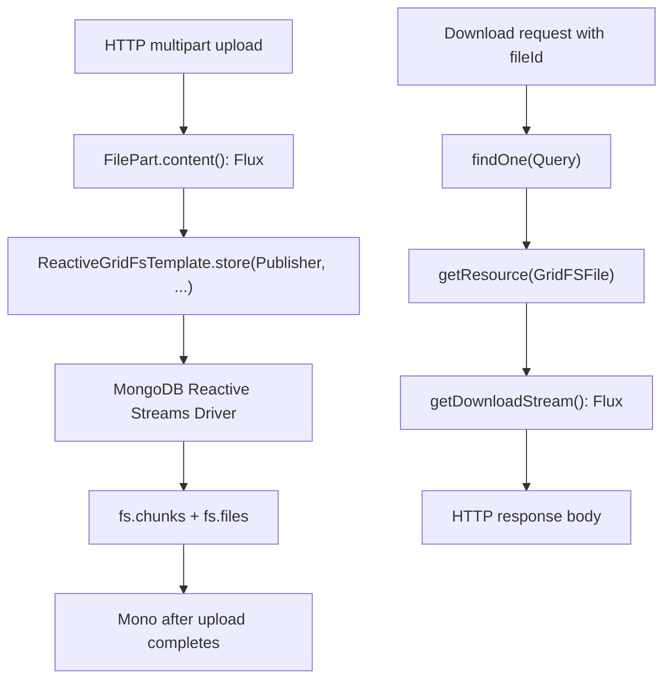

# ReactiveGridFsTemplate with Publisher<DataBuffer>

## 1. Problem and objectives

In a **Spring Data MongoDB** application using Spring WebFlux, a file uploaded over HTTP typically arrives as a stream of binary memory buffers. We want to forward those buffers to **MongoDB GridFS** and stream the file back over HTTP without allocating a `byte[]` holding the entire content.

`ReactiveGridFsTemplate` performs this via the `ReactiveGridFsOperations` interface. Its `store(…)` method accepts a `Publisher<DataBuffer>`, while the download side emits `Flux<DataBuffer>`. This connects WebFlux's data stream to the MongoDB Reactive Streams Driver's upload/download streams.

After this lesson, you will be able to:

- Distinguish `Publisher<DataBuffer>`, `Flux<DataBuffer>`, and `Mono<ObjectId>` in a GridFS pipeline.
- Stream uploads from `FilePart.content()` into `ReactiveGridFsTemplate.store(…)`.
- Locate files by `fileId` and stream them back to clients via `ReactiveGridFsResource.getDownloadStream()`.
- Understand backpressure, pooled `DataBuffer` lifecycles, error handling, subscription cancellation, and the risk of reading full files into RAM.
- Associate files with business metadata and enforce access control in the application.

## 2. Data transfer mechanism

GridFS stores file content as documents in the `fs.chunks` collection and a file descriptor document in `fs.files` (with the default bucket name `fs`). Each file has its own identifier; by default, GridFS uses a **255 KiB** chunk size. A **GridFS chunk** size is a separate concept from the size of each **`DataBuffer`** emitted by an HTTP request.



**Role of the data types:**

| Type | Meaning | Example |
|---|---|---|
| `Publisher<DataBuffer>` | Reactive Streams contract supplying binary chunks; `Flux<DataBuffer>` is an implementation | Input to `store` |
| `DataBuffer` | A segment of bytes; may be pooled and require lifecycle management | A slice of an HTTP body |
| `Mono<ObjectId>` | Emits one ID when GridFS upload succeeds; emits an error when upload fails | Return value of `store` |
| `GridFSFile` | Metadata stored in `fs.files` such as `_id`, filename, length, upload timestamp | Result of `findOne` |
| `Mono<ReactiveGridFsResource>` | Reactive resource used to open a download stream | Result of `getResource` |
| `Flux<DataBuffer>` | Binary segments emitted according to subscriber demand | `getDownloadStream` |

A `Publisher` does not mean data has already been read or written at the moment the method is called. Reactive publishers are usually **lazy**: I/O starts only upon subscription. In a WebFlux controller, the framework subscribes to the publisher returned by the endpoint; therefore, the application must not manually call `subscribe()` and discard the result.

When downstream requests more elements, **backpressure** signals propagate back through the pipeline. This helps bound data in flight simultaneously; however, using a reactive API **does not mean RAM usage is always zero**. HTTP multipart parsers, drivers, internal buffering, prefetching, and concurrent uploads all affect memory consumption.

## 3. Setup and configuration

For a Spring Boot application using WebFlux, typical dependencies are:

```gradle
dependencies {
    implementation("org.springframework.boot:spring-boot-starter-webflux")
    implementation("org.springframework.boot:spring-boot-starter-data-mongodb-reactive")
    // Add only if using Spring Security Authentication in the sample controller.
    implementation("org.springframework.boot:spring-boot-starter-security")
}
```

Starters usually auto-configure the required beans when appropriate MongoDB connection details are supplied. If configuring manually, declare the template using `ReactiveMongoDatabaseFactory` and `MongoConverter`:

```java
import org.springframework.context.annotation.Bean;
import org.springframework.context.annotation.Configuration;
import org.springframework.data.mongodb.ReactiveMongoDatabaseFactory;
import org.springframework.data.mongodb.core.convert.MongoConverter;
import org.springframework.data.mongodb.gridfs.ReactiveGridFsTemplate;

@Configuration
class GridFsReactiveConfig {

    @Bean
    ReactiveGridFsTemplate reactiveGridFsTemplate(
            ReactiveMongoDatabaseFactory factory,
            MongoConverter converter) {
        return new ReactiveGridFsTemplate(factory, converter);
    }
}
```

Declare this bean only when the application does not already define one; avoid creating two beans where injection becomes ambiguous. This sample focuses on the reactive API and does not automatically create upload controllers, size limits, or access policies.

## 4. Writing files via `store(Publisher<DataBuffer>, ...)`

### 4.1. Key overloads to remember

`ReactiveGridFsOperations` provides commonly used overloads:

```java
Mono<ObjectId> store(Publisher<DataBuffer> content, String filename);

Mono<ObjectId> store(
    Publisher<DataBuffer> content,
    String filename,
    String contentType);

Mono<ObjectId> store(
    Publisher<DataBuffer> content,
    String filename,
    String contentType,
    Object metadata);
```

These are **illustrative signatures**, not code to copy verbatim into a class. `metadata` can be an `org.bson.Document` or a Java object converted by `MongoConverter`; filenames can repeat across uploads, so retain the actual returned `ObjectId`.

Along the path:

1. The publisher emits `DataBuffer` segments from the source.
2. The template passes data chunks to the driver's upload API.
3. The driver splits content into GridFS chunks and writes them to MongoDB.
4. Once upload completes, `Mono<ObjectId>` emits the `_id` of the created file.

`Mono<ObjectId>` emits **after the upload stream has been processed successfully**. It does **not** automatically update business documents (contracts, invoices, avatars...), verify application checksums, or guarantee data has been backed up. Those steps must be designed separately.

### 4.2. Service for storing files and opening download streams

The example below uses the default bucket, keeps `ownerId` in metadata, and filters permissions by the authenticated owner ID. User identity must originate from the application's authentication layer rather than directly from the upload form.

```java
import org.bson.Document;
import org.bson.types.ObjectId;
import org.reactivestreams.Publisher;
import org.springframework.core.io.buffer.DataBuffer;
import org.springframework.data.mongodb.core.query.Criteria;
import org.springframework.data.mongodb.core.query.Query;
import org.springframework.data.mongodb.gridfs.ReactiveGridFsOperations;
import org.springframework.data.mongodb.gridfs.ReactiveGridFsResource;
import org.springframework.stereotype.Service;
import reactor.core.publisher.Mono;

@Service
public class ReactiveAttachmentStore {

    private final ReactiveGridFsOperations gridFs;

    public ReactiveAttachmentStore(ReactiveGridFsOperations gridFs) {
        this.gridFs = gridFs;
    }

    public Mono<ObjectId> upload(
            Publisher<DataBuffer> content,
            String generatedFilename,
            String contentType,
            String authenticatedOwnerId) {

        Document metadata = new Document("ownerId", authenticatedOwnerId)
                .append("kind", "attachment");

        return gridFs.store(
                content, generatedFilename, contentType, metadata);
    }

    public Mono<ReactiveGridFsResource> open(
            ObjectId fileId,
            String authenticatedOwnerId) {

        Query authorizedQuery = Query.query(
                Criteria.where("_id").is(fileId)
                        .and("metadata.ownerId").is(authenticatedOwnerId));

        // findOne returns Mono.empty() when not found.
        // getResource(file) returns Mono<ReactiveGridFsResource>.
        return gridFs.findOne(authorizedQuery)
                .flatMap(gridFs::getResource);
    }
}
```

In a multi-tenant system, add tenant conditions and document access rules in the **business document**; `metadata.ownerId` only illustrates an owner check. If authorization depends on contracts or group sharing, query the business record before emitting the file and manage permission changes there.

### 4.3. WebFlux upload endpoint using `FilePart`

`FilePart` represents a file part of a multipart request. `file.content()` returns `Flux<DataBuffer>`, matching the input type required by `store`. The controller below assumes Spring Security is configured and `Authentication` holds a trusted identity:

```java
import java.util.UUID;
import org.bson.types.ObjectId;
import org.springframework.http.HttpStatus;
import org.springframework.http.MediaType;
import org.springframework.http.ResponseEntity;
import org.springframework.http.codec.multipart.FilePart;
import org.springframework.security.core.Authentication;
import org.springframework.web.bind.annotation.PostMapping;
import org.springframework.web.bind.annotation.RequestMapping;
import org.springframework.web.bind.annotation.RequestPart;
import org.springframework.web.bind.annotation.RestController;
import reactor.core.publisher.Mono;

@RestController
@RequestMapping("/api/attachments")
public class AttachmentUploadController {

    private final ReactiveAttachmentStore store;

    public AttachmentUploadController(ReactiveAttachmentStore store) {
        this.store = store;
    }

    @PostMapping(consumes = MediaType.MULTIPART_FORM_DATA_VALUE)
    public Mono<ResponseEntity<UploadReceipt>> upload(
            @RequestPart("file") FilePart file,
            Authentication authentication) {

        // Server-generated storage name; do not trust client paths.
        String generatedFilename = "attachment-" + UUID.randomUUID();
        String contentType = MediaType.APPLICATION_OCTET_STREAM_VALUE;

        return store.upload(
                    file.content(),
                    generatedFilename,
                    contentType,
                    authentication.getName())
                .map(id -> ResponseEntity.status(HttpStatus.CREATED)
                        .body(new UploadReceipt(id.toHexString())));
    }

    public record UploadReceipt(String fileId) {}
}
```

Illustrative `curl` command:

```bash
curl -X POST "http://localhost:8080/api/attachments" \
  -H "Authorization: Bearer <access-token>" \
  -F "file=@./contract.pdf"
```

Expected response on success:

```json
{
  "fileId": "691a00000000000000000007"
}
```

The `fileId` value here is **purely illustrative**; the real value is assigned by MongoDB. In production, verify upload permissions, size, real file format, quotas, and malware scanning if accepting untrusted input. A user-supplied `Content-Type` is **not** reliable proof of file format. Original filenames, if kept, must be sanitized and stored only as display metadata, never trusted as filesystem paths.

**Important rule:** The controller returns the `Mono` so WebFlux performs the subscription. Never write `store.upload(...).subscribe()` and immediately return HTTP 201, because the response could be sent before writing finishes and upload errors would be detached from the request.

## 5. Streaming file reads via `ReactiveGridFsResource`

### 5.1. Proper read flow

```java
Mono<ReactiveGridFsResource> resource =
    gridFs.findOne(Query.query(Criteria.where("_id").is(fileId)))
          .flatMap(gridFs::getResource);

Flux<DataBuffer> content =
    resource.flatMapMany(ReactiveGridFsResource::getDownloadStream);
```

`findOne(Query)` returns `Mono<GridFSFile>`; then `getResource(GridFSFile)` returns `Mono<ReactiveGridFsResource>`. Call `getDownloadStream()` to emit content segments. When the file is not found, `findOne` completes empty and the read chain emits no content; the endpoint should translate that into HTTP 404.

**Do not use** `ReactiveGridFsResource.getInputStream()` for large files: per its Javadoc, it buffers data into memory. Likewise, `collectList()`, `DataBufferUtils.join()`, or `block()` over the whole file defeats the benefits of streaming.

A `ReactiveGridFsResource` has **single-consumption content**. If you need to compute a checksum or audit log, process it within the same pipeline or reopen the stream by file ID—do not subscribe twice to the same resource.

### 5.2. WebFlux download endpoint

The example below uses the service's `open(fileId, ownerId)` method. The HTTP body uses the publisher returned from GridFS so WebFlux can stream bytes to the socket.

```java
import java.nio.charset.StandardCharsets;
import org.bson.types.ObjectId;
import org.springframework.core.io.buffer.DataBuffer;
import org.springframework.http.ContentDisposition;
import org.springframework.http.HttpHeaders;
import org.springframework.http.HttpStatus;
import org.springframework.http.MediaType;
import org.springframework.http.ResponseEntity;
import org.springframework.security.core.Authentication;
import org.springframework.web.bind.annotation.GetMapping;
import org.springframework.web.bind.annotation.PathVariable;
import org.springframework.web.bind.annotation.RequestMapping;
import org.springframework.web.bind.annotation.RestController;
import reactor.core.publisher.Flux;
import reactor.core.publisher.Mono;

@RestController
@RequestMapping("/api/attachments")
public class AttachmentDownloadController {

    private final ReactiveAttachmentStore store;

    public AttachmentDownloadController(ReactiveAttachmentStore store) {
        this.store = store;
    }

    @GetMapping("/{fileId}")
    public Mono<ResponseEntity<Flux<DataBuffer>>> download(
            @PathVariable String fileId,
            Authentication authentication) {

        if (!ObjectId.isValid(fileId)) {
            return Mono.just(ResponseEntity.status(HttpStatus.BAD_REQUEST)
                    .<Flux<DataBuffer>>build());
        }

        return store.open(new ObjectId(fileId), authentication.getName())
                .map(resource -> ResponseEntity.ok()
                        .contentType(MediaType.APPLICATION_OCTET_STREAM)
                        .header(HttpHeaders.CONTENT_DISPOSITION,
                                ContentDisposition.attachment()
                                        .filename(resource.getFilename(),
                                                StandardCharsets.UTF_8)
                                        .build()
                                        .toString())
                        .body(resource.getDownloadStream()))
                .switchIfEmpty(Mono.just(ResponseEntity
                        .status(HttpStatus.NOT_FOUND)
                        .<Flux<DataBuffer>>build()));
    }
}
```

Test command example:

```bash
curl -L "http://localhost:8080/api/attachments/<file-id>" \
  -H "Authorization: Bearer <access-token>" \
  --output downloaded.bin
```

Returning `Flux<DataBuffer>` in `ResponseEntity` only transfers the content; the application still decides `Content-Type`, `Content-Disposition`, display filename, caching, `Content-Length`, and HTTP Range if required by the business. **GridFS does not automatically provide HTTP Range/206, CDN, or download resume**; those features must be designed and tested separately.

## 6. Backpressure, memory, and `DataBuffer` lifecycle

### 6.1. A `DataBuffer` may use pooled memory

Depending on the HTTP adapter and `DataBufferFactory`, buffers may be `PooledDataBuffer` instances using reference counting. Failing to release a buffer after use can leak direct memory; releasing too early or twice can cause the application to read invalid data.

Ownership rules:

| Situation | Handling |
|---|---|
| Passing `file.content()` directly to `ReactiveGridFsOperations.store(...)` | Let the consuming component manage buffers per the API contract; avoid calling `release()` per buffer concurrently with the consumer |
| Writing a custom operator that consumes bytes and **ends** buffer lifetime | Call `DataBufferUtils.release(buffer)` when genuinely acting as the final consumer |
| Pipelines that filter, drop, or queue buffers | Consider `doOnDiscard(DataBuffer.class, DataBufferUtils::release)` per Reactor/Spring guidance to avoid leaking discarded buffers on error/cancel |
| Retaining a buffer for later use | Call `retain()` only when needed, and balance with an exact matching number of `release()` calls |
| Passing `Flux<DataBuffer>` directly to a WebFlux response | Let the HTTP body writer consume and manage buffers; do not release in `doOnNext` before socket write completes |

Example when an operator **genuinely discards** certain buffers:

```java
Flux<DataBuffer> filtered = input
        .filter(buffer -> buffer.readableByteCount() > 0)
        .doOnDiscard(DataBuffer.class, DataBufferUtils::release);
```

This applies only to **discarded buffers**. Never attach `doOnNext(DataBufferUtils::release)` to an upload/download chain that passes buffers downstream, as releasing before the receiver finishes reading can corrupt data.

### 6.2. Patterns that break streaming

```java
// Wrong for large files: accumulates all buffers in memory.
Mono<java.util.List<DataBuffer>> all = file.content().collectList();

// Wrong for large files: merges entire content into a single DataBuffer.
Mono<DataBuffer> merged = DataBufferUtils.join(file.content());

// Avoid block() on WebFlux request threads.
// ObjectId id = store.upload(file.content(), ...).block();
```

`DataBufferUtils.join(…)` has valid uses for small, bounded payloads, provided you account for total memory held at once and release the result per contract. For large uploads, passing the publisher directly to `store` is usually the natural choice.

**Do not confuse the two sizes:** a `DataBuffer` from WebFlux might be a few KiB, whereas GridFS stores data in chunks matching the bucket configuration. The driver may combine or split data to align with chunks, so you cannot deduce the number of `fs.chunks` documents from the count of `DataBuffer` emissions.

### 6.3. Size limits and concurrent upload bounds

Backpressure coordinates production/consumption rates, but it does not replace business limits. Configure:

1. Request/multipart size limits appropriate for your server; depending on WebFlux configuration, multipart handling may use memory or spool to temporary disk.
2. Storage and file-count quotas per account/tenant.
3. Concurrent upload limits and queue bounds, especially on MongoDB clusters with limited IOPS.
4. Timeouts, cancellation policies when clients disconnect, and cleanup workflows for incomplete uploads.

Do not set a huge `maxInMemorySize` to “support large file uploads”: depending on the multipart part type, that can increase the risk of buffering payloads in RAM. Verify multipart configuration for your exact Spring WebFlux version and test with real files.

## 7. Errors, upload cancellation, versioning, and consistency

### 7.1. Distinguishing completion from failure

| Signal | Meaning | Application action |
|---|---|---|
| `Mono<ObjectId>` emits ID and completes | Upload reported successful by driver | Store `fileId` in business record, update status |
| `onError` | Error in upload source, network, MongoDB, or metadata processing | Return appropriate error, log request/correlation ID, reconcile unreferenced resources |
| `cancel` | Subscriber cancelled, e.g., client disconnected | Do not treat upload as complete; run strategy to inspect orphan files/chunks |
| Business document reference save fails | File may be stored without being referenced | Conditionally retry or clean up file per policy |

Do not blindly apply `retry()` to `FilePart.content()`: multipart bodies may be single-read, and retrying could create a new file or fail to replay bytes. Only retry when the source is **replayable**, idempotency is controlled, and the prior upload's state is known.

### 7.2. Appropriate status transition flow

For business document systems, status can be managed as follows:

```text
PENDING_UPLOAD
  │
  ├─ GridFS upload succeeds → obtain fileId
  │      │
  │      ├─ verify checksum/size, update business metadata
  │      │      └─ READY
  │      └─ update fails → reconcile / clean up unreferenced file
  │
  └─ error / client cancel → FAILED / EXPIRED → clean up leftovers
```

GridFS spans multiple `files/chunks` documents; **GridFS does not support multi-document transactions** to make writing an entire file and updating the business record a single ACID operation. When replacing a file, write the **new file**, verify it, and then swap `currentFileId` in the business document using optimistic locking or conditional updates. The old version is retained or deleted later per policy to avoid interrupting active downloads.

### 7.3. Metadata, indexes, and authorization

- The MongoDB `ObjectId` returned by `store` is the retrieval key to persist in business documents; avoid using `filename` as a unique key.
- Metadata can store `ownerId`, `tenantId`, `documentType`, and `sha256`; never store access secrets or long-lived tokens.
- If files are queried frequently by `metadata.*` fields, consider indexes on `fs.files` after measuring real queries.
- `ReactiveGridFsOperations.find(Query)` has sorting limitations: Spring Data documentation notes that `Sort` criteria on GridFS `find` are ignored. When the newest version is needed, track versions in business documents or use tested query mechanisms.
- Verify user permissions **before** emitting any buffer. A valid ID is not proof the user may read the file.

## 8. Performance evaluation and integration testing

A realistic test should upload a file larger than the 16 MiB BSON single-document limit, read it back in full via `getDownloadStream`, and compare source/target SHA-256 hashes. Also measure heap, direct memory, throughput, response latency, and concurrent requests against a representative MongoDB setup.

| Scenario | Expected behavior to verify |
|---|---|
| Small and large file upload | `Mono<ObjectId>` completes; file is found; read bytes match source |
| Download with nonexistent `fileId` | Returns HTTP 404 with no binary body |
| Invalid `fileId` | Returns HTTP 400 |
| Non-owner accesses file | Blocked per authorization policy; receives no bytes |
| Client disconnects mid-upload/download | Stream cancels cleanly; resources are not held indefinitely; reconciliation step exists |
| MongoDB disconnects mid-upload | Error propagates to HTTP; partial write tracking exists |
| Many concurrent large file uploads | Memory, MongoDB connections, and I/O stay within configured bounds |
| Downloading the same file twice | Opens **a fresh resource/stream each time**; does not reuse a single-use resource |

In a Reactor environment, `StepVerifier` can assert `Mono`/`Flux` signals, but verifying GridFS correctness requires a real MongoDB instance or equivalent integration environment. Mocks only check how the application wires publishers, not that bytes were stored properly as chunks.

## 9. Common errors and fixes

| Symptom | Common cause | Solution |
|---|---|---|
| Endpoint returns success before file is in MongoDB | Calling `subscribe()` separately; response does not wait for upload | Return `Mono<ObjectId>` mapped to the response |
| Large file causes `OutOfMemoryError` | `collectList()`, `join()`, or `getInputStream()` | Switch to `Publisher<DataBuffer>` / `getDownloadStream()` |
| `DataBuffer` leak in Netty | Operator keeps/drops buffer without releasing per contract | Audit ownership, use `doOnDiscard`, and monitor leak detector |
| `IllegalReferenceCountException` | Buffer released too early or released twice | Do not release before downstream finishes consuming |
| Downloading same resource a second time fails | Resource is designed for single-pass consumption | Call `findOne` + `getResource` again to open a fresh stream |
| No file ID received | Publisher never subscribed, upload failed, or cancelled | Return publisher to framework and inspect `onError`/`cancel` |
| Orphan files appear | Upload and business record update are two separate steps | Use upload states, audits, and periodic cleanup |
| File readable by unauthorized users | Checking only `ObjectId` without authentication/authorization | Verify business record and tenant before downloading |

## 10. Summary

In `SPRING_DATA_MONGODB`, `ReactiveGridFsTemplate` connects Spring WebFlux with MongoDB GridFS via `Publisher<DataBuffer>` streams. Core operation flow:

```text
UPLOAD:
FilePart.content() → Flux<DataBuffer> → store(...) → Mono<ObjectId>

DOWNLOAD:
findOne(Query) → getResource(GridFSFile)
               → getDownloadStream() → Flux<DataBuffer> → HTTP response
```

The advantage of this approach is streaming I/O combined with Reactive Streams backpressure. To operate safely in production, you must still handle **`DataBuffer` ownership, request limits, authorization, error/cancellation handling, versioning, and orphan file reconciliation**. When integrating business document updates, indexing, transactions, or data performance diagnostics, evaluate the entire MongoDB workflow rather than the `store` method alone.

## References

- [Spring Data MongoDB — GridFS Support](https://docs.spring.io/spring-data/mongodb/reference/mongodb/template-gridfs.html)
- [Spring Data MongoDB — ReactiveGridFsOperations API](https://docs.spring.io/spring-data/mongodb/reference/api/java/org/springframework/data/mongodb/gridfs/ReactiveGridFsOperations.html)
- [Spring Data MongoDB — ReactiveGridFsResource API](https://docs.spring.io/spring-data/mongodb/reference/api/java/org/springframework/data/mongodb/gridfs/ReactiveGridFsResource.html)
- [Spring Framework — Data Buffers and Codecs](https://docs.spring.io/spring-framework/reference/core/databuffer-codec.html)
- [MongoDB Manual — GridFS](https://www.mongodb.com/docs/manual/core/gridfs/)
