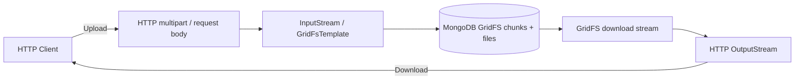
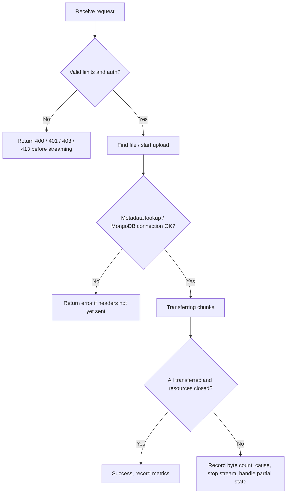

# Managing memory, streams, and file transfer errors in GridFS

## Lesson Objectives

In the **SPRING_DATA_MONGODB** module, Spring Data MongoDB enables document mapping and MongoDB operations through `MongoTemplate`, repositories, and specialized APIs. With GridFS, the central challenge is **transferring large file contents without holding the entire payload in RAM**, while properly handling errors that can occur at the HTTP, application, and MongoDB layers.

After this lesson, you will be able to:

- Distinguish **true streaming** from merely wrapping a byte array in an `InputStream` after loading the whole file into memory.
- Assess the impact of buffer sizes, GridFS chunks, concurrent requests, and multipart handling on RAM.
- Upload and download using `GridFsTemplate`, `InputStream`, and `StreamingResponseBody` with clear resource lifecycles.
- Recognize interrupted uploads, client-cancelled downloads, chunk write failures, and partially sent HTTP responses.
- Design timeouts, size limits, retries, observability, and file-transfer tests to reduce the risk of corrupted files or resource leaks.

## 1. Where does data flow through?

GridFS stores file content as chunk documents in `<bucket>.chunks` and file metadata in `<bucket>.files`. MongoDB does not require the application to assemble all chunks into one giant byte array before downloading: the GridFS driver provides a stream to read chunks sequentially in order.

A typical synchronous application has two transfer directions:



The goal is for each layer to process data incrementally. Even so, using `InputStream` **does not automatically guarantee** every layer is streaming: the multipart resolver, reverse proxy, gateway, antivirus scanner, application buffers, or HTTP client can still buffer the entire file upfront.

**Example:** a 200 MiB file is uploaded concurrently by 25 users. If each request calls `getBytes()` and retains the byte array until processing finishes, raw data alone could occupy roughly **5,000 MiB** of RAM, excluding copies, metadata, and JVM overhead. If each request uses a **64 KiB** copy buffer, the buffer memory explicitly allocated by copy code is only about **1.6 MiB** across 25 requests. This is **not** total actual RAM: the MongoDB driver, network buffers, multipart parser, threads, and other layers also consume resources.

## 2. Essential memory management rules

| Approach | Impact | Recommendation |
|---|---|---|
| `multipartFile.getBytes()`, `readAllBytes()`, or `ByteArrayOutputStream` holding full file | RAM grows with file size; concurrency amplifies the issue | Avoid for large file transfer flows; process via streams |
| `InputStream` -> fixed buffer -> `OutputStream` | Copy loop memory scales with buffer size, not file size | Use a fixed buffer, such as 64 KiB; monitor other layers' memory |
| `MultipartFile.getInputStream()` | May read data already spooled to disk or buffered in memory by the multipart resolver | Configure spool thresholds and disk capacity; do not assume the controller reads bytes straight off the wire |
| `GridFsTemplate.store(InputStream, ...)` | Driver incrementally writes content into GridFS chunks | Pass the stream directly and close it in the proper scope |
| `GridFsResource.getInputStream()` | Streams content from GridFS | Open and close the stream only while actually writing the HTTP response |
| `StreamingResponseBody` | Writes HTTP content from a Spring MVC async task | Configure a bounded executor and monitor slow connections |
| `collectList()` or `DataBufferUtils.join()` over an entire file in WebFlux | Collects all buffers, risking high RAM pressure | Keep `Flux<DataBuffer>` end-to-end when appropriate |

### Chunk size differs from copy buffer size

GridFS chunk size typically defaults to **255 KiB (261,120 bytes)**, though it is configurable on upload. It governs the payload size of each chunk document in MongoDB. By contrast, the 64 KiB buffer in a Java loop is only the read/write step size between two streams.

These two values **do not need to be equal**. Choosing a larger copy buffer does not change the GridFS chunk size; choosing a larger GridFS chunk does not cause HTTP to emit chunks of that same size. Network buffers, HTTP chunked transfer encoding, and GridFS chunks are three distinct concepts.

To control RAM under heavy load, limit concurrent uploads/downloads, monitor heap and off-heap buffers, and prevent hundreds of slow streams from exhausting threads, connection pools, or temporary resources.

## 3. Streaming uploads with Spring Data MongoDB

Suppose the application uses the `assets` bucket with `assets.files` and `assets.chunks`. Bean configuration:

```java
import org.springframework.context.annotation.Bean;
import org.springframework.context.annotation.Configuration;
import org.springframework.data.mongodb.MongoDatabaseFactory;
import org.springframework.data.mongodb.core.convert.MongoConverter;
import org.springframework.data.mongodb.gridfs.GridFsTemplate;

@Configuration
class GridFsConfig {

    @Bean("assetsGridFs")
    GridFsTemplate assetsGridFs(
            MongoDatabaseFactory databaseFactory,
            MongoConverter converter) {
        return new GridFsTemplate(databaseFactory, converter, "assets");
    }
}
```

A minimal Spring MVC controller receiving a multipart file and passing `InputStream` to GridFS:

```java
import java.io.IOException;
import java.io.InputStream;
import java.security.Principal;
import java.util.Map;

import org.bson.Document;
import org.bson.types.ObjectId;
import org.springframework.beans.factory.annotation.Qualifier;
import org.springframework.data.mongodb.gridfs.GridFsTemplate;
import org.springframework.http.HttpStatus;
import org.springframework.http.MediaType;
import org.springframework.http.ResponseEntity;
import org.springframework.web.bind.annotation.PostMapping;
import org.springframework.web.bind.annotation.RequestMapping;
import org.springframework.web.bind.annotation.RequestParam;
import org.springframework.web.bind.annotation.RestController;
import org.springframework.web.multipart.MultipartFile;

@RestController
@RequestMapping("/api/assets")
class GridFsUploadController {

    private final GridFsTemplate gridFs;

    GridFsUploadController(@Qualifier("assetsGridFs") GridFsTemplate gridFs) {
        this.gridFs = gridFs;
    }

    @PostMapping(consumes = MediaType.MULTIPART_FORM_DATA_VALUE)
    ResponseEntity<Map<String, String>> upload(
            @RequestParam("file") MultipartFile file,
            Principal principal) throws IOException {

        // Endpoint must be protected by the application's authentication mechanism.
        String filename = safeFilename(file.getOriginalFilename());
        String contentType = file.getContentType();

        Document metadata = new Document("ownerId", principal.getName())
                .append("contentType", contentType)
                .append("status", "uploaded");

        try (InputStream input = file.getInputStream()) {
            ObjectId fileId = gridFs.store(
                    input, filename, contentType, metadata);

            return ResponseEntity.status(HttpStatus.CREATED)
                    .body(Map.of("fileId", fileId.toHexString()));
        }
    }

    private static String safeFilename(String original) {
        String normalized = original == null
                ? ""
                : original.replace('\\', '/');
        String name = normalized.substring(normalized.lastIndexOf('/') + 1)
                .replace("\r", "")
                .replace("\n", "");
        return name.isBlank() ? "upload.bin" : name;
    }
}
```

The example uses `Principal` as the user identity source; a real application must require login, verify upload permissions, and enforce tenant isolation where needed. `safeFilename()` only performs basic stripping of path segments and line breaks; filename and file-type policies must be enforced per business rules. `contentType` from the request is **client-declared information**, not the result of safe content verification.

**Resource lifecycle:** `try-with-resources` closes the stream whether storing succeeds or throws an exception. Do not retain references to `MultipartFile` or `InputStream` in a background task running after the multipart request has been cleaned up, unless you explicitly manage the data source and its lifecycle.

**Note on multipart:** Spring MVC may already have received and spooled the multipart part before the controller is invoked. To bound resources, configure both request limits and temp storage location/capacity; if you need part-by-part streaming straight from the network socket to MongoDB without temp files, evaluate your HTTP/multipart and servlet stack design separately.

### Upload limits in Spring Boot

Example configuration for an endpoint accepting files up to 200 MiB:

```yaml
spring:
  servlet:
    multipart:
      max-file-size: 200MB
      max-request-size: 205MB
      file-size-threshold: 0B
```

`max-request-size` needs headroom for other multipart parts. `file-size-threshold: 0B` directs multipart files to disk temp storage in common servlet configurations; verify temp directory location and available disk space in your deployment environment. Alongside the application, reverse proxies/ingress controllers may enforce independent payload limits.

When limits are exceeded, requests are usually rejected during multipart parsing before controller logic runs, so configure error mapping to return **HTTP 413 Payload Too Large** with an appropriate message. Do not rely on `file.getSize()` inside the controller as the sole safeguard.

## 4. Downloading via `StreamingResponseBody`

For synchronous Spring MVC applications, `StreamingResponseBody` is one way to stream output: the controller resolves the file and builds headers, and Spring executes the callback to write bytes to the response.

```java
import java.io.IOException;
import java.io.InputStream;
import java.nio.charset.StandardCharsets;
import java.security.Principal;

import com.mongodb.client.gridfs.model.GridFSFile;
import org.bson.types.ObjectId;
import org.springframework.beans.factory.annotation.Qualifier;
import org.springframework.data.mongodb.core.query.Criteria;
import org.springframework.data.mongodb.core.query.Query;
import org.springframework.data.mongodb.gridfs.GridFsTemplate;
import org.springframework.http.ContentDisposition;
import org.springframework.http.HttpHeaders;
import org.springframework.http.HttpStatus;
import org.springframework.http.MediaType;
import org.springframework.http.ResponseEntity;
import org.springframework.web.bind.annotation.GetMapping;
import org.springframework.web.bind.annotation.PathVariable;
import org.springframework.web.bind.annotation.RequestMapping;
import org.springframework.web.bind.annotation.RestController;
import org.springframework.web.server.ResponseStatusException;
import org.springframework.web.servlet.mvc.method.annotation.StreamingResponseBody;

@RestController
@RequestMapping("/api/assets")
class GridFsDownloadController {

    private static final int BUFFER_SIZE = 64 * 1024;
    private final GridFsTemplate gridFs;

    GridFsDownloadController(@Qualifier("assetsGridFs") GridFsTemplate gridFs) {
        this.gridFs = gridFs;
    }

    @GetMapping("/{id}")
    ResponseEntity<StreamingResponseBody> download(
            @PathVariable String id,
            Principal principal) {

        if (!ObjectId.isValid(id)) {
            throw new ResponseStatusException(
                    HttpStatus.BAD_REQUEST, "Invalid file id");
        }

        // Do not query by filename alone: multiple files may share the same name.
        Query allowedFile = Query.query(
                Criteria.where("_id").is(new ObjectId(id))
                        .and("metadata.ownerId").is(principal.getName()));
        GridFSFile file = gridFs.findOne(allowedFile);

        if (file == null) {
            throw new ResponseStatusException(
                    HttpStatus.NOT_FOUND, "File not found");
        }

        String filename = file.getFilename() == null
                ? "download.bin"
                : file.getFilename();

        StreamingResponseBody body = output -> {
            // Open stream inside callback: response is written after
            // the controller method has already returned.
            try (InputStream input =
                         gridFs.getResource(file).getInputStream()) {
                byte[] buffer = new byte[BUFFER_SIZE];
                int bytesRead;
                while ((bytesRead = input.read(buffer)) != -1) {
                    output.write(buffer, 0, bytesRead);
                }
            }
            // Spring manages the HTTP output stream; do not call close(output).
        };

        String disposition = ContentDisposition.attachment()
                .filename(filename, StandardCharsets.UTF_8)
                .build()
                .toString();

        return ResponseEntity.ok()
                .header(HttpHeaders.CONTENT_DISPOSITION, disposition)
                .header("X-Content-Type-Options", "nosniff")
                .contentType(MediaType.APPLICATION_OCTET_STREAM)
                .contentLength(file.getLength())
                .body(body);
    }
}
```

Important points to understand correctly:

1. **Resolve metadata only in the controller.** `findOne(...)` checks the identifier and access rights without loading the entire file content.
2. **Open the GridFS stream inside the callback.** Do not open and close it with `try-with-resources` outside the callback, because the response has not yet started reading the body.
3. **Use a fixed-size buffer.** Each iteration holds only a slice of data; the driver fetches MongoDB chunks as needed.
4. **Close the read stream, not the HTTP stream.** When the callback completes or throws, `try-with-resources` closes `InputStream`. The servlet container/Spring manages `OutputStream`.
5. **Return only authorized files.** `ownerId` metadata does not enforce access control by itself; the query in the example scopes by the authenticated user. In multi-tenant setups, add tenant criteria and proper permission policies.
6. **Set `Content-Length` for full downloads.** The value comes from `GridFSFile.getLength()`. If transmission fails mid-way, the client sees a truncated response and must treat it as a failed download.

`Content-Disposition: attachment` instructs the browser to download the file rather than trying to render it. The example uses `application/octet-stream` to minimize risks of rendering untrusted content; if files must be previewed inline in the browser, enforce dedicated MIME type policies, content verification, and protections.

### Executor for streaming in Spring MVC

`StreamingResponseBody` processes requests asynchronously at the servlet layer, though the callback still **occupies a blocking I/O thread** while transferring data. Configure a dedicated bounded executor with timeouts rather than allowing unbounded task creation.

```java
import org.springframework.beans.factory.annotation.Qualifier;
import org.springframework.context.annotation.Bean;
import org.springframework.context.annotation.Configuration;
import org.springframework.core.task.TaskExecutor;
import org.springframework.scheduling.concurrent.ThreadPoolTaskExecutor;
import org.springframework.web.servlet.config.annotation.AsyncSupportConfigurer;
import org.springframework.web.servlet.config.annotation.WebMvcConfigurer;

@Configuration
class GridFsStreamingMvcConfig implements WebMvcConfigurer {

    private final ThreadPoolTaskExecutor streamingExecutor;

    GridFsStreamingMvcConfig(
            @Qualifier("gridFsStreamingExecutor")
            ThreadPoolTaskExecutor streamingExecutor) {
        this.streamingExecutor = streamingExecutor;
    }

    @Bean("gridFsStreamingExecutor")
    static ThreadPoolTaskExecutor gridFsStreamingExecutor() {
        ThreadPoolTaskExecutor executor = new ThreadPoolTaskExecutor();
        executor.setCorePoolSize(4);
        executor.setMaxPoolSize(16);
        executor.setQueueCapacity(100);
        executor.setThreadNamePrefix("gridfs-stream-");
        return executor;
    }

    @Override
    public void configureAsyncSupport(AsyncSupportConfigurer configurer) {
        configurer.setTaskExecutor(streamingExecutor);
        configurer.setDefaultTimeout(120_000L);
    }
}
```

These numbers are purely illustrative. Tune them based on network speed, how long a request occupies a thread, MongoDB connection count, and server capacity. When the queue fills up, enforce load shedding and return appropriate error responses. Spring MVC's timeout does not replace proxy, MongoDB driver, or client timeouts.

## 5. At which stages do file transfer errors occur?



| Scenario | What the application observes | Reasonable handling |
|---|---|---|
| File exceeds HTTP/multipart limits | Request size exception, often before controller runs | Return 413 when possible; keep proxy and app policies aligned |
| File missing or user unauthorized | No matching document found in `files` | Check before writing body; often return 404 to avoid leaking resource existence |
| MongoDB connection lost at start of upload | Connection exception, timeout, or write failure | Stop upload, close stream, log with correlation ID, return error if response uncommitted |
| MongoDB connection lost mid-download | Stream read fails after some bytes were already sent | Abort stream, record failed download; do not write JSON error text into binary body |
| Client disconnects during download | `IOException`/broken pipe/connection reset on `output.write(...)` | Stop reading from MongoDB, close resources, classify as client abort if identifiable |
| Client upload interrupted | HTTP/multipart source reports error; partial data written | Ensure driver/app aborts when supported; check leftover chunks once upload termination is confirmed |
| Missing or out-of-order chunk documents | GridFS driver may error while streaming content | Never treat a truncated response as success; verify integrity and data-repair workflows |
| Executor overloaded or timed out | Tasks wait too long, get rejected, or time out | Bound concurrency, monitor queue depth, and classify errors to tune capacity |

### Before and after the response is committed

**Before sending headers/body**, the application can still change the HTTP status to 400, 404, 413, or an appropriate 5xx and return an API-standard JSON error body.

**After the first byte is written**, headers may already be committed. You cannot reliably change the status code or turn the response into valid JSON. A global exception handler may only log or terminate the connection; clients must treat truncated bytes, broken connections, or checksum mismatches as a **failed download**.

Therefore, validate everything knowable early (identifier, permissions, metadata, size) before streaming, and track **mid-stream failures** through logs and metrics rather than relying solely on HTTP status codes.

### Should exceptions be swallowed inside the callback?

No. Dangerous pattern:

```java
StreamingResponseBody body = output -> {
    try (InputStream in = resource.getInputStream()) {
        in.transferTo(output);
    } catch (IOException error) {
        // Wrong: only logs and treats the callback as successful.
    }
};
```

Ensure errors are recorded and propagated to the proper error-handling mechanism; never signal false success or inject text error messages into the middle of file bytes. If you need to distinguish client aborts from backend errors, place classification/metrics logic in the catch block and allow the request to terminate as failed.

## 6. Interrupted uploads and orphan chunks

In GridFS, each upload typically writes `chunks` documents first and writes the corresponding `files` document upon completion. These operations are not automatically a single atomic transaction across the entire file.

Example: a 900 MiB upload is interrupted after the driver writes some chunks. Several documents in `assets.chunks` may remain without a corresponding document in `assets.files`. Those are **orphan chunks**, consuming storage without representing a complete file readable via normal GridFS APIs.

Lifecycle handling:

1. **When an error occurs**, let the driver close/abort the upload session properly; if using low-level upload stream APIs, invoke `abort()` where supported by the driver to clean up written chunks when possible.
2. **Log/record metrics** for upload or file ID, owner, start time, bytes received, error, and abort status.
3. **Periodically scan** for chunks lacking a matching file, combining active upload session state and a sufficient age window before classifying them as orphans.
4. **Delete only after confirming** the upload has truly terminated; chunks belonging to a valid in-progress upload will also temporarily lack a `files` record.
5. **Retry with control** to avoid creating duplicate files under the same name or business record.

Do not delete `files` documents directly with raw MongoDB commands and assume chunks are deleted automatically. When deleting complete files, prefer the GridFS delete API since it handles both collections.

### Retry is not the same as resume

Suppose a client loses network connectivity at 80% of an upload. If the API uses a single HTTP request containing the entire file, a simple retry normally creates **a brand-new upload from scratch**; it does not resume from 80%.

To design safe retries:

- Use a client-generated upload request key, persist state/idempotency at the business layer, and ensure the same key cannot produce two distinct completed results under concurrent retries.
- Publish the file to downstream systems only after upload completion and verification.
- If block-level upload resume is required, design a dedicated upload-session protocol with offsets, checkpoints, integrity checks, and finalization; GridFS `store(InputStream, ...)` does not automatically become a resumable HTTP API.
- For interrupted downloads, advertise `Accept-Ranges: bytes` only if the endpoint truly implements `Range` handling, returning `206 Partial Content` and proper `Content-Range` headers. `StreamingResponseBody` in the example above **only serves full content** and does not automatically support HTTP Range.

## 7. Timeouts, backpressure, and concurrency

The application must look at the entire transfer chain:

| Resource | Risk | Mitigation |
|---|---|---|
| Heap / direct memory | Many buffers/byte arrays or holding long payloads in RAM | Fixed buffers, avoid full-file materialization, monitor GC and native memory |
| Multipart temp disk | Disk exhaustion while receiving uploads | Set quotas, inspect temp paths, clean up temp files, limit requests |
| Spring MVC threads | Slow clients tie up streaming threads for long periods | Bounded executor, timeouts, concurrency limits |
| MongoDB connection pool | Long uploads/downloads or too many requests exhaust pool | Monitor waiting connections, max pool size, timeouts, concurrency |
| HTTP server/proxy | Proxy buffering, timeouts, or mid-transfer disconnects | Verify buffering settings, request/idle timeouts, body limits |
| Network | Low bandwidth, packet loss, client disconnects | Streaming, avoid unbounded retries, track transferred bytes and durations |

**Backpressure** means the consumer can slow down the producer when unable to keep up. The `input.read(...)` and `output.write(...)` loop in Spring MVC naturally stalls when the socket writes slowly, though it still holds a blocking thread. This is not an end-to-end non-blocking model.

With **Spring WebFlux**, `ReactiveGridFsTemplate` and `ReactiveGridFsResource` offer a reactive publisher-based approach. The pipeline can use `DataBuffer` streams and demand signaling, though you must still avoid `block()`, `collectList()`, or `join()` on whole files. When retaining or releasing `DataBuffer` instances manually, follow Spring's ownership/lifecycle rules to avoid leaks, especially with pooled buffers. Steps like encryption, virus scanning, or forwarding to external services can still queue data and defeat streaming if they buffer entire payloads.

## 8. Integrity verification and observability

GridFS stores chunks in sequence, yet the application still needs to verify **whether the file received by the client is intact** for critical documents.

- **Size:** compare actual received bytes against `GridFSFile.length` for full downloads. HTTP `Content-Length` helps clients detect truncated responses when set accurately.
- **Checksum:** compute SHA-256 incrementally during upload and store it in metadata or business records after upload completes. On download or audit, recompute from read bytes and compare. Store only real computed checksums; GridFS does not provide this automatically.
- **Business consistency:** transition status to `READY` or allow downloads only after both file storage and related metadata updates succeed per application workflow.
- **Audit:** log user/tenant, file ID, operation type, byte count, duration, and outcome. Never log binary content or unnecessary sensitive data.

Example computing a hash via stream without holding the entire file in memory:

```java
import java.io.IOException;
import java.io.InputStream;
import java.security.MessageDigest;
import java.security.NoSuchAlgorithmException;
import java.util.HexFormat;

public final class StreamChecksums {

    private StreamChecksums() {}

    public static String sha256(InputStream input) throws IOException {
        final MessageDigest digest;
        try {
            digest = MessageDigest.getInstance("SHA-256");
        } catch (NoSuchAlgorithmException e) {
            throw new IllegalStateException("SHA-256 unavailable", e);
        }

        byte[] buffer = new byte[64 * 1024];
        int count;
        while ((count = input.read(buffer)) != -1) {
            digest.update(buffer, 0, count);
        }
        // Java 17+: format digest bytes as a hex string.
        return HexFormat.of().formatHex(digest.digest());
    }
}
```

**Note:** this method consumes the stream to EOF. If you need to both upload and compute a checksum in one pass, wrap the stream to update the digest as the driver reads, or hash in a separate pass from a reopenable source. Never call `sha256(input)` and then pass that same exhausted stream to `store(input, ...)`.

### Metrics to monitor

| Metric | Question answered |
|---|---|
| `gridfs_upload_total{result=...}` | How many uploads succeeded, failed, or were cancelled? |
| `gridfs_download_total{result=...}` | How many downloads completed or were interrupted? |
| `gridfs_transfer_bytes` | How many bytes did the system actually read/write? |
| `gridfs_transfer_duration_seconds` | How are transfer speed and latency trending? |
| `gridfs_active_streams` | How many streams are active concurrently? |
| `gridfs_orphan_chunks` | Are there signs of leftover chunks after failed uploads? |
| `http_stream_executor_active/queued` | Is the streaming executor saturated? |

Do not add `fileId`, `userId`, or filenames directly as metric labels because cardinality will explode. Those values belong in structured logs or traces governed by data protection policies.

## 9. Practice and verification scenarios

### Scenario A — large file and memory

Upload a file larger than 16 MiB (for example, 50 MiB), then download it multiple times concurrently.

1. Verify `assets.files` has the expected `length` and `assets.chunks` holds multiple chunks.
2. Observe heap, off-heap memory, thread counts, and connection pool as request concurrency rises.
3. Compare against a test version that intentionally calls `getBytes()` to see the allocation difference; run this only in a bounded test environment.
4. Confirm downloaded files match the source byte-for-byte and in SHA-256.

**Criterion:** increasing file size does not cause copy code to allocate arrays proportional to the entire file. Total system memory may still rise due to other layers, so measure realistically.

### Scenario B — client aborts download mid-transfer

1. Start downloading a file large enough for the transfer to take noticeable time.
2. Cancel the request from the client before completion.
3. Verify the application logs a client abort or corresponding `IOException`.
4. Confirm the GridFS `InputStream` is closed and the active stream count drops.
5. Ensure no error payload is written into the binary response and the transfer is not recorded as a completed download.

**Criterion:** no resource leaks, metrics reflect failed or cancelled outcome, and partial bytes are never treated as a complete file.

### Scenario C — MongoDB disconnects during upload

1. In a test environment, inject a connection failure while a large upload is running.
2. Inspect the HTTP response, error logs, and closing of the input source.
3. After recovery, inspect `assets.files` and `assets.chunks`.
4. If orphan chunks remain, verify no upload is still active before cleaning up.
5. Retry with idempotency to verify two completed files are not created for the same business action.

**Criterion:** incomplete files are never published as complete; cleanup and retry leave clear audit trails.

### Scenario D — empty file and duplicate filenames

Upload a **0-byte** file and two additional files sharing the same `filename`. GridFS can represent an empty file without data chunks. Two files with identical names still receive distinct `_id` values. Test downloading by `_id`, `Content-Length`, and access control, avoiding any assumption that filename is a unique key.

## 10. Design mistakes to avoid

- **Opening a stream in the controller and closing it before the callback runs.** `StreamingResponseBody` will attempt to read from a closed stream.
- **Swallowing `IOException` inside the callback.** The application could report false success for a corrupted transfer.
- **Calling `getBytes()` or `readAllBytes()` on large files.** Memory scales with file size and concurrency.
- **Relying solely on timeouts to control load.** Timeouts do not replace concurrency bounds, backpressure, or request size limits.
- **Equating GridFS chunks with HTTP chunks.** They belong to different layers with separate rules.
- **Assuming uploads or downloads are atomic.** Mid-transfer failures can leave incomplete chunks or truncated HTTP responses.
- **Retrying automatically without idempotency.** Can create duplicate files or corrupt business state.
- **Promising resume/Range support when the endpoint has not implemented it.** Full-stream downloads do not automatically support `206 Partial Content`.
- **Ignoring temporary storage management.** Multipart parsing can consume disk even when controller code uses `InputStream`.

## Summary

Good memory management with GridFS starts with **keeping data in stream form across the entire pipeline**, using bounded buffers, and capping concurrent requests. When integrating Spring Data MongoDB, `GridFsTemplate` fits uploads via `InputStream` and downloads via `GridFsResource`; `StreamingResponseBody` lets Spring MVC send content incrementally, provided the executor and resource lifecycles are configured properly.

In operations, distinguish errors **before** and **after** HTTP response commit, handle interrupted uploads so incomplete files are never exposed, and use checksums, logs, and metrics to verify real outcomes. These principles apply across both synchronous and reactive access, even though the specific APIs differ.
