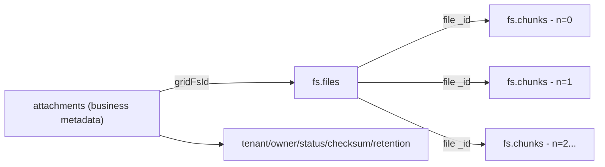
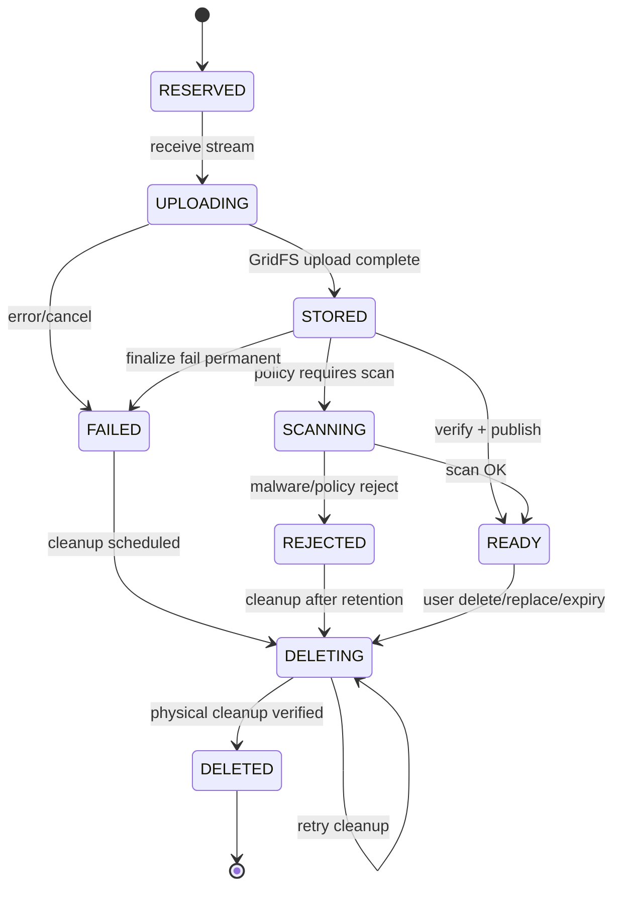
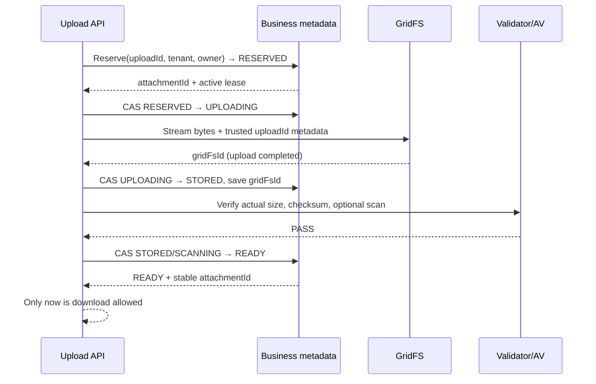
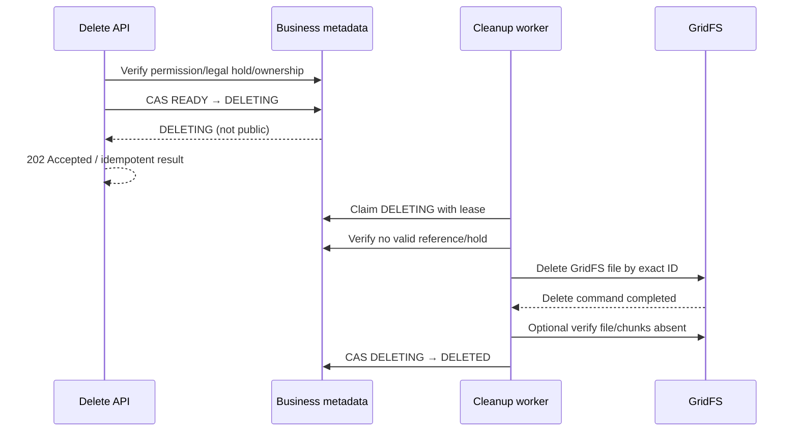
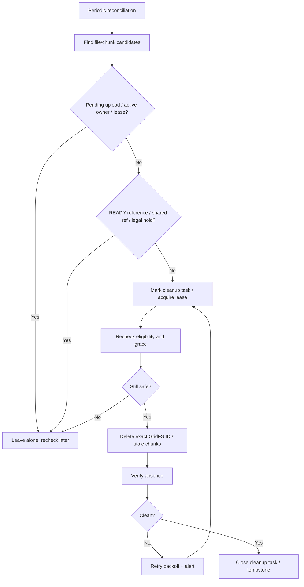
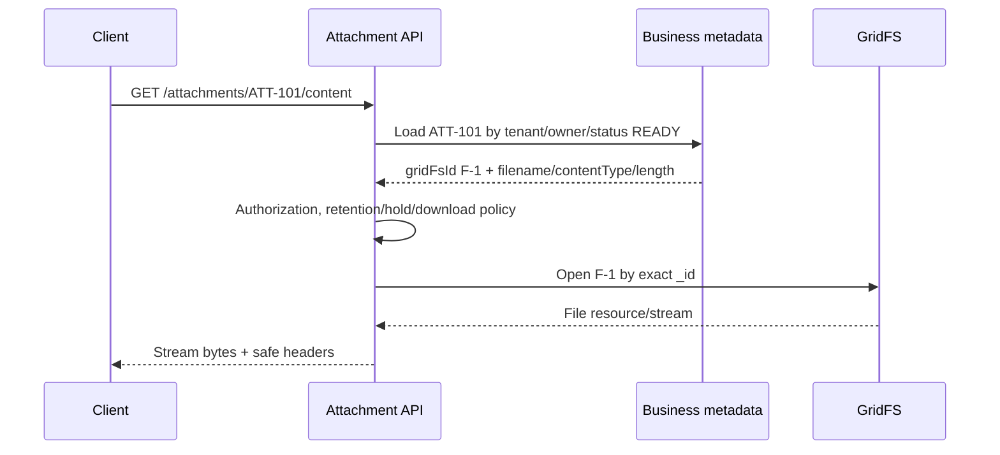
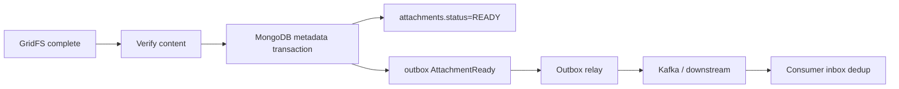
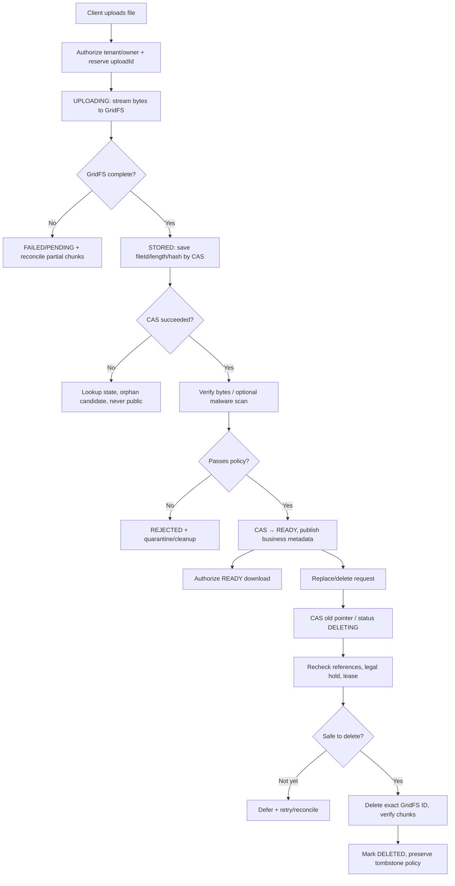

# Consistency between business metadata, file content, and cleanup with GridFS

## 1. The problem: file stored but business workflow incomplete

In the **SPRING_DATA_MONGODB** module, GridFS enables Java/Spring Data MongoDB applications to store and read large files as data streams instead of placing all bytes into a single BSON document. This approach is useful when a system handles contracts, product images, audit documents, report exports, or order attachments.

However, saving a file is more than just `gridFsTemplate.store(...)`:

1. The user uploads a stream of bytes.
2. GridFS stores the **chunks** and a file descriptor record.
3. The application stores **business metadata**: which tenant or order owns the file, who may read it, what status it is in, and what its checksum is.
4. The API reports “upload successful”, potentially triggering OCR, antivirus scanning, preview generation, or event publishing.
5. When the user replaces/deletes the file or a request fails, the system must clean up **only data no longer in use**, without accidentally deleting files that are still referenced.

Suppose the file finishes uploading to GridFS, but writing the `attachments` document fails:

```text
GridFS:
  fs.files → file id F-1 exists
  fs.chunks → data for F-1 exists

Business:
  attachments → no record referencing F-1
```

The file can become an **orphan**, consuming storage and becoming hard to trace. Conversely, if “READY” metadata is created first and the upload subsequently fails, the application could return a link to **a file without complete content**.

This lesson focuses specifically on **“Consistency between business metadata, file content, and cleanup”** in the **GridFS** chapter. The content brings together document mapping, CRUD via `MongoTemplate`/`GridFsTemplate`, reactive access, indexing, transaction boundaries, testing, and operational diagnostics. There are no additional notes for this lesson.

### 1.1. Learning outcomes

After this lesson, you will be able to:

- Distinguish GridFS system metadata from application **business metadata**.
- Describe the relationship among `fs.files`, `fs.chunks`, and `attachments`, as well as failure windows during upload.
- Design a **state machine** `STAGING → READY → DELETING/DELETED` instead of assigning a success status prematurely.
- Determine when a file is permitted to appear in search/download APIs.
- Use idempotency keys, unique constraints, and compare-and-set to prevent retries from creating duplicates.
- Handle **replacement**, deletion, shared references, cleanup queues, orphan scanning, and crash recovery.
- Understand why MongoDB transactions do not automatically turn every GridFS streaming operation into an end-to-end transaction.
- Compute checksum/length while streaming, enforce file limits, and control tenant-scoped access.
- Write integration tests with fault injection between GridFS and metadata, along with runbooks for monitoring capacity/orphans.

## 2. What does GridFS actually store?

### 2.1. Two collections per bucket

With the default bucket `fs`, MongoDB stores:

| Collection | Contents | Notable fields |
|---|---|---|
| `fs.files` | One record describing each completed uploaded file | `_id`, `length`, `chunkSize`, `uploadDate`, `filename`, `metadata` |
| `fs.chunks` | Binary data slices of files | `_id`, `files_id`, `n`, `data` |

Each chunk has `files_id` referencing `fs.files._id` and `n` indicating the chunk's position in the file. Reading a file relies on the file metadata and sequential chunks ordered by `n`. Never mix or alter chunk ordering manually.



**MongoDB does not automatically enforce a foreign key** from `attachments.gridFsId` to `fs.files._id` or from `fs.chunks.files_id` to `fs.files._id`. Cross-collection referential integrity rules are the responsibility of application and recovery design.

### 2.2. fs.files.metadata is not all of business metadata

Example GridFS document:

```javascript
// fs.files (illustrative)
{
  _id: ObjectId("673c765a0a5e0af8c76b04a1"),
  length: NumberLong(1847296),
  chunkSize: 261120,
  uploadDate: ISODate("2026-11-20T03:00:00Z"),
  filename: "contract.pdf",
  metadata: {
    uploadId: "UP-123",
    tenantId: "T-A",
    purpose: "ORDER_ATTACHMENT",
    contentType: "application/pdf"
  }
}
```

`metadata` inside `fs.files` is **arbitrary data** passed by the application through the GridFS driver/template, not a field whose business validity MongoDB validates automatically. It is useful for reconciliation and cleanup, but it does not by default replace:

- Business states `STAGING/READY/DELETING`.
- Access control by order/owner.
- Logical versioning for file replacement.
- Retention/legal hold policies.
- Idempotency/retry ownership.
- Reference counting when a file is shared across multiple objects.
- Audit trails of “who approved the file, who deleted the file.”

Never allow clients to attach `tenantId` to GridFS metadata and trust it as an authorization basis; tenant identity must come from an authenticated context.

### 2.3. Example application metadata document

```javascript
// attachments (illustrative)
{
  _id: "ATT-101",
  tenantId: "T-A",
  ownerType: "ORDER",
  ownerId: "O-101",
  uploadId: "UP-123",
  status: "READY",
  gridFsId: ObjectId("673c765a0a5e0af8c76b04a1"),
  originalFilename: "contract.pdf",
  mediaType: "application/pdf",
  length: NumberLong(1847296),
  sha256: "64-actual-hex-chars-when-hashed",
  createdAt: ISODate("2026-11-20T03:00:00Z"),
  readyAt: ISODate("2026-11-20T03:00:02Z")
}
```

The `sha256` field here is a placeholder **describing the data shape**, not a valid digest to copy for real use. The program must compute SHA-256 from the actual bytes, never trusting a client-supplied checksum.

### 2.4. filename is not a unique identifier

GridFS allows **multiple files with the same filename**. Therefore:

```java
gridFsTemplate.findOne(
    Query.query(Criteria.where("filename").is("contract.pdf")));
```

cannot be the way to select “the right file for an order” if multiple tenants/orders upload `contract.pdf`. Store the **file ID** in business metadata and look up the file by `_id` after verifying authorization.

Never use a filename in a URL as an authorization key. A filename is a user-selectable display attribute, not an access-control token.

### 2.5. Payloads over 16 MiB and streaming characteristics

GridFS splits data into chunks to store files larger than the BSON document limit. However:

- Chunk splitting **does not** automatically make uploading a file an atomic operation covering all chunks and metadata.
- Reads/downloads must be implemented with streaming to avoid bringing the entire file onto the heap.
- A request can be cancelled after writing only a subset of chunks.
- Cleanup must account for both **complete files** and **orphaned partial chunks**.

Do not choose GridFS merely to bypass all file size limits; you still need quotas, max upload bytes, timeouts, antivirus/content validation, and retention policies.

## 3. Three consistency layers to distinguish

### 3.1. Byte-level consistency

**Question:** do the chunks genuinely form a complete file of the expected length and content?

Checks:

- `fs.files.length` matches total bytes.
- Chunk sequence has no missing or duplicate positions.
- Checksum computed from the byte stream (such as SHA-256) matches the stored digest.
- Mid-upload cancelled files are never served as successful uploads.

The GridFS driver is responsible for reading/writing chunks properly per protocol; however, if an upload crashes, application cleanup/recovery must still detect incomplete data.

### 3.2. Referential consistency

**Question:** does every attachment in `READY` status point to an existing GridFS file with matching tenant/owner, and does every complete file have valid ownership/reference?

```text
READY attachment → complete GridFS file
complete file → valid attachment/intent or orphan candidate
chunks → matching file or partial-chunk orphan candidate
```

You cannot simply count `fs.files` and conclude there are no orphans: chunks without a file record can also exist after an interrupted upload.

### 3.3. Business visibility consistency

**Question:** can users download a file right after the service reports READY, and are DELETING/QUARANTINED files hidden from the API?

Typical rules:

- Show/download attachments only when `status == READY` and permissions allow.
- Never allow clients to directly download a `gridFsId` not yet confirmed by the application.
- An upload whose bytes finished saving while metadata is still unfinalized remains **not public**.
- An accepted delete request can hide the file immediately before chunks are physically deleted.
- A file under legal hold must not be cleaned up even if the user requested deletion.

This is why a **state machine** is needed rather than relying solely on the presence of `fs.files`.

### 3.4. Why can't you assume “same MongoDB means atomic”?

A service may use MongoDB for both metadata and GridFS, yet an upload typically writes multiple chunks before writing the file record. The GridFS API/driver has its own transaction limitations; MongoDB documentation states **GridFS does not support multi-document transactions** across GridFS workflows.

Therefore, do not write:

```java
// WRONG ASSUMPTION: @Transactional does not automatically make
// GridFS streaming + metadata update + remote antivirus
// one atomic business operation.
@Transactional
public void uploadEverything(...) {
    gridFsTemplate.store(...);
    mongoTemplate.save(...);
    antivirusClient.scan(...);
}
```

Even if certain metadata updates can be wrapped in a MongoDB transaction, **do not** assume long GridFS uploads, chunks, file metadata, and HTTP calls all roll back together as one unit.

A safe design is a **stateful workflow + idempotency + compensation/cleanup + reconciliation**, rather than hiding failure modes behind a single annotation.

## 4. State machine for business metadata

### 4.1. Necessary states

| Status | Meaning | API download? | Cleanup? |
|---|---|---|---|
| `RESERVED` | Upload intent/idempotency key accepted, byte storage not yet started | No | Yes after timeout/grace |
| `UPLOADING` | Writing chunks/GridFS | No | Only after ownership expires |
| `STORED` | GridFS returned a file ID, awaiting verification/metadata finalization | No | Eligible for cleanup if finalization fails |
| `SCANNING` | Awaiting antivirus/content check if required | No | Held temporarily per SLA |
| `READY` | Content verified and metadata published | Yes, after authorization | No, unless delete/retention policy applies |
| `REJECTED` | Invalid file/virus/checksum failure | No | Yes, protected by forensic policy |
| `FAILED` | Upload/processing did not complete | No | Yes after retry/grace |
| `DELETING` | No longer public, awaiting physical deletion | No | Handled by worker |
| `DELETED` | Cleanup completed per policy | No | Tombstone retention per business rules |

Not every system needs all nine states. At minimum, however, distinguish **“uploading”**, **“publicly ready”**, and **“deleting”**. A single boolean flag `uploaded=true` usually cannot capture critical failure windows.

### 4.2. State transition diagram



A temporarily failed upload request must **not** automatically transition to `READY` merely because a file record exists; you must verify the file belongs to the right intent, bytes are verified, and policy scans passed.

### 4.3. Invariants to codify as tests

1. **READY ⇒ complete GridFS file exists** referenced by `gridFsId`, barring explicitly specified delete-race protocols.
2. **READY ⇒ valid business authorization**: `tenantId`/`ownerId` match and not quarantined.
3. **One uploadId ⇒ at most one READY attachment** enforced via idempotency constraints.
4. **Immutable creation metadata**: `createdBy`, `createdAt`, tenant/owner cannot be overwritten by clients.
5. **DELETING ⇒ API issues no new downloads**, even if bytes are not yet physically removed.
6. **Physical deletion is allowed only when no valid references remain**, no legal hold exists, and no active upload/reader leases require protection per policy.
7. **Failed cleanup can be retried** without deleting a reused file by mistake.
8. **Content checksum/length** reflect actual uploaded bytes, not an unverified declared payload.

### 4.4. Upload intent as durable data

Before reading the file stream, persist the intent:

```javascript
{
  _id: "ATT-101",
  uploadId: "UP-123",
  tenantId: "T-A",
  ownerType: "ORDER",
  ownerId: "O-101",
  status: "RESERVED",
  expectedMaxBytes: NumberLong(10485760),
  gridFsId: null,
  createdBy: "user-42",
  createdAt: ISODate("2026-11-20T03:00:00Z"),
  updatedAt: ISODate("2026-11-20T03:00:00Z"),
  leaseUntil: ISODate("2026-11-20T03:05:00Z")
}
```

The intent helps detect incomplete uploads, govern retries, and explain why a GridFS file/object was created. Do not create the intent **after** the upload completes, because a crash during upload would leave no durable record for tracing the incident.

## 5. Two-phase upload workflow: prepare and publish

### 5.1. Proposed protocol



The operations above **are not one global transaction**. The strength of the protocol is that **every transition has a durable checkpoint**, allowing you to identify which step completed and which step needs compensation if the process crashes.

### 5.2. Step 1 — verify permissions and reserve

Before reading bytes:

1. Authenticate the actor and tenant from a trusted source.
2. Verify the owner order/document exists, belongs to the same tenant, and permits attachments.
3. Enforce tenant quota, allowed size, and supported file types.
4. Accept or generate an immutable **upload idempotency key** for one upload intent.
5. Insert into `attachments` in `RESERVED` state guarded by a unique index.
6. Return `attachmentId` so the client can check status; do not return a download URL yet.

Do not use `filename + uploadDate` as an idempotency key: the same filename may intentionally be uploaded twice; retries of the same intent must be identified by a dedicated key.

### 5.3. Step 2 — stream bytes through GridFS

During upload:

- Set `status=UPLOADING` and owner/lease when claiming processing rights.
- Pass trusted `uploadId`, `tenantId`, `attachmentId`, and `purpose` metadata into GridFS.
- Read from `InputStream` as a stream; enforce actual byte limits rather than trusting HTTP `Content-Length`.
- Compute SHA-256 over the actual consumed bytes.
- When GridFS returns the file ID, that marks **upload API completion**, not the point where users can download.
- If the client disconnects or the stream fails, mark the intent for recovery; if file ID/partial data is known, clean up per policy.

**Do not** buffer the entire payload in RAM or a temp file solely to compute the hash before storing. Compute the digest while streaming and inspect the result after GridFS finishes.

### 5.4. Step 3 — record GridFS ID in metadata

After `store(...)` completes, update:

```javascript
{
  $set: {
    status: "STORED",
    gridFsId: ObjectId("673c765a0a5e0af8c76b04a1"),
    actualLength: NumberLong(1847296),
    sha256: "<digest from actual bytes>",
    updatedAt: ISODate("2026-11-20T03:00:02Z")
  }
}
```

The update must use **compare-and-set** matching `uploadId`, `tenantId`, `status=UPLOADING`, and lease owner/generation if present. If matched count is 0, never force a record in `DELETING` back to `READY`. A newly stored file that failed to attach must enter **cleanup/reconciliation**.

### 5.5. Step 4 — verify content and publish

Depending on business rules:

- Compare `actualLength` with `expectedMaxBytes`/client-declared length.
- Compute/verify SHA-256; client-supplied digests are only expectations to verify.
- Sniff MIME/magic bytes; never rely solely on `Content-Type` or filename extension.
- Scan for malware and check file type/format and sensitive data per policy.
- Record `PASSED/REJECTED/SCAN_PENDING` with scanner version and timestamp.
- Transition `STORED/SCANNING → READY` **only after all mandatory checks pass**.

If the antivirus service times out, **do not** assume the file is clean and publish it. Keep it in `SCANNING`, perform bounded retries, or route it to a processing queue with alerting/ownership.

### 5.6. Step 5 — API response and retries

The response can look like:

```json
{
  "attachmentId": "ATT-101",
  "uploadId": "UP-123",
  "status": "READY",
  "length": 1847296,
  "sha256": "<actual sha256>"
}
```

For long uploads, the API may return `202 Accepted` + `attachmentId` first, after which the client polls or subscribes to status. `202` **does not mean** GridFS already holds a complete file. If returning `201 Created` for a READY attachment, ensure the read path checks that the file actually exists and policy checks passed.

If the HTTP response is lost after the backend already committed READY, a client retry with the **same uploadId** must return the existing attachment rather than creating a duplicate. If retrying with the **same key but a different payload**, return `409 Idempotency Conflict` and never overwrite existing bytes.

## 6. Failure-window matrix: knowing where to recover from

| Failure point | Possible remaining state | Risk | Recovery |
|---|---|---|---|
| Before reserve | No intent or file | No resources allocated | Return error / retry request |
| After reserve, before upload | `RESERVED` with no file | Dangling intent | Expire after lease/grace, mark FAILED |
| Mid chunk upload | `UPLOADING`, possibly chunks without `fs.files` | Orphan partial chunks | Abort upload if possible; sweeper by upload lease/age |
| GridFS store finished, before saving gridFsId | Complete GridFS file exists, intent still UPLOADING | Orphan complete file | Find via trusted `metadata.uploadId` or preallocated ID; reconcile |
| After saving gridFsId, before scan | `STORED` | Unverified file | Scan/retry; never make public |
| Scan rejected | `REJECTED` | Malicious content | Quarantine/clean up per policy, block download |
| Scan OK, CAS READY fails | Good file not yet public | Technically uploaded, not published | Check status/owner, conditionally retry finalize |
| READY committed, HTTP response lost | Public file, client thinks it failed | Duplicate on retry | Idempotency lookup returns the same attachment |
| Marked DELETING, before GridFS delete | Not public, bytes remain | Temporary storage leak | Cleanup worker retries |
| GridFS delete finished, before DELETED | File gone, metadata DELETING | Cleanup retry | Verify absence then finalize tombstone |
| Delete running while reader has open stream | Read may break or race depending on driver | UX/error consistency | Reader lease/grace or accept download failure |
| Two uploaders with same key | Could produce 2 GridFS objects | Orphan/duplicate | Unique intent, lease/fencing, clean up loser |
| Two concurrent replace requests for same version | Two new files racing for pointer | Lost update and orphans | Generation CAS, single winner, clean up loser |
| Cleaner crashes mid-chunk deletion | File/chunks partially deleted | Partial cleanup | Idempotent retry, scan to verify absence |

**Critical rule:** “Operation was invoked” and “operation became durable/committed” are not the same thing. When a timeout occurs after sending a delete command, the outcome may be unknown; **re-read the state** rather than assuming the delete definitely did not happen and restoring the reference.

### 6.1. Retrying does not make multiple collections atomic

```java
for (int retry = 0; retry < 3; retry++) {
    gridFsTemplate.store(inputStream, filename);
    mongoTemplate.save(attachment);
}
```

This is an **anti-pattern**:

- `InputStream` was already consumed on the first attempt and cannot be replayed safely.
- Each `store` call can generate a different file ID.
- When saving metadata fails after GridFS upload succeeded, retries create extra duplicate files.
- With external scanners or APIs, side effects become even harder to untangle.

Retries must rely on **`uploadId` + state checkpoints**: inspect the shared intent before deciding how to resume, avoiding replaying the entire byte stream when the prior outcome has not been verified.

### 6.2. Unknown outcomes must have a dedicated state

Especially when a connection times out between GridFS store and client ACK:

```text
Backend is unsure:
  - did fs.files appear?
  - are all chunks complete?
  - did business metadata save gridFsId?
  - was READY committed?
```

Never tell the client `"failed and safe to retry as new upload"` when the outcome is unknown. The API can return `PENDING_CONFIRMATION`/`202`, allow lookups by `uploadId`, and let reconciliation resolve it. Correctness matters more than forcing an immediate success/failure answer.

## 7. Data model and indexes for idempotency

### 7.1. Business metadata entity

```java
import java.time.Instant;
import org.bson.types.ObjectId;
import org.springframework.data.annotation.Id;
import org.springframework.data.annotation.Version;
import org.springframework.data.mongodb.core.index.CompoundIndex;
import org.springframework.data.mongodb.core.mapping.Document;

@Document("attachments")
@CompoundIndex(
    name = "ux_tenant_upload",
    def = "{'tenantId': 1, 'uploadId': 1}",
    unique = true)
public class AttachmentRecord {

    @Id
    private String id;

    private String tenantId;
    private String ownerType;
    private String ownerId;
    private String uploadId;
    private AttachmentStatus status;
    private ObjectId gridFsId;
    private String originalFilename;
    private String mediaType;
    private long actualLength;
    private String sha256;
    private String createdBy;
    private Instant createdAt;
    private Instant updatedAt;
    private Instant leaseUntil;

    @Version
    private Long version;

    protected AttachmentRecord() {}

    // Factory/constructor, getters, and state transitions
    // should be implemented at the domain/service layer.
}

enum AttachmentStatus {
    RESERVED,
    UPLOADING,
    STORED,
    SCANNING,
    READY,
    REJECTED,
    FAILED,
    DELETING,
    DELETED
}
```

This is an **entity skeleton**, not a complete copy-paste class. Validation and transition methods must be added. If the GridFS file ID is an `ObjectId`, store it using the proper BSON/Java type; do not substitute inconsistently formatted strings across different code paths.

### 7.2. Scoping unique uploadId properly

An idempotency key is meaningful only together with:

```text
tenantId + uploadId + immutable request fingerprint
```

For example, the fingerprint can include:

- `tenantId`, `ownerType`, `ownerId`.
- Upload purpose, declared media type (after validation).
- Expected length/checksum if provided by the protocol.
- Verified client-generated upload ID.

If a request reuses `uploadId` while changing `ownerId` or payload, never silently return another owner's READY file. Compare the **locked business parameters** and reject conflicts. If the true checksum is known only after upload, it cannot guard the reserve phase before bytes arrive; use a two-phase policy with expected checksum or generation/lease.

### 7.3. Required indexes

```javascript
db.attachments.createIndex(
  { tenantId: 1, uploadId: 1 },
  { unique = true, name: "ux_tenant_upload" }
);

db.attachments.createIndex(
  { tenantId: 1, ownerType: 1, ownerId: 1, status: 1 },
  { name: "ix_owner_ready" }
);

db.attachments.createIndex(
  { status: 1, leaseUntil: 1 },
  { name: "ix_stale_uploads" }
);

db.attachments.createIndex(
  { status: 1, updatedAt: 1 },
  { name: "ix_cleanup_queue" }
);

db.fs.files.createIndex(
  { "metadata.uploadId": 1, "metadata.tenantId": 1 },
  { name: "ix_gridfs_upload_lookup" }
);
```

Do not simultaneously rely on automatic `@CompoundIndex` creation and assume every environment runs `createIndex` migrations: standardize on **one** index management process and verify existing indexes before production rollout.

Note: the GridFS driver/bucket also requires standard indexes on `fs.files`/`fs.chunks`, especially on `fs.chunks(files_id, n)`. Never drop or alter default GridFS indexes just to tune business queries.

### 7.4. Cleanup states must not be immediately deleted by TTL

If you configure TTL on `attachments` for `FAILED`/`DELETING` without a worker cleaning up GridFS first, metadata may vanish while chunks/files remain: **losing the very pointer needed for cleanup**.

TTL is appropriate only for **tombstones/intent records whose cleanup is already complete and whose retention has expired**, or for a separate coordination collection where deletion never drops cleanup responsibility. Enforce the sequence:

```text
mark DELETING
    ↓
physical GridFS deletion + verification
    ↓
mark DELETED
    ↓
retention / archival
    ↓
TTL delete tombstone if permitted
```

Never place a TTL directly on `fs.files.uploadDate` assuming GridFS chunks will be removed automatically: TTL deletion of a file record **is not equivalent** to calling GridFS bucket delete and can leave orphan chunks behind.

## 8. Uploading with GridFsTemplate and recording actual byte streams

### 8.1. Imperative Spring Data MongoDB example

`GridFsTemplate` supports storing an `InputStream` into GridFS and returning the file's `ObjectId`:

```java
import java.io.IOException;
import java.io.InputStream;
import org.bson.Document;
import org.bson.types.ObjectId;
import org.springframework.data.mongodb.gridfs.GridFsTemplate;

public ObjectId uploadRawFile(
        GridFsTemplate gridFsTemplate,
        InputStream input,
        String safeName,
        String verifiedMediaType,
        String trustedTenantId,
        String attachmentId,
        String uploadId) throws IOException {

    Document metadata = new Document()
        .append("tenantId", trustedTenantId)
        .append("attachmentId", attachmentId)
        .append("uploadId", uploadId)
        .append("contentType", verifiedMediaType);

    return gridFsTemplate.store(
        input, safeName, verifiedMediaType, metadata);
}
```

In this example:

- `safeName` is a name checked for length, Unicode, and control characters, used for display only; never as a server filesystem path.
- `trustedTenantId` must come from the authentication/authorization context.
- `uploadId` is the idempotency key already reserved/checked by the service.
- After `store` returns, **do not** mark the API as READY until business metadata finalization and checks pass.
- All `metadata.*` fields are **application-supplied data**, with no automatic authorization system built on top of them.

**Do not** convert the `InputStream` into a full byte array with `readAllBytes()` in large upload endpoints. You can inspect/sniff a bounded header prefix using a resettable stream or a proper streaming parser.

### 8.2. Counting bytes and computing SHA-256 while reading

To enforce **actual** size limits, place a stream wrapper ahead of `DigestInputStream`. Java 17+ example:

```java
import java.io.FilterInputStream;
import java.io.IOException;
import java.io.InputStream;

public final class LimitedCountingInputStream
        extends FilterInputStream {

    private final long maximum;
    private long count;

    public LimitedCountingInputStream(
            InputStream source, long maximum) {
        super(source);
        if (maximum <= 0) {
            throw new IllegalArgumentException("maximum <= 0");
        }
        this.maximum = maximum;
    }

    @Override
    public int read() throws IOException {
        int byteValue = in.read();
        if (byteValue >= 0) {
            record(1);
        }
        return byteValue;
    }

    @Override
    public int read(byte[] target, int offset, int len)
            throws IOException {
        int n = in.read(target, offset, len);
        if (n > 0) {
            record(n);
        }
        return n;
    }

    @Override
    public int read(byte[] target) throws IOException {
        return read(target, 0, target.length);
    }

    private void record(int bytes) throws IOException {
        if (count > maximum - bytes) {
            throw new IOException("Upload exceeds max bytes");
        }
        count += bytes;
    }

    public long count() {
        return count;
    }
}
```

This wrapper **errors when the threshold is exceeded**. It may have read ahead from the underlying source before throwing, yet it never delivers bytes beyond the limit to `store(...)`. Limits must also be enforced early at the HTTP ingress/proxy and file upload controller to prevent network and quota abuse.

### 8.3. One upload producing StoredBlob evidence

```java
import java.io.InputStream;
import java.io.IOException;
import java.security.DigestInputStream;
import java.security.MessageDigest;
import java.security.NoSuchAlgorithmException;
import java.util.HexFormat;
import org.bson.Document;
import org.bson.types.ObjectId;
import org.springframework.data.mongodb.gridfs.GridFsTemplate;

public record StoredBlob(
    ObjectId fileId, long length, String sha256
) {}

public final class GridFsBlobWriter {
    private final GridFsTemplate files;
    private final long maxBytes;

    public GridFsBlobWriter(
            GridFsTemplate files, long maxBytes) {
        this.files = files;
        this.maxBytes = maxBytes;
    }

    public StoredBlob write(
            InputStream raw,
            String safeFilename,
            String verifiedMediaType,
            String trustedTenantId,
            String attachmentId,
            String uploadId) throws IOException {
        MessageDigest sha256;
        try {
            sha256 = MessageDigest.getInstance("SHA-256");
        } catch (NoSuchAlgorithmException e) {
            throw new IllegalStateException(
                "SHA-256 unavailable", e);
        }

        Document gridMetadata = new Document()
            .append("tenantId", trustedTenantId)
            .append("attachmentId", attachmentId)
            .append("uploadId", uploadId)
            .append("contentType", verifiedMediaType);

        try (LimitedCountingInputStream bounded =
                 new LimitedCountingInputStream(raw, maxBytes);
             DigestInputStream digestInput =
                 new DigestInputStream(bounded, sha256)) {

            ObjectId fileId = files.store(
                digestInput,
                safeFilename,
                verifiedMediaType,
                gridMetadata);

            return new StoredBlob(
                fileId,
                bounded.count(),
                HexFormat.of().formatHex(sha256.digest()));
        }
    }
}
```

`GridFsBlobWriter` writes via streaming and obtains **file ID**, **bytes read**, and **digest** after `store` succeeds. This is evidence to check against business metadata—**it does not commit READY by itself**.

**Limitations and notes:**

- Assumes the uploaded stream is read completely through `DigestInputStream` inside `store` per the driver's contract. Test with multi-chunk input fixtures and compare actual hashes.
- Compare against `fs.files.length` after upload if required by policy to detect mismatches between bytes read by the application and persisted metadata.
- If the upload fails mid-way, caller code must mark the intent and clean up/reconcile partial chunks; `try-with-resources` only closes the input stream and **does not** replace the GridFS cleanup workflow.
- If the process crashes after `store` but before returning `StoredBlob` to the caller, use `metadata.uploadId` or preallocated IDs to locate complete unattached files.
- Computing SHA-256 detects unexpected content changes, though it **does not** replace malware scanning or prove the file source is trustworthy.

### 8.4. Reading/checking a GridFS file by ID

```java
import com.mongodb.client.gridfs.model.GridFSFile;
import org.bson.types.ObjectId;
import org.springframework.data.mongodb.core.query.Criteria;
import org.springframework.data.mongodb.core.query.Query;
import org.springframework.data.mongodb.gridfs.GridFsTemplate;

public GridFSFile findById(
        GridFsTemplate files, ObjectId fileId) {
    return files.findOne(
        Query.query(Criteria.where("_id").is(fileId)));
}
```

If this returns `null` after `store` reported success, it signals the need to reconcile storage write outcome, cluster consistency, and concurrent cleanup. Never blindly set `status=READY` just because your code holds an `ObjectId` variable in memory.

### 8.5. Client-declared content length is only an expectation

A request may declare:

```text
Content-Length: 1000000
Content-Type: application/pdf
filename: invoice.pdf
```

yet send a larger payload, a renamed `.exe`, or truncated data. Therefore:

- The HTTP server/proxy must enforce size limits.
- The stream reader must enforce actual byte limits.
- Checksum and media type verification must inspect actual bytes.
- Client declarations serve only as **expected values** to verify.
- Never issue public download links until mandatory checks pass.

## 9. Transitioning state with compare-and-set, not blind overwrites

### 9.1. Why updating by ID alone is insufficient

Faulty pattern:

```java
mongoTemplate.updateFirst(
    Query.query(Criteria.where("_id").is("ATT-101")),
    new Update().set("status", "READY"),
    AttachmentRecord.class);
```

Suppose during upload another request asked to delete `ATT-101` and moved it to `DELETING`. Updating solely by `_id` could **resurrect a deleted file** back into READY.

### 9.2. CAS UPLOADING → STORED

```java
import java.time.Instant;
import com.mongodb.client.result.UpdateResult;
import org.bson.types.ObjectId;
import org.springframework.data.mongodb.core.MongoTemplate;
import org.springframework.data.mongodb.core.query.Criteria;
import org.springframework.data.mongodb.core.query.Query;
import org.springframework.data.mongodb.core.query.Update;

public boolean markStored(
        MongoTemplate mongo,
        String attachmentId,
        String tenantId,
        String uploadId,
        ObjectId gridFsId,
        long actualLength,
        String sha256) {

    Query expected = Query.query(
        Criteria.where("_id").is(attachmentId)
            .and("tenantId").is(tenantId)
            .and("uploadId").is(uploadId)
            .and("status").is("UPLOADING"));

    Update changed = new Update()
        .set("gridFsId", gridFsId)
        .set("actualLength", actualLength)
        .set("sha256", sha256)
        .set("status", "STORED")
        .set("updatedAt", Instant.now());

    UpdateResult result = mongo.updateFirst(
        expected, changed, AttachmentRecord.class);
    return result.getMatchedCount() == 1;
}
```

If `false`, do not conclude “file does not exist.” The file was uploaded to GridFS, but **the business update lost the CAS race**. The caller must inspect the current attachment:

- Already READY with **the same uploadId, gridFsId, hash/size**: may be an idempotent completion.
- Already READY with a **different uploadId**: the new file is a loser/orphan candidate.
- Already DELETING/DELETED: do not publish; send the newly uploaded GridFS file to cleanup.
- Missing or different tenant: report a security/consistency error; never cross-attach.

**Note on `@Version`:** if using raw `updateFirst`, verify specifically how Spring Data increments version and handles optimistic locking in your project version. If the application uses version for CAS, include the version predicate and enforce a unified version-increment mechanism across **every write path**—never assume `updateFirst` has identical semantics to `save(entity)`.

### 9.3. CAS STORED/SCANNING → READY

```java
Query expected = Query.query(
    Criteria.where("_id").is(attachmentId)
        .and("tenantId").is(trustedTenantId)
        .and("uploadId").is(uploadId)
        .and("gridFsId").is(fileId)
        .and("status").is("STORED"));

Update publish = new Update()
    .set("status", "READY")
    .set("readyAt", Instant.now())
    .set("updatedAt", Instant.now());

UpdateResult result =
    mongoTemplate.updateFirst(
        expected, publish, AttachmentRecord.class);
```

When a `SCANNING` step exists, publish only when both the status matches **and the scanner result actually PASSED**—do not simply flip the status name in an update. `getMatchedCount()==0` is a **race/failure to classify**, never treated as success.

### 9.4. Authorizing downloads using metadata status itself

```java
Query authorized = Query.query(
    Criteria.where("_id").is(attachmentId)
        .and("tenantId").is(trustedTenantId)
        .and("ownerId").is(authorizedOwnerId)
        .and("status").is("READY"));
```

This query is only part of a policy; it does not yet cover roles, ownership transfers, legal holds, or download permissions. Crucially, **never** query solely by:

```java
Criteria.where("gridFsId").is(fileId)
```

and let any user who knows the `ObjectId` download the file. An `ObjectId` is not a strong enough secret to serve as an authorization token.

### 9.5. Validating transitions in the domain before writing

Allowed transitions can be checked with a domain method:

```java
boolean canMove(
        AttachmentStatus from,
        AttachmentStatus to) {
    return switch (from) {
        case RESERVED ->
            to == AttachmentStatus.UPLOADING
            || to == AttachmentStatus.FAILED;
        case UPLOADING ->
            to == AttachmentStatus.STORED
            || to == AttachmentStatus.FAILED;
        case STORED ->
            to == AttachmentStatus.SCANNING
            || to == AttachmentStatus.READY
            || to == AttachmentStatus.FAILED;
        case SCANNING ->
            to == AttachmentStatus.READY
            || to == AttachmentStatus.REJECTED;
        case READY, REJECTED, FAILED ->
            to == AttachmentStatus.DELETING;
        case DELETING ->
            to == AttachmentStatus.DELETED;
        case DELETED -> false;
    };
}
```

This method only expresses **domain rules**. At the database layer, you still need **atomic CAS** to prevent two workers from transitioning from the same state simultaneously; checking in the JVM first and calling `save` is insufficient under concurrent requests.

## 10. Deleting in two layers: hide first, delete bytes later

### 10.1. Why not delete the file before metadata?

If you run:

```java
gridFsTemplate.delete(
    Query.query(Criteria.where("_id").is(fileId)));
mongoTemplate.remove(attachment);
```

and the service crashes after the first line, metadata may stay in `READY` pointing to a missing file. The download API could return 500/404 errors to users, or delete retries might lose track of the business state.

### 10.2. Multi-step deletion protocol



In the first step, **the API immediately stops issuing new downloads** by filtering on status. The file may continue occupying disk until cleanup finishes. This is **eventual physical cleanup with a known state**, which is far better than deleting bytes first and leaving a public business pointer dangling.

### 10.3. Deleting GridFS by ID

```java
import org.bson.types.ObjectId;
import org.springframework.data.mongodb.core.query.Criteria;
import org.springframework.data.mongodb.core.query.Query;
import org.springframework.data.mongodb.gridfs.GridFsTemplate;

public void deleteExactFile(
        GridFsTemplate files, ObjectId fileId) {
    files.delete(
        Query.query(Criteria.where("_id").is(fileId)));
}
```

**Never** delete by filename (which may collide) or by an overly broad client-supplied search query. Delete only a file ID obtained by a **trusted cleanup worker** from claimed metadata, after verifying no-reference/legal-hold conditions.

GridFS deletion normally affects both `fs.files` and `fs.chunks`. If a process or network failure interrupts operations in between, partial data may remain; cleanup must retry and **verify actual removal** rather than marking DELETED merely because a request was sent.

### 10.4. Repeated deletes must be idempotent

Sometimes the cleanup worker experiences:

```text
Delete F-1 succeeds
↓
Process crashes before marking DELETED
↓
Retry delete F-1
```

On retry, the file may already be gone. Depending on API/driver version, deleting a nonexistent file ID may throw an exception like `MongoGridFSException` instead of acting as a no-op. An **idempotent cleanup handler** should:

1. Execute delete.
2. When a properly classified “file not found” error occurs, verify the file and its chunks are absent per policy.
3. If confirmed clean and metadata still holds the lease/DELETING state, mark DELETED.
4. On network errors with unknown outcomes, re-read storage and retry with backoff; never delete another file.
5. Never swallow arbitrary GridFS exceptions and assume “already cleaned up.”

### 10.5. Active downloads during deletion

An open `GridFSDownloadStream` may need chunks throughout response transmission. If cleanup deletes chunks while a reader is mid-download, the download may corrupt or abort.

Three possible policies:

| Policy | Advantage | Trade-off |
|---|---|---|
| Delete physically as soon as marked DELETING | Reclaims storage early | In-flight downloads may fail |
| Grace period before deletion | Simple, reduces races | Bytes persist slightly longer |
| Reader lease/reference tracking | Stronger protection for active readers | More state/cleanup logic; must handle crashes and lease expiry |

If your system requires immediate deletion for security/legal compliance, explicitly document that **active readers may be cancelled**. If in-flight downloads must be allowed to finish, implement reader leases/draining with bounded timeouts; no single setting satisfies both simultaneously.

### 10.6. Legal hold and retention

A user clicking “delete” does not necessarily grant permission for physical deletion:

- Accounting documents with mandatory retention periods.
- Files under audit or legal hold.
- Files referenced by multiple business records.
- Files currently protected by active scans or other transactions.

Store retention/hold policies in **business metadata** and re-check them right before physical deletion. Never allow scheduled TTL jobs to purge bytes while a legal hold is active.

### 10.7. Cleanup retries differ from upload retries

For cleanup, repeating an operation is safe when targeting **the same file ID under the same intent/lease**. For uploads, calling `store` again may generate a brand-new file ID. Do not apply a generic `Retry.max(5)` identically to both.

For cleanup, bound retry attempts/backoff, record failure reasons and `nextAttemptAt`, and route to a DLQ or manual intervention when SLA limits are exceeded. If a file has special retention requirements, do not retry blindly to the point of deleting despite an updated policy.

## 11. Replacing files: upload the new version first, swap the pointer afterward

### 11.1. Why not overwrite in place?

Suppose a user replaces `contract.pdf` with a newer version. If you delete the old file first and then upload the new file:

```text
Attachment READY → GridFS F-old
    |
    +-- DELETE F-old
    +-- UPLOAD F-new (network timeout)
    |
    \-- Attachment still READY but F-old is gone
```

When uploading the new copy fails, the old file is already lost. A safer approach is **immutable file versions + atomic pointer swap**:

```text
Active: version 7 → F-old, READY

Upload candidate version 8 → F-new, STORED/SCANNING
Verify F-new complete and safe
CAS active version 7 → 8

Active: version 8 → F-new, READY
Retire F-old → cleanup queue after retention/grace
```

File bytes do not need to be “overwritten” under the same `gridFsId`. Keeping each version on an immutable file ID makes rollback, auditing, and checksum verification straightforward.

### 11.2. Two collections: logical document and attachment versions

One model:

```javascript
// business_documents
{
  _id: "O-101",
  tenantId: "T-A",
  activeAttachmentId: "ATT-008",
  attachmentGeneration: NumberLong(8)
}

// attachments
{
  _id: "ATT-008",
  ownerId: "O-101",
  tenantId: "T-A",
  status: "READY",
  gridFsId: ObjectId("673c765a0a5e0af8c76b04a2"),
  sha256: "<actual>",
  generation: NumberLong(8)
}
```

The `activeAttachmentId` pointer identifies the **displayed copy**. A candidate version in `STORED` is not yet the active copy even though its file exists. Business APIs must always load owner/tenant/status before allowing downloads.

### 11.3. Atomic compare-and-set pointer

```java
import java.time.Instant;
import com.mongodb.client.result.UpdateResult;
import org.springframework.data.mongodb.core.query.Query;
import org.springframework.data.mongodb.core.query.Criteria;
import org.springframework.data.mongodb.core.query.Update;

Query expectedOldVersion = Query.query(
    Criteria.where("_id").is(orderId)
        .and("tenantId").is(trustedTenantId)
        .and("activeAttachmentId").is(oldAttachmentId)
        .and("attachmentGeneration").is(7L));

Update promote = new Update()
    .set("activeAttachmentId", candidateAttachmentId)
    .set("attachmentGeneration", 8L)
    .set("updatedAt", Instant.now());

UpdateResult result = mongoTemplate.updateFirst(
    expectedOldVersion,
    promote,
    "business_documents");
```

Only when `getMatchedCount()==1` may the candidate be considered the race winner. If two uploads race, one succeeds; the losing request must **never delete the winner's file** and must not blindly overwrite the pointer.

In this simple example, the candidate must already be verified and in the proper status before CAS. If multiple business documents must swap pointers simultaneously, that is a **separate business rule** requiring an appropriate transaction across metadata documents, without pulling the GridFS upload itself into the transaction.

### 11.4. Do not delete the old version immediately upon pointer swap

After CAS succeeds, the old file may still have:

- Download streams opened earlier.
- A workflow that just read `oldAttachmentId` and is about to process it.
- Legal holds/retention rules.
- Version history needed for rollback.
- Other owners sharing the reference.

Enqueue retirement/cleanup and verify **no valid references remain**. If policy permits, apply a grace period before physical deletion. If version history is not retained, delete after grace while preserving tombstones/metadata for idempotent retries and incident tracing.

### 11.5. When the business pointer update succeeds but retiring the old version fails

A race/failure window:

```text
CAS business_documents.activeAttachmentId = ATT-008 OK
   ↓
Process crashes before marking ATT-007 RETIRED
```

Recovery must never delete `ATT-008` just because the old version was not yet marked retired. Reconcile using **the active pointer + business metadata status as source of truth**, and generate idempotent cleanup tasks for inactive versions.

If the API checks only `attachments.status==READY` without checking the logical active pointer, both old and new versions may appear. Clearly distinguish “READY & active” from “READY & historical version.”

### 11.6. One file referenced by multiple records

If the system performs checksum-based deduplication where multiple attachments point to the same `gridFsId`, the lifecycle changes significantly:

- Deleting one attachment does **not** mean the GridFS file can be deleted.
- Never merely count references in `attachments` without locking/coordination while new attachments are concurrently being created.
- You need a blob registry/refcount updated synchronously with reference transitions or a conservative mark-and-sweep policy.
- Identical checksums do not prove tenant/security policies permit sharing a file.
- If **any single** owner has a legal hold on the file, physical blob cleanup must be blocked.

For simpler systems, choose **one GridFS file owned per attachment**, even at some extra storage cost, to reduce the risk of accidental deletion. Deduplication is an optimization requiring its own ownership model, not a free safety feature of SHA-256.

## 12. Orphan cleanup: search both files and chunks

### 12.1. Three categories to reconcile

| Category | Symptom | Safe action |
|---|---|---|
| Complete file lacking business reference | `fs.files` and chunks exist, no valid attachment | Inspect uploadId/lease/grace, then schedule cleanup |
| Partial chunks lacking `fs.files` | `fs.chunks.files_id` has no matching file record | Never delete while upload is running; use owner/ID registry and grace |
| READY reference pointing to missing file | Attachment is READY but `fs.files` is absent or content corrupted | Alert, quarantine/mark unavailable, restore/rebuild per policy |

**An orphan is not always an error to delete immediately.** During an upload, GridFS may write chunks before creating the `fs.files` record. A scanner running at that exact moment will see “chunks without a file” even though the upload is healthy and active.

### 12.2. Finding complete GridFS files by uploadId

When uploads attach metadata containing `uploadId`/`attachmentId`, you can reconcile with:

```javascript
db.getCollection("fs.files").find({
  "metadata.uploadId": "UP-123",
  "metadata.tenantId": "T-A"
});
```

This is why trusted identifiers must be stored in GridFS metadata during upload. If the service crashes after `store` completes but before `markStored`, the sweeper can still locate the complete file matching the intent.

However, finding a complete file with the same `uploadId` **does not automatically mean** it is valid to publish. Verify:

- Matching tenant/attachment/owner.
- Expected upload fingerprint, size, and checksum.
- Number of candidate files sharing `uploadId`.
- Intent status/lease and scanner policy.

If two complete files exist for the same `uploadId` due to retries, pick one via a CAS workflow; send the loser to cleanup rather than attaching both.

### 12.3. Finding files not referenced by READY/STORED attachments

A diagnostic query for test environments or off-peak windows:

```javascript
db.getCollection("fs.files").aggregate([
  {
    $lookup: {
      from: "attachments",
      localField: "_id",
      foreignField: "gridFsId",
      as: "references"
    }
  },
  {
    $match: {
      references: { $size: 0 }
    }
  },
  {
    $project: {
      filename: 1,
      uploadDate: 1,
      "metadata.uploadId": 1,
      "metadata.tenantId": 1
    }
  }
]);
```

**The output is only candidates**, not an immediate deletion list. `attachments` might live in another database/bucket, have pending intents without `gridFsId` set yet, use a shared blob registry, or have an active uploader. Running `$lookup` across a large GridFS collection is also expensive. In production, scan in **small batches scoped by time/tenant/owner**, backed by indexes and scan budgets, rather than running full joins continuously across millions of files.

If `fs.files` uses a custom bucket or business metadata resides in a separate database, the `$lookup` pipeline above does not apply verbatim; design reconciliation with appropriate topology access.

### 12.4. Finding partial chunks without a file record

```javascript
db.getCollection("fs.chunks").aggregate([
  {
    $group: {
      _id: "$files_id",
      chunkCount: { $sum: 1 },
      minN: { $min: "$n" },
      maxN: { $max: "$n" }
    }
  },
  {
    $lookup: {
      from: "fs.files",
      localField: "_id",
      foreignField: "_id",
      as: "files"
    }
  },
  {
    $match: {
      files: { $size: 0 }
    }
  }
]);
```

This too is only a **diagnostic candidate scan**. Because `fs.chunks` does not by default store `uploadDate` or `tenantId` on each chunk, standard fields alone cannot prove a candidate is “older than 5 minutes.”

Do not infer chunk timestamps from `_id`: the GridFS driver or application may use IDs without embedded timestamps. To automate partial-chunk cleanup safely:

1. Allocate the **file ID before uploading** using lower-level driver APIs that accept a caller-provided ID, and persist that ID/lease in the intent.
2. Or maintain a reliable upload registry mapping `fileId → active owner/lease`.
3. Enforce a maximum upload duration/grace period and verify the uploader is no longer active.
4. Scan twice separated by an adequate interval to avoid racing with in-flight writes.
5. Only then clean up by file ID and verify removal.

When `GridFsTemplate.store(...)` generates the file ID only upon returning, the application may **not know the ID of partial chunks if the process crashes before receiving the return value**. This is a limitation of the simpler workflow; for deterministic automated partial-chunk cleanup, design pre-allocated IDs/registries at the appropriate driver layer.

### 12.5. Never label orphans from a single join snapshot

```text
SCAN #1: complete file F has no attachments reference
       ↓
Uploader is in the window between GridFS store and metadata finalize
       ↓
SCAN #2: READY attachment points to F
```

If the cleaner deletes F right after SCAN #1, it creates a `READY metadata → missing file` race itself. Use:

- **A grace window** longer than upload/finalization SLAs.
- Intent status/lease tracking to detect active uploads.
- Reference/owner rechecks immediately before deleting.
- CAS marking the cleanup candidate to forbid concurrent promotion.
- Fencing/generations so stale workers cannot delete a file newly attached by a winner.

A fixed grace window alone **is not enough** if legitimate uploads take a long time, networks pause, or scanners are busy. Leases and states must be renewed, owned, and reconciled rather than simply waiting N minutes.

### 12.6. Orphan cleanup is a workflow, not a one-shot delete command



### 12.7. Do not delete chunks directly while uploads may still be active

The GridFS driver manages file/chunk consistency per protocol. Manual commands such as:

```javascript
db.getCollection("fs.chunks").deleteMany({
  files_id: someFileId
});
```

should only be executed inside a **verified orphan-repair procedure**, targeting an exact `someFileId` whose uploader has stopped, with no valid `fs.files` entry, and logged for audit by an authorized operator/tool. If the application is still writing chunks, manual deletion can corrupt an active upload.

Prefer the GridFS bucket delete API for **complete files**, reserving raw chunk cleanup exclusively for verified orphan partial-chunk cases.

## 13. Building an idempotent cleanup worker

### 13.1. A retryable task

A queue document:

```javascript
{
  _id: "CLEANUP-ATT-101",
  tenantId: "T-A",
  attachmentId: "ATT-101",
  gridFsId: ObjectId("673c765a0a5e0af8c76b04a1"),
  status: "PENDING",
  reason: "USER_DELETE",
  nextAttemptAt: ISODate("2026-11-20T03:05:00Z"),
  attempts: 0,
  leaseOwner: null,
  leaseUntil: null,
  createdAt: ISODate("2026-11-20T03:00:00Z")
}
```

Workers claim tasks via atomic conditional updates (for example, `findAndModify` checking `PENDING + nextAttemptAt <= now` or expired leases). Cap in-flight tasks so burst deletes do not saturate MongoDB's I/O pool.

### 13.2. Cleanup must re-verify immediately before deleting

Order of operations:

1. Claim the task and acquire lease owner/generation.
2. Re-read the attachment and verify it is still `DELETING` with matching file ID and tenant.
3. Check legal hold, retention, shared references, and download leases if applicable.
4. Confirm the file ID is not referenced by another READY owner.
5. Call GridFS delete by exact **`_id`**.
6. Verify `fs.files` is absent and handle lingering chunks if needed.
7. CAS `DELETING→DELETED`; close the task under the same lease/generation.
8. On error, update `attempts`/`nextAttemptAt`, record the error code, and alert if SLA is breached.

**Never** delete at step 5 just because the task says “delete file X”: the task could be stale if the user reversed/restored the attachment, or another uploader attached the file. Design state transitions so `DELETING` cannot revert back to `READY` once physical cleanup begins.

### 13.3. Bounded retries, no blind retrying

| Error type | Policy |
|---|---|
| Network timeout / MongoDB temporarily unavailable | Backoff + jitter; verify outcome before retrying |
| File already absent and no chunks remain | May treat cleanup as complete per idempotency policy |
| Authorization/permission error | Alert and fix permissions; do not retry infinitely |
| Document has a new active reference | Stop deleting; reconcile race/invariant violation |
| Legal hold newly applied | Defer cleanup and record reason |
| Orphan chunks not yet proven stale | Do not delete; await operator/grace |
| Partial storage removal | Retry exact ID and verify; follow repair runbook |
| Quota/timeout scanning full collection | Shrink scan batch, optimize indexes, avoid brute-force scans |

### 13.4. Logical quota release differs from physical reclaim

If a tenant has a 10 GiB quota and a `DELETING` file still has bytes on disk, the system must distinguish:

- **Logical quota:** capacity used by READY files.
- **Physical quota:** actual bytes still in GridFS across STORED/DELETING/orphans.
- **Reserved quota:** capacity allocated to incomplete upload intents.

Do not release all quota immediately upon transitioning to DELETING if doing so allows users to churn unbounded garbage faster than the cleaner can reclaim it. Apply retry-aware quota/reservation accounting to prevent upload-delete loop abuse.

### 13.5. Cleanup metrics must track real effectiveness

Metrics to measure:

```text
cleanup_tasks_pending
cleanup_tasks_retrying
cleanup_oldest_pending_age
cleanup_files_deleted_total
cleanup_bytes_reclaimed_estimate
cleanup_orphan_files_candidates
cleanup_partial_chunk_candidates
cleanup_delete_failures_total
gridfs_storage_bytes
ready_attachment_bytes
staging_attachment_bytes
```

`cleanup_bytes_reclaimed_estimate` is only a logical data-byte estimate derived from file metadata; it does **not** equal physical disk space immediately freed due to storage engine behavior, padding, compression, replication, and filesystem allocation.

## 14. Reactive GridFS: managing Mono, DataBuffer, and cancellation

### 14.1. Reactive does not alter the consistency contract

`ReactiveGridFsTemplate` supports storing files via publishers of byte buffers instead of blocking `InputStream`. In a Spring WebFlux application, data typically flows from `FilePart.content()` to the template/driver as a `DataBuffer` stream. Reactive lets you control demand and avoid blocking I/O threads, yet it **does not** turn a multi-chunk upload into a single transaction with `attachments`.


Creating a `Mono<ObjectId>` does not mean the upload has started; MongoDB I/O runs when the pipeline is subscribed. When a controller returns a reactive response, WebFlux normally owns the subscription at the application edge. Never call `subscribe()` inside a service and report “success” before GridFS completes.

### 14.2. ReactiveGridFsTemplate example

```java
import org.bson.Document;
import org.bson.types.ObjectId;
import org.springframework.core.io.buffer.DataBuffer;
import org.springframework.data.mongodb.gridfs.ReactiveGridFsTemplate;
import org.springframework.http.codec.multipart.FilePart;
import reactor.core.publisher.Mono;

public Mono<ObjectId> storeReactive(
        ReactiveGridFsTemplate files,
        FilePart part,
        String trustedTenantId,
        String attachmentId,
        String uploadId,
        String verifiedContentType) {

    Document metadata = new Document()
        .append("tenantId", trustedTenantId)
        .append("attachmentId", attachmentId)
        .append("uploadId", uploadId);

    return files.store(
        part.content(),                    // Flux<DataBuffer>
        part.filename(),                   // must sanitize before production
        verifiedContentType,
        metadata);
}
```

This illustrates the Spring Data Reactive GridFS API using the overload taking `Publisher<DataBuffer>`, filename, contentType, and metadata in supported versions. Check the exact Javadoc for your dependency version when applying it. In production, never use `part.filename()` directly as a display name or header, and enforce byte limits, content sniffing/virus scanning, tenant authorization, idempotency, and status transitions.

### 14.3. Composing upload and metadata transitions together

```java
public Mono<AttachmentResult> uploadAndFinalize(
        UploadCommand command,
        FilePart file) {

    return reserveAndClaim(command)
        .flatMap(intent ->
            storeWithLimitHashAndMetadata(
                    intent, file.content())
                .flatMap(stored ->
                    markStored(intent, stored)
                        .flatMap(updated ->
                            scanAndPublish(updated))));
}
```

Here `UploadCommand`, `AttachmentResult`, `reserveAndClaim`, `storeWithLimitHashAndMetadata`, `markStored`, and `scanAndPublish` are **application abstractions**, not built-in Spring Data APIs. The point is that **all steps must remain inside one reactive chain with clear completion/error signals**, never using `doOnNext(...subscribe())`.

In real implementations, add **classified** `onErrorResume` handlers to record FAILED/cleanup tasks; never ignore failures if metadata `markStored` fails after GridFS `store` succeeded. Mid-stream request cancellations can still leave partial chunks or complete files requiring a sweeper.

### 14.4. DataBuffer memory and release policy

`DataBuffer` instances from WebFlux may be backed by pooled buffers (Netty). Retaining a `DataBuffer` after the publisher completes or copying it improperly can leak memory.

Principles:

- Prefer passing publishers directly through `DataBuffer`-aware APIs instead of `collectList()`/`join()` over the whole file.
- When building custom operators that consume or transform buffers, respect ownership contracts and call `DataBufferUtils.release(...)` on pooled buffers as appropriate.
- Do not both hash and upload by subscribing **twice** to `FilePart.content()`; a request body stream is normally non-replayable.
- When computing checksums in a reactive stream, place the transform/hashing **inside the same subscription** with proper serialization/concurrency.
- Handle cancellation: cleanup/lease handlers must tolerate client disconnects.

Avoid copying every `DataBuffer` into a `byte[]` to compute SHA-256 on large files; update the digest buffer-by-buffer inside a tested streaming operator, minding read positions and pooled-buffer lifetimes.

### 14.5. doFinally is not durable cleanup

```java
return gridFsUploadMono
    .doFinally(signal -> {
        // Only log/metrics/notify here.
        metrics.record(signal);
    });
```

`doFinally` runs on complete, error, or cancel, but the callback **is not awaited** for asynchronous cleanup completion. Writing:

```java
.doFinally(signal ->
    cleanupRepository.save(task).subscribe())
```

is fire-and-forget and can lose tasks during process crashes or context shutdown. For mandatory cleanup, use a **pre-reserved durable upload intent** and an independent retry/reconciliation worker rather than relying solely on subscriber cancellation hooks.

### 14.6. Retries when the reactive request body is non-replayable

```java
files.store(part.content(), name, type)
    .retryWhen(Retry.max(3));
```

**Unsafe as a default.** An HTTP upload stream may already have consumed bytes and cannot be resubscribed to replay identical content. Retrying may create multiple files or fail because the body stream is non-replayable.

Distinguish:

- **Retrying raw byte upload:** requires a replayable byte source from durable staging, or the client must re-upload against the same intent.
- **Retrying metadata CAS:** can be retried conditionally without re-uploading bytes.
- **Retrying cleanup:** targets the exact file ID and verifies the outcome.
- **Retrying after network error with unknown upload commit:** look up and reconcile by `uploadId` before deciding to re-upload.

Supporting resumable/chunked client uploads requires a **dedicated protocol** with upload sessions, chunk offsets/checksums, concurrency rules, and finalization; GridFS is not automatically a public tus/S3 multipart resume protocol.

### 14.7. Streaming downloads and backpressure

Reactive downloads can return `Flux<DataBuffer>` from the corresponding version's GridFS resource API. Avoid `DataBufferUtils.join(...)` over the entire file to materialize a `byte[]` response. Still, HTTP backpressure does not stop a cleanup worker from deleting chunks concurrently; download leases/deletion policies remain necessary.

Always verify `READY` business metadata + tenant + permissions **before** opening the GridFS download stream. Never allow clients to query raw buckets or filenames directly to bypass API checks.

## 15. Integrity, checksums, malware, and avoiding spoofed metadata

### 15.1. GridFS md5 is insufficient as an application integrity contract

Some older GridFS/driver versions computed or stored an `md5` field; this feature should not be used as a reliable security checksum for applications. MD5 has weak collision resistance and does not authenticate payload origin.

Use SHA-256 or an algorithm aligned with your security policy:

```text
sha256 = HEX(SHA-256(actual stored bytes))
length = actual bytes consumed
```

A checksum is a **content fingerprint**, not proof that the file came from an authorized user or contains no malware. If you need tamper protection against actors with database write access, consider signed digests, HMACs, or tamper-evident logs with separate key management.

### 15.2. Pre-upload and post-upload checksums

If the client supplies `X-Content-SHA256`:

1. Accept only digests matching expected format, length, and encoding.
2. Compute the digest server-side while reading bytes.
3. Compare using strict rules (lowercase hex, preserving leading zeros).
4. On mismatch: mark `REJECTED/FAILED`, never `READY`.
5. Route the stored GridFS file to cleanup/quarantine per policy.
6. Record metrics without logging raw file bytes.

To detect subsequent storage/data corruption, run **sampled integrity sweeps**: open file streams, re-hash, compare against business metadata, and verify file lengths; run off-peak with rate limiting because re-reading full files is I/O-heavy.

### 15.3. Content-Type and filename are untrusted

`Content-Type: application/pdf` or a `.pdf` suffix comes from client metadata and does not guarantee the bytes are a valid PDF. When serving downloads:

- Restrict uploaded file types per business policy.
- Sniff magic bytes or parse file formats using securely maintained libraries.
- Scan for viruses or sandbox content if required by the product.
- Avoid auto-rendering HTML/SVG or executable content on a privileged same-origin domain.
- Set `Content-Disposition: attachment` unless inline rendering is explicitly intended.
- Set `X-Content-Type-Options: nosniff` per security policy.
- Sanitize filenames to prevent header injection, path traversal, and Unicode spoofing.

Displayed filenames should have length caps, normalized representations, no newline/control characters, and never be used as local filesystem paths. If the application extracts archives, also guard against zip slip, zip bombs, and extracted file count limits.

### 15.4. Antivirus is a failable workflow

```text
STORED → SCANNING
    |
    +-- PASS → READY
    +-- REJECT → REJECTED + cleanup/quarantine
    +-- TIMEOUT → SCANNING + retry/alert
    \-- ENGINE_UNAVAILABLE → SCANNING/FAILED per SLA
```

Never equate timeout with PASS. When a scan result arrives, verify it matches the exact `uploadId + gridFsId + sha256`, rejecting scan results belonging to an older version or replaced file ID.

If the scanner fetches bytes over a URL, issue a scoped internal access token/lease rather than opening a public GridFS endpoint just for scanning. Grant external download access only when policy allows.

### 15.5. Checksums and deduplication: tenant boundaries

Two files with the same SHA-256 may contain identical bytes yet belong to two different tenants with distinct encryption or retention requirements. Never deduplicate automatically across tenants without designing shared ownership, authorization, and cryptographic isolation.

A hash is not an authorization token. Never let a client submit a digest and receive another tenant's file just because that tenant already uploaded identical content.

## 16. Download API: metadata governs permissions, GridFS supplies bytes

### 16.1. Read protocol



All authorization lookups must rely on the **attachment business record**, not merely on whether `fs.files.metadata.tenantId` matches a query parameter. GridFS metadata aids cross-checking, yet never replaces business-layer access policies.

### 16.2. Safe lookup example

```java
import com.mongodb.client.gridfs.model.GridFSFile;
import org.springframework.data.mongodb.core.MongoTemplate;
import org.springframework.data.mongodb.core.query.Criteria;
import org.springframework.data.mongodb.core.query.Query;
import org.springframework.data.mongodb.gridfs.GridFsResource;
import org.springframework.data.mongodb.gridfs.GridFsTemplate;

public GridFsResource authorizedResource(
        String attachmentId,
        String trustedTenantId,
        String authorizedOwnerId,
        MongoTemplate mongo,
        GridFsTemplate files) {

    Query attachmentQuery = Query.query(
        Criteria.where("_id").is(attachmentId)
            .and("tenantId").is(trustedTenantId)
            .and("ownerId").is(authorizedOwnerId)
            .and("status").is("READY"));

    AttachmentRecord attachment = mongo.findOne(
        attachmentQuery, AttachmentRecord.class);

    if (attachment == null || attachment.getGridFsId() == null) {
        throw new AttachmentNotAvailableException();
    }

    GridFSFile file = files.findOne(
        Query.query(Criteria.where("_id")
            .is(attachment.getGridFsId())));

    if (file == null) {
        // READY pointer missing file → consistency incident.
        throw new AttachmentContentMissingException();
    }

    return files.getResource(file);
}
```

This is a **service skeleton**: add getters to `AttachmentRecord`, define custom exceptions, and integrate your project's authorization policy. Calling `getResource` does not automatically acquire a business-level reader lease; if cleanup runs concurrently, apply the read/delete strategy from section 10.5.

### 16.3. Downloads should not necessarily return 404 for every error

Different cases:

| Status | Suggested response |
|---|---|
| Attachment missing or unauthorized to view | 404 or 403 per API disclosure policy |
| `RESERVED/UPLOADING/SCANNING` | 202/409 indicating processing state if caller is authorized |
| `REJECTED/QUARANTINED` | 403/423/409 per security policy |
| `DELETING/DELETED` | 404/410 per contract |
| READY but GridFS file missing | 500/503 + consistency incident alert; never treat as empty file |
| Bytes already started streaming when stream fails | HTTP stream failure; log/trace and apply resume/range policy if supported |

Never leak the existence of attachments belonging to another tenant through detailed error responses. API authorization and status disclosure must be designed together.

### 16.4. Conditional downloads or signed URLs

GridFS does not issue pre-signed URLs like S3. If the application needs expiring links:

- Mint an API-layer token containing subject, scope, expiry, and attachment ID.
- Every download must still check READY status, authorization, or revocation policies appropriately.
- Never merely encode a raw GridFS ID and treat it as a security “signature.”
- For sensitive files, consider auditing every access and limiting concurrency.

If issuing static CDN/cache links outside GridFS, deleting metadata does not automatically purge cached copies. Define explicit cache invalidation, TTL, or revocation policies to preserve deletion and retention semantics.

### 16.5. Never trust business metadata length headers without reconciliation

`attachments.actualLength` and `fs.files.length` should agree after upload. When setting HTTP `Content-Length`, use the verified value per contract to avoid emitting mismatched length headers that cause truncated responses. A periodic health sweep can cross-check length, checksum (sampled), and business status.

## 17. Transaction boundaries, outbox, and cross-system consistency

### 17.1. GridFS upload is a long workflow, not a single CRUD command

A large upload may consist of hundreds or thousands of chunks and take seconds to minutes. Attempting to hold a MongoDB multi-document transaction open across the whole process:

- Holds snapshots and locks for too long.
- Is not supported by the GridFS upload API as an all-or-nothing guarantee across business metadata.
- Cannot enlist external virus scanners or HTTP calls.
- Still leaves written bytes if clients cancel or time out.

Therefore, separate **short metadata transactions** from **long-running streaming/upload/scan steps**, coordinating them with CAS, explicit states, and reconciliation.

### 17.2. What MongoDB transactions can help with

Within **pure MongoDB business metadata**, short mutations can use `MongoTransactionManager` or `ReactiveMongoTransactionManager` depending on your stack:

```text
Short MongoDB transaction:
  - Mark attachment STORED/READY
  - Update owner activeAttachmentId
  - Insert business outbox event

Outside this transaction:
  - GridFS streaming chunks/files
  - Antivirus HTTP API
  - Kafka/email/SQL remote effects
  - Physical GridFS deletion
```

Never assume a MongoDB transaction manager guarantees atomicity with antivirus scanners, Kafka, SQL databases, or GridFS streaming uploads. When updating multiple business documents plus an outbox atomically, verify replica set transaction support, write concerns, session scopes, and retry policies; never mix long file streaming into transactions.

### 17.3. Outbox for announcing READY files

A workflow publishing an `AttachmentReady` event:

1. GridFS completes the upload.
2. Antivirus and checksum pass.
3. A short MongoDB transaction **transitions the attachment to READY** and **inserts an outbox event** with a stable event ID.
4. A relay reads the outbox and publishes to Kafka/webhooks.
5. Idempotent consumers deduplicate by `eventId`/inbox.



If the MongoDB transaction commits but the response is lost, client retries must look up by `uploadId`/`eventId` rather than publishing a brand-new event with a random ID. If the relay crashes after broker ACK but before marking SENT, duplicate delivery is normal; downstream consumers must deduplicate.

### 17.4. Upload-ready does not mean downstream processing is complete

`status=READY` can mean:

- The blob is stored/verified and ready for download.
- The outbox event will be published once the relay catches up.

It does **not** automatically mean OCR, search indexing, or notifications succeeded. Those need separate statuses:

```text
Attachment: READY
OCR job: PENDING / RUNNING / DONE / FAILED
Search sync: PENDING / INDEXED / RETRYING
Notification: PENDING / SENT / DEAD_LETTER
```

If product policy requires OCR/scanning before download, place it inside the `SCANNING/PROCESSING` gate before READY; if OCR is only for search optimization, it can run as asynchronous post-processing.

### 17.5. Delete intents also need a durable outbox/queue

When a user deletes a file:

- Mark `DELETING` and create a durable cleanup intent/task in **one metadata transaction** when appropriate.
- Workers run idempotent physical deletion with retries after commit.
- On cleanup success, update metadata to `DELETED` and optionally emit an `AttachmentDeleted` outbox event.

If instead you only write:

```java
attachmentRepository.save(deleting);
cleanupScheduler.submit(() -> files.delete(query));
```

then a process crash after saving metadata can **completely lose the in-memory cleanup task**. A durable queue/document or periodic scanner over `DELETING` records provides far stronger resilience.

### 17.6. Sagas/compensation are workflows, not “reverse rollback”

If content upload succeeds but metadata finalization fails, **compensation** may be cleaning up the file. Yet “deleting the file” does not undo every side effect:

- Virus scanners may have logged an audit entry.
- Search indexes may have received an event.
- A notification may already have been sent.
- Quotas may have been charged.

Identify the **units of work and side effects** that must be compensated or made idempotent at each stage. Never invoke a `rollbackUpload()` method assuming the entire distributed system reverts to its exact prior state.

### 17.7. Unknown outcome differs from failed outcome

Network errors after a MongoDB metadata write or GridFS delete can leave a state where “the server committed, but the client never received the ACK.” Principles:

- Keep idempotency keys/IDs stable across retries.
- After an unknown error, inspect state before reissuing mutating commands.
- Use a `PENDING_CONFIRMATION`/reconciliation state when evidence is incomplete.
- Do not mark `FAILED` solely because the HTTP client disconnected.
- Never delete another file to “blindly clean up” a timed-out upload.

GridFS streams and MongoDB transactions have distinct error and outcome semantics; error classifiers should consider API/driver details and timing rather than retrying every `RuntimeException` identically.

## 18. Security and isolation during cleanup, migration, and backup

### 18.1. Tenant isolation spans both metadata and bytes

A user from tenant T-A must never be able to:

- Use T-B's `attachmentId` to download a file.
- Query `fs.files.metadata.tenantId` and view T-B's files via a user-supplied query parameter.
- Delete T-B's `gridFsId` through a careless admin endpoint.
- Recover T-B's file from orphan cleanup candidates through an unauthorized tenant context.

Every read, write, and delete must enforce an **authorization policy**. The application's MongoDB database account should follow least privilege on required buckets and collections, never granting arbitrary database-wide drop/delete rights to endpoints without service mediation.

### 18.2. Per-tenant bucket or shared bucket?

| Option | Advantage | Cost / limitation |
|---|---|---|
| Single shared `fs` bucket with `tenantId` in metadata | Easy operations, fewer collections | Must enforce tenant checks on every API and cleanup path |
| Dedicated bucket per tenant | Better isolation of data, retention, and indexes in some cases | Many collections/indexes; migration and scaling complexity |
| Dedicated database per tenant | Strongest isolation and independent backup policies | Higher overhead managing connections, DBs, and schemas |

Never construct a bucket name directly from a client-supplied string without canonicalization and authorization. Every strategy still requires business metadata and idempotency state to drive cleanup—splitting collections alone does not eliminate orphans.

### 18.3. Encryption and key rotation

GridFS stores BSON binary chunks according to deployment configuration. If per-tenant or per-file encryption is needed:

- Define encryption across application layer, TLS/network, disk at-rest, and KMS.
- Never store plaintext encryption keys inside `fs.files.metadata`.
- Store key reference/version and nonce/algorithm metadata per security policy.
- If deduplicating by plaintext checksum, watch out for cross-tenant existence leaks and permission boundaries.
- Key rotation may require copying files to new IDs, safely swapping pointers, and cleaning up old files per retention.

A “key rotation” workflow is essentially **version replacement**: never delete the old copy before the new copy is verified and the pointer is promoted.

### 18.4. Backups and restores must cover all three data groups

Backing up `attachments` without `fs.files`/`fs.chunks` leaves READY metadata without bytes. Backing up GridFS without business metadata leaves bytes without ownership, permissions, or statuses.

At minimum, backup/restore plans must cover:

```text
Business metadata collections (attachments/owners)
GridFS bucket collections (fs.files / fs.chunks)
Idempotency intents, cleanup tasks, outbox
Encryption/KMS references, retention/legal-hold state
```

Restoring to mismatched timestamps can create dangling references. After restoring, run **read-only reconciliation first**, followed by checkpointed, approved cleanup. Never run a destructive orphan cleaner right after a restore while metadata is still being recovered.

### 18.5. Migrating across buckets or collections

When migrating from bucket `fs` to `documents`:

1. Copy/migrate content into the target bucket while retaining old file IDs in a registry.
2. Verify length, hash, and scan policies.
3. CAS metadata pointers to the new bucket and new file ID.
4. Retain old→new mappings for rollback during a grace window.
5. Delete old blobs only when no active, historical, or legal-held references remain.
6. Update read and cleanup pipelines to resolve both `bucketName` and `gridFsId`.

Do not store only a bare `ObjectId` once a system uses multiple buckets; include `bucketName`/storage location on the attachment record. A file ID is meaningful **within a storage bucket/namespace**, not sufficient to route system-wide across multiple buckets.

### 18.6. Cleanup worker privileges must be tightly scoped

Because cleanup workers require GridFS delete permissions, they are sensitive components. Enforce:

- A dedicated service account and network isolation.
- Narrowly scoped tasks carrying exact file IDs.
- Leases/fencing and audit trails.
- Rate limits so a bug cannot trigger mass deletion.
- Dry-run/reporting mode for ambiguous cleanup candidates.
- Approval/manual review for legal-hold or large-batch operations.

Never expose a public endpoint forwarding `{"fileId":"...", "force":true}` straight to a worker while bypassing business authorization.

## 19. Performance and quotas: reads, writes, and deletes all have costs

### 19.1. Chunk size impacts throughput and overhead

GridFS uses a default chunk size per driver/spec; many drivers default to `261120` bytes (255 KiB) when unconfigured. Chunk size affects:

- Document count in `fs.chunks`.
- Per-file index and document overhead.
- Access patterns and batch I/O.
- Cleanup cost across thousands of chunks.

Do not alter chunk size solely because files are large; benchmark on a realistic corpus with supported driver versions. Once a file is written, never edit `fs.files.chunkSize` to “optimize” it, as chunk layout must remain consistent.

### 19.2. Estimating chunk counts

For a file of length \(L\) bytes and chunk size \(C\) bytes, the expected chunk count is:

\[
N = \left\lceil \frac{L}{C} \right\rceil
\]

For example, with `L = 10,485,760` bytes (10 MiB) and `C = 261,120` bytes, the chunk count is roughly **41**. Actual files may vary if configured differently; when calculating quotas or cleanup work, inspect real metadata rather than guessing from filenames.

### 19.3. Handling high upload concurrency

Allowing each user to upload 20 files in parallel can:

- Spike open connections, cursors, and buffers.
- Surge write volume on `fs.chunks`.
- Hold many active `UPLOADING` leases.
- Back up antivirus queues.
- Shrink oplog/history retention margins under heavy write loads.

Bound:

- Concurrent uploads per user and per tenant.
- Maximum file bytes and aggregate tenant quotas.
- Global in-flight streams and connection pools.
- Scanner concurrency.
- Cleanup worker concurrency.
- Index and collection hotspots.

Do not set `flatMap(concurrency=1000)` just to chase throughput without measuring disk I/O, connection pools, and cancellation/cleanup behavior.

### 19.4. Large file reads must not buffer entirely in RAM

Anti-pattern:

```java
byte[] all = gridFsResource.getInputStream().readAllBytes();
return ResponseEntity.ok(all);
```

With hundreds of concurrent downloads, the application can hit OOM. Use Spring `Resource`/streaming HTTP responses and cap concurrency. If Range requests are required, verify GridFS streaming/seek behavior, chunk boundaries, and response headers for your API/driver version rather than slicing multi-GiB byte arrays in memory.

### 19.5. Logical quotas vs physical capacity

Track three dimensions:

| Metric | Meaning |
|---|---|
| Logical READY bytes | Storage actively used by published business files |
| Pending/RESERVED bytes | Capacity allocated to incomplete upload intents |
| Actual GridFS storage | `fs.files` + `fs.chunks` + indexes, plus orphan/failed/DELETING blobs |

Logical usage does not equal physical bytes because of compression, index overhead, orphan chunks, shared references, and replication. Enforce both **business quotas** and **storage backpressure** to keep failed, uncleaned uploads from exhausting disk.

### 19.6. Never optimize cleanup by skipping verification

A fast sweeper that accidentally deletes 0.1% of READY files causes far more damage than a few days of orphan storage costs. When optimizing cleanup:

- Index on `status/leaseUntil/updatedAt`.
- Scan in small batches/pages.
- Prioritize the oldest candidates past their grace window.
- Use leases/fencing to prevent duplicate workers.
- Re-check references right before deleting.
- Maintain dry-run metrics and audit trails.

Never hit cleanup p95 latency targets by skipping legal-hold checks or source-of-truth pointer verification.

## 20. Testing GridFS consistency with a real MongoDB instance

### 20.1. Three levels of testing

| Level | Goal | What it does not prove |
|---|---|---|
| Unit test | Transition rules, uploadId fingerprints, size limiters, checksums | Actual files/chunks stored and deleted in MongoDB |
| MongoDB integration | `GridFsTemplate.store/find/getResource/delete`, indexes, CAS | Distributed network faults/failover behave identically to production |
| Fault-injection/end-to-end | Crash windows across upload/metadata/delete, duplicates, shutdown, legal hold | Cannot be replaced by mocking `store` once |

For basic GridFS tests, a suitable test MongoDB deployment suffices. To test **multi-document metadata transactions/outbox** and failover, use a replica set/test cluster supporting transactions rather than assuming standalone MongoDB proves it.

### 20.2. Unit test for size limiter and checksum

```java
import java.io.ByteArrayInputStream;
import java.io.IOException;
import java.nio.charset.StandardCharsets;
import java.security.DigestInputStream;
import java.security.MessageDigest;
import java.util.HexFormat;
import org.junit.jupiter.api.Test;

import static org.assertj.core.api.Assertions.assertThat;
import static org.assertj.core.api.Assertions.assertThatThrownBy;

class UploadStreamValidationTest {

    @Test
    void readsActualLengthAndSha256() throws Exception {
        byte[] bytes = "hello GridFS"
            .getBytes(StandardCharsets.UTF_8);

        MessageDigest digest =
            MessageDigest.getInstance("SHA-256");

        try (LimitedCountingInputStream bounded =
                 new LimitedCountingInputStream(
                     new ByteArrayInputStream(bytes), 1024);
             DigestInputStream hashed =
                 new DigestInputStream(bounded, digest)) {

            byte[] content = hashed.readAllBytes();

            assertThat(content).isEqualTo(bytes);
            assertThat(bounded.count()).isEqualTo(bytes.length);
            assertThat(HexFormat.of().formatHex(digest.digest()))
                .hasSize(64);
        }
    }

    @Test
    void failsWhenActualBytesExceedMaximum() throws Exception {
        byte[] bytes = new byte[2049];
        try (LimitedCountingInputStream bounded =
                 new LimitedCountingInputStream(
                     new ByteArrayInputStream(bytes), 2048)) {
            assertThatThrownBy(bounded::readAllBytes)
                .isInstanceOf(IOException.class)
                .hasMessageContaining("max bytes");
        }
    }
}
```

This test proves the stream wrapper catches limit violations; it **does not** prove an HTTP proxy rejects oversized requests or that GridFS cleanup clears partial chunks. Test each layer individually.

### 20.3. GridFS integration test: upload then read bytes back

```java
import java.io.ByteArrayInputStream;
import java.io.InputStream;
import java.nio.charset.StandardCharsets;
import java.util.UUID;
import com.mongodb.client.gridfs.model.GridFSFile;
import org.bson.Document;
import org.bson.types.ObjectId;
import org.junit.jupiter.api.Test;
import org.springframework.beans.factory.annotation.Autowired;
import org.springframework.boot.test.context.SpringBootTest;
import org.springframework.data.mongodb.core.query.Criteria;
import org.springframework.data.mongodb.core.query.Query;
import org.springframework.data.mongodb.gridfs.GridFsResource;
import org.springframework.data.mongodb.gridfs.GridFsTemplate;

import static org.assertj.core.api.Assertions.assertThat;

@SpringBootTest
class GridFsFileRoundTripIntegrationTest {

    @Autowired
    GridFsTemplate files;

    @Test
    void storesAndReadsExactContent() throws Exception {
        String uploadId = "UP-" + UUID.randomUUID();
        byte[] bytes = "GridFS round trip"
            .getBytes(StandardCharsets.UTF_8);

        Document metadata = new Document()
            .append("uploadId", uploadId)
            .append("tenantId", "T-TEST");

        ObjectId fileId = files.store(
            new ByteArrayInputStream(bytes),
            "fixture.txt",
            "text/plain",
            metadata);

        GridFSFile file = files.findOne(
            Query.query(Criteria.where("_id").is(fileId)));

        assertThat(file).isNotNull();
        assertThat(file.getLength()).isEqualTo(bytes.length);
        assertThat(file.getMetadata().getString("uploadId"))
            .isEqualTo(uploadId);

        GridFsResource resource = files.getResource(file);
        try (InputStream input = resource.getInputStream()) {
            // readAllBytes is only for tiny fixtures in tests.
            assertThat(input.readAllBytes()).isEqualTo(bytes);
        }
    }
}
```

The test uses `@SpringBootTest` with a `GridFsTemplate` bean and an isolated MongoDB test database. In production, avoid `readAllBytes()` on large files; here the fixture is only a few dozen bytes so exact verification is fine.

**Isolation note:** Use test-specific `uploadId`/filenames, and never run `dropCollection("fs.files")` or `dropCollection("fs.chunks")` on a shared database. Clean up test data afterward by exact file IDs if needed rather than wiping the entire bucket.

### 20.4. Testing that CAS does not resurrect a DELETING attachment

Scenario:

1. Seed `ATT-101` with `status="UPLOADING"`, `uploadId="UP-123"`, and tenant `T-A`.
2. GridFS upload succeeds, returning `fileId`.
3. Before `markStored`, a delete workflow transitions the attachment to `DELETING` via CAS.
4. Call `markStored(...)` and assert it returns `false`.
5. Assert the attachment remains `DELETING`, not `READY` or `STORED`.
6. Assert the new file is not public; create a cleanup candidate with the exact file ID.
7. Run the cleanup worker test and assert bytes/file are removed per policy.

Do not check only the Java boolean return value; re-read both **business BSON and GridFS BSON** to verify consistency. If the application uses non-string enum serialization, adjust predicates to match Mongo mapping.

### 20.5. Testing crash after GridFS store before metadata finalization

Simulation:

```text
intent: UPLOADING, uploadId=UP-123
GridFS store() → F-1 succeeds
Injected exception before markStored
```

Expected behavior:

- Intent remains non-READY.
- `fs.files.metadata.uploadId` locates F-1.
- Download API rejects access before finalization.
- Reconciler classifies F-1 as a **candidate**; does not delete while lease is active.
- Once lease/grace expires, policy either **adopts/verifies/finalizes** or cleans up—never silently drops the file.

This is a core test proving the application handles cases where GridFS bytes and business metadata do not commit together.

### 20.6. Testing duplicate uploadId and payload conflicts

1. Send two reserve requests with the same `tenantId=T-A, uploadId=UP-123`.
2. Unique index allows only one intent with a valid immutable request fingerprint.
3. Requests with the same key and same payload receive the same `attachmentId`/status.
4. Requests with the same key but a different `ownerId` or expected checksum return conflict.
5. Two upload streams competing for the same lease allow only one owner to finalize READY; the loser's file is cleaned up.
6. If the process crashes after READY before the HTTP response is sent, a retry with the same key does **not** create a new file.

MongoDB's unique index protects the key, yet it **does not automatically handle** “same key, different payload.” The application must compare fingerprints and return a conflict per API contract.

### 20.7. Testing actual GridFS cleanup

Given a fixture with an exact file ID:

```java
import org.bson.Document;
import org.bson.types.ObjectId;
import org.springframework.data.mongodb.core.MongoTemplate;
import org.springframework.data.mongodb.core.query.Criteria;
import org.springframework.data.mongodb.core.query.Query;
import org.springframework.data.mongodb.gridfs.GridFsTemplate;

public void assertDeleted(
        GridFsTemplate files,
        MongoTemplate mongo,
        ObjectId id) {

    var file = files.findOne(
        Query.query(Criteria.where("_id").is(id)));

    long chunks = mongo.getCollection("fs.chunks")
        .countDocuments(new Document("files_id", id));

    org.assertj.core.api.Assertions.assertThat(file)
        .isNull();
    org.assertj.core.api.Assertions.assertThat(chunks)
        .isZero();
}
```

This is a helper reading post-delete state, not the delete implementation itself. Call it only against a dedicated test database/bucket, adjusting the bucket name if using a non-default bucket. Under errors or unknown network outcomes, re-verify with bounded waits and appropriate read concerns rather than treating a single read as absolute proof in every topology.

### 20.8. Testing that still-referenced files are not deleted

Fixture:

```text
Attachment A → GridFS F-1 (READY)
Attachment B → GridFS F-1 (READY)
Cleanup task A requests deleting A
```

Expected behavior: A may be marked DELETED at the business layer, yet F-1 is **not** deleted because B still holds a valid reference. Only when B is also deleted and no holds or reader leases remain may the cleaner consider physical deletion. If your design does not support shared files, forbid creating `B → F-1` from the start; do not test a model outside your contract.

### 20.9. Testing replacement races

```text
Owner currently uses generation 7, F-old
Candidate A has STORED file F-a
Candidate B has STORED file F-b
Two CAS updates both expect generation 7
```

Assertions:

- Exactly **one** candidate wins, advancing the owner pointer to generation 8.
- The losing candidate does not become active.
- F-old remains per retention/active reader policy.
- F-loser is cleaned up after grace and no-reference checks.
- The API has no gap returning missing files provided the winning candidate was verified before swap.

### 20.10. Testing reactive cancellation

With `ReactiveGridFsTemplate` and a WebFlux test client:

1. Stream multiple chunks from a test `FilePart`.
2. Cancel the subscription mid-upload.
3. Assert the business attachment is not READY.
4. Verify the stale intent retains sufficient state for the reconciler to detect it.
5. Inspect complete files/partial chunks; never assume the driver automatically wiped all partial data.
6. Run cleanup in an isolated environment and assert active uploads are untouched.

Do not verify only that `doFinally(CANCEL)` ran; a callback alone does not prove cleanup is durable.

### 20.11. Testing restore and migration

Against a test backup:

- Restore metadata only and verify the checker flags READY missing-file anomalies.
- Restore GridFS only and verify the checker flags unreferenced files without auto-deleting them.
- Test metadata pointing to an old bucket while new uploads target a new bucket.
- Verify SHA-256/length after restore and CAS pointer migration.
- Test legal hold ensuring the cleanup worker refuses deletion.

These tests should use **fault injection on a test database** without impacting production or shared collections.

### 20.12. Test coverage matrix

| Scenario | Unit | Integration/fault |
|---|---|---|
| Size exceeds limit | Limited stream test | HTTP upload + GridFS partial cleanup |
| SHA-256 mismatch | Hash/compare test | GridFS store + reject + cleanup |
| READY publish CAS loses | State transition test | Mongo metadata vs existing GridFS |
| HTTP response lost after READY | Idempotency resolution | Retry same uploadId without duplicate |
| Scanner timeout | Scan outcome policy | Queue retry; file stays non-public |
| Delete timeout after file removal | Error classifier | Verify absent, mark DELETED |
| Shared file still referenced | Refcount/query policy | Do not delete F-1 |
| Concurrent replace | Generation CAS | Single pointer winner, orphan cleanup loser |
| Orphan partial chunks | Scanner decision | Do not delete while upload lease active |
| Process crash before markStored | Resume workflow logic | Discover via metadata.uploadId |
| Out-of-sync restore state | Reconcile classifier | Read-only sweep + repair |
| Different tenant accesses file ID | Authorization logic | Web API returns no content |

## 21. Troubleshooting: diagnosing missing files, orphans, and stuck cleanup

### 21.1. Symptom table

| Symptom | Possible cause | What to check |
|---|---|---|
| API reports upload success but download fails | READY set before GridFS completed, wrong ID/tenant, or content deleted | `attachments.status`, `gridFsId`, `fs.files`, chunks/metadata |
| Storage grows despite users deleting files | `DELETING` not yet cleaned, orphans, or shared references | Cleanup queue age, status, GridFS sizes |
| `fs.files` exists without attachment | Crash between `store` and `markStored`, or migration/backup mismatch | `metadata.uploadId`, intent lease/grace |
| Chunks exist without `fs.files` | Partial/crashed upload or partial delete | Active upload registry, file ID, age evidence |
| Cleaner deleted someone else's active file | Deleted by filename, missing CAS/refcount/lease | Exact file ID, tenant scope, active reference count |
| Upload retries create multiple file IDs | Raw `store` retried without sufficient idempotency | `uploadId`, ownership, complete GridFS candidates |
| Same uploadId attached a different file | Missing payload fingerprint/lease comparison | Unique constraint, hash/size/owner |
| READY but checksum mismatch | Wrong bytes, wrong metadata, corrupted restore, stream not hashed properly | Re-hash content and verify `fs.files.length` |
| GridFS file size is 0 | `InputStream` already exhausted or reactive publisher already consumed | Streaming lifecycle, duplicate subscriptions |
| Reactive upload spikes heap | `collectList()`/`join()` or buffer leak | `DataBuffer` handling, cancellation, quotas |
| Large uploads time out frequently | HTTP/proxy timeout, connection pool, chunk size, antivirus delay | Per-phase latency, request size |
| User deletes file and it turns READY again | Stale uploader finalized without CAS | Transition predicates and generations |
| Uploading new version loses old file on failure | Delete-old-before-upload | Immutable versions + pointer CAS |
| Quota negative or fails to decrease | Logical/physical quotas conflated; cleanup retries | READY, RESERVED, STAGING, physical orphan bytes |
| TTL runs yet chunks remain | TTL deleted `fs.files`/intent only | Never apply TTL directly to GridFS files; use bucket delete |
| File not found by filename | Non-unique filename or wrong bucket query | `gridFsId`/bucket, trusted metadata IDs |
| SHA-256 matches client digest yet file is corrupt | Client/server read the same bad bytes or digest not verified on readback | Re-hash GridFS bytes, length, safe source |
| Antivirus PASSED yet file was replaced | Scan result applied to wrong upload/version | Bind scan result to `fileId+sha256+uploadId` |
| Download breaks after delete | Physical cleanup ran while reader stream was open | Reader lease/grace/policy |
| Cleanup retries endlessly without succeeding | Missing permissions, wrong bucket, stale lease, failed chunks | Error classification, owner/fencing, exact ID |
| Many orphans appear after restore | Metadata and GridFS restored at different points in time | Reconcile before deleting, backup consistency |
| Cannot delete legal-hold file | Policy working as designed or stale hold | Retention source, approved release workflow |

### 21.2. A six-question investigation checklist

1. **What is the business state?** `RESERVED`, `UPLOADING`, `STORED`, `SCANNING`, `READY`, or `DELETING`? Query by tenant/attachment ID, not filename alone.
2. **What is in GridFS?** Does the `fs.files` record exist for the right ID/bucket? Do `length`, `chunkSize`, chunks, and chunk count match?
3. **Is anything still active?** Are uploader/reader/scanner/cleanup leases still valid? Did a worker pause or lose ownership?
4. **Which failure window occurred?** After reserve, after GridFS store, after metadata CAS, after delete, before HTTP ACK, or after event publish?
5. **Are there duplicates or references?** Is another READY attachment tied to the same `uploadId`? Does the file ID have another owner, legal hold, or active generation?
6. **What is the safest recovery?** Finalize the verified file, rerun cleanup on the exact ID, quarantine, restore from backup, or escalate manually?

Never “quick-fix” by dropping the `fs.chunks`/`fs.files` collections or flipping every attachment to READY. That can destroy referential integrity.

### 21.3. Read-only diagnostic queries

Summarize metadata by status:

```javascript
db.attachments.aggregate([
  {
    $group: {
      _id: "$status",
      count: { $sum: 1 },
      totalBytes: { $sum: "$actualLength" }
    }
  },
  { $sort: { _id: 1 } }
]);
```

Find long-pending upload intents:

```javascript
db.attachments.find(
  {
    status: { $in: ["RESERVED", "UPLOADING", "STORED", "SCANNING"] },
    updatedAt: { $lt: ISODate("2026-11-20T01:00:00Z") }
  },
  {
    uploadId: 1,
    tenantId: 1,
    status: 1,
    leaseUntil: 1,
    gridFsId: 1,
    updatedAt: 1
  }
);
```

The timestamp here is **purely illustrative**; production must compute thresholds relative to SLAs and the current time rather than hardcoding a static date. A legitimate slow upload may have an old `updatedAt` while its `leaseUntil` is still active or the scanner has not yet reported back.

Count files and chunks:

```javascript
db.getCollection("fs.files").estimatedDocumentCount();
db.getCollection("fs.chunks").estimatedDocumentCount();
```

`estimatedDocumentCount` is suitable for observing trends, **not** for proving referential integrity or reclaimable bytes. Accurate reconciliation requires querying by file IDs, statuses, and sampling/hashing.

### 21.4. Investigating a specific file ID

```javascript
const fileId = ObjectId("673c765a0a5e0af8c76b04a1");

db.getCollection("fs.files").findOne({ _id: fileId });

db.getCollection("fs.chunks").countDocuments({
  files_id: fileId
});

db.attachments.find({
  gridFsId: fileId
});
```

Run against the **exact database/bucket** using an authorized account. If the file is unattached due to a crash between upload and finalization, also inspect `metadata.uploadId` and matching intents; never delete immediately just because no reference appears.

### 21.5. Interpreting valid chunk counts

Given file length \(L\) and chunk size \(C\), expected chunks are \(N = \lceil L/C \rceil\). However, an in-progress upload or delete can temporarily exhibit a chunk count different from N. Never treat “count != N” as an automatic deletion trigger while the file is still active.

For a READY file with no active writes or deletes, a count mismatch is a consistency incident requiring integrity checks and protection against serving corrupted data.

## 22. Operational runbook and observability

### 22.1. Metrics to track

| Illustrative metric | Meaning |
|---|---|
| `gridfs_upload_started_total` | Number of upload attempts |
| `gridfs_upload_completed_total` | `store` returned success; does not imply READY |
| `attachment_ready_total` | Number of published attachments |
| `attachment_upload_failed_total` | Upload/scan/finalize errors by phase |
| `attachment_upload_pending_age_p95` | Time from reserve to READY |
| `attachment_staging_count` | Count of RESERVED/UPLOADING/STORED/SCANNING |
| `attachment_ready_missing_file_total` | READY metadata with missing file |
| `attachment_digest_mismatch_total` | Files failing checksum verification |
| `attachment_idempotency_hit_total` | Retries reusing the same uploadId |
| `attachment_idempotency_conflict_total` | Same key with mismatched payload/owner |
| `gridfs_orphan_complete_candidates` | Complete files potentially unreferenced |
| `gridfs_orphan_partial_chunks_candidates` | Chunk groups lacking a file record |
| `gridfs_cleanup_oldest_age` | Age of oldest task waiting for deletion |
| `gridfs_cleanup_retries_total` | Cleanup errors / currently retrying |
| `gridfs_delete_verified_total` | Confirmed removal of files and chunks |
| `gridfs_storage_bytes_estimated` | Estimated storage across buckets/indexes |
| `gridfs_concurrent_uploads` | Currently in-flight uploads |
| `gridfs_download_errors_total` | Download stream failures, permission errors, or missing content |

Do not collapse “GridFS created file”, “metadata READY”, and “HTTP 200 response” into one generic `upload_success_total` metric: those are three distinct milestones with failure windows between them.

### 22.2. Invariant-driven alerts

Critical alerts:

- READY attachment missing GridFS file > 0.
- Orphan candidates growing continuously past grace periods.
- Cleanup tasks in `DELETING` older than SLA.
- `STORED/SCANNING` exceeding SLA with no live owner/lease.
- Storage growing faster than logical READY bytes over sustained periods.
- Antivirus scanner repeatedly unavailable while files are still transitioning to READY.
- Repeated idempotency conflicts or cross-tenant access attempts.
- Unexpected spikes in `fs.chunks` count or primary disk utilization.

Alerts must have owners and runbooks; never just send a storage chart without distinguishing quota growth, backlog, and cleanup failures.

### 22.3. Incident: storage grows while attachments do not

Response steps:

1. Measure `fs.files` count/length, `fs.chunks` count/index storage, and READY logical bytes.
2. Classify complete unreferenced files versus partial chunk candidates.
3. Inspect bursts of upload failures, client cancellations, and virus scanning backlogs.
4. Check cleanup queue/worker leases, delete permissions, and retries.
5. Run a **dry-run orphan scan** enforcing grace, reference checks, and ownership checks.
6. When policy confirms safety, execute small cleanup batches and measure reclaimed logical bytes and latency.
7. Continue monitoring until the backlog stabilizes, not just when free disk ticks up temporarily.

Never delete `fs.files` docs manually via Mongo shell just to reduce document counts; that can leave chunks behind and worsen recovery.

### 22.4. Incident: READY attachment returns 404/500

1. Stop publishing or serving affected files if checksum/security integrity is suspect.
2. Read READY metadata and confirm pointer, bucket, and tenant.
3. Query `fs.files` by exact file ID, count chunks, and verify length/hash.
4. Inspect delete/cleanup worker logs for accidental deletes or retries.
5. Check whether the file exists in backups or object archives.
6. If unrecoverable, open an incident and show “content unavailable” instead of serving another file with the same name.
7. Add a regression test covering the race that lost the file.

**Never** remap another file just because it shares the same filename or checksum without verifying ownership, security, and idempotency.

### 22.5. Incident: upload stuck in UPLOADING/STORED

1. Read `leaseOwner`, `leaseUntil`, `updatedAt`, and `uploadId`.
2. Check whether the worker/request is alive, bytes are still streaming, or antivirus is pending.
3. If the lease is still active, do not clean up.
4. Once the lease expires and evidence confirms timeout, claim a recovery task with generation/fencing.
5. Locate the GridFS candidate via `metadata.uploadId` or preallocated file ID.
6. Verify size, hash, and scan results, then either finalize **or** clean up per policy.
7. If no complete file exists, check the orphan chunk registry and clean up after grace.
8. Log recovery details and alerts; never silently reset status back to RESERVED.

### 22.6. Incident: delete does not complete

1. Check whether the attachment is already hidden (`DELETING`).
2. Inspect task lease, retry count/backoff, and error code.
3. Check legal holds, retention, shared references, and active reader leases.
4. If the file was already deleted but not marked DELETED, verify `fs.files`/chunks absence and finalize idempotently.
5. If partial chunks remain, run owner-tracked repair after verifying no active upload exists.
6. When SLA is breached, escalate an alert; never clear a stuck job by deleting the task record.

### 22.7. Restore/migration: prefer read-only mode first

After restoring a database:

```text
1. Freeze destructive cleaner
2. Verify metadata/owner pointers and GridFS bucket
3. Read-only reconcile and classify mismatches
4. Repair missing/reference issues
5. Validate checksum/length sample
6. Enable cleanup with small canary batches
7. Monitor until consistency invariants PASS
```

This prevents a sweeper inspecting partially restored metadata from deleting files that are genuinely still used by business owners.

### 22.8. Never delete production data for testing

Never run:

```javascript
db.getCollection("fs.chunks").deleteMany({});
db.getCollection("fs.files").deleteMany({});
```

on production or shared environments. Those commands destroy GridFS data. All fault-injection, cleanup, and rollback exercises must use an **isolated test database/bucket**, test-specific IDs, scoped permissions, and a recovery plan.

## 23. Hands-on exercise: uploading, replacing, and cleaning up order attachments

### 23.1. Problem statement

Build a Spring Boot service using Spring Data MongoDB with:

```text
Business collections:
  orders
  attachments
  cleanup_tasks
  outbox_events (optional but recommended)

GridFS bucket:
  fs.files
  fs.chunks

Business invariant:
  Each order has at most one active attachment per generation.
  An attachment is downloadable only when READY.
  Never delete a physical file with an active reference.
```

API:

```text
POST   /api/orders/{orderId}/attachments
GET    /api/attachments/{attachmentId}
GET    /api/attachments/{attachmentId}/content
POST   /api/orders/{orderId}/attachments/{attachmentId}/replace
DELETE /api/attachments/{attachmentId}
GET    /api/uploads/{uploadId}/status
```

Users receive `attachmentId` and are never allowed to specify `gridFsId` or bucket freely. Tenant/actor identities come from an authenticated context; filename, media type, and length must be validated.

### 23.2. Part A — models and indexes

1. Create the `AttachmentRecord`/`AttachmentStatus` entity from section 7.
2. Create the business owner `OrderDocument` with `tenantId`, `activeAttachmentId`, and `attachmentGeneration`.
3. Create unique index `(tenantId, uploadId)`.
4. Create indexes `(status, leaseUntil)` and `(status, updatedAt)` for reconciliation/cleanup.
5. Index GridFS metadata `metadata.uploadId` and `metadata.tenantId`.
6. Verify standard indexes `fs.chunks(files_id, n)` remain intact.
7. Design legal hold, quota, scan result, and event IDs if required by the business.

Do not define a unique index on `filename`: multiple users are allowed to upload files with the same name.

### 23.3. Part B — upload workflow

1. Reserve the upload intent before reading bytes.
2. Claim `RESERVED→UPLOADING` with lease/generation.
3. Stream the file enforcing max bytes and SHA-256, without `readAllBytes()`.
4. Save trusted `tenantId, attachmentId, uploadId` in GridFS metadata.
5. Obtain `ObjectId` from `GridFsTemplate.store(...)`.
6. CAS `UPLOADING→STORED`, storing ID, actual length, and checksum.
7. Verify file length/readback sample and antivirus/format checks if mandatory.
8. CAS `STORED/SCANNING→READY`.
9. Return the same attachment/status when a client retries with the same `uploadId`.
10. Ensure requests reusing a key with a different payload/owner return `409`.

### 23.4. Part C — download and permissions

1. Require an authenticated user authorized for the order.
2. Query the attachment by tenant/owner/`status=READY`.
3. Look up the GridFS file by exact `_id`, not by filename.
4. Stream the response with safe headers.
5. If file/chunks are missing, return a consistency error and raise an alert instead of returning an empty file.
6. Test that tenant T-A cannot download T-B's file even if knowing its `ObjectId`.
7. Test that attachments in `UPLOADING/SCANNING/DELETING` are never publicly accessible.

### 23.5. Part D — replace/versioning

1. Create an order currently using `ATT-7→F-old`, generation 7.
2. Upload candidate `ATT-8→F-new` and verify it.
3. CAS `activeAttachmentId=ATT-7, generation=7` to `ATT-8, generation=8`.
4. Only the request winning CAS is promoted.
5. The losing request must not delete the winner's `F-new`.
6. Retain `F-old` per retention/grace before cleanup.
7. Test a crash after CAS but before retiring old metadata; reconciliation still identifies the right active version.

### 23.6. Part E — delete and cleanup

1. API verifies tenant, permissions, and holds.
2. CAS `READY→DELETING` and enqueue a durable cleanup task.
3. API hides the file immediately; may return `202 Accepted` while physical deletion is pending.
4. Worker claims the task via lease.
5. Recheck no active/shared references remain and retention allows deletion.
6. Call `GridFsTemplate.delete` by file ID.
7. Verify `fs.files` and chunks for that file ID are gone.
8. CAS `DELETING→DELETED` and store tombstone/cleanup evidence.
9. Retry delete on unknown outcome without deleting any other file.
10. Test both single-run and repeated worker execution.

### 23.7. Part F — orphan reconciliation

Create three independent fixtures:

| Fixture | Symptom | Expected handling |
|---|---|---|
| A: upload completed then crashed before markStored | `fs.files` has trusted uploadId, intent is UPLOADING | Not public; verify/adopt or clean up after lease/grace |
| B: upload failed mid-stream | `fs.chunks` has partial data, `fs.files` missing | Wait for active upload to finish; clean up with file-ID evidence |
| C: READY attachment pointing to missing file | Business metadata READY, `fs.files` missing | Alert, block downloads, restore/quarantine/reconcile |

Add fixture D: one file `F-1` referenced by two attachments (if the app supports shared blobs). Cleaning up A must not delete `F-1` while B remains READY.

Run a **dry-run candidate scan** first. Never delete every candidate immediately, because active GridFS uploads may not yet have `fs.files`.

### 23.8. Part G — errors and recovery

| Fault injection point | Outcome to prove |
|---|---|
| After reserve, before store | Intent expires/FAILED, not READY |
| Mid-stream upload | Orphan chunks cleaned after grace, active uploads untouched |
| After GridFS store, before markStored | Candidate file discovered via `metadata.uploadId` |
| After markStored, before scan | STORED, not public |
| After scan PASS, before READY CAS | Conditionally resumes finalization |
| After READY CAS, before HTTP response | Retry with same `uploadId` returns same attachment |
| After marking DELETING, before delete | Metadata hides file; worker eventually deletes |
| After GridFS delete, before DELETED | Idempotent retry verifies file absent |
| Two concurrent replacements | Single winner, old pointer never lost before swap |
| Legal hold when cleanup starts | Cleanup deferred |
| Oversized upload request | Server rejects; intent/partial file cleaned up |
| Out-of-sync business/GridFS restore | Read-only reconciliation, no auto-delete |
| Reactive cancellation | Not READY; intent enables recovery |

### 23.9. Part H — operations and quality

1. Measure upload-to-READY P95/P99 and failure counts by phase.
2. Measure actual storage bytes versus logical READY + STAGING bytes.
3. Measure orphan candidate counts by age and cleanup backlog.
4. Track scanner timeouts and invalid media types.
5. Test checksums on large multi-chunk files and 0-byte files per policy.
6. Cap concurrency of uploads, downloads, and cleanup workers.
7. Trigger deletion while a download is active and verify UX behavior per policy.
8. Test restoring a copy of a test database containing metadata, files, and chunks.
9. Write runbooks for READY missing-file incidents and orphan backlogs.
10. Document all unknown-outcome scenarios and how they are surfaced to API clients.

### 23.10. Grading criteria

An exercise meets requirements when:

- A **durable upload intent** exists before reading bytes.
- Files reach READY **only after** GridFS completes, content is verified, and metadata CAS succeeds.
- Retries with the same `uploadId` never create duplicate business attachments.
- No fake transaction wraps GridFS streaming + HTTP + MongoDB metadata.
- Delete transitions state first, runs idempotent cleanup, and verifies references/holds.
- Cleanup handles both complete files and partial chunks without deleting active uploads.
- Replace uses version/generation CAS rather than delete-old-before-new.
- Tenant/owner authorization is enforced across upload, download, and delete.
- Checksums, quotas, scanner policies, and response statuses are clearly defined.
- Integration/fault tests on an isolated test MongoDB prove each failure window.
- Metrics and runbooks suffice for operations across crashes and rolling deployments.

## 24. Final checklist and decision table

### 24.1. Checklist before opening the upload API

- [ ] Authenticated tenant/actor and verified permission to attach to owner.
- [ ] Unique idempotency key with an immutable request fingerprint.
- [ ] Intent reserved before reading bytes.
- [ ] Multi-layer limits on size, concurrency, quota, and request timeouts.
- [ ] Bytes streamed without loading entire files onto the heap.
- [ ] Trusted identifiers recorded in GridFS metadata for reconciliation.
- [ ] Actual length and SHA-256 calculated from real bytes.
- [ ] Content-type sniffing/scanning tied to exact fileId+hash.
- [ ] READY published only after GridFS upload + verification + metadata CAS.
- [ ] Cleanup/recovery path exists for new files when metadata CAS loses.
- [ ] Clear client retry and unknown-outcome policies defined.

### 24.2. Checklist before allowing downloads

- [ ] Query business attachment by `READY`, tenant/owner, and permissions.
- [ ] Look up GridFS by exact `gridFsId` and bucket.
- [ ] Never treat filename or `ObjectId` as an authorization credential.
- [ ] Content length/type/header sanitization and streaming response implemented.
- [ ] Missing GridFS content raises a consistency incident rather than serving an empty file.
- [ ] Policy defined for active downloads when deletion begins.
- [ ] Retention/legal hold and download auditing considered where needed.

### 24.3. Checklist before cleanup

- [ ] Attachment is `DELETING` or proven eligible by policy.
- [ ] Cleanup task/lease/generation validly claimed.
- [ ] No active/shared references or legal holds remain.
- [ ] Past grace window with no active uploader/reader leases needing protection.
- [ ] Deletes exact file ID, never by filename or substring.
- [ ] Unknown delete outcomes handled via verification and retries.
- [ ] `fs.files`/`fs.chunks` verified absent before marking DELETED.
- [ ] TTL never placed directly on `fs.files` as a substitute for GridFS cleanup.
- [ ] Partial chunks never deleted solely from a single snapshot lacking `fs.files`.
- [ ] Metrics, dry-run mode, audit trails, max retries, and manual escalation in place.

### 24.4. Key decisions table

| Question | Answer |
|---|---|
| Where does GridFS store data? | Two collections `fs.files` and `fs.chunks` per bucket |
| Are GridFS filenames unique? | No; use file IDs and business attachment IDs |
| Does `store()` completion mean the API is READY? | No; metadata CAS, verification, and scan/policy remain |
| Is GridFS upload atomic with attachments/outbox? | Never assume so; use stateful workflows and idempotency |
| When is READY written? | After real upload and checks, via CAS transition |
| Should the old file be deleted before replacing? | No; upload/verify new version, then CAS pointer |
| How should deletion start? | Mark DELETING / hide downloads first, then clean up bytes |
| Does TTL on `fs.files` delete `fs.chunks`? | Never treat TTL as GridFS bucket delete; avoid orphans |
| How are orphans found? | Unreferenced complete `fs.files` and partial chunks without file records, combined with intent/lease/grace |
| Should orphan candidates be deleted immediately? | No; they may belong to active uploads or ongoing restores |
| When a delete outcome is unknown? | Verify file/chunks and retry idempotently by the same file ID |
| Can you auto-dedup by SHA-256? | Unsafe without a shared reference and tenant ownership model |
| Does a checksum replace antivirus? | No |
| Does knowing a GridFS `ObjectId` grant download permission? | No; authorize through business metadata |
| Does WebFlux cancellation guarantee cleanup? | No; durable intents and a reconciler are required |
| How should quotas be calculated? | Separate READY, RESERVED/STAGING, and physical orphan bytes |
| What must backups include? | Attachments/owners, `fs.files`/`chunks`, cleanup/outbox/retention |
| How should consistency be tested? | Unit + MongoDB integration + crash/fault injection |

### 24.5. End-to-end decision flowchart



### 24.6. Six non-negotiable principles

1. **Business metadata is the publication gate.** GridFS stores bytes, yet `READY`/tenant/owner decides whether a file can appear in APIs.
2. **Never assume a single transaction across streaming.** GridFS chunks/files, business metadata, and external scanners create multiple failure windows; handle them with state machines, CAS, and reconciliation.
3. **Idempotency lives in the upload intent.** The same `uploadId` must distinguish valid retries from payload/owner-changing requests, never creating unbounded duplicates.
4. **Deletion must prove safety.** Mark DELETING first, recheck no-reference/legal hold/lease, delete the exact file ID, and then verify.
5. **Orphans come in two types.** Unreferenced complete files and partial chunks without `fs.files`; both require grace/ownership checks rather than immediate deletion on sight.
6. **Testing failure windows matters more than the happy path.** Simulate crashes after GridFS store, before READY, after delete, concurrent replaces, and restore mismatches to prove the design truly recovers.

**Conclusion:** With Spring Data MongoDB, GridFS correctness goes beyond storing and reading a byte stream. You need an **idempotent business metadata state machine**, **atomic CAS** protecting state transitions, and a **safely retryable cleanup/reconciliation worker**. Files may be downloaded only once READY and authorized; deletes and replacements must never break active references. When a stream or process crashes, the system must know how to retain, verify, finalize, or clean up the right file—never assuming GridFS uploads and metadata commit together automatically.

### 24.7. Official references

- [Spring Data MongoDB — GridFS Support](https://docs.spring.io/spring-data/mongodb/reference/mongodb/template-gridfs.html): `GridFsTemplate`, `ReactiveGridFsTemplate`, resources, and metadata mapping.
- [Spring Data MongoDB — MongoTemplate](https://docs.spring.io/spring-data/mongodb/reference/mongodb/template-crud-operations.html): query/update/CAS and metadata operations.
- [Spring Data MongoDB — Reactive MongoDB](https://docs.spring.io/spring-data/mongodb/reference/mongodb/reactive-mongodb.html): reactive I/O and stream processing.
- [Spring Data MongoDB — Sessions and Transactions](https://docs.spring.io/spring-data/mongodb/reference/mongodb/client-session-transactions.html): transaction boundaries in Spring Data.
- [MongoDB Manual — GridFS](https://www.mongodb.com/docs/manual/core/gridfs/): buckets, `fs.files`/`fs.chunks`, metadata, and GridFS limits.
- [MongoDB Java Driver — GridFS](https://www.mongodb.com/docs/drivers/java/sync/current/crud/gridfs/): upload, download, delete, and bucket APIs.
- [MongoDB — Transactions](https://www.mongodb.com/docs/manual/core/transactions/): transaction scope, limitations, and guarantees.
- [MongoDB — TTL Indexes](https://www.mongodb.com/docs/manual/core/index-ttl/): TTL deletes documents and does not automatically run GridFS bucket cleanup.
- [Spring Framework — WebFlux Multipart Content](https://docs.spring.io/spring-framework/reference/web/webflux/controller/ann-methods/multipart-forms.html): `FilePart` and streaming uploads.
- [Spring Framework — Data Buffers and Codecs](https://docs.spring.io/spring-framework/reference/core/databuffer-codec.html): `DataBuffer`, pooled resources, and memory handling.
- [Project Reactor — Error Handling](https://projectreactor.io/docs/core/release/reference/coreFeatures/error-handling.html): `onErrorResume`/`retryWhen`/cancellation semantics.
- [Project Reactor — Testing](https://projectreactor.io/docs/core/release/reference/testing.html): `StepVerifier` and reactive tests.

**Version note:** Spring Data GridFS method overloads, MongoDB Java Driver/GridFS bucket behavior, cleanup/delete error handling, transaction limitations, `ReactiveGridFsTemplate`, and `DataBuffer` lifecycles may vary across versions. Code samples are design guides requiring service interfaces, DTO/error mapping, security, and tests; **no claim is made that they were compiled or run against integration tests in this project**. Verify exact Javadocs/versions and test on a MongoDB test deployment before production.
