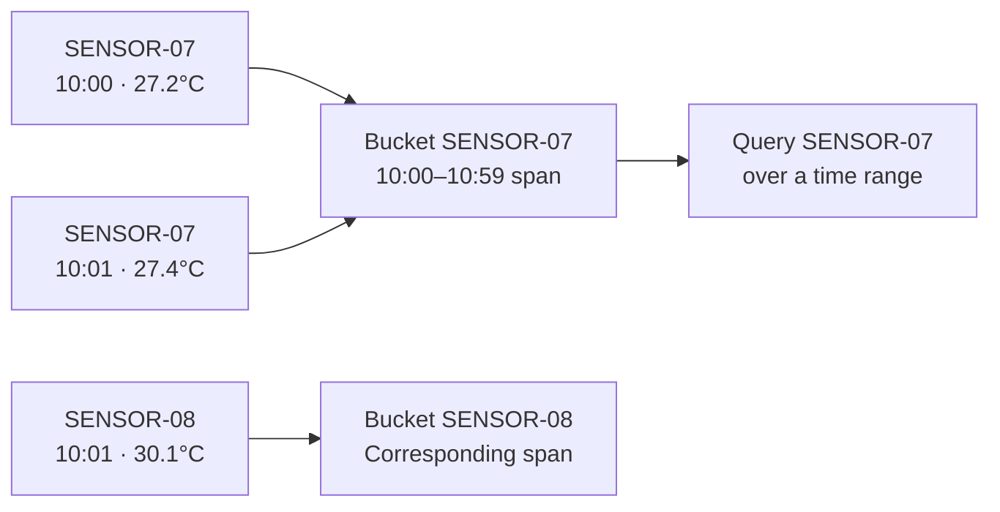

# When Should You Use a Time-Series Collection for Measurement or Event Data?

In **Spring Data MongoDB**, a system typically has to store two different groups of data:

- **Current state**: customer profiles, orders, or whether a device is currently on or off. The same document is updated repeatedly.
- **Observations over time**: temperature every minute, CPU usage every second, request traffic, stock prices, or an append-only stream of events. Each document describes what happened **at a point in time**.

MongoDB has provided **time-series collections** since version 5.0 to optimize storing and querying the second group of data. In the `SPRING_DATA_MONGODB` module, you can use `MongoTemplate`, `ReactiveMongoTemplate`, or repositories to insert, query, and aggregate measurement data. However, the mere presence of a timestamp field on a document is **not enough** to conclude that a time-series collection should be used: the decision also depends on the write pattern, query patterns, metadata stability, and whether events need to be modified or deleted.

> **Core criterion:** Choose a time-series collection when most of the workload consists of **appending many immutable data points over time**, followed by **filtering by series and time range, computing statistical aggregations, or applying data retention limits**. Choose a regular collection when you need flexible CRUD operations, unique constraints, change streams, or write transactions on those documents.

## 1. What Does a Time-Series Collection Store?

For example, a temperature sensor in a warehouse sends data every 30 seconds:

```javascript
{
  measuredAt: ISODate("2026-11-20T03:10:00.000Z"),
  sensor: {
    sensorId: "SENSOR-07",
    warehouseId: "WH-HCM-01"
  },
  temperatureC: 27.4,
  humidityPercent: 64,
  batteryPercent: 89
}
```

This document consists of three parts:

| Component | Example | Role |
|---|---|---|
| **`timeField`** | `measuredAt` | The time when the measurement was taken or the event occurred; **must have a BSON Date value** |
| **`metaField`** | `sensor` containing `sensorId`, `warehouseId` | Describes the data series; should be relatively stable and is commonly used in filter predicates |
| **Measurement fields** | `temperatureC`, `humidityPercent`, `batteryPercent` | Values that change across measurements; should not be placed in metadata |

When creating the collection, MongoDB is configured with the `timeField` name, and optionally a `metaField` and a time interval used to group data (`granularity`). These options define the **collection structure**, not just Java naming.

Each measurement is recorded as a new document. For example, if sensor `SENSOR-07` sends three temperature values at 10:00, 10:01, and 10:02, there are three documents; the system does not continuously overwrite a single `SENSOR-07` document. If you only need to keep the **latest value of each sensor**, a regular collection with one document per sensor can be simpler and more economical.

### Why Does MongoDB Call It Time Series?

MongoDB automatically groups documents with **identical metadata** and **nearby timestamps** into physical *buckets*, optimizing compression and time-series query processing. The application still reads and writes using the normal collection name; it does not have to manage the buckets in `system.buckets` directly.



The diagram illustrates the case where `granularity: "seconds"` is chosen, in which a bucket's time span can be up to one hour; **an actual bucket is also subject to size and measurement-count limits**. You must not assume that MongoDB will merge every record of a sensor within an hour into a single bucket, or that every bucket always has the same size.

## 2. When Should You Choose a Time-Series Collection?

There are five positive signals:

1. **Time-ordered write stream, mostly `insert`.** Sensors, metrics, or events are recorded as an immutable history; individual records are rarely updated or deleted.
2. **High record volume with continuously growing data.** The system receives thousands of measurement points per minute and needs to optimize storage space and time-based read speed. Actual gains depend on document size, metadata cardinality, time distribution, and query patterns.
3. **Queries filter by series and time range.** For example, "average temperature of `SENSOR-07` over 24 hours", "p95 latency of service A in 5-minute intervals", or "hourly traffic by region".
4. **Source-identifying metadata is relatively stable.** Measurements from the same sensor/device/service are grouped effectively; new metadata is not generated for every event.
5. **Clear retention policy.** For example, keeping raw metrics for 30 days and daily rollups for 365 days; `expireAfterSeconds` can be configured on the raw collection.

| Real-world data | Suitability | Explanation |
|---|---|---|
| IoT device telemetry: temperature, humidity, voltage | **Highly suitable** | Append-only; queried by device and time; old data can be expired via TTL |
| Monitoring: CPU, RAM, throughput, response time | **Highly suitable** | Many data points, typically viewed in charts and aggregated over time windows |
| Periodically recorded trading prices / exchange rates | **Suitable** | Stores sampled history per ticker; note that trade corrections/cancellations may need a separate data source |
| Immutable clicks / page views for trend analysis | **Potentially suitable** | If the goal is time-based aggregation and individual events rarely need modification or deletion |
| Audit logs that must be preserved and replayed per event | **Only if additional requirements are met** | Time series does not automatically provide infinite retention, unique indexes, or change streams; durable storage and reconciliation design are required |
| Orders with frequent status updates, refunds, cancellations | **Not suitable** | Requires updating business fields and detecting CRUD changes |
| Customer profiles queried by unique email | **Not suitable** | Point lookups and unique constraints matter more than time-based grouping |
| A device keeping only the latest reading without history | **Usually unnecessary** | One document per sensor in a regular collection is easier to manage |

**"Event" data does not automatically mean time series.** An append-only `page_view` event used for analytics can be a good fit; a `payment_received` event that requires exactly-once guarantees, reconciliation, cancellation/refund workflows, and transactional processing may need a dedicated **event log/outbox** design. Judge by immutability and access patterns, not by the word "event" in the collection name.

## 3. How Does It Differ from Regular Collections and Capped Collections?

| Question | Time-series collection | Regular collection | Capped collection |
|---|---|---|---|
| Ideal model | Many observations close together in time | CRUD entities and diverse queries | Append-only log-like document stream with a size cap |
| Storage layout | Buckets by `metaField` + time | Individual documents in standard storage | Fixed-size circular buffer |
| Business updates | **Very limited** | Flexible | Restrictions on updates/deletes |
| Old data removal | Bucket-level TTL retention | TTL index or scheduled job | Automatically evicts oldest records when size limit is reached |
| Unique index | **Not supported** | Supported | Depends on index and capped rules |
| Direct change stream | **Not supported** per current MongoDB docs | Supported on an appropriate topology | Check tracking support by version and goal; tailable cursor is a separate mechanism |
| Tailable cursor | No, because time series cannot be capped | No (unless capped) | Yes |
| Suitable for frequent per-record updates/deletes? | No | Yes | No |

This is especially important when a system needs both **measurement history** and **current state**. You can separate them:

- `sensor_readings`: time-series collection for all measurements.
- `sensors`: regular collection for configuration, online/offline status, alert thresholds, and location info.
- `sensor_daily_stats`: daily aggregation results with independent retention and update permissions.

There is no need to cram current state and full history into a single collection just to reduce the collection count.

## 4. Deciding `timeField`, `metaField`, `granularity`, and Retention

### 4.1. `timeField`: Which Timestamp Is Meaningful?

`timeField` is a field of type **BSON Date**. In Java, `Instant` or `java.util.Date` are natural choices when mapping to MongoDB.

- **`measuredAt` / `eventAt`:** when the data was measured or the event occurred. Appropriate for real-time event analysis, though devices may send data late, send historical backfills, or have skewed clocks.
- **`ingestedAt`:** when the server received the message. Easy to operate by ingestion rate, but "actual measurement time" analyses must keep `measuredAt` in another field and may not benefit as well from event-time bucket pruning.

For TTL, data age is calculated from the **configured `timeField`**, not by default from insertion time. A document carrying a timestamp from 40 days ago may be considered expired as soon as it is inserted into a collection with a 30-day TTL; actual deletion happens asynchronously. Define how to handle *late arrivals* before choosing the field.

### 4.2. `metaField`: Identifies a Series — the More Stable, the Better

Good:

```javascript
{
  sensor: { sensorId: "SENSOR-07", warehouseId: "WH-HCM-01" },
  measuredAt: ISODate("2026-11-20T03:10:00Z"),
  temperatureC: 27.4,
  humidityPercent: 64
}
```

Bad if metadata changes on every record:

```javascript
{
  sensor: {
    sensorId: "SENSOR-07",
    uniqueEventId: "evt-9e8f2",  // Every measurement creates a new metadata series
    temperatureC: 27.4           // Measurement value constantly changes
  },
  measuredAt: ISODate("2026-11-20T03:10:00Z")
}
```

MongoDB groups measurements with **matching `metaField` values** into appropriate buckets. Putting `requestId`, `eventId`, timestamps, or fluctuating measurement values into metadata causes **high cardinality**, produces many sparse buckets, and degrades compression and query efficiency. Metadata can be an object; in filters, prefer subfield paths such as `"sensor.sensorId"` instead of matching the whole object unnecessarily.

**Distinction:** Having many distinct `sensorId` values is not necessarily wrong. What matters is the number of concurrently active series, how often each series is written, and how frequently metadata changes between measurements. Benchmark against your real workload.

### 4.3. `granularity`: Bucket Grouping Span, Not Display Format

MongoDB supports three standard levels:

| Option | Default maximum bucket span | Suitable examples |
|---|---|---|
| `seconds` | About 1 hour | Dense measurements spaced seconds or minutes apart |
| `minutes` | About 24 hours | Sparser measurements, every tens of minutes or hourly |
| `hours` | About 30 days | Very sparse measurements, such as a few times per day |

This is the maximum span by bucket policy, not a guarantee that every document will stay in the same bucket for that entire duration. MongoDB also closes buckets due to size limits, document count limits, or operational conditions. Choose `granularity` based on the **time interval between measurements of the same series**, query patterns, and retention—not based on the chart display unit.

Since MongoDB 6.3, you can use `bucketMaxSpanSeconds` and `bucketRoundingSeconds` together to customize bucket timing. **Both values must be equal** and cannot be used alongside `granularity` when creating the collection. After creation, bucket spans can only be increased under MongoDB's supported conditions and cannot be arbitrarily narrowed; test with sample data beforehand.

### 4.4. `expireAfterSeconds`: Automatic Removal, Not Exact to the Second

For example, a 30-day retention policy: `expireAfterSeconds: 2592000`. MongoDB removes **buckets** via a background task once all documents in the bucket qualify for expiration. Therefore, an expired document can remain present until the entire bucket qualifies and the TTL task runs. Do not use TTL as a business timer with a guarantee of deletion at an exact timestamp.

If raw data should only be kept for 30 days while annual charts must remain viewable, create **summary rollup tables before raw data expires**. Retention rules must also account for late-arriving data and backfill processes.

## 5. Examples with `mongosh`: Create, Write, Filter, and Aggregate

Suppose a warehouse sends a measurement every 30 seconds. We create the collection with the right type from the start:

```javascript
// Run once during database initialization, before inserting data.
db.createCollection("sensor_readings", {
  timeseries: {
    timeField: "measuredAt",
    metaField: "sensor",
    granularity: "seconds"
  },
  expireAfterSeconds: 30 * 24 * 60 * 60
});

// Used to verify the collection has type "timeseries" and the expected configuration.
db.getCollectionInfos({ name: "sensor_readings" });
```

**Deployment note:** `createCollection` fails if the collection already exists. The migration/startup step should inspect the existing configuration, detect mismatches, and fail clearly. An existing regular collection **cannot be converted in place** to a time-series collection; plan to create a new collection and migrate data. `timeField` and `metaField` cannot be renamed after creation.

Insert three sample measurements (the timestamps in this example are illustrative; when testing TTL, use current timestamps):

```javascript
db.sensor_readings.insertMany([
  {
    measuredAt: ISODate("2026-11-20T03:00:00.000Z"),
    sensor: { sensorId: "SENSOR-07", warehouseId: "WH-HCM-01" },
    temperatureC: 27.2, humidityPercent: 63
  },
  {
    measuredAt: ISODate("2026-11-20T03:00:30.000Z"),
    sensor: { sensorId: "SENSOR-07", warehouseId: "WH-HCM-01" },
    temperatureC: 27.4, humidityPercent: 64
  },
  {
    measuredAt: ISODate("2026-11-20T03:00:30.000Z"),
    sensor: { sensorId: "SENSOR-08", warehouseId: "WH-HCM-01" },
    temperatureC: 29.3, humidityPercent: 57
  }
]);
```

Query by **metadata + time range**:

```javascript
db.sensor_readings.find({
  "sensor.sensorId": "SENSOR-07",
  measuredAt: {
    $gte: ISODate("2026-11-20T03:00:00.000Z"),
    $lt: ISODate("2026-11-20T04:00:00.000Z")
  }
}).sort({ measuredAt: 1 });
```

Aggregate average temperature in 5-minute windows:

```javascript
db.sensor_readings.aggregate([
  {
    $match: {
      "sensor.sensorId": "SENSOR-07",
      measuredAt: {
        $gte: ISODate("2026-11-20T03:00:00.000Z"),
        $lt: ISODate("2026-11-20T04:00:00.000Z")
      }
    }
  },
  {
    $group: {
      _id: {
        $dateTrunc: { date: "$measuredAt", unit: "minute", binSize: 5 }
      },
      samples: { $sum: 1 },
      avgTemperatureC: { $avg: "$temperatureC" },
      minTemperatureC: { $min: "$temperatureC" },
      maxTemperatureC: { $max: "$temperatureC" }
    }
  },
  { $sort: { _id: 1 } }
]);
```

Use half-open intervals `[$gte, $lt)` so adjacent windows do not double-count boundary points. `$dateTrunc` groups by year/month/day/hour/minute, and timezone selection must align with business reporting requirements. The `$group` output in the example returns the sample count and statistics for each 5-minute interval without modifying raw data.

To evaluate performance, compare queries with and without `"sensor.sensorId"`, inspect `explain("executionStats")` on a sufficiently large dataset, and measure actual execution time. A compound `metaField + timeField` index is created by default by MongoDB on supported versions when metadata is declared; **there is no default unique index on `_id`** as in regular collections. Adding secondary indexes must be based on query patterns and the constraints of the running MongoDB version.

## 6. Using Spring Data MongoDB: Mapping and Collection Initialization

In Spring Data MongoDB, an entity can be annotated with `@TimeSeries`. The following example uses a Java record to model a measurement sample:

```java
import java.time.Instant;
import org.springframework.data.mongodb.core.mapping.TimeSeries;

@TimeSeries(
    collection = "sensor_readings",
    timeField = "measuredAt",
    metaField = "sensor",
    expireAfter = "30d"
)
public record SensorReading(
    Instant measuredAt,
    SensorMetadata sensor,
    double temperatureC,
    double humidityPercent
) {}

record SensorMetadata(String sensorId, String warehouseId) {}
```

`@TimeSeries` specifies `timeField`, `metaField`, and the target collection in Spring Data's mapping metadata. The `expireAfter` attribute is supported in newer Spring Data MongoDB versions (introduced in the 4.4 API); if your application uses an older version, configure TTL when creating the collection via a compatible MongoDB/migration mechanism instead of copying this annotation verbatim.

**Important:** the annotation only describes the collection; the collection still needs to be **created with time-series options before the first write**. According to Spring Data MongoDB documentation, `MongoTemplate.createCollection(Entity.class)` reads the configuration from `@TimeSeries`:

```java
import org.springframework.data.mongodb.core.MongoTemplate;

// Example run once during migration/initialization before writing.
public void createSensorCollection(MongoTemplate template) {
    if (!template.collectionExists(SensorReading.class)) {
        template.createCollection(SensorReading.class);
    }
}
```

In a multi-instance system, checking `collectionExists` before calling `createCollection` still has a race condition; manage migrations centrally, or verify after an "already exists" error that the actual configuration matches. Never let the first `save()` implicitly create a regular collection due to missing initialization.

Insert a measurement and query with `MongoTemplate`:

```java
import java.time.Instant;
import java.time.temporal.ChronoUnit;
import java.util.List;
import org.springframework.data.domain.Sort;
import org.springframework.data.mongodb.core.MongoTemplate;
import org.springframework.data.mongodb.core.query.Criteria;
import org.springframework.data.mongodb.core.query.Query;

// Example inside a service with an injected MongoTemplate template.
Instant now = Instant.now();

template.insert(new SensorReading(
    now,
    new SensorMetadata("SENSOR-07", "WH-HCM-01"),
    27.4,
    64.0
));

Query query = new Query(Criteria.where("sensor.sensorId").is("SENSOR-07")
    .and("measuredAt")
    .gte(now.minus(1, ChronoUnit.HOURS))
    .lt(now.plus(1, ChronoUnit.SECONDS)));
query.with(Sort.by(Sort.Direction.ASC, "measuredAt"));

List<SensorReading> recent = template.find(query, SensorReading.class);
```

`ReactiveMongoTemplate` provides an equivalent reactive API; you must **subscribe to or chain the publishers** for collection creation and read/write commands. For example:

```java
import java.time.Instant;
import reactor.core.publisher.Mono;

// template is ReactiveMongoTemplate, executed within a managed pipeline.
Mono<Void> initialize = template.createCollection(SensorReading.class).then();

Mono<SensorReading> inserted = template.insert(new SensorReading(
    Instant.now(),
    new SensorMetadata("SENSOR-07", "WH-HCM-01"),
    27.4, 64.0
));
```

The two publishers above are API illustrations only. In a real application, run `createCollection` only when migration requires it; use `initialize.then(inserted)` or an ordered startup step with error handling. Do not invoke collection creation on every ingest.

When using a repository, `findBy...` methods, time-range queries, and projections can be useful. However, **repositories do not bypass update, index, or transaction limitations of time-series collections**; domain operations like calling `save()` to update an old record or upserting by `_id` are not generally appropriate. For measurement data, prefer `insert`; if event deduplication is needed, use an identification/reconciliation mechanism at the ingestion layer.

## 7. Limitations to Check Before Deciding

### 7.1. Does Not Handle CRUD Like a Regular Collection

According to MongoDB's time-series limitations documentation, updates are allowed only within a very narrow scope: the filter must be based on `metaField`, only `metaField` values can be modified, update operators must be used, it must target multiple records (`multi: true`), and upserts are disallowed. Do not design business workflows around modifying `temperatureC`, `measuredAt`, or replacing documents whenever a measurement needs correction.

For data that is corrected after writing, consider one of these approaches:

- Append a **correction sample** referencing the original sample and apply resolution rules at query time.
- Write the immutable raw source to time series, and keep corrected state in a regular collection or projection.
- If unrestricted per-document updates/deletes are a core requirement, choose a regular collection from the start.

Direct deletes and auxiliary features have behaviors and limits that vary by MongoDB version; confirm version requirements when designing purge/repair flows. Do not use `deleteMany` indiscriminately in place of TTL retention if the goal is simply cleaning up old data.

### 7.2. Features That May Be Disqualifying Constraints

In current MongoDB documentation, time-series collections have notable constraints:

| Need | What to know |
|---|---|
| Processing `changeStream()` directly on the measurement collection | **Not supported**. If CDC is needed, use an ingestion pipeline/broker or a parallel event source |
| Writing to time-series inside a multi-document transaction | **Writes not supported**; reads inside a transaction are supported under MongoDB's conditions |
| Unique index to guarantee at most one point per `sensorId + measuredAt` | **Unique indexes not supported**. Handle deduplication at ingestion or use a separate key registry |
| Using time series as a capped collection with tailable cursors | **Cannot be a capped collection** |
| Creating schema validation directly on the collection | **Not supported** per current docs; validate at the application/ingestion layer |
| Querying MongoDB Search directly on time series | **Not supported** per current docs |
| Using `$merge` to write into a time-series collection | `$merge` is not supported as a target; `$out` may be considered under MongoDB's conditions |
| Converting an existing regular collection to time series in place | **Not supported**; create a separate collection and migrate |
| Using `_id` as a pre-indexed lookup key | No default `_id` index as in regular collections; verify index/version rules if needed |

Feature limitations can change across versions. When building a production system, verify the **MongoDB server version, feature compatibility version (FCV), and Spring Data MongoDB version** rather than inferring from annotations or the driver version alone.

### 7.3. Cases Where Benefits Are Negated

- **Excessively high metadata cardinality:** every record having distinct metadata creates many sparse buckets.
- **Heavy late arrivals or multi-year scattered backfills:** data struggles to stay in open buckets, causing unexpected write/read overhead.
- **Reads by keys unrelated to metadata and time:** may cause large scans; a regular collection with dedicated indexes can perform better.
- **Low write volume and no aggregations:** the operational cost of a new model may outweigh the benefits.
- **Strong mutation/deletion or uniqueness enforcement requirements:** feature restrictions become business risks.
- **Per-tenant or per-event retention rules:** collection-level TTL or metadata-filtered TTL (depending on version) must be verified; do not assume it satisfies every policy out of the box.

Time-series collections can reduce storage size and speed up certain queries, but **they do not guarantee every query will be faster**. Benchmark using production-accurate sensor counts, write frequencies, metadata distributions, and time ranges.

## 8. Design Checklist and Hands-On Exercises

Before introducing a time-series collection into a system, answer these questions:

1. **What is the read purpose?** Time-based charts, interval aggregations, trend detection, or looking up and editing a specific record?
2. **Is the data append-only?** How are corrections, cancellations, and deduplication handled?
3. **Use event time or ingestion time?** What happens if a sensor clock drifts or an event arrives late?
4. **Does `metaField` identify a stable series?** Are there fields that change continuously and cause sparse buckets?
5. **What is the measurement frequency?** Choose an appropriate `granularity` and measure against a realistic distribution.
6. **How long is retention?** Is TTL delay acceptable; how should long-term data be aggregated and archived?
7. **Are transactional writes, change streams, unique indexes, or arbitrary updates required?** If so, consider a regular collection or complementary architecture.
8. **What metrics measure performance?** Ingestion throughput, p95/p99 query latency, storage footprint, bucket count, sensor/time query latency, and index overhead.

### Exercise A — Measure and Query

Create `sensor_readings` with `granularity: "seconds"` and `metaField: "sensor"`. Generate data for 100 sensors, each sending 1 point per minute for 7 days. Run a 24-hour query for one sensor and a 5-minute aggregation. Compare `explain`, storage size, and execution time against a regular collection with the same data and appropriate query indexes.

### Exercise B — Test the Metadata Model

Repeat workload A, but add a `uniqueEventId` that changes on every measurement inside **`metaField`**. Measure the change in bucket count, storage size, and latency. Then move `uniqueEventId` back to a regular field. Explain why stable metadata has a major impact on bucketing efficiency.

### Exercise C — Retention and Late-Arriving Events

Create a collection with a short TTL in a test environment. Insert one document with `measuredAt` set to the current time and one with a very old `measuredAt`. Observe asynchronous bucket-level deletion; do not expect exact per-second timing. Then write rules for rejecting or reordering backfills and an architecture for aggregating data before raw records expire.

### Decision Scenario

An application has two requirements: (1) store temperature from 20,000 sensors every minute for 90 days for charting, and (2) receive sensor status changes from `ACTIVE` to `DISABLED` to lock the device immediately. Should everything go into one time-series collection?

**Suggested solution:** Use a time-series collection for measurement history by `sensorId` + `measuredAt` with 90-day retention. Store `ACTIVE`/`DISABLED` state in a regular collection; to react to status updates, use a change stream on the regular collection when MongoDB runs as a replica set or sharded cluster, or publish events through a broker. This separation matches data semantics and avoids requiring change streams from a time-series collection.

## References

- [MongoDB — About Time Series Data / Bucketing](https://www.mongodb.com/docs/manual/core/timeseries/timeseries-bucketing/)
- [MongoDB — Create and Query a Time Series Collection](https://www.mongodb.com/docs/manual/core/timeseries/timeseries-procedures/)
- [MongoDB — Time Series Collection Limitations](https://www.mongodb.com/docs/manual/core/timeseries/timeseries-limitations/)
- [MongoDB — Set Granularity for Time Series Data](https://www.mongodb.com/docs/manual/core/timeseries/timeseries-granularity/)
- [MongoDB — Set up Automatic Removal (TTL)](https://www.mongodb.com/docs/manual/core/timeseries/timeseries-automatic-removal/)
- [Spring Data MongoDB — Index and Collection Management, Time Series](https://docs.spring.io/spring-data/mongodb/reference/mongodb/template-collection-management.html)
- [Spring Data MongoDB — @TimeSeries API](https://docs.spring.io/spring-data/mongodb/docs/current/api/org/springframework/data/mongodb/core/mapping/TimeSeries.html)

**Conclusion:** `timeField` tells **when**, `metaField` tells **which series**, and measurement fields tell **what values**. When a system stores large volumes of immutable observations and analyzes them over time ranges, a time-series collection is worth evaluating. If the core functionality involves mutating document state or enforcing uniqueness, prefer a regular collection and design a dedicated event pipeline when needed.
