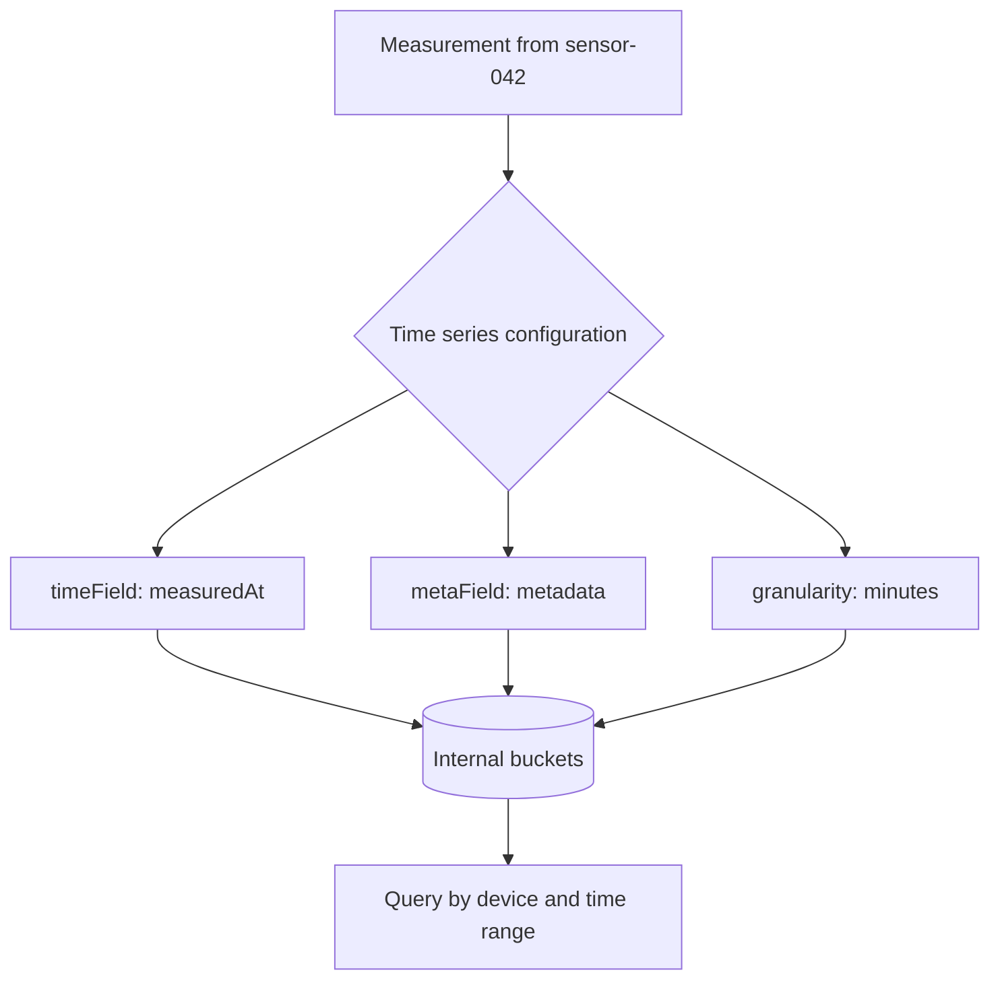

# Choosing `timeField`, `metaField`, and `granularity` for Time Series in MongoDB

## Lesson Objectives

When building a Spring Data MongoDB application for sensor readings, time-varying product prices, telemetry, or measurement logs, choosing the right three settings—**`timeField`, `metaField`, and `granularity`**—determines how MongoDB organizes data in a *time series collection*. These three choices affect bucket count, compression ratio, query efficiency, and operational cost.

After this lesson, you will be able to:

- Distinguish the event occurrence timestamp from the system ingestion timestamp and choose a valid datetime field as `timeField`.
- Select stable source-identifying attributes as `metaField` so related measurements have a good chance of being grouped into the same buckets.
- Choose `granularity` based on the sampling cadence of **each individual data series**, understanding it as a bucket-organization hint rather than timestamp rounding or a sampling schedule.
- Create the collection in MongoDB, map documents with Spring Data MongoDB, query data, and verify the applied configuration.

## 1. Scenario: Many Measurements from the Same Device

Suppose there are 5,000 sensors, and each device sends temperature and humidity once every five minutes. Each record represents **a measurement at a point in time**, along with device identity and installation site:

```javascript
{
  measuredAt: ISODate("2026-11-20T09:00:00Z"),
  metadata: {
    deviceId: "sensor-042",
    siteId: "warehouse-a"
  },
  temperatureC: 26.4,
  humidityPct: 61.2
}
```

Subsequent measurements carry a new `measuredAt` and updated readings, while `metadata` typically remains unchanged:

| Field | Changes per measurement? | Role |
| --- | --- | --- |
| `measuredAt` | Yes | Actual timestamp of the measurement, used as `timeField`. |
| `metadata.deviceId` | Usually no | Identifies the sensor producing the data. |
| `metadata.siteId` | Rarely changes | Information about the location/group of the device. |
| `temperatureC`, `humidityPct` | Yes | Measured values; unsuitable as static metadata. |

MongoDB time series optimizes storing measurements by **time span** and **metadata values**. Data is still queried like individual documents, while MongoDB manages internal buckets that hold multiple measurements. You do not need to create or edit bucket collections manually.



## 2. Choosing `timeField`: Which Timestamp Represents the Measurement?

`timeField` is the **top-level field name** on each document holding the measurement timestamp. Its value must be a BSON `Date`. When declaring `timeField: "measuredAt"`, a valid document must include a datetime `measuredAt`, such as `ISODate(...)`.

### Event Time vs. Ingestion Time

In systems with queues or offline devices, these two timestamps can differ:

| Time type | Example | When to use |
| --- | --- | --- |
| *Event time* (`measuredAt`) | Sensor measured at 09:00 UTC. | Analyzing physical trends, charting, aggregating by actual measurement time. |
| *Ingestion time* (`receivedAt`) | Server received the message at 09:07 UTC. | Tracking latency, handling late arrivals, monitoring pipeline throughput. |

For a temperature series, **prefer `measuredAt` as `timeField`** because that is the timestamp users want to analyze. You can still store `receivedAt` as a secondary field to measure latency. If the business concern is system load by request arrival time, ingestion time may be the right choice instead.

Example of a late-arriving measurement that still preserves its original timestamp:

```javascript
{
  measuredAt: ISODate("2026-11-20T09:00:00Z"),
  receivedAt: ISODate("2026-11-20T09:07:12Z"),
  metadata: { deviceId: "sensor-042", siteId: "warehouse-a" },
  temperatureC: 26.4
}
```

### Rules for Choosing `timeField`

1. **Use BSON `Date`, not strings or integers.** `"2026-11-20T09:00:00Z"` is a string and cannot replace `ISODate(...)` when writing directly through `mongosh`.
2. **Keep the field at the top level.** If the collection is created with `timeField: "measuredAt"`, the timestamp field must sit at `measuredAt`, not nested inside `metadata.measuredAt`.
3. **Standardize timezone handling.** BSON `Date` stores instants in UTC; convert timezones when displaying or analyzing in local time.
4. **Watch device clocks.** Timestamps far in the past or future caused by misconfigured device clocks can produce unwanted buckets.
5. **Do not overwrite the original timestamp with server time** merely because a message arrived late; separate `receivedAt` if you need to track delay.

Choose the `timeField` name carefully in the initial design. Time series creation options and storage structures have change restrictions; altering the time field model usually requires creating a new collection and migrating data.

## 3. Choosing `metaField`: What Identifies a Series?

`metaField` is an **optional top-level field name** containing information that describes the data source. That field can be a single scalar value or a document with nested properties. When using `metaField: "metadata"`:

```javascript
metadata: {
  deviceId: "sensor-042",
  siteId: "warehouse-a"
}
```

MongoDB can organize measurements sharing **matching metadata values** into appropriate time buckets. Thus, metadata should remain **stable** across many readings from the same source. Another option is using a single `deviceId` field as `metaField` when only device identity is needed; when multiple stable filter attributes are required, a `metadata` subdocument is usually more flexible.

### What Should and Should Not Go Into Metadata?

| Attribute | Recommendation | Reason |
| --- | --- | --- |
| `deviceId` | Should include | Identifies the source; typically stable across the series. |
| `siteId` / `machineId` | Maybe | Useful if stable and frequently used in filters. |
| `sensorType` | Maybe | Suitable when the sensor type is fixed. |
| `temperatureC` | No | Changes with each measurement, breaking metadata stability. |
| `batteryPct`, `signalStrength` | No | Operational measurement values that change frequently. |
| `requestId` (random) | No | Gives each record distinct metadata, reducing bucket grouping opportunities. |
| `receivedAt` | No | Reflects arrival time of an individual record rather than the source. |

**Point to weigh:** `siteId` seems stable, yet it can change if a sensor is relocated. If `siteId` is inside `metadata`, the metadata value changes when the device moves, and measurements may be placed into a different bucket group. This may be desirable semantically (analyzing by installation site) or an unnecessary cost. If locations change constantly, consider keeping `metadata` restricted to durable identifiers and storing location per measurement or in an external lookup.

### Metadata and Query Selectivity

Suppose most queries follow the pattern "fetch the 100 most recent measurements of `sensor-042`". A suitable structure is:

```javascript
db.sensor_readings.find({
  "metadata.deviceId": "sensor-042",
  measuredAt: {
    $gte: ISODate("2026-11-20T00:00:00Z"),
    $lt: ISODate("2026-11-21T00:00:00Z")
  }
}).sort({ measuredAt: -1 }).limit(100);
```

The **device + time range** predicate pair is commonly the query design foundation for measurement series. Do not assume metadata automatically creates sufficient indexes for every query; inspect execution plans and create indexes tailored to your MongoDB version and real workload.

## 4. Choosing `granularity`: Bucket Granularity

`granularity` describes the **expected frequency of data** so MongoDB can pick how to span bucket time windows. Valid values are:

| Value | Typical data cadence | Examples |
| --- | --- | --- |
| `"seconds"` | Measurements spaced seconds or under a few minutes apart. | Telemetry recorded every 2 seconds, machine vibration every 10 seconds. |
| `"minutes"` | Measurements spaced minutes apart. | Warehouse temperature every 5 minutes, power usage every 15 minutes. |
| `"hours"` | Measurements spaced hours apart. | Environmental metrics every 6 hours, hourly power totals. |

For a sensor reporting **once every 5 minutes**, `granularity: "minutes"` is a reasonable starting point. If the same device reports every 3 seconds, use `"seconds"`; if it measures only once every 12 hours, consider `"hours"`.

Two misconceptions to avoid:

- **`granularity` does not round timestamps.** A record with `measuredAt = 09:05:17.250Z` keeps that exact timestamp; `"minutes"` does not turn it into `09:05:00Z`.
- **`granularity` does not downsample or aggregate data.** To turn a 5-minute series into hourly reports, you need an aggregation such as `$dateTrunc` or `$dateToString`/`$group` as required; `granularity` does not produce summary rows.

### How to Decide

1. Identify **one data source corresponding to one metadata value** and the typical interval between two readings from that source.
2. Pick `seconds`, `minutes`, or `hours` according to that interval; if cadences vary dramatically across source types, consider whether separate collections are warranted.
3. Measure write throughput, storage footprint, and query latency under realistic conditions rather than choosing by field name or timestamp precision.
4. Check your MongoDB version before adjusting bucket parameters. Some versions allow coarsening granularity along `seconds → minutes → hours`, but constraints apply and you should not assume narrowing it back is straightforward.

When `granularity` is omitted, MongoDB defaults to `"seconds"`. Specify it explicitly when you know the sampling rate and want a clear, verifiable configuration.

## 5. Creating a Time Series Collection with `mongosh`

Create the collection **before the application writes its first record**. For example, using `measuredAt` as the time field, `metadata` for device identity, and `minutes` for data sent every five minutes:

```javascript
db.createCollection("sensor_readings", {
  timeseries: {
    timeField: "measuredAt",
    metaField: "metadata",
    granularity: "minutes"
  }
});
```

Insert two measurements:

```javascript
db.sensor_readings.insertMany([
  {
    measuredAt: ISODate("2026-11-20T09:00:00Z"),
    metadata: { deviceId: "sensor-042", siteId: "warehouse-a" },
    temperatureC: 26.4,
    humidityPct: 61.2
  },
  {
    measuredAt: ISODate("2026-11-20T09:05:00Z"),
    metadata: { deviceId: "sensor-042", siteId: "warehouse-a" },
    temperatureC: 26.7,
    humidityPct: 60.8
  }
]);
```

To verify that the collection is time series and all three options were applied:

```javascript
db.getCollectionInfos({ name: "sensor_readings" })[0].options.timeseries;
```

The expected output contains the three declared fields (MongoDB may add or present extra fields depending on version):

```javascript
{
  timeField: "measuredAt",
  metaField: "metadata",
  granularity: "minutes"
}
```

**Avoiding accidental regular collection creation:** If the application calls `insert` while `sensor_readings` does not exist yet, MongoDB may implicitly create a regular collection. Adding `@Document` in Java specifies the collection name for mapping, **not a guarantee** that the actual collection is time series. Therefore, create it during migration/database initialization and verify the configuration before running the application.

## 6. Mapping and Querying with Spring Data MongoDB

In Spring Data MongoDB, the document class describes the measurement data; `timeField`, `metaField`, and `granularity` are options of the **MongoDB collection** and must match the mapped field names.

Java example using records (Java 17+):

```java
import java.util.Date;

import org.bson.types.ObjectId;
import org.springframework.data.annotation.Id;
import org.springframework.data.mongodb.core.mapping.Document;

@Document(collection = "sensor_readings")
public record SensorReading(
        @Id ObjectId id,
        Date measuredAt,
        SensorMetadata metadata,
        double temperatureC,
        double humidityPct
) {}

public record SensorMetadata(String deviceId, String siteId) {}
```

These two records are **two independent Java types**; in a real project, place each `public record` in its own matching file, or make `SensorMetadata` package-private or nested appropriately. They do not require a separate MongoDB collection: `SensorMetadata` is stored as a nested document inside `metadata`.

Write a measurement using `MongoTemplate`:

```java
import java.time.Instant;
import java.util.Date;
import org.springframework.data.mongodb.core.MongoTemplate;

public class SensorWriter {
    private final MongoTemplate mongoTemplate;

    public SensorWriter(MongoTemplate mongoTemplate) {
        this.mongoTemplate = mongoTemplate;
    }

    public SensorReading recordMeasurement(String deviceId,
                                           String siteId,
                                           Instant measuredAt,
                                           double temperatureC,
                                           double humidityPct) {
        SensorReading reading = new SensorReading(
                null,
                Date.from(measuredAt),
                new SensorMetadata(deviceId, siteId),
                temperatureC,
                humidityPct
        );
        return mongoTemplate.insert(reading);
    }
}
```

`Date.from(measuredAt)` ensures the Java property is converted to a BSON `Date`, matching `timeField: "measuredAt"`. This snippet handles persistence; a production application also needs input validation, timestamp sanity checks, and per-device write authorization.

Query by sensor and time range:

```java
import java.time.Instant;
import java.util.Date;
import java.util.List;

import org.springframework.data.domain.Sort;
import org.springframework.data.mongodb.core.MongoTemplate;
import org.springframework.data.mongodb.core.query.Criteria;
import org.springframework.data.mongodb.core.query.Query;

public List<SensorReading> latestReadings(MongoTemplate template,
                                          String deviceId,
                                          Instant from,
                                          Instant to) {
    Query query = Query.query(
            Criteria.where("metadata.deviceId").is(deviceId)
                    .and("measuredAt")
                    .gte(Date.from(from))
                    .lt(Date.from(to))
    );
    query.with(Sort.by(Sort.Direction.DESC, "measuredAt")).limit(100);
    return template.find(query, SensorReading.class);
}
```

With these fields, the example uses `MongoTemplate` directly since it is the familiar Spring Data MongoDB API. If using a repository with derived queries, Java property names must align with mapping, and both time range and metadata criteria must still remain explicit.

### Indexes and Real-World Verification

If querying by `metadata.deviceId` and `measuredAt` is frequent, consider an appropriate index:

```javascript
db.sensor_readings.createIndex({
  "metadata.deviceId": 1,
  measuredAt: -1
});
```

Evaluate with an execution plan rather than assuming an index is always beneficial:

```javascript
db.sensor_readings.find({
  "metadata.deviceId": "sensor-042",
  measuredAt: { $gte: ISODate("2026-11-20T00:00:00Z") }
}).explain("executionStats");
```

Time series collections have specific indexing rules that have evolved across MongoDB versions. Check the capabilities of your deployed version, existing default indexes, selectivity, and write overhead before adding multiple indexes.

## 7. High-Impact Operational Decisions

| Suboptimal decision | Potential impact | Better approach |
| --- | --- | --- |
| Using `receivedAt` when users need charts by measurement time | Late-arriving data appears at the wrong position on charts. | Use `measuredAt` for event time and keep `receivedAt` separate. |
| Writing `measuredAt` as a `String` | Fails the BSON Date requirement for `timeField`. | Convert/validate to `Date` before inserting. |
| Putting `temperatureC` or `requestId` into `metaField` | Metadata changes on every record, fragmenting bucket groups. | Keep only low-churn identifying attributes in metadata. |
| Putting `siteId` in metadata when devices move constantly | Metadata changes frequently, creating more series groups. | Consider keeping a stable device ID and storing location as a measurement field. |
| Choosing `granularity: "hours"` when devices send every second | Bucket layout mismatches the sampling cadence. | Choose `"seconds"` and measure performance on real data. |
| Equating granularity with hourly aggregation | Reports/charts are not downsampled as expected. | Use time-based aggregations to compute averages, min/max, or sums. |
| Using `@Document` and assuming the collection automatically becomes time series | Application may write to a regular collection. | Create and verify collection configuration before writing. |

In practice, also monitor **write volume, source count, time skew between messages, common queries, and retention duration**. If old data needs automatic expiration, design `expireAfterSeconds` (per MongoDB version support) separately from `granularity`; data retention is a storage lifecycle policy, not a sampling frequency.

Do not force a single configuration on all telemetry types if their sampling cadences and metadata characteristics differ sharply. For instance, 1-second vibration logs and 6-hour temperature reports may fit better in two separate collections for easier tuning and operations.

## 8. Practice Exercises

1. Design a collection for 500 power meters reporting every 15 minutes: choose `timeField`, `metaField` structure, and `granularity`; explain your reasoning.
2. Create the collection using `db.createCollection(...)` and insert three measurements with identical metadata and different timestamps. Use `getCollectionInfos` to verify the configuration.
3. Add a `receivedAt` field 20 minutes later than `measuredAt`, and write a query returning data accurately by measurement time to see the difference between the two time concepts.
4. Try varying `batteryPct` on every record and explain why this field belongs outside `metadata`.
5. Write a `MongoTemplate` query filtering by `metadata.deviceId` over a one-day range, sorted descending by `measuredAt` with a result limit.

**Remember:** `timeField` captures **when** the measurement happened; `metaField` describes **which source** produced it; `granularity` tells MongoDB **whether each source reports densely or sparsely**. Choose these three settings according to your business questions and actual write cadence, then validate performance and collection options in your deployment environment.
