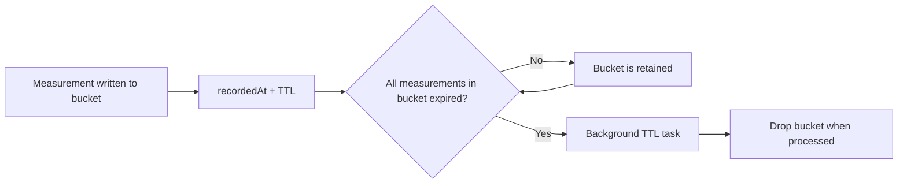

# TTL and Version-Specific Data Retention Policies

## 1. Problem Statement: How Long Should Time Series Data Be Kept?

In applications using **Spring Data MongoDB**, a time series collection typically stores timestamped data: sensor temperature readings, operational metrics, measurement events, and system observability records. New data is continuously appended; older data may lose analytical value while continuing to occupy disk space, increasing storage costs and complicating operations.

**TTL (Time To Live)** allows MongoDB to automatically purge expired data. For time series collections, the *retention policy* is normally defined in seconds via `expireAfterSeconds` at the **collection level**. When different durations are needed per metadata group, MongoDB 7.0 and later also support **partial TTL indexes**.

After this lesson, you will be able to:

- Distinguish time series collection TTL from TTL indexes on regular collections.
- Create, inspect, modify, and disable retention periods without confusing `timeField` with database insertion time.
- Choose an approach compatible with the running versions of MongoDB and Spring Data MongoDB.
- Design, test, and monitor a data retention policy in a Spring application.

Running example: a sensor collection system stores `recordedAt` (measurement timestamp), `sensor` (metadata containing `sensorId` and `tier`), and `temperatureC` (temperature). The initial goal is to retain measurements for **30 days**, and later to retain `tier: "debug"` data for only **7 days**.

## 2. How Does TTL Work in a Time Series Collection?

### 2.1. The Expiration Anchor Is `timeField`

When creating a time series collection, `timeseries.timeField` must be specified. This field holds each measurement's BSON `Date` value. With `expireAfterSeconds = N`, a measurement becomes **eligible for expiration** at:

```text
expiration time = timeField value + N seconds
```

For example, `recordedAt = 2026-01-01T08:00:00Z` with a TTL of `2_592_000` seconds (30 × 24 × 60 × 60) yields `2026-01-31T08:00:00Z`. This is the **eligibility timestamp**, not a guarantee of deletion at that exact second.

Important consequence: if a device loses connectivity and backfills a record with a very old `recordedAt`, TTL age is still computed from the **measurement time**, not when the application called `save()`. If the business requirement is "retain for 30 days from ingestion time", you must design how timestamps and data are modeled separately; you cannot arbitrarily replace `timeField` with `insertedAt` while ignoring measurement semantics and time-series queries.

### 2.2. MongoDB Deletes by Bucket in a Background Process

Time series collections group nearby measurements with matching metadata into **buckets**. MongoDB can only drop a bucket when **every measurement inside that bucket has expired**. A background task checks for expired buckets roughly every **60 seconds**; heavy system load can delay deletion even further.

| Collection `granularity` | Maximum time span a bucket can cover |
| --- | ---: |
| `seconds` (default) | 1 hour |
| `minutes` | 24 hours |
| `hours` | 30 days |

These values are bucket span limits documented by MongoDB; they are not TTL durations. For example, a 7-day TTL policy **does not guarantee** data always disappears after exactly 7 days, especially if a bucket contains newer measurements and uses a wide bucket span.



**TTL is an asynchronous cleanup mechanism**, not a per-record precision deletion timer. Therefore, do not rely on TTL as the sole guarantee for strict contractual or regulatory deletion deadlines. If access to expired data must stop immediately upon expiration, add time-range filters in queries and a dedicated deletion/audit workflow.

## 3. Creating a Time Series Collection with TTL

In `mongosh`, initialize a 30-day collection as follows (requires MongoDB **5.0 or later**):

```javascript
db.createCollection("sensor_readings", {
  timeseries: {
    timeField: "recordedAt",
    metaField: "sensor",
    granularity: "seconds"
  },
  expireAfterSeconds: 30 * 24 * 60 * 60
});

db.sensor_readings.insertOne({
  recordedAt: new Date(),
  sensor: { sensorId: "s-101", tier: "standard" },
  temperatureC: 27.4
});
```

Here:

- `recordedAt` must have a valid datetime type; Java `Instant` is typically mapped to BSON `Date` by Spring Data.
- `sensor` is the `metaField`, used to group measurements by sensor attributes; avoid putting continuously changing values like individual readings in metadata.
- `granularity: "seconds"` suits data arriving every few seconds or minutes. Choose based on actual sampling cadence while considering bucket-level deletion lag.
- `expireAfterSeconds` sits at the **same top level** as `timeseries`, not inside the `timeseries` object.

The collection must be created as time series **before writing data**. Creating a regular collection first and adding Java annotations later will not convert it into a time series collection.

### 3.1. Spring Data MongoDB: Entity Mapping and Collection Initialization

In Spring Data MongoDB **4.4 or later**, `@TimeSeries` supports the `expireAfter` attribute. You can use `30d`, `720h`, ISO-8601 durations like `P30D`, or configuration placeholders.

```java
import java.time.Instant;
import java.util.Map;

import org.springframework.data.annotation.Id;
import org.springframework.data.mongodb.core.mapping.TimeSeries;

@TimeSeries(
    collection = "sensor_readings",
    timeField = "recordedAt",
    metaField = "sensor",
    expireAfter = "30d"
)
public class SensorReading {
    @Id
    private String id;

    private Instant recordedAt;
    private Map<String, String> sensor;
    private double temperatureC;

    // Constructors, getters, and setters per project convention.
}
```

The annotation is a **collection creation declaration**, not an operation that automatically alters the TTL of an existing collection. When deploying a new application, explicitly create the collection from entity metadata:

```java
import org.springframework.boot.ApplicationRunner;
import org.springframework.context.annotation.Bean;
import org.springframework.context.annotation.Configuration;
import org.springframework.data.mongodb.core.MongoTemplate;

@Configuration
class MongoCollectionSetup {

    @Bean
    ApplicationRunner createSensorReadings(MongoTemplate template) {
        return args -> {
            if (!template.collectionExists(SensorReading.class)) {
                template.createCollection(SensorReading.class);
            }
        };
    }
}
```

This initializer works for learning examples or environments with a **single migration process**. For multi-instance systems, use a controlled migration step to prevent two instances from creating the collection simultaneously and to detect an existing collection with the wrong type or options. `collectionExists()` only checks existence; it **does not verify** whether `timeField` and TTL match.

For Spring Data MongoDB versions that support `@TimeSeries` but **do not yet support `expireAfter`** (prior to 4.4), you can create the time series collection via `MongoTemplate` or the MongoDB Driver and set retention via the collection's `expireAfterSeconds` option. This approach is also useful when centralizing TTL management in migrations instead of annotations:

```java
// When not using annotations: initialize time series via MongoTemplate.
template.createCollection(
    "sensor_readings",
    org.springframework.data.mongodb.core.CollectionOptions
        .timeSeries("recordedAt")
);
// Configure metaField and expireAfterSeconds in the collection creation workflow
// using the Driver/Spring Data API appropriate for your version.
```

The snippet above only illustrates the `MongoTemplate` entry point and is **not equivalent** to the `mongosh` example with `metaField` and TTL. When deploying, configure both options using your version's API or use the `db.createCollection` command above. Do not create a collection without TTL and assume retention is active.

> **Reactive:** `ReactiveMongoTemplate` also supports collection creation, but the method returns a publisher; it must be composed into a subscribed flow (such as a controlled startup routine), otherwise the command will not execute.

## 4. Important Differences Across Versions

TTL capabilities depend on **two independent versions**: MongoDB Server determines storage and deletion features, while Spring Data MongoDB determines the APIs and annotations available to the application.

### 4.1. MongoDB Server

| Version | TTL capabilities on time series | Appropriate strategy |
| --- | --- | --- |
| Before **5.0** | No dedicated time series collections. | Regular collections and standard TTL indexes (different model). |
| **5.0 – 6.2** | Time series collections with collection-level `expireAfterSeconds`; no partial TTL indexes per metadata group. | One shared TTL per collection; split collections if groups need different retentions. |
| **6.3 – 6.x** | Adds custom bucket settings `bucketMaxSpanSeconds`/`bucketRoundingSeconds`; auto-creates compound `metaField` + `timeField` index on new collections. | Keep basic collection-level TTL policies; do not rely on 7.0 partial TTL. |
| **7.0 and later** | Supports **partial TTL indexes** on time series, with filter predicates based solely on `metaField`. | One general TTL plus shorter TTLs for metadata groups, or TTL applied only to selected groups. |
| **8.x/9.x** | Supports the TTL capabilities above; other options and restrictions must be checked against exact server/FCV versions. | Verify existing collections and downgrade constraints before changing settings. |

*Note:* `bucketMaxSpanSeconds` and `bucketRoundingSeconds` were introduced in 6.3, must be specified **together** with equal values, and cannot be combined with `granularity`. Features also depend on **Feature Compatibility Version (FCV)** during upgrades or downgrades; do not infer server capabilities from Java library versions.

### 4.2. Spring Data MongoDB

| Spring Data MongoDB version | Application considerations |
| --- | --- |
| **3.3 and later** | Provides `@TimeSeries` to specify collection, `timeField`, `metaField`, and `granularity`. |
| **4.4 and later** | Adds `@TimeSeries(expireAfter = "30d")` (supports duration units, ISO-8601, placeholders, and SpEL). |
| Versions without `expireAfter` | Use `createCollection`/`collMod` via the Driver or migrations; do not copy newer annotation attributes into older codebases. |

To establish an accurate support matrix, check the deployed MongoDB Server version, FCV, Spring Data dependency, and MongoDB Driver version. For instance, using Spring Data 5.x **will not enable** partial TTL indexes if the MongoDB Server is still on 6.x.

## 5. Changing the TTL Policy on a Running Collection

Administrative adjustments use `collMod`. For example, changing from **30 days to 14 days**:

```javascript
db.runCommand({
  collMod: "sensor_readings",
  expireAfterSeconds: 14 * 24 * 60 * 60
});
```

Inspect the live configuration directly from MongoDB instead of relying only on annotations or application config files:

```javascript
db.getCollectionInfos({ name: "sensor_readings" })
  .map(({ name, type, options }) => ({
    name,
    type,
    timeField: options.timeseries?.timeField,
    expireAfterSeconds: options.expireAfterSeconds
  }));
```

To disable collection-level TTL, use `expireAfterSeconds: "off"` on server versions supporting this syntax:

```javascript
db.runCommand({ collMod: "sensor_readings", expireAfterSeconds: "off" });
```

Lowering TTL from 30 to 14 days can cause a large volume of older data to **become eligible for deletion simultaneously**. Estimate the affected record/bucket volume, watch disk and I/O load, and back up any necessary data before making the change. Increasing or disabling TTL **does not recover** already-deleted data; recovery requires an appropriate backup or archive.

## 6. Different Policies per Metadata Group: MongoDB 7.0+

Suppose the system keeps standard data for 30 days but wants to drop debug readings after 7 days. On MongoDB 7.0 or later, you can keep the 30-day collection TTL and create a **partial TTL index** filtering on `metaField`:

```javascript
db.sensor_readings.createIndex(
  { recordedAt: 1 },
  {
    name: "debug_ttl_7d",
    expireAfterSeconds: 7 * 24 * 60 * 60,
    partialFilterExpression: { "sensor.tier": "debug" }
  }
);
```

Keep these rules in mind:

1. The TTL index key uses **`timeField`** (`recordedAt`), while `partialFilterExpression` must reference **only `metaField`** (`sensor`). Do not write filter conditions using `temperatureC` or non-metadata measurement fields.
2. The 7-day partial TTL **shortens** retention for the `debug` group; it **cannot extend** the 30-day retention of any other group while the collection still has a general TTL.
3. If the collection **has no general TTL**, a partial TTL can expire only the targeted group while leaving unmatched groups unaffected.
4. Do not assume `@Indexed(expireAfter = ...)` on an arbitrary property replaces time series partial TTL syntax; the index must conform to server restrictions.
5. Verify the actual indexes after migration:

```javascript
db.sensor_readings.getIndexes();
```

**If the server is still on 5.x or 6.x**, an operationally straightforward design is to **separate collections** by retention, such as `sensor_readings_debug_7d` and `sensor_readings_standard_30d`, and route reads/writes accordingly in services or repositories. Splitting increases collection/index count and cross-collection query complexity, but avoids depending on unsupported features.

| Requirement | Recommended design |
| --- | --- |
| Keep all measurements for 30 days | Collection-level 30-day TTL. |
| `debug` 7 days, `standard` 30 days, MongoDB 7.0+ | 30-day general TTL + 7-day partial TTL index for `sensor.tier = "debug"`. |
| Custom retention per customer on MongoDB 5/6 | Separate collections per retention tier or a tightly managed custom purge workflow. |
| Data legally required for long-term retention | Export to an appropriate archive before TTL runs; do not rely on raising TTL after deletion. |

## 7. Managing Retention Policies Across Upgrades and Versions

Policies can evolve by **business policy version** (`retention-policy-v1`, `retention-policy-v2`) and **MongoDB Server version**. Do not conflate the two: Server 7.0 enables new enforcement mechanisms, but does not determine your company's retention rules.

Example evolution plan:

| Rollout milestone | Business rule | MongoDB | Implementation |
| --- | --- | --- | --- |
| Policy `v1` | Keep all readings for 30 days. | 6.0 | Collection TTL 30 days. |
| Policy `v2` | Debug 7 days, standard 30 days. | 6.0 | Split collections by tier if upgrading is not yet possible. |
| Policy `v3` | Debug 7 days, standard 30 days. | 7.0+ | Can use partial TTL on `sensor.tier`; requires a data migration plan. |

A retention migration should document: **policy version**, effective date, affected collections, before/after configuration, estimated records/buckets to expire, read/write impact, data rollback plan (from backup if needed), and owner. When consolidating multiple collections back into one, design a data migration flow; simply adding an index does not merge older collections.

Do not use a "document version" as a `metaField` substitute for policy if every single record needs an independent expiration date. Collection-level and partial TTLs have clear boundaries; if per-record dynamic retention is required, evaluate alternative schemas and storage mechanisms rather than stretching time series TTL beyond server limits.

## 8. Testing and Monitoring Retention

### 8.1. Meaningful Test Scenarios

In a test environment with a short TTL, verify:

| Scenario | What to observe |
| --- | --- |
| Measurement with recent `recordedAt` | Remains queryable before reaching TTL age. |
| Measurement with very old `recordedAt` | Eventually removed once the **entire bucket** qualifies and the background task runs. |
| Two distinct `sensor.tier` groups (MongoDB 7.0+) | Partial TTL removes only the targeted group without prematurely deleting the standard group. |
| Backfilled old measurement | TTL age is still measured from `recordedAt`, not insertion time. |
| Modifying `expireAfterSeconds` | `listCollections`/`getCollectionInfos()` reflects the new setting; additional deletions are anticipated. |

Sample test data:

```javascript
db.sensor_readings.insertMany([
  {
    recordedAt: new Date(Date.now() - 35 * 24 * 60 * 60 * 1000),
    sensor: { sensorId: "s-test-old", tier: "standard" },
    temperatureC: 22.1
  },
  {
    recordedAt: new Date(),
    sensor: { sensorId: "s-test-new", tier: "standard" },
    temperatureC: 22.2
  }
]);
```

Do not write tests assuming old documents vanish after exactly `N` seconds. Use **polling with a reasonable timeout**, and arrange metadata/timestamps so you know which bucket qualifies for removal; if newer data shares the same bucket, that bucket will not be deleted yet.

### 8.2. Operational Monitoring

Periodically audit collection and index configurations (`getCollectionInfos`, `getIndexes`). You can also inspect **server-wide** TTL task metrics with:

```javascript
db.serverStatus().metrics.ttl;
```

Server-wide TTL metrics do not break down `sensor_readings` specifically. To evaluate retention enforcement for a given collection, combine counts/storage sizes across `recordedAt` ranges, lag between expiration threshold and actual disappearance, and system load during large cleanup waves.

In a Spring application, user-facing queries can filter by the permitted visibility window even before a bucket has been cleaned up:

```java
Instant cutoff = Instant.now().minus(Duration.ofDays(30));

Query query = Query.query(
    Criteria.where("recordedAt").gte(cutoff)
);

List<SensorReading> recent = mongoTemplate.find(
    query, SensorReading.class
);
```

This snippet requires importing `java.time.Duration`, `org.springframework.data.mongodb.core.query.Query`, `Criteria`, `java.util.List`, and injecting `MongoTemplate`. This query predicate **does not replace data deletion**; it merely restricts returned results to match display policy.

## 9. Common Mistakes

| Mistake | Consequence | Fix |
| --- | --- | --- |
| Confusing `recordedAt` with insertion time | Backfilled data may expire immediately. | Clarify the business timestamp before designing `timeField`. |
| Believing TTL deletes at the exact second | Flaky tests; expired data remains accessible. | Account for buckets, background cycles, and server load; filter queries when necessary. |
| Changing `expireAfter` in the annotation and assuming DB TTL updates | Application and collection settings diverge. | Use migrations/`collMod` and read back options from the server. |
| Adding a partial TTL index on MongoDB 6.x | Feature error or silent non-functional design. | Check server/FCV; separate collections until upgraded to 7.0. |
| Trying to extend one group's retention via partial TTL | Collection-wide TTL still deletes that group. | Set collection TTL to the longest retention and shorten others via partial TTL; or split collections. |
| Abruptly lowering TTL on large datasets | Deletion load spike and unrecoverable data loss via config rollback. | Assess data volume before migration, back up/archive, and monitor load. |
| Treating TTL as historical archiving | Expired data is permanently lost from the collection. | Tier hot/cold data and export archives prior to expiration. |

## 10. Applied Exercise

Design retention for a system with three device tiers: `debug` needs 3 days, `standard` needs 30 days, and `audit` needs 365 days. Explain:

1. The configuration to create on MongoDB 6.0 so each tier keeps its own retention.
2. The configuration on MongoDB 7.0+ if sharing a single time series collection: what should the collection-level TTL be, and which partial TTL indexes should be created?
3. What happens if collection-level TTL is lowered from 365 days to 30 days while `audit` data is still needed for 365 days?
4. With `granularity: "hours"`, why should a test not wait exactly 3 days and assert that debug records must be gone?
5. Which configurations and operational metrics will you verify before and after a retention migration?

**Hint:** On 7.0+, set collection-level TTL to 365 days and add 3-day partial TTL for `debug` and 30-day partial TTL for `standard`; on 6.0, split tiers into separate collections. With a 30-day collection TTL, `audit` data can also be deleted after 30 days even if a longer partial TTL exists. Every choice must factor in bucket-level deletion delay.

## References

- [MongoDB — Set up Automatic Removal for Time Series Collections (TTL)](https://www.mongodb.com/docs/manual/core/timeseries/timeseries-automatic-removal/)
- [MongoDB — Time Series Indexes](https://www.mongodb.com/docs/manual/core/timeseries/timeseries-index/)
- [MongoDB — Create and Query a Time Series Collection](https://www.mongodb.com/docs/manual/core/timeseries/timeseries-procedures/)
- [MongoDB — `collMod` command](https://www.mongodb.com/docs/manual/reference/command/collmod/)
- [Spring Data MongoDB — Index and Collection Management](https://docs.spring.io/spring-data/mongodb/reference/mongodb/template-collection-management.html)
- [Spring Data MongoDB — `@TimeSeries` API](https://docs.spring.io/spring-data/mongodb/docs/current/api/org/springframework/data/mongodb/core/mapping/TimeSeries.html)
