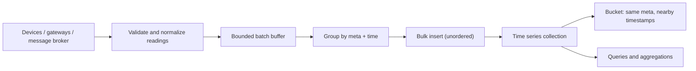

# Batch Data Ingestion and Designing Stable Metadata for Time Series

## Learning Objectives

In the **SPRING_DATA_MONGODB** module, Spring Data MongoDB helps Java applications connect to MongoDB, map documents, query via `MongoTemplate` or repositories, run aggregations, manage indexes, write tests, and monitor performance. With **time series** data, write volume grows rapidly over time: an IoT system with thousands of devices can produce millions of readings per day. How you **batch data** and choose **low-churn metadata** directly impacts write throughput, bucket density, storage cost, and query efficiency.

After this lesson, you will be able to:

- Distinguish `timeField`, `metaField`, and measurement fields in a time series document.
- Design metadata that accurately identifies a data series, stays stable over time, and matches query patterns.
- Create a time series collection and perform batch writes with MongoDB/Spring Data MongoDB.
- Choose batch sizes, group readings by metadata, use unordered mode appropriately, and control memory usage.
- Handle partial batch failures, retries, duplicate readings, late arrivals, and ingestion recovery.
- Verify results, measure throughput, and detect bucket fragmentation caused by unstable metadata.

## 1. Context: How Does a Time Series Collection Store Data?

A MongoDB time series collection is designed for documents representing an event or measurement at a point in time: temperature, electric current, CPU usage, transaction rate, production metrics, and more.

When creating the collection, you specify:

| Component | Example | Role |
|---|---|---|
| `timeField` | `observedAt` | When the measurement occurred; must be a valid BSON Date value. |
| `metaField` | `meta` | Describes the data series (sensor, tenant, metric type); should rarely change. |
| Measurement fields | `value`, `batteryPercent`, `quality` | Values that vary across samples; generally do not belong in metadata. |

Example document:

```javascript
{
  observedAt: ISODate("2026-11-20T03:30:00Z"),
  meta: {
    tenantId: "factory-a",
    sensorId: "line-02-temp-07",
    metric: "temperature",
    unit: "celsius"
  },
  value: 24.8,
  batteryPercent: 82,
  quality: "OK",
  eventId: "gateway-05:1732073400000:007"
}
```

Internally, MongoDB organizes readings with **identical `metaField` values** and nearby timestamps into optimized **storage buckets**. These are internal time series buckets, **different** from GridFS `files/chunks` buckets. Most applications query the time series collection directly without accessing the internal bucket collection.



**Two closely linked decisions:** (1) choosing metadata so MongoDB can group related readings together; (2) structuring batches so readings sharing metadata are written close together, reducing network round trips and working efficiently with buckets.

## 2. Designing Stable Metadata

### 2.1. Metadata Identifies a Data Series

For a factory temperature monitoring system, the following combination can represent one series:

```json
{
  "tenantId": "factory-a",
  "sensorId": "line-02-temp-07",
  "metric": "temperature",
  "unit": "celsius"
}
```

These fields describe **who/what** produces the metric and how it is interpreted. When temperature rises from `24.8` to `24.9` or battery drops from `82%` to `81%`, metadata stays unchanged. MongoDB has a strong opportunity to pack many points into well-filled buckets.

Compare:

| Field | Where to place? | Reason |
|---|---|---|
| `tenantId` | Usually in `meta` | Logically partitions data by tenant and is often used for filtering; must be stable. |
| `sensorId` | `meta` | Identifies the series source and is frequently used in queries. |
| `metric` | `meta` if each metric type is a separate series | Distinguishes temperature, humidity, and pressure. |
| `unit` | `meta` if it is a long-lived series attribute | Prevents mixing values measured in different units. |
| `observedAt` | `timeField` | Changes on every reading; do not put in `meta`. |
| `value`, `batteryPercent` | Measurement fields | Change continuously. |
| `quality`, `alarm` | Measurement fields | Status may change every minute; putting it in `meta` splits the series into many groups. |
| `ingestedAt` | Regular field or operational table | Receipt/ingestion timestamp, changing per sample; differs from `observedAt`. |
| `requestId`, `eventId` | Regular field or separate idempotency store | Extremely high churn; placing it in `meta` gives nearly every reading its own metadata. |

**Example of unstable metadata:**

```javascript
// Poor design: every sample has different meta
{
  observedAt: ISODate("2026-11-20T03:30:00Z"),
  meta: {
    sensorId: "line-02-temp-07",
    receivedAt: ISODate("2026-11-20T03:30:01Z"),
    requestId: "req-123",
    batteryPercent: 82
  },
  value: 24.8
}
```

`receivedAt` and `requestId` change continuously; readings can hardly be grouped with adjacent points in the same series. The result can be **many sparse buckets**, extra storage overhead, and reduced series-query efficiency.

### 2.2. Cardinality and Stability Are Two Dimensions to Balance

**Metadata cardinality** is the number of distinct metadata values. A system with 10,000 sensors naturally has many series, which can be legitimate for the domain. Problems arise when each sensor creates thousands of unnecessary metadata variants (request IDs, transient status flags, ingestion timestamps).

Choosing metadata solely for low cardinality is not enough either. Dropping `sensorId` to lump every sensor into a single group weakens query selectivity and erases series identity. Keep **enough stable fields to distinguish each series accurately**, especially fields that appear frequently in filter predicates.

MongoDB may reorder fields within the `meta` object; for safe querying and effective index usage, filter on scalar subfields such as `"meta.sensorId"` instead of matching the whole `meta` object by field order. Also standardize field names, data types, casing, units, and missing-value handling before writing.

### 2.3. When Metadata Genuinely Changes

Suppose device `sensor-17` moves from `site-a` to `site-b`. If site is part of the series identity, new readings can use metadata `{sensorId: "sensor-17", siteId: "site-b"}`; historical data retains the site at the time of measurement. This is a meaningful domain change, not a bug.

Conventions should be documented clearly:

1. Which values create a **new series** (for example, changing unit or reassigning a sensor to a new site)?
2. Which values are **measurements** or short-lived states that must stay outside `meta`?
3. When adding a new metadata field, how should older data be interpreted?
4. Do tenant, sensor, and metric use consistent data types? For instance, always use strings for `sensorId`.

A `metaField` declared at collection creation cannot be switched to a **different field name** simply by changing data values. If the series identity design changes fundamentally, a collection/schema migration plan is usually required. Do not run bulk metadata updates to rewrite history without evaluating time series update restrictions and bucket impact.

## 3. Creating the Collection Before Starting Ingestion

A regular collection does not automatically become time series just because documents have a timestamp field. Create the collection with the `timeseries` option **before the first insert**.

Using `mongosh`:

```javascript
db.createCollection("sensor_readings", {
  timeseries: {
    timeField: "observedAt",
    metaField: "meta",
    granularity: "minutes"
  }
})
```

`granularity` is a bucket-layout hint matched to data cadence, not a way to round or alter sample timestamps. Choose `seconds`, `minutes`, or `hours` according to actual interval/density between data points, then measure performance. Newer MongoDB versions also support custom bucket parameters; do not mix `granularity` with custom bucket parameters in the same declaration.

You can also create it via the integrated driver through `MongoTemplate`, suitable for controlled migrations/provisioning:

```java
import com.mongodb.client.model.CreateCollectionOptions;
import com.mongodb.client.model.TimeSeriesGranularity;
import com.mongodb.client.model.TimeSeriesOptions;
import org.springframework.data.mongodb.core.MongoTemplate;

public final class TimeSeriesCollectionProvisioner {

    private TimeSeriesCollectionProvisioner() {}

    public static void create(MongoTemplate template) {
        template.execute(database -> {
            CreateCollectionOptions options = new CreateCollectionOptions()
                .timeSeriesOptions(new TimeSeriesOptions("observedAt")
                    .metaField("meta")
                    .granularity(TimeSeriesGranularity.MINUTES));
            database.createCollection("sensor_readings", options);
            return null;
        });
    }
}
```

This is a **one-time creation** operation during provisioning. If the collection already exists, inspect its actual options before deciding whether to ignore the error or run a migration. Avoid relying on implicit regular-collection creation on the first write.

Verify configuration:

```javascript
db.getCollectionInfos({ name: "sensor_readings" })
```

The output should confirm `timeseries.timeField = "observedAt"` and `timeseries.metaField = "meta"` as expected. MongoDB may manage an internal bucket collection, but application code should interact only with `sensor_readings`.

## 4. Batch Ingestion (Batch Insert)

### 4.1. Why Is Batching Better Than One Document at a Time?

Suppose 5,000 measurements arrive every second. If the application issues 5,000 independent `insertOne` commands, network round trips, command coordination, and connection management overhead can be substantial. Sending multiple documents in a single `insertMany` or bulk insert reduces request count.

MongoDB recommendations for time series:

- **Write multiple documents in a batch** rather than many `insertOne` calls.
- When possible, **group readings sharing the same `metaField` value into the same batch** or place them adjacent within the batch.
- Use `ordered: false` when the application does not require inserts to execute strictly in submission order, as this mode can improve throughput.

Example with `mongosh`:

```javascript
db.sensor_readings.insertMany(
  [
    {
      observedAt: ISODate("2026-11-20T03:00:00Z"),
      meta: { tenantId: "factory-a", sensorId: "s-01", metric: "temperature", unit: "celsius" },
      value: 23.7
    },
    {
      observedAt: ISODate("2026-11-20T03:01:00Z"),
      meta: { tenantId: "factory-a", sensorId: "s-01", metric: "temperature", unit: "celsius" },
      value: 23.8
    },
    {
      observedAt: ISODate("2026-11-20T03:00:00Z"),
      meta: { tenantId: "factory-a", sensorId: "s-02", metric: "temperature", unit: "celsius" },
      value: 24.1
    },
    {
      observedAt: ISODate("2026-11-20T03:01:00Z"),
      meta: { tenantId: "factory-a", sensorId: "s-02", metric: "temperature", unit: "celsius" },
      value: 24.2
    }
  ],
  { ordered: false }
)
```

The first two readings share `meta`, and the next two share `meta`. This grouping gives the server a chance to process data per series more efficiently. **Unordered mode does not guarantee write or completion order** for individual documents; `observedAt` itself determines the chronological axis at query time.

### 4.2. Choosing a Batch Size

There is no single optimal batch size for all applications. A test baseline typically starts around **500–2,000 documents per batch**, then measures:

| Criterion | Batch too small | Batch too large |
|---|---|---|
| Network round trips | Many | Fewer |
| Buffered RAM awaiting write | Low | Higher |
| Latency of fresh samples | Low if flushed immediately | May increase while waiting to fill batch |
| Error handling / partial success | Easy to isolate | Harder to reconcile individual documents |
| Pressure on MongoDB | Many small commands | Heavy commands or load spikes |
| Recovery granularity | Frequent checkpoints | May require re-scanning a large batch |

Batch size should be bounded by **document count, total byte size, wait time, and concurrent in-flight batches**. The driver also imposes limits on batch size and BSON/message size; do not assume an arbitrarily large Java list can be sent as one payload.

Example policy:

- Flush upon reaching 1,000 documents, or an estimated 2 MiB of data, or waiting longer than 500 ms.
- Cap the number of concurrent in-flight batches; apply backpressure if the queue fills.
- Within each batch, sort or group by a stable metadata key before execution if CPU/RAM cost is acceptable.
- These thresholds are starting points for benchmarking, not MongoDB hard limits.

## 5. Batch Writing with Spring Data MongoDB

### 5.1. Document Mapping

Example using Java records to model a reading. `meta` fields must maintain consistent types and semantics throughout the data lifecycle.

```java
import java.time.Instant;

import org.springframework.data.mongodb.core.mapping.Document;

@Document(collection = "sensor_readings")
public record SensorReading(
        Instant observedAt,
        SensorMeta meta,
        double value,
        int batteryPercent,
        String quality,
        String eventId
) {
    public record SensorMeta(
            String tenantId,
            String sensorId,
            String metric,
            String unit
    ) {}
}
```

Spring Data MongoDB maps `Instant` to a BSON date and stores `SensorMeta` as a nested `meta` document by default. In production systems, verify mapping behavior when using custom converters or changing field types.

### 5.2. Using `BulkOperations.BulkMode.UNORDERED`

With `MongoTemplate`, you can submit a list of readings as a bulk operation:

```java
import java.util.ArrayList;
import java.util.Comparator;
import java.util.Iterator;
import java.util.List;
import java.util.Objects;

import com.mongodb.bulk.BulkWriteResult;
import org.springframework.data.mongodb.core.BulkOperations.BulkMode;
import org.springframework.data.mongodb.core.MongoTemplate;
import org.springframework.stereotype.Service;

@Service
public class SensorReadingBatchWriter {

    private static final int BATCH_SIZE = 1_000;
    private final MongoTemplate mongoTemplate;

    public SensorReadingBatchWriter(MongoTemplate mongoTemplate) {
        this.mongoTemplate = mongoTemplate;
    }

    public int writeBatch(List<SensorReading> readings) {
        if (readings.isEmpty()) {
            return 0;
        }
        if (readings.size() > BATCH_SIZE) {
            throw new IllegalArgumentException("Batch exceeds limit");
        }

        for (SensorReading reading : readings) {
            validate(reading);
        }

        // Group readings sharing the same meta; observedAt is unchanged.
        List<SensorReading> sorted = readings.stream()
            .sorted(Comparator
                .comparing((SensorReading r) -> r.meta().tenantId())
                .thenComparing(r -> r.meta().sensorId())
                .thenComparing(r -> r.meta().metric())
                .thenComparing(r -> r.meta().unit())
                .thenComparing(SensorReading::observedAt))
            .toList();

        BulkWriteResult result = mongoTemplate
            .bulkOps(BulkMode.UNORDERED, SensorReading.class)
            .insert(sorted)
            .execute();

        return result.getInsertedCount();
    }

    public long importFrom(Iterator<SensorReading> source) {
        List<SensorReading> batch = new ArrayList<>(BATCH_SIZE);
        long inserted = 0;

        while (source.hasNext()) {
            batch.add(source.next());

            if (batch.size() == BATCH_SIZE) {
                inserted += writeBatch(batch);
                batch.clear();
            }
        }
        if (!batch.isEmpty()) {
            inserted += writeBatch(batch);
        }
        return inserted;
    }

    private static void validate(SensorReading reading) {
        Objects.requireNonNull(reading, "reading");
        Objects.requireNonNull(reading.observedAt(), "observedAt");
        SensorReading.SensorMeta meta =
            Objects.requireNonNull(reading.meta(), "meta");

        if (meta.tenantId() == null || meta.tenantId().isBlank()
                || meta.sensorId() == null || meta.sensorId().isBlank()
                || meta.metric() == null || meta.metric().isBlank()
                || meta.unit() == null || meta.unit().isBlank()) {
            throw new IllegalArgumentException("Missing stable metadata");
        }

        if (!Double.isFinite(reading.value())) {
            throw new IllegalArgumentException("Invalid measurement value");
        }
    }
}
```

Understand the exact scope of this example:

1. `writeBatch` processes **at most 1,000 readings**; `importFrom` streams incrementally through an `Iterator` rather than loading the entire source into RAM. Real sources (Kafka consumers, CSV parsers, HTTP streams) require their own lifecycle and checkpoint management.
2. `BulkMode.UNORDERED` can continue processing remaining documents after an error on another document. Partial success does not mean all documents were written.
3. `sorted` keeps series items grouped together in the outbound list; it does not guarantee server-side write order, so applications must rely on `observedAt` when querying.
4. `return result.getInsertedCount()` runs only when `execute()` returns normally. If a batch throws an exception, callers must record the failure and run reconciliation; never advance checkpoints as if the entire batch succeeded.
5. Do not use `save()` in place of insert in an append-only pipeline. `save()` carries `_id`-based update/replace semantics, whereas time series is optimized for appending measurements and restricts updates.
6. This example omits write concern, retry logic, deduplication guarantees, metrics, and tenant authorization; those must be implemented in a production pipeline.

When you simply need to insert multiple readings without explicitly controlling ordered/unordered mode, Spring Data also provides `mongoTemplate.insert(list, SensorReading.class)`. When explicit `ordered: false` control is needed, `BulkOperations` or the MongoDB driver's `insertMany` with `InsertManyOptions` is the right choice.

### 5.3. Using the MongoDB Java Driver Directly

For data already converted into `Document` instances, you can use:

```java
import com.mongodb.client.MongoCollection;
import com.mongodb.client.model.InsertManyOptions;
import org.bson.Document;

import java.util.List;

public void insertUnordered(
        MongoCollection<Document> collection,
        List<Document> docs) {

    if (!docs.isEmpty()) {
        collection.insertMany(docs, new InsertManyOptions().ordered(false));
    }
}
```

This is useful when you have a pipeline handling raw BSON directly. It **bypasses Spring Data entity mapping** performed by `MongoTemplate`; keep converters and data contracts consistent if both write paths coexist.

## 6. Handling Late-Arriving, Out-of-Order Data, and Timestamps

Time series sources do not necessarily arrive in chronological order. A gateway may lose connectivity for 15 minutes and then upload hundreds of older readings. MongoDB can still accept documents with older `observedAt` timestamps; however, bucket density, throughput, and storage behavior may differ from steady in-order writes.

**Distinguish two timestamps:**

- `observedAt`: when the sensor took the measurement; used for charting and event-time statistics.
- `ingestedAt`: when the system received or began processing it; useful for measuring ingestion lag and detecting late arrivals, but **do not put it in `meta`** since it changes on every document.

Example:

```javascript
{
  observedAt: ISODate("2026-11-20T03:00:00Z"),
  ingestedAt: ISODate("2026-11-20T03:16:05Z"),
  meta: {
    tenantId: "factory-a",
    sensorId: "s-01",
    metric: "temperature",
    unit: "celsius"
  },
  value: 23.7
}
```

To avoid data distortion:

- Normalize timestamps to `Instant`/UTC at the API boundary and apply timezones on display. The time field must be a BSON Date, not a text ISO string in MongoDB.
- Do not overwrite `observedAt` with ingestion time just to make batches look neatly ordered.
- When sorting, prefer grouping by metadata and then sorting by `observedAt` within each group, remembering that unordered inserts do not guarantee completion order.
- For sources with microsecond or nanosecond resolution, define a rounding/truncation policy when storing as BSON Date (millisecond precision).
- If TTL is enabled, backfilled data older than the retention window may be removed by retention policy after insertion; specify clearly how very old events are handled.

## 7. Partial Failures and Retries: The Hardest Part of Batching

### 7.1. A Batch Can Partially Succeed

Suppose a batch holds 1,000 documents. MongoDB writes 700 documents successfully, then a network failure occurs. Depending on timing and error type, the application may **not know for sure** whether 700, 999, or all 1,000 documents were persisted, even if the call throws an exception.

`ordered: false` prevents a single document error from halting subsequent documents in the batch, but **it does not make the batch an all-or-nothing transaction**. Time series collections also have a limitation: **writes inside multi-document transactions are not supported**, so you cannot wrap an entire time series batch and a business state table in one MongoDB transaction to solve every failure mode.

Do not do this:

```java
// Anti-pattern: blindly retrying the entire batch on every exception.
try {
    writer.writeBatch(readings);
} catch (Exception ex) {
    writer.writeBatch(readings);
}
```

Blind retries can produce **duplicate readings**. MongoDB does not enforce unique indexes on time series like regular collections; relying solely on `_id` or `eventId` without an external constraint mechanism will not prevent duplicates in all scenarios.

### 7.2. Designing Idempotency at the Ingestion Layer

A practical workflow can use:

1. Every reading or source chunk carries a **stable event key** (`eventId` or composite `tenantId + sensorId + metric + sourceSequence`).
2. Persist receipt/checkpoint state in a **regular collection** or an offset-tracked messaging system paired with reconciliation; that regular collection can enforce a unique index for deduplication.
3. Acknowledge completion to the upstream source only after the batch write succeeds per policy and state is safely updated.
4. When a write outcome is uncertain, reconcile by event ID, time range, and source payload before replaying.
5. Design recovery for the case where the time series write succeeded but the checkpoint update failed; never assume two-store writes are atomic.

**Note:** a unique index on a receipt-tracking collection does not automatically give end-to-end exactly-once semantics. If there is a window between recording the receipt and writing to time series, crashes can still drop or duplicate data. Define the actual semantics clearly (at-least-once, downstream deduplication, or stronger external guarantees) and maintain reconciliation.

### 7.3. Classifying Errors for Appropriate Handling

| Error or symptom | Recommended handling |
|---|---|
| Invalid `observedAt` value | Reject immediately at validation; route to dead-letter storage if needed |
| Missing or wrong-type metadata | Fix/normalize at the source; do not retry the same payload endlessly |
| Connection loss, timeout, ambiguous write outcome | Log batch ID and uncertain status; reconcile before or during retry |
| MongoDB overloaded, transient error | Exponential backoff with jitter, cap retry count and concurrent batches |
| Some readings invalid, others valid | Isolate bad records, inspect per-operation errors if provided by driver; log partial result report |
| Same event replayed | Enforce idempotency outside time series or run deduplication/reconciliation |
| Batch too large or growing backlog | Reduce batch size/concurrency, tune backpressure and consumer throughput |

The application should track **received, accepted for dispatch, confirmed written, failed, and pending-reconciliation counts**. Never increment "saved" counts based solely on the input `List` size passed to bulk operations.

## 8. Querying by Metadata and Time Range

The benefit of stable metadata becomes obvious when queries typically start from a sensor, metric, and time window.

```javascript
db.sensor_readings.find(
  {
    "meta.tenantId": "factory-a",
    "meta.sensorId": "s-01",
    "meta.metric": "temperature",
    observedAt: {
      $gte: ISODate("2026-11-20T00:00:00Z"),
      $lt: ISODate("2026-11-21T00:00:00Z")
    }
  },
  {
    _id: 0,
    observedAt: 1,
    value: 1,
    "meta.unit": 1
  }
).sort({ observedAt: 1 })
```

With Spring Data:

```java
import java.time.Instant;
import java.util.List;

import org.springframework.data.domain.Sort;
import org.springframework.data.mongodb.core.MongoTemplate;
import org.springframework.data.mongodb.core.query.Criteria;
import org.springframework.data.mongodb.core.query.Query;

public List<SensorReading> readRange(
        MongoTemplate template,
        String tenantId,
        String sensorId,
        String metric,
        Instant fromInclusive,
        Instant toExclusive) {

    Query query = Query.query(
        Criteria.where("meta.tenantId").is(tenantId)
            .and("meta.sensorId").is(sensorId)
            .and("meta.metric").is(metric)
            .and("observedAt").gte(fromInclusive).lt(toExclusive)
    ).with(Sort.by(Sort.Direction.ASC, "observedAt"));

    return template.find(query, SensorReading.class);
}
```

`find()` here materializes a list and therefore fits **narrow time ranges or paginated/bounded results**. For very large queries, use streaming/aggregation, limit output size, and process incrementally rather than loading millions of points into RAM. Always bind `tenantId` from the authenticated security context rather than trusting arbitrary tenant parameters from user input.

Optimal indexes usually start with filtered metadata fields followed by `timeField`; MongoDB's default index creation varies by version. Check `getIndexes()`, `explain()` plans, and workload characteristics before adding indexes:

```javascript
db.sensor_readings.getIndexes()

db.sensor_readings.createIndex({
  "meta.tenantId": 1,
  "meta.sensorId": 1,
  "meta.metric": 1,
  observedAt: 1
})
```

Do not create indexes across every field indiscriminately: they consume storage and increase write cost. Time series collections do not support all regular collection index types; for example, **unique indexes are not supported**. Index capabilities and default index names can differ between MongoDB versions, so verify against your deployment target.

## 9. Measuring Performance and Monitoring Ingestion Quality

An effective batch pipeline measures both **throughput** and **data accuracy**.

| Metric | Meaning |
|---|---|
| `ingest_received_total` | Total readings received from sources. |
| `ingest_valid_total` and `ingest_rejected_total` | How many readings passed validation vs. failed data checks. |
| `ingest_batch_size` | Distribution of actual document count and byte size per batch. |
| `ingest_batch_duration_seconds` | Write latency per batch; track P50/P95/P99. |
| `ingest_confirmed_total` | Readings confirmed written according to pipeline policy. |
| `ingest_unknown_total` | Readings left in an uncertain state after timeouts or disconnects. |
| `ingest_queue_depth` | Backlog awaiting batching; continuous growth signals ingestion falling behind. |
| `ingest_lag_seconds` | Difference between receipt time and measurement/publish time. |
| `ingest_duplicate_suspected_total` | Potential replays or duplicate records. |
| Distinct metadata / readings ratio | Indicator of abnormal metadata cardinality, inspected per tenant/sensor. |

### Throughput Sanity-Check Formula

Suppose there are 10,000 sensors, each sending one reading every 10 seconds:

```text
Readings/second = 10,000 / 10 = 1,000
Readings/day    = 1,000 × 86,400 = 86,400,000

At an average of 1,000 readings/batch:
Batches/second ≈ 1,000 / 1,000 = 1
```

This is only an average calculation. In reality, traffic bursts, per-tenant or per-sensor batching, and timer-based flushes produce a higher batch rate. Factor in BSON overhead, indexes, write concern, and cluster topology during capacity planning.

### Query to Check Metadata Cardinality

The aggregation below counts distinct metadata series over a time range; run on a bounded window to avoid heavy scans:

```javascript
db.sensor_readings.aggregate([
  {
    $match: {
      observedAt: {
        $gte: ISODate("2026-11-20T00:00:00Z"),
        $lt: ISODate("2026-11-21T00:00:00Z")
      }
    }
  },
  {
    $group: {
      _id: {
        tenantId: "$meta.tenantId",
        sensorId: "$meta.sensorId",
        metric: "$meta.metric",
        unit: "$meta.unit"
      },
      samples: { $sum: 1 }
    }
  },
  {
    $group: {
      _id: null,
      distinctSeries: { $sum: 1 },
      totalSamples: { $sum: "$samples" },
      minSamplesPerSeries: { $min: "$samples" },
      maxSamplesPerSeries: { $max: "$samples" }
    }
  }
])
```

If each series averages only 1–2 readings when the system is supposed to stream continuously, review metadata design, source dispersion, and other factors (do not jump to conclusions from a single statistic).

## 10. Hands-On Lab: Ingesting One Million Factory Readings

**Scenario:** two factories, 500 sensors total; each sensor sends temperature or humidity once per minute. Data lives in `sensor_readings`, keyed chronologically by `observedAt`. You need to optimize throughput and keep metadata stable.

Steps:

1. Create the collection with `timeField = observedAt`, `metaField = meta`, and `granularity = minutes`. Verify with `getCollectionInfos()`.
2. Define `meta` containing `tenantId`, `sensorId`, `metric`, and `unit`. Keep `value`, `quality`, `batteryPercent`, and `eventId` outside `meta`.
3. Generate test data with many readings sharing metadata across differing `observedAt` values; include late-arriving readings to simulate an offline gateway.
4. Compare two write modes: inserting one document at a time vs. batching 1,000 readings with `BulkMode.UNORDERED`. Measure total elapsed time, P95 batch latency, CPU/RAM, write command count, and visibility lag.
5. Temporarily add `requestId` to `meta` to observe cardinality growth; then remove it from `meta` and re-measure in a **separate test collection** so active data is not polluted.
6. Inject a controlled network interruption mid-batch, mark uncertain state, test reconciliation/recovery, and check whether any readings were lost or duplicated.
7. Run queries filtering by `meta.sensorId` + `observedAt` range; inspect `getIndexes()` and `explain()` to observe query behavior.

**Completion criteria:**

- Documents use valid BSON Date timestamps and stable per-series metadata.
- The pipeline processes data in bounded batches without buffering a million documents in RAM.
- Failed batches are never falsely recorded as succeeded; uncertain outcomes are detected and recovered.
- Metadata + time-range queries return accurate results even when some points arrive late.
- Empirical measurements justify the chosen batch size and whether index tuning is needed.

## 11. Common Misconceptions

| Misconception | Correct understanding |
|---|---|
| "The more fields in `meta`, the better" | Metadata must identify the series and stay low-churn; volatile fields inflate bucket count. |
| "Enabling unordered automatically sorts data chronologically" | Unordered only affects write execution; queries must still sort by `observedAt` for ordered output. |
| "Writing 1,000 readings is a single transaction" | Bulk inserts are not implicitly all-or-nothing, and time series does not support transactional writes. |
| "Having `eventId` in the document prevents duplicates" | Time series does not support unique indexes on that field; implement idempotency and reconciliation externally. |
| "Changing metadata only edits a display label" | Metadata determines how buckets are organized and affects query efficiency. |
| "Always wait for a full batch before writing" | Use a flush timeout to balance throughput against sample latency. |
| "Measuring inserts/second alone is enough" | Also track partial failures, lag, storage footprint, RAM, query latency, and data accuracy. |

## Summary

For time series, **batch inserts** cut down MongoDB round trips, and grouping readings that share `metaField` enables efficient bucket organization. **Stable metadata** should hold series identity and frequently filtered attributes, while measurements, transient states, and request IDs belong in measurement or regular fields.

In Spring Data MongoDB, `MongoTemplate.bulkOps(BulkMode.UNORDERED, ...)` provides a solid way to implement batch ingestion. Bound both batch size and buffer wait time, preserve original event timestamps, handle partial failures, and build proper idempotency for retries. True optimization requires benchmarking throughput and correctness on a production-representative workload.

### References

- [MongoDB — Best Practices for Time Series Collections](https://www.mongodb.com/docs/manual/core/timeseries/timeseries-best-practices/)
- [MongoDB — Time Series Collection Considerations](https://www.mongodb.com/docs/manual/core/timeseries/timeseries-considerations/)
- [MongoDB — Time Series Collection Limitations](https://www.mongodb.com/docs/manual/core/timeseries/timeseries-limitations/)
- [Spring Data MongoDB — Index and Collection Management](https://docs.spring.io/spring-data/mongodb/reference/mongodb/template-collection-management.html)
- [Spring Data MongoDB — Saving, Updating, and Removing Documents](https://docs.spring.io/spring-data/mongodb/reference/mongodb/template-crud-operations.html)
