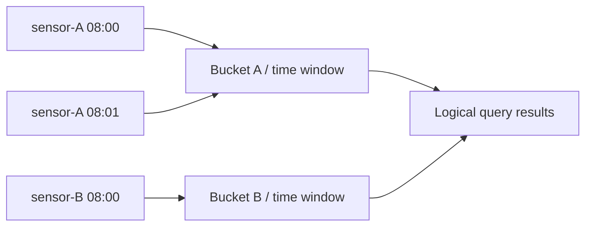

# Version-Specific Limitations on Indexes, Updates, Deletes, and Transactions

MongoDB **time series collections** optimize time-ordered data by grouping measurements with matching `metaField` values and nearby `timeField` timestamps into buckets. This model works well for IoT, metrics, telemetry, sensor logs, and high-volume observational data, yet it is **not fully equivalent to a regular collection** when creating indexes, updating, deleting, or using transactions.

The easiest mistake to make is overlooking **how capabilities change across MongoDB Server versions**: 5.0 is largely insert/read only; 5.1 allows restricted updates/deletes; 6.0 expands secondary indexes; 6.3 adds a default compound index; 7.0 relaxes deletes and adds partial TTL; newer versions still retain strict update and transaction constraints. Spring Data MongoDB issues commands to the server and cannot make prohibited commands valid.

This lesson belongs to the **Time series** chapter of module `SPRING_DATA_MONGODB`. The module covers connecting and mapping documents, working with `MongoTemplate` or repositories, designing queries, aggregations, indexes, transactions, reactive access, testing, and performance diagnostics. The sole focus of this lesson is **version-specific limitations on indexes, updates, deletes, and transactions** in MongoDB time series and how to use them properly from Spring Data.

> **Foundational rule:** Time series is designed to be **append-oriented**. It has no default unique `_id` index, cannot arbitrarily update measurements like regular documents, cannot write to time series inside a **multi-document transaction**, and requires checking **server binary + Feature Compatibility Version (FCV) + collection options** before using version-dependent features.

## 1. Learning Objectives

After this lesson, you will be able to:

1. Explain bucketing and differences between time series and regular collections.
2. Read the version compatibility matrix from MongoDB 5.0 through 8.3 and current documentation.
3. Inspect server version, FCV, collection options, and the index catalog.
4. Create a time series collection via `db.createCollection` or `CollectionOptions.timeSeries(...)`.
5. Distinguish `timeField`, `metaField`, and measurement fields.
6. Understand why time series does not create an `_id` index by default like regular collections.
7. Know the default compound metadata/time index introduced in 6.3.
8. Know secondary indexes on measurement fields expanded in 6.0.
9. Avoid prohibited index types, notably `unique` and `text`.
10. Design collection-level TTL and 7.0+ partial TTL.
11. Use `updateMany` solely to modify metadata within server constraints.
12. Distinguish `updateFirst`, `updateMulti`, `upsert`, and replacement updates.
13. Understand restricted `deleteMany` before 7.0 and `deleteOne`/`deleteMany` from 7.0 onward.
14. Distinguish asynchronous TTL from manual deletes.
15. Explain why transactional reads are allowed while transactional writes are prohibited.
16. Understand why `@Transactional` does not override MongoDB Server constraints.
17. Avoid relying on `MongoRepository.save` and `@Version` for mutable time series.
18. Choose strategies for fixing bad measurements via appended corrections or rebuilds.
19. Write Spring Data integration tests targeting specific server versions.
20. Inspect `explain`, FCV compatibility, and downgrade risks.

## 2. Version Compatibility Matrix

The milestones below come from the MongoDB Server Manual and Release Notes. In production, consult the documentation for your **exact version**, because newer branches, FCV, and topology can change specific conditions.

| Version | Notable index changes | Update | Manual delete | Write in transaction |
| --- | --- | --- | --- | --- |
| **MongoDB 5.0** | Time series introduced; initial indexing capabilities limited | No | No | No |
| **5.1–5.2** | Internals and bucketing improvements | Match/modify `metaField` only, `multi:true` | Restricted to `metaField` filter, `deleteMany` | No |
| **6.0–6.2** | Secondary indexes on **measurement fields** | Metadata only under restrictions | Still restricted to metadata filters and multi-deletes | No |
| **6.3–6.x** | Default compound index `metaField + timeField` on eligible new collections | Still meta-only | Still 5.1–6.x style restrictions | No |
| **7.0–7.x** | Partial TTL on `metaField` | Still meta-only | Significantly relaxed: `deleteOne`/`deleteMany`, diverse filter fields | No |
| **8.0–8.2** | Index/FCV rules per 8.x branch | Manual updates still require meta-only | Follows expanded 7.0 semantics | No |
| **8.3+ / current manual** | Additional restrictions on `_id_` index name/hint; check exact manual version | Manual still documents meta-only restrictions | Check methods/FCV of running branch | Manual still states no time series writes in transactions |

**Do not conflate two independent changes:** MongoDB 7.0 relaxing **deletes** does not make `updateOne` or modifying `temperatureC` a supported update operation. This is a common misunderstanding when reading release notes.

### 2.1. Binary Version Differs from Feature Compatibility Version

A cluster whose MongoDB binaries were upgraded without upgrading FCV may not yet enable all behaviors and features of the newer version. Secondary indexes using newer features can cause **FCV downgrade to fail** if left unhandled. Always check both.

### 2.2. Spring Data Version Does Not Dictate MongoDB Server Features

`MongoTemplate.updateMulti` compiles across many Spring Data versions. Yet MongoDB 5.0 does not support manual time series updates, and MongoDB 8.x still enforces restrictions on which fields can be modified. **The driver/library never substitutes for server capability checks.**

## 3. Checking Version, FCV, and Options

In `mongosh` connected to the target cluster and database:

```javascript
db.version();
db.adminCommand({ buildInfo: 1 });

// Requires appropriate role to inspect FCV.
db.adminCommand({
  getParameter: 1,
  featureCompatibilityVersion: 1
});

// Time series or regular? Which timeField/metaField?
db.getCollectionInfos({ name: "sensor_readings" });

// Indexes actually present:
db.sensor_readings.getIndexes();
```

Never run `setFeatureCompatibilityVersion` or `rs.reconfig` in production casually to test a feature. These are high-impact administrative operations requiring a dedicated runbook.

### 3.1. Reading Collection Options Output

A valid time series collection has `options.timeseries` listing the corresponding `timeField`, `metaField`, and granularity. If a collection already exists as regular because an insert ran before migration, adding a Java annotation will not convert it into time series.

### 3.2. Collection Type Cannot Be Changed Arbitrarily

You choose the collection type only at creation time. You cannot directly convert a regular collection to time series or vice versa by changing the `@Document` annotation; to switch, create a new namespace and migrate data with a backup and validation plan.

## 4. Creating Time Series and Sample Documents

Example on a dedicated test database:

```javascript
use time_series_lab

db.createCollection("sensor_readings", {
  timeseries: {
    timeField: "observedAt",
    metaField: "sensorId",
    granularity: "minutes"
  },
  expireAfterSeconds: 60 * 60 * 24 * 30
});

db.sensor_readings.insertMany([
  {
    _id: "A-001",
    sensorId: "sensor-A",
    observedAt: ISODate("2026-11-20T08:00:00Z"),
    temperatureC: 27.2,
    humidityPct: 61
  },
  {
    _id: "A-002",
    sensorId: "sensor-A",
    observedAt: ISODate("2026-11-20T08:01:00Z"),
    temperatureC: 27.6,
    humidityPct: 60
  },
  {
    _id: "B-001",
    sensorId: "sensor-B",
    observedAt: ISODate("2026-11-20T08:00:00Z"),
    temperatureC: 29.1,
    humidityPct: 57
  }
]);
```

This is **synthetic data for learning syntax**, not verified real-world measurements. Note that string `_id` values in the example are solely for readability and do not imply the server creates a unique time series index.

| Field | Role |
| --- | --- |
| `observedAt` | `timeField`, BSON Date of the measurement |
| `sensorId` | `metaField`, identifies the source/sensor |
| `temperatureC`, `humidityPct` | Measurement values |
| `granularity` | Parameter optimizing bucket timespan |
| `expireAfterSeconds` | Collection-wide TTL, processed by buckets |

### 4.1. Why Can't `timeField`/`metaField` Be Changed After Creation?

MongoDB does not allow modifying a collection's `timeField` and `metaField` options after creation. Certain granularity or bucket parameters can be increased within defined bounds via `collMod`, but domain schema changes must never be treated as risk-free edits.

### 4.2. Buckets Are the Unit of Optimization



MongoDB packs multiple measurements into buckets. Indexing, retention, and deletion effects can occur at bucket granularity, differing from the intuition that "each document is kept or deleted independently on the dot."

## 5. Spring Data: `@TimeSeries` and `CollectionOptions`

Spring Data MongoDB offers the `@TimeSeries` annotation and `CollectionOptions.timeSeries(...)` for explicit provisioning.

```java
package dev.learning.telemetry;

import java.time.Instant;
import org.springframework.data.annotation.Id;
import org.springframework.data.mongodb.core.mapping.TimeSeries;

@TimeSeries(
    collection = "sensor_readings",
    timeField = "observedAt",
    metaField = "sensorId"
)
public record SensorReading(
    @Id String id,
    Instant observedAt,
    String sensorId,
    double temperatureC,
    int humidityPct
) {}
```

Create the collection before ingesting (in a migration or test fixture, never on every request):

```java
import org.springframework.data.mongodb.core.CollectionOptions;

// MongoTemplate has already been injected.
mongoTemplate.createCollection(
    "sensor_readings",
    CollectionOptions.timeSeries(
        "observedAt",
        options -> options.metaField("sensorId"))
);
```

Or call `mongoTemplate.createCollection(SensorReading.class)` so Spring Data reads the `@TimeSeries` mapping, if your project setup supports it. When using a reactive template, the collection-creation Publisher must be **subscribed to** in a controlled manner.

### 5.1. Annotations Do Not Automatically Guarantee the Right Collection

`@TimeSeries` describes mapping metadata, yet the application must still provision the actual time series collection. If an earlier insert accidentally created a regular collection, code continues running without time series bucketing, indexing, or TTL semantics.

### 5.2. Why Prefer `insert` Over `save`?

Time series data is **append-oriented**. `mongoTemplate.insert(reading)` or repository `insert` expresses that intent accurately. `save` often carries update/replace/upsert semantics for existing records, running into time series server restrictions. Do not use `@Version` assuming all time series measurements support optimistic locking.

## 6. Indexes Operate on Buckets, Unlike Regular Collections

A MongoDB logical time series collection returns individual measurements to the application, while the storage engine groups them by `metaField` and `timeField` windows. Starting in MongoDB 6.0, secondary indexes on measurement fields can leverage **bucket min/max values** to prune irrelevant buckets before unpacking and checking measurements.

```javascript
db.sensor_readings.find({
  sensorId: "sensor-A",
  observedAt: {
    $gte: ISODate("2026-11-20T00:00:00Z"),
    $lt: ISODate("2026-11-21T00:00:00Z")
  }
}).sort({ observedAt: 1 });
```

### 6.1. Choosing Indexes by Query Pattern

For most telemetry workloads, the dominant query filters by **sensor or tenant+sensor** over a time window. Therefore, evaluate a `sensorId + observedAt` index before creating any measurement-value indexes.

Do not judge solely by `keysExamined` being zero or a single plan name; measure buckets/measurements unpacked, latency, and write overhead on a representative dataset.

### 6.2. Never Access `system.buckets` Directly

MongoDB manages internal bucket storage. Avoid operating directly on `system.buckets.*` from application code to bypass update/delete restrictions. Doing so can violate invariants, break upgrades, and is not a supported application API.

## 7. Default Metadata/Time Index from MongoDB 6.3

**MongoDB 6.3+** creates a default **compound index** on `metaField` and `timeField` for new time series collections that declare metadata. Before adding your own index, inspect existing ones:

```javascript
db.sensor_readings.getIndexes();
```

A manual creation command if an appropriate index is missing:

```javascript
db.sensor_readings.createIndex(
  { sensorId: 1, observedAt: 1 },
  { name: "sensor_time_lookup" }
);
```

Do not blindly add another index with the same key pattern under a different name in a migration: duplicate or near-duplicate indexes may be rejected or add unnecessary write overhead.

### 7.1. Older Collections After Upgrade

Do not assume every collection created in MongoDB 5.x/6.0 is automatically backfilled with the new index immediately upon upgrading binaries to 6.3+. Inspect the index catalog in the upgraded database and provision missing indexes when needed.

### 7.2. Collections Without `metaField`

Without `metaField`, there is no corresponding metadata/time pair for that compound index. A standalone `timeField` index may be needed, while also re-evaluating your bucketing model and source cardinality.

## 8. Secondary Indexes on Measurement Fields from 6.0

Starting in **MongoDB 6.0**, MongoDB permits adding secondary indexes on measurement fields such as `temperatureC`. Run the example below only on a supporting server/FCV:

```javascript
db.sensor_readings.createIndex(
  { temperatureC: 1 },
  { name: "temperature_lookup" }
);

db.sensor_readings.find({
  temperatureC: { $gte: 35 }
});
```

MongoDB maintains secondary indexes at the bucket level; for a measurement field, **bucket min/max** values identify candidate ranges. If values inside a bucket fluctuate widely, many buckets still must be unpacked, so the index may not significantly improve latency.

### 8.1. Do Not Index Every Measurement Field

A sensor may emit dozens of numeric metrics per second; creating 20 single-field indexes forces every insert to maintain all of them. Choose indexes based on query frequency, selectivity, dashboard latency, and ingestion cost.

### 8.2. Queries Typically Filter Metadata First

```javascript
db.sensor_readings.find({
  sensorId: "sensor-A",
  observedAt: {
    $gte: ISODate("2026-11-20T00:00:00Z"),
    $lt: ISODate("2026-11-21T00:00:00Z")
  },
  temperatureC: { $gte: 35 }
});
```

Compare `explain` between the metadata+time index and the measurement index to verify which queries actually benefit. Never assume a `temperatureC` index behaves like a regular B-tree with one entry per measurement.

### 8.3. Special Index Types

Time series imposes specific restrictions on **multikey, partial, sparse, and geospatial indexes**. The MongoDB Manual notes that multikey indexing is restricted to `metaField`; do not copy array-measurement indexes from regular collections as portable patterns. `2dsphere` has supported use cases, yet `$near`/`$nearSphere` cannot be used arbitrarily on time series; when using `$geoNear`, specify `key` and omit `query` inside the stage.

Some documentation sections phrase `2d`/`sparse` support differently across branches/versions. For production, avoid relying on these types without creating and verifying them on your exact server version and FCV.

## 9. Unsupported Indexes and the `_id` Trap

Unlike regular collections, time series collections **do not automatically have an `_id` index** at creation. MongoDB also **does not support unique indexes** or text indexes on time series.

| Assumption | Reality to verify |
| --- | --- |
| `@Id` creates a unique index like regular collections | **No** default unique `_id` index |
| `unique:true` on sensor+time | **Unique indexes not supported** on time series |
| `text` index for notes/comments | **Not supported** |
| `_id_` can always be hinted | **No**; 8.3+ explicitly rejects `_id_` hint/name |
| Measurement fields can be indexed on 5.0 | **No**; expanded starting in 6.0 |
| Default compound metadata+time on every version | Auto-created only from 6.3 under qualifying conditions |

### 9.1. Data Can Contain Duplicate `_id` Values

`@Id` on a Java entity maps to MongoDB `_id`, but there is no default unique index as on regular collections. If the application ingests duplicates, `findById` or `save` can behave unexpectedly.

If business logic strictly requires idempotency or uniqueness, maintain a **regular companion collection with a unique index**, an ingestion registry, or unique event-key enforcement at the boundary instead of expecting time series to enforce it.

### 9.2. MongoDB 8.3 Rules for `_id_` Name and Hint

Current MongoDB Manual documentation states that starting in **MongoDB 8.3**, **creating an index named `_id_` or hinting `"_id_"`** on time series fails with an error. Do not hardcode `hint("_id_")` carried over from regular-collection repositories or query plans into time series.

Even on other versions that allow creating a non-unique index on `_id`, **it does not replace a unique index** and does not make mutable `save` a safe API for time series.

### 9.3. Index Builds on Legacy Mixed-Schema Data

Time series collections created prior to MongoDB 5.2 may contain mixed-schema buckets. When building measurement-field indexes, the server may reject the build until data is remediated. Check `validate`/warnings, take backups, and follow official remediation procedures instead of mutating internal bucket documents from Spring Data.

## 10. TTL and Partial TTL by Version

Collection-wide TTL is configured via `expireAfterSeconds` at creation or via appropriate configuration. MongoDB removes **buckets eligible for expiration** rather than deleting individual measurements at the exact millisecond.

```javascript
db.createCollection("sensor_readings_30d", {
  timeseries: {
    timeField: "observedAt",
    metaField: "sensorId"
  },
  expireAfterSeconds: 30 * 24 * 60 * 60
});
```

### 10.1. Partial TTL from MongoDB 7.0

Starting in **7.0**, you can create a TTL index with a `partialFilterExpression` based on **`metaField`** so one sensor group has shorter retention than another.

```javascript
// MongoDB 7.0+; verify FCV/index options.
db.sensor_readings.createIndex(
  { observedAt: 1 },
  {
    name: "ttl_test_sensor_7d",
    expireAfterSeconds: 7 * 24 * 60 * 60,
    partialFilterExpression: {
      sensorId: "sensor-test"
    }
  }
);
```

**Note:** the partial filter is based on `metaField`; TTL still evaluates age against `timeField`. Do not create arbitrary unique/text/partial indexes expecting regular-collection behavior.

### 10.2. Interaction Between Both Retention Types

If collection TTL is 30 days and partial TTL is 7 days for `sensor-test`, the test group can expire sooner. Partial TTL cannot extend retention for a group already bounded by collection-wide expiration.

### 10.3. TTL Is Not Immediate Deletion

The TTL monitor runs asynchronously and buckets can span differing timestamps. Use TTL for eventual retention, **not** as a substitute for business requirements demanding immediate deletion with synchronous confirmation. For manual deletes, verify MongoDB version constraints.

## 11. Spring Data Index Management and FCV

With Spring Data `MongoTemplate`, indexes are created via `IndexOperations`, for example:

```java
import org.springframework.data.domain.Sort;
import org.springframework.data.mongodb.core.index.Index;

// Run only during migration when the index is missing and version supports it.
mongoTemplate.indexOps(SensorReading.class).ensureIndex(
    new Index()
        .on("sensorId", Sort.Direction.ASC)
        .on("observedAt", Sort.Direction.ASC)
        .named("sensor_time_lookup")
);
```

**Never call `ensureIndex` on every HTTP request.** Check `db.sensor_readings.getIndexes()` first because 6.3+ may already create a helpful compound index.

### 11.1. Annotations Do Not Override Server Restrictions

`@Indexed(unique=true)` on a time series field can still cause index creation to fail. Spring Data cannot "enable unique indexes" where the server forbids them. When auto-index creation is intentionally enabled, test startup carefully to avoid service failure from an incompatible annotation.

### 11.2. Downgrades and Secondary Indexes

If you use index features added in 6.x/7.x and later need to downgrade FCV, MongoDB may require **dropping incompatible secondary indexes** first. Follow a migration plan with backups and rollback steps; never drop production indexes ad hoc just to run an older binary.

## 12. Updates from MongoDB 5.1: Metadata Only

In MongoDB **5.0**, time series essentially allowed only inserts and reads, with **no manual update support**. Starting in **5.1**, updates are permitted under strict constraints:

1. Queries may only match on `metaField`.
2. Only `metaField` may be modified, never `timeField` or measurement fields.
3. Update documents must use **update operator expressions**.
4. Updates must be multi-document (`multi:true` / `updateMany`).
5. `upsert:true` is prohibited.

Valid pattern on supporting servers/FCV:

```javascript
db.sensor_readings.updateMany(
  { sensorId: "sensor-A" },
  { $set: { sensorId: "sensor-renamed-A" } }
);
```

This example updates metadata across **many measurements** carrying `sensorId:"sensor-A"`, not just a single measurement. Verify impact scope before running, especially in multi-tenant datasets.

### 12.1. Why Can't Temperature Be Edited?

```javascript
// Invalid under the restrictions described above:
db.sensor_readings.updateMany(
  { sensorId: "sensor-A" },
  { $set: { temperatureC: 38.1 } }
);
```

`temperatureC` is a measurement field, not `metaField`. The server rejects it with a time series update restriction error. **Upgrading to MongoDB 7.0 does not automatically lift this restriction**; 7.0 changed deletes, not general measurement updates.

### 12.2. Why Can't Updates Filter by Time?

```javascript
// Invalid for meta-only time series updates:
db.sensor_readings.updateMany(
  {
    sensorId: "sensor-A",
    observedAt: {
      $lt: ISODate("2026-11-21T00:00:00Z")
    }
  },
  { $set: { sensorId: "sensor-renamed-A" } }
);
```

Adding `observedAt` to the filter means the query no longer **matches solely on `metaField`**, violating update restrictions. Do not copy complex filters from regular collections to time series updates.

## 13. Update Operations Not to Use as Regular CRUD

| Operation | Compatible with time series rules? | Reason |
| --- | --- | --- |
| `insertOne/insertMany` | Yes | Append-oriented data |
| `updateMany` matching/modifying `metaField` only | Yes from 5.1, within limits | Metadata-only |
| `updateOne` | No under meta-only contract | Multi-updates only |
| `replaceOne`/replacement update | No | Updates must use operators |
| `upsert:true` | No | Server forbids time series upserts |
| `$set: {temperatureC:...}` | No | Measurements are immutable under update rules |
| `$set: {observedAt:...}` | No | `timeField` cannot be modified via update |
| `findOneAndUpdate`/`findAndModify` | Not a valid substitute | Single-document update semantics are incompatible |
| `MongoRepository.save(existing)` | Should not be relied upon | Typically triggers update/replacement/upsert |
| `@Version` optimistic save | Not guaranteed | Cannot bypass time series constraints |

### 13.1. `updateMany` Applies Across `metaField`, Not Specific Times

Changing `sensorId` potentially relabels **every measurement** matching that metadata. If only a single reading is wrong, append a correction or rebuild the dataset rather than trying to filter by `_id` and update the measurement.

### 13.2. Never Silently Swap `updateFirst` for `updateMulti`

If a service previously used `updateFirst` targeting one record, changing it to `updateMulti` can turn a single-measurement change into modifying **thousands of records**. That is a serious data-integrity risk, not a harmless API fix.

## 14. `MongoTemplate.updateMulti`: Controlled Example

Spring Data MongoDB can still use `MongoTemplate.updateMulti` to issue a server-valid update command:

```java
package dev.learning.telemetry;

import org.springframework.data.mongodb.core.MongoTemplate;
import org.springframework.data.mongodb.core.query.Criteria;
import org.springframework.data.mongodb.core.query.Query;
import org.springframework.data.mongodb.core.query.Update;
import com.mongodb.client.result.UpdateResult;

public class SensorMetadataRenamer {

    private final MongoTemplate mongoTemplate;

    public SensorMetadataRenamer(MongoTemplate mongoTemplate) {
        this.mongoTemplate = mongoTemplate;
    }

    public UpdateResult renameSensor(
            String originalSensor, String newSensor) {

        if (originalSensor == null || newSensor == null
                || originalSensor.isBlank()
                || newSensor.isBlank()) {
            throw new IllegalArgumentException("Invalid Sensor ID");
        }

        Query onlyMeta = Query.query(
            Criteria.where("sensorId").is(originalSensor));

        Update onlyMetaUpdate =
            new Update().set("sensorId", newSensor);

        return mongoTemplate.updateMulti(
            onlyMeta,
            onlyMetaUpdate,
            SensorReading.class
        );
    }
}
```

**Important contract:** `renameSensor` can modify metadata on **many measurements**. If the sensor ID sits inside a nested metadata object, verify the exact path mapping and server restrictions. Never accept raw filter/update expressions from HTTP requests.

### 14.1. Checking `UpdateResult`

`matchedCount` reflects documents matched under MongoDB update semantics; `modifiedCount` shows how many measurements were actually modified per driver/server results. Do not use these counts to assume documents were unpacked like an uncompressed regular collection, or treat metadata renaming as a zero-cost operation on large datasets.

### 14.2. Why Not Use `updateFirst`?

`updateFirst` sends single-update semantics, whereas time series update rules require `multi:true`. If business logic needs to fix an individual measurement, do not silently switch to `updateMulti` because it can affect the sensor's entire history.

### 14.3. `ReactiveMongoTemplate`

`ReactiveMongoTemplate.updateMulti(...)` accepts the same `Query`/`Update` and returns `Mono<UpdateResult>`. The operation runs only when subscribed; server errors propagate to `onError`. Never swallow failures with `onErrorResume(Mono.empty())` and report success.

## 15. Deletes on MongoDB 5.0 and 5.1–6.x

**MongoDB 5.0:** Manual writes are limited to insert/read; manual delete is not supported.

**MongoDB 5.1 through pre-7.0:** deletes are partially enabled under two strict conditions:

1. Filters may match only on `metaField`.
2. The command must **delete many**, using `deleteMany` or raw delete with `limit:0`; `deleteOne` is disallowed.

Example on MongoDB 5.1–6.x:

```javascript
// Valid within supported version scope:
db.sensor_readings.deleteMany({
  sensorId: "sensor-test"
});
```

This command can wipe **all measurements belonging to `sensor-test`**, not just one time range. If sensor metadata spans years of history, the data-loss risk is severe; never run in production without verifying scope and having a backup.

### 15.1. Time Filters Are Invalid on Older Versions

```javascript
// INVALID under 5.1 to 6.x delete restrictions:
db.sensor_readings.deleteMany({
  sensorId: "sensor-test",
  observedAt: {
    $lt: ISODate("2026-11-01T00:00:00Z")
  }
});
```

Reason: the filter includes `observedAt` and no longer matches solely on `metaField`. A service needing time-based deletion should use an appropriate TTL/retention policy, or follow an approved MongoDB upgrade when manual selective deletes are required.

### 15.2. `deleteOne` Is Also Invalid on 5.1–6.x

```javascript
// Unsupported on restricted versions:
db.sensor_readings.deleteOne({
  sensorId: "sensor-test"
});
```

Do not simply switch `deleteMany` to `deleteOne` hoping to remove one document. Prior to 7.0, time series delete semantics restrict deletes to multi-deletes by metadata.

## 16. Expanded Deletes Starting in MongoDB 7.0

MongoDB **7.0** lifted **most time-series-specific restrictions** on `delete`-based operations, including `deleteOne`, `deleteMany`, and corresponding bulk deletes.

Example on MongoDB 7.0+:

```javascript
// Can delete by time range, not only metaField.
db.sensor_readings.deleteMany({
  sensorId: "sensor-test",
  observedAt: {
    $lt: ISODate("2026-11-01T00:00:00Z")
  }
});

// Can delete a single matching measurement.
db.sensor_readings.deleteOne({
  sensorId: "sensor-A",
  observedAt: ISODate("2026-11-20T08:01:00Z")
});
```

**However:** you still **cannot perform deletes on time series inside a multi-document transaction**. Lifting filter/limit restrictions does not mean transactional writes are supported.

### 16.1. Is `deleteOne` Safe by ID?

Time series has no default unique `_id` index. If the filter is merely `{ _id: "A-001" }` and duplicates exist, `deleteOne` may delete **one matching document** without guaranteeing uniqueness per business expectations. Combine metadata/time and proper ingestion identity, and verify counts and permissions before deleting.

### 16.2. Do Not Confuse Relaxed Deletes with Relaxed Updates

`deleteOne` support in 7.0+ **does not mean** `updateOne` to modify temperature is supported. The MongoDB Manual still specifies that updates must be meta-only, multi, and non-upsert across the referenced versions.

### 16.3. Deletes and Bucket Repacking

Deleting a measurement from a bucket may force the server to repack the remaining bucket; if all measurements in a bucket are deleted, the server can remove the bucket. Do not estimate delete cost from a single regular-collection record. Test with realistic data volumes and watch latency.

## 17. Spring Data Deletes by Version

When deleting an entire metadata group on MongoDB 5.1–6.x, `MongoTemplate.remove(Query, Class)` issues corresponding multi-delete semantics:

```java
import org.springframework.data.mongodb.core.query.Criteria;
import org.springframework.data.mongodb.core.query.Query;
import com.mongodb.client.result.DeleteResult;

Query onlyMetadata = Query.query(
    Criteria.where("sensorId").is("sensor-test"));

DeleteResult result =
    mongoTemplate.remove(onlyMetadata, SensorReading.class);
```

Verify driver method mapping and permissions in integration tests against the exact server version. `remove` can delete **many measurements**, so do not treat it as "delete one record" by default.

### 17.1. Delete by Time on 7.0+

```java
import java.time.Instant;

Query oldData = Query.query(
    Criteria.where("sensorId").is("sensor-test")
        .and("observedAt").lt(
            Instant.parse("2026-11-01T00:00:00Z")));

DeleteResult deleted =
    mongoTemplate.remove(oldData, SensorReading.class);
```

Spring Data maps `Instant` to BSON Date via its converter; verify timezone and formatting. This query is **not compatible with MongoDB 5.1–6.x** under older delete restrictions.

### 17.2. Never Assume `repository.deleteById` Is Always Safe

Derived repository deletes and `deleteById` can generate differing commands/filters across versions and implementations, and time series `_id` lacks a default unique constraint. Inspect the actual command, delete behavior, and version compatibility; prefer explicit `MongoTemplate` or driver operations when controlled semantics are essential.

### 17.3. Bulk Deletes Carry Risk

Deleting many measurements can affect many buckets. Restrict callers, validate tenant/sensor/time filters, consider read/write load, and never allow an unbounded synchronous HTTP request to purge millions of documents without quotas.

## 18. Transactions: Reads Allowed, Writes Prohibited

According to the current MongoDB Manual, **you cannot write to time series collections inside multi-document transactions**. This includes:

- Inserting measurements into a time series collection inside a transaction.
- Updating time series metadata inside a transaction.
- Deleting measurements from a time series collection inside a transaction.

**Reading** from time series inside a transaction **is supported**, subject to relevant read concern and snapshot restrictions. State this distinction clearly; never make a blanket claim that "time series does not support transactions" and assume reads are banned as well.

### 18.1. Anti-Pattern: Inserting Inside `@Transactional`

```java
import org.springframework.transaction.annotation.Transactional;

@Transactional
public void recordMeasurement(SensorReading reading) {
    mongoTemplate.insert(reading); // Time series write inside tx.
}
```

Assuming a real transaction is opened via `MongoTransactionManager` on a replica set, the server rejects the time series write per the rules above. Simply adding `@Transactional` cannot enable prohibited atomic writes.

### 18.2. When `@Transactional` Silently Does Nothing

If the application **has no `MongoTransactionManager` configured** or calls bypass the Spring AOP proxy, `@Transactional` may not actually start a MongoDB transaction. An insert "succeeding" does not prove time series supports transactional writes; verify actual `ClientSession` and transaction boundaries in tests.

### 18.3. Reading Inside Transactions

`mongoTemplate.find(query, SensorReading.class)` can run inside a read-only MongoDB transaction when topology, read concern, and other constraints are satisfied. Never infer from this that **writing** measurements in the same transaction is allowed.

### 18.4. Snapshot Isolation and Concurrent DDL

MongoDB notes that snapshot reads on time series have limitations if the collection is concurrently dropped, renamed, or recreated. Do not treat snapshot isolation as covering concurrent DDL operations of that kind.

## 19. Single-Insert Atomicity and Distributed Workflows

MongoDB preserves single-document operation atomicity per storage rules. However, time series bucketing has specialized internal behavior; never treat `insertMany` as a distributed transaction spanning other collections simply because MongoDB writes compressed buckets.

When business logic needs to update `orders` and record a measurement/telemetry event together, decide carefully:

| Requirement | Recommended approach |
| --- | --- |
| Record measurement as log/event, eventual consistency acceptable | Insert into time series **outside the transaction** after confirmation |
| Atomicity between business write and event emission | **Transactional outbox** in a regular collection, relayed separately |
| Transactions across multiple mutable records | Store them in **regular collections** with transaction support |
| Editing measurements and auditing every change | Mutable regular collection + history, or appended corrections |
| High-volume observation retention | Time series TTL + data reconciliation |

### 19.1. Transactional Outbox Is Not Inserting Both Collections in One Tx

A transaction can write the business document and an outbox record into **regular collections**. After commit, a relay reads the outbox and inserts the measurement into time series or publishes a message. If the relay crashes, retries and idempotency handle duplicate risk; never advertise unverified "exactly-once" guarantees.

### 19.2. Never Disable Transactions Casually to Hide Errors

When a time series insert fails inside a transaction, moving the call outside the transaction **changes consistency semantics**. Review business invariants and error handling instead of merely deleting `@Transactional` and treating the issue as solved.

## 20. Designing Corrections for Erroneous Measurements

A classic scenario: `sensor-A` sent temperature `270.0` instead of `27.0`. In a regular collection you could run `updateOne({_id}, {$set:{temperatureC:27}})`, whereas under time series meta-only rules, **direct measurement updates like that are unavailable**.

Options:

1. **Append correction:** write a new correction record carrying `correctionOf`/`revision` and select the latest revision at the query layer.
2. **Sidecar corrections collection:** store corrections keyed by event identity in a regular collection and apply them at read/aggregation time.
3. **Re-ingest/migrate:** create a new time series collection, clean/filter out bad records, migrate, and perform a planned cutover.
4. **Separate mutable state:** store frequently edited data in regular collections; keep time series strictly for observation history.

### 20.1. Correction Event Example

```javascript
db.sensor_corrections.insertOne({
  readingKey: {
    sensorId: "sensor-A",
    observedAt: ISODate("2026-11-20T08:00:00Z")
  },
  correctedTemperatureC: 27.0,
  reason: "sensor calibration",
  correctedAt: new Date()
});
```

`sensor_corrections` is a **regular collection** with its own indexes and authorization; it does not mutate the measurement in time series. Queries and reports must define clear join/overlay rules and audit history.

### 20.2. Is Delete-Then-Insert Transactional?

On MongoDB 7.0+, you can delete a measurement by filter and insert a corrected one, but **you cannot wrap both time series writes in a multi-document transaction**. A window of inconsistency exists between them; implement reconciliation or versioned datasets if atomic visibility is required.

## 21. `@Version`, Optimistic Locking, and Repository `save`

Spring Data repositories cut boilerplate but do not erase MongoDB Server boundaries:

- `@Version` normally relies on expected version checks and update semantics.
- `MongoRepository.save(existing)` can issue replace, upsert, or update commands.
- Time series meta-only update rules forbid typical mutation paths.
- `_id` lacks a default unique index and therefore cannot enforce uniqueness guarantees.
- Update/delete commands can affect many measurements sharing a metadata group.

**Therefore:** for time series, prefer repository `insert` and read queries; use explicit `MongoTemplate` calls for metadata updates or version-appropriate deletes. Never build a "full CRUD" API atop time series if the domain genuinely requires mutable entities.

### 21.1. Never Use `@Id` as a Unique Business Key

If idempotency logic merely checks `repository.existsById(id)` and then inserts, two concurrent writers can still insert the same `_id` because there is no default unique index enforcing it. Use a deduplication registry with a unique key in a regular collection or an ingestion pipeline with proper guarantees.

### 21.2. Time Series Does Not Fit Every Model

Data such as users, orders, workflow states, cart items, or documents requiring frequent per-field updates should not be moved to time series simply because they contain a `createdAt` field.

## 22. Testing Server Capabilities Rather Than Just Java APIs

A unit test using Mockito can prove `MongoTemplate.updateMulti` was invoked, but it **does not** prove MongoDB Server accepts a time series update. For version-dependent features, write **integration tests connecting to the exact target server binary and FCV**.

Test categories:

| Test | Input / condition | Expected outcome |
| --- | --- | --- |
| Time series collection created | `getCollectionInfos` returns `timeseries` | Correct storage type |
| Insert and time-range query | On MongoDB 5.0+ | Succeeds |
| Measurement secondary index | MongoDB 6.0+ | Supported index created |
| Unique index | Referenced versions | Rejected by server |
| Text index | Referenced versions | Rejected by server |
| Metadata `updateMany` | MongoDB 5.1+ | Succeeds under meta-only rules |
| Measurement `updateMany` | Referenced manual versions | Rejected by server |
| `updateOne`/upsert | Meta-only update contract | Invalid |
| `deleteMany` by metadata | MongoDB 5.1+ | Succeeds with valid filter |
| `deleteOne` by timestamp | MongoDB 7.0+ | Succeeds with valid syntax/permissions |
| `deleteMany` by time on 6.x | Metadata-only delete restriction | Rejected |
| Partial TTL | MongoDB 7.0+ | Index created with meta filter |
| Write in transaction | Referenced versions | Rejected |
| Read in transaction | Valid replica set/tx config | Allowed per limitations |
| Hint `_id_` | MongoDB 8.3+ | Rejected per manual |

### 22.1. Avoid "Works on My Machine" Mismatches with Production

If local development runs MongoDB 8.0 while production runs 6.0, a `deleteOne` test passes locally and fails in production. Pin **MongoDB test image versions** per deployment target and record FCV in test reports.

### 22.2. Do Not Assert Exact Error Message Text

Error messages and codes can vary across MongoDB versions and Spring Data exception translation. Assert the **exception class/category**, rejected operation, and unchanged database state; do not couple tests to exact English error strings.

## 23. Testcontainers: Testing Example on MongoDB 8.0

Example using **Spring Boot 3.x + Testcontainers Java 1.x** on an isolated test database. `MongoDBContainer` starts a single-node replica set suitable for testing transaction limitations and time series:

```java
package dev.learning.telemetry;

import static org.assertj.core.api.Assertions.*;

import java.time.Instant;
import java.util.List;
import java.util.UUID;

import org.bson.Document;
import org.junit.jupiter.api.BeforeEach;
import org.junit.jupiter.api.Test;
import org.springframework.beans.factory.annotation.Autowired;
import org.springframework.boot.test.context.SpringBootTest;
import org.springframework.data.mongodb.core.CollectionOptions;
import org.springframework.data.mongodb.core.MongoTemplate;
import org.springframework.data.mongodb.core.query.Criteria;
import org.springframework.data.mongodb.core.query.Query;
import org.springframework.data.mongodb.core.query.Update;
import org.springframework.test.context.DynamicPropertyRegistry;
import org.springframework.test.context.DynamicPropertySource;
import org.testcontainers.containers.MongoDBContainer;
import org.testcontainers.junit.jupiter.Container;
import org.testcontainers.junit.jupiter.Testcontainers;
import org.testcontainers.utility.DockerImageName;

@Testcontainers
@SpringBootTest
class TimeSeriesCompatibilityIntegrationTest {

    @Container
    static final MongoDBContainer mongo =
        new MongoDBContainer(DockerImageName.parse("mongo:8.0"));

    @DynamicPropertySource
    static void mongoProperties(DynamicPropertyRegistry registry) {
        // Spring Boot 3.x property; check namespace on newer Boot versions.
        registry.add("spring.data.mongodb.uri",
            mongo::getReplicaSetUrl);
    }

    @Autowired MongoTemplate template;

    @BeforeEach
    void provisionCollection() {
        if (!template.collectionExists("sensor_readings")) {
            template.createCollection(
                "sensor_readings",
                CollectionOptions.timeSeries(
                    "observedAt",
                    options -> options.metaField("sensorId")));
        }
        // Production-like tests should verify capped/time-series metadata.
    }

    @Test
    void allowsMetadataUpdateMany() {
        String key = UUID.randomUUID().toString();
        String before = "sensor-before-" + key;
        String after = "sensor-after-" + key;

        template.insert(new SensorReading(
            "READING-" + key,
            Instant.parse("2026-11-20T08:00:00Z"),
            before,
            27.1,
            60));

        var updated = template.updateMulti(
            Query.query(Criteria.where("sensorId").is(before)),
            new Update().set("sensorId", after),
            SensorReading.class);

        assertThat(updated.getModifiedCount())
            .isGreaterThanOrEqualTo(1L);

        List<SensorReading> reloaded = template.find(
            Query.query(Criteria.where("sensorId").is(after)),
            SensorReading.class);

        assertThat(reloaded)
            .extracting(SensorReading::id)
            .contains("READING-" + key);
    }

    @Test
    void rejectsMeasurementUpdate() {
        String key = UUID.randomUUID().toString();
        String sensor = "sensor-test-" + key;

        template.insert(new SensorReading(
            "READING-" + key,
            Instant.parse("2026-11-20T08:10:00Z"),
            sensor,
            27.1,
            60));

        assertThatThrownBy(() ->
            template.updateMulti(
                Query.query(Criteria.where("sensorId").is(sensor)),
                new Update().set("temperatureC", 99.0),
                SensorReading.class))
            .isInstanceOf(RuntimeException.class);

        SensorReading actual = template.findOne(
            Query.query(Criteria.where("sensorId").is(sensor)),
            SensorReading.class);

        assertThat(actual).isNotNull();
        assertThat(actual.temperatureC()).isEqualTo(27.1);
    }
}
```

**Explanation:** The test fixture uses UUIDs to isolate data. Running it requires Spring Data, JUnit, AssertJ, and MongoDB Testcontainers dependencies. If your project uses Testcontainers 2.x, module names and imports may differ. Run only against a test database; never call `dropCollection` on a shared namespace.

### 23.1. Why Doesn't One Test Prove All Versions?

The container pins **MongoDB 8.0** only. It tests 8.0, not the 5.x/6.x/7.x matrix. To verify an assumption about 6.0 or 7.0, run separate tests against those images/versions and verify their FCV.

### 23.2. `@TimeSeries` Configuration Must Be Loaded

The test uses `SensorReading` and `@TimeSeries` from section 5. The application must discover entities, repositories, and mappings in the right packages. If a regular collection with the same name was already created by another fixture, `collectionExists` alone does not prove the right storage type; inspect `getCollectionInfos` during setup.

### 23.3. Gradle Test Execution Not Assumed During Authoring

These examples are guides for learners to execute in a test environment with MongoDB/Docker. Authoring Markdown documentation does not imply Testcontainers or Docker was executed in the workspace.

## 24. Delete Compatibility Test: 6.x vs. 7.x

A practical compatibility test should provision **two test environments running different versions** (or a CI test matrix), run the same dataset, and compare outcomes.

```javascript
// Test fixture: run only on a test database.
db.sensor_readings.insertMany([
  {
    sensorId: "sensor-delete-test",
    observedAt: ISODate("2026-01-01T00:00:00Z"),
    temperatureC: 20
  },
  {
    sensorId: "sensor-delete-test",
    observedAt: ISODate("2026-02-01T00:00:00Z"),
    temperatureC: 21
  }
]);
```

On **MongoDB 6.x**:

```javascript
// Can delete the entire metadata group:
db.sensor_readings.deleteMany({
  sensorId: "sensor-delete-test"
});

// Cannot use deleteOne or observedAt filter for time series deletes.
```

On **MongoDB 7.0+**:

```javascript
// Can selectively delete one measurement by time:
db.sensor_readings.deleteOne({
  sensorId: "sensor-delete-test",
  observedAt: ISODate("2026-01-01T00:00:00Z")
});
```

Run both examples against **separate test datasets or reset fixtures**; deleting the whole group first leaves zero matches for the subsequent selective delete.

### 24.1. The Difference Is on the Server, Not Driver Syntax

Both commands are standard MongoDB delete commands. A driver may expose `deleteOne` in earlier releases, yet MongoDB 6.x still rejects it on time series due to collection-type restrictions. Having the API in Java does not prove the server supports it.

### 24.2. Testing Deleted Count

Inspect `deletedCount`/`DeleteResult` and verify the remaining documents. Never assert solely that the command did not throw, because a wrong filter or tenant mismatch can yield zero deletions without raising an exception.

## 25. Performance, `explain`, and Capacity

Time series buckets often reduce storage and index footprints and speed up metadata+time queries, but they do not guarantee every query outperforms a regular collection.

```javascript
db.sensor_readings.explain("executionStats").find({
  sensorId: "sensor-A",
  observedAt: {
    $gte: ISODate("2026-11-20T00:00:00Z"),
    $lt: ISODate("2026-11-21T00:00:00Z")
  },
  temperatureC: { $gte: 30 }
});
```

Observe:

- Which index was chosen, especially metadata/time vs. measurement indexes.
- Keys/buckets/documents examined compared to measurements returned.
- Unpack/filter duration and conversion overhead in Spring Data.
- Ingestion latency before and after adding indexes.
- Query plans for high- and low-cardinality sensors.
- Selectivity of the time range and measurement threshold.
- TTL backlog and deletion/repacking work.
- Impact of large manual deletes or updates.
- Disk space and cache footprint after migration.
- Performance after FCV or index catalog changes.

### 25.1. Never Compare Index Counts Naively Against Regular Collections

Time series stores internal buckets; a measurement index can represent bucket-level min/max bounds. Therefore, "fewer index entries" does not automatically mean faster latency for every query. Benchmark representative workloads and inspect `explain`.

### 25.2. Measurements with Very Distant Timestamps

MongoDB notes special considerations for `timeField` values before **1970-01-01** or after **2038-01-19**: creating an index on `timeField` may be needed to improve query optimization. Do not assume historical or far-future timestamps optimize identically to current timestamps.

### 25.3. Time Series Differs from an Append-Only Event Store

Time series retention and bucketing serve time-oriented measurements. If you need a tamper-resistant audit trail, strict ordering, exactly-once messaging, consumer offsets, or transactions with business entities, combine an event store, outbox, or broker rather than forcing everything into time series.

## 26. Security and Multi-Tenancy

Control not only indexes and queries, but also the risk of **accidentally updating or deleting an entire metadata group**.

### 26.1. Metadata-Only Updates Can Affect Multiple Tenants

If `sensorId` is not globally unique across tenants and a query filters only `{ sensorId: "A" }`, `updateMany` will modify data across multiple tenants. Design `metaField` to include tenant identity (such as `meta: { tenantId, sensorId }`) and enforce verified query/authorization policies. Since time series updates match only on `metaField`, verify that your paths and queries conform to your server version.

### 26.2. Never Accept Raw Queries or Filters from Clients

Do not let clients submit raw `Query`/`Update` payloads that bypass validation. Validate IDs, roles, timestamps, and delete ranges; use explicit DTOs or authorized business commands. For bulk deletions, enforce quotas, approvals, and audit logging of validated criteria.

### 26.3. Do Not Log Sensitive Measurements

Telemetry can reveal locations, health metrics, or operational secrets. When debugging update/delete failures, avoid dumping entire documents into logs. Prefer correlation IDs, normalized tenant IDs, command type, server version, matched/modified/deleted counts, and exception category.

## 27. Common Pitfalls

| Symptom | Cause | Fix |
| --- | --- | --- |
| `@TimeSeries` present, no bucketing | Collection exists as regular | Inspect `getCollectionInfos`, migrate |
| Creating unique index fails | Time series forbids unique indexes | Regular companion collection / ingest dedup |
| Text index rejected | Text indexes unsupported | Search in a separate system or regular collection |
| Measurement index fails on 5.x | Added in 6.0 | Upgrade appropriately or redesign |
| Mixed-schema index build error | Legacy buckets prior to 5.2 | Backup + official remediation |
| `hint("_id_")` fails on 8.3+ | Server restricts name/hint | Remove hint or use another valid index |
| `_id` lookup returns duplicates | No default unique `_id` index | Deduplicate on business key |
| `updateFirst` fails | Multi-update required | Meta-only `updateMulti` if domain allows |
| `updateMany` on temperature fails | Only `metaField` can be modified | Append correction / re-ingest |
| `upsert` fails | Time series updates disallow upsert | Insert separately with idempotency |
| Update filter on `observedAt` fails | Match restricted to `metaField` | Redesign operation |
| `deleteOne` fails on MongoDB 6.x | Single-document delete unsupported | Upgrade to 7.0+ or use TTL/alternate storage |
| `deleteMany` by time fails on 6.x | Filter restricted to `metaField` | Use TTL or upgrade server |
| `deleteOne` on 7.x behaves unexpectedly | Non-unique filter with duplicates | Verify data, key, and permissions |
| Transactional write fails | Time series writes unsupported in tx | Outbox / regular collection |
| Read transaction mistakenly assumed banned | Confused reads and writes | Reads are allowed under conditions |
| TTL did not delete on the exact hour | Asynchronous bucket expiration | Monitor TTL and bucket spans |
| Partial TTL fails to create on 6.x | Feature introduced in 7.0 | Check version and FCV |
| FCV downgrade blocked | Incompatible index features | Migrate/drop indexes with backup |
| Queries slow despite measurement index | Poor bucket min/max selectivity | Run `explain`, add metadata+time index |
| Spring repository `save` fails | Replacement/upsert invalid | Append inserts, explicit operations |
| Deleting one sensor wipes too much data | Broad metadata group | Check count/scope before deleting |

### 27.1. Ordered Debugging Checklist

1. Check the exact MongoDB binary version and FCV on the target server/cluster.
2. Verify the collection has valid `timeseries.timeField` and `metaField`.
3. Inspect `getIndexes`, default indexes, and indexes added after upgrades.
4. Is the operation `insert`, `updateMany`, `updateOne`, `deleteOne`, or `deleteMany`?
5. For updates: are both the filter and modified fields strictly within `metaField`?
6. For deletes: is the server 7.0+ or still 5.1–6.x?
7. Does `@Transactional` actually open a MongoDB transaction?
8. Are unsupported unique/text indexes, hints, or TTL indexes being used?
9. Could object/key collisions span multiple tenants?
10. Are there legacy mixed-schema buckets or FCV downgrade constraints?
11. What do `explain` bucket scans and latency show?
12. Does re-reading from the database reflect the expected state?

## 28. Practice Exercises

**Exercise 1 — Versions.** Run `db.version()`, `buildInfo`, and `featureCompatibilityVersion` on a test database. Why is knowing only the binary version insufficient?

**Exercise 2 — Create collection.** Provision `sensor_readings` with `timeField=observedAt`, `metaField=sensorId`, and 3 sample records; verify with `getCollectionInfos`.

**Exercise 3 — Default index.** Inspect `getIndexes` on a new time series collection created on MongoDB 6.3+; compare with one created on an older version.

**Exercise 4 — Measurement index.** On MongoDB 6.0+, create an index on `temperatureC`. Use `explain` to compare it against the metadata+time index.

**Exercise 5 — Unique constraint.** Attempt to create a unique sensor/time index on a test collection; explain why a regular companion registry is needed.

**Exercise 6 — `_id`.** Explain why `@Id` does not guarantee a default unique index in time series, and describe the risk from concurrent producers.

**Exercise 7 — Metadata update.** On 5.1+, use `updateMany` to rename `sensorId` for one metadata group. Verify the count of affected measurements.

**Exercise 8 — Measurement update.** Attempt to modify `temperatureC` via `$set`; record the error and design a correction record instead.

**Exercise 9 — `updateFirst`.** Analyze why `MongoTemplate.updateFirst` does not satisfy multi-update restrictions.

**Exercise 10 — Legacy delete.** On MongoDB 6.x, test `deleteMany` by sensor and `deleteOne`; explain the outcomes.

**Exercise 11 — 7.0+ delete.** Delete one reading by sensor+timestamp and read back the result; never run on production.

**Exercise 12 — TTL.** Create a collection with 30-day retention; explain why TTL does not guarantee deletion at the exact second of expiration.

**Exercise 13 — Partial TTL.** On MongoDB 7.0+, configure shorter retention for `sensor-test` using a metadata filter.

**Exercise 14 — Transactions.** On a test replica set, configure `MongoTransactionManager` and attempt a time series insert inside `@Transactional`. Contrast with a read-only transaction.

**Exercise 15 — Outbox.** Design an atomic write for order+outbox in regular collections, then relay the measurement after commit.

**Exercise 16 — FCV.** Write a checklist of secondary indexes to review before downgrading; distinguish backup, migration, and rollback.

**Exercise 17 — Time range.** Explain why measurement `timeField` values far outside 1970–2038 may need a dedicated index.

**Exercise 18 — Multi-tenancy.** Update metadata safely when two tenants share sensor IDs. Design the metadata schema and safe filter.

**Exercise 19 — Model choice.** If an entity updates state daily, why is a regular collection usually a better fit than time series?

**Exercise 20 — Test matrix.** Write a test plan covering MongoDB 6.0/7.0/8.0 with expected outcomes for indexes, updates, deletes, and transactional writes.

## 29. Pre-Deployment Checklist

- [ ] Know both the MongoDB Server binary version **and FCV**.
- [ ] Confirm the collection actually has `timeseries.timeField` and `metaField` matching the schema.
- [ ] Do not treat the `@TimeSeries` Java annotation as automatic migration.
- [ ] Use a BSON Date `timeField` and metadata with controlled cardinality.
- [ ] Design ingestion as append-oriented rather than uncontrolled mutable CRUD.
- [ ] Do not assume `_id` has a default unique index.
- [ ] Do not create unsupported unique/text indexes.
- [ ] Add measurement indexes only on 6.0+ when justified by workload.
- [ ] Check for the default 6.3+ metadata+time compound index.
- [ ] Avoid equivalent/redundant indexes that inflate write cost.
- [ ] Use partial TTL only on 7.0+ and filter strictly on metadata.
- [ ] Treat TTL as asynchronous bucket expiration, not a hard deletion deadline.
- [ ] Restrict time series updates to matching and modifying `metaField` via operators with `multi:true` and no upsert.
- [ ] Never replace `updateFirst` with `updateMulti` without assessing impacted record counts.
- [ ] On MongoDB 5.1–6.x, restrict deletes to `metaField` filters using `deleteMany`.
- [ ] On MongoDB 7.0+, test `deleteOne` and time-based filters against a real server.
- [ ] Never write to time series inside multi-document transactions.
- [ ] Distinguish supported read transactions from prohibited writes.
- [ ] Do not rely on `@Transactional` to bypass server restrictions.
- [ ] Avoid `MongoRepository.save` and `@Version` as mutable CRUD.
- [ ] Establish a correction/re-ingest policy for bad measurements.
- [ ] Maintain an external unique/dedup registry outside time series when needed.
- [ ] Enforce tenant authorization and bounded scope on queries, updates, and deletes.
- [ ] Never manipulate `system.buckets.*` directly to bypass rules.
- [ ] Run `explain` on representative workloads.
- [ ] Maintain integration tests verifying allowed/rejected behaviors against target server versions and FCV.
- [ ] Prepare backup, migration, and rollback plans when changing indexes, TTL, or FCV.
- [ ] Check `_id_` index name/hint restrictions for 8.3+.
- [ ] `WRITTEN` only confirms documentation authoring, not Content QA or publishing.

## 30. Official References and Conclusion

### 30.1. MongoDB Server Documentation

1. [Time Series Collections](https://www.mongodb.com/docs/manual/core/timeseries-collections/): introduction to time series since MongoDB 5.0.
2. [Time Series Collection Limitations — current](https://www.mongodb.com/docs/manual/core/timeseries/timeseries-limitations/): current restrictions on indexes, updates, and transactions.
3. [Time Series Limitations — MongoDB 7.0](https://www.mongodb.com/docs/v7.0/core/timeseries/timeseries-limitations/): reference for 7.0 branch behavior.
4. [Time Series Limitations — MongoDB 8.0](https://www.mongodb.com/docs/v8.0/core/timeseries/timeseries-limitations/): reference for 8.0 branch behavior.
5. [Time Series Indexes](https://www.mongodb.com/docs/manual/core/timeseries/timeseries-index/): 6.0 secondary measurement indexes, 6.3 compound index, and 7.0 partial TTL.
6. [MongoDB 7.0 Release Notes](https://www.mongodb.com/docs/manual/release-notes/7.0/): changes to delete-based operations.
7. [db.collection.updateMany](https://www.mongodb.com/docs/manual/reference/method/db.collection.updateMany/): metadata-only updates since 5.1.
8. [db.collection.deleteOne](https://www.mongodb.com/docs/manual/reference/method/db.collection.deleteOne/): singleton deletes by version.
9. [db.collection.deleteMany](https://www.mongodb.com/docs/manual/reference/method/db.collection.deleteMany/): filter and delete semantics.
10. [TTL Indexes](https://www.mongodb.com/docs/manual/core/index-ttl/): collection retention and partial TTL considerations.
11. [Time Series Bucketing](https://www.mongodb.com/docs/manual/core/timeseries/timeseries-bucketing/): bucket storage, deletes, and retention.
12. [Time Series Best Practices](https://www.mongodb.com/docs/manual/core/timeseries/timeseries-best-practices/): choosing metadata and queries.
13. [Feature Compatibility Version](https://www.mongodb.com/docs/manual/reference/command/setFeatureCompatibilityVersion/): upgrade/downgrade safeguards.
14. [Transactions and Operations](https://www.mongodb.com/docs/manual/core/transactions-operations/): transaction restrictions.

### 30.2. Spring Data and Testing Documentation

15. [Spring Data MongoDB — Collection Management](https://docs.spring.io/spring-data/mongodb/reference/mongodb/template-collection-management.html): `@TimeSeries` and `CollectionOptions.timeSeries`.
16. [Spring Data MongoDB — TimeSeries Annotation](https://docs.spring.io/spring-data/mongodb/docs/current/api/org/springframework/data/mongodb/core/mapping/TimeSeries.html): time/meta/granularity/expireAfter.
17. [Spring Data MongoDB — CollectionOptions](https://docs.spring.io/spring-data/mongodb/docs/current/api/org/springframework/data/mongodb/core/CollectionOptions.html): programmatic collection provisioning.
18. [Spring Data MongoDB — MongoTemplate CRUD](https://docs.spring.io/spring-data/mongodb/reference/mongodb/template-crud-operations.html): insert, update, and remove APIs.
19. [Spring Data MongoDB — Index Management](https://docs.spring.io/spring-data/mongodb/reference/mongodb/mapping/mapping-index-management.html): `IndexOperations` and mapping.
20. [Testcontainers — MongoDB Module](https://java.testcontainers.org/modules/databases/mongodb/): integration testing with real MongoDB.
21. [MongoDB Manual — Explain Results](https://www.mongodb.com/docs/manual/reference/explain-results/): analyzing query plans and performance.

### 30.3. Quick Decision Table

| Goal | Recommended approach |
| --- | --- |
| Ingest new readings | Time series `insert` |
| Find sensor within time range | `metaField + timeField` index, measure with `explain` |
| Index temperature values | MongoDB 6.0+ and matching FCV |
| Enforce sensor/time uniqueness | Regular companion collection / ingest registry |
| Rename/update metadata | Meta-only `updateMany` on MongoDB 5.1+ |
| Fix temperature/`timeField` | Correction / re-ingest, never normal update |
| Delete group on 6.x | `deleteMany` with metadata filter |
| Delete one reading or by time | MongoDB 7.0+ delete semantics |
| Automatic retention | Collection TTL; partial TTL from 7.0 |
| Write atomically with business entity | Regular collection + transactional outbox |
| Downgrade MongoDB/FCV | Audit secondary index compatibility |

**Conclusion:** MongoDB time series optimizes chronological data through bucketing, accompanied by **intentional constraints**. Secondary indexes on measurements expanded in **6.0**, default compound metadata/time indexes arrived in **6.3**, and partial TTL plus flexible deletes arrived in **7.0**. Updates since **5.1** remain bound to **matching/modifying metadata only, multi, no upsert**, while **writes inside multi-document transactions remain unsupported** across referenced versions even though reads may be allowed. With Spring Data MongoDB, prefer `insert`, explicit version-appropriate metadata updates/deletes, migrations for indexes/TTL, tests against real server+FCV targets, and outbox/correction models whenever business logic requires atomicity or measurement edits.
