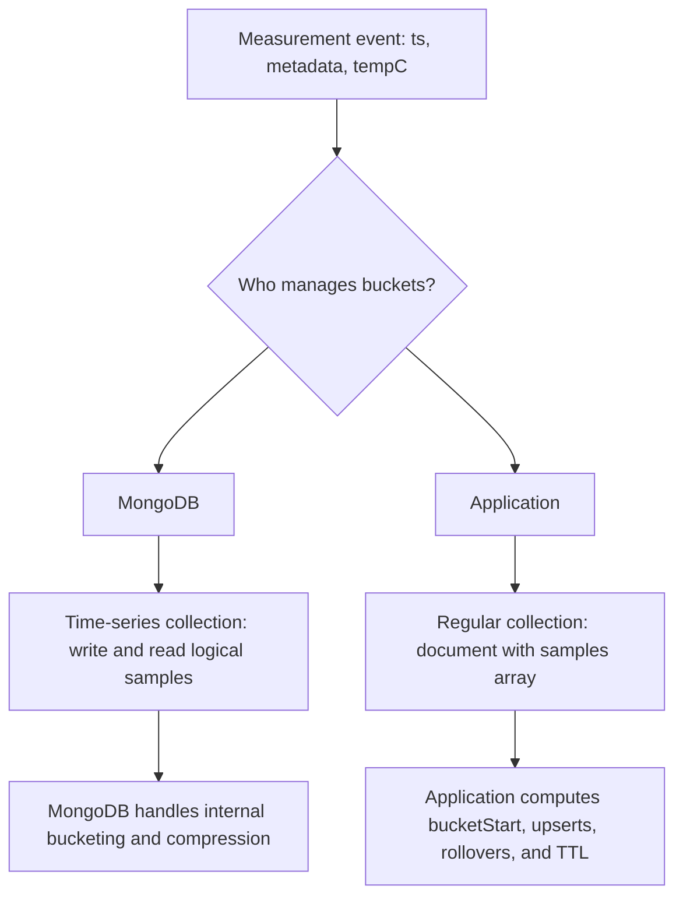

# Comparing Time-Series Collections with Application-Managed Bucket Models

## 1. The Problem and Two Views of a "Bucket"

In systems using **Spring Data MongoDB**, measurement data typically arrives as an event stream containing a timestamp, source, and value: sensor temperature, server CPU, electrical power, device location, or transaction metrics. For instance, 1,000 devices sending one record every 10 seconds generate roughly **8.64 million records per day**. The application needs continuous writes, queries by device and time range, per-minute averages, and automatic expiration of old data.

Example measurement sample:

```javascript
{
  ts: ISODate("2026-11-20T13:00:15Z"),
  metadata: {
    tenantId: "t7",
    deviceId: "s9",
    siteId: "factory-a"
  },
  eventId: "evt-10001",
  tempC: 22.7
}
```

There are two storage approaches to distinguish:

- **Time-series collection**: the application writes each measurement as a logical document; **MongoDB automatically groups samples into internal buckets**, managing storage layout and compression. The application still queries measurements using regular collection syntax.
- **Application-managed buckets**: the application defines bucket boundaries (such as one minute per device), stores a document containing a `samples` array, and explicitly controls appending, bucket splitting, summary counters, retries, and expiration.

Both approaches "group data over time", but **who controls bucket structure and owns maintenance** differs. Do not confuse application-managed bucket documents with the internal `system.buckets.*` collection created by MongoDB for a time-series collection.



## 2. Time-Series Collection: MongoDB Manages Buckets

### Creating the Collection and Writing Data

Initialize the collection before the first record; `timeField` designates the timestamp field, while `metaField` holds metadata identifying a measurement series (such as tenant, device, and site). `granularity` informs MongoDB of the expected data cadence to organize buckets appropriately.

```javascript
db.createCollection("sensor_readings", {
  timeseries: {
    timeField: "ts",
    metaField: "metadata",
    granularity: "seconds"
  },
  expireAfterSeconds: 30 * 24 * 60 * 60
});

db.sensor_readings.insertMany([
  {
    ts: ISODate("2026-11-20T13:00:15Z"),
    metadata: { tenantId: "t7", deviceId: "s9", siteId: "factory-a" },
    eventId: "evt-10001",
    tempC: 22.7
  },
  {
    ts: ISODate("2026-11-20T13:00:25Z"),
    metadata: { tenantId: "t7", deviceId: "s9", siteId: "factory-a" },
    eventId: "evt-10002",
    tempC: 22.9
  }
]);
```

Each object in `insertMany` is **one logical measurement**. The developer does not construct a document wrapping an array of measurements. MongoDB automatically groups measurements with matching metadata and nearby timestamps into internal buckets, maintains time-range metadata, and compresses columnar values. This typically lowers storage overhead when many records share stable fields and metadata.

Place low-churn series attributes in `metadata`, such as `tenantId`, `deviceId`, and stable site identifiers. Avoid putting timestamps, per-event UUIDs, or temperature values into `metadata`: metadata that changes on every sample increases series cardinality and undermines bucket packing. If a device relocates and `siteId` changes, readings before and after the move are stored under separate series.

### Querying and Aggregating Measurements

```javascript
const from = ISODate("2026-11-20T13:00:00Z");
const to = ISODate("2026-11-20T14:00:00Z");

// Filter by tenant, device, and [from, to) interval.
db.sensor_readings.find({
  "metadata.tenantId": "t7",
  "metadata.deviceId": "s9",
  ts: { $gte: from, $lt: to }
}).sort({ ts: 1 });

// Compute per-minute average temperature.
db.sensor_readings.aggregate([
  {
    $match: {
      "metadata.tenantId": "t7",
      "metadata.deviceId": "s9",
      ts: { $gte: from, $lt: to }
    }
  },
  {
    $group: {
      _id: { $dateTrunc: { date: "$ts", unit: "minute" } },
      avgTempC: { $avg: "$tempC" },
      minTempC: { $min: "$tempC" },
      maxTempC: { $max: "$tempC" },
      count: { $sum: 1 }
    }
  },
  { $sort: { _id: 1 } }
]);
```

The application works against it like a regular collection; MongoDB handles bucket pruning and unpacking required measurements during execution. Consider indexing metadata and time based on `explain` against real workloads:

```javascript
db.sensor_readings.createIndex({
  "metadata.tenantId": 1,
  "metadata.deviceId": 1,
  ts: 1
});
```

**Note:** time-series collections have specific rules around indexes, updates, deletes, transactions, sharding, and certain administrative operations; capabilities vary across MongoDB versions. Do not assume every regular collection behavior applies. In particular, time-series collections do not support per-measurement unique indexes like regular collections; if duplicate `eventId` writes must be prevented, design idempotency at ingestion or maintain a dedicated event-key store.

### TTL and Late-Arriving Data

`expireAfterSeconds` automatically removes expired time-series data. Because data is stored in buckets, actual reclamation depends on bucket boundaries and TTL monitor cycles; **do not treat TTL as a guarantee of exact per-second deletion for individual measurements**.

Late-arriving or out-of-order data can raise processing overhead and affect bucket efficiency. Measure ingestion lag, late-sample rate, and storage footprint per source rather than assuming append-only data always arrives in order.

## 3. Application-Managed Buckets: Custom Layout and Updates

### Document Design and Bucket Rules

Suppose the application chooses **one bucket per device per UTC minute**. A document is stored in a regular `sensor_buckets` collection:

```javascript
{
  _id: "t7|s9|2026-11-20T13:00:00.000Z",
  tenantId: "t7",
  deviceId: "s9",
  bucketStart: ISODate("2026-11-20T13:00:00Z"),
  bucketEnd: ISODate("2026-11-20T13:01:00Z"), // exclusive end bound
  expiresAt: ISODate("2026-12-20T13:01:00Z"),
  count: 2,
  minTempC: 22.7,
  maxTempC: 22.9,
  samples: [
    { eventId: "evt-10001", ts: ISODate("2026-11-20T13:00:15Z"), tempC: 22.7 },
    { eventId: "evt-10002", ts: ISODate("2026-11-20T13:00:25Z"), tempC: 22.9 }
  ]
}
```

Each sample is now an **element inside a document's array**, not a standalone document. The application decides when to split into a new bucket if the array grows large, a device writes too fast, or late data arrives.

Clear invariants must be defined:

1. Unique bucket key by tenant, device, and bucket start time in UTC.
2. Half-open interval `[bucketStart, bucketEnd)`; a sample on the exact end bound belongs to the next bucket.
3. Limits on sample count and document size; MongoDB enforces a **16 MiB per-document** BSON limit.
4. Every record carries `eventId` and duplicate handling; `$push` does not deduplicate automatically.
5. `count`, `minTempC`, and `maxTempC` must stay synchronized with the array, or be recomputed in a controlled manner.

### Example of Atomic Document-Level Update

```javascript
const reading = {
  ts: ISODate("2026-11-20T13:00:15Z"),
  tenantId: "t7",
  deviceId: "s9",
  eventId: "evt-10001",
  tempC: 22.7
};

const bucketStart = new Date(
  Math.floor(reading.ts.getTime() / 60_000) * 60_000
);
const bucketEnd = new Date(bucketStart.getTime() + 60_000);
const bucketId =
  [reading.tenantId, reading.deviceId, bucketStart.toISOString()].join("|");

db.sensor_buckets.updateOne(
  { _id: bucketId },
  {
    $setOnInsert: {
      tenantId: reading.tenantId,
      deviceId: reading.deviceId,
      bucketStart,
      bucketEnd,
      expiresAt: new Date(bucketEnd.getTime() + 30 * 24 * 60 * 60 * 1000)
    },
    $push: {
      samples: {
        eventId: reading.eventId,
        ts: reading.ts,
        tempC: reading.tempC
      }
    },
    $inc: { count: 1 },
    $min: { minTempC: reading.tempC },
    $max: { maxTempC: reading.tempC }
  },
  { upsert: true }
);
```

This example illustrates **single-document atomicity**: appending the sample, incrementing `count`, and updating extrema in one operation. It is **not yet a complete production solution**:

- Retrying the same `eventId` will push the sample and increment `count` again. A consistent deduplication/idempotency mechanism (such as a separate event-key store with a unique index and coordinated write flow) is required.
- Two concurrent requests creating the same bucket can race on the initial upsert; use a deterministic unique bucket key, catch duplicate-key errors, and retry carefully.
- `$push` does not cap array length; enforce rollover thresholds (sample count, BSON size, document write heat). You cannot rely solely on a one-minute window if a source emits bursts rapidly.
- Repeated writes to the same bucket can create a **hot document**, increasing write contention. This is a major performance contrast against appending individual measurements to a time-series collection.

### Reading Samples and Bucket TTL

```javascript
db.sensor_buckets.createIndex({
  tenantId: 1,
  deviceId: 1,
  bucketStart: 1
});

// TTL removes the entire bucket document after expiresAt.
db.sensor_buckets.createIndex(
  { expiresAt: 1 },
  { expireAfterSeconds: 0 }
);

const from = ISODate("2026-11-20T13:00:10Z");
const to = ISODate("2026-11-20T13:02:00Z");

db.sensor_buckets.aggregate([
  {
    $match: {
      tenantId: "t7",
      deviceId: "s9",
      bucketStart: { $lt: to },
      bucketEnd: { $gt: from }
    }
  },
  { $unwind: "$samples" },
  { $match: { "samples.ts": { $gte: from, $lt: to } } },
  { $project: { _id: 0, ts: "$samples.ts", tempC: "$samples.tempC" } },
  { $sort: { ts: 1 } }
]);
```

The index locates **candidate buckets**. Then the pipeline must filter array elements, often using `$unwind` and sorting. When frequently querying "exact temperature at every second" across millions of samples, array unwinding overhead can become significant. Conversely, if you only need bucket-level `count`, `minTempC`, or `maxTempC`, the application can read precomputed fields directly.

With TTL on application-managed buckets, an entire document is dropped at `expiresAt`. Set `expiresAt` relative to the bucket end time plus retention duration; setting it relative to bucket start risks deleting newer samples inside the bucket prematurely. The TTL monitor can lag, so do not depend on TTL for synchronous, immediate deletion.

## 4. Bringing This Into Spring Data MongoDB

For a time-series collection, use a controlled migration or initialization step to run `db.createCollection(...)` **before** `MongoTemplate` writes the first record. Adding `@Document` alone does not ensure the collection was created with time-series options; if a regular collection with the same name already exists, plan a new collection and data migration.

Java measurement mapping example (place each record in the appropriate Java file):

```java
import java.time.Instant;
import org.springframework.data.annotation.Id;
import org.springframework.data.mongodb.core.mapping.Document;

@Document(collection = "sensor_readings")
public record SensorReading(
    @Id String id,
    Instant ts,
    SensorMeta metadata,
    double tempC
) {}

record SensorMeta(String tenantId, String deviceId, String siteId) {}
```

```java
import java.time.Instant;
import java.util.List;
import org.springframework.data.domain.Sort;
import org.springframework.data.mongodb.core.MongoTemplate;
import org.springframework.data.mongodb.core.query.Criteria;
import org.springframework.data.mongodb.core.query.Query;

// MongoTemplate is injected by Spring into the service.
mongoTemplate.insert(new SensorReading(
    null,
    Instant.parse("2026-11-20T13:00:15Z"),
    new SensorMeta("t7", "s9", "factory-a"),
    22.7
));

Instant from = Instant.parse("2026-11-20T13:00:00Z");
Instant to = Instant.parse("2026-11-20T14:00:00Z");
Query query = Query.query(
    Criteria.where("metadata.tenantId").is("t7")
        .and("metadata.deviceId").is("s9")
        .and("ts").gte(from).lt(to)
);
query.with(Sort.by(Sort.Direction.ASC, "ts"));

List<SensorReading> readings =
    mongoTemplate.find(query, SensorReading.class);
```

The service snippet is illustrative; `mongoTemplate` comes from a Spring bean, and actual imports and class/service structure depend on your application.

With application-managed buckets, map a `SensorBucket` entity with `bucketStart`, `bucketEnd`, and `samples`, and call `MongoTemplate.updateFirst(...)` / `upsert(...)` or use the MongoDB driver directly for `$push`, `$inc`, `$min`, and `$max`. Keep **a single service responsible for bucket rules**: key calculation, UTC validation, size limits, idempotency, rollover, and retries. Do not scatter that logic across repositories or controllers.

For time-series reads, you can use Spring Data repositories for simple queries, `MongoTemplate` for dynamic queries, and `Aggregation` for windowed statistics. With application-managed buckets, queries return buckets or require array-unwinding pipelines; **you cannot simply swap in a measurement-returning repository** once schema and semantics have changed.

## 5. Practical Comparison Table

| Criterion | Time-series collection | Application-managed buckets |
|---|---|---|
| Logical model | One document per measurement sample | One document per batch of samples |
| Bucketing | Managed internally by MongoDB | Application computes keys, sizes, and boundaries |
| Continuous writes | Simple measurement inserts, suited for high-volume ingest | Typically `upsert`/`$push` into an existing document |
| Compression & storage layout | Dedicated time-series storage optimization and compression | Depends on schema and general MongoDB compression; app tunes manually |
| Time-range queries | Directly on `ts` and metadata | Filter buckets, then filter `samples` elements |
| Interval statistics | Aggregations over measurements | Unwind-array aggregations or reading maintained summaries |
| Per-sample edits | Subject to version-dependent time-series limitations | Array elements can be updated, at higher complexity |
| Concurrent writes to same source | MongoDB handles internal bucketing | Risk of hot documents and write contention |
| Deduplication | Requires idempotency outside per-measurement unique indexes | Customizable, though plain `$push` still allows duplicates |
| Expiration | Time-series TTL, bounded by bucket span and monitor cycles | Bucket-document TTL via app-chosen `expiresAt` |
| Operational risks | Depends on version-specific feature support and limits | Bucket-splitting bugs, 16 MiB limit, retries, skewed counts, rollover |
| Structural control | Lower, ideal for standard measurement streams | High, suited to specialized bucket workflows |

**You cannot conclude that "one document holding many samples is always faster than many documents."** Self-managed buckets lower logical document count but increase document size, update contention, and array-unwinding costs. Time-series collections already pack measurements into internal buckets, so comparing solely on application-visible document count is misleading.

## 6. Choosing a Model Based on Workload

**Prefer a time-series collection** when data is primarily append-only, every sample has a clear timestamp, metadata is relatively stable, and reads filter by time ranges and compute aggregation statistics. This is usually the right starting point for sensor readings, infrastructure monitoring, and telemetry.

**Consider application-managed buckets** when the bucket itself is a first-class domain entity: you must compute and mutate a batch of samples as a unit, store custom summaries, enforce specialized size rules, or serve a UI that always reads whole groups at once. This choice requires accepting the cost of maintaining bucket lifecycle logic.

Several scenarios:

- **Per-minute CPU dashboard with flexible 1-hour to 7-day queries:** a time-series collection plus `$dateTrunc`/`$group` pipelines is usually simpler.
- **Device logs ingested in batches where each batch carries approval status, checksum, and version:** a domain bucket/batch document may fit better.
- **Needing 30-day p95 across hundreds of millions of events:** benchmark time-series aggregations and consider a separate rollup table; do not automatically stuff every sample into one huge array.
- **Duplicate writes from network retries:** both models must define idempotency from source key, timestamp, and `eventId`. Never assume plain insertion eliminates duplicates.

You can combine both: store raw data in a time-series collection and maintain a **rollup collection** at minute/hour resolution for dashboards. A rollup is a derived aggregate regenerable from raw data, distinct from replacing raw data entirely with application-managed buckets.

## 7. Fair Comparison Benchmark

Before deciding, build an identical test dataset spanning multiple tenants, devices, samples/second, timestamp skew, and metadata distribution. Keep retention, response requirements, hardware, and write concern identical.

| Benchmark scenario | Observations to collect |
|---|---|
| Steady ingest, 5–10x spike | Throughput, p50/p95/p99 latency, CPU, errors/retries |
| 1–5% late or out-of-order events | Latency increase, extra buckets created, storage growth |
| Single-device 15-minute query | `explain("executionStats")`, keys/docs examined, execution time |
| Multi-device 30-day query | Scan volume, aggregation memory, latency |
| Raw samples vs. per-minute statistics | Measurement/array unpacking cost and rollup computation cost |
| 30-day retention under continuous writes | Disk usage, TTL speed, actual data removal lag |
| Duplicate event retries, concurrent bucket writes | Duplicate/lost event counts, count/min/max accuracy, write conflicts |

Example starting point to inspect execution plans:

```javascript
db.sensor_readings.find({
  "metadata.tenantId": "t7",
  "metadata.deviceId": "s9",
  ts: {
    $gte: ISODate("2026-11-20T13:00:00Z"),
    $lt: ISODate("2026-11-20T14:00:00Z")
  }
}).explain("executionStats");
```

Beyond `totalDocsExamined` and latency, compare **actual storage size** of collections and indexes after ingesting identical data. Run measurements after warm-up and with enough data volume to reflect retention. Report implementation/migration effort separately, because a fast model that mishandles duplicates still fails requirements.

## 8. Production Readiness Checklist

1. **Correct time semantics:** standardized UTC, half-open `[from, to)`, late-arrival policy, and retention duration.
2. **Correct metadata:** grouped by tenant/device and stable attributes; never turn metadata into a per-event identifier.
3. **Correct idempotency:** explicit event keys and retry tests; verify `$push` and counters in particular.
4. **Correct sizing:** for app buckets, cap documents well under 16 MiB and mitigate hot documents; for time-series, measure packing/compression per source.
5. **Correct indexes:** inspect real query plans and avoid adding indexes by habit since every index slows writes.
6. **Correct versions:** verify time-series capabilities (updates, deletes, indexes, sharding, transactions, TTL) against your **deployed MongoDB and Spring Data MongoDB versions**.
7. **Correct operations:** track ingestion lag, duplicate rate, query latency, storage size, and TTL throughput; test summary rebuild/recovery when needed.

**Implementation recommendation:** start with a time-series collection whenever the core entity is a *timestamped measurement*. Only build application-managed buckets when concrete domain requirements or benchmark data prove the benefit of that structure. Either way, keep the boundaries between raw data, aggregated summaries, and idempotency rules clear enough to test thoroughly.
