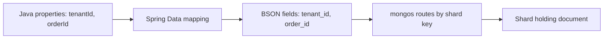

# `@Sharded` and Shard Key Field Mapping in Spring Data MongoDB

When a collection is **sharded** in MongoDB, documents are distributed across multiple shards according to the **shard key**. In a Spring Data MongoDB application, `@Sharded` describes the shard key at the entity level so the framework can assist certain write operations; `@Field` determines the actual field name stored in BSON. These two naming layers must match the sharding configuration in MongoDB accurately.

This lesson focuses on how to declare `@Sharded`, map single and compound keys, create the corresponding shard key on the cluster, query via `MongoTemplate`, and verify operational limits. The examples use Java and Spring Data MongoDB, though the mapping principles also apply to repositories and reactive access.

## 1. The shard key belongs to the collection, while `@Sharded` belongs to the entity

A shard key consists of one or more BSON fields used by MongoDB to partition data and route queries. For example, `shop.orders` is sharded on two fields in the order `{ tenant_id: 1, order_id: 1 }`. Every business document should have stable values for both fields; queries providing the full key generally help the `mongos` router determine the target shard more efficiently.

`@Sharded` resides in `org.springframework.data.mongodb.core.mapping` and declares **metadata telling Spring Data that the entity is stored in a sharded collection**. The annotation **does not create a sharded cluster, run `shardCollection`, or guarantee index creation**. The collection must be configured on the MongoDB side, and the entity and server configuration must stay consistent.



Main attributes of `@Sharded`:

| Attribute | Meaning | Note |
| --- | --- | --- |
| `shardKey = {"..."}` | List of **property names on the entity**, in single or compound key order. | Spring Data maps them to the corresponding BSON names, including `@Field`. |
| `value = {"..."}` | Alias for `shardKey`. | Pick one consistent style across the project. |
| `shardingStrategy` | `ShardingStrategy.RANGE` (default) or `ShardingStrategy.HASH`. | Strategy must match the actual shard key/index on MongoDB. |
| `immutableKey` | Default `false`; when `true`, Spring Data assumes the entity's shard key does not change and skips key-change checks in relevant write paths. | This is an optimization assumption, **not an immutability constraint enforced by the annotation**. |

If `shardKey` is omitted, `@Sharded` uses the entity's identifier property, corresponding to `_id`, by default. In practice, choose the shard key based on data distribution and query patterns rather than defaulting to `_id` for every problem.

## 2. Example: declaring a compound shard key and renaming BSON fields

A multi-tenant order management application (`tenant`). Each order has `tenantId` and `orderId`; field names in BSON follow `snake_case`.

```java
import org.bson.types.ObjectId;
import org.springframework.data.annotation.Id;
import org.springframework.data.mongodb.core.mapping.Document;
import org.springframework.data.mongodb.core.mapping.Field;
import org.springframework.data.mongodb.core.mapping.Sharded;

@Document(collection = "orders")
@Sharded(
    shardKey = { "tenantId", "orderId" },
    immutableKey = true
)
public class OrderDocument {

    @Id
    private ObjectId id;

    @Field("tenant_id")
    private String tenantId;

    @Field("order_id")
    private String orderId;

    private String status;

    protected OrderDocument() { }

    public OrderDocument(String tenantId, String orderId, String status) {
        this.tenantId = tenantId;
        this.orderId = orderId;
        this.status = status;
    }

    public ObjectId getId() { return id; }
    public String getTenantId() { return tenantId; }
    public String getOrderId() { return orderId; }
    public String getStatus() { return status; }
}
```

With `tenantId = "tenant-a"`, `orderId = "ord-001"`, and `status = "NEW"`, the persisted document looks like:

```javascript
{
  _id: ObjectId("65fd4e0f0a01020304050607"),
  tenant_id: "tenant-a",
  order_id: "ord-001",
  status: "NEW"
}
```

Clearly distinguish **Java property names** from **MongoDB field names**:

| Purpose | Name used |
| --- | --- |
| Properties in `OrderDocument` | `tenantId`, `orderId` |
| `@Sharded(shardKey = { ... })` | `"tenantId"`, `"orderId"` |
| `@Field` on properties | `"tenant_id"`, `"order_id"` |
| Shard key in MongoDB commands / BSON | `{ tenant_id: 1, order_id: 1 }` |
| Conditions in entity-bound `Criteria` | `"tenantId"`, `"orderId"` |

The order of a compound key also matters: if `tenantId` precedes `orderId` in the annotation, the server shard key definition must put `tenant_id` before `order_id`. Putting BSON names directly into an annotation expecting Java property names, or creating the server shard key on `tenantId` instead of `tenant_id`, causes the application model and collection to diverge.

`immutableKey = true` is only appropriate when business rules forbid moving orders between tenants or editing the order identifier. If the shard key can change, keep the default setting and design a controlled update flow adhering to MongoDB's rules, rather than assuming `save()` handles every case.

## 3. Preparing a sharded collection whose field names match the entity

The following example runs in **`mongosh` connected to the `mongos` router** of a configured sharded cluster, using an account with appropriate administrative privileges. This is a database deployment operation, not a command automatically executed when the Spring Boot application starts.

```javascript
use shop

// Create the shard key supporting index first; required if the collection already has data.
db.orders.createIndex({ tenant_id: 1, order_id: 1 })

// These names are BSON field names, not Java property names.
sh.shardCollection(
  "shop.orders",
  { tenant_id: 1, order_id: 1 }
)

// Inspect sharding configuration and indexes.
sh.status()
db.orders.getIndexes()
```

For an empty collection, MongoDB can automatically create the shard key index when running `sh.shardCollection`; creating the index explicitly in the example makes configuration comparison easier. For collections with existing data, prepare a compatible index before sharding. The index and shard key must match in field order; declaring `@Sharded` alone will not perform either step.

If choosing a hashed strategy, the MongoDB configuration must use the key component `{ field_name: "hashed" }` and its corresponding index; `ShardingStrategy.HASH` in Java by itself does not turn a range-sharded collection into a hashed-sharded one. Choosing hashed versus range should be based on distribution characteristics and query patterns; the primary example here uses range.

## 4. Reading, updating, and saving with `MongoTemplate`

`Criteria`/`Query` targeting an entity work with **Java property names**; Spring Data maps them via `@Field` when generating queries sent to MongoDB.

```java
import org.springframework.data.mongodb.core.MongoTemplate;
import org.springframework.data.mongodb.core.query.Criteria;
import org.springframework.data.mongodb.core.query.Query;
import org.springframework.data.mongodb.core.query.Update;

// mongoTemplate is already configured by the Spring application.
Query byKey = Query.query(
    Criteria.where("tenantId").is("tenant-a")
            .and("orderId").is("ord-001")
);

OrderDocument found = mongoTemplate.findOne(byKey, OrderDocument.class);

// updateFirst uses an explicit routing filter containing the full shard key.
mongoTemplate.updateFirst(
    byKey,
    new Update().set("status", "PAID"),
    OrderDocument.class
);

// Insert a new entity with full shard key values.
OrderDocument created = new OrderDocument("tenant-b", "ord-002", "NEW");
mongoTemplate.insert(created);

// When saving an existing entity, Spring Data can append the shard key to
// the replaceOne filter, under the conditions supported by the API.
// mongoTemplate.save(found);
```

At the BSON level, the `byKey` condition is essentially equivalent to:

```javascript
{ tenant_id: "tenant-a", order_id: "ord-001" }
```

Spring Data provides **best-effort** support for certain full-document replacement write paths, typically `MongoTemplate.save(...)`, `CrudRepository.save(...)`, and their reactive counterparts. When necessary, the framework may issue an extra read to learn the entity's stored shard key before building the `replaceOne` filter. This mechanism **does not mean every query automatically receives the shard key**. For `find`, `updateFirst`, `remove`, and operations taking a `Query`, the application must explicitly provide appropriate shard key conditions when accurate and efficient routing is needed.

Querying solely by `orderId` when the shard key is `{ tenant_id, order_id }` may hit multiple shards and is generally less optimal than querying with the full key. Whether a query targets one shard or multiple must be verified using `explain` on an actual cluster, as it also depends on configuration and filter operators.

## 5. Verifying mapping before deployment

You can test the entity-to-BSON conversion step independently without spinning up a sharded cluster. The illustrative test below uses the converter configured in the application and AssertJ:

```java
OrderDocument order = new OrderDocument("tenant-a", "ord-001", "NEW");
org.bson.Document bson = new org.bson.Document();

mongoTemplate.getConverter().write(order, bson);

assertThat(bson.getString("tenant_id")).isEqualTo("tenant-a");
assertThat(bson.getString("order_id")).isEqualTo("ord-001");
assertThat(bson).doesNotContainKeys("tenantId", "orderId");
```

After deploying to a sharded environment, verify further from `mongosh`:

```javascript
use shop

// Inspect actual field names inside the document.
db.orders.findOne({ tenant_id: "tenant-a", order_id: "ord-001" })

// Observe the routing plan; do not assume every query hits a single shard.
db.orders.find({ tenant_id: "tenant-a", order_id: "ord-001" })
  .explain("executionStats")

sh.status()
```

Verify three things independently: (1) the converter writes the right field names, (2) the collection's actual index/shard key matches in names and order, and (3) key business queries include the expected routing conditions. Unit tests on mapping cannot substitute for integration testing against a sharded cluster.

## 6. Common pitfalls

| Symptom | Common cause | Resolution |
| --- | --- | --- |
| `@Sharded` is present, yet collection is still unsharded | The annotation only supplies metadata inside Spring Data. | Create the index, run `sh.shardCollection` via a separate ops process, and verify with `sh.status()`. |
| Cluster shards by `tenantId`, while documents store `tenant_id` | Confusing Java property names with `@Field` BSON names. | Use `tenantId` in annotations/`Criteria`, and `tenant_id` in MongoDB commands. |
| Single-order query slows down as data grows | Filtering only by `orderId`, omitting the leading component of the compound shard key. | Include `tenantId` in the query filter, re-evaluate shard key against workload, and inspect `explain`. |
| `save` or updates fail with shard key issues | Key changed, missing values, or Java and cluster configs disagree. | Keep the key stable per business rules, check existing data, and include the shard key in update queries. |
| `immutableKey = true` is set, yet code still mutates `tenantId` | The annotation does not lock setters or block domain mutations. | Enforce immutability in entity/service design; only enable the optimization when the invariant holds. |
| `@Sharded` looks right, yet data distribution is skewed | Low-selectivity shard key or writes concentrated in one value range. | Evaluate cardinality, read/write distribution, and range/hashed strategy before going live. |

In particular, a compound key does not automatically enforce cluster-wide uniqueness: if a unique constraint is required, design a unique index compliant with MongoDB's rules for sharded collections. `_id` should likewise not be assumed globally unique across the cluster in configurations where `_id` is not part of the shard key.

## 7. Short hands-on exercise

Suppose `OrderDocument` above is deployed in a multi-tenant order service:

1. Declare the entity with `@Sharded(shardKey = {"tenantId", "orderId"})` and the two corresponding `@Field` annotations; explain why MongoDB sees `tenant_id` and `order_id`.
2. Configure `shop.orders` on a test sharded cluster with shard key `{ tenant_id: 1, order_id: 1 }` and its supporting index.
3. Insert orders for two tenants, then read and update an order using `MongoTemplate` with both key components; compare `explain` of the full-key query against a query with only `orderId`.
4. Audit whether `tenantId` can ever change in business flows and decide whether `immutableKey = true` is justified. Document how the application prevents key changes.

**Completion criteria:** field names align across Java, BSON, and cluster configuration; reads/writes access the right order for the right tenant; and you can clearly state the scope of `@Sharded` support and the limits of automatic shard key inclusion.

## References

- [Spring Data MongoDB — Sharding](https://docs.spring.io/spring-data/mongodb/reference/mongodb/sharding.html): how Spring Data uses `@Sharded`, field name mapping, and shard key handling on writes.
- [Spring Data MongoDB — `@Sharded` API](https://docs.spring.io/spring-data/mongodb/reference/api/java/org/springframework/data/mongodb/core/mapping/Sharded.html): attributes and defaults.
- [MongoDB — Shard Keys](https://www.mongodb.com/docs/manual/core/sharding-shard-key/): shard key concepts, key selection, updating key values.
- [MongoDB — Shard Key Indexes](https://www.mongodb.com/docs/manual/core/sharding-shard-key-indexes/): index and unique index requirements for sharded collections.
