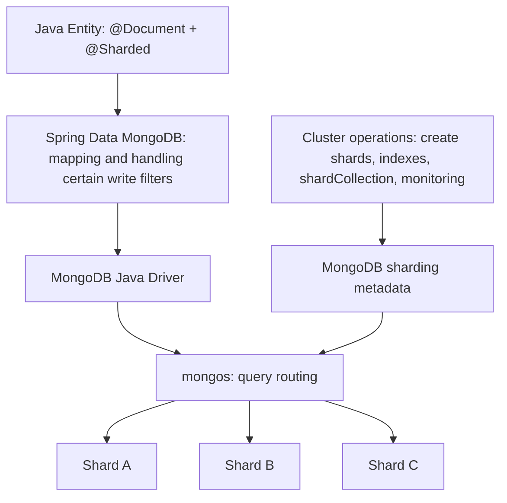

# Distinguishing `@Sharded` Metadata from Actual Cluster Configuration

> **Chapter:** Sharding  
> **Scope:** Spring Data MongoDB — connecting, document mapping, and operating on MongoDB through `MongoTemplate` or repositories in a sharded data system.

## 1. The problem to understand

Suppose an e-commerce application uses Spring Data MongoDB and wants to distribute millions of orders across multiple shards. A developer writes:

```java
@Document("orders")
@Sharded(shardKey = {"tenantId", "orderNo"})
public class PurchaseOrder {
    @Id String id;
    String tenantId;
    String orderNo;
}
```

After running the application, **the `orders` collection does not automatically become a sharded collection**. The `@Sharded` annotation describes how the entity corresponds to a *shard key* and helps Spring Data handle certain write operations; creating the cluster architecture, indexes, and sharding configuration is the responsibility of MongoDB and the deployment process.

These are two distinct layers:

- **Application layer (metadata):** `@Sharded` attaches shard key information to the Java type; Spring Data can use that metadata when constructing filters for certain write commands.
- **Database layer (actual cluster):** MongoDB must have a sharding-capable cluster, a collection enabled for sharding with a specific shard key, appropriate indexes, and the `mongos` router; only then does MongoDB distribute data across shards.

An application with accurate annotations may still be writing to an unsharded collection. Conversely, MongoDB can shard a collection even if the Java entity lacks `@Sharded`; in that case, the application simply does not receive the shard-key-related assistance provided by the annotation.

## 2. Responsibility boundary diagram



The arrow from the annotation to the driver represents application execution flow, **not** a shard-creation command. Changing the annotation does not replace running administrative commands on the cluster.

| Component | Where is it declared or executed? | Effect | Does `@Sharded` perform it automatically? |
| --- | --- | --- | --- |
| Collection name and field mapping | `@Document`, `@Field` | Maps entity to BSON | No; this is general mapping functionality |
| Shard key known to Spring Data | `@Sharded(shardKey = ...)` | Assists building filters for certain write operations | **Yes**, at the metadata layer |
| Index supporting the shard key | MongoDB index, migration workflow, or `IndexOperations` | Enables and supports sharding the collection | **No** |
| Sharded collection | `sh.shardCollection(...)` or equivalent admin command | Registers namespace and shard key in MongoDB | **No** |
| Config server, shards, `mongos`, balancer | MongoDB infrastructure / managed service provider | Stores metadata, routes queries, and distributes data | **No** |
| Shard selection and range/chunk migration | MongoDB based on shard key and cluster metadata | Balances data while the cluster operates | **No** |

## 3. What information does `@Sharded` actually provide?

`@Sharded` belongs to `org.springframework.data.mongodb.core.mapping` and is placed on an entity or on an annotation used as a meta-annotation. Main attributes:

| Attribute | Meaning | Default |
| --- | --- | --- |
| `shardKey = {"tenantId", "orderNo"}` | Ordered **Java property** names forming the shard key | Empty array, interpreted as the entity's ID property |
| `value` | Alias for `shardKey` | Empty array |
| `shardingStrategy` | Metadata describing the sharding strategy | `ShardingStrategy.RANGE` |
| `immutableKey` | Tells Spring Data the application does not change shard key values after entity creation | `false` |

Note on field naming: `@Sharded` references entity properties, whereas `shardCollection` uses **actual BSON field names**. If a property has `@Field("tenant_id")`, MongoDB must use `tenant_id`. Never assume the two names are always identical.

### Write assistance is narrow in scope and *best effort*

Spring Data may automatically append shard key values to the `replaceOne` filter generated by entity-saving operations, such as:

- `CrudRepository.save(...)`, `saveAll(...)`, and reactive variants;
- `MongoTemplate.save(...)`, `ReactiveMongoTemplate.save(...)`;
- certain full-entity replacement update/upsert operations when `UpdateDefinition` contains a full copy of the entity.

The goal is to ensure the write operation carries enough shard key information where required. Depending on the case, Spring Data may need to perform an extra read of current data to determine the actual shard key before replacing. Setting `immutableKey = true` signals that the key will not change and avoids that extra check; this is **not** a server-enforced immutability constraint.

**Do not generalize this behavior to all APIs.** For `find`, `updateFirst`, `updateMulti`, `remove`, or custom repository queries, developers must supply appropriate shard key conditions in `Query` whenever precise routing or operation constraints require them. The annotation does not automatically inject tenant filters into every query, nor does it replace data authorization controls.

## 4. Consistent end-to-end example from Java to MongoDB

Consider the `sales` database and `orders` collection. An order is identified within a tenant by `tenantId` and `orderNo`; these values remain stable after creation. The example uses **range sharding** on that pair of fields in that order. Whether this shard key is optimal depends on actual load distribution and query patterns.

### Step A — Declare the entity for Spring Data

```java
import java.math.BigDecimal;
import org.springframework.data.annotation.Id;
import org.springframework.data.mongodb.core.mapping.Document;
import org.springframework.data.mongodb.core.mapping.Field;
import org.springframework.data.mongodb.core.mapping.Sharded;
import org.springframework.data.mongodb.core.mapping.ShardingStrategy;

@Document("orders")
@Sharded(
    shardKey = {"tenantId", "orderNo"},
    shardingStrategy = ShardingStrategy.RANGE,
    immutableKey = true
)
public class PurchaseOrder {
    @Id
    private String id;

    @Field("tenant_id")
    private String tenantId;

    @Field("order_no")
    private String orderNo;

    private BigDecimal amount;

    // Constructor and getters/setters per application model conventions.
}
```

What Spring Data sees is a key of two **properties**, `tenantId` and `orderNo`. Because of `@Field`, the corresponding BSON contains `tenant_id` and `order_no`. Adding `@Sharded` in Java **does not execute** `shardCollection`, create a cluster topology, or guarantee index creation.

### Step B — Prepare the cluster and index

Before this step, operations has provisioned a running sharded cluster and a **`mongos`** endpoint (or equivalent endpoint provided by a managed service), along with appropriate admin privileges. Connect `mongosh` to the router, not directly to an individual shard, when configuring the application's collection.

```javascript
// In mongosh, connected to mongos:
use sales

// Especially important to create the supporting index beforehand if the collection already has data.
db.orders.createIndex(
  { tenant_id: 1, order_no: 1 },
  { name: "tenant_order_shard_key" }
)

// Configuration operation in MongoDB:
sh.shardCollection(
  "sales.orders",
  { tenant_id: 1, order_no: 1 }
)
```

For a **collection with existing data**, MongoDB requires a supporting index for the shard key beforehand; an index having the shard key as a prefix is valid. For an empty collection, MongoDB can create the supporting index automatically during `shardCollection`, though managing indexes explicitly via migrations keeps deployment and verification clearer.

Starting with MongoDB 6.0, running `sh.enableSharding("sales")` before `sh.shardCollection(...)` is no longer mandatory. Some documentation or older environments still include the database enable step; check your server version and MongoDB service policies.

### Step C — Connect the application and include the shard key in queries

The application configures the MongoDB Java Driver/Spring Data to connect to the cluster's `mongos` endpoint and targets the `sales` database. The URI, authentication mechanism, TLS, and connection pool depend on the deployment environment; `@Sharded` neither creates nor alters connectivity.

For partial update queries, include the shard key fields in `Query`, especially when the application typically looks up an order by tenant and order number:

```java
import org.springframework.data.mongodb.core.MongoTemplate;
import org.springframework.data.mongodb.core.query.Criteria;
import org.springframework.data.mongodb.core.query.Query;
import org.springframework.data.mongodb.core.query.Update;

class PurchaseOrderWriter {
    void markPaid(MongoTemplate mongoTemplate,
                  String tenantId, String orderNo) {
        Query query = Query.query(
            Criteria.where("tenantId").is(tenantId)
                    .and("orderNo").is(orderNo)
        );
        Update update = new Update().set("state", "PAID");
        mongoTemplate.updateFirst(query, update, PurchaseOrder.class);
    }
}
```

`MongoTemplate` maps properties `tenantId`/`orderNo` to `tenant_id`/`order_no` for this entity query. A complete filter gives the router a basis to target the right shard; verify the actual effect with `explain`. If the query only filters by `state = "PAID"`, the annotation will not automatically supply the tenant or order number.

### Step D — Verify the cluster is actually sharded

```javascript
// In mongosh, connected to mongos:
sh.status()                        // Verify namespace sales.orders and shard key
use sales
db.orders.getIndexes()             // Inspect supporting index

db.orders.find({
  tenant_id: "tenant-a",
  order_no: "ORD-1001"
}).explain("executionStats")
```

Read `sh.status()` to confirm `sales.orders` is registered as a sharded collection with key `{ tenant_id: 1, order_no: 1 }`. Read `getIndexes()` to verify the actual index structure. With `explain`, observe which shards were accessed and the execution plan; then compare against a query missing the shard key to see the difference between targeted routing and queries that must examine multiple shards.

**Do not treat successful application startup or a successful `repository.save(...)` call as proof that a collection is sharded.** Those operations still work on a replica set or an unsharded collection.

## 5. Changing shard key strategy: metadata must match actual configuration

MongoDB distinguishes range and hashed sharding. Spring Data defines enum values `ShardingStrategy.RANGE` and `ShardingStrategy.HASH` (the exact name is **`HASH`**, not `HASHED`); MongoDB uses the literal `"hashed"` in configuration commands.

Example of a **different** design that hashes a single `tenantId` field:

```java
@Document("orders_by_tenant")
@Sharded(
    shardKey = "tenantId",
    shardingStrategy = ShardingStrategy.HASH
)
class HashedOrder {
    @Id String id;
    @Field("tenant_id") String tenantId;
}
```

```javascript
// Illustrative matching configuration for a new/separately deployed collection:
sh.shardCollection("sales.orders_by_tenant", { tenant_id: "hashed" })
```

This example illustrates **semantic alignment** between metadata and the server; `@Document` must point to the actual collection in each environment. Do not apply both range and hash configurations to the same live collection. Changing `shardingStrategy` or `shardKey` in source code **does not** alter the shard key stored by the cluster; changing the actual shard key requires an appropriate data migration workflow, such as resharding, with separate impact assessment and validation.

## 6. Common misconceptions

| Scenario | What happens | Proper approach |
| --- | --- | --- |
| Entity has `@Sharded`, running on standalone/replica set MongoDB | Metadata stays inside the app; data does not automatically turn into a sharded collection | Provision a sharded cluster and shard the collection via admin procedures |
| Cluster already shards `orders`, entity omits `@Sharded` | Server still distributes data according to its current configuration | Consider declaring entity metadata so Spring Data assists eligible write commands |
| Java declares `tenantId`, while MongoDB shards on `tenant_id` | This configuration is **correct** if the property has `@Field("tenant_id")` | Verify actual BSON field names; preserve key order |
| Only `@CompoundIndex` or `@Indexed` is present | An index may exist (if created), yet the collection may remain unsharded | Verify both indexes **and** sharding status on the server |
| Code changes `RANGE` to `HASH` | Cluster does not automatically reshard; Java and MongoDB configs diverge | Plan cluster and data changes, then update the entity |
| `immutableKey = true` is set, yet code still edits the shard key | Spring Data may skip the extra read assuming an immutable key | Only use `true` when business logic strictly keeps the key unchanged |
| Query filters only on fields outside the shard key | Router may have to send the query to multiple shards | Design the shard key around query patterns, pass shard key filters when possible, and measure with `explain` |
| `save` succeeds and team assumes horizontal scaling is working | Does not prove distribution or load capacity | Inspect namespace, indexes, accessed shards, data distribution, and operational metrics |

### Three things the annotation does not guarantee

1. **Does not guarantee a good shard key.** A low-selectivity, skewed, or monotonically increasing key can lead to hotspots and imbalance. Key selection requires examining cardinality, write frequency, typical queries, and locality requirements.
2. **Does not guarantee index and uniqueness consistency.** Unique index rules on sharded collections carry specific constraints. You cannot infer cluster-wide uniqueness simply because Java entity fields match the shard key.
3. **Does not guarantee transactions, query routing, or performance.** Multi-shard transactions, query fan-out, aggregations, and shard key updates follow MongoDB's respective rules; the annotation participates in only a small portion of the application path.

## 7. Pre- and post-deployment verification checklist

When introducing an `@Sharded` entity into an application backed by a sharded cluster, verify in order:

1. **Cross-check design:** explicitly record database name, collection name, property order in `@Sharded`, `@Field` mappings, and desired BSON key. Verify whether critical queries can pass the shard key.
2. **Verify infrastructure:** confirm the application and admin tools connect through the right environment's `mongos`/router endpoint; confirm shard count, authentication, and admin permissions are configured.
3. **Prepare indexes and sharding:** check required indexes and run the `shardCollection` admin migration per MongoDB version and environment; ensure controlled migration if data already exists.
4. **Verify on the server:** use `sh.status()` and `getIndexes()` to inspect actual state; match server keys against the entity's BSON fields.
5. **Verify queries/writes:** run save, replace, update, and read operations containing the shard key; review `explain("executionStats")` plans; measure round trips, load distribution, shards accessed, and any write errors.
6. **Monitor post-deployment:** watch data growth, distribution skew, balancer health, latency, and queries hitting multiple shards. Adjust indexes or shard key design based on metrics.

In a test environment, you can run a two-stage experiment: first add `@Sharded` without calling `shardCollection`, then actually shard the collection and compare `sh.status()`. This experiment makes the boundary between Java-side metadata and MongoDB-managed state crystal clear.

## 8. Key technical takeaways

- `@Sharded` is **metadata at the Spring Data MongoDB layer**: it identifies the entity's shard key and assists certain write paths that need the key appended to filters.
- **MongoDB ultimately determines whether a collection is truly sharded**, based on topology, indexes, and metadata created via administrative commands. Spring Data neither builds a sharded cluster nor enables sharding from an annotation alone.
- Both sides must agree on **database, collection, BSON field names, shard key order, and partitioning strategy**; verify against server state and query telemetry rather than guessing from Java code.

## References

- [Spring Data MongoDB — `@Sharded` API](https://docs.spring.io/spring-data/mongodb/docs/current/api/org/springframework/data/mongodb/core/mapping/Sharded.html): write support scope, field mapping, indexes, and `immutableKey`.
- [Spring Data MongoDB — `ShardingStrategy` API](https://docs.spring.io/spring-data/mongodb/docs/current/api/org/springframework/data/mongodb/core/mapping/ShardingStrategy.html): `RANGE` and `HASH` enum values.
- [Spring Data MongoDB — Sharding Reference](https://docs.spring.io/spring-data/mongodb/reference/mongodb/sharding.html): entity, collection, and shard key handling examples.
- [MongoDB — `sh.shardCollection()`](https://www.mongodb.com/docs/manual/reference/method/sh.shardcollection/): command to enable sharding on a collection.
- [MongoDB — Shard Key Indexes](https://www.mongodb.com/docs/manual/core/sharding-shard-key-indexes/): shard key index requirements.
- [MongoDB — `sh.enableSharding()`](https://www.mongodb.com/docs/manual/reference/method/sh.enablesharding/): requirement changes since MongoDB 6.0.
