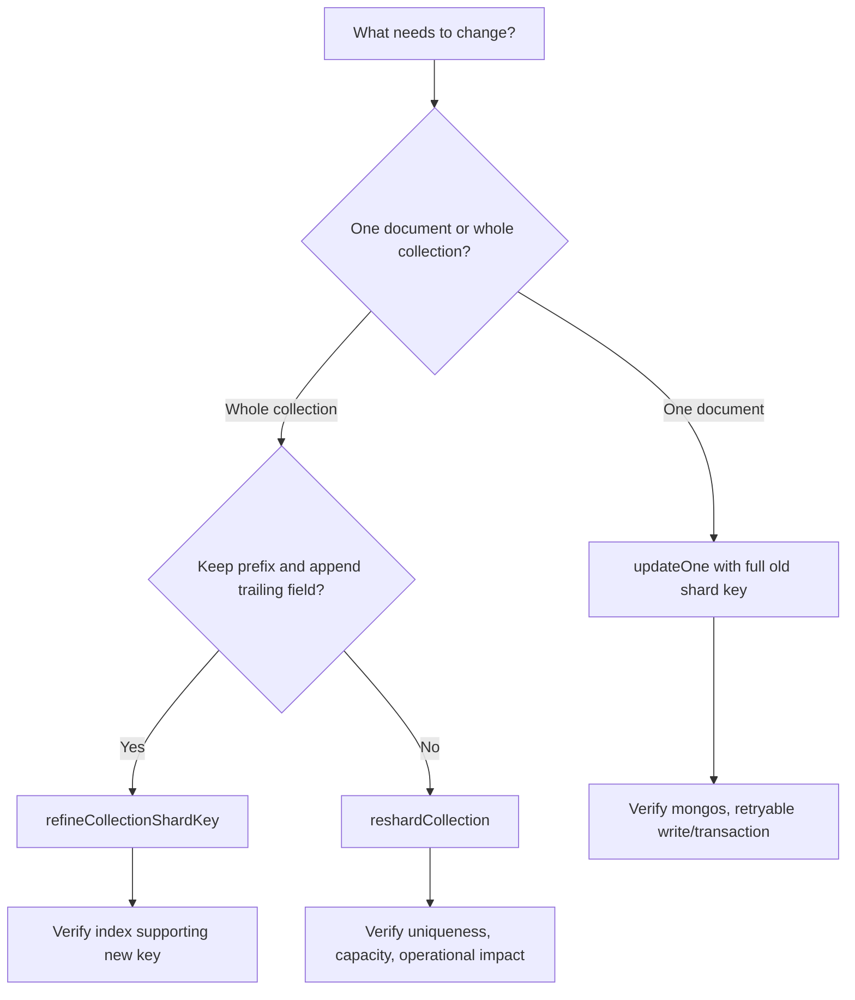

# Updating Shard Keys and Version-Specific Operation Limits

The **shard key** determines how MongoDB distributes documents across shards and how `mongos` routes queries. In a **Spring Data MongoDB** application, modifying a field that is part of the shard key, extending the shard key, and replacing a collection's shard key altogether are **three distinct operations** with different operational requirements and version support.

This lesson belongs to the **Sharding** chapter of `SPRING_DATA_MONGODB`: using Spring Data MongoDB to connect, map documents, and work through `MongoTemplate` or repositories while understanding server constraints on queries, updates, indexes, transactions, and performance.

> Scope: examples operate on a sharded cluster via **`mongos`**. Check the actual version of MongoDB Server, Atlas/self-managed cluster features, driver version, and Spring Data version before applying changes to real data. Shard key changes can increase read/write overhead or change where documents are stored.

## 1. Learning objectives

After this lesson, you will be able to:

1. Distinguish **updating a document's shard key value**, **refining a shard key**, and **resharding a collection**.
2. Explain why changing a shard key value requires a filter matching the entire old shard key, `mongos`, and a retryable write or transaction.
3. Recognize limitations around `_id`, `updateOne`, `updateMany`, `upsert`, missing shard keys, and unique indexes.
4. Choose the right operation by MongoDB Server version, especially milestones 4.2, 4.4, 5.0, 7.1, and 8.0.
5. Write controlled examples using `mongosh` and `MongoTemplate`.
6. Verify metadata, indexes, and queries after changing a shard key.

## 2. Three easily confused types of "shard key change"

Consider the `fulfillment.shipments` collection currently using shard key `{ region: 1 }`:

```javascript
{
  _id: "SHP-1001",
  region: "apac",
  tenantId: "shop-a",
  trackingCode: "TRK-1001",
  status: "CREATED"
}
```

| Requirement | Operation | Impact scope |
| --- | --- | --- |
| Move shipment from `region="apac"` to `"emea"` | **Update shard key value** | One document is updated and may need to move to another shard |
| Keep `region` as prefix, append `tenantId` for finer granularity | **Refine shard key** | Changes shard key definition from `{ region: 1 }` to `{ region: 1, tenantId: 1 }` |
| Drop `region`, shard by `{ trackingCode: "hashed" }` | **Reshard collection** | Changes distribution definition for the entire collection and reorganizes data |



**Changing a document's field value** does not change the collection's shard key definition. Conversely, **refine/reshard** are collection-level administrative operations; adding `@Sharded` on a Java entity does not perform these changes on the server.

## 3. Capability matrix by MongoDB version

| Server milestone | Key capability to remember | Important limitations |
| --- | --- | --- |
| **Before 4.2** | Does not support modifying existing shard key values via modern update mechanics | Usually requires designing a version-appropriate data migration/recreation process |
| **4.2+** | Allows changing a **document's shard key value**, except the immutable `_id` field | Must go through `mongos`; use transaction or retryable write; equality filter on **full old shard key** |
| **4.4+** | `refineCollectionShardKey` appends fields **at the end** of the shard key | Cannot reorder, remove fields, or change an existing field from `1` to `"hashed"`; requires supporting index |
| **5.0+** | `reshardCollection` allows replacing a collection's shard key | Check permissions, indexes/unique constraints, capacity, and restricted operations during resharding |
| **7.1+** | Relaxes targeting requirements for some sharded collection operations, such as `updateOne` / `findAndModify` without shard key or `_id` in the query | Does not mean you can omit the **full old shard key** filter when the update itself changes the shard key value |
| **8.0+** | Supports `reshardCollection` on the **same current shard key** with `forceRedistribution: true`; `updateOne`/`replaceOne` reference docs describe more flexible upserts | Do not extrapolate `updateOne` behavior to `updateMany` or every driver/command |
| **8.0.10+** | Can reshard **time series collections** under MongoDB prerequisites | All shards holding the time series collection must run the minimum required version; other time series limits still apply |

These milestones refer to **MongoDB Server**, not Spring Boot or Spring Data versions. Behavior can also differ among the legacy `update` command, `updateOne`, `replaceOne`, `findAndModify`, and how drivers issue commands.

**Version documentation note:** MongoDB 8.0 release notes record relaxing `updateOne(..., { upsert: true })` requirements starting in the 7.1 branch; current `updateOne` reference docs describe this capability starting from 8.0. For code targeting multiple versions, the more portable approach is to **keep an equality filter on the full shard key for upserts** and rely on relaxed behavior only after testing against your exact server/driver versions.

Inspect the actual server:

```javascript
// Run via mongos
db.version();
db.adminCommand({ buildInfo: 1 }).version;
sh.status();
```

A cluster might be mid-way through a rolling upgrade. Before running administrative commands, confirm the appropriate **feature compatibility version (FCV)**, for example via `getParameter` per your MongoDB version's ops guide; checking a single `mongos` version number is not enough.

## 4. Updating a document's shard key value (4.2+)

### 4.1. Mandatory prerequisites

MongoDB lets you modify a shard key value if the field being changed is not the immutable `_id`. To update an **existing** shard key value:

1. Send the command to **`mongos`**—do not connect directly to a shard's `mongod` to edit it.
2. Use a **single-document write**: such as `updateOne`, `replaceOne`, or `findOneAndUpdate` per method rules.
3. Run inside a **multi-document transaction** or as an eligible **retryable write**.
4. The query filter must contain **equality conditions on all old shard key components**. You may add `_id` and business criteria to identify exactly one document.
5. Preserve schema/index constraints; if the new shard key places the document into a chunk on another shard, the server may have to move the document across shards.

Suppose the shard key is `{ region: 1, tenantId: 1 }`; a valid filter is:

```javascript
{
  _id: "SHP-1001",
  region: "apac",
  tenantId: "shop-a"
}
```

Supplying only `{ _id: "SHP-1001" }` or `{ region: "apac" }` **does not satisfy** the full equality filter requirement for changing a compound shard key, even though ordinary single-document writes on newer versions may target documents with other filters.

### 4.2. `mongosh` example using retryable writes

This example targets a **test sharded cluster**. Connect to the `mongos` router address using a MongoDB URI with `retryWrites=true` enabled. Replace hostnames, credentials, and TLS settings with values from your real environment.

```bash
mongosh "mongodb://mongos-host:27017/fulfillment?retryWrites=true"
```

Prepare the sample collection (only if not yet sharded):

```javascript
use fulfillment

db.createCollection("shipments");
db.shipments.createIndex({ region: 1 });
sh.shardCollection("fulfillment.shipments", { region: 1 });

db.shipments.insertOne({
  _id: "SHP-1001",
  region: "apac",
  tenantId: "shop-a",
  trackingCode: "TRK-1001",
  status: "CREATED"
});
```

Update region:

```javascript
const filter = {
  _id: "SHP-1001",
  region: "apac" // equality on the ENTIRE old shard key
};

const result = db.shipments.updateOne(
  filter,
  { $set: { region: "emea" } },
  { upsert: false }
);

printjson({
  matchedCount: result.matchedCount,
  modifiedCount: result.modifiedCount
});

db.shipments.findOne({ _id: "SHP-1001", region: "emea" });
```

Expected output for a document not yet changed is `matchedCount=1` and `modifiedCount=1`. MongoDB may keep the document on the same shard or migrate it to another shard depending on chunk metadata; never infer physical shard placement from region names alone.

After the update, running again with the **old** filter `region: "apac"` yields `matchedCount=0` because the document now holds the new value. This behavior is helpful for preventing unintended updates when state validation before changing is required.

**Retryable writes do not make every operation retryable.** `updateOne` qualifies when driver, session, write concern, and deployment configuration meet prerequisites; `updateMany` is not a substitute for this operation. Business-layer idempotency, network error retries, and handling ambiguous outcomes must still be designed.

### 4.3. Example inside a transaction

If changing `region` must accompany another business write, you can use a transaction. The example below keeps both the region change and audit logging in the same transaction; the server may require retrying the transaction on transient errors.

```javascript
// Illustrative example, run on a replica-set-backed sharded cluster supporting transactions.
const session = db.getMongo().startSession();
const txDb = session.getDatabase("fulfillment");

try {
  session.startTransaction();

  const result = txDb.shipments.updateOne(
    { _id: "SHP-1001", region: "emea" },
    { $set: { region: "apac" } }
  );
  if (result.matchedCount !== 1) {
    throw new Error("Shipment not found with old shard key");
  }

  txDb.shipmentAudit.insertOne({
    shipmentId: "SHP-1001",
    action: "REGION_CHANGED",
    previousRegion: "emea",
    newRegion: "apac"
  });

  session.commitTransaction();
} catch (error) {
  try { session.abortTransaction(); } catch (_) {}
  throw error;
} finally {
  session.endSession();
}
```

This is an **illustrative skeleton** without a retry loop for `TransientTransactionError` / `UnknownTransactionCommitResult`. In production, use the driver's controlled transaction retry mechanism and verify `writeConcern` policies, timeouts, audit records, and repeatability of business logic. Do not specify a per-operation `writeConcern` inside a transaction.

### 4.4. Cases that must be handled separately

- **Shard key containing `_id`:** `_id` is immutable; you cannot change `_id` via `$set` or document replacement.
- **Compound shard key:** every old component needs an equality condition in the filter when changing shard key values.
- **Documents missing the shard key:** MongoDB supports updating missing values; matching `null` can match both documents missing the field and documents storing an explicit `null`. Include `_id` and follow method- and version-specific rules.
- **`updateMany`:** do not use it to batch-change existing shard key values. Setting a value for a *missing shard key* has separate rules, such as certain `updateMany` operations allowed when setting `null`.
- **`bulkWrite`:** if changing shard key values moves documents across shards, batch restrictions apply; do not arbitrarily pack numerous cross-shard changes into one bulk write.
- **Upsert:** avoid combining "find or create" logic with **moving** an existing document without thoroughly analyzing the filter and uniqueness guarantees.

## 5. Targeting, upsert, and missing shard keys across versions

A common mistake is applying **ordinary single-document operation** rules to **changing a shard key value**. Those two scopes have different requirements.

### 5.1. Filters for ordinary updates

Example collection sharded by `{ region: 1 }`:

```javascript
// Easily targets one shard thanks to the shard key:
db.shipments.updateOne(
  { _id: "SHP-1001", region: "apac" },
  { $set: { status: "IN_TRANSIT" } }
);

// Updates a non-shard-key field by _id without changing region.
// Targeting/filter eligibility and routing cost depend on server version.
db.shipments.updateOne(
  { _id: "SHP-1001" },
  { $set: { status: "DELIVERED" } }
);
```

Starting in MongoDB 7.1, some methods allow single-document writes whose filter omits the shard key or `_id`; depending on the query, MongoDB must locate the target shard in multiple stages. A solid performance rule is to **include the full shard key in the filter whenever the application knows its value**.

Do not drop the old equality condition just because `updateOne` accepts filters without the shard key on newer versions when **the shard key field itself is being modified**.

### 5.2. Filters for upsert

`Upsert` inserts a new document if no match is found. On older versions, upsert filters on sharded collections generally required the full shard key. MongoDB 8.0 reference docs for `updateOne`/`replaceOne` allow `upsert: true` without the full key in certain cases; `updateMany` and legacy `update` have their own rules.

To avoid relying on newer behavior when supporting multiple versions, specify the shard key explicitly:

```javascript
db.shipments.updateOne(
  { _id: "SHP-1002", region: "apac" },
  {
    $setOnInsert: { tenantId: "shop-a" },
    $set: { status: "CREATED" }
  },
  { upsert: true }
);
```

This filter clearly identifies the new data range upon insert. However, **upsert does not automatically guarantee cluster-wide uniqueness** on arbitrary fields; if business uniqueness is needed, you must have a shard-key-compatible unique index or an equivalent guarantee model.

### 5.3. Documents missing a shard key field

A document can lack a shard key field; the server may treat a missing value like `null` during matching and routing.

```javascript
// Illustrates that a filter can match either missing or null:
db.shipments.find({ region: null });

// When fixing a missing field, add a specific _id to avoid matching unintended documents.
db.shipments.find({ _id: "SHP-2001", region: null });
```

Transitioning from missing/`null` to **non-null** must go through `mongos`, and in applicable cases must use a retryable write or transaction. `updateOne` / `replaceOne` / `findAndModify` have distinct filter rules; do not assume all `$set` operations on a missing shard key behave identically to updating an existing shard key.

### 5.4. Quick decision table

| Scenario | Recommended rule |
| --- | --- |
| Update `status` of a document, shard key known | Filter by shard key and `_id` or appropriate business key |
| Change `region` of one document | `mongos` + full equality filter on **old shard key** + retryable write/transaction + single-document update |
| Change shard key of many documents | Process each document in a controlled loop, evaluate transactions/retries; do not default to `updateMany` |
| `upsert: true` across versions | Keep the full shard key in the filter for compatibility while enforcing uniqueness |
| Fix a missing shard key field | Check missing-field rules, distinguishing missing vs. `null` |
| Change the shard key field for the **entire collection** | Use `reshardCollection`; do not loop `updateOne` per document pretending to alter cluster definition |

## 6. Refine shard key: append fields at the end only (4.4+)

### 6.1. When is refine appropriate?

Suppose `fulfillment.tenantOrders` currently uses:

```javascript
{ tenantId: 1 }
```

A very large tenant can create a data range that is hard to split because many documents share the exact same shard key value. We want to transition to:

```javascript
{ tenantId: 1, orderNumber: 1 }
```

This is **refinement**: keeping the `tenantId` prefix unchanged and appending `orderNumber` at the end. This addition increases granularity so key ranges can be split further. It **does not guarantee** all hotspots disappear, as queries/traffic for one tenant can remain skewed.

You cannot use refine to change `{ tenantId: 1 }` into:

- `{ orderNumber: 1 }`: drops the old prefix.
- `{ orderNumber: 1, tenantId: 1 }`: changes field order.
- `{ tenantId: "hashed", orderNumber: 1 }`: changes the index type of the old shard key field.

Those requirements call for **resharding**, if server version and data permit.

### 6.2. Prerequisites and practice commands

The collection is already sharded by `{ tenantId: 1 }` and holds data. Before refining, an index supporting the **new key** is required; the supporting index must start with the new key and must not be a partial or sparse index. For collections with non-simple collation, check the `simple collation` rule.

```javascript
use fulfillment

// Inspect existing indexes before proceeding.
db.tenantOrders.getIndexes();

// Prepare an index supporting the refined key.
db.tenantOrders.createIndex({ tenantId: 1, orderNumber: 1 });

// Run on the mongos router, with appropriate admin privileges.
db.adminCommand({
  refineCollectionShardKey: "fulfillment.tenantOrders",
  key: { tenantId: 1, orderNumber: 1 }
});

sh.status();
```

**Refine does not rewrite all data like resharding** and does not immediately redistribute existing chunks evenly. After refining, monitor splits/balancer, indexes, and query distribution to confirm whether the cluster meets its goals.

Specifically, for collections with an existing **unique shard key index**, refinement prerequisites are stricter: the refined key must have an appropriate unique index, and MongoDB docs explain how to handle the old shard key index prior to running `refineCollectionShardKey`. Do not take the non-unique example above and apply it verbatim to collections with unique constraints.

### 6.3. Impact on application queries

After refine, the shard key becomes a compound key. Spring Data MongoDB should know the new key metadata in entity mappings, and business queries should consider supplying the additional field to improve targeting:

```javascript
// After refine, including the full new shard key:
db.tenantOrders.findOne({
  tenantId: "shop-a",
  orderNumber: "ORD-2026-1001"
});
```

Index/`@Sharded` definitions in the application must also align; if deployment involves multiple application instances, coordinate the rollout with the moment the cluster changes its shard key definition.

## 7. Reshard collection: replacing the shard key completely (5.0+)

### 7.1. Difference from refine

`reshardCollection` allows choosing a **different** shard key: for instance, from `{ tenantId: 1 }` to `{ orderNumber: "hashed" }`. MongoDB builds and distributes data under the new key in a collection-level administrative operation.

```text
Before:
  collection: tenantOrders
  shard key: { tenantId: 1 }

  shard A -> tenantId ranges
  shard B -> tenantId ranges

Reshard:
  donor -> copy/sort data by new key -> recipient
  sync ongoing changes -> commit

After:
  collection: tenantOrders
  shard key: { orderNumber: "hashed" }
```

This operation consumes substantial I/O, CPU, disk, and time; read the documentation for your exact version, plan capacity, and monitor the system while it runs.

### 7.2. Example `reshardCollection` command

```javascript
// Admin example: run only in an environment where prerequisites are verified.
// Collection was initially sharded on { tenantId: 1 }.
db.adminCommand({
  reshardCollection: "fulfillment.tenantOrders",
  key: { orderNumber: "hashed" }
});
```

Unlike refine, you do not manually pre-create the **new shard key** supporting index; resharding includes a phase that builds the required index. However, additional query-serving indexes and especially **existing unique indexes** must still be carefully evaluated.

For example, the unique index `{ tenantId: 1, orderNumber: 1 }` will **not automatically fit** a new shard key of `{ orderNumber: "hashed" }`. MongoDB does not permit hashed indexes to be unique, and resharding succeeds only if unique index constraints comply with the rules of the new shard key.

### 7.3. Operational limits during resharding

- Only **one collection at a time** can be resharded on a cluster.
- During resharding, blocked DDL operations such as `createIndexes`, `dropIndexes`, `collMod`, and `renameCollection` cannot run on the collection.
- Do not start resharding while an index build is in progress; MongoDB docs warn that index builds during resharding can fail.
- Provision substantial **disk headroom and throughput** on both donor and recipient shards, monitoring application latency and change volume.
- The process includes a brief **write-blocking** commit phase; MongoDB documentation describes a default maximum of roughly two seconds, though this is not an end-to-end application latency guarantee.
- Retryable writes initiated before/during resharding have a retry window tied to transaction history; after some time, `IncompleteTransactionHistory` errors may occur.
- Check restrictions for time series, encrypted collections, Search indexes, and specific cluster features.
- Aborting is restricted by phase; **never** assume you can cancel once the commit phase has begun.

### 7.4. Resharding to the same key on MongoDB 8.0+

Starting in 8.0, MongoDB allows **redistributing data** while keeping the exact same shard key definition via `forceRedistribution: true`:

```javascript
// Use only when the server supports MongoDB 8.0+.
db.adminCommand({
  reshardCollection: "fulfillment.events",
  key: { eventId: "hashed" },
  forceRedistribution: true
});
```

Typical use cases: adding new shards, changing zone distribution, or rebalancing data. This is **different** from changing the shard key to another field.

## 8. Spring Data MongoDB: applying correctly at the application layer

### 8.1. The `@Sharded` annotation and `immutableKey`

Spring Data MongoDB provides `@Sharded` since Spring Data MongoDB 3.0; it describes the entity's shard key and helps append shard key info to filters in **certain replacement/save operations**. It does not instruct the cluster to run `shardCollection`, `refineCollectionShardKey`, or `reshardCollection`.

```java
import org.springframework.data.annotation.Id;
import org.springframework.data.mongodb.core.mapping.Document;
import org.springframework.data.mongodb.core.mapping.Sharded;
import org.springframework.data.mongodb.core.mapping.ShardingStrategy;

@Document(collection = "shipments")
@Sharded(
    shardKey = "region",
    shardingStrategy = ShardingStrategy.RANGE,
    immutableKey = false
)
public class Shipment {

    @Id
    private String id;

    private String region;
    private String tenantId;
    private String trackingCode;
    private String status;

    // Constructor, getters, setters...
}
```

`immutableKey = false` is the default. When the shard key can change and Spring Data needs to construct a filter for certain save/replace operations, the library may have to **read the current shard key from the server** to identify the right document.

Only set `immutableKey = true` when **business rules guarantee the shard key never changes** and the application upholds that invariant. This attribute avoids extra round trips in eligible cases; it **does not create a new immutability constraint on MongoDB Server**.

If the application uses a Java field whose name differs from the BSON field (such as `@Field("region_code")`), verify how Spring Data maps property names in annotations, queries, and indexes so filters do not target the wrong field name.

### 8.2. Modifying a shard key with `MongoTemplate.updateFirst`

When moving a shipment between two regions, code should explicitly provide the **old shard key** in `Query`:

```java
import com.mongodb.client.result.UpdateResult;
import org.springframework.data.mongodb.core.MongoTemplate;
import org.springframework.data.mongodb.core.query.Criteria;
import org.springframework.data.mongodb.core.query.Query;
import org.springframework.data.mongodb.core.query.Update;

public class ShipmentService {

    private final MongoTemplate mongoTemplate;

    public ShipmentService(MongoTemplate mongoTemplate) {
        this.mongoTemplate = mongoTemplate;
    }

    public boolean changeRegion(
            String shipmentId,
            String oldRegion,
            String newRegion
    ) {
        Query query = Query.query(
            Criteria.where("_id").is(shipmentId)
                    .and("region").is(oldRegion)
        );
        Update update = new Update().set("region", newRegion);

        UpdateResult result =
                mongoTemplate.updateFirst(query, update, Shipment.class);

        return result.getMatchedCount() == 1;
    }
}
```

For this code to work properly when **changing a shard key**:

- Spring Data / Java driver must be configured to connect to **`mongos`**.
- The command must run as an **eligible retryable write** or inside a transaction; for example, connecting via `mongodb://.../fulfillment?retryWrites=true` if driver and server support it.
- The filter needs equality for the **entire current shard key**; in this example the shard key has only `region`.
- Before calling update, the application must know `oldRegion`. If concurrent changes are possible, check matched count and consider optimistic locking or a version condition in the filter.
- Handle driver errors, write conflicts, timeouts, and ambiguous outcomes with appropriate retry logic. Do not swallow every exception into `false`.

If the shard key is compound, include all components:

```java
Query query = Query.query(
    Criteria.where("_id").is(shipmentId)
            .and("region").is(oldRegion)
            .and("tenantId").is(tenantId)
);
```

Distinguish `@Sharded` auto-inclusion support for certain `save`/`replace` operations from `updateFirst` taking an explicit `Query`. Do not expect the annotation to automatically append shard key criteria to **every** update method.

### 8.3. When is `MongoTransactionManager` needed?

A single-document shard-key update **does not require a transaction** if it already runs as an eligible retryable write. When the update must be atomic alongside other documents, use `MongoTransactionManager` and `@Transactional`, provided the cluster is configured to support transactions.

```java
import org.springframework.stereotype.Service;
import org.springframework.transaction.annotation.Transactional;

@Service
public class ShipmentWorkflow {

    private final ShipmentService shipmentService;

    public ShipmentWorkflow(ShipmentService shipmentService) {
        this.shipmentService = shipmentService;
    }

    @Transactional
    public void moveShipment(
            String shipmentId, String oldRegion, String newRegion
    ) {
        if (!shipmentService.changeRegion(
                shipmentId, oldRegion, newRegion)) {
            throw new IllegalStateException(
                "Shipment is no longer in the initial region"
            );
        }

        // Write additional business data in the same transaction if needed.
    }
}
```

`@Transactional` only starts an actual MongoDB transaction when an **appropriate transaction manager** is configured and calls go through the Spring transaction context. When combining multiple databases or transaction managers, specify explicitly which transaction manager to use. Transient transaction errors require retry handling scoped appropriately to the business operation.

### 8.4. Refine/reshard and application rollout

If changing the **definition** of a shard key:

1. Prepare entities, queries, and indexes for the new schema; assess compatibility of both old and new application versions.
2. Execute server-side administrative operations via reviewed `mongosh`/migration scripts; never run resharding on every application startup.
3. Once metadata changes complete, roll out updated `@Sharded` config and required filters in the application.
4. Monitor queries with and without the shard key, write latency, scatter-gather, and upsert edge cases.
5. In multi-instance deployments, plan the transition window so no instance group operates on stale shard key assumptions for sensitive operations.

Do not treat `repository.save(entity)` as a universally safe default for "moving" an entity across shards across all versions. Automatic shard key inclusion on replacement depends on Spring Data version, entity state, and query structure; test key-changing writes through `mongos` with the exact driver/version you will deploy.

## 9. Uniqueness, indexes, and `_id` when changing shard keys

### 9.1. Unique indexes must remain compatible with the new shard key

A sharded collection can generally enforce cluster-wide uniqueness only when a unique index has the **full shard key as its prefix** (for ranged shard keys), aside from `_id`'s special exceptions and constraints.

Suppose the collection has:

```javascript
db.tenantOrders.createIndex(
  { tenantId: 1, orderNumber: 1 },
  { unique: true }
);
```

If the new shard key is `{ orderNumber: "hashed" }`, this existing index violates the prefix rule of the new shard key. You cannot assume resharding will convert the old unique index into a valid one. Re-evaluate the data model or uniqueness mechanism prior to resharding.

`_id` is immutable by default. When `_id` is not the shard key, the default unique index on `_id` is only enforced **within each shard**. This is especially important during resharding: MongoDB may reject the operation if existing data contains duplicate `_id` values across shards; applications should generate globally unique IDs proactively.

### 9.2. Indexes for refine vs. indexes for reshard

| Operation | Typical index rule |
| --- | --- |
| Edit a document's shard key value | No extra index needed "for changing the key"; existing shard key index must remain valid |
| Refine `{ a: 1 }` → `{ a: 1, b: 1 }` | **Pre-create** supporting index for the new key; if unique indexes exist, handle extra requirements |
| Reshard to `{ b: "hashed" }` | Server builds the new shard key index during resharding; avoid concurrent index builds and check unique constraints |
| After key change | Re-evaluate query-serving indexes, repository filters, and routing overhead |

## 10. Verification and troubleshooting

### 10.1. Checking status before/after

```javascript
// Connect to mongos.
db.version();
sh.status();

use fulfillment

db.shipments.getIndexes();
db.tenantOrders.getIndexes();

// Verify the document after updating shard-key value.
db.shipments.findOne({
  _id: "SHP-1001",
  region: "emea"
});

// Compare queries with and without the shard key.
db.shipments.find({
  region: "emea",
  status: "CREATED"
}).explain("executionStats");

db.shipments.find({
  status: "CREATED"
}).explain("executionStats");
```

Verification goes beyond seeing `ok: 1`. Confirm shard key metadata, indexes, logical document placement, number of shards accessed by queries, and latency impact.

### 10.2. Typical error table

| Symptom | Possible cause | Resolution |
| --- | --- | --- |
| Shard key update rejected when connecting directly to shard | Not routed through `mongos` | Fix client/router configuration |
| Key-changing update fails condition check | Missing full old shard key in filter, or command is not a retryable write/transaction | Add equality filter and fix write mode |
| `matchedCount=0` | Old shard key value already changed or document does not exist | Re-read document; guard against stale updates |
| Attempt to modify `_id` | `_id` is immutable | Design a new ID and proper migration flow |
| Refine fails | Missing supporting index, wrong field order, incompatible unique/collation | Inspect `getIndexes()` and refine rules |
| Reshard fails or stalls | Insufficient capacity, conflicting ops, incompatible unique index, duplicate `_id` | Check prerequisites, capacity, and reshard status |
| Queries slow down after reshard | Application still filters by old shard key | Update queries for new shard key; add suitable query indexes |
| Upsert works in test yet fails in production | Different MongoDB versions/FCVs/drivers or different command used | Keep full shard key in filter; verify version/feature flags separately |
| `@Sharded` does not shard the collection | Annotation is only Spring Data metadata | Run sharding/refine/reshard commands on the server |

### 10.3. Minimum tests before going to production

- **Version/FCV:** confirm MongoDB Server version and cluster FCV; know your deployed Spring Data/driver versions.
- **Targeting:** test updates with the full old shard key and test a query missing the shard key to assess routing cost.
- **Correctness:** check `matchedCount`, updated document, duplicate IDs, and business-code uniqueness.
- **Concurrency:** send two concurrent requests changing the same document from the same old region; only one should match once modified.
- **Fault tolerance:** test safe retries on network/transient transaction errors without writing duplicate audit logs.
- **Operations:** for refine/reshard, verify indexes, disk/I/O headroom, DDL restrictions, and phased monitoring/rollback plans.

## 11. Practice scenarios for self-assessment

**Scenario A.** Collection `shipments` is sharded by `{ region: 1 }`. A user moves a shipment from APAC to EMEA. This changes a **document value**: use `updateOne` with old `region` and `_id` in the filter, via `mongos` and a retryable write or transaction.

**Scenario B.** Collection `tenantOrders` is sharded by `{ tenantId: 1 }`. Some tenants have huge order volumes, and you want finer splitting using `orderNumber` while keeping `tenantId` as prefix. This is **refining the shard key**: create the supporting index then call `refineCollectionShardKey`, and monitor distribution afterward.

**Scenario C.** Collection `events` is sharded by timestamp, piling most inserts into the newest range. You need to switch to hashed `eventId` to distribute writes better. This requires **resharding the collection**: check server 5.0+, uniqueness, operational cost, and update application filters.

**Scenario D.** After adding new shards, a collection already has a good hashed shard key and you only want to redistribute data without changing the key. On **MongoDB 8.0+**, consider `reshardCollection` on the same key with `forceRedistribution: true` if prerequisites are met.

A proper choice solves the **right level of change**: document value, extended shard key definition, or new shard key definition for the whole collection.

## 12. References

- MongoDB Manual — [Change a Document's Shard Key Value](https://www.mongodb.com/docs/manual/core/sharding-change-shard-key-value/)
- MongoDB Manual — [Change a Shard Key](https://www.mongodb.com/docs/manual/core/sharding-change-a-shard-key/)
- MongoDB Manual — [Refine a Shard Key](https://www.mongodb.com/docs/manual/core/sharding-refine-a-shard-key/)
- MongoDB Manual — [refineCollectionShardKey command](https://www.mongodb.com/docs/manual/reference/command/refinecollectionshardkey/)
- MongoDB Manual — [Reshard a Collection](https://www.mongodb.com/docs/manual/core/sharding-reshard-a-collection/)
- MongoDB Manual — [Shard Key Indexes](https://www.mongodb.com/docs/manual/core/sharding-shard-key-indexes/)
- MongoDB Manual — [Set Missing Shard Key Fields](https://www.mongodb.com/docs/manual/core/sharding-set-missing-shard-key-fields/)
- MongoDB Manual — [updateOne() on sharded collections](https://www.mongodb.com/docs/manual/reference/method/db.collection.updateone/)
- MongoDB Manual — [Maintain Uniqueness in Sharded Clusters](https://www.mongodb.com/docs/manual/tutorial/maintain-uniqueness-in-sharded-clusters/)
- MongoDB — [MongoDB 8.0 Release Notes](https://www.mongodb.com/docs/v8.0/release-notes/8.0/)
- Spring Data MongoDB — [`@Sharded` API](https://docs.spring.io/spring-data/mongodb/reference/api/java/org/springframework/data/mongodb/core/mapping/Sharded.html)

**Takeaway for practice:** changing a document's **shard key value** is a write operation with specific filter/transaction rules; **refine** appends a suffix to the collection's shard key; **reshard** reorganizes the collection under a new shard key or redistributes under the same key on supported versions. Every operation must be checked against your exact MongoDB version's limits and actual Spring Data queries.
