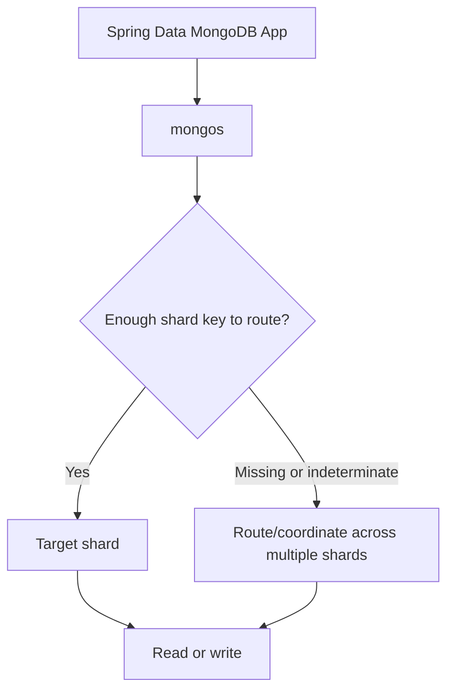
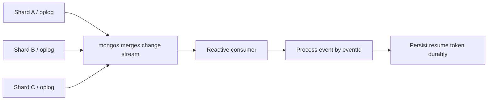
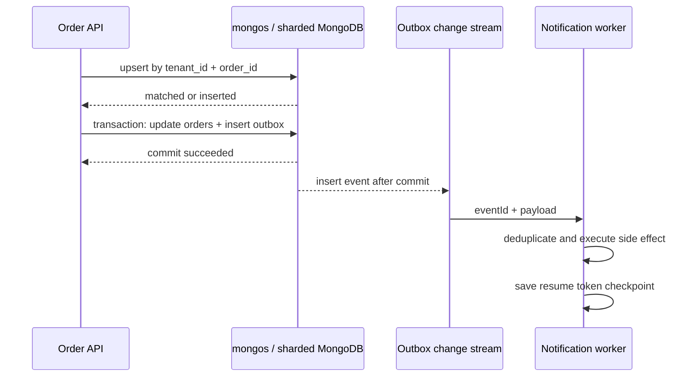

# Impact of Sharding on Upsert, Transactions, and Change Streams in Spring Data MongoDB

Sharding helps MongoDB distribute data and load across multiple shards, but it also changes how write operations are routed, transaction overhead, and how applications observe changes. In Spring Data MongoDB, the same `MongoTemplate.upsert(...)` call, `@Transactional` method, or change stream subscription can behave differently when the collection is sharded. Those differences tie directly to the **shard key**, the **`mongos`** router, MongoDB version, and retry/resume mechanics.

This lesson uses a multi-tenant order service to examine all three operations in turn. The focus is connecting query design, indexes, transactions, reactive access, and performance diagnostics; Java snippets illustrate Spring Data MongoDB, while collection setup commands run separately in `mongosh` against a sharded cluster.

## 1. Context: one collection, multiple shards

Suppose the `shop.orders` namespace has an ordered compound shard key `{ tenant_id: 1, order_id: 1 }`. In the application, `tenantId` and `orderId` are Java property names; MongoDB stores `tenant_id` and `order_id` via `@Field`.

```java
import java.time.Instant;
import org.bson.types.ObjectId;
import org.springframework.data.annotation.Id;
import org.springframework.data.mongodb.core.mapping.Document;
import org.springframework.data.mongodb.core.mapping.Field;
import org.springframework.data.mongodb.core.mapping.Sharded;

@Document(collection = "orders")
@Sharded(shardKey = { "tenantId", "orderId" }, immutableKey = true)
public class OrderDocument {
    @Id
    private ObjectId id;

    @Field("tenant_id")
    private String tenantId;

    @Field("order_id")
    private String orderId;

    private String status;
    private Instant createdAt;

    // Constructors/getters and shard key immutability enforcement omitted.
}
```

`@Sharded` provides metadata for Spring Data; it does not create a sharded cluster or invoke `shardCollection`. In this example, `immutableKey = true` simply states the assumption that `tenantId`/`orderId` do not change after order creation; business logic and data must actually enforce this.

Prepare the collection and unique index on a test cluster, connecting `mongosh` to **`mongos`**:

```javascript
use shop

// Unique across the full pair (tenant_id, order_id), not each individual component.
db.orders.createIndex(
  { tenant_id: 1, order_id: 1 },
  { unique: true }
)

// For range sharding, requires a unique shard key matching the index above.
sh.shardCollection("shop.orders", { tenant_id: 1, order_id: 1 }, true)

sh.status()
db.orders.getIndexes()
```

If the collection is already sharded or has other existing data/indexes, check preconditions before running these commands; never run them blindly in a loop. A unique index on the compound shard key prevents two documents from sharing the same `(tenant_id, order_id)` pair—an important property when concurrent upsert requests arrive.



Operations on sharded collections must always be examined at two layers: **business semantics** (right document, uniqueness, atomicity) and **distributed semantics** (routing, shard coordination, transient failures).

## 2. Upsert: filter conditions determine safety and performance

**Upsert** means updating a document matching the filter, or inserting a new document if no match exists. On a sharded collection, the router must locate where to update or insert; thus filter and shard key design are critical.

### 2.1. Requirements by MongoDB version

| Case | Behavior / constraint to remember |
| --- | --- |
| `updateOne(..., { upsert: true })` prior to MongoDB 8.0 | The upsert filter must include equality conditions on the **full shard key**, as required by those versions. |
| `updateOne(..., { upsert: true })` from MongoDB 8.0 | Providing the full shard key in the filter is no longer strictly required to perform an upsert. |
| `replaceOne(..., { upsert: true })` from MongoDB 8.0 | Rules for `replaceOne` were also relaxed; consult documentation for your exact version and API. |
| Multi-tenant business design | Still include the **full shard key and business key** in the filter for clear routing and to reduce duplicate inserts or cross-tenant mistakes. |

Because requirements vary across MongoDB versions and specific commands, avoid absolute statements like "every upsert on a sharded collection always requires the full shard key." The safe rule in this example is to provide `{ tenant_id, order_id }` regardless of whether you run MongoDB 7.x or 8.x.

### 2.2. `MongoTemplate.upsert` with a compound shard key

```java
import java.time.Instant;
import com.mongodb.client.result.UpdateResult;
import org.springframework.data.mongodb.core.MongoTemplate;
import org.springframework.data.mongodb.core.query.Criteria;
import org.springframework.data.mongodb.core.query.Query;
import org.springframework.data.mongodb.core.query.Update;

public UpdateResult createOrderIfAbsent(
        MongoTemplate mongoTemplate, String tenantId, String orderId) {

    Query byBusinessKey = Query.query(
        Criteria.where("tenantId").is(tenantId)
                .and("orderId").is(orderId)
    );

    Update onInsert = new Update()
            .setOnInsert("tenantId", tenantId)
            .setOnInsert("orderId", orderId)
            .setOnInsert("status", "NEW")
            .setOnInsert("createdAt", Instant.now());

    return mongoTemplate.upsert(
        byBusinessKey, onInsert, OrderDocument.class
    );
}
```

`Criteria` and `Update` use **Java property names**. Spring Data maps them to `tenant_id` and `order_id` in BSON. `$setOnInsert` only sets fields when MongoDB actually inserts a new record; calling this method repeatedly with the same key pair will not reset an existing `status` back to `NEW`. `UpdateResult.getUpsertedId()` indicates a new record was inserted, while `getMatchedCount()` indicates an existing document matched the filter. Do not interpret `modifiedCount = 0` as a failed operation: an idempotent write may make no changes.

Conceptually, the equivalent operation in `mongosh` is:

```javascript
db.orders.updateOne(
  { tenant_id: "tenant-a", order_id: "ord-001" },
  {
    $setOnInsert: {
      tenant_id: "tenant-a",
      order_id: "ord-001",
      status: "NEW",
      createdAt: new Date()
    }
  },
  { upsert: true }
)
```

Two concurrent requests can both observe no document before inserting. A **matching unique index** is the durable safeguard against duplicates; if a request receives `DuplicateKey`, application code should re-read the document or perform bounded retries using the business key, rather than assuming upsert provides exactly-once semantics by itself. For upserts that alter state, explicitly decide whether overwriting current state is permitted and include status predicates in the filter when necessary.

### 2.3. Conditions to examine when upserting

- **Partial shard key missing:** starting in MongoDB 8.0, some upsert commands permit filters missing key fields, but that does not eliminate scatter-gather risks, inserting documents missing fields, or matching the wrong business key.
- **Changing the shard key:** updating a shard key value is distinct from ordinary upsert and carries specific rules regarding `mongos`, retryable writes/transactions, and full-key equality filters; `_id` is immutable.
- **BSON field names:** `@Field("tenant_id")` must match the server's index and shard key definition. Using the wrong name causes broken filters or unexpected routing.
- **`save()` is not synonymous with `upsert(Query, Update, ...)`:** `save()` may follow a document-replacement write path with `@Sharded` metadata assistance; never assume all APIs automatically inject the same filter.

## 3. Transactions: atomicity remains, distributed overhead changes

MongoDB supports multi-document ACID transactions on sharded clusters. When all operations touch a single shard, overhead is close to a replica set transaction. When operations span multiple shards, MongoDB must coordinate commit across them, increasing latency and resource usage.

| Aspect | Single-shard transaction | Multi-shard transaction |
| --- | --- | --- |
| Scope | One shard handles most/all writes. | Multiple shards participate in one transaction. |
| Commit | Minimal distributed coordination. | Requires cross-shard commit coordination; latency is typically higher. |
| Read snapshot | Follows transaction rules. | When consistent snapshots across multiple shards are required, use read concern `snapshot`. |
| Migration errors | Transaction errors must still be handled. | Overlap with chunk/range migration can cause commit failures and abort the transaction. |
| Design | Co-locate data frequently written together on the same shard via business access keys when appropriate. | Use only when atomicity across multiple documents/shards is required; measure real cost. |

Sharding **does not break the atomicity of committed transactions**. However, application code must properly handle unknown commit results, transient errors, timeouts, and transaction limits; it does not magically include external systems (email, Kafka, HTTP) inside the MongoDB transaction.

### 3.1. Enabling `@Transactional` for `MongoTemplate`

Imperative Spring Data MongoDB configuration example:

```java
import org.springframework.context.annotation.Bean;
import org.springframework.context.annotation.Configuration;
import org.springframework.data.mongodb.MongoDatabaseFactory;
import org.springframework.data.mongodb.MongoTransactionManager;

@Configuration
class MongoTxConfig {
    @Bean
    MongoTransactionManager mongoTransactionManager(MongoDatabaseFactory factory) {
        return new MongoTransactionManager(factory);
    }
}
```

`MongoTemplate` and the transaction manager must share the same `MongoDatabaseFactory`; `@Transactional` must execute through a Spring proxy (e.g., a `public` method on a bean called from another bean). For reactive access, use `ReactiveMongoTransactionManager` and Reactor context instead of the imperative transaction manager. The application must connect through `mongos` to a transaction-capable cluster; never connect directly to individual shards for this workflow.

### 3.2. Updating order status and writing outbox in one transaction

Suppose the application marks an order as shipped and records an internal event in `order_outbox`. Both writes must commit or roll back together; pushing the event externally is handled later by a consumer.

```java
import org.bson.Document;
import org.springframework.stereotype.Service;
import org.springframework.transaction.annotation.Transactional;
import org.springframework.data.mongodb.core.MongoTemplate;
import org.springframework.data.mongodb.core.query.Criteria;
import org.springframework.data.mongodb.core.query.Query;
import org.springframework.data.mongodb.core.query.Update;

@Service
public class ShippingService {
    private final MongoTemplate mongoTemplate;

    public ShippingService(MongoTemplate mongoTemplate) {
        this.mongoTemplate = mongoTemplate;
    }

    @Transactional
    public void markShipped(String tenantId, String orderId) {
        Query readyOrder = Query.query(
            Criteria.where("tenantId").is(tenantId)
                    .and("orderId").is(orderId)
                    .and("status").is("PAID")
        );

        var result = mongoTemplate.updateFirst(
            readyOrder,
            new Update().set("status", "SHIPPED"),
            OrderDocument.class
        );

        if (result.getMatchedCount() != 1) {
            throw new IllegalStateException("No order found in PAID state");
        }

        String eventId = tenantId + ":" + orderId + ":SHIPPED";
        Document outbox = new Document("_id", eventId)
                .append("eventId", eventId)
                .append("tenant_id", tenantId)
                .append("order_id", orderId)
                .append("event_type", "ORDER_SHIPPED");

        mongoTemplate.insert(outbox, "order_outbox");
    }
}
```

This example assumes `shop.orders` and `shop.order_outbox` **already exist** with suitable indexes and constraints; do not implicitly create collections inside a cross-shard transaction. If `order_outbox` lives on another shard, the transaction becomes multi-shard and its cost must be measured. The event `_id` is deterministically built from the business key to aid recognition on retries; if outbox is also sharded, cluster-wide duplicate prevention must obey its shard key's unique index rules.

When a transaction fails with `TransientTransactionError` or `UnknownTransactionCommitResult`, handle retries per MongoDB driver/Spring Data guidance with bounded attempts and idempotency. **Do not blindly retry the whole business workflow** when commit outcome is unknown: re-read order state and the outbox event using the business key to reconcile. Spring Data recommends controlled retry mechanisms such as Spring Retry in imperative flows.

### 3.3. Operational limits you cannot ignore

- **Read concern:** in cross-shard transactions, `snapshot` provides a consistent snapshot across shards; align read/write concern choices with business requirements.
- **Timeouts:** transactions have time limits; long-running transactions hold resources and can block chunk migrations. Avoid waiting on external APIs or running heavy CPU work inside transactions.
- **DDL:** create collections, indexes, and sharding configurations upfront; transactions performing cross-shard writes cannot create new collections.
- **Migrations:** range/chunk redistribution can conflict with commits and cause aborts; log errors, retry on proper labels, and monitor commit latency.
- **Arbiters:** transactions touching multiple shards will abort if any involved shard contains an arbiter; check this deployment constraint beforehand.

## 4. Change streams: events merged through `mongos`

Change streams let applications subscribe to committed changes without tailing the oplog directly. They work on both replica sets and sharded clusters; on a sharded cluster, clients open streams **through `mongos`**. The router opens streams on the shards, merges and orders events, filters them, and performs `fullDocument` lookups if requested.



Important note: even when the application filters by a single tenant or shard key range, `mongos` may still open streams across **all shards** to preserve global event ordering. An idle shard can still delay event emission because the router must track logical progress across other shards. Open cursor count, connection pools, event filters, and write pressure all affect performance.

### 4.1. Reading a change stream with Spring Data Reactive MongoDB

Example consumer watching **inserts** into `order_outbox` after transaction commit:

```java
import org.bson.Document;
import org.springframework.data.mongodb.core.ChangeStreamEvent;
import org.springframework.data.mongodb.core.ReactiveMongoTemplate;
import reactor.core.publisher.Flux;

// reactiveMongoTemplate is configured to connect to mongos.
Flux<ChangeStreamEvent<Document>> events = reactiveMongoTemplate
        .changeStream(Document.class)
        .watchCollection("order_outbox")
        .listen();

// Subscribe and manage lifecycle in a long-lived application bean/worker;
// event processing, stream errors, and checkpointing belong to the consumer.
```

In reactive mode, `listen()` returns a `Flux`, so subscriptions must be managed alongside application lifecycle. When using the synchronous driver, Spring Data provides `DefaultMessageListenerContainer`/`ChangeStreamRequest` to manage blocking listeners. Watch scope can be a collection, a database, or an entire deployment; avoid opening one stream per tenant when a single filtered stream meets requirements.

A `ChangeStreamEvent` provides `getOperationType()`, `getBody()`, `getResumeToken()`, and `getTimestamp()`. For `insert` events, `getBody()` typically holds the new document. For `update`, `fullDocument` may be absent by default; enabling `UPDATE_LOOKUP` performs a lookup of the document state at lookup time, which **must not be assumed to be an exact snapshot at the moment of the update**. For `delete`, the full document may be unavailable; use `documentKey` from the raw event when you need to identify the deleted record.

### 4.2. Resume tokens and delivery semantics

MongoDB includes a **resume token** in `_id` of each change event; Spring Data exposes it via `ChangeStreamEvent.getResumeToken()`. Applications should persist tokens durably to resume the stream after restarts:

```java
import org.bson.BsonValue;
import org.bson.Document;
import org.springframework.data.mongodb.core.ChangeStreamEvent;
import reactor.core.publisher.Flux;

// checkpointStore is an application adapter loading the persisted BSON token.
BsonValue lastProcessedToken = checkpointStore.loadLastToken();

Flux<ChangeStreamEvent<Document>> resumed = reactiveMongoTemplate
        .changeStream(Document.class)
        .watchCollection("order_outbox")
        .resumeAfter(lastProcessedToken)
        .listen();
```

This snippet illustrates the `resumeAfter` API and assumes `checkpointStore.loadLastToken()` returns a **non-null** `BsonValue`. On initial startup with no saved token, adopt an explicit bootstrap policy (such as watching from current time combined with reconciling existing outbox records); do not call `resumeAfter(null)`. **Save the checkpoint only after corresponding business processing completes durably.** Saving the token before processing risks skipping events if the worker crashes. Processing successfully then crashing before saving the token causes event redelivery; consumers must deduplicate using `eventId` or an idempotency key.

`resumeAfter` cannot resume past an `invalidate` event (such as collection drop/rename); `startAfter` can be used in appropriate cases. Resuming also depends on oplog history still retaining the token and compatible pipeline/options; shard removal, long downtime, or oplog rollover can force re-initialization via a reconciliation workflow. Never use `clusterTime` alone to conclude two events belong to the same transaction: multiple distinct transactions can share a timestamp; inspect `lsid` and `txnNumber` in the raw event when transaction grouping is needed.

### 4.3. How change streams reflect upserts and transactions

| Write operation | Typical stream observation | Handling note |
| --- | --- | --- |
| Upsert **insert** | `insert` event. | Rely on `operationType`/`documentKey` and business ID to prevent duplicate notifications. |
| Upsert **update** | `update` or `replace` event depending on the actual write operation. | Do not assume `fullDocument` is always present; check update description or lookup. |
| Update changing no data | May emit no data-change event. | `matchedCount > 0` does not guarantee a new notification. |
| Multi-document transaction commit | Committed changes appear as events for their respective operations. | The stream does not replace a business transaction log; events may replay upon resume. |
| Transaction abort | Rolled-back changes never appear as committed events. | Never emit external side effects before commit. |
| Chunk/range migration | Internal data movement must not be treated as a new business event. | Distinguish application document changes from storage relocation. |

For streams on sharded collections, `documentKey` in the event may also contain shard key fields to identify and route the document. For events emitted by transactions, the raw event may include `lsid` and `txnNumber`; to track a logical order across multiple collections, store explicit business identifiers in the outbox rather than inferring everything from timestamps.

## 5. Combining all three into a consistent pipeline

A common pattern is the **transactional outbox**: upsert creates the order record safely by shard key; a transaction updates state and inserts an outbox record; a change stream delivers committed events to an external worker.



This coordination delivers **at-least-once** semantics at the event boundary: events only surface after commit, yet external processors can still see redeliveries upon restart or retry. To achieve an effectively once business outcome, the consumer needs an idempotency key and synchronized tracking of processing results with checkpoints. A MongoDB transaction cannot roll back an email or HTTP request already sent earlier.

### Failure scenario example

Suppose the worker calls a shipping partner API to create a shipment label, then crashes before persisting the resume token. On restart, the change stream replays `ORDER_SHIPPED`. If the worker calls the partner unconditionally again, two labels may be created. The solution is to pass `eventId` as an idempotency key to the partner (if supported), or persist processing results keyed by `eventId` in durable storage before advancing the checkpoint. Also maintain a reconciliation job for events whose resume tokens have expired.

## 6. Testing and diagnostics on a sharded cluster

Practice on a cluster with **at least two shards**, distributed test data, and connections routed via `mongos`; cross-shard behavior cannot be inferred from standalone MongoDB or mocked repositories.

| Scenario | Action | Verification criteria |
| --- | --- | --- |
| First upsert | Send `tenant-a/ord-001`. | Inserts one document, `upsertedId` present, BSON field names accurate. |
| Repeated/concurrent upsert | Send same key pair concurrently. | No duplicate orders thanks to unique index; race errors handled via business key. |
| Filter missing shard key | Test an `orderId`-only filter in your test environment by version. | Record exact version behavior/errors and routing rather than guessing from another version. |
| Single-shard transaction | Update order and co-located related record on the same shard. | Commit/roll back atomically; measure p95/p99 commit latency. |
| Multi-shard transaction | Write two documents actually residing on two different shards. | Atomic commit; compare latency and test transient error handling. |
| Aborted transaction | Intentionally throw an exception before commit. | Neither order nor outbox commits; stream emits no events from rolled-back changes. |
| Consumer restart | Save token, stop listener, insert new events, restart. | Resumes from token without losing events inside oplog window; idempotent processing. |
| Quiet/cold shard | Read stream while one shard has almost no events. | Observe latency and resource usage instead of assuming instant delivery. |

Useful `mongosh` commands:

```javascript
use shop

// Sharding status, key, and chunk/range distribution.
sh.status()

// Unique index and shard key field order.
db.orders.getIndexes()

// Inspect routing for a query containing the full shard key.
db.orders.find({ tenant_id: "tenant-a", order_id: "ord-001" })
  .explain("executionStats")

// Simple watch from mongos; loops waiting for events, exit with Ctrl+C.
const stream = db.order_outbox.watch([{ $match: { operationType: "insert" } }])
while (stream.hasNext()) {
  printjson(stream.next())
}
```

Under real workloads, also track transaction abort/retry rates, commit latency, active change stream cursors, connection pool utilization, resume failures, and end-to-end lag from `clusterTime` to consumer completion. When selecting a shard key, balance load distribution against **co-locating operations that commonly share a transaction on the same shard**.

## 7. Misconceptions to avoid

1. **"Upsert is already safe because `upsert: true` is set"**: you still need a compatible unique index, stable business keys, tenant-scoped filters, and concurrency handling.
2. **"All transactions on a sharded cluster are slow"**: single-shard transactions can perform close to replica sets; cross-shard scope and actual load determine cost.
3. **"`@Transactional` enables itself for MongoDB"**: requires a configured transaction manager/session, compatible MongoDB deployment, and active Spring proxying.
4. **"A change stream only reads the shard containing the tenant"**: `mongos` may coordinate streams across all shards to maintain global order.
5. **"Having a resume token means exactly-once"**: tokens only resume delivery; external processing still needs idempotency and durable checkpoints.
6. **"Every event from one transaction shares a unique `clusterTime`"**: never equate transactions by timestamp; inspect session/transaction metadata when needed.

## 8. Comprehensive hands-on exercise

Build a multi-tenant `POST /orders` feature on a test cluster:

1. Configure `shop.orders` with shard key `{ tenant_id: 1, order_id: 1 }` and a compatible unique index. Implement `MongoTemplate.upsert` using the full key and `setOnInsert` for initial status.
2. Add `MongoTransactionManager`. Inside a transaction, update order status and insert an `order_outbox` record; verify rollback by intentionally throwing an exception.
3. Use `ReactiveMongoTemplate` to watch outbox inserts; persist `eventId`, processing outcomes, and resume tokens. Restart the consumer, inject failures, and confirm zero duplicate side effects.
4. Generate single-shard and cross-shard workloads to compare commit latency; inspect query plans via `explain` and change stream metrics.
5. Document your exact MongoDB version and also test an upsert missing the shard key—do not apply MongoDB 8.0 conclusions to 7.x.

**Completion criteria:** you can explain version differences in upsert rules, why cross-shard transactions add cost, how `mongos` merges change stream events, and how to build a resumable, idempotent consumer. Include real cluster logs or measurements, not merely mapping unit tests.

## References

- [MongoDB — `updateOne` on sharded collections and upsert](https://www.mongodb.com/docs/manual/reference/method/db.collection.updateone/): routing rules and version-specific shard key requirements.
- [MongoDB — `replaceOne` and upsert](https://www.mongodb.com/docs/manual/reference/method/db.collection.replaceone/): replace-specific constraints.
- [MongoDB — Enforce Uniqueness on the Shard Key Values](https://www.mongodb.com/docs/manual/tutorial/enforce-uniqueness-on-shard-key-values/): unique indexes for shard keys.
- [MongoDB — Production Considerations for Sharded Transactions](https://www.mongodb.com/docs/manual/core/transactions-sharded-clusters/): cost, read concern, and abort scenarios.
- [MongoDB — Change Streams](https://www.mongodb.com/docs/manual/changestreams/): sharded cluster mechanics, resume tokens, and invalidation.
- [MongoDB — Change Streams Production Recommendations](https://www.mongodb.com/docs/manual/administration/change-streams-production-recommendations/): global ordering, cold shards, and performance.
- [Spring Data MongoDB — Sessions & Transactions](https://docs.spring.io/spring-data/mongodb/reference/mongodb/client-session-transactions.html): `MongoTransactionManager`, `@Transactional`, reactive transactions.
- [Spring Data MongoDB — Change Streams](https://docs.spring.io/spring-data/data-mongo/reference/mongodb/change-streams.html): reactive change streams, resume APIs, and listeners.
