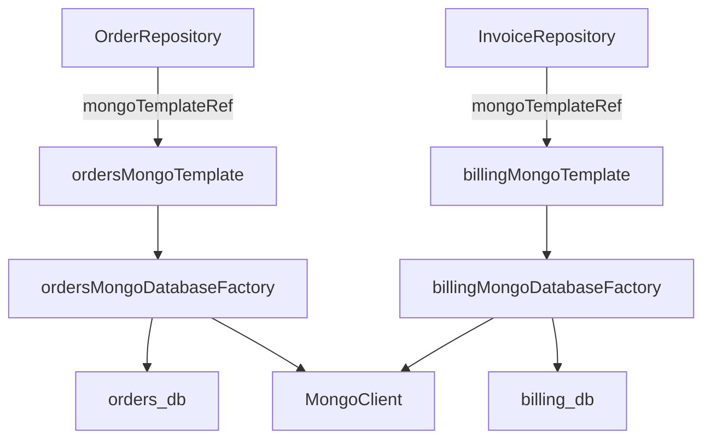
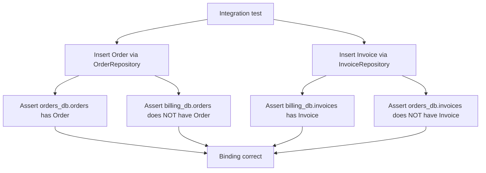

# Binding Repository Groups to the Right Template

A **Spring Data MongoDB** application can work with multiple MongoDB databases: for example, `orders_db` for orders and `billing_db` for invoices. If the configuration is loose, `OrderRepository` can be bound by Spring to the billing database's `MongoTemplate` even when entity names, collection names, and repository methods all look valid. The most dangerous consequence is **writing data into the wrong database without any error**, especially when both databases share the same collection name.

The primary solution is to create templates with **explicit bean names** and bind each repository group via `@EnableMongoRepositories(mongoTemplateRef = "...")`. For reactive repositories, use `@EnableReactiveMongoRepositories(reactiveMongoTemplateRef = "...")`. Combine clean package grouping, `MongoDatabaseFactory`/`ReactiveMongoDatabaseFactory`, `@Qualifier` when injecting templates, and integration tests that verify which database actually receives the data.

This lesson belongs to the **Multiple databases** chapter of the `SPRING_DATA_MONGODB` module. The module covers using Spring Data MongoDB to connect, map documents, and perform operations via `MongoTemplate`/repositories, practicing queries, aggregations, indexes, transactions, reactive access, testing, and performance diagnostics. In this lesson, the specific scope is **binding repository groups to the right template**, not an arbitrary dynamic tenant-routing system.

> **Key point to remember:** `@Document(collection = "orders")` only selects the **collection**, not the database. `@Primary` only prioritizes type-based dependency injection when multiple beans exist; it **does not replace** setting `mongoTemplateRef`/`reactiveMongoTemplateRef` on each repository group. If a bean name in the annotation is wrong, the application typically fails at startup; if a package group is scanned incorrectly while a valid template still exists, the application may **run and write to the wrong place**.

## 1. Learning objectives

After this lesson, you will be able to:

1. Distinguish `MongoClient`, `MongoDatabaseFactory`, `MongoTemplate`, and repository proxies.
2. Explain how a repository is bound to a database via a **template**, not just via `@Document`.
3. Distinguish two databases on the same MongoDB deployment from two separate MongoDB clusters.
4. Create two `MongoDatabaseFactory` beans for two databases while optionally sharing one `MongoClient`.
5. Create two `MongoTemplate` beans with consistent bean names: `ordersMongoTemplate` and `billingMongoTemplate`.
6. Separate repository interfaces into non-overlapping packages.
7. Use `@EnableMongoRepositories(basePackageClasses = ..., mongoTemplateRef = "...")` for each group.
8. Understand the default fallback `mongoTemplateRef = "mongoTemplate"` when omitted.
9. Use `@Qualifier` in services that need direct access to a specific template.
10. Distinguish `@Primary` from explicit repository-to-template binding.
11. Configure Spring Boot to avoid repository auto-scanning broader packages than intended.
12. Understand marker packages/`basePackageClasses` and the risks of refactoring package names.
13. Read the mapping chain "repository → template → factory → database".
14. Declare repositories for the same entity type across two databases without mixing scopes.
15. Separate index creation/migrations per target database.
16. Use `MongoTemplate` properly to run `find`, aggregations, and updates.
17. Configure multiple **reactive repository** groups using `reactiveMongoTemplateRef`.
18. Distinguish sync `MongoClient` from reactive MongoDB `MongoClient`.
19. Choose a `MongoTransactionManager` matching the same `MongoDatabaseFactory` that the template uses.
20. Avoid assuming distributed transactions exist across two MongoDB clusters.
21. Avoid request-scoped switching of a shared template.
22. Configure tests using fixed test databases/URIs.
23. Verify both that **data is in the right place** and that **no records exist in the wrong place**.
24. Diagnose missing template beans, duplicate repositories, ambiguous autowiring, and wrong databases.
25. Implement least-privilege MongoDB permissions and per-database query observability.

## 2. How repositories bind to a database

A Spring Data repository is a proxy generated by the framework. In an imperative setup, the proxy uses a designated `MongoOperations`/`MongoTemplate`. That template receives a `MongoDatabaseFactory` configured with a default database.



Resolution chain:

1. `@EnableMongoRepositories` scans repository interfaces within the configured package scope.
2. `mongoTemplateRef` specifies the template **bean name** for the discovered repositories.
3. The template is built from a `MongoDatabaseFactory` configured with a database name.
4. The MongoDB Driver opens that database and the collection specified by mapping/operations.
5. `@Document` affects only the collection name, type alias, and mapping context — **it never switches to another database**.

### 2.1. Bean names are part of the contract

`mongoTemplateRef = "ordersMongoTemplate"` must match the Spring bean name **exactly**. `mongoTemplateRef` is not a URI, a database name, or a Java field name. Choose clear names and keep them stable when refactoring configuration.

### 2.2. Database name is not collection name

Two databases can both have an `orders` collection containing completely different data. Therefore, a test asserting only `repository.count() == 1` is insufficient; you must inspect the **target database** directly.

## 3. Two multi-database deployment patterns

| Pattern | Example | Driver client | Database factories | Notes |
| --- | --- | --- | --- | --- |
| Two databases on the **same MongoDB deployment** | `orders_db` and `billing_db` | Can **share one sync MongoClient** | Two factories with different database names | Shares connection pool, deployment, and credentials |
| Two databases on **different deployments** | Order cluster A, billing cluster B | **Two MongoClients** by URI | Each factory uses its matching client | Separate networks/credentials/pools |
| One template with dynamic database name via raw driver | `getDatabase(name)` | Possibly one | Typically one factory | Does not make repository groups switch automatically |
| One database, multiple collections | `orders`, `invoices` in same DB | One | One | No need for two templates just for multiple collections |

### 3.1. When is multi-database config unnecessary?

If you simply have multiple collections inside the same database, `@Document("orders")` and `@Document("invoices")` with a single template suffice. Creating unnecessary templates only complicates repository scanning.

### 3.2. Is sharing a MongoClient safe?

When two databases belong to the same deployment and use the same credentials authorized on both, you can use **one container-managed MongoClient** with two `MongoDatabaseFactory` beans. `MongoClient` is designed for reuse, holding connection pools and topology monitoring.

Conversely, if the two databases require **different credentials, TLS settings, or clusters**, provide separate clients and never try to share one client to bypass access boundaries.

## 4. Distinguishing the configuration layers

| Layer | Primary type | Responsibility |
| --- | --- | --- |
| Sync connection | `com.mongodb.client.MongoClient` | Deployment connection, pooling, auth/TLS |
| Sync database factory | `MongoDatabaseFactory` | Default database selection, session management |
| Sync operations | `MongoTemplate`/`MongoOperations` | Domain/BSON conversion, CRUD, queries |
| Sync repository | `MongoRepository<T,ID>` | Proxy with derived queries/CRUD |
| Reactive connection | `com.mongodb.reactivestreams.client.MongoClient` | Reactive Streams Driver |
| Reactive database factory | `ReactiveMongoDatabaseFactory` | Reactive DB/session access |
| Reactive operations | `ReactiveMongoTemplate` | Returns `Mono`/`Flux` |
| Reactive repository | `ReactiveMongoRepository<T,ID>` | Reactive repository proxy |

Spring Data MongoDB has **two distinct client types** for synchronous and reactive paths. Even though both interfaces are named `MongoClient`, their packages differ; you cannot pass a sync client bean into `ReactiveMongoTemplate`.

### 4.1. Client lifecycle

When creating a `MongoClient` via `MongoClients.create` and registering it as a `@Bean`, Spring manages its close/destroy lifecycle alongside the bean lifecycle. Opening new clients per request causes connection pools and monitor threads to grow. In these examples, each client is a singleton bean.

## 5. Non-overlapping package structure

An illustrative layout:

```text
dev.learning.multi
  MultiDatabaseApplication.java
  config/
    MultiMongoInfrastructure.java
    OrdersRepositoryConfiguration.java
    BillingRepositoryConfiguration.java
  orders/
    model/
      OrderDocument.java
    repo/
      OrderRepository.java
    service/
      OrderService.java
  billing/
    model/
      InvoiceDocument.java
    repo/
      InvoiceRepository.java
    service/
      BillingService.java
```

**Important:** `orders.repo` and `billing.repo` are two separate packages; orders' `@EnableMongoRepositories` scans only `orders.repo`, and billing's scans only `billing.repo`.

### 5.1. Why prefer `basePackageClasses` over strings?

`basePackageClasses = OrderRepository.class` instructs Spring to scan **the package containing that class** and its subpackages. It is safer than typing a raw string that can silently go stale when a package is renamed. If you want to decouple the marker from the repository itself, create an empty marker interface like `OrdersRepositoryPackage` inside the target package.

### 5.2. Never place an unscoped config scan on the root package

`@EnableMongoRepositories` without `basePackages`/`basePackageClasses` scans the package of the configuration class itself. If the config sits in `dev.learning.multi`, it can scan **both orders and billing**, binding both groups together. Always specify the explicit scope in multi-database setups.

## 6. Two domain classes

An order in the orders database:

```java
package dev.learning.multi.orders.model;

import org.springframework.data.annotation.Id;
import org.springframework.data.mongodb.core.mapping.Document;

@Document("orders")
public record OrderDocument(
    @Id String id,
    String tenantId,
    String status,
    long totalCents
) {}
```

An invoice in the billing database:

```java
package dev.learning.multi.billing.model;

import org.springframework.data.annotation.Id;
import org.springframework.data.mongodb.core.mapping.Document;

@Document("invoices")
public record InvoiceDocument(
    @Id String id,
    String tenantId,
    String orderId,
    long amountCents
) {}
```

### 6.1. `@Document` does not specify a database name

`@Document("orders")` only tells Spring Data the default collection name `orders`. An `OrderDocument` saved via `billingMongoTemplate` can still create/write to the `billing_db.orders` collection. Thus, **entity types are not a firewall against writing to the wrong DB**.

### 6.2. Avoid real sensitive data in examples/tests

The IDs, tenant IDs, and `totalCents` amounts are synthetic. Production systems need tenant authorization and dedicated policies for PII/financial data rather than relying solely on package separation.

## 7. Two repository interfaces

```java
package dev.learning.multi.orders.repo;

import dev.learning.multi.orders.model.OrderDocument;
import org.springframework.data.mongodb.repository.MongoRepository;
import java.util.List;

public interface OrderRepository
        extends MongoRepository<OrderDocument, String> {

    List<OrderDocument> findByTenantId(String tenantId);
}
```

```java
package dev.learning.multi.billing.repo;

import dev.learning.multi.billing.model.InvoiceDocument;
import org.springframework.data.mongodb.repository.MongoRepository;
import java.util.List;

public interface InvoiceRepository
        extends MongoRepository<InvoiceDocument, String> {

    List<InvoiceDocument> findByTenantId(String tenantId);
}
```

A repository declares only the **domain API**; no URI or database name appears in the interface. Where it persists is decided by `@EnableMongoRepositories` + template binding.

### 7.1. Is `@Repository` required?

Normally, interfaces extending `MongoRepository` are registered by the repository infrastructure when within scan scope; `@Repository` is not needed just to generate the proxy. For Spring to discover a repository, package scanning and repository activation are what matter.

## 8. Configuring two factories and two templates

Example of **two databases on the same deployment**, using the sync MongoDB Driver and one managed client. This forms the configuration core.

```yaml
# application.yml — dev example only; production reads URIs from secrets.
app:
  mongo:
    uri: ${APP_MONGO_URI:mongodb://localhost:27017}
    orders-database: orders_db
    billing-database: billing_db
```

```java
package dev.learning.multi.config;

import com.mongodb.client.MongoClient;
import com.mongodb.client.MongoClients;
import org.springframework.beans.factory.annotation.Qualifier;
import org.springframework.beans.factory.annotation.Value;
import org.springframework.context.annotation.Bean;
import org.springframework.context.annotation.Configuration;
import org.springframework.data.mongodb.MongoDatabaseFactory;
import org.springframework.data.mongodb.core.MongoTemplate;
import org.springframework.data.mongodb.core.SimpleMongoClientDatabaseFactory;

@Configuration(proxyBeanMethods = false)
public class MultiMongoInfrastructure {

    @Bean("sharedMongoClient")
    MongoClient sharedMongoClient(
            @Value("${app.mongo.uri}") String uri) {
        return MongoClients.create(uri);
    }

    @Bean("ordersMongoDatabaseFactory")
    MongoDatabaseFactory ordersMongoDatabaseFactory(
            @Qualifier("sharedMongoClient") MongoClient client,
            @Value("${app.mongo.orders-database}") String name) {
        return new SimpleMongoClientDatabaseFactory(client, name);
    }

    @Bean("billingMongoDatabaseFactory")
    MongoDatabaseFactory billingMongoDatabaseFactory(
            @Qualifier("sharedMongoClient") MongoClient client,
            @Value("${app.mongo.billing-database}") String name) {
        return new SimpleMongoClientDatabaseFactory(client, name);
    }

    @Bean("ordersMongoTemplate")
    MongoTemplate ordersMongoTemplate(
            @Qualifier("ordersMongoDatabaseFactory")
            MongoDatabaseFactory factory) {
        return new MongoTemplate(factory);
    }

    @Bean("billingMongoTemplate")
    MongoTemplate billingMongoTemplate(
            @Qualifier("billingMongoDatabaseFactory")
            MongoDatabaseFactory factory) {
        return new MongoTemplate(factory);
    }
}
```

### 8.1. Why not just write `MongoTemplate(client, "orders_db")` directly?

`new MongoTemplate(client, "orders_db")` is a valid constructor, but `new MongoTemplate(MongoDatabaseFactory)` creates an **explicit factory bean**, making it convenient to configure `MongoTransactionManager` with the **same factory instance**, verify the database name in tests, and control infrastructure.

### 8.2. Distinguishing `@Bean` names from database names

| Spring bean | Instance | Default database |
| --- | --- | --- |
| `sharedMongoClient` | Driver client for a deployment | No business database default |
| `ordersMongoDatabaseFactory` | `SimpleMongoClientDatabaseFactory` | `orders_db` |
| `billingMongoDatabaseFactory` | `SimpleMongoClientDatabaseFactory` | `billing_db` |
| `ordersMongoTemplate` | `MongoTemplate` | `orders_db` |
| `billingMongoTemplate` | `MongoTemplate` | `billing_db` |

The same client can manage shared connections; the two factories/templates still maintain distinct database names and operation scopes.

### 8.3. Using two different clusters

If orders and billing reside on two separate MongoDB deployments, create two `MongoClient` beans from **two separate URIs** and inject each into its corresponding factory. Do not share `sharedMongoClient` in that case, because credentials, topology, latency, and transactions do not span deployments.

### 8.4. Never hardcode passwords

In production, fetch URIs from a secrets manager or environment configuration, and sanitize logs to prevent exposing URIs with credentials. Even if a URI includes a database path, the explicit database name on the factory still governs the template's default database; avoid conflicting database names and test against real connections.

## 9. Two `@EnableMongoRepositories` with `mongoTemplateRef`

**Orders group** configuration class:

```java
package dev.learning.multi.config;

import dev.learning.multi.orders.repo.OrderRepository;
import org.springframework.context.annotation.Configuration;
import org.springframework.data.mongodb.repository.config.EnableMongoRepositories;

@Configuration(proxyBeanMethods = false)
@EnableMongoRepositories(
    basePackageClasses = OrderRepository.class,
    mongoTemplateRef = "ordersMongoTemplate"
)
public class OrdersRepositoryConfiguration {}
```

**Billing group** configuration class:

```java
package dev.learning.multi.config;

import dev.learning.multi.billing.repo.InvoiceRepository;
import org.springframework.context.annotation.Configuration;
import org.springframework.data.mongodb.repository.config.EnableMongoRepositories;

@Configuration(proxyBeanMethods = false)
@EnableMongoRepositories(
    basePackageClasses = InvoiceRepository.class,
    mongoTemplateRef = "billingMongoTemplate"
)
public class BillingRepositoryConfiguration {}
```

Key decisions:

- `basePackageClasses` defines **which repositories belong to the group**.
- `mongoTemplateRef` defines **which template bean the group uses**.
- The template name must match `@Bean("...")` in `MultiMongoInfrastructure`.
- Scan packages must **never overlap**, lest a repository get registered in both groups.
- Whenever a repository moves to another package, verify it still falls inside the intended scan scope.

### 9.1. The dangerous default: `mongoTemplate`

If `mongoTemplateRef` is omitted, `@EnableMongoRepositories` defaults to looking for a bean named **`mongoTemplate`**. Having two beans `ordersMongoTemplate` and `billingMongoTemplate` does not mean Spring will infer the right one from the entity. Never leave target database selection to default wiring.

### 9.2. Never omit package scope

`@EnableMongoRepositories(mongoTemplateRef = "ordersMongoTemplate")` without `basePackages` in a broad config package can attach `InvoiceRepository` to the orders template. Multi-database setups require **both `templateRef` and scan scope**.

## 10. Spring Boot auto-configuration and duplicate scanning

Spring Boot automatically detects MongoDB repositories in application base packages. When moving to multiple databases, **both auto-scanning repositories and declaring multiple `@EnableMongoRepositories`** can cause bean name collisions, duplicate registrations, or billing repositories accidentally wiring to the orders template.

### 10.1. Each repository must belong to exactly one scan scope

```java
@EnableMongoRepositories(
    basePackageClasses = OrderRepository.class,
    mongoTemplateRef = "ordersMongoTemplate")
```

For billing, scan only the package containing `InvoiceRepository` and use `billingMongoTemplate`. Do not place a third annotation on the application root that scans both packages.

### 10.2. Disabling auto-repository scanning when needed

Spring Boot offers a flag controlling **auto-configured MongoDB repositories**. On supported Boot versions:

```yaml
spring:
  data:
    mongodb:
      repositories:
        type: none
```

The goal is to turn off Boot's repository auto-configuration, **not** the explicit repository groups declared via `@EnableMongoRepositories`. Check property metadata for your exact Spring Boot major version; if Boot already backs off automatically when manual configuration is present, no extra override is needed.

### 10.3. Avoid bean overriding to mask errors

`spring.main.allow-bean-definition-overriding=true` can hide a duplicate registration, making behavior depend on bean registration order. Never use it as a substitute for clean package boundaries and explicit bean names.

## 11. `@Primary` does not replace `mongoTemplateRef`

With two `MongoTemplate` beans, plain type-based injection can throw `NoUniqueBeanDefinitionException`:

```java
@Autowired MongoTemplate template; // Ambiguous if no default exists.
```

`@Primary` only chooses a default bean when Spring resolves multiple injection candidates. It **does not bind repository groups** by domain. In multi-database architectures, use explicit `@Qualifier` for templates and `mongoTemplateRef` for repository groups.

### 11.1. Injecting a template in a service with a qualifier

```java
package dev.learning.multi.orders.service;

import dev.learning.multi.orders.model.OrderDocument;
import dev.learning.multi.orders.repo.OrderRepository;
import org.springframework.beans.factory.annotation.Qualifier;
import org.springframework.data.mongodb.core.MongoOperations;
import org.springframework.data.mongodb.core.query.Query;
import org.springframework.stereotype.Service;

@Service
public class OrderService {

    private final OrderRepository orders;
    private final MongoOperations ordersOps;

    public OrderService(
            OrderRepository orders,
            @Qualifier("ordersMongoTemplate") MongoOperations ordersOps) {
        this.orders = orders;
        this.ordersOps = ordersOps;
    }

    public OrderDocument create(OrderDocument value) {
        return orders.insert(value);
    }

    public long countAll() {
        return ordersOps.count(new Query(), OrderDocument.class);
    }
}
```

`ordersOps` is injected by bean name; `OrderRepository` is already bound via `OrdersRepositoryConfiguration`. Both operations target `orders_db`.

### 11.2. When is `@Primary` useful?

When an application has a clear primary database for legacy code, `@Primary` resolves injection ambiguity. However, before enabling it, audit every unqualified `MongoTemplate` injection; never expect `@Primary` to separate orders and billing properly on its own.

## 12. Making repository-to-database mapping an invariant

| Repository group | Template bean | Factory bean | Database |
| --- | --- | --- | --- |
| `OrderRepository` | `ordersMongoTemplate` | `ordersMongoDatabaseFactory` | `orders_db` |
| `InvoiceRepository` | `billingMongoTemplate` | `billingMongoDatabaseFactory` | `billing_db` |

Verify every row from **repository scan → templateRef → template bean → factory bean → database name**. No row may jump across to another database.

### 12.1. Successful startup can still write to the wrong database

If `InvoiceRepository` is mistakenly bound to the orders template, MongoDB may automatically create `orders_db.invoices` on insert. The app runs normally, yet invoices are missing from the billing DB. That is a **data integrity** bug, not a syntax error.

### 12.2. Verify absence in the wrong database as well

A test asserting only `invoiceRepository.findById(id)` returns the invoice is insufficient: the repository might simply read back from the **wrong database** it just wrote to. Read billing through an independent template/factory and verify that the orders DB **does not contain** that record.

## 13. Queries and aggregations must also use the right template

```java
import java.util.List;
import org.springframework.data.mongodb.core.query.Criteria;
import org.springframework.data.mongodb.core.query.Query;

Query q = Query.query(
    Criteria.where("tenantId").is("tenant-a"));

List<OrderDocument> orders =
    ordersMongoTemplate.find(q, OrderDocument.class);
```

Aggregation example:

```java
import org.bson.Document;
import org.springframework.data.mongodb.core.aggregation.Aggregation;

var pipeline = Aggregation.newAggregation(
    Aggregation.match(
        Criteria.where("tenantId").is("tenant-a")),
    Aggregation.group("status").count().as("total")
);

var result = ordersMongoTemplate.aggregate(
    pipeline, OrderDocument.class, Document.class);
```

The template determines `orders_db`; the entity/`@Document` determines the `orders` collection. Switching to `billingMongoTemplate` would direct the query to `billing_db.orders` without changing a single line of mapping.

### 13.1. `@Field` does not change database routing

`@Field("customer_id")` maps a Java property to a BSON field. It does not choose a database. Each template can have a different mapping converter; when custom converters are present, test both field mapping and database binding.

### 13.2. Raw `MongoClient` can bypass repository boundaries

A service that obtains a raw `MongoClient` and calls `getDatabase("billing_db")` can touch billing even from inside the orders package. Restrict raw client access via modular/gateway architecture, credentials, and code review.

## 14. Custom repository fragments must also use the right template

Suppose `OrderRepository` extends a custom fragment `OrderAnalytics`:

```java
package dev.learning.multi.orders.repo;

public interface OrderAnalytics {
    long countOpenOrders(String tenantId);
}
```

Fragment implementation:

```java
package dev.learning.multi.orders.repo;

import dev.learning.multi.orders.model.OrderDocument;
import org.springframework.beans.factory.annotation.Qualifier;
import org.springframework.data.mongodb.core.MongoOperations;
import org.springframework.data.mongodb.core.query.Criteria;
import org.springframework.data.mongodb.core.query.Query;

public class OrderAnalyticsImpl implements OrderAnalytics {

    private final MongoOperations ordersOps;

    public OrderAnalyticsImpl(
            @Qualifier("ordersMongoTemplate") MongoOperations ordersOps) {
        this.ordersOps = ordersOps;
    }

    @Override
    public long countOpenOrders(String tenantId) {
        return ordersOps.count(
            Query.query(
                Criteria.where("tenantId").is(tenantId)
                    .and("status").is("OPEN")),
            OrderDocument.class);
    }
}
```

Spring Data fragment implementations must follow your version's naming convention/configuration. **Repository CRUD methods can hit the right template while a custom method hits the wrong database** if the fragment injects an unqualified template.

### 14.1. Non-repository paths

Scheduled jobs, index/migration runners, event listeners, CLI maintenance tools, and aggregation services all require the right template bean. A properly bound repository does not prove those paths are bound properly.

## 15. Same entity in two databases follows the same rules

Two templates can map the same `CustomerSnapshot.class` and collection name:

```java
ordersMongoTemplate.insert(snapshot, "customer_snapshots");
billingMongoTemplate.insert(snapshot, "customer_snapshots");
```

These two calls target **two distinct namespaces**. Therefore, a Java entity class cannot serve as a "type-level database guard".

### 15.1. Avoid colliding interface bean names

Having a `CustomerRepository` interface in both packages can trigger bean name collisions. Use distinct names like `OrdersCustomerRepository` and `BillingCustomerRepository`, or configure an appropriate bean name generator. Never enable bean overriding so one repository silently wins over the other.

### 15.2. No built-in per-call `databaseName` parameter

A repository is bound to its template when Spring creates the proxy. Passing a `databaseName` query parameter does not switch the repository's template. Dynamic routing requires a dedicated architecture and does not replace the static group configuration shown here.

## 16. `ReactiveMongoRepository` has its own binding attribute

Spring Data MongoDB uses a different annotation for reactive repositories:

```java
@EnableReactiveMongoRepositories(
    basePackageClasses = ReactiveOrderRepository.class,
    reactiveMongoTemplateRef = "ordersReactiveMongoTemplate")
```

The right attribute is **`reactiveMongoTemplateRef`**, not the imperative `mongoTemplateRef`. When omitted, the Javadoc specifies a default bean name of `reactiveMongoTemplate`.

| Execution path | Driver MongoClient | Template | Repository |
| --- | --- | --- | --- |
| Sync | `com.mongodb.client.MongoClient` | `MongoTemplate` | `MongoRepository` |
| Reactive | `com.mongodb.reactivestreams.client.MongoClient` | `ReactiveMongoTemplate` | `ReactiveMongoRepository` |

Even though both clients share the class name `MongoClient`, **their packages differ**; never inject a sync client into a reactive database factory.

## 17. Two reactive factories and templates

This is the **reactive variant** of the configuration built in section 8. If an application uses both sync and reactive stacks, each client type needs its own bean name, pool, and lifecycle.

```java
package dev.learning.multi.config;

import com.mongodb.reactivestreams.client.MongoClient;
import com.mongodb.reactivestreams.client.MongoClients;
import org.springframework.beans.factory.annotation.Qualifier;
import org.springframework.beans.factory.annotation.Value;
import org.springframework.context.annotation.Bean;
import org.springframework.context.annotation.Configuration;
import org.springframework.data.mongodb.ReactiveMongoDatabaseFactory;
import org.springframework.data.mongodb.core.ReactiveMongoTemplate;
import org.springframework.data.mongodb.core.SimpleReactiveMongoDatabaseFactory;

@Configuration(proxyBeanMethods = false)
public class MultiReactiveMongoInfrastructure {

    @Bean("sharedReactiveMongoClient")
    MongoClient sharedReactiveClient(
            @Value("${app.mongo.uri}") String uri) {
        return MongoClients.create(uri);
    }

    @Bean("ordersReactiveMongoDatabaseFactory")
    ReactiveMongoDatabaseFactory ordersFactory(
            @Qualifier("sharedReactiveMongoClient") MongoClient client,
            @Value("${app.mongo.orders-database}") String db) {
        return new SimpleReactiveMongoDatabaseFactory(client, db);
    }

    @Bean("billingReactiveMongoDatabaseFactory")
    ReactiveMongoDatabaseFactory billingFactory(
            @Qualifier("sharedReactiveMongoClient") MongoClient client,
            @Value("${app.mongo.billing-database}") String db) {
        return new SimpleReactiveMongoDatabaseFactory(client, db);
    }

    @Bean("ordersReactiveMongoTemplate")
    ReactiveMongoTemplate ordersTemplate(
            @Qualifier("ordersReactiveMongoDatabaseFactory")
            ReactiveMongoDatabaseFactory factory) {
        return new ReactiveMongoTemplate(factory);
    }

    @Bean("billingReactiveMongoTemplate")
    ReactiveMongoTemplate billingTemplate(
            @Qualifier("billingReactiveMongoDatabaseFactory")
            ReactiveMongoDatabaseFactory factory) {
        return new ReactiveMongoTemplate(factory);
    }
}
```

### 17.1. Reactive factory still binds a default DB

`SimpleReactiveMongoDatabaseFactory(client, "orders_db")` provides the default database for `ordersReactiveMongoTemplate`. Reactor Context or security context **does not automatically switch** a static template's database.

### 17.2. Two reactive deployments

If orders and billing reside on two clusters, create two reactive `MongoClient` beans from two separate URIs and bind them accordingly. Never share credentials when privilege isolation is required.

## 18. Two reactive repository groups

Example repositories in separate packages from the sync repositories:

```java
package dev.learning.multi.orders.reactive;

import dev.learning.multi.orders.model.OrderDocument;
import org.springframework.data.mongodb.repository.ReactiveMongoRepository;
import reactor.core.publisher.Flux;

public interface ReactiveOrderRepository
        extends ReactiveMongoRepository<OrderDocument, String> {
    Flux<OrderDocument> findByTenantId(String tenantId);
}
```

```java
package dev.learning.multi.billing.reactive;

import dev.learning.multi.billing.model.InvoiceDocument;
import org.springframework.data.mongodb.repository.ReactiveMongoRepository;
import reactor.core.publisher.Flux;

public interface ReactiveInvoiceRepository
        extends ReactiveMongoRepository<InvoiceDocument, String> {
    Flux<InvoiceDocument> findByTenantId(String tenantId);
}
```

Orders config:

```java
package dev.learning.multi.config;

import dev.learning.multi.orders.reactive.ReactiveOrderRepository;
import org.springframework.context.annotation.Configuration;
import org.springframework.data.mongodb.repository.config.EnableReactiveMongoRepositories;

@Configuration(proxyBeanMethods = false)
@EnableReactiveMongoRepositories(
    basePackageClasses = ReactiveOrderRepository.class,
    reactiveMongoTemplateRef = "ordersReactiveMongoTemplate"
)
public class OrdersReactiveRepositoryConfiguration {}
```

Billing config:

```java
package dev.learning.multi.config;

import dev.learning.multi.billing.reactive.ReactiveInvoiceRepository;
import org.springframework.context.annotation.Configuration;
import org.springframework.data.mongodb.repository.config.EnableReactiveMongoRepositories;

@Configuration(proxyBeanMethods = false)
@EnableReactiveMongoRepositories(
    basePackageClasses = ReactiveInvoiceRepository.class,
    reactiveMongoTemplateRef = "billingReactiveMongoTemplate"
)
public class BillingReactiveRepositoryConfiguration {}
```

### 18.1. Usage

```java
import reactor.core.publisher.Flux;
import reactor.core.publisher.Mono;

Mono<OrderDocument> inserted = reactiveOrderRepository.insert(
    new OrderDocument("O-101", "tenant-a", "NEW", 12500));

Flux<OrderDocument> records =
    reactiveOrderRepository.findByTenantId("tenant-a");
```

`Mono`/`Flux` execute upon subscription. The repository proxy remains bound to **`ordersReactiveMongoTemplate`** and does not switch to billing based on entity name or Reactor subscriber.

### 18.2. When `ReactiveMongoOperations` is needed

```java
public ReactiveOrderService(
        ReactiveOrderRepository repo,
        @Qualifier("ordersReactiveMongoTemplate")
        ReactiveMongoOperations operations) {
    this.repo = repo;
    this.operations = operations;
}
```

This is a service constructor fragment with the corresponding imports. An unqualified `ReactiveMongoOperations` in a context with two templates will be ambiguous.

## 19. Binding transaction managers to the right `MongoDatabaseFactory`

MongoDB transactions require a supporting topology (replica set/sharded cluster) and a compatible `ClientSession`. Spring Data transaction managers manage sessions per database factory.

### 19.1. Imperative

```java
import org.springframework.beans.factory.annotation.Qualifier;
import org.springframework.context.annotation.Bean;
import org.springframework.data.mongodb.MongoDatabaseFactory;
import org.springframework.data.mongodb.MongoTransactionManager;

@Bean("ordersTransactionManager")
MongoTransactionManager ordersTransactionManager(
        @Qualifier("ordersMongoDatabaseFactory")
        MongoDatabaseFactory factory) {
    return new MongoTransactionManager(factory);
}
```

When used in a service:

```java
import org.springframework.transaction.annotation.Transactional;

@Transactional(transactionManager = "ordersTransactionManager")
public void updateOrder(/* args */) {
    // Use OrderRepository / ordersMongoTemplate
    // within this transaction scope.
}
```

Place the `@Bean` method inside a `@Configuration` class. `ordersTransactionManager` must use the **same factory bean** as `ordersMongoTemplate` so the template receives the session bound by Spring Data.

### 19.2. Reactive

```java
import org.springframework.beans.factory.annotation.Qualifier;
import org.springframework.context.annotation.Bean;
import org.springframework.data.mongodb.ReactiveMongoDatabaseFactory;
import org.springframework.data.mongodb.ReactiveMongoTransactionManager;

@Bean("ordersReactiveTransactionManager")
ReactiveMongoTransactionManager ordersReactiveManager(
        @Qualifier("ordersReactiveMongoDatabaseFactory")
        ReactiveMongoDatabaseFactory factory) {
    return new ReactiveMongoTransactionManager(factory);
}
```

Reactive transactions use Reactor Context and require a Publisher chain managed by `TransactionalOperator` or a reactive transaction manager, not scattered inner `subscribe()` calls.

### 19.3. Multiple transaction managers

When both orders and billing transaction managers exist, `@Transactional` without specifying a manager can cause ambiguity or pick the wrong default. Declare `@Transactional(transactionManager = "ordersTransactionManager")` at the appropriate service boundary.

## 20. No automatic distributed transactions across two templates

MongoDB can execute transactions across multiple databases **within the same deployment** when server conditions allow. However:

- Two `MongoDatabaseFactory` beans **do not automatically share session binding** merely by sharing a `MongoClient`.
- `ordersTransactionManager` does not automatically enlist `billingMongoTemplate` built from the billing factory.
- If the two databases are on **two separate MongoDB clusters**, a single simple MongoDB-native manager cannot commit atomically across both deployments.
- Cross-database reads using two templates do not automatically provide a consistent snapshot.

### 20.1. Designing writes for order + invoice

Within the same deployment, an **explicit session/factory coordination design** and real integration tests are needed if a multi-database transaction is required. Across two deployments, prefer a transactional outbox, event-driven reconciliation, saga, or idempotent compensation aligned with business invariants.

### 20.2. Do not treat `@Transactional` as a system-wide guarantee

A `@Transactional` annotation on a service calling both repositories does not prove all writes joined the same MongoDB session. Verify the selected transaction manager, factories, and actual MongoDB transactions via integration tests.

## 21. Credentials and data authorization

Repository-to-template binding is an **application-level constraint**, not the sole security boundary. A shared client with permissions on both orders and billing can still write to the wrong place if code picks the wrong template.

### 21.1. Least privilege

- The orders runtime principal only needs appropriate permissions on `orders_db`.
- The billing runtime principal only needs appropriate permissions on `billing_db`.
- Migration/index provisioning should use separate administrative privileges.
- Never hardcode passwords in `application.yml` or log connection strings containing credentials.
- If sharing a single client/credential, evaluate the isolation trade-off against connection pool reuse.

### 21.2. Database separation is not tenant authorization

`orders_db` can still hold multiple tenants; `@EnableMongoRepositories` does not filter `tenantId` automatically. All user-facing queries require tenant authorization, validation, and proper query predicates.

### 21.3. Never let clients pick templates arbitrarily

An HTTP parameter like `database=orders_db` or `database=billing_db` must never map directly to a bean name or `MongoClient.getDatabase(...)` without authorization. Doing so can bypass boundaries and leak data across business domains.

## 22. Testing repository binding: what to assert

The goal of testing is to prove the **right database**, not just that `repository.save` works.



Recommended test groups:

1. Bean `ordersMongoTemplate` exists and points to factory database `orders_db`.
2. Bean `billingMongoTemplate` exists and points to `billing_db`.
3. `OrderRepository.insert` succeeds and the document is in `orders_db.orders`.
4. `InvoiceRepository.insert` succeeds and the document is in `billing_db.invoices`.
5. **No** order exists in `billing_db.orders`.
6. **No** invoice exists in `orders_db.invoices`.
7. Derived tenant ID queries hit the right collection.
8. Template operations, aggregations, and custom fragments also hit the right DB.
9. Migrations/index provisioning target the right namespaces.
10. If reactive repositories exist, verify similarly with `StepVerifier`.

### 22.1. Why are negative tests critical?

If `OrderRepository` is misbound to the billing template, a test running `orders.insert(order)` and `orders.findById(id)` will still **pass** because both insert and find hit the billing DB. Negative assertions reading through an independent template catch the bug immediately.

### 22.2. Avoid using a root account for permission tests

A test using root credentials can write to the wrong database without failing. Maintain separate functional routing tests and permission tests using scoped principals. Permission tests do not replace routing tests, and routing tests do not replace least privilege.

## 23. Complete integration test with Spring Boot and Testcontainers

The example below uses **Spring Boot 3.x + Testcontainers Java 1.x**, along with `MultiMongoInfrastructure`, `OrdersRepositoryConfiguration`, `BillingRepositoryConfiguration`, and the repositories above.

```java
package dev.learning.multi;

import static org.assertj.core.api.Assertions.assertThat;

import java.util.UUID;

import dev.learning.multi.orders.model.OrderDocument;
import dev.learning.multi.orders.repo.OrderRepository;
import dev.learning.multi.billing.model.InvoiceDocument;
import dev.learning.multi.billing.repo.InvoiceRepository;

import org.junit.jupiter.api.Test;
import org.springframework.beans.factory.annotation.Autowired;
import org.springframework.beans.factory.annotation.Qualifier;
import org.springframework.boot.test.context.SpringBootTest;
import org.springframework.data.mongodb.MongoDatabaseFactory;
import org.springframework.data.mongodb.core.MongoTemplate;
import org.springframework.test.context.DynamicPropertyRegistry;
import org.springframework.test.context.DynamicPropertySource;
import org.testcontainers.containers.MongoDBContainer;
import org.testcontainers.junit.jupiter.Container;
import org.testcontainers.junit.jupiter.Testcontainers;
import org.testcontainers.utility.DockerImageName;

@Testcontainers
@SpringBootTest
class RepositoryDatabaseBindingIntegrationTest {

    @Container
    static final MongoDBContainer mongo =
        new MongoDBContainer(
            DockerImageName.parse("mongo:7.0"));

    @DynamicPropertySource
    static void mongoProperties(DynamicPropertyRegistry registry) {
        registry.add("app.mongo.uri", mongo::getReplicaSetUrl);
        registry.add("app.mongo.orders-database", () -> "orders_db");
        registry.add("app.mongo.billing-database", () -> "billing_db");
    }

    @Autowired OrderRepository orderRepository;
    @Autowired InvoiceRepository invoiceRepository;

    @Autowired
    @Qualifier("ordersMongoTemplate")
    MongoTemplate ordersTemplate;

    @Autowired
    @Qualifier("billingMongoTemplate")
    MongoTemplate billingTemplate;

    @Autowired
    @Qualifier("ordersMongoDatabaseFactory")
    MongoDatabaseFactory ordersFactory;

    @Autowired
    @Qualifier("billingMongoDatabaseFactory")
    MongoDatabaseFactory billingFactory;

    @Test
    void repositoriesWriteToCorrectDatabasesOnly() {
        String suffix = UUID.randomUUID().toString();
        String orderId = "order-" + suffix;
        String invoiceId = "invoice-" + suffix;

        OrderDocument order = new OrderDocument(
            orderId, "tenant-test", "NEW", 12500L);
        InvoiceDocument invoice = new InvoiceDocument(
            invoiceId, "tenant-test", orderId, 12500L);

        orderRepository.insert(order);
        invoiceRepository.insert(invoice);

        // Assertions on actual database factories.
        assertThat(ordersFactory.getMongoDatabase().getName())
            .isEqualTo("orders_db");
        assertThat(billingFactory.getMongoDatabase().getName())
            .isEqualTo("billing_db");

        // Positive assertions: right database.
        assertThat(
            ordersTemplate.findById(orderId, OrderDocument.class))
            .isNotNull();
        assertThat(
            billingTemplate.findById(invoiceId, InvoiceDocument.class))
            .isNotNull();

        // Negative assertions: must NOT exist in the wrong database.
        assertThat(
            billingTemplate.findById(orderId, OrderDocument.class))
            .isNull();
        assertThat(
            ordersTemplate.findById(invoiceId, InvoiceDocument.class))
            .isNull();

        // Derived queries must still return data for the right group.
        assertThat(orderRepository.findByTenantId("tenant-test"))
            .extracting(OrderDocument::id)
            .contains(orderId);
        assertThat(invoiceRepository.findByTenantId("tenant-test"))
            .extracting(InvoiceDocument::id)
            .contains(invoiceId);
    }
}
```

### 23.1. Why use `@DynamicPropertySource`?

Because the custom application config uses `app.mongo.uri`, the test must override **that exact key** rather than only setting `spring.data.mongodb.uri`. `MongoDBContainer` provides a valid test URI, while the explicit database factories select `orders_db` and `billing_db`.

### 23.2. Why use UUIDs in tests?

Unique IDs prevent collisions with fixtures from other tests. Results do not depend on a completely empty collection or a `deleteAll` call that could wipe another test's data. Keep test databases inside an isolated container.

### 23.3. Testcontainers 1.x and 2.x

The import `org.testcontainers.containers.MongoDBContainer` comes from Testcontainers Java 1.x. Newer branches may have different modules/packages; pin the BOM per your project and adjust imports when upgrading. This lesson does not imply running `MongoDBContainer` in production.

### 23.4. Transactions are not needed to verify binding

This test writes an order and invoice independently and inspects both namespaces. It **does not claim** the two writes share atomicity. If your business flow requires cross-database transactions, write a separate test tailored to the corresponding topology and session strategy.

### 23.5. Bean scanning must be loaded in the test context

`@SpringBootTest` assumes the application scans the `@Configuration` classes listed above and that `OrderRepository`/`InvoiceRepository` are activated explicitly. If using a test slice like `@DataMongoTest`, you may need `@Import` for manual configurations rather than assuming the slice loads every bean automatically.

## 24. Testing reactive binding

In a reactive project, use `ReactiveOrderRepository`/`ReactiveInvoiceRepository` and reactive templates/factories. The logic remains **positive + negative assertions**, using Publishers and `StepVerifier`:

```java
import reactor.core.publisher.Mono;
import reactor.test.StepVerifier;

String suffix = java.util.UUID.randomUUID().toString();
String id = "R-" + suffix;

Mono<Void> action = reactiveOrderRepository
    .insert(new OrderDocument(id, "tenant-test", "NEW", 100L))
    .then();

StepVerifier.create(action).verifyComplete();

StepVerifier.create(
    ordersReactiveMongoTemplate.findById(id, OrderDocument.class))
    .expectNextMatches(doc -> id.equals(doc.id()))
    .verifyComplete();

StepVerifier.create(
    billingReactiveMongoTemplate.findById(id, OrderDocument.class))
    .verifyComplete(); // No record in the billing database.
```

Place this snippet inside a test class with the reactive beans injected, using an isolated test database and the `reactor-test` dependency. Simply creating a Publisher does not run the query; **`StepVerifier` must subscribe** to actually verify behavior.

### 24.1. Test the reactive invoice group too

Do the same for `ReactiveInvoiceRepository`, reading with `billingReactiveMongoTemplate` and asserting it is **not found via `ordersReactiveMongoTemplate`**. Never test only the orders group, as an annotation could have been copy-pasted incorrectly.

### 24.2. Never block in production WebFlux code

In tests, `StepVerifier` with a reasonable timeout is fine; in reactive services, never call `block()` just to "make sure" the right DB is chosen. Database routing is a matter of bean configuration, not blocking versus non-blocking subscription.

## 25. Index creation, migrations, and schema ownership

Index creation must use the **right template**:

```java
import org.springframework.data.domain.Sort;
import org.springframework.data.mongodb.core.index.Index;

ordersMongoTemplate.indexOps(OrderDocument.class)
    .ensureIndex(
        new Index()
            .on("tenantId", Sort.Direction.ASC)
            .on("status", Sort.Direction.ASC)
            .named("tenant_status"));

billingMongoTemplate.indexOps(InvoiceDocument.class)
    .ensureIndex(
        new Index()
            .on("tenantId", Sort.Direction.ASC)
            .on("orderId", Sort.Direction.ASC)
            .named("tenant_order"));
```

If both `indexOps` calls run on `ordersMongoTemplate`, the billing index gets created on `orders_db.invoices`, while `billing_db.invoices` still lacks the index it needs.

### 25.1. Separate migrations by logical database

Rules:

- Orders migrations touch only `orders_db`.
- Billing migrations touch only `billing_db`.
- Every migration verifies the namespace/collection before creating or dropping indexes.
- Never run automatic DDL on every HTTP request.
- Never use an unqualified default template in migration tasks.
- Use matching principals/roles; separate runtime read/write access from DDL privileges.

### 25.2. Custom converters can differ

When two databases follow different conventions (e.g., field naming, `BigDecimal`, encryption, or type aliases), configure `MongoConverter`/`MongoMappingContext` consistently for each template. **Sharing a Java entity does not guarantee the same BSON schema** when converters differ. Integration tests should check not only the DB name, but also serialization of critical fields.

### 25.3. Do not rely on annotation-based auto-index creation blindly

Modern Spring Data MongoDB versions typically **do not auto-create indexes from annotations by default**. If you enable auto-index creation or use `@Indexed`, verify the actual indexes in each database; repository binding does not provision indexes into both DBs automatically.

## 26. Operations, performance, and observability

Multiple templates are not just a Spring injection concern. Each client or cluster can have distinct connection pools, authentication, TLS, read/write concerns, and failure domains.

### 26.1. One `MongoClient` or multiple?

| Scenario | Reasonable choice | Trade-off |
| --- | --- | --- |
| Two databases on the same deployment, same credentials | Can use **one shared MongoClient** | Shared pool, broader permissions |
| Two databases on the same deployment, different permissions | Two clients/credentials | More resources, better isolation |
| Two different MongoDB deployments | Two separate clients | Independent topology, failover, and monitoring |
| One app using both sync and reactive | Two different **client types** | Manage pool/lifecycle for each driver |

`MongoTemplate` is typically reused as a singleton; **never create a new `MongoTemplate` per request**. Creating a new `MongoClient` per call spawns additional connections and monitoring resources, leading to saturation.

### 26.2. Log database names, never log credentials

A helpful log at startup or in tests:

```java
String ordersDb =
    ordersFactory.getMongoDatabase().getName();

String billingDb =
    billingFactory.getMongoDatabase().getName();

// Log allowed DB names; never log URI credentials.
```

Never log full MongoDB URIs if they contain usernames/passwords or sensitive connection options. In production, use structured logs (component, logical database, operation, trace ID) with redaction.

### 26.3. Command monitoring per database

MongoDB Java Driver provides `CommandListener`. In test/staging, you can read `CommandStartedEvent.getDatabaseName()` to observe which DB commands actually hit. Log only the **database name and command type**, never raw command documents containing customer data.

### 26.4. Independent network failures

If orders and billing run on two clusters, the orders cluster may be healthy while the billing cluster times out. Never use a single global `ping` on orders to declare the whole application healthy. Monitor connection pools, latency, server selection time, replica lag, and failure rates per database/deployment.

### 26.5. Health checks must test the right path

The existence of an `ordersMongoTemplate` bean does not prove billing DB credentials have read permissions. Readiness checks should verify connectivity and required permissions for each domain (using lightweight, safe commands), avoiding test writes in production.

## 27. Common errors and troubleshooting

| Symptom | Common cause | Resolution |
| --- | --- | --- |
| `No bean named ordersMongoTemplate` | `mongoTemplateRef` does not match bean name | Compare with `@Bean("ordersMongoTemplate")` |
| `NoUniqueBeanDefinitionException MongoTemplate` | Two templates, unqualified injection | Use `@Qualifier` |
| Duplicate repository bean | Overlapping scan scopes or Boot auto-scan | Separate packages, check auto-config |
| `BeanDefinitionOverrideException` | Two repository interfaces with the same bean name | Rename interfaces, avoid overlapping scans |
| CRUD succeeds yet billing DB is empty | `InvoiceRepository` uses orders template | Negative DB assertions |
| Orders records end up in billing DB | `mongoTemplateRef` copy-pasted wrong | Fix binding, plan migration of misplaced data |
| Template bean has right name, wrong DB | Factory uses wrong database name | Assert `MongoDatabaseFactory.getMongoDatabase().getName()` |
| `@Document` changed, DB did not | Annotation only sets collection | Fix factory/template |
| `@Primary` sends operations to wrong DB | Unqualified injection picks default | Use domain qualifiers |
| Derived repository works, custom fragment fails | Fragment injects default `MongoTemplate` | Inject qualified operations |
| Index created on `orders_db.invoices` | Migration uses orders template | Separate index jobs |
| Reactive repo cannot find template | Used `mongoTemplateRef` instead of reactive attr | Use `reactiveMongoTemplateRef` |
| Reactive client type mismatch | Imported sync `MongoClient` into reactive factory | Use `com.mongodb.reactivestreams.client.MongoClient` |
| App boots, repository not created | Wrong scan scope/missing annotation | Check `basePackageClasses` |
| Both sync/reactive repos scanned wrongly | Overlapping package boundaries | Split repository packages |
| Transaction runs on wrong DB | Wrong `MongoTransactionManager` chosen | Match factory and explicit manager name |
| Cross-DB writes not atomic | Two factories, separate sessions | Design coordination/outbox |
| Transaction works only on simple local setup | Standalone MongoDB or unconfigured manager | Test against a real replica set |
| Permission denied only on billing | Credentials/roles insufficient for billing DB | Scoped least privilege |
| Connection pool grows sharply | Client/template created per request | Managed singleton beans |
| URI changed but data still writes wrong | Factory's own database name is still wrong | Inspect entire bean graph |
| Spring Boot auto-config duplicates beans | Auto repository activation + manual configs | Check `repositories.type`/backoff |
| Repository insert test passes despite bad mapping | Tested read-back only via same repository | Run positive and negative tests via templates |
| One tenant reads another tenant's data | Missing authorization/tenant filter | Validate principal and query predicates |

### 27.1. Diagnostic checklist order

1. Which packages do `OrderRepository` and `InvoiceRepository` currently reside in?
2. How many `@EnableMongoRepositories` exist and which packages does each scan?
3. What string is set in `mongoTemplateRef` for each group?
4. Does the context contain beans matching the exact names and type `MongoTemplate`?
5. Which `MongoClient`/DB name is each template's factory using?
6. Is Boot auto-scan or a broad component scan causing double registration?
7. Is `@Primary` causing unqualified services to pick a default?
8. Does any custom repository fragment or aggregation job use a different template?
9. In reactive apps, are `reactiveMongoTemplateRef` and the driver type right?
10. Does the transaction manager use the template's exact factory?
11. Do tests verify both the **right DB** and the **wrong DB**?
12. Are database permissions, credentials, and `authSource` valid?
13. Which namespace do indexes/migrations target?
14. Is there any undesigned cross-database consistency assumption?
15. Have startup/DB-mapping diagnostics been captured without exposing credentials?

## 28. Hands-on exercises

**Exercise 1 — Mapping chain.** Draw the diagram `OrderRepository → ordersMongoTemplate → ordersMongoDatabaseFactory → orders_db` and the corresponding chain for invoices.

**Exercise 2 — Two templates.** Declare two `MongoTemplate` beans on the same `MongoClient` with different database names.

**Exercise 3 — Two clients.** Modify the example so orders/billing have two separate URIs and credentials. Why not use a shared client?

**Exercise 4 — Repo packages.** Organize `orders.repo` and `billing.repo` so scan scopes do not overlap.

**Exercise 5 — TemplateRef.** Write two `@EnableMongoRepositories` annotations with accurate `mongoTemplateRef` values.

**Exercise 6 — Default hazard.** What happens when a group omits `mongoTemplateRef` and the app has a default `mongoTemplate` bean?

**Exercise 7 — BasePackageClasses.** Compare type-safe `basePackageClasses` with string-based `basePackages` during refactoring.

**Exercise 8 — Primary vs Qualifier.** Why doesn't `@Primary` replace `mongoTemplateRef`? Write a service injecting `@Qualifier`.

**Exercise 9 — No-overlap.** Try placing a config at the root package and omitting `basePackageClasses`. Analyze the risk of scanning both repositories.

**Exercise 10 — Duplicate bean.** Create two interfaces both named `CustomerRepository` in two packages, observe startup, and rename them cleanly.

**Exercise 11 — Negative assertion.** Insert an order via the repo, verify it exists in `orders_db.orders` and **does not** exist in `billing_db.orders`.

**Exercise 12 — Billing mirror.** Insert an invoice, verify it exists in billing and not in the orders database.

**Exercise 13 — Reactive.** Create a second `ReactiveMongoTemplate` and write `@EnableReactiveMongoRepositories(reactiveMongoTemplateRef=...)`.

**Exercise 14 — Reactor.** Use `StepVerifier` to prove the reactive `OrderRepository` inserts/reads in the right DB.

**Exercise 15 — Fragment.** Write a custom `OrderAnalyticsImpl` with a qualified `MongoOperations`; explain what happens if the fragment mistakenly uses the billing template.

**Exercise 16 — Migration.** Create a tenant/status index for orders and a tenant/orderId index for billing, and inspect index catalogs in both DBs.

**Exercise 17 — Transaction.** Create a `MongoTransactionManager` for the orders factory and use `@Transactional(transactionManager=...)`.

**Exercise 18 — Cross-db.** Design an outbox/saga when orders and billing live on two independent clusters.

**Exercise 19 — Security.** Contrast a shared client with permissions on both DBs against two-client least privilege.

**Exercise 20 — Diagnostics.** Create startup diagnostics logging only database names and template bean names; never log URI passwords.

**Exercise 21 — Resilience.** When the billing cluster is down while orders is healthy, how should health status and error handling be designed?

**Exercise 22 — Review.** Review a pull request adding `RefundRepository`: which group/template/database does it belong to, and what test proves it is right?

## 29. Pre-deployment review checklist

- [ ] Decided whether the two databases share one deployment or use two deployments.
- [ ] `MongoClient` is a singleton; no new client created per request.
- [ ] Each DB has a `MongoDatabaseFactory` with the right database name.
- [ ] Each group has a named `MongoTemplate` or `ReactiveMongoTemplate`.
- [ ] Bean names in `mongoTemplateRef`/`reactiveMongoTemplateRef` match exactly.
- [ ] `@EnableMongoRepositories` specifies both package scope and `templateRef`.
- [ ] `@EnableReactiveMongoRepositories` specifies both package scope and reactive `templateRef`.
- [ ] Scan scopes between repository groups do not overlap.
- [ ] Spring Boot repository auto-configuration/backoff reviewed.
- [ ] Bean overriding is not used to mask duplicate registrations.
- [ ] `@Primary` is used only for a genuine default; domain services use qualifiers.
- [ ] `@Document` is understood as collection mapping, not database routing.
- [ ] Custom repository fragments inject the right operations bean.
- [ ] Aggregations, scheduled jobs, and migrations use the right template.
- [ ] Custom converters and index definitions are verified per DB.
- [ ] Sync and reactive clients have separate types/names if both run.
- [ ] Transaction managers use the same factory as the transactional template.
- [ ] No assumption of transactions atomically spanning two factories/clusters.
- [ ] Database credentials and roles follow least privilege.
- [ ] Clients cannot arbitrarily select databases/template beans via raw input.
- [ ] Query filters still enforce tenant isolation inside each database.
- [ ] Tests read the right database via a factory or qualified template.
- [ ] Tests assert **no records in the wrong database** after repository inserts.
- [ ] Billing and orders test groups are independent, using unique IDs/fixtures.
- [ ] Reactive tests use `StepVerifier` to actually subscribe to operations.
- [ ] Performance monitors pools, latency, and failover per deployment.
- [ ] Health checks distinguish orders and billing availability.
- [ ] URI credentials and sensitive BSON payloads are never logged.
- [ ] A migration/repair plan exists if data was ever written to the wrong database.
- [ ] `WRITTEN` confirms only the technical writing step, not Content QA/publishing.

## 30. Official references and conclusion

### 30.1. Spring Data MongoDB

1. [EnableMongoRepositories Javadoc](https://docs.spring.io/spring-data/mongodb/docs/current/api/org/springframework/data/mongodb/repository/config/EnableMongoRepositories.html) — `mongoTemplateRef`, `basePackageClasses`, scanning semantics.
2. [EnableReactiveMongoRepositories Javadoc](https://docs.spring.io/spring-data/mongodb/docs/current/api/org/springframework/data/mongodb/repository/config/EnableReactiveMongoRepositories.html) — `reactiveMongoTemplateRef`, reactive package scanning.
3. [MongoDB Repositories](https://docs.spring.io/spring-data/mongodb/reference/mongodb/repositories/repositories.html) — activation and repository infrastructure.
4. [Creating Repository Instances](https://docs.spring.io/spring-data/mongodb/reference/repositories/create-instances.html) — JavaConfig and package scope.
5. [Connecting to MongoDB](https://docs.spring.io/spring-data/mongodb/reference/mongodb/configuration.html) — `MongoDatabaseFactory`, reactive factory, and `MongoClient`.
6. [MongoTemplate Configuration](https://docs.spring.io/spring-data/mongodb/reference/mongodb/template-config.html) — template constructors, converters, and session considerations.
7. [MongoDatabaseFactory Javadoc](https://docs.spring.io/spring-data/mongodb/docs/current/api/org/springframework/data/mongodb/MongoDatabaseFactory.html) — default database and sessions.
8. [ReactiveMongoDatabaseFactory Javadoc](https://docs.spring.io/spring-data/mongodb/docs/current/api/org/springframework/data/mongodb/ReactiveMongoDatabaseFactory.html) — reactive database access.
9. [SimpleMongoClientDatabaseFactory Javadoc](https://docs.spring.io/spring-data/mongodb/docs/current/api/org/springframework/data/mongodb/core/SimpleMongoClientDatabaseFactory.html) — client + DB name constructor.
10. [SimpleReactiveMongoDatabaseFactory Javadoc](https://docs.spring.io/spring-data/mongodb/docs/current/api/org/springframework/data/mongodb/core/SimpleReactiveMongoDatabaseFactory.html) — reactive client + DB name.
11. [Sessions and Transactions](https://docs.spring.io/spring-data/mongodb/reference/mongodb/client-session-transactions.html) — transaction managers must use the same factory.
12. [MongoTransactionManager Javadoc](https://docs.spring.io/spring-data/mongodb/docs/current/api/org/springframework/data/mongodb/MongoTransactionManager.html) — session binding.

### 30.2. Spring Boot, framework, and testing

13. [Spring Boot — MongoDB / NoSQL](https://docs.spring.io/spring-boot/reference/data/nosql.html) — MongoDB auto-configuration and repository scanning.
14. [Spring Boot — How-to Data Access](https://docs.spring.io/spring-boot/how-to/data-access.html) — auto-configured repository controls.
15. [Spring Framework — @Qualifier](https://docs.spring.io/spring-framework/reference/core/beans/annotation-config/autowired-qualifiers.html) — disambiguation when multiple beans exist.
16. [Spring Framework — @Primary](https://docs.spring.io/spring-framework/reference/core/beans/annotation-config/autowired-primary.html) — default for type-based injection.
17. [Spring Data MongoDB — Index Management](https://docs.spring.io/spring-data/mongodb/reference/mongodb/mapping/mapping-index-management.html) — creating indexes per collection/template.
18. [Testcontainers Java — MongoDB](https://java.testcontainers.org/modules/databases/mongodb/) — MongoDB test environment.
19. [Project Reactor — Testing](https://projectreactor.io/docs/core/release/reference/testing.html) — `StepVerifier` and reactive tests.
20. [MongoDB Manual — Transactions](https://www.mongodb.com/docs/manual/core/transactions/) — transaction server scope/topology.
21. [MongoDB Java Driver — Monitoring](https://www.mongodb.com/docs/drivers/java/sync/current/monitoring-logging/monitoring/) — command monitoring/database name.

### 30.3. Quick decision rules

| Requirement | How to configure |
| --- | --- |
| Two sync repository groups | Two `@EnableMongoRepositories` with separate `mongoTemplateRef` |
| Two reactive repository groups | Two `@EnableReactiveMongoRepositories` with separate `reactiveMongoTemplateRef` |
| Two DBs on the same cluster | Can use one shared client, two factories/templates |
| Two DBs on different clusters/credentials | Two clients/URIs and matching factories/templates |
| Inject template into service | `@Qualifier("ordersMongoTemplate")` or billing |
| Avoid duplicate repository beans | Disjoint base packages and verify Boot auto-config |
| Separate orders transactions | `MongoTransactionManager` using the orders factory |
| Cross-cluster transactions | Outbox/saga; never expect one transaction manager to handle it |
| Test routing | Positive **and negative** assertions on each database |
| Schema/index migrations | Qualified template/database namespace and permissions |

**Conclusion:** In Spring Data MongoDB, a repository does not infer its database from `@Document` or class names. **Each repository group must be scanned in the right package and bound to the right named template** via `@EnableMongoRepositories(mongoTemplateRef = "...")` or `@EnableReactiveMongoRepositories(reactiveMongoTemplateRef = "...")`. The template in turn must receive the **exact database factory**, while services, custom fragments, transaction managers, and migrations must use the corresponding beans. `@Primary` does not replace this binding. Before deploying to production, test both that data appears in the **right database** and does not appear in the **wrong database**, enforce MongoDB permissions, and never assume two databases automatically share transactions.
