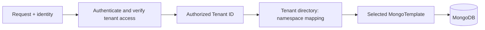

# Selecting a Database or Collection per Tenant in Spring Data MongoDB

In a multi-tenant SaaS application, every request must read and write data within the scope of the tenant the caller is authorized to use. With **Spring Data MongoDB**, data can be isolated by **database**, by **collection**, or by using a shared collection with a `tenantId` field. This lesson explains how to select a database or collection per tenant using `MongoTemplate`, the limitations of repositories, and considerations for queries, indexes, transactions, reactive access, and testing.

## 1. Choosing a storage model

Suppose the system has two customers, `alpha` and `beta`, both needing to store orders.

| Model | Order location | Suitable when | Management considerations |
| --- | --- | --- | --- |
| **Separate database per tenant** | `tenant_alpha.orders` and `tenant_beta.orders` | Clear data and operational boundaries, per-database access control/backup are desired | Provisioning databases, indexes, migrations, tenant count |
| **Separate collection per tenant** | `saas.orders_alpha` and `saas.orders_beta` | Data separation within a shared database is desired and tenant/collection count is manageable | Many collections/indexes, initialization and maintenance workflows |
| **Shared collection** | `saas.orders`; each document contains `tenantId` | Many small tenants share a similar schema and fewer namespaces are preferred | Every query/write/delete must enforce tenant constraints; compound index design |

Example document:

```json
{
  "_id": "order-123",
  "tenantId": "alpha",
  "externalRef": "PO-001",
  "state": "CREATED"
}
```

A separate database **does not equate** to a separate MongoDB cluster or server: multiple databases can coexist on a single deployment. Resource, credential, network, and backup isolation depend on the actual deployment setup. Similarly, separate collections do not automatically stop a broadly privileged credential from reading another tenant's collection.

## 2. Identifying the tenant from a trusted source

The most important rule is that **the tenant must be authenticated and authorized before selecting a namespace**.



1. Authenticate the user or service. For applications that allow switching active organizations, verify the caller has permission for the selected organization.
2. Extract `tenantId` from the authenticated and authorized context, such as a verified JWT combined with membership records. Do not trust an `X-Tenant-Id` header or query parameter simply because the client sent it.
3. Look up a server-managed **tenant directory** to obtain the provisioned database or collection name. Unknown, suspended, or unauthorized tenants must be rejected.
4. Route before executing any query; within a single unit of work, keep the selected tenant consistent.

For example, a tenant directory may manage mappings like:

| Tenant ID | Separate database | Separate collection in `saas` database |
| --- | --- | --- |
| `alpha` | `tenant_alpha` | `orders_alpha` |
| `beta` | `tenant_beta` | `orders_beta` |

The two namespace columns represent **two alternative approaches**: using database `tenant_alpha` with a fixed collection `orders`, or using a shared database `saas` with collection `orders_alpha`. Never concatenate namespace names directly from unvalidated user strings. The tenant directory should store provisioned names that comply with MongoDB naming rules and the application's permission boundaries.

## 3. Selecting a database per tenant

### 3.1. One shared MongoClient and a MongoTemplate per database

If tenants reside on the same MongoDB deployment and share the same authentication configuration, the application can reuse **a single `MongoClient`** (along with its driver connection pool) and create a `MongoTemplate` bound to each target database. Once configured, `MongoTemplate` can be used concurrently across requests.

The Java 17+ example below assumes the application has already declared a `MongoClient` bean (which may be configured by Spring Boot). `TenantDirectory` is a lookup contract implemented by the application based on trusted tenant metadata.

```java
import com.mongodb.client.MongoClient;
import java.util.concurrent.ConcurrentHashMap;
import java.util.concurrent.ConcurrentMap;
import org.springframework.data.mongodb.core.MongoTemplate;
import org.springframework.data.mongodb.core.SimpleMongoClientDatabaseFactory;
import org.springframework.stereotype.Service;

interface TenantDirectory {
    String databaseNameFor(String authorizedTenantId);
    String orderCollectionNameFor(String authorizedTenantId);
}

@Service
public class TenantMongoRouter {
    private final MongoClient mongoClient;
    private final TenantDirectory directory;
    private final ConcurrentMap<String, MongoTemplate> templates =
            new ConcurrentHashMap<>();

    public TenantMongoRouter(MongoClient mongoClient, TenantDirectory directory) {
        this.mongoClient = mongoClient;
        this.directory = directory;
    }

    public MongoTemplate forTenant(String authorizedTenantId) {
        // Directory validates the tenant and returns only the provisioned database name.
        String database = directory.databaseNameFor(authorizedTenantId);

        return templates.computeIfAbsent(database,
                name -> new MongoTemplate(
                        new SimpleMongoClientDatabaseFactory(mongoClient, name)));
    }
}
```

In this example, `SimpleMongoClientDatabaseFactory` determines the **default database** for `MongoTemplate`. `MongoClient` still manages connections to the deployment. Caching by database name avoids recreating templates per request; if the tenant count is large or changes frequently, add cache eviction/lifecycle policies. If tenants use different clusters, credentials, or URIs, manage the corresponding `MongoClient` instances and connection permissions rather than assuming one client works for all.

### 3.2. Saving documents and querying the right database

Define a document:

```java
import org.springframework.data.annotation.Id;
import org.springframework.data.mongodb.core.mapping.Document;

@Document(collection = "orders")
public record TenantOrder(
        @Id String id,
        String tenantId,
        String externalRef,
        String state
) {}
```

The `@Document(collection = "orders")` annotation only sets the default collection. **The database is chosen by MongoTemplate**:

```java
import org.springframework.data.mongodb.core.MongoTemplate;
import org.springframework.data.mongodb.core.query.Criteria;
import org.springframework.data.mongodb.core.query.Query;
import org.springframework.stereotype.Service;

@Service
public class TenantOrderService {
    private final TenantMongoRouter router;

    public TenantOrderService(TenantMongoRouter router) {
        this.router = router;
    }

    public TenantOrder create(String authorizedTenantId, TenantOrder input) {
        if (!authorizedTenantId.equals(input.tenantId())) {
            throw new IllegalArgumentException("Tenant mismatch");
        }
        MongoTemplate mongo = router.forTenant(authorizedTenantId);
        return mongo.save(input); // tenant's database, "orders" collection
    }

    public TenantOrder findByExternalRef(String authorizedTenantId, String ref) {
        MongoTemplate mongo = router.forTenant(authorizedTenantId);
        Query query = Query.query(Criteria.where("tenantId")
                .is(authorizedTenantId).and("externalRef").is(ref));
        return mongo.findOne(query, TenantOrder.class);
    }
}
```

The `authorizedTenantId` parameter **has already been authenticated and authorized at the security layer**; the service does not treat strings passed from the request body as trusted. Keeping the `tenantId` field on the document even with separate databases can still be useful for auditing, consistency checks, and migrations.

### 3.3. Why doesn't a repository switch databases automatically?

```java
public interface TenantOrderRepository
        extends org.springframework.data.mongodb.repository.MongoRepository<
                TenantOrder, String> {
}
```

A standard repository is bound to a `MongoTemplate`/`MongoDatabaseFactory` at configuration time. Passing `tenantId` into a repository method **does not make it switch databases automatically**. When the database varies per request, using a router to explicitly select `MongoTemplate` is easy to observe and reason about. A custom routing factory/repository mechanism would also need to handle sessions, transactions, and context propagation across threads.

## 4. Selecting a collection per tenant in a shared database

With separate collections, keep a single `MongoTemplate` pointing to the shared database, then pass the **explicit collection name to each operation**. Spring Data MongoDB provides overloads accepting a collection name, such as `save`, `findOne`, `find`, `remove`, `updateFirst`, and `aggregate`.

```java
import org.springframework.data.mongodb.core.MongoTemplate;
import org.springframework.data.mongodb.core.query.Criteria;
import org.springframework.data.mongodb.core.query.Query;
import org.springframework.stereotype.Service;

@Service
public class TenantCollectionOrderService {
    private final MongoTemplate sharedDatabaseTemplate;
    private final TenantDirectory directory;

    public TenantCollectionOrderService(
            MongoTemplate sharedDatabaseTemplate, TenantDirectory directory) {
        this.sharedDatabaseTemplate = sharedDatabaseTemplate;
        this.directory = directory;
    }

    public TenantOrder create(String authorizedTenantId, TenantOrder input) {
        if (!authorizedTenantId.equals(input.tenantId())) {
            throw new IllegalArgumentException("Tenant mismatch");
        }
        String collection =
                directory.orderCollectionNameFor(authorizedTenantId);
        return sharedDatabaseTemplate.save(input, collection);
    }

    public TenantOrder findById(String authorizedTenantId, String id) {
        String collection =
                directory.orderCollectionNameFor(authorizedTenantId);
        Query query = Query.query(Criteria.where("_id").is(id)
                .and("tenantId").is(authorizedTenantId));
        return sharedDatabaseTemplate.findOne(query, TenantOrder.class, collection);
    }
}
```

Even though `TenantOrder` has `@Document(collection = "orders")`, the explicit collection argument will be used for the operation. Conversely, if someone calls `sharedDatabaseTemplate.save(input)`, it can write to the default `orders` collection: wrap the template behind a service/API layer that requires an authorized tenant and restrict direct access to the raw template.

For aggregations, you must also specify the input collection:

```java
// aggregation: constructed Aggregation; OrderSummary: result type.
// sharedDatabaseTemplate.aggregate(aggregation, collection, OrderSummary.class);
```

If multiple document types are needed, the tenant directory can store mappings for each logical collection (e.g., orders, invoices); there is no need to let the client supply collection names.

## 5. Shared collection: enforcing the tenant constraint in every command

When all documents reside in `saas.orders`, `tenantId` must be a **mandatory condition** in queries, updates, and deletes. For example:

```java
Query query = Query.query(
        Criteria.where("tenantId").is(authorizedTenantId)
                .and("_id").is(orderId));
TenantOrder order = mongoTemplate.findOne(query, TenantOrder.class);
```

Simply calling `findById(orderId)` or `deleteById(orderId)` on a shared repository can bypass tenant boundaries. The same check applies to `updateFirst`, `findAndModify`, `remove`, `count`, and aggregation pipelines. Ideally, the data access layer has a strict contract: **require an authorized tenant**, and do not expose access methods without tenant constraints.

If the order code `externalRef` only needs to be unique **within each tenant**, use a compound unique index:

```javascript
db.orders.createIndex(
  { tenantId: 1, externalRef: 1 },
  { unique: true, name: "uniq_tenant_external_ref" }
);
```

In the separate database or separate collection models, a unique index can be placed solely on `externalRef` in **each tenant's collection**. Uniqueness rules must therefore match the storage model.

## 6. Indexes, transactions, and reactive access

### Namespace initialization and indexes

With separate databases, create collections/indexes in each tenant database; with separate collections, create indexes in each collection. For example, when provisioning a collection:

```java
import org.springframework.data.domain.Sort.Direction;
import org.springframework.data.mongodb.core.index.Index;

String collection = directory.orderCollectionNameFor(authorizedTenantId);
sharedDatabaseTemplate.indexOps(collection)
        .ensureIndex(new Index().on("externalRef", Direction.ASC).unique());
```

With separate databases, you can use `router.forTenant(tenantId).indexOps(TenantOrder.class).ensureIndex(...)`. With a shared collection, design indexes based on queries, typically including the tenant field in compound indexes such as `{ tenantId: 1, state: 1, createdAt: -1 }`. Verify with `explain` on representative data and examine cardinality, pagination, and selectivity.

Do not assume index annotations will automatically create all indexes for dynamically generated namespaces: automatic index creation behavior depends on configuration and the Spring Data MongoDB version. Put index creation/verification into an idempotent provisioning/migration workflow. Monitor the number of databases, collections, indexes, startup time, and resource usage as tenant count grows.

### Transactions

`MongoTransactionManager` manages transactions based on a `MongoDatabaseFactory`. If a service selects templates/databases dynamically, simply adding `@Transactional` is not enough to prove operations use the right session and transaction manager. Design transaction boundaries consistently with the chosen factory/template and test on a MongoDB deployment that supports transactions (such as a properly configured replica set or sharded cluster). Multiple independent MongoDB clusters cannot participate in a single MongoDB transaction.

A manageable design principle is that each business operation writes within the scope of **a single tenant**. If data across multiple tenants must be coordinated, design a separate workflow with error handling and idempotency mechanisms.

### Reactive

With Spring WebFlux and `ReactiveMongoTemplate`, do not use `ThreadLocal` to pass the tenant through a pipeline: callbacks may execute on different threads. Instead, pass the tenant explicitly or place the authenticated tenant into the Reactor `Context`, then read it at execution time.

Illustrative example (assuming `reactiveRouter` is a router returning the tenant's `ReactiveMongoTemplate`):

```java
return Mono.deferContextual(context -> {
    String authorizedTenantId = context.get("tenantId");
    return reactiveRouter.forTenant(authorizedTenantId).findOne(
            Query.query(Criteria.where("tenantId").is(authorizedTenantId)
                    .and("externalRef").is(ref)),
            TenantOrder.class);
});
```

A reactive router can store templates per database using the corresponding reactive factory. Values in the Reactor Context must be authenticated and authorized by the security layer beforehand; the example above only shows where to read the tenant and select the template.

## 7. Testing data isolation

Prefer integration tests with a real MongoDB instance (for example, Testcontainers), because mocking `MongoTemplate` cannot verify the actual database/collection, indexes, or `_id` mapping.

| Test case | Expected result |
| --- | --- |
| `alpha` and `beta` create orders with the same `externalRef` | Both coexist if namespaces differ, or comply with compound unique index in a shared collection |
| User `alpha` queries an order code existing only in `beta` | Cannot read `beta`'s document |
| Client sends an unauthorized/non-existent tenant | Rejected before reaching MongoDB |
| Write payload contains a `tenantId` different from the authorized tenant | Rejected, no accidental write |
| Update, delete, count, and aggregation | Do not affect or leak another tenant's data |
| Provisioning a new tenant | Has the expected namespace, indexes, and access permissions |
| Concurrent async/reactive requests | No tenant context leakage from other requests |

In separate-database tests, check the **actual database name** holding the document; in separate-collection tests, check the **actual collection name**. Seed data for at least two tenants to catch routing bugs or missing tenant filters.

## 8. Deployment decisions

- **Separate databases**: choose when per-tenant operational/backup/access-control boundaries are required; prepare provisioning, migrations, and monitoring for multiple databases.
- **Separate collections**: choose when you want namespace separation within a shared database and the number of collections/indexes remains manageable.
- **Shared collection**: choose when many tenants share a schema and fewer namespaces are needed; require every access path to enforce `tenantId` and design proper compound indexes.

In Spring Data MongoDB, distinguish three layers of responsibility: `MongoDatabaseFactory`/`MongoTemplate` determines the **database**, operation arguments on `MongoTemplate` can choose the **collection**, and the tenant directory together with the security layer decides **which tenant is allowed to reach which namespace**. Keeping these three layers clearly separated is the foundation for designing a secure and maintainable multi-tenant system.
