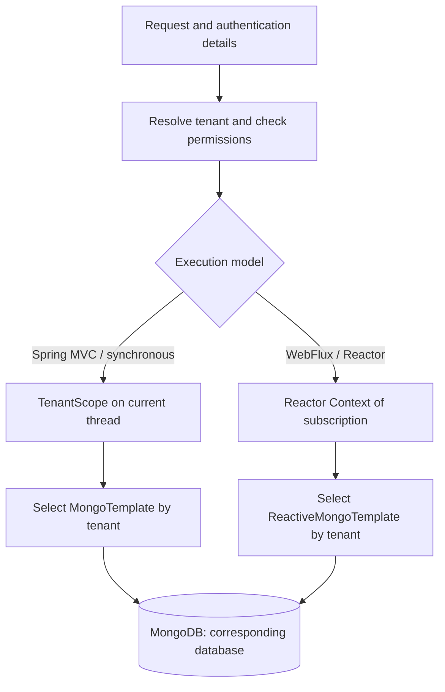

# Preserving the Right Tenant in Synchronous Flows and Reactor Context

## Learning objectives

In a multi-tenant application using **Spring Data MongoDB**, the same document type can be stored across multiple databases: for instance, tenant `alpha` uses `orders_alpha`, while tenant `beta` uses `orders_beta`. Even though both share the `Order` model and the same API, a query from `alpha` must never run against `beta`'s database.

After this lesson, you will be able to:

- Establish the rule for selecting a MongoDB database per tenant at the request trust boundary.
- Preserve the tenant in **synchronous** execution flows using a properly cleaned-up `ThreadLocal` scope.
- Preserve the tenant in **reactive** flows using Reactor `Context` per subscription.
- Use `MongoTemplate` and `ReactiveMongoTemplate` for the right database and recognize bugs when mixing the two models.
- Test tenant isolation, handle transactions, and diagnose cross-database access errors.

## 1. Why is the wrong tenant so easily selected?

In the **database-per-tenant** strategy, the data layer must solve two distinct problems: confirming which tenant a request belongs to and selecting the right `MongoDatabase` for every operation in that request. MongoDB does not automatically understand `tenantId` in HTTP requests, `Authentication`, `ThreadLocal`, or Reactor `Context`. The application must pass the authenticated tenant into Spring Data MongoDB's database selection mechanism.

Example of server-managed mapping:

| Authenticated tenant | Allowed database | Sample document |
| --- | --- | --- |
| `alpha` | `orders_alpha` | `Order` with code `A-100` |
| `beta` | `orders_beta` | `Order` with code `B-200` |

`GET /orders/A-100` only makes sense when combined with the caller's tenant. If a `beta` request accidentally uses a template pointing to `orders_alpha`, checking the order ID alone is not enough to guarantee data isolation.



**Invariant to maintain:** before running any data operation, the application already knows a valid tenant; that tenant uniquely determines the database to use; without a tenant, the operation must fail explicitly. Never silently fall back to a default database, especially in systems holding customer data.

The scope of this lesson is routing by **separate database per tenant**. If using a shared database with `tenantId` inside each document, queries, updates, aggregations, and indexes must still apply the tenant condition; `ThreadLocal` or Reactor `Context` alone does not add a MongoDB filter.

## 2. Selecting the tenant at the trust boundary

The tenant should be derived from the authenticated identity, verified token/claims, or established system access permissions. If an API allows users to specify a tenant via a header or path, you must verify that the caller is authorized to access the requested tenant.

A safe workflow includes:

1. Authenticate the caller and determine the set of allowed tenants.
2. Identify the active tenant and verify it against the allowed set.
3. Look up the server-managed **tenant → database name** mapping; reject unknown tenants.
4. Place the tenant into the appropriate execution scope, invoke the data layer, and always clear the scope upon completion.

Never concatenate raw header values to build database names (`"orders_" + header`), as that turns untrusted input into a routing decision. In the examples below, `validatedTenant` denotes a tenant that has passed both authentication and authorization checks.

## 3. A registry mapping tenants to MongoTemplate

A simple and observable approach is to pre-initialize templates for the allowed tenant list. **Spring Data MongoDB** provides `MongoTemplate` for synchronous flows and `ReactiveMongoTemplate` for Reactive Streams. Each template is bound to a `MongoDatabaseFactory` or `ReactiveMongoDatabaseFactory` configured with a specific database name.

Illustrative configuration example (imports omitted; the application must configure the Mongo clients and converter properly):

```java
@Configuration
class TenantMongoConfiguration {

    @Bean
    TenantMongoRegistry tenantMongoRegistry(
            com.mongodb.client.MongoClient blockingClient,
            com.mongodb.reactivestreams.client.MongoClient reactiveClient,
            MongoConverter converter) {

        // Server-configured and controlled mapping list.
        Map<String, String> databases = Map.of(
                "alpha", "orders_alpha",
                "beta",  "orders_beta"
        );

        Map<String, MongoOperations> blocking = new HashMap<>();
        Map<String, ReactiveMongoOperations> reactive = new HashMap<>();

        databases.forEach((tenant, database) -> {
            blocking.put(tenant, new MongoTemplate(
                    new SimpleMongoClientDatabaseFactory(blockingClient, database),
                    converter));

            reactive.put(tenant, new ReactiveMongoTemplate(
                    new SimpleReactiveMongoDatabaseFactory(reactiveClient, database),
                    converter));
        });

        return new TenantMongoRegistry(blocking, reactive);
    }
}

final class TenantMongoRegistry {
    private final Map<String, MongoOperations> blocking;
    private final Map<String, ReactiveMongoOperations> reactive;

    TenantMongoRegistry(Map<String, MongoOperations> blocking,
                        Map<String, ReactiveMongoOperations> reactive) {
        this.blocking = Map.copyOf(blocking);
        this.reactive = Map.copyOf(reactive);
    }

    MongoOperations blockingFor(String tenant) {
        MongoOperations operations = blocking.get(tenant);
        if (operations == null) {
            throw new IllegalArgumentException("Invalid tenant");
        }
        return operations;
    }

    ReactiveMongoOperations reactiveFor(String tenant) {
        ReactiveMongoOperations operations = reactive.get(tenant);
        if (operations == null) {
            throw new IllegalArgumentException("Invalid tenant");
        }
        return operations;
    }
}
```

This is a suitable implementation choice when the tenant set is relatively stable. For dynamically created tenants, the registry needs a controlled configuration-loading mechanism and resource lifecycle management; do not create a new `MongoClient` per request. If tenants use different credentials, clusters, or connection settings, the mapping must include the corresponding factory/client and enforce isolation at the MongoDB permission level.

The registry only decides **which database is queried**. The next section addresses **how to know the tenant of the current operation**.

## 4. Synchronous flows: managing `ThreadLocal` with an explicit scope

In a Spring MVC application running synchronously on a servlet thread, multiple service/repository calls can execute on the same thread during request processing. A `ThreadLocal` can pass the tenant across layers without adding a parameter to every call. However, servlet containers **reuse threads**: if the value is not cleared after a request, the next request may see the previous request's tenant.

```java
public final class TenantContext {
    private static final ThreadLocal<String> CURRENT = new ThreadLocal<>();

    private TenantContext() {}

    public static String requireTenant() {
        String tenant = CURRENT.get();
        if (tenant == null) {
            throw new IllegalStateException("Missing tenant in synchronous flow");
        }
        return tenant;
    }

    public static Scope open(String validatedTenant) {
        if (validatedTenant == null || validatedTenant.isBlank()) {
            throw new IllegalArgumentException("Invalid tenant");
        }
        String previous = CURRENT.get();
        CURRENT.set(validatedTenant);
        return () -> {
            if (previous == null) {
                CURRENT.remove();
            } else {
                CURRENT.set(previous);
            }
        };
    }

    @FunctionalInterface
    public interface Scope extends AutoCloseable {
        @Override
        void close();
    }
}
```

After authentication and authorization, a filter/interceptor or coordinator can open the scope:

```java
String tenant = tenantResolver.resolveAndAuthorize(request); // Permissions verified
try (TenantContext.Scope ignored = TenantContext.open(tenant)) {
    orderService.processOrder(orderId);
} // close() executes even if the service throws an exception
```

The service reads the tenant when performing data operations:

```java
@Service
class BlockingOrderService {
    private final TenantMongoRegistry mongoRegistry;

    BlockingOrderService(TenantMongoRegistry mongoRegistry) {
        this.mongoRegistry = mongoRegistry;
    }

    Order findById(String id) {
        String tenant = TenantContext.requireTenant();
        return mongoRegistry.blockingFor(tenant).findById(id, Order.class);
    }
}
```

Assuming `Order` is a document with Spring Data mapping declared, when `TenantContext` holds `alpha`, `findById` uses the template for `orders_alpha`. When the tenant is `beta`, the same code accesses `orders_beta`.

**Important limitation:** `ThreadLocal` is bound only to the **currently executing thread**. It does not automatically propagate across `@Async`, `CompletableFuture`, executors, scheduled tasks, callbacks on other threads, or Reactor chains switching threads. An asynchronous task must carry the tenant as input data and establish a new scope on the executing thread. Do not use `InheritableThreadLocal` as a substitute for controlled tenant propagation with thread pools.

## 5. Reactive flows: the tenant belongs to the subscription, not the thread

In WebFlux and reactive Spring Data MongoDB, a `Mono`/`Flux` chain can run across multiple threads, and a single thread can serve multiple subscriptions. Therefore, reading `TenantContext.requireTenant()` inside `map`, `flatMap`, or when a template queries MongoDB is unreliable.

**Reactor `Context`** stores metadata attached to a subscription. `contextWrite(...)` provides values to operators **upstream** of that position in the chain; `deferContextual(...)` reads the value when subscription occurs. The context stays with the reactive chain even across normal `publishOn` or `subscribeOn` transitions.

```java
final class TenantKeys {
    static final String ID = "tenantId";
    private TenantKeys() {}
}

@Service
class ReactiveOrderService {
    private final TenantMongoRegistry mongoRegistry;

    ReactiveOrderService(TenantMongoRegistry mongoRegistry) {
        this.mongoRegistry = mongoRegistry;
    }

    Mono<Order> findById(String id) {
        return Mono.deferContextual(context -> {
            String tenant = context.getOrDefault(TenantKeys.ID, null);
            if (tenant == null) {
                return Mono.error(new IllegalStateException(
                        "Missing tenant in Reactor Context"));
            }
            return mongoRegistry.reactiveFor(tenant).findById(id, Order.class);
        });
    }
}
```

At the authorized boundary, attach the tenant to the returned chain's context:

```java
Mono<Order> response = reactiveOrderService.findById(orderId)
        .contextWrite(context -> context.put(TenantKeys.ID, validatedTenant));
return response;
```

`validatedTenant` is resolved before constructing the returned chain; the snippet above illustrates controller/filter handling after authentication. If the tenant is missing, the service emits `onError` instead of querying a default database. `deferContextual` is placed **inside** the service to resolve the template at subscription time rather than locking in the tenant when assembling the pipeline.

### 5.1. Placing `contextWrite` in the right position

```java
Mono<Order> order = reactiveOrderService.findById("A-100")
        .publishOn(Schedulers.parallel())
        .contextWrite(ctx -> ctx.put(TenantKeys.ID, "alpha"));
```

`findById` sees `alpha`: even though `publishOn` may switch threads, `contextWrite` still supplies the context to operators upstream of it. Conversely, if `contextWrite` is attached to a branch that does not wrap the query, the query branch will not receive the tenant:

```java
Mono<Order> order = reactiveOrderService.findById("A-100");
Mono<String> unrelated = Mono.just("ok")
        .contextWrite(ctx -> ctx.put(TenantKeys.ID, "alpha"));
// The context of unrelated does not automatically propagate to order's subscription.
```

When using `flatMap`, `zip`, `retry`, or asynchronous operations, design the context path within **the same subscription chain**. Do not store a tenant-routed publisher in a shared cache without distinguishing by tenant, because cached results could cross data boundaries even if the original query hit the right database.

### 5.2. Capturing the tenant at the WebFlux boundary

In a `WebFilter`, after extracting the principal and verifying the allowed tenant, wrap the rest of the chain as follows:

```java
return chain.filter(exchange)
        .contextWrite(ctx -> ctx.put(TenantKeys.ID, validatedTenant));
```

Ensure that tenant resolution and authorization finish before invoking this snippet and that every MongoDB path needing the tenant stays under the same subscription. If an operation starts a separate subscription outside the request chain, pass the tenant to that operation explicitly.

## 6. Mixing synchronous and reactive code without losing the tenant

The two models do not exchange tenants automatically. This example is **wrong** when running in WebFlux:

```java
return Mono.fromCallable(() -> blockingOrderService.findById(orderId))
        .subscribeOn(Schedulers.boundedElastic());
// blockingOrderService reads ThreadLocal on boundedElastic, which usually has no tenant.
```

If calling a synchronous MongoDB API from a reactive pipeline is unavoidable, read the tenant from Reactor `Context`, then set `ThreadLocal` directly on the thread executing the blocking call:

```java
return Mono.deferContextual(ctx -> {
    String tenant = ctx.get(TenantKeys.ID);
    return Mono.fromCallable(() -> {
        try (TenantContext.Scope ignored = TenantContext.open(tenant)) {
            return blockingOrderService.findById(orderId);
        }
    }).subscribeOn(Schedulers.boundedElastic());
});
```

`boundedElastic` isolates blocking work from the event loop; for fully reactive services, prefer `ReactiveMongoTemplate` and avoid switching to blocking calls. The bridge above preserves the tenant even on errors or cancellation of running work, because `try-with-resources` cleans up the blocking call's scope.

In the opposite direction, if synchronous code calls `.block()` on a `Mono` that reads Reactor `Context`, the current `ThreadLocal` value **does not automatically appear** in Reactor `Context`. If bridging at a synchronous entry point where blocking is permitted is truly necessary, pass the tenant into the subscription:

```java
String tenant = TenantContext.requireTenant();
Order order = reactiveOrderService.findById(orderId)
        .contextWrite(ctx -> ctx.put(TenantKeys.ID, tenant))
        .block();
```

Never call `.block()` on the WebFlux event loop: it can cause errors or stall processing. In new code, passing the tenant explicitly via method parameters is usually easier to control across technology boundaries, especially for background tasks.

## 7. Transactions, repositories, and related operations

**Transactions:** In MongoDB, transactions are tied to a session and the corresponding transaction manager. You must determine the tenant and select the right factory/template **before** starting the transaction, then keep the tenant consistent for all operations inside it. `MongoTransactionManager` is used for the synchronous stack; `ReactiveMongoTransactionManager` and `TransactionalOperator` are used for the reactive stack. A `@Transactional` annotation using a fixed default transaction manager does not dynamically pick a transaction manager from Reactor `Context`. If the application has multiple databases/templates, configure an appropriate manager selection mechanism or organize transaction boundaries per tenant.

**Repositories:** A Spring Data repository created with a fixed `MongoOperations`/`ReactiveMongoOperations` will not switch databases merely because `ThreadLocal` or `Context` holds a new tenant. Provide a genuinely routed repository or call the template retrieved from the registry as shown in the examples. All custom queries, aggregations, bulk updates, and repository queries must follow the same tenant-selection mechanism.

**Background jobs:** Schedulers, message workers, and queue consumers usually have no HTTP request from which to inherit a tenant. Carry the tenant in trusted job metadata, verify permissions/scope per system policy, and establish a fresh context for each job/subscription. Avoid running a multi-tenant job under a single shared `ThreadLocal`.

**MongoDB resources:** Separate databases must have indexes, schema validation (if used), configuration data, and migration processes initialized per tenant. MongoDB permissions should restrict credentials to the minimum needed; correct routing in the application does not replace database-level access control.

## 8. Testing tenant isolation

Instead of checking only that an API returns data, verify **which template/database was selected**. Combine unit tests using mocks for the registry with integration tests against a real MongoDB instance or Testcontainers with two separate databases. Valuable test cases include:

| Scenario | Expectation |
| --- | --- |
| Synchronous request `alpha`, then `beta` on the same thread | Each request uses the right template; `ThreadLocal` is restored/cleared after each scope |
| Synchronous service throws an exception | `TenantScope.close()` still runs; the next request does not see the previous tenant |
| Missing or unregistered tenant | Fails explicitly **before** reading/writing MongoDB |
| Two concurrent reactive subscriptions for `alpha` and `beta` | Each subscription accesses only its own database |
| Reactive chain with `publishOn`, `flatMap`, `retry` | The tenant is still read from the same `Context` when the query runs |
| Bridge to `boundedElastic` | Tenant is set on the thread running the blocking call and cleaned up afterward |
| Transactions and repositories | Factory/manager and operations all belong to the selected tenant |

A minimal test verifying the **fail-closed** policy in a reactive service:

```java
StepVerifier.create(reactiveOrderService.findById("A-100"))
        .expectError(IllegalStateException.class)
        .verify();
```

Routing tests can use two stub templates returning different `Order` objects for the same ID; create two independent subscriptions with `contextWrite(ctx -> ctx.put(TenantKeys.ID, "alpha"))` and similarly for `beta`, then use `StepVerifier` to check for the expected document. Integration tests should write a document only to `orders_alpha`, query from `beta` and confirm it cannot be read, and test the reverse direction as well. This is a critical check for catching template configurations pointing to the wrong database even when `Context` logic looks right.

### Diagnostics when troubleshooting

At the template-selection layer, emit structured logs with the normalized tenant identifier, selected database, operation, and trace/request ID; avoid logging authentication tokens, credentials, or sensitive document contents. If queries appear to hit the wrong tenant, check in order: whether the tenant was authorized, whether any scope was left unclosed when a request finished, whether `contextWrite` wraps the subscription executing the query, whether a repository is using a fixed template, and whether the transaction manager selected the matching factory.

## 9. Implementation principles to remember

- Tenant selection is a security and routing decision; only use tenants that are authenticated, authorized, and mapped in server configuration.
- For synchronous processing, wrap `ThreadLocal` in a `try/finally` or `try-with-resources` scope; restore or clear the value after every request, even on exceptions.
- For Reactor, use `contextWrite` to supply the tenant to the subscription and `deferContextual` to read it at execution time; do not rely on `ThreadLocal` or thread names.
- For Spring Data MongoDB, select the tenant's `MongoTemplate`/`ReactiveMongoTemplate` and factory; repositories, aggregations, and transactions must follow the same routing rule.
- When crossing synchronous/reactive boundaries, executors, or background jobs, pass the tenant explicitly and re-establish the scope where execution actually runs.
- No valid tenant means no query. Test multiple tenants concurrently and test failure cases to ensure no cross-database data leakage occurs.

When all of these principles are followed, an application can share Spring Data MongoDB models and business logic while ensuring every operation runs against the right tenant's database in both synchronous flows and Reactor pipelines.
