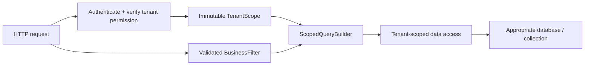
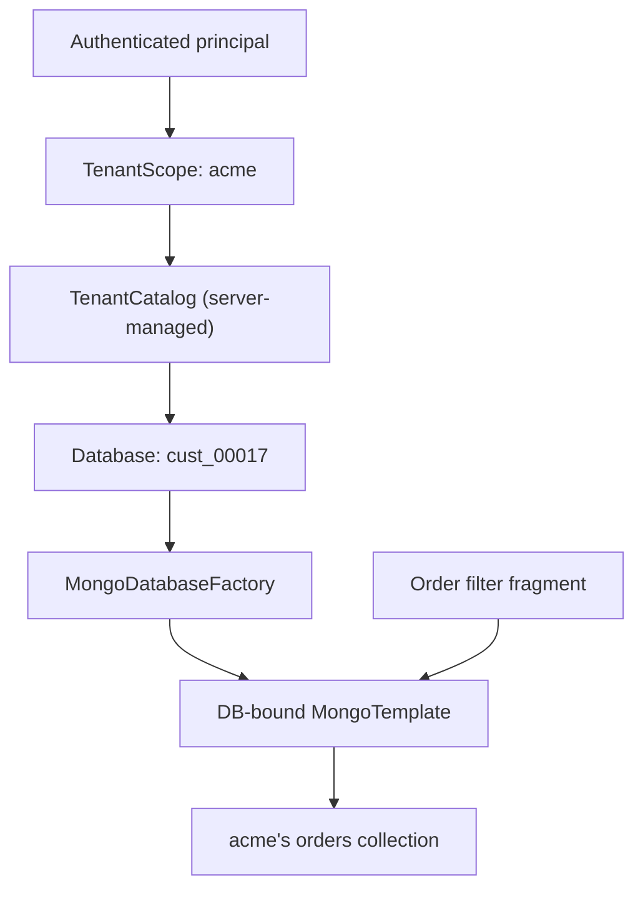

# Preventing Cross-Tenant Queries When Reusing Filters or Fragments

## 1. Problem and learning objectives

In a multi-tenant system, a request may share **processing code**, **repositories**, **`MongoTemplate`**, a search filter, or an aggregation **fragment** with another tenant's requests. Reuse reduces code duplication, yet a filter missing a tenant predicate or attaching the wrong condition can let users view, count, update, or delete data they are not authorized to access.

In Spring Data MongoDB, applications query using `MongoTemplate`, repositories, `Query` / `Criteria`, aggregations, and reactive APIs. None of those APIs automatically know the relationship between the logged-in principal and a tenant. The application must enforce data boundaries both when selecting the **database** and when constructing **data commands**.

This lesson belongs to the **Multiple databases** chapter and focuses on a common bug: **reusing a query fragment that is valid for multiple tenants while forgetting or dropping the tenant scope on a specific call**. After studying this lesson, you will be able to:

1. Distinguish database boundaries from `tenantId` predicates inside a collection, and know which models require both.
2. Spot database routing bugs, empty filters, wrong `$or` grouping, mutated shared fragments, and raw queries/aggregations bypassing guards.
3. Design an **immutable `TenantScope`** derived from authenticated identity and construct a fresh query per request.
4. Use a **controlled data-access boundary** so every read, count, update, delete, and aggregation enforces the proper scope.
5. Write tests with two tenants, colliding business IDs, adversarial scenarios, and verify outcomes in the right database.

> Java examples use imperative Spring Data MongoDB with `MongoTemplate`; later sections cover repositories, reactive access, and operations. Tenant names `acme`, `beta`, database names, and sample records are synthetic. Standard Java/Spring imports are omitted where they do not affect the main point; actual library versions may require minor adjustments.

## 2. Determine the tenant boundary before writing a `Query`

A tenant is typically a customer, company, or group sharing an application while having isolated permissions and data. A MongoDB cluster can contain multiple databases, and each database can contain multiple collections. Physical layout directly determines what kind of guard is required.

| Model | Example | Primary access boundary | Risk when reusing fragments |
|---|---|---|---|
| **Database per tenant** | `tenant_acme.orders`, `tenant_beta.orders` | Select the **right database** for the authorized tenant | `MongoTemplate` points to the wrong DB, context leaks across requests, fallback to default DB |
| **Collection per tenant** (same DB) | `app.orders_acme`, `app.orders_beta` | Select the right collection from a catalog | Collection name concatenated from untrusted input, fragment targets a shared collection |
| **Shared collection** | `app.orders` containing `tenantId` | Every operation must enforce a tenant predicate | Fragment misses tenant, `$or` escapes scope, `updateMany`/`deleteMany` lacks guard |
| **Hybrid** | Regional DB + multi-tenant collections | Select the right DB **and** enforce `tenantId` predicate | Guard enforced at one layer while missing at the other |

Example of two documents stored in a **shared collection**:

```javascript
// app.orders
{
  _id: ObjectId("66a000000000000000000001"),
  tenantId: "acme",
  orderNo: "ORD-100",
  status: "OPEN",
  amount: 120
}
{
  _id: ObjectId("66a000000000000000000002"),
  tenantId: "beta",
  orderNo: "ORD-100",
  status: "OPEN",
  amount: 120
}
```

Both records share the same `orderNo` and `status`. If customer `acme` runs `find({ status: "OPEN" })` on the shared collection, they could see both orders. In the database-per-tenant model, the same filter only restricts results **inside the selected DB**. Thus, if `tenant_beta` is chosen for an `acme` request, even a "correct" filter reads the wrong customer's data.

**Core principle:** request input, business filters, and authorization boundaries are three distinct concepts:

- **Identity:** which authenticated principal owns the request?
- **Tenant scope:** which tenant is the principal authorized to access, and on which database/collection?
- **Business filter:** does the user want `OPEN` orders, a date range, or specific statuses?

A business filter is variable user input; tenant scope is a server-enforced constraint. Reusable fragments should express business predicates only; they must never be responsible for "proving" scope.

## 3. Threat model: what happens when a tenant guard is lost?

A simple-looking API like `GET /orders?status=OPEN` passes through multiple layers:



In unsafe code, `A` may run while `S` is never passed down to `O`. A service takes `tenantId` from a query parameter or builds a `Query` from a shared fragment; the driver executes a command that is completely valid for the database account. Consequently, the bug usually **throws no exception** and silently returns wrong results.

| Action | Missing-scope bug | Impact |
|---|---|---|
| `find` / repository find | Filters only `status=OPEN` | Exposes documents |
| `count` / `exists` | Counts or checks `orderNo` globally | Leaks information even without returning documents |
| `findById` | Relies solely on `_id` | Reads another tenant's object in a shared collection |
| `updateFirst` / `updateMulti` | `{orderNo: ...}` without tenant | Modifies status/balance of the wrong tenant |
| `remove` / `findAndRemove` | Reuses fragment without tenant | Deletes another tenant's data |
| Aggregation | `$match` lacks scope, `$lookup`/`$unionWith` reads another source | Leaks data in projections or statistics |
| Bulk operation | Reuses unguarded filter | Mutates multiple records |
| Reactive flow | Reads tenant context from `ThreadLocal` when subscription runs on another thread | Queries wrong DB/tenant due to context drift |
| Scheduled job | No authenticated request so skips scope | Processes unintended data |

An attacker does not need to inject JSON with `$where`. Simply using normal features with `orderNo`, statuses, or timestamps that overlap across tenants is enough to exploit a missing guard.

## 4. Anti-patterns in filters and fragments

### 4.1. Never place `$or` at the same level as a tenant condition in one branch

An API filtering `OPEN` **or** `URGENT` can accidentally construct:

```javascript
// WRONG: the second branch has no tenant restriction.
db.orders.find({
  $or: [
    { tenantId: "acme", status: "OPEN" },
    { priority: "URGENT" }
  ]
});
```

The second branch returns `beta`'s `URGENT` records too. A safe filter requires the tenant predicate to sit **outside** all business branches:

```javascript
// CORRECT for shared collection: tenant is always mandatory.
db.orders.find({
  $and: [
    { tenantId: "acme" },
    { $or: [
        { status: "OPEN" },
        { priority: "URGENT" }
    ]}
  ]
});
```

This can be verified logically:

\[
(\mathrm{tenant}=A\land\mathrm{OPEN})\lor\mathrm{URGENT}
\quad\ne\quad
(\mathrm{tenant}=A)\land(\mathrm{OPEN}\lor\mathrm{URGENT})
\]

The right-hand side preserves the tenant constraint across **every** business branch.

### 4.2. Static `Query` or `Criteria` shared across requests

`Criteria` and `Query` are mutable query-builder objects with fluent methods. Many methods append criteria or alter sort, limit, and projections. Never treat them as immutable DTOs, and never store an instance in a `static` field to mutate across requests:

```java
// WRONG: a shared Query is mutated per request.
static final Query COMMON = Query.query(
    Criteria.where("status").is("OPEN")
);

List<Order> queryFor(String tenantId) {
    COMMON.addCriteria(Criteria.where("tenantId").is(tenantId));
    return mongoTemplate.find(COMMON, Order.class);
}
```

Subsequent requests can hit duplicate criteria, retain stale scopes, use wrong pagination/sorting, or suffer race conditions from concurrent mutations. Bugs like this are notoriously hard to reproduce because they depend on request ordering.

Solution: share only **pure fragment-builder functions** or immutable parameter objects, and instantiate a **fresh `Criteria` / `Query` every time**.

### 4.3. Creating scope properly, then reassigning to another query

```java
// WRONG: replaces the entire Query, accidentally dropping the guard.
Query q = Query.query(Criteria.where("tenantId").is(scope.value()));
if (filter.isAdvancedSearch()) {
    q = Query.query(Criteria.where("status").in(filter.statuses()));
}
return mongoTemplate.find(q, Order.class);
```

Even though earlier lines added `tenantId`, reassigning `q` in a branch wipes out the guard. Never scatter the responsibility of "remembering to add the tenant" across dozens of controllers or services.

### 4.4. Confusing `tenantId` from the request with the authenticated tenant

```java
// WRONG: tenantId in the URL does not prove authorization.
@GetMapping("/tenants/{tenantId}/orders")
List<Order> list(
    @PathVariable String tenantId,
    @RequestParam String status
) {
    return orderService.find(tenantId, status);
}
```

You may accept a tenant in the path as the **target tenant**, but you must verify the principal is authorized for that tenant. For APIs operating only on the current tenant, derive the tenant from the verified session/JWT and server-side membership records. Never blindly "trust" `X-Tenant-Id` headers, client-set cookies, or body fields.

### 4.5. User-supplied `BasicQuery`, JSON, or BSON fragments

```java
// WRONG: query predicate is raw JSON supplied directly by the client.
Query q = new BasicQuery(request.getRawMongoFilter());
return mongoTemplate.find(q, Order.class);
```

Even if a client-supplied filter contains `tenantId`, its values or structure can be tampered with. Allow clients to choose only from an **allowlisted set of fields and operations** (`status`, `from`, `to`, `minAmount`) and construct fragments safely. MongoDB operators such as `$where`, `$expr`, `$function`, or arbitrary predicates must never enter via an "advanced filter" without an independent security validation policy.

## 5. Designing a `TenantScope` that cannot be altered by fragments

A simple model for systems sharing a collection is an immutable `TenantScope`, constructed solely from server-verified authorization data.

```java
public record TenantScope(String tenantId) {
    public TenantScope {
        if (tenantId == null || tenantId.isBlank()) {
            throw new IllegalArgumentException("tenantId is required");
        }
    }

    // Intended to be invoked only by an authenticated resolver for controllers/services.
    // Never expose a public factory reading raw query params.
}
```

A `record` only holds immutable state; **creating the record does not itself verify permissions**. You need a resolver that takes the principal and target tenant, checking membership, tenant status (active/suspended), and operation permissions.

```java
public interface TenantAuthorization {
    TenantScope requireScope(Authentication principal, String requestedTenant);
}

@Service
public class TenantScopeResolver {
    private final TenantAuthorization authorization;

    public TenantScopeResolver(TenantAuthorization authorization) {
        this.authorization = authorization;
    }

    public TenantScope resolve(
        Authentication principal,
        String requestedTenant
    ) {
        if (principal == null || !principal.isAuthenticated()) {
            throw new AccessDeniedException("Unauthenticated");
        }
        return authorization.requireScope(principal, requestedTenant);
    }
}
```

Place authorization decisions at the **trust boundary**: for example, Spring Security authenticates the JWT and a membership service produces the scope. `TenantScopeResolver` above illustrates the contract; the `TenantAuthorization` implementation must verify that the principal is non-anonymous, the tenant is active, membership is valid, and the role grants `orders:read` or `orders:write` as appropriate.

**Fail closed:** if scope is missing, the tenant does not exist, or the principal lacks permission, the service must throw or abort; never silently default to `tenant=default` or run an unfiltered query.

### 5.1. Tenant ID and database name need not be identical

Tenant ID `acme` is a **logical identifier**. The database name might be `cust_00017`, stored in a managed catalog. Never build strings casually such as `"tenant_" + requestTenant` and pass them directly to `MongoTemplate`. A catalog enables renaming, migrations, regional placement, and tenant offboarding.

```text
Verified principal + membership
            |
     TenantScope("acme")
            |
     TenantCatalog lookup
            |
   dbName = "cust_00017"
            |
 MongoDatabaseFactory / MongoTemplate
```

Even with a separate DB per tenant, server-side authorization remains mandatory to prevent **IDOR**: a user could guess another ID and ask the catalog to select a database they do not own.

## 6. When multiple tenants share a collection: building queries with mandatory AND

To reuse fragments safely, separate the **business predicate builder** (reusable) from the **scope composer** (non-bypassable). Example API filtering by status or priority:

```java
public record OrderSearch(
    List<String> statuses,
    boolean urgentOnly,
    Instant fromInclusive,
    Instant toExclusive,
    int page,
    int size
) {}
```

Before building `Criteria`, validate inputs: `size` within bounds, `page` non-negative, `from` before `to`, `statuses` within an allowlisted set. Never accept raw `Criteria` / `Document` objects in public APIs.

The business fragment can be a pure function returning **a fresh `Criteria`**:

```java
public final class OrderPredicates {
    private OrderPredicates() {}

    public static Criteria business(OrderSearch search) {
        List<Criteria> parts = new ArrayList<>();

        if (search.statuses() != null && !search.statuses().isEmpty()) {
            parts.add(Criteria.where("status").in(search.statuses()));
        }
        if (search.urgentOnly()) {
            parts.add(Criteria.where("priority").is("URGENT"));
        }
        if (search.fromInclusive() != null) {
            parts.add(Criteria.where("createdAt").gte(search.fromInclusive()));
        }
        if (search.toExclusive() != null) {
            parts.add(Criteria.where("createdAt").lt(search.toExclusive()));
        }

        // If no business conditions are given, still return a finite predicate.
        return parts.isEmpty()
            ? Criteria.where("archived").ne(true)
            : new Criteria().andOperator(parts.toArray(Criteria[]::new));
    }
}
```

`archived != true` in the example is an application-specific business rule. Never use it as a substitute for a tenant guard. If an API allows "querying all orders belonging to the tenant", the fragment can express the genuine business condition; the scope composer must still unconditionally prepend the tenant constraint.

A single composer applies logical `AND` regardless of the fragment's internal structure:

```java
public final class TenantQueryBuilder {
    private TenantQueryBuilder() {}

    public static Query scoped(
        TenantScope scope,
        Criteria business
    ) {
        Objects.requireNonNull(scope, "scope");
        Objects.requireNonNull(business, "business");

        Criteria restricted = new Criteria().andOperator(
            Criteria.where("tenantId").is(scope.tenantId()),
            business
        );

        return Query.query(restricted);
    }
}
```

Example where the business fragment contains `$or`:

```java
Criteria business = new Criteria().orOperator(
    Criteria.where("status").is("OPEN"),
    Criteria.where("priority").is("URGENT")
);

Query query = TenantQueryBuilder.scoped(scope, business);
```

Logical result:

```javascript
{
  $and: [
    { tenantId: "acme" },
    {
      $or: [
        { status: "OPEN" },
        { priority: "URGENT" }
      ]
    }
  ]
}
```

Even when the business fragment has complex nested branches, the outer `tenantId=acme` constraint still limits results inside the shared collection. This **does not** make arbitrary fragments automatically safe: users still must not supply raw operators, and `$lookup`/`$unionWith` stages in aggregations can open additional data sources.

### 6.1. Building an independent query on every call

```java
public Query toQuery(TenantScope scope, OrderSearch filter) {
    validate(filter);

    Query query = TenantQueryBuilder.scoped(
        scope,
        OrderPredicates.business(filter)
    );

    query.with(
        Sort.by(Sort.Order.desc("createdAt"), Sort.Order.asc("_id"))
    );
    query.skip(Math.multiplyExact((long) filter.page(), filter.size()));
    query.limit(filter.size());
    return query;
}
```

Each request receives a new `Query`, new sort, and independent limit. `Math.multiplyExact` throws on overflow instead of producing a bogus offset; validation should cap large page numbers and favor keyset pagination where appropriate. Even if users pass `sortBy`, allow only an allowlisted set of sort fields rather than arbitrary field names.

### 6.2. Enforcing scope at data access, not in controllers

Place sensitive operations behind a boundary that only accepts `TenantScope` and validated filter DTOs:

```java
@Service
public class ScopedOrderReader {
    private final MongoTemplate mongoTemplate;

    public ScopedOrderReader(MongoTemplate mongoTemplate) {
        this.mongoTemplate = mongoTemplate;
    }

    public List<Order> find(TenantScope scope, OrderSearch filter) {
        Query q = toQuery(scope, filter); // Builder method shown above.
        return mongoTemplate.find(q, Order.class);
    }

    public long count(TenantScope scope, OrderSearch filter) {
        Query q = TenantQueryBuilder.scoped(
            scope,
            OrderPredicates.business(filter)
        );
        return mongoTemplate.count(q, Order.class);
    }
}
```

The class above is **only safe if** every call path to the `orders` collection goes through it. If another service can autowire raw `MongoTemplate` and call `findAll`, a "scoped reader" does not enforce system-wide isolation. Restrict data-access paths through module/repository boundaries, code reviews, and contract tests; database-level authorization adds defense in depth.

## 7. Read, count, update, and delete must use the same scope

Bugs frequently arise when `find` is guarded while `update` or `remove` still uses an unguarded filter. Rather than checking tenant ownership with `findById` first and then updating by ID alone (which creates a race and can update the wrong tenant), put the tenant constraint directly into **the update/delete query itself**.

```java
@Service
public class ScopedOrderCommands {
    private final MongoTemplate mongoTemplate;

    public ScopedOrderCommands(MongoTemplate mongoTemplate) {
        this.mongoTemplate = mongoTemplate;
    }

    public Order findById(TenantScope scope, String id) {
        Query q = TenantQueryBuilder.scoped(
            scope, Criteria.where("_id").is(id)
        );
        Order order = mongoTemplate.findOne(q, Order.class);
        if (order == null) {
            throw new OrderNotFoundException(); // Same error when ID belongs to another tenant.
        }
        return order;
    }

    public void setStatus(
        TenantScope scope, String id, String newStatus
    ) {
        Query q = TenantQueryBuilder.scoped(
            scope, Criteria.where("_id").is(id)
        );
        Update u = new Update()
            .set("status", newStatus)
            .currentDate("updatedAt");

        UpdateResult result = mongoTemplate.updateFirst(q, u, Order.class);
        if (result.getMatchedCount() == 0) {
            throw new OrderNotFoundException();
        }
    }

    public void delete(TenantScope scope, String id) {
        Query q = TenantQueryBuilder.scoped(
            scope, Criteria.where("_id").is(id)
        );
        DeleteResult result = mongoTemplate.remove(q, Order.class);
        if (result.getDeletedCount() == 0) {
            throw new OrderNotFoundException();
        }
    }
}
```

In this example, `OrderNotFoundException` is an application exception returning 404/not-found, avoiding revealing whether "the ID exists under another tenant". It is also recommended to authorize read, update, and delete actions separately by role; having a valid tenant scope does not automatically imply permission to delete.

**Never equate ownership with `_id` values**. MongoDB `ObjectId`s are normally unique, but uniqueness does not prove authorization. For business IDs unique only **within a tenant**, the `tenantId + orderNo` predicate is even more essential.

Operations that should go through a scoped API:

| Spring Data MongoDB API | Mandatory guard in shared collection | Notes |
|---|---|---|
| `find`, `findOne`, `exists`, `count` | `tenantId == scope.tenantId` | An empty raw filter leaks or counts across tenants |
| `updateFirst`, `updateMulti` | Scope inside the update `Query` itself | Do not rely only on a prior read check |
| `findAndModify`, `findAndRemove` | Scope inside the atomic query | Returns old/new document only when tenant matches |
| `remove(Query, ...)` | Scope inside the delete query | Distinguish tenant-scoped deletion from admin maintenance |
| `BulkOperations` | Scope on every `updateOne/updateMany/delete` item | One unguarded item still causes major damage |
| `aggregate` | Scope on primary source and all joined sources | `$lookup`/`$unionWith` need dedicated review |
| `save` / `insert` | Validate/assign tenant from scope and check ID/ownership | No `Query` guard exists; avoid taking entity `tenantId` from client |
| `findAll` / `removeAll` | Exclude from tenant-facing ports | Reserve strictly for controlled admin tasks |

### 7.1. Upsert is a special branch

`upsert` creates a new record when no match exists. The tenant in the query must be reflected in the newly inserted document, and tenant identity must be server-controlled. Explicitly write tenant and business identity invariants on insert:

```java
public void upsertDraft(TenantScope scope, String orderNo) {
    Query q = TenantQueryBuilder.scoped(
        scope,
        Criteria.where("orderNo").is(orderNo)
            .and("status").is("DRAFT")
    );

    Update u = new Update()
        .setOnInsert("tenantId", scope.tenantId())
        .setOnInsert("orderNo", orderNo)
        .setOnInsert("status", "DRAFT")
        .currentDate("updatedAt");

    mongoTemplate.upsert(q, u, Order.class);
}
```

This is a technical example for upserting a draft. In real business logic, including `status=DRAFT` in the match predicate can create a duplicate order if one with the same number already exists in another status; design unique keys and handle `DuplicateKeyException` properly. In a shared collection, a unique index on `{tenantId: 1, orderNo: 1}` reduces the risk of colliding business IDs under concurrent requests.

### 7.2. Writing with `save` requires guards at another layer

`MongoTemplate.save(entity)` takes no `Query`. If an entity comes from a client with an `_id` pointing to another tenant's document, `save` can overwrite that document (matching by ID without tenant). Therefore:

1. Construct new entities from DTOs and assign `tenantId` from `scope.tenantId()`; never auto-bind `tenantId` from the request body.
2. When updating an existing entity, prefer `updateFirst` with both `tenantId` and `_id`, using `@Version` when optimistic locking is needed.
3. If `save` must be used, prove ownership within the same boundary and handle concurrency properly; a read followed by a save does not create a guard on the write command itself.
4. Enforce invariants via service validation and database permissions where appropriate; converter callbacks are an extra layer, not a replacement for controlling all write paths.

## 8. When each tenant has a separate database: binding `MongoTemplate` to the right database

In the **database-per-tenant** model, documents may omit `tenantId` because the entire collection belongs to one tenant. In that case, `Criteria.where("tenantId")` alone does nothing if the template already points to the wrong DB. You must select the right `MongoDatabaseFactory` or `MongoTemplate` **before building the query**.

Simple diagram:



### 8.1. Routing from an authorized catalog

```java
public interface TenantCatalog {
    // Accepts only tenants already authorized by TenantAuthorization.
    String databaseFor(TenantScope scope);
}

@Service
public class TenantTemplateProvider {
    private final MongoClient client;
    private final TenantCatalog catalog;
    private final ConcurrentMap<String, MongoTemplate> byDatabase =
        new ConcurrentHashMap<>();

    public TenantTemplateProvider(
        MongoClient client,
        TenantCatalog catalog
    ) {
        this.client = client;
        this.catalog = catalog;
    }

    public MongoTemplate forTenant(TenantScope scope) {
        Objects.requireNonNull(scope, "scope");

        String databaseName = catalog.databaseFor(scope);
        if (databaseName == null || databaseName.isBlank()) {
            throw new IllegalStateException("Unknown tenant database");
        }

        return byDatabase.computeIfAbsent(databaseName, name ->
            new MongoTemplate(
                new SimpleMongoClientDatabaseFactory(client, name)
            )
        );
    }
}
```

Safety requirements for this code:

- `TenantCatalog` is server-managed and keyed by an authorized `scope`; it **never** returns a client-supplied database name.
- The catalog must return only active tenants and provide no default DB when lookup fails.
- Never create a `MongoClient` per request; a client manages connection pools and resources.
- The template cache here is illustrative. With many tenants or tenant migrations, implement bounds, invalidation/versioning, and lifecycle management; never cache an arbitrary `TenantScope` in a static field.
- Use a `MongoDatabaseFactory` compatible with your transaction manager and converters when using transactions; while `new MongoTemplate(client, dbName)` supports simple setups, it does not automatically join a transaction manager wired to a different factory.
- A MongoDB account with permissions across multiple databases still lets the application read the wrong DB if routing has a bug. For stronger isolation, consider per-database/tenant users/roles, separate deployments, and permission verification tests.

### 8.2. Do not expose the raw template to callers

A service that resolves the template within **each individual call**:

```java
@Service
public class IsolatedOrderReader {
    private final TenantTemplateProvider provider;

    public IsolatedOrderReader(TenantTemplateProvider provider) {
        this.provider = provider;
    }

    public List<Order> find(
        TenantScope scope, OrderSearch filter
    ) {
        MongoTemplate template = provider.forTenant(scope);

        Query query = Query.query(OrderPredicates.business(filter));
        query.limit(filter.size());
        return template.find(query, Order.class);
    }
}
```

In the separate-DB model, this query does not add `tenantId` because the **database itself is authorized and fixed** in `template`. In a hybrid model, you must also apply `TenantQueryBuilder.scoped(...)` inside the selected DB.

A stronger design for larger systems exposes only business methods on the public data-access API (`findOrders(scope, filter)`, `updateOrder(scope, ...)`), keeping `TenantTemplateProvider` internal so random services cannot call `provider.forTenant(forgedScope)`. Also restrict autowiring unscoped `MongoTemplate` beans into tenant-facing services.

### 8.3. Caching is not access control

A DB-bound `MongoTemplate` can be reused across requests if its configuration is immutable. However, never store a **mutable** `currentDatabase` or `currentTenant` field on a singleton bean.

```java
// WRONG: global mutable state shared across requests.
class UnsafeRepository {
    volatile MongoTemplate currentTemplate;

    void selectTenant(MongoTemplate template) {
        currentTemplate = template;
    }

    List<Order> findOpen() {
        return currentTemplate.find(
            Query.query(Criteria.where("status").is("OPEN")),
            Order.class
        );
    }
}
```

Two concurrent requests can overwrite `currentTemplate` between selection and query execution. Even adding `synchronized` to one method leaves async, reactive, or multi-step calls vulnerable to context corruption. Always resolve the template **from the call's own scope** into a local variable, or encapsulate the entire operation inside a tenant-scoped port.

## 9. `$or`, `$nor`, `$expr`, and negation: verify with logic

Reusing complex fragments drops guards if boolean operator precedence is misunderstood.

### 9.1. An `$or` operator is safe when nested inside `AND`

```javascript
// Safe query for a shared collection.
{
  $and: [
    { tenantId: "acme" },
    { $or: [
        { status: "OPEN" },
        { tags: "VIP" }
    ]}
  ]
}
```

The business branches `status=OPEN` and `tags=VIP` remain reusable, yet neither branch can escape `tenantId=acme`.

### 9.2. Negation at the wrong scope

```javascript
// WRONG: "not acme OPEN" matches all of beta.
{ $nor: [ { tenantId: "acme", status: "OPEN" } ] }

// CORRECT: "within acme, not OPEN".
{
  $and: [
    { tenantId: "acme" },
    { status: { $ne: "OPEN" } }
  ]
}
```

Negating **both** the tenant and status conditions turns every other tenant's data into a valid match. Enforce the rule that "not" applies only to the **business fragment**, with scope combined outside it.

### 9.3. Fail-closed principle for empty predicates

An empty `Criteria` fragment or a filter with no fields set must never silently turn into `findAll`. Two valid strategies exist:

- The API requires search criteria: if the filter is empty → return 400 or reject.
- The API allows listing all records **within the tenant**: empty fragment → query becomes `tenantId=scope` (with pagination and permissions).

That choice is a business requirement; **never** drop `TenantScope` just because the filter is empty. The query builder in section 6 uses `archived != true` as an example business rule and still ANDs it with the tenant.

### 9.4. Filtering by tenant after receiving results is too late

```java
// WRONG: already pulled unauthorized data over the network and into memory.
return mongoTemplate.find(businessQuery, Order.class).stream()
    .filter(order -> order.getTenantId().equals(scope.tenantId()))
    .toList();
```

Even if the final response contains only the right tenant's records, counts, pagination, latency, logs, traces, or logic before `.filter(...)` have already touched unauthorized data. The guard must live in the **predicate sent to MongoDB** so the database returns only in-scope records.

## 10. Aggregation fragments are also a data leak surface

An aggregation can share `match`, `group`, `project`, and sort stages across tenants. Leaks occur when a fragment enters a pipeline without an effective tenant match, or when a subsequent stage reads another collection without restriction.

### 10.1. Guarding the source before `$group`

```java
public record OrderTotals(String status, long count) {}

public List<OrderTotals> totals(
    MongoTemplate template,
    TenantScope scope,
    Criteria business
) {
    Criteria restricted = new Criteria().andOperator(
        Criteria.where("tenantId").is(scope.tenantId()),
        business
    );

    Aggregation pipeline = Aggregation.newAggregation(
        Aggregation.match(restricted),
        Aggregation.group("status").count().as("count"),
        Aggregation.project("count")
            .and("_id").as("status")
    );

    return template.aggregate(
        pipeline, "orders", OrderTotals.class
    ).getMappedResults();
}
```

If the pipeline uses `Order.class` as its input type, verify `@Field` mappings, collection names, and custom stages so Java property names are not confused with BSON field names. Placing `$match` at the start of the pipeline typically reduces documents entering `$group` and enables index use, though certain stages **must** appear first (such as `$geoNear`, `$search`, `$vectorSearch` in supported environments). In those cases, put the tenant constraint into that stage's pre-filter/filter option per your version's API and inspect the execution plan. Never blindly prepend `$match` before a stage that must be first.

### 10.2. `$lookup` and `$unionWith` have their own sources

```javascript
// WRONG if both app.orders and app.customers are multi-tenant:
db.orders.aggregate([
  { $match: { tenantId: "acme" } },
  {
    $lookup: {
      from: "customers",
      localField: "customerNo",
      foreignField: "customerNo",
      as: "customer"
    }
  }
]);
```

If both `acme` and `beta` have `customerNo="C-100"`, `$lookup` can attach the other tenant's customer to `acme`'s order. A guard on the outer collection **does not restrict the joined source**.

Safe lookup logic within the **same database**, using `let` and a `pipeline` enforcing tenant equality on both sides:

```javascript
db.orders.aggregate([
  { $match: { tenantId: "acme" } },
  {
    $lookup: {
      from: "customers",
      let: {
        tid: "$tenantId",
        cno: "$customerNo"
      },
      pipeline: [
        { $match: {
          $expr: {
            $and: [
              { $eq: ["$tenantId", "$$tid"] },
              { $eq: ["$customerNo", "$$cno"] }
            ]
          }
        }}
      ],
      as: "customer"
    }
  }
]);
```

In the database-per-tenant model, `$lookup` in the example joins collections in the **same database** by default (specific support depends on MongoDB version/topology); ensure the template points to the right database and the foreign collection is not a shared multi-tenant collection. Cross-database lookups behave differently or are unsupported in certain topologies, so never assume "same collection name means safe".

With `$unionWith`, every additional source branch must also include its own tenant match. With `$facet`, understand that branches consume input from preceding stages; if `$facet` precedes the tenant match, each branch must guard itself. With `$out` / `$merge`, tightly control the output target and namespace, never letting a fragment pick the destination collection/database.

### 10.3. Allowlisting permitted stages

A user-facing reporting API should allow choosing only predefined fragments such as `statusTotals`, `sumByDay`, or `topProducts`; never accept an entire JSON pipeline from the client. If internal plugins support dynamic stages, enforce a policy checker validating the **source and destination** of every stage. Simply prepending an initial `$match` is not enough to prove an arbitrary pipeline is safe.

## 11. Repositories, `@Query`, and derived methods do not automatically carry tenant guards

Spring Data MongoDB repositories derive queries from method names or `@Query`. Repositories reduce boilerplate, yet they do not add `tenantId` automatically unless a method explicitly declares or enforces it.

```java
public interface OrderRepository extends MongoRepository<Order, String> {
    // DANGEROUS on a multi-tenant shared collection:
    List<Order> findByStatus(String status);

    // Scoped, but caller must supply an authorized tenant:
    List<Order> findByTenantIdAndStatus(
        String tenantId, String status
    );

    @Query("{ 'tenantId': ?0, 'status': ?1 }")
    List<Order> findScopedByJson(
        String tenantId, String status
    );
}
```

The second and third methods are safe only when `tenantId` comes from `TenantScopeResolver`, not an arbitrary client-supplied ID. Built-in methods such as `findAll`, `findById`, `deleteById`, `count`, and `existsById` can still cross tenant boundaries on a shared collection; avoid exposing them in tenant-facing services.

Do not confuse a method name containing `TenantId` with an authorization policy. `@Query` and dynamic SpEL expressions can also omit scope by mistake. When using custom repository fragments, embed `TenantScope` and the mandatory query builder inside the shared implementation, backed by tests verifying every call path.

### 11.1. Design a port instead of exposing raw `MongoRepository`

```java
public interface TenantOrderPort {
    List<Order> find(TenantScope scope, OrderSearch filter);
    Order get(TenantScope scope, String orderId);
    void updateStatus(
        TenantScope scope, String orderId, String newStatus
    );
    void delete(TenantScope scope, String orderId);
}
```

Tenant-facing application code depends only on `TenantOrderPort`. The implementation selects the right database or adds the right predicates depending on the storage model. Internal repositories or raw `MongoTemplate` instances should not be exposed directly to controllers or service interfaces where anyone could invoke `findAll`.

### 11.2. Issues with shared repository fragments

Spring Data repository fragments let you share custom methods across repositories. A fragment implementation might inject a fixed `MongoTemplate`. If the same fragment serves tenants across different databases, a fixed template will point to the wrong database. Pass scope explicitly and resolve the right template per call, or instantiate tenant-bound repositories/fragments via a lifecycle-managed factory.

In a shared collection, a generic fragment such as `searchOrders(criteria)` taking a caller-built `Criteria` can accidentally permit tenantless queries. A better design is `searchOrders(scope, validatedFilter)` with the scope composer invoked **inside** the fragment implementation.

## 12. Reactive access: resolving scope at subscription time

Spring WebFlux processes requests across multiple schedulers; storing a tenant in `ThreadLocal` and reading it on the thread executing `ReactiveMongoTemplate` can read the wrong context or nothing at all. With Reactor, retrieve the authenticated scope from the **subscriber's `Context`** and build the query at subscription time.

```java
@Service
public class ReactiveScopedOrderReader {
    private final ReactiveMongoTemplate template;

    public ReactiveScopedOrderReader(ReactiveMongoTemplate template) {
        this.template = template;
    }

    public Flux<Order> findOpen() {
        return Flux.deferContextual(context -> {
            TenantScope scope = context.get(TenantScope.class);
            Query q = TenantQueryBuilder.scoped(
                scope, Criteria.where("status").is("OPEN")
            );
            return template.find(q, Order.class);
        });
    }
}
```

`Context` must be populated by middleware or a service after authorization. Never trust a `TenantScope` built from client headers/bodies merely because it was placed into Reactor Context. If context is missing, `context.get(...)` fails explicitly; never fall back to a default tenant.

A simple test for a reactive shared collection:

```java
StepVerifier.create(
    reader.findOpen()
        .contextWrite(Context.of(
            TenantScope.class,
            new TenantScope("acme")
        ))
)
.expectNextMatches(order ->
    "acme".equals(order.getTenantId()))
.verifyComplete();
```

Test fixtures for the test above must include both an `acme` record and a `beta` record with `status=OPEN`. The scope in the test simulates an authorized context; real authorization tests belong at the web/security layer.

With **database per tenant**, resolve the reactive template from the catalog inside `Flux.deferContextual`:

```java
public Flux<Order> findFromTenantDatabase() {
    return Flux.deferContextual(ctx -> {
        TenantScope scope = ctx.get(TenantScope.class);
        ReactiveMongoTemplate scopedTemplate = provider.forTenant(scope);
        return scopedTemplate.find(
            Query.query(Criteria.where("status").is("OPEN")),
            Order.class
        );
    });
}
```

`provider` here is the reactive counterpart of `TenantTemplateProvider`, using a `ReactiveMongoDatabaseFactory` bound to the right DB. You cannot cast or reuse the imperative provider from section 8. Likewise, `ReactiveMongoRepository` with `findByStatus` does not automatically add a tenant filter simply because the request has a security context.

When `retryWhen`/`repeat` resubscribes to a stream, preserve scope per subscription. Long-running jobs may need to recheck whether permissions were revoked according to system policy. Never store a mutable `currentTenant` field in a singleton across concurrent requests.

## 13. Transactions, sessions, and scope consistency

A transaction groups multiple operations together; **a transaction does not enforce tenant authorization on behalf of the application**. If a query lacks scope or routes to the wrong DB, the transaction will still atomically update the wrong tenant.

In Spring Data MongoDB, `MongoTransactionManager` / `ReactiveMongoTransactionManager` combined with `MongoTemplate` / `ReactiveMongoTemplate` using the **same database factory** can participate in transactions. Spring Data documentation warns that ad-hoc templates created directly from `MongoClient` and a database name may not participate in sessions by default if the transaction manager is bound to a different factory.

```text
authenticated request -> TenantScope acme
                      -> select acme's DB/Factory
                      -> open matching transaction
                      -> query/update WITH tenant scope
                      -> write audit for the right tenant
                      -> commit
```

When a service needs to update both orders and payments, pass the **same scope** into both data ports:

```java
void approve(TenantScope scope, String orderId) {
    Order order = orders.get(scope, orderId);
    payments.charge(scope, order.getPaymentReference());
    orders.updateStatus(scope, orderId, "APPROVED");
}
```

This example illustrates propagation; a real workflow must also design idempotency, payment failure handling, transaction boundaries, and consistency with external systems outside MongoDB. Avoid starting a transaction under tenant A and mutating routing mid-flight to tenant B. When a business case genuinely permits cross-tenant operations, use a dedicated administrative workflow with explicit source and target scopes, authorization checks, auditing, and clear consistency guarantees.

## 14. Caches, batches, cursors, and business IDs must carry a tenant namespace

A MongoDB query can be completely correct while another layer leaks data by reusing keys without a tenant component.

### 14.1. Cache keys

```java
// WRONG: two tenants can share the same orderNo.
@Cacheable(cacheNames = "orders", key = "#orderNo")
public Order getOrder(String orderNo) { /* ... */ }

// Conceptual key pattern:
public record OrderCacheKey(String tenantId, String orderNo) {}
```

In the database-per-tenant model, `orderNo` is unique **within a database**, not globally across the system. Cache keys should include the tenant, resource type, query/sort parameters where applicable, and data version. A cached entry for tenant A must never be returned to B even when both request `ORD-100`.

### 14.2. Bulk operations

A batch containing multiple updates must still enforce a tenant predicate **on every item**. There is no universal outer guard wrapping all `BulkOperations` if individual updates accept arbitrary filters.

```java
BulkOperations bulk = template.bulkOps(
    BulkOperations.BulkMode.ORDERED, Order.class
);

for (OrderCommand command : commands) {
    Query scoped = TenantQueryBuilder.scoped(
        scope,
        Criteria.where("_id").is(command.orderId())
    );
    bulk.updateOne(
        scoped, new Update().set("status", "APPROVED")
    );
}
bulk.execute();
```

`template` must target the right DB, and `commands` must be validated and bounded in count. `BulkMode.ORDERED` does not replace tenant authorization. Inspect matched/modified counts for anomalies; when any command is unauthorized, fail closed before submitting the bulk batch whenever possible.

### 14.3. Keyset cursors and pagination

A cursor issued to tenant A must never be reused for tenant B. Any user-modifiable cursor payload should be signed and bound to the tenant, query fingerprint, sort order, and expiration; each subsequent page request must rebuild `tenantId AND businessPredicate AND seekPredicate`. Filtering solely by `_id > cursorId` without scope can read records from other tenants.

### 14.4. Unique indexes per tenant

If `orderNo` is unique only within a tenant, a shared collection requires a compound unique index:

```javascript
db.orders.createIndex(
  { tenantId: 1, orderNo: 1 },
  { unique: true }
);

db.idempotency_keys.createIndex(
  { tenantId: 1, requestId: 1 },
  { unique: true }
);
```

In database-per-tenant, `{orderNo: 1}` can be unique within each namespace. Unique indexes protect consistency, **not** read/modify authorization. Scope validation is still mandatory.

## 15. References, exports, and background jobs are hidden access paths

### 15.1. `@DBRef` and `@DocumentReference`

An `Order` may reference a customer by `customerNo` or `ObjectId`. If reference resolution uses a default repository `findById` on a shared collection, it could resolve a document belonging to tenant B. `@DBRef` can even embed a target database name. Review how foreign documents are loaded and use scoped lookups matching both `tenantId` and business keys; automatic reference resolution is not an authorization layer.

### 15.2. Reporting and exports

`count`, revenue totals, or status breakdowns are sensitive data: even without returning individual orders, aggregates can expose another customer's activity. CSV/Excel exports and object-storage artifacts must also enforce tenant scope in source queries, caches, file names, and download authorization.

Reporting pipelines with `$lookup`/`$unionWith` must be audited across **both outer and joined namespaces**. `$out` / `$merge` can write outputs to another collection; never let a user-chosen fragment decide the destination.

### 15.3. Change streams and consumers

A database-level or cluster-level listener sees events from multiple tenants. An event containing only `{ orderId }` is ambiguous when multiple databases share the same IDs. Event envelopes should carry a trusted tenant identifier, verified and mapped via the catalog before processing. Never trust `tenantId` merely because it appears in a message: verify the producer, signature, schema, or internal source permissions.

```java
public record OrderEvent(
    String tenantId,
    String orderId,
    String eventId
) {}
```

If an event lacks a tenant and no trusted derivation exists, stop and route it to an audited DLQ/quarantine. Avoid "picking a default tenant" just to keep the consumer running.

## 16. Isolation integration tests: two tenants with identical data

A test with only tenant A's data easily passes even when a query has no guard. Security test fixtures must deliberately include tenant B data with **matching status, `orderNo`, and `customerNo`**, and verify state after write operations.

| Test case | Fixture / action | Expected result |
|---|---|---|
| `find` | A/B both OPEN, A searches OPEN | Only A |
| `findById` | A requests B's real ID | Not found |
| `count`/`exists` | B has matching records | Not counted / not visible |
| `$or` | B has priority URGENT | Not returned to A |
| `$nor` | B has status CLOSED | Not returned to A |
| Update | A sends B's ID | `matchedCount=0`, B unchanged |
| Delete | A sends B's ID | `deletedCount=0`, B intact |
| `$lookup` | A/B share `customerNo` | Does not join B's customer |
| Aggregation | A=1, B=5 | A's total includes only A |
| DB routing | A/B share `_id` in two DBs | Reads A's database only |
| Concurrency | A/B alternate concurrently | No template/query cross-talk |
| Missing scope | Unauthorized tenant | Fails closed, no query sent |
| Reactive | Interleaved A/B subscriptions | Results isolated per context |
| Cache | A/B share `orderNo` | Keys/results separated per tenant |

### 16.1. Spring Data integration test with a shared collection

The example below uses a MongoDB integration fixture (the URI can come from Testcontainers in CI). This tests **query scoping**, while authentication is tested at another layer.

```java
@Document("orders")
record OrderDoc(
    @Id String id,
    String tenantId,
    String orderNo,
    String status,
    String priority
) {}

class TenantIsolationIT {
    static MongoClient client;
    static MongoTemplate template;

    @BeforeAll
    static void connect() {
        String uri = System.getProperty("test.mongo.uri");
        if (uri == null || uri.isBlank()) {
            throw new IllegalStateException(
                "Specify -Dtest.mongo.uri for isolated test MongoDB"
            );
        }
        client = MongoClients.create(uri);
        template = new MongoTemplate(client, "it_shared_orders");
    }

    @AfterAll
    static void close() {
        if (client != null) client.close();
    }

    @BeforeEach
    void seed() {
        template.dropCollection(OrderDoc.class);
        template.insert(new OrderDoc(
            "a-1", "acme", "ORD-100", "OPEN", "NORMAL"
        ));
        template.insert(new OrderDoc(
            "b-1", "beta", "ORD-100", "OPEN", "URGENT"
        ));
    }

    @Test
    void orPredicateCannotEscapeTenant() {
        Criteria business = new Criteria().orOperator(
            Criteria.where("status").is("OPEN"),
            Criteria.where("priority").is("URGENT")
        );

        Query query = TenantQueryBuilder.scoped(
            new TenantScope("acme"), business
        );

        List<OrderDoc> rows = template.find(query, OrderDoc.class);
        assertEquals(1, rows.size());
        assertEquals("a-1", rows.get(0).id());
    }

    @Test
    void foreignIdCannotBeReadOrDeleted() {
        Query query = TenantQueryBuilder.scoped(
            new TenantScope("acme"),
            Criteria.where("_id").is("b-1")
        );

        assertNull(template.findOne(query, OrderDoc.class));
        assertEquals(0,
            template.remove(query, OrderDoc.class).getDeletedCount());

        // Test admin reads directly to confirm B's data remains intact.
        assertNotNull(template.findById("b-1", OrderDoc.class));
    }

    @Test
    void countIsTenantScoped() {
        Query query = TenantQueryBuilder.scoped(
            new TenantScope("acme"),
            Criteria.where("status").is("OPEN")
        );
        assertEquals(1, template.count(query, OrderDoc.class));
    }
}
```

The test harness performs an unscoped read of `b-1` on the last line purely to **verify post-conditions**, not as an example production API. The `it_shared_orders` database must be an isolated test DB; never run `dropCollection` on a real environment. Standard JUnit 5, Java driver, and Spring Data MongoDB imports are omitted for brevity.

### 16.2. Database-per-tenant test with identical IDs

```java
@Test
void sameIdIsIsolatedByDatabase() {
    MongoTemplate acme = new MongoTemplate(client, "it_acme");
    MongoTemplate beta = new MongoTemplate(client, "it_beta");

    acme.dropCollection(OrderDoc.class);
    beta.dropCollection(OrderDoc.class);
    acme.insert(new OrderDoc(
        "same-id", "acme", "ORD-100", "OPEN", "NORMAL"
    ));
    beta.insert(new OrderDoc(
        "same-id", "beta", "ORD-100", "OPEN", "NORMAL"
    ));

    assertEquals("acme",
        acme.findById("same-id", OrderDoc.class).tenantId());
    assertEquals("beta",
        beta.findById("same-id", OrderDoc.class).tenantId());
}
```

This test proves `MongoTemplate` targets each specific namespace. It **does not yet prove** that the principal-to-catalog resolver prevents A from selecting B's DB; write separate tests using simulated memberships and the real provider. The "unknown tenant" case must fail closed with no default DB fallback.

### 16.3. Testing builder immutability and races

```java
@Test
void eachCallBuildsIndependentQuery() {
    Query a = TenantQueryBuilder.scoped(
        new TenantScope("acme"),
        Criteria.where("status").is("OPEN")
    );
    Query b = TenantQueryBuilder.scoped(
        new TenantScope("beta"),
        Criteria.where("status").is("OPEN")
    );
    assertNotSame(a, b);
    assertNotEquals(
        a.getQueryObject().toJson(),
        b.getQueryObject().toJson()
    );
}
```

This is only a structural test; add execution tests across both tenants. For concurrency, use latches/phasers to interleave database selection and queries between A and B; if production code had a mutable `currentTemplate`, such a test can catch the leak. Reactive tests should subscribe to the same publisher with two different `Context`s and assert each subscription returns only its own scope.

### 16.4. Negative cases to cover

```text
null / anonymous principal                  -> deny
requested tenant not in membership          -> deny
suspended tenant                            -> deny
catalog lookup misses database              -> deny; no fallback
raw filter contains disallowed operator     -> reject
sort/limit/regex outside allowlist          -> reject
tenant scope missing in reactive context    -> error
update/delete targeting another tenant's id -> modified/deleted == 0
empty query filter                          -> still scoped or reject
bulk request has one foreign-tenant item    -> deny item/batch
aggregation $lookup missing foreign tenant  -> contract test fails
```

A spy/fake provider should verify that denied cases **issue zero database calls**, rather than asserting HTTP 403 alone.

## 17. Property-based and mutation testing: verifying invariants

A useful invariant property:

> For every business fragment `F` drawn from permitted operations and every tenant scope `T`, every document returned by a tenant-facing port has `tenantId=T`; any data mutation can occur only on documents belonging to `T`.

Generate random combinations of `AND`/`OR`/negation over business fields (`status`, `priority`, `createdAt`), always wrapping them through the scope composer. Seed A/B fixtures with overlapping statuses to expose unguarded filters.

```text
for each generated permittedBusinessFilter:
    q = tenantScopedQuery(A, permittedBusinessFilter)
    rows = testMongo.find(q)
    assert all(rows.tenantId == A)

for each updateTargetId:
    beforeB = adminReadAll(B)
    tenantFacingPortForA.update(updateTargetId)
    afterB = adminReadAll(B)
    assert afterB == beforeB
```

**Mutation test:** temporarily change `scoped(scope, business)` to `Query.query(business)` or move the scope inside an `OR` branch. Your test suite must FAIL. If it does not, your fixtures or assertions are too weak. Property tests alone do not prove all `$lookup`s, raw pipelines, or third-party extensions are safe, so combine them with contract tests and code reviews.

## 18. Observability for cross-tenant errors

Telemetry mainly helps catch regressions after refactoring or migrations; it does not replace access control.

| Signal | How to detect | Action |
|---|---|---|
| Missing scope | `tenant_scope_missing_total` at scoped port | Block and investigate caller |
| Unauthorized tenant | `tenant_authorization_denied_total` | Return error; audit access attempt |
| Missing DB mapping | `tenant_db_lookup_failure_total` | Alert on catalog; do not fall back |
| Bypassed query builder | Static analysis, review, contract tests | Route raw access through scoped port |
| Wrong-tenant document returned | Invariant check during result mapping | Suppress response; trigger incident alert |
| Abnormal update/delete counts | Matched/modified counts per operation | Review filters and business logic |
| Fragment triggers full scan | `explain`/slow query logs | Tune indexes while keeping guard |
| Abnormal caching/routing growth | Cache hits, template count, pool metrics | Inspect isolation and lifecycle |

Never use high-cardinality `tenantId` values as unbounded Prometheus/Micrometer labels; log pseudonymized correlation IDs when policy permits. Avoid logging raw JWTs, full documents, queries with PII, or foreign tenant data.

In test/staging, MongoDB Java Driver's `CommandListener` can inspect namespaces and `find`/`aggregate`/`update`/`delete` commands after scrubbing sensitive fields. Note that `getMore` and `commitTransaction` do not carry tenant filters directly. In shared collections, verify predicates; in DB-per-tenant, verify the target execution namespace. Simple regex checks on command JSON cannot guarantee logical correctness for complex pipelines.

## 19. Index design for high-performance scoped queries

In a shared collection, an index leading with `tenantId` can serve equality checks on tenant/status plus time ranges:

```javascript
db.orders.createIndex({
  tenantId: 1,
  status: 1,
  createdAt: -1
});

db.orders.find({
  $and: [
    { tenantId: "acme" },
    { status: "OPEN" },
    {
      createdAt: {
        $gte: ISODate("2026-11-01T00:00:00Z")
      }
    }
  ]
}).sort({ createdAt: -1 }).explain("executionStats");
```

No single index fits every query shape. Measure `keysExamined`, `docsExamined`, latency, RAM/index footprint, and write overhead. Wrapping `$or` inside `$and` does not inherently disable indexes; the optimizer can pick per-branch plans, so benchmark against realistic workloads. Never drop a tenant predicate because a query is slow; fix the index, data model, or query shape instead.

In database-per-tenant, indexes must be created and migrated in every DB; catalog drift can leave one tenant missing an index and suffering high latency even though scope is right. Version schemas/indexes alongside tenant onboarding.

## 20. Three defense layers commonly combined

| Layer | Primary protection | Limitation |
|---|---|---|
| Scoped query builder + scoped port | Restricts every operation on a shared collection by tenant | Bypassed if other raw templates/repositories exist |
| Catalog + tenant template/factory | Selects the exact DB/collection belonging to the tenant | Overly broad DB credentials can still read the wrong DB if routing has a bug |
| MongoDB RBAC / DB-scoped credentials | Limits blast radius when the app hits the wrong namespace | Database-level RBAC does not filter documents by `tenantId` inside a shared collection |

In a hybrid model, both tenant predicates and database routing must be right. Even with multiple layers, start with **authorization at the request boundary**; `TenantScope` is simply the representation the app trusts after verifying permissions.

## 21. Investigation runbook when a data leak is suspected

1. Identify the endpoint, operation, service version, request/correlation ID, source/target tenants, timestamp, and executed namespace.
2. Isolate or disable the suspect access path per incident response procedures; preserve relevant logs/audits and snapshots, and never repair data using an unscoped filter.
3. Trace where scope originated, whether the principal held membership, what DB the catalog returned, and whether any fallback existed.
4. Inspect the final query: `$and`/`$or`, `$lookup`/`$unionWith`, raw `@Query`, repository methods, cache keys, and background paths.
5. If writes occurred, compare cross-tenant document state via test/admin audits and available change history.
6. Fix at the shared boundary (scoped port/query composer or tenant provider), add adversarial regression tests, and audit all callers using the fragment.
7. Post-deployment, monitor missing scopes, denials, mapping errors, and cross-tenant indicators without logging PII.

Example root-cause patch for a shared collection:

```diff
- Query q = Query.query(Criteria.where("status").is(status));
- return template.find(q, Order.class);
+ Criteria business = Criteria.where("status").is(status);
+ Query q = TenantQueryBuilder.scoped(scope, business);
+ return template.find(q, Order.class);
```

That patch suffices only when `template` already points to the right DB and all other operations are equally guarded. For DB-per-tenant, add authorized `provider.forTenant(scope)`.

## 22. Worked case studies

### Case 1: One `OR` branch without a tenant

Is the filter `{ $or: [{ tenantId: "A", status: "PAID" }, { priority: "URGENT" }] }` safe?

**Solution:** No. The priority branch can match B. Move tenant outside: `{ $and: [{tenantId:"A"},{$or:[{status:"PAID"},{priority:"URGENT"}]}] }`. Test with B having `priority=URGENT`.

### Case 2: Right fragment, wrong DB

Two tenants have separate DBs. Code stores the template in a global `lastTemplate`. Request A picks DB A, request B picks DB B, then A queries.

**Solution:** Routing race condition. Remove mutable `lastTemplate`; resolve the template from the catalog by scope into a local variable per call. Test concurrently with A/B having the same `_id` but different documents.

### Case 3: `countByStatus` misses tenant constraint

`findByTenantIdAndStatus` is fixed, yet `countByStatus` still returns 9 when A has 2 orders and B has 7.

**Solution:** Count must share the exact same scope as find. Check `exists`, statistics, and pagination totals too.

### Case 4: `$lookup` joining by `customerNo`

Both Order A and B have `customerNo=C-1`. The pipeline matches A, then looks up customers by `customerNo`.

**Solution:** Foreign data needs its own tenant match. Use `let` + `$expr` matching both `tenantId` and `customerNo`; test that customer B never appears in A's projection.

### Case 5: No status filter provided

The service calls `findAll` when the user omits `status`.

**Solution:** An empty business filter does not mean an empty tenant scope. Either always run a tenant-scoped query or reject requests missing required filters per API contract.

### Case 6: `save` from request body

A client submits an entity with `_id` pointing to B's document and claims `tenantId=A`; the service calls `save`.

**Solution:** `save` has no `Query` guard. Use patch/update matching `_id AND tenantId`, allow only mutable fields, and apply optimistic locking if needed.

### Case 7: Caching by `orderNo`

Both A and B have `ORD-123`. The cache key is simply `ORD-123`.

**Solution:** Cached responses can cross tenants even though the DB query was right. Include the tenant, resource type, and query context in the cache key.

### Case 8: Background job loses context

A consumer reads an event containing only `orderId`, and after a restart it falls back to the default DB.

**Solution:** Event envelopes need a trusted tenant; the service must verify the source, resolve catalog and scope before querying; missing tenant → quarantine/DLQ.

### Case 9: Regional hybrid

Database `us_east` holds multiple tenants. The provider picks the right DB by region. Is `tenantId` still needed?

**Solution:** Yes. The DB isolates only the region; inside collections you still need the tenant predicate and scoped joins.

### Case 10: Subscribing to a shared publisher

Two reactive subscribers for A and B share a prebuilt `Flux<Order>`. The code resolves the template outside `deferContextual`.

**Solution:** It can lock in the wrong template or lose scope. Read scope and select template/query at subscription time; test two interleaved contexts.

## 23. Implementation checklist

**Identity and routing**

- [ ] Principal authenticated; target tenant passed membership/role checks.
- [ ] Tenant scope comes from a server-side resolver; never taken directly from untrusted requests.
- [ ] Catalog mapping tenant → DB/collection is managed; lookups fail closed.
- [ ] Template/factory has no mutable singleton `currentTenant` variable.
- [ ] Raw `MongoTemplate` / repository `findAll` is not exposed to tenant-facing services.
- [ ] Transaction manager and template use compatible factories for the scope.

**Queries and writes**

- [ ] `find`, `count`, `exists`, update/delete/`findAndModify` enforce tenant guards.
- [ ] Tenant guard sits outside all business `$or`/`$nor`/negations.
- [ ] Fragment builders return fresh `Query`/`Criteria` objects rather than caching mutable instances.
- [ ] `upsert`, `save`, `insert`, and bulk operations protect tenant boundaries and use proper unique indexes.
- [ ] Aggregations audit namespaces and all `$lookup`/`$unionWith`/`$out`/`$merge` stages.
- [ ] Derived repository methods/`@Query`/custom fragments cannot bypass the scoped port.
- [ ] Client filters, sorts, limits, and projections pass allowlists and validation.

**Auxiliary paths**

- [ ] Caches, cursors, idempotency keys, search indexes, and exports include tenant namespaces.
- [ ] Reactive context fails closed; background events carry trusted tenant identifiers.
- [ ] Cross-collection/DB references resolve through scoped loaders.

**Testing and operations**

- [ ] Fixtures include two tenants with colliding business keys, statuses, and `customerNo`.
- [ ] Tests cover read/count/exists/update/delete/aggregate/lookup and DB routing.
- [ ] Tests cover negative scopes, concurrency, reactive subscriptions, and caching.
- [ ] Mutation tests removing scope cause the test suite to FAIL.
- [ ] Metrics/audits detect missing scopes and DB mapping failures without leaking PII.

## 24. Self-check questions

**Q:** Is `tenantId` needed on filters when each tenant has a dedicated DB? **A:** Not strictly if the template already points to the right authorized DB and related sources are not shared; routing bugs remain a risk to test against.

**Q:** Why is putting `tenantId` in one `OR` branch insufficient? **A:** Other branches can match documents from other tenants. Tenant must be ANDed outside the entire business expression.

**Q:** If queries have tenant guards, is `save` already safe? **A:** `save` accepts no query filter; you must protect ownership and choose conditional updates separately.

**Q:** Does `findByStatus` in a repository automatically read the tenant from the security context? **A:** No. A service or custom repository must explicitly add the predicate or select the right DB per contract.

**Q:** Does `$match tenant=A` at the start of a pipeline protect every `$lookup`? **A:** No. The foreign collection may hold B's data; you need a tenant join condition in the foreign subpipeline.

**Q:** Is testing with a single tenant A enough? **A:** No. You need tenant B with matching keys/statuses and assertions verifying B's data remains untouched after A's writes.

## 25. Key takeaways

**`TenantScope` is an immutable constraint on data access; a business fragment is merely a reusable condition.** In a shared collection, apply `tenantId` from verified authorization using `AND` outside all fragments. In database-per-tenant, select the template/factory from a server-controlled tenant catalog. In hybrid models, enforce both. Never share mutable singleton `Query`/`Criteria` objects or `currentTenant` variables across requests.

Protection must be uniform across reads, counts, exists, updates, deletes, saves, upserts, aggregations, repositories, reactive flows, exports, caches, and background jobs. The reliable measure is **running tests with two tenants that share easily confused data**: every result and every mutation must remain strictly within the authorized scope.

## 26. References

- [Spring Data MongoDB — Connecting to MongoDB](https://docs.spring.io/spring-data/mongodb/reference/mongodb/configuration.html): `MongoDatabaseFactory`, `ReactiveMongoDatabaseFactory`, and database selection.
- [Spring Data MongoDB — MongoTemplate Configuration](https://docs.spring.io/spring-data/mongodb/reference/mongodb/template-config.html): initializing `MongoTemplate` per database.
- [Spring Data MongoDB — Querying Documents](https://docs.spring.io/spring-data/mongodb/reference/mongodb/template-query-operations.html): `Query`, `Criteria`, `andOperator`, `orOperator`.
- [Spring Data MongoDB — Repository Query Methods](https://docs.spring.io/spring-data/mongodb/reference/mongodb/repositories/query-methods.html): derived queries, `@Query`, and SpEL.
- [Spring Data MongoDB — Aggregation Framework](https://docs.spring.io/spring-data/mongodb/reference/mongodb/aggregation-framework.html): `Aggregation`, `match`, `group`, and custom stages.
- [Spring Data MongoDB — Sessions and Transactions](https://docs.spring.io/spring-data/mongodb/reference/mongodb/client-session-transactions.html): sharing the same factory between templates and transaction managers.
- [MongoDB — Role-Based Access Control](https://www.mongodb.com/docs/manual/core/authorization/): database and collection authorization.
- [MongoDB — `$lookup`](https://www.mongodb.com/docs/manual/reference/operator/aggregation/lookup/): `let`, `$expr`, and subpipeline joins.
- [MongoDB — `$unionWith`](https://www.mongodb.com/docs/manual/reference/operator/aggregation/unionWith/): unioning multiple sources.
- [MongoDB — Explain Results](https://www.mongodb.com/docs/manual/reference/explain-results/): inspecting query plans with tenant predicates.
