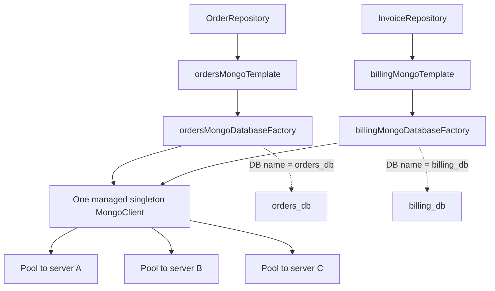
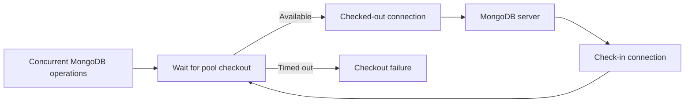

# Testing Isolation and Limiting Connection Pools

In Spring Data MongoDB, an application can use multiple databases to separate orders, billing, analytics, or other business domains. Configuring two `MongoTemplate` beans and two repository groups is not enough to conclude the system is safe. You must **test that a repository never reads from or writes to another database**, verify MongoDB account permissions, and avoid creating excessive `MongoClient` instances that spawn unnecessary **connection pools**.

A common misconception is thinking "every database needs its own MongoClient", leading to one client/pool per tenant or per repository. In reality, the MongoDB Java Driver manages **connection pools per MongoClient and per server in the topology**, never automatically creating new pools per collection, repository, or database. When two databases sit on the **same deployment** with the same credentials, TLS, and policy, they can share **one managed MongoClient** with two separate `MongoDatabaseFactory` and `MongoTemplate` beans. When separating clusters or credentials for security isolation, use separate clients and **budget connections across total clients × servers × app instances**.

This lesson belongs to the **Multiple databases** chapter of the `SPRING_DATA_MONGODB` module. The module covers connecting to MongoDB, mapping documents, operating via `MongoTemplate`/repositories, query design, aggregations, indexes, transactions, reactive access, testing, and performance diagnostics. The direct topic here is **"Testing Isolation and Limiting Connection Pools"**: writing integration tests with negative assertions, tuning pools sensibly, and observing actual resource usage.

> **Core rule:** Having multiple `MongoTemplate` beans does not mean having multiple pools if they share **one MongoClient**. Conversely, two `MongoClient`s pointing to the same cluster create **independent pools**. `maxPoolSize` caps **each per-server pool of each client**, not the maximum sockets across the entire JVM or cluster. Sharing a client saves resources, yet never replaces testing **database isolation, tenant authorization, and credential scope**.

## 1. Learning objectives

After completing this lesson, you will be able to:

1. Distinguish isolation across **database namespace, tenant, principal, client/pool, and deployment**.
2. Read the mapping diagram: repository → template → factory → client → MongoDB database.
3. Know when two databases should share one `MongoClient`.
4. Know when two clients are required due to different clusters, TLS, or credentials.
5. Explain why each `MongoClient` manages pools per **server**, not per database.
6. Understand `maxPoolSize`, `minPoolSize`, `maxConnecting`, `maxConnectionIdleTime`, and `maxWaitTime`.
7. Avoid confusing legacy `waitQueueTimeoutMS` with modern driver timeout settings.
8. Estimate an approximate upper bound on application connections when scaling pods.
9. Account for monitoring sockets outside the pool and topology/role changes.
10. Use Spring-managed singleton clients instead of client-per-request.
11. Write configurations for two `MongoDatabaseFactory` and two `MongoTemplate` beans sharing one client.
12. Bind two repository groups to the right templates using `mongoTemplateRef`.
13. Configure equivalent reactive clients/templates without mixing sync and reactive drivers.
14. Write **positive and negative** tests to catch misplaced database writes.
15. Verify tenant isolation within a single database.
16. Test least privilege with two principals when strong security boundaries are required.
17. Use Testcontainers to run isolated MongoDB test environments without touching production.
18. Measure pool usage via `ConnectionPoolListener`/JMX/metrics.
19. Design load tests to measure checkout wait, timeouts, and pool saturation.
20. Distinguish checkout timeouts, server selection timeouts, and socket/network timeouts.
21. Verify shutdown does not leak clients or pools.
22. Handle configuration drift, connection leaks, and version-specific startup behaviors.
23. Understand why reactive backpressure does not automatically cap total clients.
24. Avoid assuming shared pools imply shared transactions.
25. Know when to reuse pools versus when to prioritize security separation.

## 2. What does isolation mean in multi-database setups?

"Isolation" spans multiple layers. Ask **what is actually being isolated**:

| Layer | Goal | Right test example |
| --- | --- | --- |
| Database namespace | Orders never write to billing | `orders_db.orders` has the order; `billing_db.orders` does not |
| Repository → template | Repo never picks the wrong template | `OrderRepository` uses `ordersMongoTemplate` |
| Tenant inside one database | Tenant A cannot read B's data | Query/principal A never returns B's document |
| Credential/authorization | Orders principal cannot touch billing | Commands to billing fail with `Unauthorized` |
| Client/pool | No redundant clients/pools opened | Two templates share one client; client/pool counts stay bounded |
| Deployment/network | Separate failure domains/clusters | Billing cluster outage never redirects orders connections |
| Transaction/session | No confused boundaries | Matching manager/factory/session |

**Two separate databases** do not create hard security if both use the same principal granted `readWrite` on both. With a shared client, proper config prevents logic errors, yet raw driver code could still call `client.getDatabase("billing_db")` if credentials permit it.

### 2.1. Data isolation requires negative assertions

Checking only that `orderRepository.findById(id)` returns the order is not enough: if the repository was mistakenly bound to the billing template, it can **write to and read back from the wrong database** while the test stays green.

A trustworthy test must prove simultaneously:

- The order **exists** in `orders_db.orders`.
- The order **does not exist** in `billing_db.orders`.
- The invoice **exists** in `billing_db.invoices`.
- The invoice **does not exist** in `orders_db.invoices`.
- Tenant queries never return another tenant's data.

### 2.2. Pool isolation is not data isolation

Using a shared `MongoClient` **does not mix** the `orders_db` and `billing_db` namespaces; the two templates/factories still pick distinct databases. However, it **shares connection pools, credentials, networking, and client resources**, so a heavy workload on one can raise checkout latency for the other.

## 3. The right topology: two templates, one client, one pool set per topology



A `MongoClient` connected to a replica set maintains **a separate pool for each server** it communicates with, plus monitoring connections. Not all server connection pools immediately open up to `maxPoolSize`; they grow with activity, and connections can be closed on idle/lifetime expiry or topology changes.

### 3.1. Template count does not equal pool count

| Templates | `MongoClient` instances | Servers involved | Potential pools |
| --- | --- | --- | --- |
| 2 templates / 2 databases | **1** shared client | 1 server | About **1 pool** |
| 10 templates / 10 databases | **1** shared client | 3 servers | Per **3 servers**, not 10 DBs |
| 2 templates / 2 databases | **2** separate clients | 3 servers | Potentially **6 client-server pools** |
| 100 tenants, client per tenant | **100** clients | 3 servers | Potentially **300 pools** |

These numbers reflect **potential client-server pairs**, not a claim that every pool already holds open/checked-out sockets or that all 3 replica set members receive equal traffic. Actual pool topology depends on the driver, read preference, and server selection.

### 3.2. Limits of a shared client

Share a client only when databases reside on the same MongoDB deployment, use the same client-level authentication/TLS/read-preference settings, and security policy allows shared credentials. If orders and billing sit on two clusters or require two separate principals, use **two clients**; never trade away security boundaries just to reduce pool count.

## 4. How are pools scoped in the MongoDB Java Driver?

MongoDB Java Sync Driver and Reactive Streams Driver documentation state: **each `MongoClient` maintains one connection pool per server in the topology**. The driver uses pooled connections for operations and reuses them; the client also maintains monitoring connections for topology discovery outside regular application checkouts.

| Component | Creates a new pool? | Notes |
| --- | --- | --- |
| `new MongoClient` | **May create**, per connected server | Each client manages its own pools |
| `MongoClient.getDatabase("orders_db")` | **No** | Obtains a database handle without creating a client |
| `MongoClient.getDatabase("billing_db")` | **No** | Same client reuses existing pools |
| `new MongoTemplate(factory)` | **No if factory uses a shared client** | Template handles database selection/mapping |
| `new MongoRepository proxy` | **Never on its own** | Uses the bound template |
| Scaling out another Spring Boot pod | **Own client/pools in the new pod** | Pools are not shared across JVMs |
| Opening a reactive client alongside a sync client | **Separate pools** | Two distinct driver client types |

### 4.1. Important defaults, not universal recommendations

Per current MongoDB Java Driver guidance:

- `maxPoolSize` defaults to **100** connections **per pool/server/client**.
- `minPoolSize` defaults to **0**.
- `maxConnecting` defaults to **2** simultaneous connections being established per pool.
- `maxIdleTimeMS` defaults to **0** (no idle time limit under that option).
- The Java Sync Driver opens monitoring sockets separate from pooled application connections.

Defaults and client-level timeout mechanisms can vary by driver major version. Check the docs for your pinned driver version rather than treating table values as SLAs or hard cluster caps.

### 4.2. Checkout versus holding a connection

An operation typically **checks out** a connection from the pool, runs, and **checks it back in**; `MongoClient` does not open a new socket per command when an idle connection is available. When all connections to a server are busy and the pool hits its limit, operations must **wait for checkout** or fail per timeout policy.

### 4.3. Monitoring sockets outside `maxPoolSize`

Never assume `maxPoolSize=50` means the JVM opens at most 50 TCP sockets to the cluster. The driver maintains **monitoring connections** per server, alongside sockets from other clients, sessions, DNS/TLS/routers, and application dependencies.

## 5. Estimating your connection budget when scaling

A simple upper bound for **pooled application connections**, assuming every client opens pools to the same `S` server endpoints:

\[
C_{\mathrm{pooled,max}} \approx P \times K \times S \times M
\]

Where:

- `P`: number of application instances/pods.
- `K`: number of `MongoClient` instances **per instance**.
- `S`: number of servers for which each client holds a pool.
- `M`: `maxPoolSize` **per client-server pool**.

This is an **illustrative upper bound**, not a forecast of sockets actually open at any moment. Add monitoring connections, other processes, topology churn, and headroom.

### 5.1. Example with two clients per pod

Suppose:

```text
6 pods × 2 MongoClients/pod × 3 endpoints × maxPoolSize 40
= 1440 maximum pooled connections assuming full pools
```

If sharing the same deployment, auth/policy, and using **one shared `MongoClient` per pod**:

```text
6 pods × 1 MongoClient/pod × 3 endpoints × maxPoolSize 40
= 720 maximum pooled connections under the same assumption
```

Both figures **exclude monitoring sockets**, do not represent exact active connections, and are not production recommendations. In a replica set, read preferences and primary routing can distribute usage unevenly across pools.

### 5.2. A multiplication mistake

"2 databases × maxPoolSize=40 = 80 connections" is wrong if both use the **same `MongoClient`** to the same server: there is still **one pool capped at 40** pooled connections on that server, shared across both databases' workloads.

### 5.3. Adding app replicas can trigger a connection storm

Scaling a deployment from 4 to 40 pods multiplies total clients/pools by 10 even when each pod keeps a singleton client. High `minPoolSize`, high `maxConnecting`, and simultaneous health checks can cause many pods to open connections at once. Plan rollout pacing, readiness gates, and MongoDB server connection limits accordingly.

## 6. Pool settings: meaning, impact, and risks

| Setting | Meaning | If misconfigured |
| --- | --- | --- |
| `maxPoolSize` / `maxSize` | Max connections in each per-server pool | Too small → checkout queuing; too large → cluster pressure |
| `minPoolSize` / `minSize` | Minimum connections a pool tries to keep warm | Too high × many pods → excessive idle sockets |
| `maxConnecting` | Connections that can be established concurrently | Too low → slow warmup; too high → connection storms |
| `maxIdleTimeMS` | Idle time limit for pooled connections | Too low → connection churn; too high → lingering idle sockets |
| `maxLifeTimeMS` | Max connection lifetime | Must align with LB/firewall/network policies |
| `maxWaitTime` | Time to wait for an available connection | Exceeded → checkout failure |
| `waitQueueTimeoutMS` | Legacy URI setting, deprecated in newer driver docs | Prefer version-appropriate client-level timeouts |
| `serverSelectionTimeoutMS` | Time spent locating a suitable server | Not the checkout wait |
| `connectTimeoutMS` | Socket/network connect timeout | Not a pool-size cap |

**Important:** `waitQueueTimeoutMS` is marked **deprecated** in current MongoDB docs; when your driver supports **client-level timeouts**, configure per your version's API and guidance. On older Spring Boot/driver versions, verify differences before changing properties.

### 6.1. Do not pick values by guesswork

For instance, `maxPoolSize=20` is a reasonable experiment, not a universal best practice. Measure concurrency, queued operations, p95/p99 checkout latency, command latency, pool cleared events, and MongoDB server resources; increase pool size only when checkout itself is the proven bottleneck.

### 6.2. Do not mechanically set `minPoolSize` equal to `maxPoolSize`

`minPoolSize=100` across 20 pods and 3 servers keeps a huge number of connections open even during low traffic. Keep `minPoolSize` low unless warm pools are demonstrably needed; benchmark cold-start latency and tune against your SLOs.

## 7. Example configuration: one shared `MongoClient` with a bounded pool

Consider two databases `orders_db` and `billing_db` on the **same MongoDB deployment**, sharing credentials. Use one singleton client and two database factories. This conserves client-server pools when security requirements allow.

```yaml
# application.yml (development example)
app:
  mongo:
    uri: ${APP_MONGO_URI:mongodb://localhost:27017}
    pool:
      max-size: 24
    orders-db: orders_db
    billing-db: billing_db
```

```java
package dev.learning.multidb.config;

import com.mongodb.ConnectionString;
import com.mongodb.MongoClientSettings;
import com.mongodb.client.MongoClient;
import com.mongodb.client.MongoClients;
import java.util.concurrent.TimeUnit;
import org.springframework.beans.factory.annotation.Qualifier;
import org.springframework.beans.factory.annotation.Value;
import org.springframework.context.annotation.Bean;
import org.springframework.context.annotation.Configuration;
import org.springframework.data.mongodb.MongoDatabaseFactory;
import org.springframework.data.mongodb.core.MongoTemplate;
import org.springframework.data.mongodb.core.SimpleMongoClientDatabaseFactory;

@Configuration(proxyBeanMethods = false)
public class SharedMongoConfiguration {

    @Bean(value = "sharedMongoClient", destroyMethod = "close")
    MongoClient sharedMongoClient(
            @Value("${app.mongo.uri}") String uri,
            @Value("${app.mongo.pool.max-size:24}") int maxSize) {

        if (maxSize < 1) {
            throw new IllegalArgumentException(
                "MongoDB maxPoolSize must be positive");
        }

        MongoClientSettings settings =
            MongoClientSettings.builder()
                .applyConnectionString(new ConnectionString(uri))
                .applyToConnectionPoolSettings(pool -> pool
                    .minSize(0)
                    .maxSize(maxSize)
                    .maxConnecting(2)
                    .maxWaitTime(5, TimeUnit.SECONDS))
                .build();

        return MongoClients.create(settings);
    }

    @Bean("ordersMongoDatabaseFactory")
    MongoDatabaseFactory ordersMongoDatabaseFactory(
            @Qualifier("sharedMongoClient") MongoClient client,
            @Value("${app.mongo.orders-db}") String database) {

        return new SimpleMongoClientDatabaseFactory(client, database);
    }

    @Bean("billingMongoDatabaseFactory")
    MongoDatabaseFactory billingMongoDatabaseFactory(
            @Qualifier("sharedMongoClient") MongoClient client,
            @Value("${app.mongo.billing-db}") String database) {

        return new SimpleMongoClientDatabaseFactory(client, database);
    }

    @Bean("ordersMongoTemplate")
    MongoTemplate ordersMongoTemplate(
            @Qualifier("ordersMongoDatabaseFactory")
            MongoDatabaseFactory factory) {
        return new MongoTemplate(factory);
    }

    @Bean("billingMongoTemplate")
    MongoTemplate billingMongoTemplate(
            @Qualifier("billingMongoDatabaseFactory")
            MongoDatabaseFactory factory) {
        return new MongoTemplate(factory);
    }
}
```

**Explanation:** `max-size: 24` is an **illustrative value to benchmark**, not a general threshold. `maxWaitTime(5, SECONDS)` exists in the Java Driver pool settings API; on driver versions with newer timeout models, consult the MongoDB Driver docs. Configure pool settings on **`MongoClientSettings`** rather than trying to allocate a separate pool per template.

### 7.1. Why doesn't the factory close the shared client?

The Javadoc for `SimpleMongoClientDatabaseFactory(MongoClient, String)` states that a factory receiving an externally managed client **does not close that client when the factory is destroyed**. The Spring bean `sharedMongoClient` owns the lifecycle and closes the client once at application context shutdown.

### 7.2. What if properties define two databases while the URI specifies a database?

`ordersMongoDatabaseFactory` and `billingMongoDatabaseFactory` receive explicit database names. The database path in the URI may still affect default/authentication behavior depending on setup; verify **`authSource`**, permissions, and each factory's effective database. Never assume the URI alone dictates which database repositories access.

### 7.3. Checking per-pool limits

A single client has one `maxSize` applied across its pools. Two templates cannot independently set "orders pool 10 and billing pool 20" while sharing one `MongoClient`, because they share the connection pools to the same servers. If workloads need hard capacity isolation, consider separating clients/pools or adding application-layer rate limiting.

## 8. Binding two repository groups for testability

Example domain classes:

```java
package dev.learning.multidb.orders;

import org.springframework.data.annotation.Id;
import org.springframework.data.mongodb.core.mapping.Document;

@Document("orders")
public record OrderDoc(
    @Id String id,
    String tenantId,
    long totalCents
) {}
```

```java
package dev.learning.multidb.billing;

import org.springframework.data.annotation.Id;
import org.springframework.data.mongodb.core.mapping.Document;

@Document("invoices")
public record InvoiceDoc(
    @Id String id,
    String tenantId,
    String orderId
) {}
```

Two repository interfaces in separate packages:

```java
package dev.learning.multidb.orders;

import org.springframework.data.mongodb.repository.MongoRepository;
import java.util.List;

public interface OrderRepository
        extends MongoRepository<OrderDoc, String> {

    List<OrderDoc> findByTenantId(String tenantId);
}
```

```java
package dev.learning.multidb.billing;

import org.springframework.data.mongodb.repository.MongoRepository;
import java.util.List;

public interface InvoiceRepository
        extends MongoRepository<InvoiceDoc, String> {

    List<InvoiceDoc> findByTenantId(String tenantId);
}
```

Two configurations scanning and binding to **named templates**:

```java
package dev.learning.multidb.config;

import dev.learning.multidb.orders.OrderRepository;
import org.springframework.context.annotation.Configuration;
import org.springframework.data.mongodb.repository.config.EnableMongoRepositories;

@Configuration(proxyBeanMethods = false)
@EnableMongoRepositories(
    basePackageClasses = OrderRepository.class,
    mongoTemplateRef = "ordersMongoTemplate"
)
public class OrdersRepositoriesConfiguration {}
```

```java
package dev.learning.multidb.config;

import dev.learning.multidb.billing.InvoiceRepository;
import org.springframework.context.annotation.Configuration;
import org.springframework.data.mongodb.repository.config.EnableMongoRepositories;

@Configuration(proxyBeanMethods = false)
@EnableMongoRepositories(
    basePackageClasses = InvoiceRepository.class,
    mongoTemplateRef = "billingMongoTemplate"
)
public class BillingRepositoriesConfiguration {}
```

### 8.1. Why are both attributes needed?

- `basePackageClasses`: which repositories belong to the group.
- `mongoTemplateRef`: which template bean that group uses.
- The template uses a factory with a specific database name.
- The factory uses `sharedMongoClient`.

If `mongoTemplateRef` is missing, Spring Data defaults to bean name `mongoTemplate`; never let a default Boot client/template silently become a repository group's target database.

### 8.2. Avoiding overlapping scans

If the orders config scanned the parent package `dev.learning.multidb`, `InvoiceRepository` could be registered under the wrong group. Use disjoint repository packages or dedicated marker classes, and verify Spring Boot auto-repository scanning/back-off.

### 8.3. `@Document` is not a security or routing rule

`@Document("invoices")` only picks the collection, not `billing_db`. If `InvoiceRepository` uses the orders template, inserts can create `orders_db.invoices` without error. That is the exact regression integration tests must catch.

## 9. When two separate clients and independent pools are mandatory

If orders and billing use **two different clusters**, or share a cluster yet need **different credentials, roles, or TLS options** for security isolation, configure two `MongoClient` beans.

```yaml
app:
  mongo:
    orders-uri: ${ORDERS_MONGO_URI}
    billing-uri: ${BILLING_MONGO_URI}
```

```java
@Bean(value = "ordersMongoClient", destroyMethod = "close")
MongoClient ordersMongoClient(
        @Value("${app.mongo.orders-uri}") String uri) {
    return MongoClients.create(uri);
}

@Bean(value = "billingMongoClient", destroyMethod = "close")
MongoClient billingMongoClient(
        @Value("${app.mongo.billing-uri}") String uri) {
    return MongoClients.create(uri);
}
```

In this configuration, each database factory injects **its corresponding client**. Do not simultaneously keep `sharedMongoClient` from section 7 if the architecture requires two independent principals.

### 9.1. Security outweighs having fewer pools

A shared client requires a single credential capable of accessing both DBs. If the requirement states "the orders principal must be unable to read billing even if a developer injects the wrong template", you must use **separate credentials and roles**. Never merge two clients just to save connection pools.

### 9.2. Two clients can point to the same cluster

Even on the same MongoDB deployment, two different credentials must live in two separate clients, each with its own pools. Budget resources accordingly and test that **commands fail when credentials lack permission**, rather than trusting bean names alone.

### 9.3. Client lifetime and shutdown

Never create or close clients inside individual service methods. Both clients are Spring-managed singleton beans. `close()` at application context shutdown releases pools and monitor threads; never wrap a client shared by multiple templates in `try-with-resources`.

## 10. Anti-pattern: one `MongoClient` per request or per tenant

Wrong:

```java
public OrderDoc readOrder(String uri, String id) {
    MongoClient newClient = MongoClients.create(uri);
    MongoTemplate newTemplate = new MongoTemplate(
        new SimpleMongoClientDatabaseFactory(
            newClient, "orders_db"));
    return newTemplate.findById(id, OrderDoc.class);
}
```

Flaws in this approach:

- Every request can spin up its own client, pool, and monitoring connections.
- Forgetting to close leaks connections; closing immediately causes handshake/TLS churn.
- Passing a client-controlled URI risks SSRF or unauthorized DB access.
- Pool metrics become fragmented, making quotas hard to enforce.
- Topology discovery and centrally managed credentials are never reused.

Better: inject `OrderRepository` or `@Qualifier("ordersMongoTemplate") MongoOperations` from the application context and reuse it.

### 10.1. Per-tenant databases need their own architecture

If you have 500 tenant databases on **one deployment with the same credentials/policy**, creating 500 `MongoClient`s merely to select 500 database names is wasteful. Yet sharing a client alone does not protect each tenant's data; design an authorized tenant-to-database resolver, restrict database names, manage storage mappings, quotas, and consistency. Never turn raw `tenantId` input into arbitrary `getDatabase` calls.

### 10.2. Never call `MongoClients.create` inside another `@Bean MongoTemplate`

`@Bean MongoTemplate orders() { return new MongoTemplate(MongoClients.create(uri), "orders_db"); }` and a similar billing bean actually create **two clients** even though you only see two template beans. Inspect the full bean graph rather than counting templates to infer pool count.

## 11. Separating tests: correctness, authorization, and capacity

| Test type | Question answered | Tools |
| --- | --- | --- |
| Database routing | Does the repository write to the right DB? | Testcontainers, direct `MongoTemplate` |
| Negative isolation | Does data leak into the other DB? | Assert absence in the wrong DB |
| Tenant isolation | Can A see B's records? | Service/security integration tests |
| Credential isolation | Can the orders principal read billing? | Role/credential tests |
| Pool topology | Is there one client or multiple clients? | Spring context / Pool listener |
| Pool capacity | Checkout queuing/timeouts under high load? | Bounded load test + metrics |
| Resource lifecycle | Any leaks across restarts/disposal? | Listeners, JMX, thread/socket monitoring |
| Failure isolation | How does a billing outage affect orders? | Chaos/staging, latency/error measurements |

**Do not cram everything into a single integration test**. Correct-DB read/write tests run fast and deterministically; permission tests require MongoDB role setup; load tests measuring pool saturation need dedicated workloads and metrics.

### 11.1. Service unit tests do not prove target databases

Mocking `OrderRepository` only proves the service calls the right method. To catch a wrong `mongoTemplateRef` or factory database name, you must run the Spring context against a real MongoDB instance.

### 11.2. Counting beans is not counting sockets

`ApplicationContext.getBeansOfType(MongoClient.class).size()==1` verifies the number of **Spring-managed `MongoClient` beans**, but tells you nothing about how many sockets the client opened, how many server hosts exist, or whether raw clients were created outside Spring. Combine it with pool events and metrics to verify actual resource usage.

## 12. Test environment: Testcontainers and Spring Boot configuration

Use a dedicated test MongoDB deployment for integration tests. Testcontainers Java 1.x provides `MongoDBContainer`, which starts a single-node replica set in a container—handy when also testing MongoDB transactions; database isolation tests themselves **do not require a replica set**, though using that container keeps fixtures consistent.

A sample application only needs component scanning over the configs and repositories:

```java
package dev.learning.multidb;

import org.springframework.boot.SpringApplication;
import org.springframework.boot.autoconfigure.SpringBootApplication;

@SpringBootApplication
public class MultiDatabaseApplication {

    public static void main(String[] args) {
        SpringApplication.run(MultiDatabaseApplication.class, args);
    }
}
```

Configuration classes sit in `dev.learning.multidb.config`, and entity/repository classes sit in the two subpackages. With two `@EnableMongoRepositories` configs targeting their own groups, avoid a third annotation scanning the root package. If Spring Boot's auto repository scan on your version causes collisions, verify back-off and adjust explicit configuration; never enable bean overriding to hide errors.

### 12.1. Example dependencies

```groovy
dependencies {
    implementation "org.springframework.boot:spring-boot-starter-data-mongodb"
    testImplementation "org.springframework.boot:spring-boot-starter-test"
    testImplementation "org.testcontainers:junit-jupiter"
    testImplementation "org.testcontainers:mongodb"
}
```

This example matches **Testcontainers Java 1.x**. In Testcontainers 2.x, module/import names may change; pin the appropriate BOM/version. If CI lacks Docker, use a dedicated test MongoDB service with two databases and separate roles.

### 12.2. Every test DB must be isolated from production

`orders_it` and `billing_it` are strictly test databases. Never run `dropDatabase`, `dropCollection`, or create test principals on production. Use unique IDs instead of wiping a shared database so parallel tests do not interfere with one another.

## 13. Integration test: present in the right place and absent in the wrong place

A complete test (Spring Boot 3.x and Testcontainers Java 1.x) must verify **positive + negative assertions**:

```java
package dev.learning.multidb;

import static org.assertj.core.api.Assertions.assertThat;

import java.util.Map;
import java.util.UUID;

import com.mongodb.client.MongoClient;
import dev.learning.multidb.orders.OrderDoc;
import dev.learning.multidb.orders.OrderRepository;
import dev.learning.multidb.billing.InvoiceDoc;
import dev.learning.multidb.billing.InvoiceRepository;

import org.junit.jupiter.api.Test;
import org.springframework.beans.factory.annotation.Autowired;
import org.springframework.beans.factory.annotation.Qualifier;
import org.springframework.boot.test.context.SpringBootTest;
import org.springframework.context.ApplicationContext;
import org.springframework.data.mongodb.MongoDatabaseFactory;
import org.springframework.data.mongodb.core.MongoTemplate;
import org.springframework.test.context.DynamicPropertyRegistry;
import org.springframework.test.context.DynamicPropertySource;
import org.testcontainers.containers.MongoDBContainer;
import org.testcontainers.junit.jupiter.Container;
import org.testcontainers.junit.jupiter.Testcontainers;
import org.testcontainers.utility.DockerImageName;

@Testcontainers
@SpringBootTest
class MongoDatabaseIsolationTest {

    @Container
    static final MongoDBContainer mongo =
        new MongoDBContainer(DockerImageName.parse("mongo:7.0"));

    @DynamicPropertySource
    static void testProperties(DynamicPropertyRegistry registry) {
        registry.add("app.mongo.uri", mongo::getReplicaSetUrl);
        registry.add("app.mongo.orders-db", () -> "orders_it");
        registry.add("app.mongo.billing-db", () -> "billing_it");
        registry.add("app.mongo.pool.max-size", () -> "8");
    }

    @Autowired OrderRepository orderRepository;
    @Autowired InvoiceRepository invoiceRepository;
    @Autowired ApplicationContext context;

    @Autowired
    @Qualifier("ordersMongoTemplate")
    MongoTemplate ordersTemplate;

    @Autowired
    @Qualifier("billingMongoTemplate")
    MongoTemplate billingTemplate;

    @Autowired
    @Qualifier("ordersMongoDatabaseFactory")
    MongoDatabaseFactory ordersFactory;

    @Autowired
    @Qualifier("billingMongoDatabaseFactory")
    MongoDatabaseFactory billingFactory;

    @Test
    void writesStayInTheirDatabases() {
        String suffix = UUID.randomUUID().toString();

        OrderDoc order = new OrderDoc(
            "order-" + suffix, "tenant-A", 12345L);

        InvoiceDoc invoice = new InvoiceDoc(
            "invoice-" + suffix, "tenant-A", order.id());

        orderRepository.insert(order);
        invoiceRepository.insert(invoice);

        assertThat(ordersFactory.getMongoDatabase().getName())
            .isEqualTo("orders_it");
        assertThat(billingFactory.getMongoDatabase().getName())
            .isEqualTo("billing_it");

        // Data exists in the right database.
        assertThat(
            ordersTemplate.findById(order.id(), OrderDoc.class))
            .isNotNull();
        assertThat(
            billingTemplate.findById(invoice.id(), InvoiceDoc.class))
            .isNotNull();

        // Record must NEVER exist in the wrong database.
        assertThat(
            billingTemplate.findById(order.id(), OrderDoc.class))
            .isNull();
        assertThat(
            ordersTemplate.findById(invoice.id(), InvoiceDoc.class))
            .isNull();
    }

    @Test
    void springManagesOnlyOneSyncMongoClient() {
        Map<String, MongoClient> clients =
            context.getBeansOfType(MongoClient.class);

        assertThat(clients)
            .containsKey("sharedMongoClient")
            .hasSize(1);
    }
}
```

The test above matches the `app.mongo.*` properties from section 7. It verifies **one managed sync `MongoClient` bean**, though it does not by itself prove there is only one TCP connection or no raw client created outside the container.

### 13.1. Why assert absence in the wrong database?

If `OrderRepository` accidentally targets `billingMongoTemplate`, both `orderRepository.insert` and `orderRepository.findById` will pass because both run on the wrong database. Checking only repository readback misses the regression. Reading directly via **both qualified templates** catches it.

### 13.2. Why use UUIDs instead of wiping collections?

Unique IDs avoid collisions and prevent tests from stepping on one another. Avoid `deleteAll` or `dropDatabase` on a shared MongoDB instance just to shorten a test.

### 13.3. Use test DB names distinct from production names

The integration test sets `orders_it` and `billing_it` to verify factories use **property injection** rather than hardcoding `orders_db` in Java. If config accidentally hardcodes the name, the factory database name assertion fails.

### 13.4. Testing one client bean differs from testing pools

Counting Spring beans does not measure:
- the number of **pools per server**,
- active sockets or monitoring connections,
- clients instantiated outside the Spring context,
- client counts across **other pods**.

That is why listeners and metrics are covered in later sections.

## 14. Testing tenant isolation within the same database

Separating orders and billing databases does not guarantee **tenant A cannot see tenant B** when both reside in `orders_it`. Repositories must filter by the tenant provided by a **server-side authenticated principal**.

Add to `OrderRepository`:

```java
import java.util.Optional;

// Additional method in OrderRepository.
Optional<OrderDoc> findByIdAndTenantId(
    String id, String tenantId);
```

A service accepting only `trustedTenantId` from the authentication boundary:

```java
package dev.learning.multidb.orders;

import java.util.Optional;
import org.springframework.stereotype.Service;

@Service
public class OrderReadService {
    private final OrderRepository repository;

    public OrderReadService(OrderRepository repository) {
        this.repository = repository;
    }

    public Optional<OrderDoc> findOwned(
            String id, String trustedTenantId) {
        if (trustedTenantId == null
                || trustedTenantId.isBlank()) {
            return Optional.empty();
        }
        return repository.findByIdAndTenantId(
            id, trustedTenantId);
    }
}
```

Test the service with an order belonging to tenant A and a user from tenant B:

```java
@Test
void tenantBDoesNotSeeTenantAOrder() {
    String id = "tenant-isolation-" + UUID.randomUUID();

    orderRepository.insert(
        new OrderDoc(id, "tenant-A", 500L));

    OrderReadService service =
        new OrderReadService(orderRepository);

    assertThat(service.findOwned(id, "tenant-A")).isPresent();
    assertThat(service.findOwned(id, "tenant-B")).isEmpty();
}
```

The example method takes `trustedTenantId` because this lesson focuses on the data boundary. Production code must obtain it from the authenticated principal, never allowing HTTP callers to specify an arbitrary tenant ID. Beyond `findOwned`, all updates, deletes, and aggregations must also apply appropriate tenant filters.

### 14.1. Write negative tests for every method, not only `findById`

If a service exposes `findAll`, `search`, `aggregate`, or bulk deletes, any path can omit the tenant predicate. Passing on one method does not prove the others are isolated.

### 14.2. A tenant is not a MongoDB database

`tenant-A` and `tenant-B` can share `orders_db`; `@EnableMongoRepositories` only binds a repository to a database and does not enforce row/document-level tenant policies.

## 15. Testing least privilege with two MongoDB principals

If "the orders service cannot access billing" is a **security invariant**, create **two separately scoped users/roles** in a test environment with MongoDB authentication enabled. Illustrative admin commands on a test database:

```javascript
// Executed by a test admin on a test MongoDB deployment.
use orders_it
db.createUser({
  user: "orders_app_test",
  pwd: "<secret-from-test-env>",
  roles: [
    { role: "readWrite", db: "orders_it" }
  ]
});

use billing_it
db.createUser({
  user: "billing_app_test",
  pwd: "<secret-from-test-env>",
  roles: [
    { role: "readWrite", db: "billing_it" }
  ]
});
```

To verify actual permissions, test clients must **authenticate as those specific users** with the proper `authSource`, not as root/test admin:

- Orders principal reading/writing `orders_it` succeeds.
- Orders principal reading/writing `billing_it` fails with `Unauthorized`.
- Billing principal succeeds on `billing_it`.
- Billing principal is denied on `orders_it`.

### 15.1. Default Testcontainers does not prove authorization isolation

A Testcontainers MongoDB without auth/role enforcement enabled lets both templates read every database. `MongoDatabaseIsolationTest` in section 13 proves **routing**, not MongoDB user permissions. Run a **separate test profile** with auth enabled to verify least privilege.

### 15.2. Failing with `Unauthorized` differs from not found

If the orders client queries the billing DB without permission, expect the **command to be rejected**, not `find(...) == null`. Tests with MongoDB auth must distinguish server `Unauthorized`/permission failures from a genuinely absent document.

### 15.3. Never hardcode passwords in tests

Load test secrets from fixtures/environment variables and redact logs. Never run negative tests with production accounts; avoid any action that could alter real data.

## 16. Measuring pools via `ConnectionPoolListener`

The MongoDB Java Driver provides `com.mongodb.event.ConnectionPoolListener` to observe events such as:

- `connectionPoolCreated`, `connectionPoolClosed`.
- `connectionCreated`, `connectionClosed`.
- `connectionCheckedOut`, `connectionCheckedIn`.
- `connectionCheckOutStarted`, `connectionCheckOutFailed`.
- `connectionPoolCleared`, when a pool is cleared during network or topology events.

Example listener **using counters without logging raw credentials or BSON**:

```java
package dev.learning.multidb.metrics;

import java.util.concurrent.atomic.LongAdder;
import com.mongodb.event.ConnectionPoolListener;
import com.mongodb.event.ConnectionCheckedOutEvent;
import com.mongodb.event.ConnectionCheckOutFailedEvent;
import com.mongodb.event.ConnectionPoolCreatedEvent;

public final class MongoPoolCounters
        implements ConnectionPoolListener {

    private final LongAdder poolsCreated = new LongAdder();
    private final LongAdder checkouts = new LongAdder();
    private final LongAdder checkoutFailures = new LongAdder();

    @Override
    public void connectionPoolCreated(
            ConnectionPoolCreatedEvent event) {
        poolsCreated.increment();
    }

    @Override
    public void connectionCheckedOut(
            ConnectionCheckedOutEvent event) {
        checkouts.increment();
    }

    @Override
    public void connectionCheckOutFailed(
            ConnectionCheckOutFailedEvent event) {
        checkoutFailures.increment();
    }

    public long poolsCreated() {
        return poolsCreated.sum();
    }

    public long checkouts() {
        return checkouts.sum();
    }

    public long checkoutFailures() {
        return checkoutFailures.sum();
    }
}
```

Register the listener **before creating the `MongoClient`**:

```java
@Bean
MongoPoolCounters mongoPoolCounters() {
    return new MongoPoolCounters();
}

// Update the sharedMongoClient @Bean method in section 7 to inject counters.
MongoClientSettings settings = MongoClientSettings.builder()
    .applyConnectionString(new ConnectionString(uri))
    .applyToConnectionPoolSettings(pool -> pool
        .minSize(0)
        .maxSize(maxSize)
        .maxConnecting(2)
        .addConnectionPoolListener(counters))
    .build();
```

The final snippet is a **replacement inside the bean method**, assuming `uri`, `maxSize`, and `counters` are injected; it is not a complete second configuration class. Never call `MongoClients.create` a second time just to attach a listener.

### 16.1. Counting `poolCreated` is not counting current connections

`poolsCreated()` counts **events since the listener started**, not active pools or current open sockets. When topology changes, pools clear/recreate, or clients restart, the counter grows even though that many pools do not coexist simultaneously.

### 16.2. Use JMX/Micrometer when gauges are needed

MongoDB Java drivers support pool monitoring via JMX and `ConnectionPoolListener`. Useful gauges track per-server **current size, checked-out count, and waiters** where supported by your driver/metrics stack. Do not treat cumulative `checkouts` since boot as "currently active connections".

### 16.3. Watch labels and cardinality

To prevent metrics cardinality explosions, stick to labels like `application`, `clientRole`, `serverAddress`, and environment; **never** add raw tenant IDs or full connection URIs/passwords as metric labels.

## 17. Testing that pools do not multiply per database

A resource-isolation verification should span three layers:

1. **Static configuration:** only one `sharedMongoClient` bean created for both factories.
2. **Runtime events:** a listener attached to that client before connecting.
3. **Server connections:** metrics/JMX or server-side monitoring showing actual sockets.

In a single-node `MongoDBContainer` test, when the same client accesses `orders_it` and then `billing_it`, it reuses the pool to the **same server**. Never equate **database count = pool count**.

### 17.1. Testing configuration does not create a second client

Add a test to `MongoDatabaseIsolationTest`:

```java
@Test
void twoFactoriesStillUseOneManagedClient() {
    Map<String, MongoClient> clients =
        context.getBeansOfType(MongoClient.class);

    assertThat(clients.keySet())
        .containsExactly("sharedMongoClient");

    assertThat(ordersFactory.getMongoDatabase().getName())
        .isEqualTo("orders_it");

    assertThat(billingFactory.getMongoDatabase().getName())
        .isEqualTo("billing_it");
}
```

**Verification limit:** This test only guarantees one **managed client bean** and that both factories pick the right DB names; it will not catch clients manually constructed in custom Java code outside Spring or count TCP sockets. Combine with code review/static search and live metrics.

### 17.2. Pool events do not grow with repository count

In a **stable, single-server-address** test environment, you can record `connectionPoolCreated` before and after touching each DB for the first time. Do not expect a pool-creation event after every `MongoTemplate.insert`: once the pool exists, the client reuses it.

However, avoid asserting a rigid event count on multi-node replica sets or during topology changes; server endpoints, monitoring states, and failovers can vary event totals.

### 17.3. Testing simulated misconfiguration

To guard your architecture contract, you can write a **dedicated configuration test** intentionally creating two clients instead of one and observe:

- Spring-managed `MongoClient` bean count increases.
- Each client's `ConnectionPoolListener` tracks an independent lifecycle.
- Server-side connection count can grow as both pools warm up.

Never deploy this flawed configuration into production just to benchmark. Use a test profile or an isolated test harness.

## 18. Load-testing pool limits: measure wait time, not only throughput

Pool saturation occurs when more operations want to talk to a server concurrently than available connections allow. When all pooled connections are checked out and `maxPoolSize` is reached, requests queue and may fail per timeout policy.



### 18.1. Set clear test objectives

A load test can configure a client with `maxPoolSize=2` and run concurrent reads/writes, while measuring:

- `connectionCheckOutStarted`, `connectionCheckedOut`, `connectionCheckOutFailed`.
- p50/p95/p99 **checkout wait time**.
- p50/p95/p99 database command latency.
- Concurrent in-flight operations / thread or reactive demand.
- Server CPU, I/O, locks, and available connections.
- Timeouts and retry attempts.
- Number of clients and app replicas in the test.
- Stability when workload shifts between orders and billing.

**Do not assume** 20 quick `findById` calls guarantee checkout timeouts: if queries finish fast enough, two connections can easily serve them all. Reproducing saturation requires workloads holding connections long enough and objective measurements.

### 18.2. Never run server-slowing load tests on production

If you need to test pool exhaustion, use a dedicated **load-test database/cluster** with bounded concurrency, timeouts, and cleanup. Never lock collections, run intentionally slow queries indefinitely, or open thousands of sockets against production just to prove `maxPoolSize` works.

### 18.3. Practical sizing formula

Under steady-state concurrency:

\[
\text{inFlightOperations} \approx
\text{throughputPerSecond} \times
\text{averageOperationLatencySeconds}
\]

This is a rough application of Little's Law; it **estimates** concurrency demand, not an exact formula for `maxPoolSize`. One HTTP request can execute multiple database commands, commands may retry, and topology selection can concentrate writes onto a single primary.

### 18.4. Orders workload can contend with billing in a shared pool

Because `ordersMongoTemplate` and `billingMongoTemplate` share a client, a heavy orders batch job issuing many writes can raise billing checkout latency **when hitting the same server pool**. If business SLAs demand strict latency isolation, apply per-workflow rate limits/bulkheads or split clients where justified.

## 19. Sizing in practice and capping total connections

The goal is not "as few pools as possible", but **sufficient throughput while staying inside the server connection budget and meeting isolation requirements**.

### 19.1. Illustrative scenario table

| Scenario | Pods | Clients/pod | Server endpoints/client | MaxSize | Upper bound on pooled connections* |
| --- | ---: | ---: | ---: | ---: | ---: |
| Shared client | 4 | 1 | 3 | 20 | 240 |
| Two credentials | 4 | 2 | 3 | 20 | 480 |
| 12 DBs, one client | 4 | 1 | 3 | 20 | 240 |
| One client per DB (12 DBs) | 4 | 12 | 3 | 20 | 2,880 |
| Shared after scale-out | 16 | 1 | 3 | 20 | 960 |

*Assumes every client maintains a pool to every endpoint and all pools are full. Excludes monitoring sockets, admin tools, backup agents, and other processes.

### 19.2. A pool of 20 does not mean 20 requests max

Each connection is reused rapidly across sequential operations; throughput depends on latency and server capacity. Conversely, one HTTP request can issue 2–5 database commands; never equate 20 connections with an exact limit of 20 concurrent HTTP clients.

### 19.3. Never raise `maxPoolSize` when queries are slow due to missing indexes

If p99 command latency spikes because of collection scans or missing indexes, raising pool size can **overload MongoDB further** without fixing the root cause. Check `explain("executionStats")`, index metrics, and server resource usage before simply bumping connection limits.

### 19.4. Reserve a cluster-level budget

MongoDB servers and Atlas tiers enforce connection limits shared with admin sessions, backups, CDC, and monitoring. Leave headroom for those processes, failovers, and traffic spikes. `P × K × S × M` is a **capacity-planning** tool, not an automatic system-wide guard.

## 20. `ReactiveMongoTemplate` also maintains pools per client/server

A reactive Spring Data MongoDB application requires the **Reactive Streams Driver `MongoClient`**:

```java
import com.mongodb.ConnectionString;
import com.mongodb.MongoClientSettings;
import com.mongodb.reactivestreams.client.MongoClient;
import com.mongodb.reactivestreams.client.MongoClients;
import org.springframework.data.mongodb.ReactiveMongoDatabaseFactory;
import org.springframework.data.mongodb.core.ReactiveMongoTemplate;
import org.springframework.data.mongodb.core.SimpleReactiveMongoDatabaseFactory;

MongoClient reactiveClient = MongoClients.create(
    MongoClientSettings.builder()
        .applyConnectionString(
            new ConnectionString("mongodb://localhost:27017"))
        .applyToConnectionPoolSettings(pool -> pool
            .minSize(0)
            .maxSize(24)
            .maxConnecting(2))
        .build());

ReactiveMongoDatabaseFactory ordersFactory =
    new SimpleReactiveMongoDatabaseFactory(
        reactiveClient, "orders_db");

ReactiveMongoDatabaseFactory billingFactory =
    new SimpleReactiveMongoDatabaseFactory(
        reactiveClient, "billing_db");

ReactiveMongoTemplate ordersOps =
    new ReactiveMongoTemplate(ordersFactory);

ReactiveMongoTemplate billingOps =
    new ReactiveMongoTemplate(billingFactory);
```

This is a **structural snippet**; in a real application, register the client, factories, and templates as named singleton beans and close the reactive client on shutdown. Never create a client inside `Flux.defer` or per request.

### 20.1. Reactive repositories bind via a different attribute

```java
@EnableReactiveMongoRepositories(
    basePackageClasses = ReactiveOrderRepository.class,
    reactiveMongoTemplateRef = "ordersReactiveMongoTemplate")
```

`reactiveMongoTemplateRef` must match the bean name, and repository classes must reside in non-overlapping packages. Only a `ReactiveMongoRepository` bound to the right template executes commands against the intended database when subscribed.

### 20.2. Reactive driver does not share pools with sync driver

If an application uses both `com.mongodb.client.MongoClient` and `com.mongodb.reactivestreams.client.MongoClient`, they are **two independent client types** with separate connection pools, even for the same URI/cluster. Count **both** in your connection budget.

### 20.3. Reactor backpressure does not limit `MongoClient` count

`Flux`/`Mono` regulate demand, yet if every subscriber creates a new `MongoClient`, pool count still explodes. Reactive does not mean "zero connections". Use singleton clients, bounded concurrency, and proper subscription cancellation.

### 20.4. Bounded concurrency

```java
Flux<OrderDoc> result = Flux.fromIterable(ids)
    .flatMap(
        id -> reactiveOrderRepository.findById(id),
        8 // Limit concurrent inner subscriptions.
    );
```

`ids` and `reactiveOrderRepository` come from your application context. Bounding concurrency reduces checkout pressure, though the number 8 should be tuned to workload measurements rather than treated as an arbitrary SLA. Note that `flatMap` does not preserve order; use `concatMap` when sequential ordering is required.

## 21. Never confuse pool limits with timeouts and retries

When queries fail, distinguish the layers:

| Error / symptom | Likely cause | Evidence to inspect |
| --- | --- | --- |
| High checkout wait | Connections busy, pool too small, slow ops | Pool listener: checked-out/wait |
| Checkout timeout | Could not check out within deadline | `connectionCheckOutFailed` reason, client timeout |
| Server selection timeout | No suitable server found (primary/down/URI) | Cluster/heartbeat events |
| Connect timeout | Slow TCP/TLS/network handshake | Connect errors, network metrics |
| Socket/read timeout | I/O command exceeded timeout | Driver errors, server latency |
| `Unauthorized` | MongoDB principal lacks permission | Auth roles, database/collection |
| `NoSuchBeanDefinition` | Wrong Spring template ref | Bean names/scanning |
| Data lands in wrong DB | Wrong factory/template binding | Positive + negative DB assertions |
| Low throughput with idle pool | Server index/I/O/lock/query bottleneck | Explain, server metrics |

### 21.1. Retries can worsen pool overload

If every timed-out request retries immediately, total concurrent operations multiply, pushing pools and clusters into a retry storm. Use backoff, retry budgets, and idempotency for retried writes. Never use retries to mask bad credentials or misrouted repositories.

### 21.2. `maxConnecting` is not `maxPoolSize`

`maxConnecting` only throttles **new connections being established concurrently**, whereas `maxPoolSize` caps total pooled connections after creation. Raising `maxConnecting` speeds up warmup but can trigger connection storms during scale-outs.

### 21.3. Deprecated `waitQueueTimeoutMS`

Current MongoDB Driver docs deprecate `waitQueueTimeoutMS` and recommend appropriate client-level timeouts. If your Spring Boot version pins an older driver, test carefully instead of blindly rewriting configuration from newer docs; check `MongoClientSettings`, driver version, and failure semantics.

## 22. Transactions and database isolation are separate concerns

Two `MongoTemplate` beans sharing a `MongoClient` do not mean operations across both automatically join **the same MongoDB transaction**.

- `MongoTransactionManager` binds sessions/transactions to a specific `MongoDatabaseFactory`.
- `ordersMongoTemplate` and `billingMongoTemplate` have **two factories** in our example.
- A manager for orders **does not automatically enlist** the billing factory in its session.
- MongoDB servers can support multi-database transactions **within the same deployment**, but the Spring app must explicitly coordinate sessions.
- Two independent clusters have no simple MongoDB-native transaction manager that commits atomically across both.

### 22.1. Dedicated tests for transaction boundaries

With a test MongoDB replica set and `MongoTransactionManager`:

1. Use an orders transaction manager bound to `ordersMongoDatabaseFactory`.
2. Write orders inside a verified active transaction.
3. Intentionally throw an exception to trigger rollback.
4. Confirm orders did not commit.
5. If the service also calls a separate billing template, **do not** assume billing rolls back unless explicit session coordination has been designed and tested.

Never use the DB routing integration test from section 13 to infer cross-database atomicity.

### 22.2. When cross-database consistency is needed

If orders and billing live on two deployments, consider a **transactional outbox**, idempotent event consumers, sagas/compensation, and reconciliation. Reducing connection pool counts does not alter distributed transaction limits.

## 23. Scale-out, restarts, and connection storms

A singleton `MongoClient` is only a singleton **within one Spring application context/JVM**. Running 20 Kubernetes pods yields roughly 20 shared-client instances, not one client across the whole deployment.

### 23.1. Startup connection surge

With a high `minPoolSize` and many pods rolling out simultaneously, each pod immediately opens sockets to every server, alongside TLS/auth handshakes and monitoring sockets. Limit rollout surge, benchmark warmup, and keep `minPoolSize` modest.

### 23.2. Liveness and readiness

- **Liveness** should not repeatedly kill pods just because one database is temporarily slow, causing restart storms.
- **Readiness** can mark billing-dependent features degraded when billing is unreachable.
- With two clusters, monitor each deployment's availability independently rather than pinging orders and declaring billing healthy.
- Test that when one cluster goes down, billing operations never silently fail over to the orders database.

### 23.3. Shutdown and graceful release

Spring-managed `MongoClient` beans close at context shutdown. With a shared client, never close the client inside the billing service when "billing is disabled", because orders still needs it. Close at the application lifecycle owner after draining incoming requests/jobs and letting in-flight operations finish within a bounded grace period.

### 23.4. `ConnectionPoolCleared` events

Failovers or network errors can emit `connectionPoolCleared`. This event does not mean the app spawned a new client; it reflects driver pool state transitions. Distinguish **pool cleared**, **pool created**, **connection created**, and **connection checked out** on dashboards.

## 24. Fault-injection scenarios to test in staging

A multi-database system can suffer business-level failures even when pool metrics look normal. Test across distinct failure domains:

| Scenario | What to verify | What NOT to do |
| --- | --- | --- |
| Orders principal loses billing access | Billing commands fail `Unauthorized` under orders credentials | Fall back to orders |
| Billing cluster times out | Orders continues running if clusters are independent | Reuse orders DB for invoices |
| Replica set failover | Driver recovers and updates topology | Spin up a new `MongoClient` on every retry |
| Pool hits `maxSize` | Queuing/wait/failures appear in metrics | Open unbounded extra clients |
| TLS certificate expires | Connections fail explicitly | Disable verification to bypass |
| One application pod dies | That pod's pools close; other pods keep serving | Treat a singleton client as cluster-wide |
| Bulk orders import | Billing latency stays within SLO or is bulkheaded | Allow unmonitored starvation |
| Wrong factory DB name | Positive/negative integration tests fail | Test only repository readback |
| Invalid tenant | Request rejected / returns no data | Pick database from raw request input |

### 24.1. Executing safely

Use Testcontainers for logic faults and dedicated staging environments for cluster/network failures. Never intentionally block servers, drop databases, or alter firewalls on production just to "test resilience"; such drills require formal operational runbooks and dedicated scopes.

### 24.2. Observing after fault injection

Measure metrics before and after faults: pool size, checked-out count, check-out failures, p99 command latency, `MongoClient` bean/process count, retry rates, error types, and business state in both domains. Abort tests if metrics exceed safe resource thresholds.

## 25. Evaluating trade-offs: pool sharing vs. pool isolation

There is no universal "always share one `MongoClient`" rule for every multi-database application.

| Criterion | Shared client | Separate clients |
| --- | --- | --- |
| Pools to the same server | Generally fewer | Scales with client count |
| Connection reuse | Across workloads of both databases | Within each client only |
| Credentials | Usually shared | Can separate credentials |
| TLS/client settings | Shared | Can customize independently |
| Checkout contention | Can contend on the same server pool | Independent pool quotas |
| Server resources | Often lower when idle | Often higher |
| Fault isolation | Shared client/topology settings | Separable across distinct clusters |
| Best fit | Same deployment, shared trust/policy | Separate clusters, roles, SLOs, or hard quotas |

### 25.1. When is pool sharing a good choice?

When orders and billing share a MongoDB deployment and an authorized principal, traffic is moderate, and operational simplicity matters, one shared `MongoClient` per application instance is usually advantageous. **Never create a new client just because you added a collection, repository, or database handle.**

### 25.2. When should pools NOT be shared?

- Two domains have **mandatory separate credentials**.
- Two clusters have different topology, TLS, or client options.
- Billing has strict latency SLAs requiring a dedicated quota that application bulkheads cannot enforce alone.
- A heavy batch workload saturates a shared pool with checkout contention.
- Security policy mandates "orders code cannot access billing" at the database principal layer.

In those cases, accept additional clients/pools, **budget and cap each client**, rather than merging them merely to make one metric smaller.

### 25.3. Pool isolation does not guarantee business isolation

Even with separate clients, a service can still inject the wrong `billingMongoTemplate`. Continue running positive/negative DB tests and enforcing API authorization. Never treat separate clients as an excuse to skip repository-binding tests.

## 26. Common errors and troubleshooting table

| Symptom | Possible cause | Check / fix |
| --- | --- | --- |
| 10 DBs, worried about 10 pools despite shared client | Confusing databases with `MongoClient` | Inspect client beans / pool events |
| Socket count grows with template count | Each template creates its own `MongoClient` | Reuse singleton client/factory |
| Server reports too many connections | Too many clients/pods, high pool caps | Compute P × K × S × M plus monitoring sockets |
| `maxPoolSize=20` yet server sees > 20 sockets | Multiple servers/clients, monitoring sockets | Break down per-client and per-server |
| High checkout latency | Pool saturated or long-held queries | Listener + command latency + `explain` |
| Many `CheckOutFailed` events | Unavailable connections or timeouts | Check pool failures, budgets, and latency |
| `ServerSelectionTimeout` | Topology/URI/primary unreachable | Cluster monitoring, not just pool size |
| Slow startup across many pods | `minPoolSize`/`maxConnecting` too high | Reduce connection storm, staged rollout |
| Excessive idle connections | High min pool or lax idle policy | Tune `minPoolSize`/idle lifetime |
| MongoDB dead after one service stops | Shared `MongoClient` closed too early | Close at app lifecycle owner |
| Duplicate `MongoClient` bean | Boot auto-config + custom factory clash | Inspect bean definitions / back-off |
| Orders data in billing database | Wrong `mongoTemplateRef`/factory | Positive + negative DB tests |
| Repository CRUD works, custom aggregation fails | Custom fragment injects wrong template | `@Qualifier` on operations |
| Cross-tenant leak inside `orders_db` | Missing principal/tenant predicate | Service security tests |
| Orders user still reads billing | Overly broad shared credentials | Separate credentials/clients, permission tests |
| `Unauthorized` in billing | Billing client uses orders credentials | Check `authSource`/roles |
| User auth fails while route test passes | Routing test didn't test auth | Write separate role-isolation tests |
| `MongoTemplate` count passes, real cluster fails | Tests mocked everything | Real Testcontainers, check DB factory names |
| Database changes after URI edit | URI path differs from factory default DB | Check effective database names |
| Concurrent load test sees no checkout failures | Queries too fast to saturate pool | Measure waits/checkouts, apply controlled load |
| Pool count test is flaky | Asserting exact socket/topology counts | Test managed client count, separate metrics |
| `waitQueueTimeoutMS` behaves unexpectedly | Deprecated in newer drivers | Use client timeout matching driver version |
| Retries tank throughput | Retry storm multiplies load | Backoff, retry budget, idempotency |
| Sync and reactive open two pools | Two distinct `MongoClient` types | Account for both in capacity budget |
| Reactive stream hits memory pressure | Unbounded concurrency/buffering | Bounded concurrency, cancel, metrics |
| Transaction fails to roll back billing | Two factories don't share sessions automatically | Transaction boundaries / outbox |
| Billing outage leaves all health checks green | Only pinging orders | Per-dependency readiness checks |
| Many pool creations after failover | Pool cleared/recreated | Distinguish pool lifecycle events |
| Metrics contain full MongoDB URI | Leaking credentials | Redact URIs, label only role/host |
| Multi-tenant app creates client per request | Dynamic client creation | Caching/tenant resolver with quotas |
| Raising pool size didn't speed up queries | Index/query/server bottleneck | `explain`, server metrics |

### 26.1. 12-question debugging checklist

1. How many sync/reactive **`MongoClient` beans** does the application have?
2. Are there any raw `MongoClients.create(...)` calls outside Spring config?
3. Which MongoDB deployment/credentials does each client connect to?
4. How many server endpoints per deployment does the driver pool against?
5. On **which client** are `maxPoolSize`/`minPoolSize`/`maxConnecting` configured?
6. How many pods/JVM instances are running?
7. Do `@EnableMongoRepositories`/`mongoTemplateRef` match each group?
8. What does `MongoDatabaseFactory.getMongoDatabase().getName()` return?
9. Do positive/negative tests read directly through both templates?
10. Is the tenant principal mandatory and checked in queries?
11. Are failures checkout timeouts, or server selection/command timeouts?
12. Are pool budgets, server resources, and retry rates sufficient for SLOs?

## 27. Hands-on exercises

**Exercise 1 — Draw the diagram.** Sketch two repository groups pointing to two templates/factories and one shared client, expanding into per-server pools.

**Exercise 2 — Two factories.** Create `ordersMongoDatabaseFactory` and `billingMongoDatabaseFactory` backed by the same `MongoClient`.

**Exercise 3 — Pool config.** Configure `MongoClientSettings` with `minSize(0)`, `maxSize(24)`, `maxConnecting(2)`, and explain why these are only experimental starting points.

**Exercise 4 — Bean count.** Use `ApplicationContext.getBeansOfType(MongoClient.class)` to assert only one sync client bean exists.

**Exercise 5 — Positive isolation.** Insert an `OrderDoc` and verify it exists in `orders_it.orders`.

**Exercise 6 — Negative isolation.** Verify that order does **not** exist in `billing_it.orders`.

**Exercise 7 — Billing mirror.** Insert an `InvoiceDoc` and check it exists in billing and not in orders.

**Exercise 8 — Wrong template.** Intentionally switch billing's `mongoTemplateRef` to orders in a test profile and explain how the negative test catches it.

**Exercise 9 — `@Document`.** Why doesn't changing `@Document("orders")` to `@Document("other")` move documents to another database?

**Exercise 10 — Tenant.** Write `findByIdAndTenantId` and test that tenant B cannot access tenant A's order.

**Exercise 11 — Roles.** Grant a `readWrite` test role on orders DB only, and verify billing access fails with `Unauthorized`.

**Exercise 12 — Same deployment.** Two databases share a MongoDB deployment and credentials: why can they share a client without mixing namespaces?

**Exercise 13 — Different clusters.** Switch to two `MongoClient`s with separate URI/TLS/credentials; recalculate the pool budget impact.

**Exercise 14 — Pool per server.** With a three-member replica set, explain why `maxPoolSize=24` does not cap the entire JVM at 24 sockets.

**Exercise 15 — Sizing.** Compute the pooled connection upper bound for 6 pods, 2 clients/pod, 3 server endpoints, and `maxPoolSize=40`. Note the caveats of the formula.

**Exercise 16 — `maxConnecting`.** Distinguish the limit on concurrently establishing connections from the limit on total connections in the pool.

**Exercise 17 — Monitoring.** Implement a `ConnectionPoolListener` counting `poolCreated` and `checkoutFailed`, distinguishing counters from gauges.

**Exercise 18 — Load test.** Configure a small `maxPoolSize` on a test cluster and ramp concurrency; measure p95 checkout wait, command latency, and server resource usage.

**Exercise 19 — Query tuning.** A missing-index query increases latency; why can raising `maxPoolSize` make things worse?

**Exercise 20 — Scale.** If pod count quadruples, recalculate the connection budget and startup impact.

**Exercise 21 — Reactive.** Configure one reactive client for two `ReactiveMongoTemplate` beans. Why doesn't it share pools with the sync client?

**Exercise 22 — Faults.** When the billing cluster is unavailable, how do you prevent invoices from falling back to the orders database?

**Exercise 23 — Lifecycle.** Identify the bugs in code creating and closing a `MongoClient` inside every HTTP request.

**Exercise 24 — Transactions.** Show that a `MongoTransactionManager` on the orders factory does not automatically manage the billing factory.

**Exercise 25 — Decision.** Compare one shared client against two separate clients across security boundaries, pool contention, and operational complexity.

## 28. Implementation and testing checklist

- [ ] Repositories are bound to the right named templates per group.
- [ ] Each template uses a factory with the right database name.
- [ ] Repository package scan scopes do not overlap.
- [ ] `@Document` is understood as collection mapping, not database selection.
- [ ] Integration tests run against real test MongoDB instances, not just mocks.
- [ ] Orders appear in the orders DB and **not in the billing DB**.
- [ ] Invoices appear in the billing DB and **not in the orders DB**.
- [ ] Tests use unique IDs/isolated fixtures rather than wiping shared databases.
- [ ] Tenant isolation is tested inside each DB.
- [ ] When strong isolation is needed, two MongoDB users/roles are tested with auth enabled.
- [ ] Shared clients are never treated as a security boundary.
- [ ] URI passwords are never hardcoded and raw credentials are never logged.
- [ ] One Spring-managed singleton `MongoClient` exists per logical config group.
- [ ] No uncontrolled client-per-request/repository/tenant creation exists.
- [ ] Two databases on the same cluster share a client if policy permits.
- [ ] Different clusters or credentials use separate clients.
- [ ] `maxPoolSize` is budgeted **per client-server pool**.
- [ ] All pods, sync/reactive clients, and server endpoints are accounted for.
- [ ] Capacity headroom is reserved for monitoring sockets and other processes.
- [ ] `minPoolSize`/`maxConnecting` are chosen based on rollout and peak load.
- [ ] Legacy `waitQueueTimeoutMS` is not treated as modern driver best practice.
- [ ] Checkout wait/failure metrics are exposed via listeners, JMX, or telemetry.
- [ ] Pool saturation is distinguished from server selection, network, or slow queries.
- [ ] Load tests are bounded and run strictly in non-production environments.
- [ ] Exact socket counts are not assumed invariant during replica set failovers.
- [ ] Metric labels never expose raw URIs or sensitive tenant IDs.
- [ ] Shared `MongoClient` is closed only when the application lifecycle shuts down.
- [ ] Two templates are never assumed to share sessions/transactions automatically.
- [ ] Per-dependency resilience/health checks exist per database/cluster.
- [ ] A migration/repair plan exists if data was ever written to the wrong DB.
- [ ] `WRITTEN` confirms only technical drafting/verification, not Content QA.

## 29. Official references

### 29.1. MongoDB Java Driver — connection pools and monitoring

1. [MongoDB Java Sync Driver — Connection Pools](https://www.mongodb.com/docs/drivers/java/sync/current/connection/specify-connection-options/connection-pools/): per-client/per-server pools, `maxPoolSize`, `minPoolSize`, `maxConnecting`, and wait settings.
2. [MongoDB Java Reactive Streams Driver — Connection Pools](https://www.mongodb.com/docs/languages/java/reactive-streams-driver/current/connect/specify-connection-options/connection-pools/): pool settings for reactive clients.
3. [MongoDB Java Sync Driver — Create MongoClient](https://www.mongodb.com/docs/drivers/java/sync/current/connection/mongoclient/): thread-safe client reuse and connection lifecycle.
4. [MongoDB Manual — Connection String Options](https://www.mongodb.com/docs/manual/reference/connection-string-options/): pool settings and version-dependent options.
5. [MongoDB Java Sync Driver — Monitoring](https://www.mongodb.com/docs/drivers/java/sync/current/logging-monitoring/monitoring/): command and connection pool listeners.
6. [MongoDB Java Reactive Driver — Monitoring](https://www.mongodb.com/docs/languages/java/reactive-streams-driver/current/logging-monitoring/monitoring/): reactive metrics and JMX/pool listeners.
7. [MongoDB Java Driver — ConnectionPoolListener Javadoc](https://mongodb.github.io/mongo-java-driver/5.12/apidocs/driver-core/com/mongodb/event/ConnectionPoolListener.html): pool create/checkin/checkout/failure events.
8. [MongoDB Manual — serverStatus](https://www.mongodb.com/docs/manual/reference/command/serverStatus/): server-side connections and operational metrics.
9. [MongoDB Java Sync Driver — Connection Troubleshooting](https://www.mongodb.com/docs/drivers/java/sync/current/connection/connection-troubleshooting/): classifying connection/timeout/auth failures.

### 29.2. Spring Data, Spring Boot, and testing

10. [Spring Data MongoDB — Connecting to MongoDB](https://docs.spring.io/spring-data/mongodb/reference/mongodb/configuration.html): factories, templates, sync/reactive drivers.
11. [Spring Data — SimpleMongoClientDatabaseFactory Javadoc](https://docs.spring.io/spring-data/mongodb/docs/current/api/org/springframework/data/mongodb/core/SimpleMongoClientDatabaseFactory.html): managed-client constructor and lifecycle semantics.
12. [Spring Data — SimpleReactiveMongoDatabaseFactory Javadoc](https://docs.spring.io/spring-data/mongodb/docs/current/api/org/springframework/data/mongodb/core/SimpleReactiveMongoDatabaseFactory.html): reactive factory client and database.
13. [Spring Data — EnableMongoRepositories Javadoc](https://docs.spring.io/spring-data/mongodb/docs/current/api/org/springframework/data/mongodb/repository/config/EnableMongoRepositories.html): repository groups and `mongoTemplateRef`.
14. [Spring Data — EnableReactiveMongoRepositories Javadoc](https://docs.spring.io/spring-data/mongodb/docs/current/api/org/springframework/data/mongodb/repository/config/EnableReactiveMongoRepositories.html): `reactiveMongoTemplateRef`.
15. [Spring Data MongoDB — Sessions and Transactions](https://docs.spring.io/spring-data/mongodb/reference/mongodb/client-session-transactions.html): MongoDB sessions and transaction factory compatibility.
16. [Spring Boot — Data Access How-to](https://docs.spring.io/spring-boot/how-to/data-access.html): Mongo repositories auto-configuration and explicit registration.
17. [Spring Framework — @Qualifier](https://docs.spring.io/spring-framework/reference/core/beans/annotation-config/autowired-qualifiers.html): bean disambiguation when multiple templates exist.
18. [Testcontainers Java — MongoDB](https://java.testcontainers.org/modules/databases/mongodb/): testing with real MongoDB.
19. [MongoDB Java Driver — Testcontainers Integration](https://www.mongodb.com/docs/drivers/java/sync/current/integrations/testcontainers/): testing MongoDB containers with Spring Boot.
20. [Project Reactor — Testing](https://projectreactor.io/docs/core/release/reference/testing.html): `StepVerifier` reactive tests.
21. [MongoDB Manual — Transactions](https://www.mongodb.com/docs/manual/core/transactions/): transaction topology/scope and server limits.

## 30. Conclusion and decision table

| Scenario | Choice |
| --- | --- |
| Two databases on the same cluster, compatible credentials | **One shared `MongoClient`** + two factories/templates |
| Two databases on different clusters or strict privilege separation | **Two `MongoClient`s** + separate roles/URIs |
| Proving routing works | Test that data **is in the right DB and absent from the wrong DB** |
| Proving tenant isolation | Test principal/tenant predicates within each DB |
| Proving credential boundaries | Test `Unauthorized` with separately scoped roles |
| Controlling connection counts | `maxPoolSize` **per server/client**, monitor checkouts |
| Many pods increasing connection load | Estimate `P × K × S × M`, add headroom |
| App uses both sync and reactive | Count pools from **both driver clients** |
| High pool wait times | Measure checkout and query latency before raising size |
| Transactions across two deployments | Outbox/saga; never treat a shared pool as a transaction |
| Auditing resource leaks | Client bean count + listener/JMX/server metrics |

**Conclusion:** In multi-database Spring Data MongoDB applications, test **both data-isolation logic and connection configuration**. Repositories must bind to the right template/factory, tests must prove data **exists in the intended database and does not appear in any other database**, and tenant and credential boundaries must be verified whenever business requirements demand them. To limit connection pool counts, **reuse a singleton `MongoClient` when databases share a deployment and security policy permits**; never create clients per repository, request, or tenant. Pools are managed **per `MongoClient` and per server**, so `maxPoolSize` limits must be calculated across topology and pod replicas rather than multiplied mistakenly by database count. When workloads or credentials require isolation, use multiple clients intentionally, budget checkouts/latency/connections, manage lifecycles cleanly, and test failure modes to balance **isolation, performance, and reliability**.
