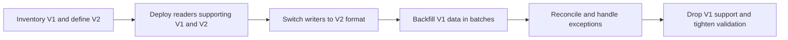

# Managing Document Changes with Schema Versions in Spring Data MongoDB

## 1. Why Do Documents Still Need Schema Version Management?

MongoDB does not require every document in the same collection to have the same structure. This allows applications to evolve quickly, but it also means that after multiple deployments, data can exist in many different shapes. With **Spring Data MongoDB**, this variation directly affects mapping documents to Java objects, querying with `MongoTemplate` or repositories, building aggregations, creating indexes, and maintaining data over the long term.

For example, the `customers` collection initially stores name and email as follows:

```json
{
  "_id": "c-101",
  "name": "Nguyễn An",
  "email": "an@example.test"
}
```

In the next version, the application standardizes field naming and requires each document to explicitly declare its structural version:

```json
{
  "_id": "c-101",
  "schemaVersion": 2,
  "fullName": "Nguyễn An",
  "primaryEmail": "an@example.test"
}
```

If you only rename the Java entity property from `name` to `fullName`, Spring Data does not automatically rename the field in older documents. An unmigrated document may be read with `fullName == null`, and queries filtering on `fullName` will also miss it. A **schema version** is an intentional data field that tells the application which structural convention a document follows and how to transform it.

In this lesson, the convention is:

| Value | Meaning | Main structure |
| --- | --- | --- |
| Missing `schemaVersion` | Historical data, identified as v1 under this specific migration contract | `name`, `email` |
| `schemaVersion: 1` | Explicitly tagged V1 | `name`, `email` |
| `schemaVersion: 2` | Current V2 | `fullName`, `primaryEmail` |
| Other versions | Not yet supported by the current reader | Must be handled intentionally, never guessed |

The rule of treating a missing field as v1 is **only valid once historical data has been inventoried and verified**. For new collections, every document should be required to include `schemaVersion` from the beginning.

## 2. Distinguishing Schema Version from `@Version`

Two concepts are easily confused in Spring Data MongoDB:

| Application-defined `schemaVersion` | Spring Data `@Version` |
| --- | --- |
| Indicates the document's shape and interpretation rules | Used for **optimistic locking** when updating an entity |
| Typically incremented when the data structure changes | May increment on each successful write via a version-aware save mechanism |
| Migrations process v1 → v2 → v3 | Detects concurrent write conflicts |
| Not managed automatically by Spring Data | Supported by Spring Data MongoDB via `org.springframework.data.annotation.Version` |

Both fields can appear together:

```java
@Document("customers")
public class CustomerDocument {
    @Id
    private String id;

    private Integer schemaVersion;
    private String fullName;
    private String primaryEmail;

    @Version
    private Long revision;

    // Constructor, getters, and setters according to project conventions.
}
```

The snippet above illustrates **two distinct purposes**. Do not use `revision` to identify the schema, and do not expect the `@Version` annotation to perform migrations automatically. Direct update commands on a collection (such as `updateMulti` by collection name) also do not automatically provide the full concurrency control mechanism of saving an entity annotated with `@Version`.

## 3. Designing the Schema Contract Before Modifying Data

Each version must define **invariants**: which fields a valid document must have, their data types, which values are allowed to be missing, and the business meaning of each field.

For example, in the customer scenario:

- **V1:** `name` and `email` are non-empty strings; `schemaVersion` may be missing or equal to `1`.
- **V2:** `schemaVersion` equals `2`; `fullName` and `primaryEmail` are non-empty strings; canonical data no longer uses `name` or `email`.
- **Invalid input:** documents missing required fields, having unexpected types, or containing both sets of fields with conflicting values are routed to a separate handling list; do not automatically bump their version.

Increment the version when a change causes **older readers or business rules to no longer interpret the data accurately**, such as renaming or changing field types, splitting one field into multiple fields, moving nested structures, or changing value semantics. Adding an optional field with a clear default sometimes does not require a new version, but the decision must be consistent across the entire application.

A maintainable design has the following characteristics:

1. Use a fixed field name, such as `schemaVersion`, with incrementing integers (`1`, `2`, `3`...).
2. Keep a single source of truth for the latest version in application code; every flow creating new documents writes the correct version.
3. Explicitly write adjacent upgrade paths: v1 → v2, v2 → v3. If skipping intermediate steps, you must prove the transformation is equivalent.
4. Define the strategy for reading old data, when to start writing the new structure, conditions for safely removing old fields, and how to recover if deployment encounters issues.
5. Record document counts by version, conversion errors, and processing time; avoid logging raw personal data.

## 4. Reading Multi-Version Data Explicitly

During the transition period, a repository bound to the V2 entity is only suitable when data can already be mapped safely to V2. For unmigrated V1 documents, you can use `MongoTemplate` to read a BSON `Document`, check the version, and convert it into a stable business model.

```java
import org.bson.Document;

record CustomerView(String id, String fullName, String primaryEmail) {}

public final class CustomerSchemaReader {
    private CustomerSchemaReader() {}

    public static CustomerView toView(Document document) {
        Object rawVersion = document.get("schemaVersion");
        if (rawVersion != null && !(rawVersion instanceof Integer)) {
            throw new IllegalStateException("schemaVersion must be a BSON Int32 integer");
        }

        int version = rawVersion == null ? 1 : (Integer) rawVersion;
        String id = String.valueOf(document.get("_id"));

        return switch (version) {
            case 1 -> new CustomerView(
                id,
                requiredString(document, "name"),
                requiredString(document, "email")
            );
            case 2 -> new CustomerView(
                id,
                requiredString(document, "fullName"),
                requiredString(document, "primaryEmail")
            );
            default -> throw new IllegalStateException(
                "Unsupported schemaVersion=" + version + ", id=" + id
            );
        };
    }

    private static String requiredString(Document document, String field) {
        Object value = document.get(field);
        if (!(value instanceof String text) || text.isBlank()) {
            throw new IllegalStateException("Missing or invalid field type: " + field);
        }
        return text;
    }
}
```

Example of integrating `MongoTemplate` when you need to read a raw document:

```java
import static com.mongodb.client.model.Filters.eq;

import org.bson.Document;
import org.springframework.data.mongodb.core.MongoTemplate;

public class CustomerLookup {
    private final MongoTemplate mongoTemplate;

    public CustomerLookup(MongoTemplate mongoTemplate) {
        this.mongoTemplate = mongoTemplate;
    }

    public CustomerView find(String id) {
        Document document = mongoTemplate.getCollection("customers")
            .find(eq("_id", id))
            .first();

        if (document == null) {
            throw new java.util.NoSuchElementException("Customer not found: " + id);
        }
        return CustomerSchemaReader.toView(document);
    }
}
```

The examples use a string `_id` and BSON `Int32` version per the stated contract. If the actual collection uses `ObjectId` or stores the version as `Int64`, you must standardize the format or adjust the reader in a controlled manner. Do not coerce every type into a number and implicitly trust that the data is valid.

**Key takeaway:** transforming at the read layer lets the application return a unified DTO while V1 documents still exist, but reading itself **does not necessarily have to write back**. Do not silently rewrite each document simply because a user viewed the data, unless a lazy migration strategy has been explicitly chosen and write concurrency is controlled.

## 5. V1 → V2 Migration with `MongoTemplate`

For simple field renames, MongoDB supports the `$rename` and `$set` operators. Spring Data provides `Update.rename(...)`, `Update.set(...)`, and `MongoTemplate.updateMulti(...)` to express the same operation.

```java
import com.mongodb.client.result.UpdateResult;
import org.springframework.data.mongodb.core.MongoTemplate;
import org.springframework.data.mongodb.core.query.Criteria;
import org.springframework.data.mongodb.core.query.Query;
import org.springframework.data.mongodb.core.query.Update;

public class CustomerV1ToV2Migration {
    private final MongoTemplate mongoTemplate;

    public CustomerV1ToV2Migration(MongoTemplate mongoTemplate) {
        this.mongoTemplate = mongoTemplate;
    }

    public long migrate() {
        Criteria oldVersion = new Criteria().orOperator(
            Criteria.where("schemaVersion").exists(false),
            Criteria.where("schemaVersion").is(1)
        );

        Query query = new Query(new Criteria().andOperator(
            oldVersion,
            Criteria.where("name").type(2).regex("\\S"),
            Criteria.where("email").type(2).regex("\\S"),
            Criteria.where("fullName").exists(false),
            Criteria.where("primaryEmail").exists(false)
        ));

        Update update = new Update()
            .rename("name", "fullName")
            .rename("email", "primaryEmail")
            .set("schemaVersion", 2);

        UpdateResult result = mongoTemplate.updateMulti(query, update, "customers");
        return result.getModifiedCount();
    }
}
```

This is an **illustration for a dataset already confirmed to be valid V1**. The `type(2)` condition requires the BSON string type, and the regex checks for a non-whitespace character in normal string cases. MongoDB has special matching rules for array values, so a pre-check step must still detect and quarantine array data, missing fields, wrong types, or conflicting data. Because the query excludes documents that already have `fullName` or `primaryEmail`, partially migrated V1 documents will **not be auto-fixed**; each case must be inspected and handled according to business rules.

### Why Can This Migration Be Re-run?

After a successful update, the document has `schemaVersion: 2`, so it no longer matches the V1 criteria. Re-running the command does not rename fields again or overwrite V2 data. This is **idempotency**: the same migration run can be executed multiple times without causing unintended repeated changes.

It is important to distinguish levels of atomicity:

- Renaming fields and setting `schemaVersion` in **a single update on a single document** is atomic at the document level.
- `updateMulti` updates **multiple documents**; the entire run is not an atomic transaction across the whole collection. If interrupted midway, some documents may already be at V2. Readers must support the mixed state, and the migration must be resumable.
- If a V1 writer still writes `name`/`email` after a document has moved to V2, it can produce hybrid data. Filtering by version does not replace rollout coordination and management of active writers.

For very large collections, running `updateMulti` across all documents is suitable for explaining syntax, but it is not an optimal operational workflow. You should select bounded batches by `_id`, run version-conditioned updates per batch, monitor latency and replication lag, and persist a resumable checkpoint. Avoid large `skip` pagination when scanning high-volume data.

### When Migrations Are More Complex Than Field Renames

Cases such as splitting `address` into a nested object, converting date strings to BSON Date, normalizing array data, or recalculating aggregate fields often require an **aggregation update pipeline** or tested transformation logic in Java. In those cases:

1. Write a vN → vN+1 transformation with clearly defined inputs and outputs.
2. Keep the version condition in the write operation while validating source data before bumping the version.
3. Do not mark a document as V2 before all required V2 fields are successfully created.
4. Avoid carelessly applying an irreversible transformation; consider snapshots/backups and store reconciliation information as required by the business.

Only consider MongoDB transactions if changes span multiple documents or collections requiring cross-document invariants, and provided the deployment environment supports them. Transactions do not substitute for versioning mechanisms or rollout procedures.

## 6. Safe Rollout Across Multiple Application Versions

Schema changes can break older running application processes, especially during rolling updates. A commonly used path is **expand → migrate → contract**:



**Expand phase:** the new application must accurately read both V1 and V2. If older instances that only understand V1 are still running, you cannot immediately have every writer produce V2 without a compatibility strategy: you can update all readers first, temporarily use dual-read/dual-write with clear synchronization rules, or deploy through intermediate versions. Account for background workers, scheduled jobs, consumers, and integrated systems, not just HTTP APIs.

**Migrate phase:** after writers producing V1 have stopped or are controlled, run the backfill. During this time, mixed V1/V2 data is normal; the read path must branch by version. Do not expect the collection to become uniform immediately after a single update command.

**Contract phase:** once all valid documents are at V2, old readers have been retired, and metrics confirm no V1 write sources remain, only then remove the compatibility path along with old indexes/fields if no longer needed. You can add MongoDB JSON Schema validation or application-layer validation rules to prevent malformed documents from reappearing.

The rollback procedure must be decided upfront: if data has already been written in V2, rolling back directly to an application version that only understands V1 may be unsafe. A common option is to keep a previous build that **already reads both V1 and V2**, or prepare a verified reverse migration if restoring the data shape is truly required.

## 7. Observability, Reconciliation, and Handling Anomalous Data

Before and after migration, you can count documents by version using a MongoDB aggregation:

```javascript
db.customers.aggregate([
  {
    $group: {
      _id: { $ifNull: ["$schemaVersion", 1] },
      count: { $sum: 1 }
    }
  },
  { $sort: { _id: 1 } }
]);
```

This count groups documents missing a version into V1 according to the **example convention**; report mistyped version values separately if the collection contains dirty data. Do not only check `count(V1) == 0`: you must also verify that V2 documents have all required fields, correct types, and no lost or duplicated values violating business rules.

Key metrics to monitor include documents inspected/updated/skipped, cases requiring manual intervention, batch duration, read error rate by version, query latency, replica lag, and the rate at which new V1 documents appear. Logs should include `_id`, version, error code, batch, or checkpoint; avoid logging raw customer data.

Queries filtering by version can be expensive on large collections. Use `explain()` with actual queries and data statistics to decide on appropriate indexes; an index on `schemaVersion` can help depending on selectivity, though missing `schemaVersion` in historical data and low cardinality of version values may limit its benefit. Also account for write and index maintenance overhead during bulk migrations.

## 8. Testing Before Production Rollout

Use a MongoDB test instance matching the production version (for example, Testcontainers with JUnit) to test **actual documents in BSON**, rather than only unit testing Java conversion functions.

| Test scenario | Expected result |
| --- | --- |
| V1 document missing `schemaVersion` | Reader returns correct DTO; migration renames fields and sets version = 2 |
| Document with `schemaVersion: 1` | Migrated to V2 the same way as historical documents |
| Valid V2 document | Reader works; migration does not modify the document |
| Running migration twice consecutively | Second run makes no changes to documents already at V2 |
| V1 document missing `email`, wrong `name` type, or conflicting target fields | Version is not bumped automatically; detected and routed to exception handling |
| Document with unsupported version, e.g., V3 | Reader reports a traceable error without misinterpreting it as V1/V2 |
| Concurrent writes during backfill | No values are lost; writer coordination or concurrency control strategy is verified |
| Stopping migration partway and resuming | Mixed data remains readable; remaining documents are processed without duplicate operations |

You should also verify repository/`MongoTemplate` flows, aggregations, and indexes actually used in the application. For example, repository code like `findByFullName(...)` will not find documents that only have `name`; reading via an adapter only solves mapping **after a document is found**. During the mixed phase, search queries must also support both schemas, or data must be migrated before using V2-only queries.

## 9. Common Pitfalls

| Pitfall | Consequence | Prevention |
| --- | --- | --- |
| Treating MongoDB as "schema-less" meaning no migration needed | Old data does not map properly to the new model | Define invariants and inventory versions |
| Using `@Version` instead of `schemaVersion` | Cannot determine document shape for transformation | Separate structural version from optimistic locking version |
| Only updating entities and repositories | Queries, projections, or aggregations miss V1 | Review all read and write paths |
| Bumping version before data conversion completes | Document is labeled V2 without satisfying V2 schema | Update target fields and version together in the appropriate operation |
| Running scripts that overwrite on re-run | Data loss or duplication | Constrain updates by version, design idempotently |
| Removing V1 reader as soon as backfill starts | Read failures while both schemas coexist | Only contract after reconciliation and stopping V1 writers |
| Ignoring invalid documents or forcing type casts | Data loss, data loses business validity | Branch exception handling, validate types and contents |

## 10. Suggested Practice Exercise

Create a `customers` collection with one group of V1 documents missing `schemaVersion`, one group of V1 documents with an explicit version, one group of V2 documents, and one V1 document with malformed field data. Then:

1. Implement a reader that returns `CustomerView` from V1 and V2, while clearly raising an error for unsupported versions.
2. Write a migration that renames `name` → `fullName`, `email` → `primaryEmail`, and conditionally sets `schemaVersion: 2`.
3. Run the migration twice; compare documents before and after to prove idempotency and zero value loss.
4. Verify that the malformed document has not been tagged V2, log the reason, and handle it according to agreed rules.
5. Create a name search query supporting both V1 and V2 during the transition; after backfill, switch to a V2-only query and confirm equivalent results.
6. Simulate stopping the migration midway and resuming; verify all remaining valid documents transition to V2.

Completion criteria are that every document has a **shape matching its declared version**, the application reads correctly during the transition, the migration can be safely re-run, and no sources of V1 data remain before dropping support for the old schema.
