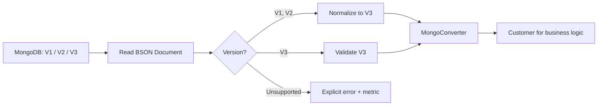

# Multi-Version Read Compatibility for Data Structures

In a long-running system, a single MongoDB collection can contain documents created by multiple versions of an application. Renaming fields, moving data into nested objects, changing BSON types, or adding required rules can prevent the current Java entity from accurately mapping old documents. **Multi-version read compatibility** is the ability to recognize each published structure, convert them into a unified business model, and clearly report errors for out-of-contract data.

With **Spring Data MongoDB**, you can use repositories for stable structures and use `MongoTemplate`, `MongoConverter`, or custom converters when finer control over reading is needed. This design is especially useful when migrations are rolled out gradually; at the same time, you must consider queries, aggregations, indexes, transactions, reactive access, testing, and performance diagnostics.

## 1. Problem: One Collection, Three Structures

Suppose the `customers` collection has been written across three releases. All three documents carry the same business meaning but have different shapes:

**V1 — no `schemaVersion` yet**: name and email sit directly at the root level.

```javascript
{
  _id: "c-001",
  name: "An",
  email: "an@example.test"
}
```

**V2 — `schemaVersion: 2`**: rename `name` to `fullName`, move email into `contact`.

```javascript
{
  _id: "c-002",
  schemaVersion: 2,
  fullName: "Bình",
  contact: { email: "binh@example.test" }
}
```

**V3 — `schemaVersion: 3`**: move display name into `profile`.

```javascript
{
  _id: "c-003",
  schemaVersion: 3,
  profile: { displayName: "Chi" },
  contact: { email: "chi@example.test" }
}
```

| Component | V1 | V2 | V3 (current) |
| --- | --- | --- | --- |
| Version marker | Missing `schemaVersion` by historical convention | `schemaVersion: 2` | `schemaVersion: 3` |
| Display name | `name` | `fullName` | `profile.displayName` |
| Email | `email` | `contact.email` | `contact.email` |
| On read | Normalize to V3 | Normalize to V3 | Validate then map |
| On create | Do not write V1 | Do not write V2 | Write V3 once all readers are compatible |

Here, `schemaVersion` is an **application-managed data structure version**. It is not a MongoDB/Spring Data version, nor is it the `@Version` field used for optimistic locking.

## 2. Read-Compatibility Contract

Before writing a converter, clearly define:

1. **Supported versions.** For example, only V1, V2, and V3. If `schemaVersion: 4` is encountered, older readers must report an unsupported version rather than silently treating it as V3.
2. **Detection rules.** Only treat a *missing* `schemaVersion` field as V1 when data history guarantees it. Values such as `null`, negative numbers, string `"2"`, and unexpected types must be handled transparently.
3. **Business invariants.** For example, display name and email must be non-empty strings. Optional fields may be absent, whereas required fields must never be fabricated with dummy values.
4. **Conflicting fields.** A document containing both `name` and `profile.displayName` with differing values must follow a version-based precedence policy or be quarantined for handling.
5. **Write direction.** After the writer cutover point, all new documents use the canonical schema; legacy readers only remain responsible for historical support.

Normalizing on read is an **in-memory** transformation, not a database update operation. Separating these two steps lets you deploy compatible readers before starting backfill.



## 3. Complete Example with Spring Data MongoDB

The example uses **Java 17+**, Spring Data MongoDB, and `_id` stored as a **string** (such as `"c-001"`). If the actual collection uses BSON `ObjectId`, adjust the ID type and query filters accordingly.

### 3.1. Defining the Canonical Model

File `Customer.java`:

```java
package example.customer;

import org.springframework.data.annotation.Id;
import org.springframework.data.mongodb.core.mapping.Document;

@Document(collection = "customers")
public record Customer(
        @Id String id,
        int schemaVersion,
        Profile profile,
        Contact contact
) {
    public record Profile(String displayName) {}
    public record Contact(String email) {}
}
```

The business layer only needs to know `customer.profile().displayName()` and `customer.contact().email()`. The `name` and `fullName` fields belong to the data compatibility layer.

### 3.2. Reading Raw Data and Normalizing

File `CustomerReader.java`:

```java
package example.customer;

import com.mongodb.client.model.Filters;
import org.bson.Document;
import org.springframework.data.mongodb.core.MongoTemplate;
import org.springframework.stereotype.Service;

import java.util.Optional;

@Service
public class CustomerReader {
    private static final int CURRENT_VERSION = 3;
    private final MongoTemplate mongoTemplate;

    public CustomerReader(MongoTemplate mongoTemplate) {
        this.mongoTemplate = mongoTemplate;
    }

    public Optional<Customer> findById(String id) {
        // Fetch raw BSON so legacy fields are not lost during entity mapping.
        Document raw = mongoTemplate.getCollection("customers")
                .find(Filters.eq("_id", id))
                .first();

        if (raw == null) {
            return Optional.empty();
        }

        Document canonical = normalize(raw);
        return Optional.of(
                mongoTemplate.getConverter().read(Customer.class, canonical));
    }

    // Pure function: does not mutate raw, does not write to MongoDB.
    public static Document normalize(Document raw) {
        int version = detectVersion(raw);
        return switch (version) {
            case 1 -> canonical(
                    raw,
                    requiredString(raw, "name"),
                    requiredString(raw, "email"));
            case 2 -> canonical(
                    raw,
                    requiredString(raw, "fullName"),
                    requiredString(requiredDocument(raw, "contact"), "email"));
            case 3 -> {
                requiredString(requiredDocument(raw, "profile"), "displayName");
                requiredString(requiredDocument(raw, "contact"), "email");
                yield new Document(raw);
            }
            default -> throw new IllegalStateException(
                    "Unsupported customer schemaVersion: " + version);
        };
    }

    private static Document canonical(
            Document raw, String displayName, String email) {
        return new Document("_id", requiredString(raw, "_id"))
                .append("schemaVersion", CURRENT_VERSION)
                .append("profile", new Document("displayName", displayName))
                .append("contact", new Document("email", email));
    }

    private static int detectVersion(Document raw) {
        // Only when the field is completely absent is it treated as V1.
        if (!raw.containsKey("schemaVersion")) {
            return 1;
        }
        Object value = raw.get("schemaVersion");
        if (value instanceof Integer version && version > 0) {
            return version;
        }
        if (value instanceof Long version
                && version > 0 && version <= Integer.MAX_VALUE) {
            return version.intValue();
        }
        throw new IllegalStateException("Invalid customer schemaVersion");
    }

    private static Document requiredDocument(Document source, String key) {
        Object value = source.get(key);
        if (value instanceof Document nested) {
            return nested;
        }
        throw new IllegalStateException("Expected document at: " + key);
    }

    private static String requiredString(Document source, String key) {
        Object value = source.get(key);
        if (value instanceof String text && !text.isBlank()) {
            return text;
        }
        throw new IllegalStateException("Expected nonblank string at: " + key);
    }
}
```

This code uses `MongoTemplate.getCollection(...)` to obtain an `org.bson.Document` through the MongoDB Java Driver, then calls `MongoConverter.read(...)` to map the normalized document to `Customer`. Reading BSON directly bypasses mapping steps and conversion lifecycle events that normally occur when calling `MongoTemplate.find(...)`; therefore, place it inside an explicit adapter and maintain a consistent policy across all consumers of the collection.

The execution branches are:

- V1: rename `name` to `profile.displayName` and move email into `contact.email`.
- V2: move `fullName` into `profile.displayName` and keep `contact.email`.
- V3: validate required fields and use the existing structure.
- Unsupported version or corrupted structure: throw an exception so the caller logs and handles it. Never silently drop documents or assume values.

The `normalize(...)` function intentionally illustrates only the example fields. **Do not take an entity you just read and call `save(customer)` to "migrate" old documents**: extra fields not modeled on the entity can be lost when the whole document is rewritten. A backfill process must explicitly specify which fields are kept, transformed, or removed.

### 3.3. Repository, `@Field`, and Converters

A `MongoRepository<Customer, String>` reading V1/V2 directly will not automatically derive `profile` from `name` or `fullName`. Repositories can continue to serve canonical read/write paths, while mixed-data read paths need an adapter or compatible converter.

| Scenario | Suitable solution | Limitations to remember |
| --- | --- | --- |
| Adding an optional field | Entity and defaults at the business layer | Distinguish absence from malformed data |
| One stable BSON name | `@Field("field_name")` | Specifies only one storage name; does not support multiple aliases |
| Multiple aggregate structures | Service using `MongoTemplate` + `normalize` | Explicit version control and testing |
| Broadly reusable converter | `@ReadingConverter` in `MongoCustomConversions` | Scope carefully to avoid affecting other types |
| Dashboards or reports | MongoDB aggregation/projection | Consider performance and field fallbacks |

With `ReactiveMongoTemplate`, keep the normalization function pure and apply it inside the `map(...)` step of the reactive pipeline. Never call the synchronous driver or `block()` on a reactive request thread.

## 4. Queries, Aggregations, and Indexes Must Also Be Compatible

**Post-read normalization does not make MongoDB queries automatically recognize old fields.** If a repository searches by `profile.displayName`, V1 (`name`) and V2 (`fullName`) documents will be missed.

During the transition period, perform exact display-name lookups using criteria across all three paths:

```java
import org.bson.Document;
import org.springframework.data.mongodb.core.query.Criteria;
import org.springframework.data.mongodb.core.query.Query;

Query query = new Query(new Criteria().orOperator(
        Criteria.where("name").is(keyword),
        Criteria.where("fullName").is(keyword),
        Criteria.where("profile.displayName").is(keyword)
));

var customers = mongoTemplate.find(query, Document.class, "customers")
        .stream()
        .map(CustomerReader::normalize)
        .map(doc -> mongoTemplate.getConverter().read(Customer.class, doc))
        .toList();
```

If a document simultaneously has multiple synonymous fields, an `$or` branch can still match a legacy name that the reader no longer uses. When actual data has conflicts, restrict branches by version or apply explicit conditions and resolution rules. In particular, case-insensitive search, accent-insensitive matching, and collation must follow the same string normalization contract.

For aggregations, a projection can produce a unified display name:

```javascript
db.customers.aggregate([
  {
    $project: {
      schemaVersion: 1,
      displayName: {
        $ifNull: [
          "$profile.displayName",
          { $ifNull: ["$fullName", "$name"] }
        ]
      }
    }
  }
])
```

`$ifNull` treats both a missing field and a `null` value as fallback triggers. If business logic must distinguish *missing field*, *null value*, and *empty string*, use explicit conditional expressions such as `$type` / `$cond` or handle it in the adapter.

### Indexes While Multiple Versions Coexist

Example indexes for the three query paths, if traffic analysis confirms they are needed:

```javascript
db.customers.createIndex({ name: 1 }, { sparse: true })
db.customers.createIndex({ fullName: 1 }, { sparse: true })
db.customers.createIndex({ "profile.displayName": 1 }, { sparse: true })
```

Do not blindly create all three indexes in production: indexes increase storage and write overhead. Use `explain("executionStats")` on real queries to observe `totalDocsExamined`, `totalKeysExamined`, and how each `$or` branch uses indexes.

Sorting and pagination also need consideration: `sort({ "profile.displayName": 1 })` does not yield a consistent name order across V1/V2. For large collections, you can complete the backfill or maintain a canonical field used for search and sorting. Using `$ifNull` in an aggregation produces a unified value, but it may require the sort stage to process more documents.

## 5. Phased Rollout: Read First, Write Later

The **expand → migrate → contract** strategy keeps the system operational:

1. **Inventory data:** count V1 (missing `schemaVersion`), V2, and V3 documents; sample mistyped values, `null`s, missing fields, and conflicting fields. Document handling rules for each category.
2. **Release compatible readers:** deploy to every instance, background job, API, consumer, and other application with read access to the collection. Test unsupported future versions as well.
3. **Switch writers to V3:** enable V3 writes only after all active readers can read V3. During rolling deployments, use deployment ordering or feature flags to prevent old readers from encountering unknown data.
4. **Batch backfill:** select old documents, transform them, write with a filter on the source version, track read/modified/skipped/error counts, and throttle database load. Keep a checkpoint to resume after interruption.
5. **Reconcile and remove legacy support:** verify data, queries, indexes, and dependent application access; remove V1/V2 branches only when confident no legacy data or writers remain.

Example updating **one verified V2 document** to V3:

```javascript
db.customers.updateOne(
  { _id: "c-002", schemaVersion: 2 },
  {
    $set: {
      "profile.displayName": "Bình",
      schemaVersion: 3
    },
    $unset: { fullName: "" }
  }
)
```

In a real job, you must derive the name from existing content, validate email and other business fields, and handle concurrent update conflicts. The `schemaVersion: 2` filter prevents overwriting an already-migrated document; if the job re-runs and the record is already at V3, the operation makes no further changes. For V1, filter on `schemaVersion` *not existing* rather than comparing against a value of 1 that was never stored.

Single-document updates in MongoDB are atomic. If a migration requires preserving invariants across multiple documents or collections, evaluate transactions, infrastructure prerequisites, and operational costs. Readers that only normalize data in memory do not require transactions.

Rollback plans must account for V3 documents already written: reverting to an older binary is only safe if it can read V3 or if a verified data recovery mechanism exists. Prepare backups, migration statistics, and checkpoints before running large-scale backfills.

## 6. Common Errors

| Symptom | Cause | Fix |
| --- | --- | --- |
| Reading V1 yields `profile == null` | V3 entity maps directly, ignoring legacy fields | Normalize before mapping BSON to the entity |
| Search misses older customers | Query only filters on the V3 field | Query across all versions or backfill the search field |
| New data is misread as V1 | Defaulting all missing-version documents to V1 | Apply the historical convention only after verification; monitor writers |
| `null` is treated as a missing field | Using `get(...) == null` for detection | Use `containsKey(...)` and type checks |
| Extra data lost when calling `save(...)` | Entity lacks legacy/unknown fields | Separate the read adapter from migration writers |
| Converting `String` to BSON Date shifts time | Implicit parsing without timezone specification | Convert explicitly, standardize on UTC, and test boundaries |
| Two fields hold conflicting values | Unsynchronized dual-write or rolling deployment | Version-based precedence policy; measure and quarantine conflicts |
| Legacy app cannot read V3 | Switching writers before releasing readers | Release compatible readers across the entire system first |
| Slow `$or` queries or sorts | Missing indexes or sorting on computed fields | Inspect `explain`, measure load, gradually reduce legacy data |

Keeping both `oldField` and `newField` for long periods can cause data drift. If dual-write is necessary, explicitly designate the canonical source, reconciliation method, and when dual-writing ends.

## 7. Testing and Observability

### 7.1. Unit Tests for Pure Transformations

Place tests in package `example.customer`:

```java
package example.customer;

import org.bson.Document;
import org.junit.jupiter.api.Test;

import static org.junit.jupiter.api.Assertions.*;

class CustomerReaderTest {
    @Test
    void normalizesV1WithoutMutatingSource() {
        Document old = new Document("_id", "c-001")
                .append("name", "An")
                .append("email", "an@example.test");

        Document result = CustomerReader.normalize(old);

        assertEquals(3, result.getInteger("schemaVersion"));
        assertEquals("An",
                result.get("profile", Document.class).getString("displayName"));
        assertEquals("an@example.test",
                result.get("contact", Document.class).getString("email"));
        assertFalse(old.containsKey("schemaVersion"));
    }

    @Test
    void normalizesV2() {
        Document old = new Document("_id", "c-002")
                .append("schemaVersion", 2)
                .append("fullName", "Bình")
                .append("contact", new Document("email", "binh@example.test"));

        Document result = CustomerReader.normalize(old);

        assertEquals(3, result.getInteger("schemaVersion"));
        assertEquals("Bình",
                result.get("profile", Document.class).getString("displayName"));
    }

    @Test
    void rejectsFutureVersionAndMalformedField() {
        Document future = new Document("_id", "c-004")
                .append("schemaVersion", 4);
        Document malformed = new Document("_id", "c-005")
                .append("schemaVersion", 2)
                .append("fullName", 123)
                .append("contact", new Document("email", "x@example.test"));

        assertThrows(IllegalStateException.class,
                () -> CustomerReader.normalize(future));
        assertThrows(IllegalStateException.class,
                () -> CustomerReader.normalize(malformed));
    }
}
```

Add integration tests against real MongoDB (e.g., using Testcontainers) to verify `_id` mapping, nested records, BSON types, aggregations, collations, and indexes. The test suite should cover: valid V1/V2/V3; missing, `null`, mistyped, or empty fields; versions as strings, negative numbers, or future versions; documents containing both old and new fields; multi-version queries and pagination; re-running backfills; update contention; and rollbacks during mixed old/new binary deployments.

### 7.2. Operational Monitoring

Measure read rates for V1/V2/V3, normalization errors, unsupported versions, remaining documents needing backfill, and query latency. Log error codes, versions, and appropriate trace IDs; do not include email addresses or personal information in logs. Only remove compatibility branches once legacy schema read counts are at an acceptable level over a sufficiently long observation window **and** you have verified no producer still writes that schema.

## 8. Practice Exercises

**Exercise 1 — Add V4.** Suppose V4 renames `contact.email` to `contacts.primaryEmail` while keeping `profile.displayName`. Extend the read contract so V1–V4 normalize to V4; add a test for a V4 document missing email. Do not replace missing emails with an empty string.

**Exercise 2 — Queries on mixed schemas.** Write a MongoDB query finding customers named `"An"` across V1–V3; explain why sorting solely on `profile.displayName` does not guarantee order before backfill. Propose a strategy for a collection with millions of documents needing stable pagination.

**Exercise 3 — Safe repeatable migration.** Design a batch job upgrading V2 to V3 with version-conditioned updates, checkpoints, `matched/modified` statistics, error document handling, and post-run verification. Explain what happens if the job re-runs or an old writer still writes V2.

**Completion criteria:** distinguish schema versions from optimistic locking versions; build a reader handling multiple structures via Spring Data MongoDB; handle malformed data explicitly; ensure queries/indexes fit mixed data; roll out in the right order across readers, writers, backfill, and legacy schema retirement.
