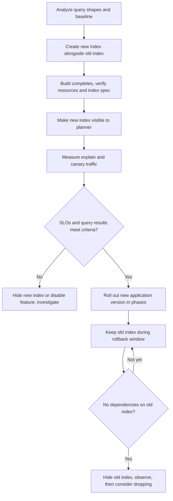

# Preparing and Changing Indexes Without Disrupting the Application

> **Chapter:** Data Migration · **Module:** `SPRING_DATA_MONGODB`. In Spring Data MongoDB, applications use `MongoTemplate`, repositories, or reactive access to read and write documents. Indexes determine query execution plans, yet adding, hiding, altering options, or dropping an index also consumes CPU, I/O, and memory, and can alter write behavior. This lesson explains how to prepare and roll out index changes while the application continues serving traffic, with MongoDB and Spring Data MongoDB examples.

## 1. Why Do Index Migrations Need a Dedicated Plan?

A new application version wants to fetch orders by `tenantId`, `status`, and `createdAt`. The `orders` collection currently has the index:

```javascript
{ tenantId: 1, createdAt: -1 }    // idx_orders_tenant_created_v1
```

The new version plans to run the query:

```javascript
db.orders.find({
  tenantId: "tenant-a",
  status: "PAID"
}).sort({ createdAt: -1 }).limit(50);
```

If the old index does not adequately cover both filtering and sorting, MongoDB may scan many keys or documents. The seemingly simple solution is to create:

```javascript
{ tenantId: 1, status: 1, createdAt: -1 }
```

However, changing indexes on a live system raises four questions:

1. Is there enough disk space and compute capacity to **build the new index** across all existing data?
2. Will all running application versions—including instances not yet upgraded—continue operating normally?
3. After creating the index, will the query planner select it and will real-world performance improve?
4. If the rollout goes wrong, can we **roll back quickly** without rebuilding an index for hours?

The rollout goal is maintaining **availability and compatibility** while minimizing performance impact, rather than assuming every index operation is lock-free or costless.

### Understanding Online Index Builds Properly

On modern MongoDB versions, index builds allow application reads and writes during **most of the build process**. Still, short exclusive locks occur at the beginning and end of the build; CPU load, I/O, memory pressure, disk space, and replica set synchronization can increase latency. Under heavy load or constrained resources, an online index build can still violate SLOs.

Since MongoDB 4.2, the legacy `background` option is ignored in favor of the new index build mechanism; setting `background: true` does not guarantee "zero disruption." On replica sets, index builds depend on participating node health and **commit quorum**; do not alter quorum settings or build indexes manually node-by-node without a runbook specific to your version.

## 2. Designing Indexes Around Real Queries

Before making changes, identify the **query shape**: filter predicates, sort, projection, limit, collation, data distribution, and frequency. Do not infer indexes solely from fields listed in a Java entity.

### 2.1. Extracting Query Shapes from the Application

For the `orders` example, there are two read patterns:

| Query shape | Representative query | Need |
|---|---|---|
| Q1 — Recent lookups by tenant | `{tenantId}`, sort `createdAt:-1` | Preserve legacy behavior, fast response |
| Q2 — Lookups by tenant and status | `{tenantId,status}`, sort `createdAt:-1` | Add index serving the new version |
| Q3 — Lookup by order number | `{tenantId,orderNo}` | May require a separate unique index |

For Q2, `{tenantId:1,status:1,createdAt:-1}` places equality predicates `tenantId,status` first, followed by sort `createdAt`, which is generally appropriate. However, the new index **does not automatically replace every use** of the old index: Q1 does not filter on `status`, so the `createdAt` key order behind `status` does not necessarily support sorting by `createdAt` across the entire tenant. Thus, **both** indexes may need to coexist.

A useful rule of thumb for compound indexes is **ESR — Equality, Sort, Range**. This is a guideline, not an unbreakable law. When a query has a highly selective range predicate, field order must be verified via `explain` on real data.

### 2.2. Conditions That Make an Index Unusable or Ineffective

- **Collation:** an index with a different collation than the query may not be used for string comparisons or sorting as expected.
- **Partial index:** if a query does not guarantee the `partialFilterExpression` condition, the planner usually cannot use the partial index because results could be missed.
- **Multikey:** when an index includes array fields—especially multiple array fields in the same document—there are build and sort restrictions to verify.
- **Selectivity:** a field with very few distinct values (such as `status` with three values) can perform poorly if placed alone at the leading edge of an index.
- **Number of indexes:** every `insert`, `update` touching indexed fields, and `delete` must maintain all corresponding indexes. Adding indexes speeds up reads but can slow writes and consume storage.
- **Hints:** if the application calls `hint()` with an old index name, dropping or hiding that index can cause queries to fail. Inventory all hints before changing indexes.

For example, a field may be stored in MongoDB under a different name than the Java property via `@Field`. When using Spring Data, prefer entity-mapped APIs to avoid mistyping storage field names; when using `mongosh`, always use the **actual BSON field names**.

## 3. Pre-Deployment Preparation Checklist

### 3.1. Inventory and Capture Baseline

Run on an environment reflecting production data and load, with appropriate read permissions.

```javascript
use shop

// Identify existing indexes and their options.
db.orders.getIndexes();

// Inspect data and index sizes to estimate storage growth.
db.orders.stats();

// Check plans, keys/documents scanned, and execution time.
db.orders.find({
  tenantId: "tenant-a",
  status: "PAID"
}).sort({ createdAt: -1 }).limit(50).explain("executionStats");

// Check index usage statistics since server stats were last reset.
db.orders.aggregate([{ $indexStats: {} }]);
```

Record at a minimum: p50/p95/p99 latency of key APIs, read/write throughput, error rate, CPU, RAM, disk IOPS, free disk space, cache pressure, replication lag, queue depth, and `explain` output for each query shape. In `explain("executionStats")`, examine `winningPlan` (`IXSCAN` vs `COLLSCAN`), `totalKeysExamined`, `totalDocsExamined`, `nReturned`, and `executionTimeMillis`.

**Do not treat a single `explain` on a few documents as sufficient proof:** warm vs. cold caches, large vs. small tenants, data skew, sort/limit, pagination, and write load have major effects. `$indexStats` reflects operation counters that reset on server restart or index rebuild; never conclude an index is "unused" from a short observation window alone.

### 3.2. Verify Infrastructure and Data Prerequisites

| Check | Reason | Decision before proceeding |
|---|---|---|
| MongoDB version, FCV, topology | Availability of `hidden`, `collMod`, build mechanism, and commit quorum depends on version | Choose compatible syntax and rollout method |
| Replica set / sharded cluster health | Index build and commit require healthy nodes | Resolve replication lag and unhealthy nodes before rollout |
| Disk space and compute resources | New index coexists with old index during transition | Ensure headroom and define abort/pause thresholds |
| Peak traffic and application load | Index builds compete for I/O and CPU with normal traffic | Pick low-traffic window, assign on-call owner |
| Data quality | Unique, partial, collation, and TTL change data semantics | Check duplicates, nulls, missing fields, expiration dates |
| Running application versions | Phased rollouts result in multiple query shapes coexisting | Maintain compatibility throughout the transition |
| Permissions and deployment flow | `createIndexes`/`collMod`/`dropIndexes` require admin privileges | Prepare migration job, logging, monitoring, and rollback plan |

Especially for large collections, estimate index build cost by testing on a copy with realistic size and data distribution. Never extrapolate build duration on a few thousand documents to hundreds of millions of documents.

### 3.3. Lock Down SLOs and Stop Conditions

Before executing, agree on measurable thresholds, such as max allowed p95 latency, normal error rate, acceptable replication lag, and minimum safe free disk space. If a threshold is breached, pause application rollout, evaluate the build progress, and follow the runbook; aborting a build or rolling back must account for node states and MongoDB version.

## 4. Expand → Switch → Contract Rollout Workflow

A safe index change is a **multi-stage migration**, not directly editing declarations and immediately dropping the old index.



| Phase | System remains serving | Key activities |
|---|---|---|
| **Prepare** | Old code, old index | Inventory queries, validate data and resources |
| **Expand** | Old code, **old + new indexes** | Build new index, wait for completion, verify spec |
| **Verify** | Old code + canary | Make new index visible to planner, run `explain`, measure SLOs |
| **Switch** | Old + new code concurrently | Phased app rollout, using feature flags if needed |
| **Stabilize** | New code, old index retained | Observe over representative period, keep fast rollback path |
| **Contract** | New code, new index | Hide old index as a trial, then drop only when proven unused |

Index names are part of the operational contract if applications, reports, backfill procedures, or `hint`s reference them. Use versioned names, such as `idx_orders_tenant_status_created_v2`, so two generations of indexes can coexist.

## 5. MongoDB Walkthrough: Creating and Activating the New Index

The examples below use MongoDB **hidden indexes** (MongoDB 4.4 and later). A hidden index is still maintained on writes, but the query planner will not select it; this lets you prepare an index before exposing read traffic to it.

### Step 1. Create the New Index as Hidden

```javascript
use shop

db.orders.createIndex(
  { tenantId: 1, status: 1, createdAt: -1 },
  {
    name: "idx_orders_tenant_status_created_v2",
    hidden: true
  }
);

// Proceed only once the build finishes and the spec matches.
db.orders.getIndexes().filter(
  index => index.name === "idx_orders_tenant_status_created_v2"
);
```

`createIndex` is considered complete only when the server returns success. On replica sets or sharded clusters, monitor build progress and node states according to your deployment version. If an index with the same name already exists with **different keys/options**, do not treat the migration as successful: MongoDB may raise a conflict error. Neither `ensureIndex` nor `createIndex` can arbitrarily alter an existing index definition.

An index created with `hidden: true` **still consumes disk space and adds write overhead**. It is a rollout state, not a way to make an index "free."

### Step 2. Make the Index Visible to the Planner

```javascript
db.runCommand({
  collMod: "orders",
  index: {
    name: "idx_orders_tenant_status_created_v2",
    hidden: false
  }
});
```

Hiding or unhiding an index only toggles planner eligibility; it does not rebuild the index data. After unhiding, compare `explain` across multiple tenants and datasets:

```javascript
const predicate = { tenantId: "tenant-a", status: "PAID" };

db.orders.find(predicate)
  .sort({ createdAt: -1 })
  .limit(50)
  .explain("executionStats");

// Use hint only for intentional benchmarking after the index is visible.
db.orders.find(predicate)
  .sort({ createdAt: -1 })
  .limit(50)
  .hint("idx_orders_tenant_status_created_v2")
  .explain("executionStats");
```

You cannot `hint` a **hidden index**; make it visible first before benchmarking. Once visible, the query planner might still pick another index based on estimated cost. Distinguish between **the index exists**, **the planner can see it**, and **the planner actually chooses it**.

### Step 3. Roll Out Application Traffic Gradually

Enable query flow Q2 for a small percentage of traffic, monitor p95/p99, `totalDocsExamined`, CPU, and I/O, and then ramp up gradually. Do not drop `idx_orders_tenant_created_v1` during this phase, as Q1 may still rely on it.

If results degrade, first disable the feature flag or roll back the code calling Q2; if you need to remove the index from planner candidates, you can **hide index v2**:

```javascript
db.runCommand({
  collMod: "orders",
  index: {
    name: "idx_orders_tenant_status_created_v2",
    hidden: true
  }
});
```

Hiding an index affects query planning within its scope, so verify all query shapes. Queries explicitly calling `hint` on index v2 will fail when the index is hidden; that is why hardcoding hints during transitions should be avoided.

### Step 4. Consider Dropping the Old Index Only When Safe

If Q1 still needs the old index, **keep it**. If all query shapes later have alternatives and the rollback window has closed, try hiding the old index first:

```javascript
db.runCommand({
  collMod: "orders",
  index: {
    name: "idx_orders_tenant_created_v1",
    hidden: true
  }
});

// Observe over real traffic and a representative period; do not drop right away.
```

If any query regression appears, unhide it immediately:

```javascript
db.runCommand({
  collMod: "orders",
  index: {
    name: "idx_orders_tenant_created_v1",
    hidden: false
  }
});
```

Only after confirming zero remaining dependencies:

```javascript
db.orders.dropIndex("idx_orders_tenant_created_v1");
```

`dropIndex` frees index resources and has no instant "undo": recovering a dropped index requires rebuilding it and paying the full build cost again. Thus, **hide first, drop later** provides a fast-rollback contraction path. Also, never drop the default `_id` index.

## 6. Spring Data MongoDB Integration

### 6.1. Declaring the Model and Index Definitions

Example entity:

```java
import java.time.Instant;
import org.springframework.data.annotation.Id;
import org.springframework.data.mongodb.core.mapping.Document;

@Document("orders")
public class Order {
    @Id
    private String id;
    private String tenantId;
    private String status;
    private Instant createdAt;

    // Constructor, getters, and setters appropriate for the application.
}
```

Indexes can be described via annotations:

```java
import org.springframework.data.mongodb.core.index.CompoundIndex;
import org.springframework.data.mongodb.core.index.CompoundIndexes;
import org.springframework.data.mongodb.core.mapping.Document;

@Document("orders")
@CompoundIndexes({
    @CompoundIndex(
        name = "idx_orders_tenant_created_v1",
        def = "{ 'tenantId': 1, 'createdAt': -1 }"
    ),
    @CompoundIndex(
        name = "idx_orders_tenant_status_created_v2",
        def = "{ 'tenantId': 1, 'status': 1, 'createdAt': -1 }"
    )
})
public class Order {
    // Fields declared as in the example above.
}
```

**Remember:** annotations are merely **metadata** for Spring Data. The presence of an annotation does not prove the corresponding index has been deployed successfully to the database. Since Spring Data MongoDB 3.0, **automatic index creation is disabled by default**. For production, use a controlled, properly privileged, and monitored migration job; avoid letting every application instance trigger index builds on startup.

### 6.2. Creating Indexes in a Controlled Migration Job

Spring Data provides `IndexOperations` and `Index`. The example below is invoked by a dedicated job after preparation, not silently inside constructors or HTTP requests:

```java
import org.springframework.data.domain.Sort.Direction;
import org.springframework.data.mongodb.core.MongoTemplate;
import org.springframework.data.mongodb.core.index.Index;

public final class OrderIndexMigration {

    private final MongoTemplate mongoTemplate;

    public OrderIndexMigration(MongoTemplate mongoTemplate) {
        this.mongoTemplate = mongoTemplate;
    }

    public String createV2Index() {
        Index v2 = new Index()
            .on("tenantId", Direction.ASC)
            .on("status", Direction.ASC)
            .on("createdAt", Direction.DESC)
            .named("idx_orders_tenant_status_created_v2");

        return mongoTemplate.indexOps(Order.class).ensureIndex(v2);
    }
}
```

`ensureIndex(v2)` creates the index if absent, or confirms an index with the same definition is usable. It **does not** fix mismatches in keys, collation, unique, TTL, or hidden options on an existing index. If you need `hidden: true` and a `collMod` rollout, use the MongoDB shell or driver inside a controlled migration job; verify that your Spring Data version supports any required options.

Note when combining both methods: if you created index v2 via `mongosh` with `hidden:true`, do not assume calling `ensureIndex` with the same name without specifying `hidden` will make it visible; manage hidden state with the appropriate command and inspect `getIndexes()`.

You can read index metadata from Spring Data:

```java
var indexInfo = mongoTemplate.indexOps(Order.class).getIndexInfo();
indexInfo.forEach(System.out::println);
```

With `@Field("db_field_name")`, use consistent entity mapping across the application. After migration, verify both the **server-side spec**, **actual queries**, and **running application versions**; `ensureIndex` returning an index name does not reflect query performance.

### 6.3. Avoiding Premature Hints in Repositories/Templates

Querying with `MongoTemplate`:

```java
import org.springframework.data.domain.Sort;
import org.springframework.data.mongodb.core.query.Criteria;
import org.springframework.data.mongodb.core.query.Query;

Query query = new Query(
    Criteria.where("tenantId").is("tenant-a")
            .and("status").is("PAID")
).with(Sort.by(Sort.Direction.DESC, "createdAt")).limit(50);

// Let the query planner choose the index after unhiding and verification.
var orders = mongoTemplate.find(query, Order.class);
```

Only with clear justification and after confirming the index is visible and present should you consider `query.withHint("idx_orders_tenant_status_created_v2")`. Hints couple application code lifecycles to index names and reduce your ability to roll back by hiding an index.

## 7. Special Case: Migrating to a UNIQUE Index

Moving from non-unique to **unique** is a migration that can cause **writes to fail**, not merely change query speed. There is no safe way to enable uniqueness on duplicate data while skipping data quality cleanup.

Suppose every `(tenantId, emailNorm)` pair must be unique. Before building, check for duplicates:

```javascript
db.customers.aggregate([
  {
    $group: {
      _id: { tenantId: "$tenantId", emailNorm: "$emailNorm" },
      count: { $sum: 1 }
    }
  },
  { $match: { count: { $gt: 1 } } },
  { $limit: 20 }
]);
```

A sound procedure:

1. Precisely define `emailNorm` normalization (e.g., lowercase, trim) and handling for null/missing fields, collation, and existing duplicates.
2. Deploy new code that validates input and writes normalized values consistently; clean/backfill legacy data in batches while controlling concurrent updates.
3. Deduplicate existing records; prevent **new duplicates from appearing during the build** via write rules or coordination.
4. Build the unique index once data satisfies the invariant; verify success and monitor `DuplicateKeyException` in the application.
5. Drop obsolete indexes only after proving query shapes and rollback paths are safe.

Example creating a unique index:

```javascript
db.customers.createIndex(
  { tenantId: 1, emailNorm: 1 },
  {
    unique: true,
    name: "uq_customers_tenant_email_norm_v1"
  }
);
```

**Null/missing values are not automatically exempt.** Under a unique index, missing or `null` values follow uniqueness rules corresponding to the generated index keys. If you only want to enforce uniqueness for documents that already have a string `emailNorm`, consider a **partial unique index**:

```javascript
db.customers.createIndex(
  { tenantId: 1, emailNorm: 1 },
  {
    name: "uq_customers_tenant_email_norm_partial_v1",
    unique: true,
    partialFilterExpression: { emailNorm: { $type: "string" } }
  }
);
```

Partial unique **does not enforce** uniqueness for documents outside the filter; this must be an explicit part of the data contract. On sharded collections, unique indexes are further constrained by the shard key and MongoDB version; verify your topology rather than copying replica set settings.

**Hidden unique warning:** hiding a unique index only prevents the query planner from using it; **the uniqueness constraint is still enforced**. Hiding is not a rollback switch for uniqueness. To change write behavior, you need a clear code/data plan and appropriate index operations.

## 8. Special Case: TTL, Partial Indexes, and Changing Options

### 8.1. TTL Indexes Can Delete Real Data

A TTL index automatically deletes documents once expired, for example:

```javascript
db.sessions.createIndex(
  { expiresAt: 1 },
  {
    name: "ttl_sessions_expires_at_v1",
    expireAfterSeconds: 0
  }
);
```

`expireAfterSeconds: 0` means documents expire at the timestamp stored in `expiresAt`, not necessarily the instant the index command finishes. The TTL monitor runs in the background, so deletion may lag behind the expiration timestamp; do not rely on TTL as a scheduler requiring second-level precision.

Before creating a TTL index on a populated collection:

- Count already-expired documents and estimate how many will be deleted.
- Verify `expiresAt` is a valid BSON Date (not a mistyped ISO string).
- Clean up expired data in batches if mass deletion would trigger an abnormal load spike.
- Take a backup and confirm retention windows with the data owner.

Do not use `hidden:true` to "safely test" a TTL index: a hidden TTL index still deletes documents. Changing `expireAfterSeconds` on an existing index can use `collMod` on supported MongoDB versions; confirm version requirements, data retention, and the volume of documents about to expire before modifying it.

### 8.2. Changing Keys, Collation, Partial Filters, or Index Types

There is no single universal "ALTER INDEX" command for all properties. To change a **key pattern**, **collation**, `partialFilterExpression`, or major constraints, you usually must **create a new index**, shift traffic, and then consider dropping the old index. Certain properties such as `hidden` (and TTL on supported versions) can be modified with `collMod`.

In particular, MongoDB has rules regarding **equivalent indexes** and which index combinations may coexist; never assume you can create two indexes differing only by name. If two indexes share a key pattern and options that cannot coexist, design a transition plan tailored to your MongoDB version.

## 9. Operating Index Migrations Under Live Traffic

### 9.1. Monitoring During Builds and After Rollout

```javascript
// Observe active operations, subject to admin role permissions:
db.currentOp({ "command.createIndexes": "orders" });

// Verify final indexes:
db.orders.getIndexes();

// Monitor index usage over time:
db.orders.aggregate([{ $indexStats: {} }]);
```

`db.currentOp()` helps inspect active operations, though output format and how index builds appear depend on version and topology. Combine it with server logs, cluster monitoring metrics, and real `explain` queries. Never treat "not visible in currentOp" as proof that a build succeeded; wait for the index creation command to return and re-check `getIndexes()`.

Maintain a minimal dashboard covering:

- API latency/error rates by route and tenant;
- MongoDB query latency, scanned keys/documents, and slow queries;
- CPU, I/O, memory, free disk space, and cache pressure;
- replication lag, member health, and index-related log messages;
- write latency and write errors (especially `DuplicateKeyException` when unique indexes exist).

### 9.2. Boundary Between Code Rollback and Index Rollback

| Incident | Preferred response | Conditions/limitations |
|---|---|---|
| New version query is slow | Disable feature flag or roll back code | Keep old index so rollback needs no rebuild |
| Planner picks v2 index poorly | Hide v2, re-check plans | Watch out for queries hardcoding hint v2 |
| Dropping v1 index slows Q1 | If only **hidden**, unhide v1 | If **dropped**, must rebuild—can take a long time |
| Unique index causes write errors | Fix data/input flow; evaluate constraint migration | Hidden unique still enforces; never drop hastily without checking invariants |
| TTL deletes wrong data | Stop change causing deletions, restore from backup if available | Hiding TTL does not stop expiry; code rollback does not restore documents |
| Build causes resource pressure | Pause rollout, investigate build/quorum/infrastructure | Aborting a build has differing consequences and steps by topology/version |

Above all, avoid making **dropping the old index** an immediate default step right after releasing a new version. Systems often have batch jobs, overnight reports, maintenance scripts, or un-upgraded clients still relying on the old index even when the main API appears healthy.

### 9.3. Meaningful Testing Approach

Before production, verify on realistic data:

1. **Correctness:** queries return accurate results and ordering before and after migration; test small/large tenants, null/missing fields, and collations.
2. **Performance:** `explain`, p95/p99 latency, and write throughput under mixed load; verify both Q1 and Q2, not just the new query.
3. **Compatibility:** run old and new application versions concurrently during transition; check repositories, `MongoTemplate`, and non-API jobs.
4. **Failure injection:** roll back code while v2 is visible; hide/unhide v2; test connection failures, node lag, and resource pressure in an appropriate staging environment.
5. **Data safety:** for unique/TTL, test duplicates/expirations, backfill migrations, and backup recovery scenarios.

Never run destructive tests on production to confirm behavior; a staging environment with a replica set and representative dataset is the proper place for failure testing.

## 10. Example Real-World Deployment Runbook

Goal: add `idx_orders_tenant_status_created_v2` to support Q2 while **preserving Q1**.

| Stage | Action | Required evidence | If wrong |
|---|---|---|---|
| T-1: Prepare | Collect query shapes, `explain`, index specs, SLO baseline; verify disk/nodes | Q1/Q2 report and sufficient resources | Postpone rollout |
| T0: Expand | Create hidden v2 on `orders` collection | Command succeeds, index spec and health pass | Stop transition, investigate |
| T1: Verify | Unhide v2, compare `explain`, run Q2 canary | Q2 improves, Q1 does not regress | Hide v2, keep old code |
| T2: Switch | Roll out application gradually | Error rate/latency/replication lag meet SLOs | Roll back code/flag |
| T3: Stabilize | Keep both v1 and v2 over representative load cycle | Reports, batch jobs, legacy clients still accurate | Keep v1, collect more metrics |
| T4: Contract | Evaluate hiding/dropping v1 only if Q1 no longer needs it | No hints/dependencies remain; rollback window closed | Unhide v1 if needed |

In this example, **v1 may need to remain permanently** because it serves queries filtering only on `tenantId` and sorting by `createdAt`. "Migration complete" can mean **the new index was added properly with controlled overhead**, without requiring the old index to be dropped.

### Sample Deployment Decision Checklist

- [ ] Understand all query shapes, sorts, collations, projections, hints, and application versions.
- [ ] Capture baseline latency, scanned keys/docs, write throughput, and cluster health.
- [ ] Confirm sufficient resources, permissions, index build capability, and abort procedures.
- [ ] Check duplicate/missing fields and retention rules if unique, partial, or TTL applies.
- [ ] Create index v2 alongside v1 with a distinct name; verify build completion and exact spec.
- [ ] Verify plans with `explain` and canary traffic before expanding rollout.
- [ ] Retain v1 through the rollback window; hide/drop only after zero dependencies remain.
- [ ] Document index spec, deployment time, before/after metrics, and responsible owner.

## 11. Self-Check Questions

1. Why can `{tenantId:1,status:1,createdAt:-1}` optimize Q2 yet fail to replace `{tenantId:1,createdAt:-1}` for Q1?
2. Does an "online" index build mean zero increase in read/write latency in production? Which resources face contention?
3. What capability does creating an index as hidden provide? Does it avoid write overhead and unique/TTL enforcement?
4. Why must application code transition before dropping an old index? What happens if a repository calls `hint` on a dropped index?
5. Why does migrating to a unique index require resolving race conditions with new records inserted during the index build?
6. If v1 has already been dropped via `dropIndex`, can you roll back immediately via `unhide`?
7. When is `ensureIndex` in Spring Data appropriate, and why shouldn't it be treated as a migration tool for all index properties?

## References

- [MongoDB Manual — Indexes](https://www.mongodb.com/docs/manual/indexes/)
- [MongoDB Manual — Index Builds on Populated Collections](https://www.mongodb.com/docs/manual/core/index-creation/)
- [MongoDB Manual — Hidden Indexes](https://www.mongodb.com/docs/manual/core/index-hidden/)
- [MongoDB Manual — Unique Indexes](https://www.mongodb.com/docs/manual/core/index-unique/)
- [MongoDB Manual — TTL Indexes](https://www.mongodb.com/docs/manual/core/index-ttl/)
- [MongoDB Manual — Explain Results](https://www.mongodb.com/docs/manual/reference/explain-results/)
- [Spring Data MongoDB Reference — Index Creation](https://docs.spring.io/spring-data/mongodb/reference/mongodb/mapping/mapping-index-management.html)
- [Spring Data MongoDB API — IndexOperations](https://docs.spring.io/spring-data/mongodb/docs/current/api/org/springframework/data/mongodb/core/IndexOperations.html)
