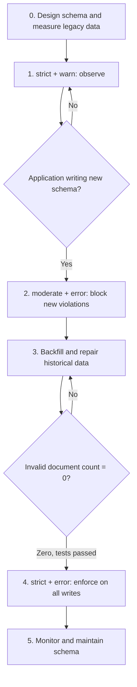

# Phased Schema Validation Rollout

## Objectives and Context

In **Spring Data MongoDB**, Java entities, `MongoTemplate`, and repositories help the application read and write documents, yet a MongoDB collection can still hold many different document shapes: data from older app versions, manual imports, ETL batches, or other services. When changing document structures, modifying Java classes alone can leave historical data misaligned with the new model.

**Schema validation** on the MongoDB side enforces rules directly on a collection using a `validator` (typically with `$jsonSchema`). Every client writing to the collection is affected, including repositories, `MongoTemplate`, the MongoDB Java Driver, `mongosh`, and data ingestion pipelines. Therefore, changing a validator is part of **data migration** and must be rolled out in phases to avoid blocking the running application.

After this lesson, you will be able to:

- Distinguish `validationLevel` from `validationAction` and choose the right combination for each phase.
- Write a valid BSON schema and inspect existing documents before tightening rules.
- Enable or update a validator via `collMod` or `MongoTemplate.executeCommand(...)`.
- Transition from observing violations to blocking new invalid writes, cleaning up legacy data, and enforcing strict rules.
- Test, monitor, and prepare a response plan when a change causes write errors.

> Lesson scope: **MongoDB collection** schema validation, not HTTP request validation or Java-layer Bean Validation. Examples use `mongosh` and Spring Data MongoDB; run them on a test collection before applying to production data.

## 1. Why Not Enable `strict + error` Immediately?

Suppose the `orders` collection contains three kinds of documents:

```javascript
// Test data in a dedicated database; do not run verbatim on production.
db.orders.insertMany([
  {
    _id: "ord-101",
    customerId: "c-101",
    totalCents: NumberLong("12500"),
    status: "NEW"
  },
  {
    _id: "ord-102",
    // Legacy document missing customerId.
    totalCents: NumberLong("8500"),
    status: "NEW"
  },
  {
    _id: "ord-103",
    customerId: "c-103",
    // Older version stored the amount as a string.
    totalCents: "4900",
    status: "NEW"
  }
]);
```

The new application version wants every order to have a string `customerId`, a non-negative BSON `long` `totalCents`, and `status` in `NEW`, `PAID`, or `CANCELLED`. When `validationLevel: "strict"` and `validationAction: "error"` are set, MongoDB rejects any write whose resulting document fails validation. This protects the new data structure, yet even a minor update to an old document missing `customerId` can fail.

An important point to understand: **enabling `strict` does not automatically fix or retroactively scan all existing data**. Invalid documents can remain in the collection until they are updated. Hence, the safe plan is to observe, repair data, and verify before blocking all non-conforming writes.

## 2. Understanding the Two Validator Controls

MongoDB manages validation with these components:

| Component | Common values | Effect |
| --- | --- | --- |
| `validator` | `{ $jsonSchema: { ... } }` | Defines the valid document structure |
| `validationLevel` | `off` | Does not apply the validator on inserts or updates |
| `validationLevel` | `moderate` | Validates new inserts and updates to **already-valid** documents; updates to **already-invalid** documents may be permitted |
| `validationLevel` | `strict` | Validates every insert and update; does not automatically scan existing data |
| `validationAction` | `warn` | Allows the write despite violations; logs a warning to the MongoDB log when the rule applies |
| `validationAction` | `error` | Rejects violating writes when the rule applies |

`validationLevel` answers **"which operations are checked?"**; `validationAction` answers **"what happens if validation fails?"**. For instance, `moderate + warn` will not catch all updates to documents that were already invalid, because `moderate` exempts that group from checking. Initial measurement phases typically use `strict + warn` to observe all executed writes.

Some MongoDB versions offer additional options:

- `validationAction: "errorAndLog"` added in MongoDB **8.1**: rejects violating writes and logs them.
- `validationLevel: "constraint"` added in MongoDB **9.0**: stronger enforcement requiring the entire collection to conform upon transitioning to this level, with a dedicated preparation step and only usable with `error`/`errorAndLog`.

The main workflow in this lesson uses `warn`, `error`, `moderate`, and `strict` so it applies across MongoDB deployments supporting them. Always check your MongoDB Server version before adopting newer options.

## 3. Phased Rollout Roadmap



| Phase | Configuration | Purpose | Gate to proceed |
| --- | --- | --- | --- |
| 0. Survey | No config change yet | Identify invalid data, write APIs, and blast radius | Violations categorized and schema agreed |
| 1. Observe | `strict + warn` | Record violating writes while still allowing them | Violation logs and applications addressed |
| 2. Protect new data | `moderate + error` | Block invalid inserts and updates that break valid documents | No unexpected write rejections on new paths |
| 3. Backfill | Keep `moderate + error` | Fix schema-violating historical documents | Violating record count reaches 0 and data is verified |
| 4. Tighten | `strict + error` | All writes must match schema | Compatibility tests and error monitoring pass |

These are **operational decision gates**, not a fixed calendar schedule. Systems with multiple writers, massive datasets, or nightly ETL jobs may require longer observation and backfill windows.

## 4. Phase 0 — Write Target Schema and Inventory Data

### 4.1. Defining `$jsonSchema`

Open `mongosh` on a test database containing the `orders` collection. Illustrative target schema:

```javascript
const targetSchema = {
  bsonType: "object",
  required: ["customerId", "totalCents", "status"],
  properties: {
    customerId: {
      bsonType: "string",
      minLength: 1,
      description: "customerId must be a non-empty string"
    },
    totalCents: {
      bsonType: "long",
      minimum: 0,
      description: "totalCents must be a non-negative BSON long"
    },
    status: {
      enum: ["NEW", "PAID", "CANCELLED"],
      description: "status must belong to the supported set of states"
    }
  }
};
```

Notes:

- `required` distinguishes a **missing** field from a present field. Individual property rules still need type and value constraints to reject `null` when disallowed.
- BSON `int`, `long`, `double`, and `decimal` are distinct types. Specify `bsonType: "long"` only when writers truly store values as 64-bit BSON integers. If data intentionally uses multiple numeric types, consider a list of `bsonType`s and verify business rules.
- `additionalProperties` allows extra fields by default. Setting `additionalProperties: false` can block `_id`, Spring Data's `_class`, or extension fields if you forget to list them; tighten it only when genuinely needed and verified against actual data.
- MongoDB implements a **subset of JSON Schema draft 4** with the additional `bsonType` keyword; do not use unsupported keywords like `default` expecting MongoDB to populate missing values.
- Validators check document shape; they do not enforce foreign-key existence or uniqueness. Uniqueness requires a unique index; cross-collection invariants require other mechanisms.

### 4.2. Counting and Sampling Non-Conforming Documents

You can reuse the exact same schema as a query condition. The `$nor` operator negates `$jsonSchema`:

```javascript
const invalidFilter = {
  $nor: [{ $jsonSchema: targetSchema }]
};

const total = db.orders.countDocuments({});
const invalidCount = db.orders.countDocuments(invalidFilter);
printjson({ total, invalidCount, validCount: total - invalidCount });

db.orders.find(
  invalidFilter,
  { _id: 1, customerId: 1, totalCents: 1, status: 1 }
).limit(20).forEach(printjson);
```

In the sample dataset, `ord-102` lacks `customerId` and `ord-103` has a mistyped `totalCents`, yielding two invalid documents. In practice, break violations down by category (missing field, wrong BSON type, out-of-enum value), data source, and write timestamp to decide how to repair them.

`$jsonSchema` queries can be expensive when scanning large collections; run them at appropriate times, monitor system load, and partition the work if needed. **`warn` logs are not a complete inventory of legacy data**: old documents that have not been written to will not generate warnings. You need an independent measurement query like the one above.

### 4.3. Inventorying Writers

Before applying a validator, identify everyone writing to `orders`: Spring Data repositories, `MongoTemplate`, bulk imports, background jobs, operational shells, and integrated services. Update write paths to supply all required fields and proper BSON types. If you upgrade one service while leaving an old ETL running, the `error` phase can break the ETL.

## 5. Phase 1 — `strict + warn` for Observation

Add the validator to an **existing** collection using `collMod`:

```javascript
db.runCommand({
  collMod: "orders",
  validator: { $jsonSchema: targetSchema },
  validationLevel: "strict",
  validationAction: "warn"
});
```

MongoDB still allows violating writes while logging a warning for operations within the validator's scope. Example in a test environment:

```javascript
// The write can still succeed, but a warning is logged on the MongoDB Server.
db.orders.insertOne({
  _id: "ord-invalid-demo",
  totalCents: "1200",
  status: "UNKNOWN"
});
```

After observing, delete the demo document by `_id` in your test environment so it does not skew backfill metrics. In production, monitor MongoDB/Atlas logs and application dashboards by write source; restrict log access if violation details include sensitive data.

**Phase exit criteria:** application versions and jobs are ready to write valid documents; causes of recent warnings have been resolved or have an explicit compatibility plan. Do not switch to `error` just because warnings dropped for a few minutes: an infrequently executed writer may not have been observed yet.

## 6. Phase 2 — `moderate + error` to Block New Violations

Once primary writers conform to the schema, update **only** these two options:

```javascript
db.runCommand({
  collMod: "orders",
  validationLevel: "moderate",
  validationAction: "error"
});
```

Omitting `validator` keeps the stored rules intact. This is a critical transition:

1. **Inserting a new invalid document:** rejected.
2. **Updating a previously valid document to become invalid:** rejected.
3. **Updating a historical document that is already invalid:** not forced to satisfy the validator under `moderate`; this lets legacy workflows continue operating while you gradually repair old data.

Verification examples in a test environment:

```javascript
// Error: insert missing customerId.
db.orders.insertOne({
  _id: "ord-invalid-new",
  totalCents: NumberLong("1000"),
  status: "NEW"
});

// Error: turns an already-valid document into an invalid one.
db.orders.updateOne(
  { _id: "ord-101" },
  { $set: { totalCents: "1200" } }
);

// With ord-102 still missing customerId, updating an unrelated
// field can be permitted in moderate mode.
db.orders.updateOne(
  { _id: "ord-102" },
  { $set: { migrationNote: "legacy" } }
);
```

The first two operations are expected to fail with **Document failed validation** when run individually. The last operation demonstrates `moderate`'s limitation: it **does not guarantee** every document in the collection is valid. Do not treat `moderate` as the final state if historical data must be uniform.

At the Spring Data layer, violating calls from `MongoTemplate.save(...)`, `insert(...)`, `updateFirst(...)`, repository `save(...)`, or bulk writes raise a MongoDB write error (typically translated into Spring's data access exception hierarchy). Handle it in the application layer, record metrics, and respond appropriately; never silently swallow the error.

## 7. Phase 3 — Backfill and Repair Historical Data

Backfilling brings **all existing documents** into compliance with `targetSchema`. Before updating, classify root causes and determine authoritative data sources. Never assign a dummy `customerId` merely to make the validator pass; doing so makes data structurally valid yet semantically corrupt.

In the test data, suppose we verified that `ord-102` belongs to customer `c-102` and `ord-103` holds the exact amount in cents:

```javascript
db.orders.updateOne(
  { _id: "ord-102", customerId: { $exists: false } },
  { $set: { customerId: "c-102" } }
);

db.orders.updateOne(
  { _id: "ord-103", totalCents: "4900" },
  { $set: { totalCents: NumberLong("4900") } }
);
```

Filtering on the old state helps avoid overwriting changes if another writer already repaired the record. With real data, clarify currency units, precision, rounding rules, and overflow risks before converting strings or doubles to BSON `long`. Undetermined records must go to a reconciliation or documented exception process rather than fabricating values.

For large collections:

- Partition batches by `_id`, time, or business key, and store checkpoints for safe resumption.
- Use **idempotent** updates (safe to repeat) with conditional filters; consider `bulkWrite` sized to system load.
- Track progress: scanned, repaired, remaining invalid, errors by violation type, and retries.
- Monitor latency, write concern, replication lag, and MongoDB resource utilization while running.
- Keep necessary backups/recovery mechanisms and audit logs to reconcile business-critical modifications.

Re-measure after each batch:

```javascript
const remaining = db.orders.countDocuments({
  $nor: [{ $jsonSchema: targetSchema }]
});
print("remaining invalid:", remaining);
```

When `remaining === 0`, additionally validate business values (especially monetary amounts and identifiers), test new read/write paths, and audit low-frequency writers. Measure the `0` condition **right before** tightening the validation level, since updates to legacy invalid documents can still pass under `moderate`.

## 8. Phase 4 — Transition to `strict + error`

After backfilling, testing, and confirming zero remaining violations:

```javascript
db.runCommand({
  collMod: "orders",
  validationLevel: "strict",
  validationAction: "error"
});
```

From this point forward, MongoDB checks all inserts and updates and rejects non-conforming documents. **Note:** switching to `strict` does not automatically scan for existing invalid documents; that is why the inventory query in earlier phases is essential. If an older writer still produces invalid data during the cutover, coordinate its upgrade or pause it during the transition window.

Inspect the stored configuration on the collection:

```javascript
const info = db.getCollectionInfos({ name: "orders" })[0];
printjson(info.options);

// After enabling strict + error, re-verify existing data.
printjson({
  invalidCount: db.orders.countDocuments({
    $nor: [{ $jsonSchema: targetSchema }]
  })
});
```

`db.getCollectionInfos()` may omit options using default values if they were never explicitly set. Inspect both `validator` and configured options rather than checking a single field and assuming the validator is absent.

If running MongoDB **9.0+** and you need a strict guarantee that the entire existing collection satisfies the schema at upgrade time, look into `validationLevel: "constraint"`. It requires a `prepareConstraintValidationLevel` step, validates existing data, and carries specific schema-change/bypass restrictions; it does **not** serve as a drop-in replacement for `strict` on older versions.

## 9. Executing `collMod` from Spring Data MongoDB

When managing database changes through a Java/Spring Boot migration job, you can invoke database commands via `MongoTemplate.executeCommand(Document)`. Java 17+ example:

```java
import org.bson.Document;
import org.springframework.data.mongodb.core.MongoTemplate;

public final class OrderValidationMigration {

    private final MongoTemplate mongoTemplate;

    public OrderValidationMigration(MongoTemplate mongoTemplate) {
        this.mongoTemplate = mongoTemplate;
    }

    public void installWarningSchema() {
        Document schema = Document.parse("""
            {
              "bsonType": "object",
              "required": ["customerId", "totalCents", "status"],
              "properties": {
                "customerId": {
                  "bsonType": "string",
                  "minLength": 1
                },
                "totalCents": {
                  "bsonType": "long",
                  "minimum": 0
                },
                "status": {
                  "enum": ["NEW", "PAID", "CANCELLED"]
                }
              }
            }
            """);

        Document command = new Document("collMod", "orders")
                .append("validator", new Document("$jsonSchema", schema))
                .append("validationLevel", "strict")
                .append("validationAction", "warn");

        mongoTemplate.executeCommand(command);
    }

    public void setEnforcement(String level, String action) {
        if (!("strict".equals(level) || "moderate".equals(level))) {
            throw new IllegalArgumentException("Unsupported validation level");
        }
        if (!("warn".equals(action) || "error".equals(action))) {
            throw new IllegalArgumentException("Unsupported validation action");
        }

        Document command = new Document("collMod", "orders")
                .append("validationLevel", level)
                .append("validationAction", action);

        mongoTemplate.executeCommand(command);
    }
}
```

Execution steps are orchestrated by a migration runner or deployment tool:

```java
// Step 1: run once after surveying existing data.
migration.installWarningSchema();

// Step 2: after verifying writers are ready.
migration.setEnforcement("moderate", "error");

// Step 4: after backfill, once inventory confirms zero invalid records.
migration.setEnforcement("strict", "error");
```

These calls belong to **separate deployments**, never invoked back-to-back in a single startup. Track migration version, executor, timestamp, and verification results, and prevent multiple application replicas from calling `collMod` simultaneously. Modifying collection options requires appropriate administrative privileges; regular application database users may not—and often should not—hold them.

### Relationship to Entities and Repositories

```java
import org.springframework.data.annotation.Id;
import org.springframework.data.mongodb.core.mapping.Document;

@Document("orders")
public class OrderDocument {
    @Id
    private String id;
    private String customerId;
    private Long totalCents;
    private String status;
    // Constructor and getters/setters per project conventions.
}
```

Under default mapping, Java `Long` encodes as BSON `long`; however, legacy documents may omit fields or store different types, so reading old data must be tested against real application code. `@Document` specifies the collection; it **does not automatically enable** a JSON Schema validator in MongoDB. If using custom converters, `@Field`, or type mapping settings, compare the schema against actual stored BSON (including the `_class` field if present).

Spring Data also provides `MongoJsonSchema` and `CollectionOptions.schema(...)` for creating collections with validators. When **modifying an existing collection**, `collMod` remains the appropriate operation for controlled rollout ordering.

## 10. Matrix Testing Across Scenarios

Run tests on an isolated test database or collection pre-populated with known valid and invalid documents:

| Scenario | `strict + warn` | `moderate + error` | `strict + error` |
| --- | --- | --- | --- |
| Insert complete document | Succeeds | Succeeds | Succeeds |
| Insert missing `customerId` | Succeeds, logs warning | Rejected | Rejected |
| Update valid document to invalid | Succeeds, logs warning | Rejected | Rejected |
| Update already-invalid legacy document, keeping it invalid | Succeeds, logs warning | May succeed | Rejected |
| Update invalid legacy document to valid | Succeeds | Succeeds | Succeeds |
| Read existing invalid legacy document | Still readable | Still readable | Still readable |

Error test commands can be executed individually in `mongosh` while catching exceptions:

```javascript
try {
  db.orders.insertOne({
    _id: "ord-test-invalid",
    totalCents: NumberLong("100"),
    status: "NEW"
  });
  print("write accepted");
} catch (e) {
  print("write rejected: " + e.message);
}
```

Under `warn`, the insert succeeds; re-running with the same `_id` afterward raises a **duplicate key** error rather than a validation error. Reset the test collection or use a fresh ID per test case.

When testing with Spring Data, observe exceptions from repositories/`MongoTemplate` and ensure the application does not infinitely retry an operation that permanently violates schema rules. Beyond unit tests for DTOs/entities, write integration tests against real MongoDB or an appropriate test container, because validators live in the database and only trigger fully on real write commands.

## 11. Monitoring, Rollback, and Schema Versioning

Monitor at minimum: invalid document counts across scans, write violations from MongoDB logs, application write failure rates, retry/bulk-write errors, write latency, backfill job throughput, and downstream service impact. Compare metrics before and after each transition; pay close attention to rarely executed batches or endpoints.

If unexpected write failures occur after switching to `error`, first identify which writer sent the invalid document and whether the root cause is BSON mapping, a new field, or legacy data. You can **temporarily** relax enforcement back to warnings under controlled incident response:

```javascript
// Example fallback to relax write blocking when operationally authorized.
db.runCommand({
  collMod: "orders",
  validationLevel: "strict",
  validationAction: "warn"
});
```

Switching to `warn` permits new invalid data to enter; this directly affects data quality. Monitor violation counts, fix the offending writer, backfill any newly created bad documents, and re-enable `error` once verified. Changing a validator or enforcement mode only affects future write checks; **it does not heal or transform** previously stored data.

Record schemas and `collMod` operations in versioned migration history. When changing required fields or enums:

1. Design the new rules and evaluate compatibility with existing data and active writers.
2. If needed, first deploy code that reads both old and new shapes; then deploy code writing the new format.
3. Observe and repair data through the phases above.
4. Remove legacy format support only after verifying all writers and historical data comply.

Never assume a validator change substitutes for API contracts, optimistic locking, transactions, unique indexes, or business-logic validation.

## 12. Common Errors

| Symptom | Common cause | Resolution |
| --- | --- | --- |
| `Document failed validation` right after rollout | Enabling `error` while writers still emit the old schema | Inspect logs/exceptions, identify the field, and fix the writer |
| Updating a legacy document fails even when touching one field | `strict` checks the entire resulting document | Backfill first; use `moderate` intentionally during transition |
| Zero warnings logged, yet invalid documents exist | `warn` logs only on writes matching the validation scope | Scan independently with `$nor` + `$jsonSchema` |
| Validator expects `long` but app writes `int` or `double` | Actual BSON type differs from Java/JSON assumption | Check actual BSON stored, align converters and schema |
| Adding `additionalProperties: false` blocks all writes | Forgot `_id`, `_class`, or legitimate fields in schema | Add valid fields or remove the unintended restriction |
| Re-running backfill corrupts data | Non-idempotent updates or unguarded numeric conversions | Filter by legacy state, checkpoint, and verify unit conversions |
| Running test in `warn` then `error` hits duplicate key | Reusing the same `_id` | Use dedicated test data per case |
| Assuming `moderate + error` guarantees clean data | Existing invalid documents are skipped on update | Count violations, backfill, then enable `strict + error` |

## 13. Practice Exercises

**Exercise 1 — Create a schema.** Design a validator for `products` requiring non-empty `sku`, non-negative BSON `long` `priceCents`, and `state` in `ACTIVE`/`INACTIVE`. Use `$jsonSchema` and explain why a validator does not replace a unique index on `sku`.

**Exercise 2 — Rollout.** Prepare three documents: one valid, one missing `sku`, and one with string `priceCents`. Roll out `strict + warn`, `moderate + error`, backfill, and finally `strict + error`. At each stage, attempt an invalid insert, updating a valid document to invalid, and updating a legacy invalid document. Record results and compare with the table in Section 10.

**Exercise 3 — Spring Data integration.** Build a migration job calling `MongoTemplate.executeCommand(...)`, record the execution version, and write an integration test verifying that repository `save(...)` with an invalid document is rejected under `strict + error`. Verify the job cannot run concurrently across multiple instances.

**Exercise 4 — Incident handling.** Simulate an old writer sending string `priceCents` after `moderate + error` is enabled. Identify the error, propose a fix for the write code, define metrics to verify the fix, and state the criteria for re-enabling strict enforcement if you had to downgrade temporarily to `warn`.

## Summary of Key Principles

- `$jsonSchema` defines valid documents; `validationLevel` selects validation scope; `validationAction` decides whether to warn or reject.
- For heterogeneous historical data, the practical path is **survey → `strict + warn` → `moderate + error` → backfill → `strict + error`**.
- `strict` does not clean up legacy documents; `moderate` does not prove the collection conforms to the schema.
- Reuse the same schema with `$nor`/`$jsonSchema` to count violations, and verify business quality before tightening rules.
- Manage `collMod` as a versioned migration with phase gates, real-database tests, and an incident plan for write rejections.

## References

- [MongoDB — Schema Validation](https://www.mongodb.com/docs/manual/core/schema-validation/)
- [MongoDB — Specify Validation Level for Existing Documents](https://www.mongodb.com/docs/manual/core/schema-validation/specify-validation-level/)
- [MongoDB — Choose How to Handle Invalid Documents](https://www.mongodb.com/docs/manual/core/schema-validation/handle-invalid-documents/)
- [MongoDB — Query for Valid or Invalid Documents](https://www.mongodb.com/docs/manual/core/schema-validation/use-json-schema-query-conditions/)
- [MongoDB — Modify Schema Validation](https://www.mongodb.com/docs/manual/core/schema-validation/update-schema-validation/)
- [MongoDB — collMod Command](https://www.mongodb.com/docs/manual/reference/command/collmod/)
- [MongoDB — $jsonSchema Query Operator](https://www.mongodb.com/docs/manual/reference/operator/query/jsonschema/)
- [Spring Data MongoDB — MongoTemplate API](https://docs.spring.io/spring-data/mongodb/docs/current/api/org/springframework/data/mongodb/core/MongoTemplate.html)
- [Spring Data MongoDB — CollectionOptions API](https://docs.spring.io/spring-data/mongodb/docs/current/api/org/springframework/data/mongodb/core/CollectionOptions.html)
