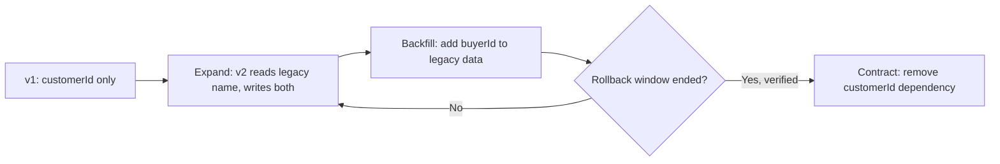
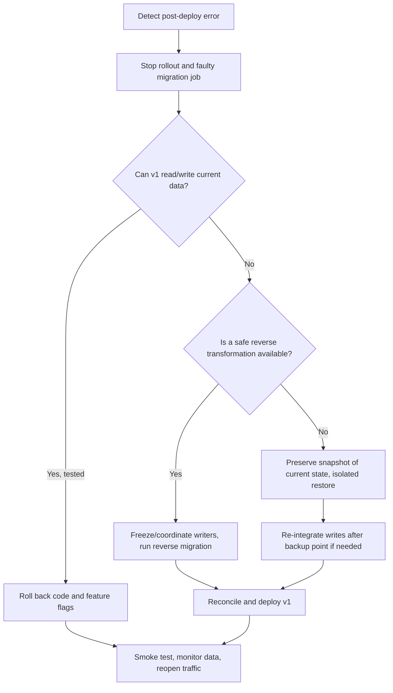

# Backup, Restore, and Conditions for Rolling Back to an Older Application Version

## Lesson Objectives

In the **Data Migration** chapter of **SPRING_DATA_MONGODB**, you will learn how to prepare a safe rollback path when modifying an application or document structure. Spring Data MongoDB accesses MongoDB via `MongoTemplate` and repositories, yet rollback feasibility still depends on **data already written**, how the migration was deployed, and backups proven to restore cleanly.

After this lesson, you will be able to:

- Distinguish **application version rollback**, **reverse data migration**, and **backup restore**.
- Choose an appropriate backup approach for MongoDB Atlas, self-managed replica sets, or test environments.
- Understand **RPO** (acceptable data loss) and **RTO** (target recovery time).
- Design **expand → migrate → contract** migrations so the older application version can continue working during the rollback window.
- Write a contingency runbook, rehearse recovery in an isolated environment, validate data, and decide when direct rollback is **not possible**.

> **Principle:** A backup becomes a trustworthy recovery plan only after restore capability has been tested. And **reverting to old code does not equate to reverting to old data**.

## 1. Three Commonly Confused Operations

Suppose an order management application has version `v1` storing `customerId`. Version `v2` wants to rename it to `buyerId` and change how data is read.

| Operation | What changes | What happens to newly created data? | When to apply |
| --- | --- | --- | --- |
| **Application rollback** | Deployment artifact, config, feature flags | Existing data remains untouched | Current schema remains compatible with the old application version |
| **Reverse / compensating migration** | Modified documents and indexes | Must design reverse transformation rules and protect new writes | Transformations can be reliably inverted |
| **Backup restore / point-in-time** | Entire or partial database state | Changes after the restore point **risk loss or require re-integration** | Data corruption, irreversible migration, severe incident |

A system can roll back `v2 → v1` in minutes if every new document still contains `customerId`. Conversely, if `v2` immediately deletes `customerId` and writes many new orders containing only `buyerId`, redeploying `v1` **is not enough**: `v1` cannot read those documents.

Further distinctions:

- **Backup** is a copy kept for recovery if needed; a backup does not automatically revert live data.
- **Restore** is the operation of loading data from a backup into a target; it can overwrite or lose existing data on the target.
- **PITR (Point-in-Time Recovery)** is the ability to restore to a point within a recovery window, if supported by the backup infrastructure. Having a `mongodump` archive with oplog **does not mean** you have continuous PITR to any arbitrary moment.

## 2. Defining RPO and RTO Before Choosing Tools

Suppose the business requires recovering from a migration incident in at most 30 minutes and tolerates losing at most 5 minutes of data:

| Metric | Example | Meaning for the plan |
| --- | --- | --- |
| **RPO = 5 minutes** | At most 5 minutes of writes may be lost | Daily snapshots are insufficient; requires continuous backup or data replay |
| **RTO = 30 minutes** | Service must recover within 30 minutes | Must measure actual restore time, connection switchover, and verification |
| **Rollback window = 24 hours** | Allows reverting to `v1` for 24 hours after deploy | `v2` must maintain `v1`-compatible data at least throughout this window |

These are **example assumptions**, not MongoDB defaults. Set targets based on business criticality, data size, backup lag, service count, and operational capacity.

A pure application rollback can achieve an RPO of 0 **for durably persisted writes** if no database restore is needed and the old app still reads and writes properly. Full restore RTO can far exceed application rollback RTO due to data volume, index builds, cache warming, and connection rerouting.

## 3. Choosing a Backup Approach for MongoDB

| Approach | Core capability | Conditions / limitations to understand |
| --- | --- | --- |
| **MongoDB Atlas Cloud Backup** | Managed snapshots, retention schedules, and restore workflows | Check tier, backup policy, permissions, and restore duration; PITR is not enabled by default everywhere |
| **Atlas Continuous Cloud Backup** | Snapshots + oplog history enabling point-in-time restore within the restore window | Must be enabled and target timestamp within window; restore may temporarily pause writes on target |
| **Consistent storage snapshots** (self-managed) | Fast physical backups for large datasets | Must guarantee snapshot consistency across replica set and filesystem; never copy `dbPath` arbitrarily while `mongod` writes |
| **`mongodump` / `mongorestore`** | Logical BSON backup/restore, suited to small datasets or scoped tasks | Restores take time; under concurrent writes, plain dumps are not point-in-time consistent |
| **`mongodump --oplog`** | Full dump of a **replica set member** including writes occurring during the dump | Must restore with `--oplogReplay`; cannot be combined with `--db`/`--collection` or full sharded cluster backup via `mongos` |

On Atlas, prefer Atlas-managed backup policies and **rehearse restores into a test target cluster**. For self-managed systems, use consistent snapshots or supported backup tooling for your topology; sharded cluster plans must account for cross-shard consistency.

**Do not confuse `--oplogReplay` with continuous PITR.** This flag replays oplog entries captured **during that dump**, making the dump point-in-time consistent at dump completion. Recovering to a timestamp hours after the dump requires a PITR solution with continuous change history.

### Data Outside Documents That Also Needs Protection

Within Spring Data MongoDB applications, recovery also depends on:

- Indexes (including unique, TTL, partial), collection options, validators, and collations.
- Users, roles, server/Database Tools versions, encryption keys, credentials, and network access rules.
- Message broker state, job schedulers, external search indexes, caches, object storage files, and external system transactions.
- Spring Boot configuration, migration versions, feature flags, `spring.data.mongodb.uri` connection strings, and other services sharing the database.

A MongoDB backup **does not back up** systems outside the database. After a restore, reconcile outbound side effects (emails, payments, events, etc.) before replaying jobs.

## 4. Designing So Older Application Versions Can Still Read Data

### Real-World Case: Renaming `customerId` to `buyerId`

Suppose `v1` reads `customerId` and `v2` wants to rename the field. A direct change:

```javascript
// Do not run immediately in production if v1 rollback is still required!
db.orders.updateMany(
  { customerId: { $exists: true } },
  { $rename: { customerId: "buyerId" } }
);
```

This renames the field, leaving `v1` without `customerId`. If `v2` also inserts new documents containing only `buyerId`, reverting to `v1` becomes much harder. A safer approach is **expand → migrate → contract**.



Phases:

1. **Expand:** allow documents to carry both fields. Deploy the new version accepting legacy data, writing both `customerId` and `buyerId` in the same document update.
2. **Migrate/backfill:** populate `buyerId` for older documents missing it. Run in batches with checkpoints and logging, avoiding overwriting concurrent updates.
3. **Observe:** monitor incompatible document rates, serialization/deserialization errors, APIs, indexes, and background tasks. During this phase, keep maintaining `customerId` so `v1` can still read it.
4. **Contract:** drop the old field or remove compatibility code **only after** confirming no legacy consumers remain, the rollback window has closed, and backup recovery has been verified.

### Writing Compatible Code with `MongoTemplate`

Suppose the Java entity maps documents during the expand phase:

```java
import org.springframework.data.annotation.Id;
import org.springframework.data.mongodb.core.mapping.Document;

@Document("orders")
public class OrderDocument {
    @Id
    private String id;

    // v1 field still required during the rollback window.
    private String customerId;

    // Newly added v2 field.
    private String buyerId;

    public String getId() { return id; }
    public String getCustomerId() { return customerId; }
    public String getBuyerId() { return buyerId; }

    // While v1 can still write, treat the legacy field as the primary source.
    public String customerIdForBusiness() {
        return customerId != null ? customerId : buyerId;
    }
}
```

When `v2` updates an order's customer, write **both fields in a single document update**:

```java
import org.springframework.data.mongodb.core.MongoTemplate;
import org.springframework.data.mongodb.core.query.Criteria;
import org.springframework.data.mongodb.core.query.Query;
import org.springframework.data.mongodb.core.query.Update;

// Assumes template, orderId, and newCustomerId are properly provided.
Query query = Query.query(Criteria.where("_id").is(orderId));

Update update = new Update()
    .set("customerId", newCustomerId)
    .set("buyerId", newCustomerId);

template.updateFirst(query, update, OrderDocument.class);
```

An update to a **single document** is atomic in MongoDB: readers never observe half of that operation. However, `v1` may still write **only** `customerId`; therefore, `v2` prioritizes the legacy field when both exist during concurrent execution. Once all old writers exit the system, run a final backfill before considering switching precedence to `buyerId`.

**Repository note:** `save(entity)` typically replaces the entire document. A `v1` process unaware of `buyerId` can inadvertently strip the new field on save. When versions run concurrently, inspect repository behavior and prefer targeted updates via `MongoTemplate.updateFirst` or versioning/optimistic locking where appropriate.

### Conditional Backfill to Avoid Overwriting Newer Data

Example of **one batch** of 500 documents. The update condition must re-verify that the record still lacks `buyerId` and that `customerId` still equals the value just read:

```java
import java.util.List;
import org.springframework.data.mongodb.core.MongoTemplate;
import org.springframework.data.mongodb.core.query.Criteria;
import org.springframework.data.mongodb.core.query.Query;
import org.springframework.data.mongodb.core.query.Update;

Query batchQuery = Query.query(
    Criteria.where("customerId").exists(true)
        .and("buyerId").exists(false)
).limit(500);

List<OrderDocument> batch =
    template.find(batchQuery, OrderDocument.class);

for (OrderDocument order : batch) {
    Query guarded = Query.query(
        Criteria.where("_id").is(order.getId())
            .and("customerId").is(order.getCustomerId())
            .and("buyerId").exists(false)
    );

    template.updateFirst(
        guarded,
        new Update().set("buyerId", order.getCustomerId()),
        OrderDocument.class
    );
}
```

This snippet illustrates **a single batch iteration**, not a full migration runner. At scale, add a controlled loop, stable cursor pagination, retries, checkpoints, load throttling, and updated-count metrics. If documents have `customerId: null`, empty strings, invalid values, or an existing conflicting `buyerId`, apply explicit handling rules; never overwrite automatically.

In particular, consider backfill successful only when **values** are reconciled, not merely when the new field exists.

## 5. Logical Backups with MongoDB Database Tools

The commands below use a **Bash/Linux-style shell** and a **self-managed replica set** example. `mongodump` and `mongorestore` are standalone MongoDB Database Tools utilities, not `MongoTemplate` methods. Retrieve URIs from a secret manager and secure dump files per backup policy.

### Step 1: Take a Full Replica Set Dump Before Migration

```bash
# SOURCE_URI points to a replica set with appropriate read permissions.
# Backup directory must exist with sufficient free space.
mongodump \
  --uri="$SOURCE_URI" \
  --archive="/secure/backups/pre-v2.archive.gz" \
  --gzip \
  --oplog
```

Explanation:

- `--archive`: packages BSON data and metadata into a single archive file.
- `--gzip`: compresses the backup file; `--gzip` must also be passed on restore.
- `--oplog`: captures concurrent writes during the dump to support a consistent restore via replay.

`--oplog` requires dumping an entire replica set member; **do not combine** it with `--db`, `--collection`, or `--query`. It is not a way to back up an entire sharded cluster through `mongos`. Metadata changes such as collection renames during the dump can cause the dump to fail; check exit codes, logs, and backup metadata before treating a backup as valid.

### Step 2: Rehearse Restore into an Isolated Environment

Create an **empty test** database/cluster isolated from production write paths, with compatible server version and permissions:

```bash
# STAGING_URI must point to an isolated recovery target, never production.
mongorestore \
  --uri="$STAGING_URI" \
  --archive="/secure/backups/pre-v2.archive.gz" \
  --gzip \
  --oplogReplay
```

`--oplogReplay` replays oplog records captured during the dump. With `--oplogReplay`, you must restore the **full dump** created by `--oplog`; do not arbitrarily filter namespaces. This command assumes an empty target. If matching collections already exist, restore may raise duplicate key errors or fail to load as expected.

You can preview work with `mongorestore --dryRun`, but **a dry run does not substitute for a real restore rehearsal**. Passing `--drop` drops matching target collections prior to restoring; use it only after verifying the target, backup scope, and impact on existing data. If the dump includes `admin`, restoring users and roles also requires careful planning to avoid locking out access.

### Step 3: Verify the Restored Copy

Connect `mongosh` to the **correct test database**:

```javascript
// Verify counts and representative documents.
db.orders.countDocuments({});
db.orders.find(
  {},
  { _id: 1, customerId: 1, buyerId: 1 }
).sort({ _id: 1 }).limit(5);

// Verify indexes, collection options, and validators.
db.orders.getIndexes();
db.getCollectionInfos({ name: "orders" });
```

Reconcile counts by business keys/groups, sample `_id`s, total order values, indexes, uniqueness, TTLs, validators, and API responses. Matching total document counts alone is **insufficient** to prove data integrity. Separately verify backups of users, roles, and system collections if included in the recovery scope.

Record rehearsal results: backup size, start/end times, exit codes, errors observed, actual restore duration, index build time, and reconciliation metrics. These metrics ground your RTO/RPO estimates.

## 6. Using MongoDB Atlas: Snapshots and Point-in-Time

With Atlas, confirm before running the migration:

1. The cluster has **Cloud Backup** enabled with an adequate snapshot retention schedule.
2. If you may need to recover to the exact moment before a faulty migration, **Continuous Cloud Backup / PITR** is enabled on a supported tier and the target point remains inside the **restore window**.
3. Operational accounts have restore permissions; you have rehearsed restoring into a **safe target cluster**.
4. Your deployment can switch `spring.data.mongodb.uri`/secrets to the restored cluster, update IP allowlists, verify topology/read-write concerns, and reroute applications.

Point-in-time restores usually target **the moment right before the damaging operation**, after which Atlas replays oplog history up to the chosen timestamp within the allowed window. Restoring at the cluster level onto a cluster holding existing data can wipe existing data on the **target cluster**; the target is unavailable for normal traffic during restore. Selecting a new/isolated cluster reduces the risk of overwriting live data.

Even with PITR, reverting to `T0` **discards changes made after `T0`** unless they were captured and re-integrated via a separate mechanism. For transactional systems, account for orders, payments, and messages generated in that interval.

## 7. Specific Conditions for Rolling Back the Application from v2 to v1

Below is a **decision matrix** for on-call engineers when issues appear after a migration:

| Check condition | Safe to roll back directly to v1? | Action |
| --- | --- | --- |
| All v2 documents retain valid `customerId`; all writers are compatible; v1 supports current collections/indexes/validators | **Yes**, once tests confirm | Halt v2 rollout, deploy v1, verify reads/writes, and monitor |
| Documents have both fields with conflicting values | **Not yet** | Determine authoritative field, reconcile, and verify before rolling back |
| Documents exist with only `buyerId`, or v2 changed BSON types v1 cannot read | **Not directly** | Controlled reverse migration or backup restore/re-integration |
| v2 added unique indexes, validators, or collection options that reject v1 writes | **Not yet** | Evaluate compatible schema/index adjustments, test with v1, measure impact |
| v2 deleted fields or data that cannot be derived back | **Not directly** | Use backup or external data sources; account for writes after backup point |
| Events/messages/APIs from v2 emit schemas older consumers fail to parse | **Not yet** | Add compatibility adapters, stop emitting new schema, drain/handle side effects |
| Backups exist but have never been restore-tested; RTO unknown | **Cannot rely on as a proven recovery option** | Run restore rehearsal, measure duration, and verify reconciliation |

A compatibility matrix can be tracked right inside the migration ticket:

| Existing document state | Readable by v1? | Readable by v2? | Safe to roll back code? |
| --- | --- | --- | --- |
| `{ customerId: "C1" }` | Yes | Yes, with fallback | Yes |
| `{ customerId: "C1", buyerId: "C1" }` | Yes | Yes | Yes |
| `{ buyerId: "C1" }` | No | Yes | No |
| `{ customerId: "C1", buyerId: "C2" }` | Yes, though potentially wrong | Yes, though ambiguous | Not yet; reconcile first |

**At rollback decision time**, inspect the **live data** and all active write sources, not just the newly built code artifact. Also confirm the older application works against the database server, mappings, transactions, aggregations, and new indexes. If the application changed aggregation pipelines or BSON decoding, failures might surface only under production load or rare edge-case documents.

## 8. Deployment and Incident Response Runbook

### Before Release

1. **Scope:** list affected collections, fields, indexes, schema validation, aggregations, repositories, and services. Classify change type: add field, rename, change type, drop field, or split/merge collections.
2. **Define thresholds:** set RPO/RTO, v1 compatibility duration, success metrics (API errors, mismatches, lag, throughput, timeouts), and rollback decision owner.
3. **Verify backup:** take a pre-change backup, tag release and UTC timestamp, secure backup via least-privilege/encryption with an independent copy; test restore and data readability.
4. **Expand release:** deploy code accepting both old and new schemas; add new fields/indexes first in a controlled step when needed. Switch write paths only after all readers understand the format.
5. **Run backfill:** batch, idempotent, checkpointed, monitoring CPU/IO/replication lag; reconcile business invariants rather than document counts alone.
6. **Canary and observe:** shift partial traffic, compare outputs between versions, and retain feature flags to disable new logic on error.

### When an Incident Occurs



Detailed coordination steps:

1. **Record incident timeline:** deployment time, app version, migration ID, logs, queue state, and backup UTC timestamp. Stop jobs/backfills corrupting data; prevent other instances from continuing faulty writes.
2. **Check compatibility:** count documents with the new schema or missing legacy fields, sample failing records, and verify v1 can write under current indexes and validators.
3. **If code rollback is safe:** shift traffic back to v1 via standard deployment; do not restore the database. Monitor reads, order creation/updates, background jobs, and index scans.
4. **If data repair is needed:** preserve a copy of **current state before intervening**, prepare a reverse migration or isolated target restore; capture all writes occurring since `T0`.
5. **Verify then reopen traffic:** run smoke tests, check counts and business invariants, verify `MongoClient` reconnects, and confirm jobs/consumers behave properly before resuming writes.
6. **Post-incident monitoring:** monitor mapping errors, query/aggregation latency, invalid document counts, replication lag, duplicate/lost messages, and data drift over a defined window.

**Decision guideline:** if you cannot prove current data is compatible with v1 or lack a plan to preserve newer writes, keep the investigable state intact and prefer **rolling forward** or controlled compensating updates. A hasty rollback can turn a deployment bug into permanent data loss.

## 9. Checks Before Completing a Rollback

Run the following on the database under evaluation after confirming the environment:

```javascript
// How many documents lack customerId for v1?
db.orders.countDocuments({ customerId: { $exists: false } });

// How many documents have buyerId but lack customerId?
db.orders.countDocuments({
  buyerId: { $exists: true },
  customerId: { $exists: false }
});

// How many documents have both fields with mismatched values?
db.orders.countDocuments({
  customerId: { $exists: true },
  buyerId: { $exists: true },
  $expr: { $ne: ["$customerId", "$buyerId"] }
});

// Do structure and indexes affect v1?
db.orders.getIndexes();
db.getCollectionInfos({ name: "orders" });
```

`$exists` queries on large datasets can be expensive; run them in a controlled manner with proper indexes and scope sizing. **Missing field** differs from a present field set to `null`; also inspect anomalous values, BSON types, and empty strings per business rules.

In Spring Data MongoDB, critical counts can be wired into health checks or operational tools during migration rollout:

```java
import org.springframework.data.mongodb.core.MongoTemplate;
import org.springframework.data.mongodb.core.query.Criteria;
import org.springframework.data.mongodb.core.query.Query;

// Example on the orders collection before allowing v1 rollback:
long incompatible = template.count(
    Query.query(Criteria.where("customerId").exists(false)),
    OrderDocument.class
);

if (incompatible > 0) {
    throw new IllegalStateException(
        "Cannot rollback to v1 yet: " + incompatible
            + " documents missing customerId"
    );
}
```

This is only **one verification check**, not a full compatibility certificate. Beyond counts, verify field contents, document versions, write paths, API contracts, related collections, and actual behavior of the legacy application.

## 10. Practice Exercise: Restorable and Rollback-Safe

Set up a test environment with Spring Boot + Spring Data MongoDB, at least two app builds simulating `v1` and `v2`, and a test MongoDB replica set or an Atlas cluster with backup enabled.

1. Populate `orders` with `customerId` only; record document counts and key business values.
2. Perform a backup using your chosen strategy. For a small self-managed replica set, try `mongodump --oplog` as in Section 5.
3. Deploy `v2` reading both `customerId` and `buyerId` and writing both. Run a conditional backfill for legacy data.
4. Have `v2` create 10 new orders. Confirm the new documents still include `customerId`, then redeploy `v1` without restoring. Test reads/writes with `v1`.
5. In a **separate** environment, simulate an incompatible migration by removing `customerId` from some documents; run Section 9 checks and verify `v1` rollback is blocked.
6. Restore the backup into a fresh environment, verify data, and measure elapsed time. Compare pre-backup order counts with the 10 orders created post-backup; explain the data-loss risk of choosing an older restore point.
7. Write a one-page runbook covering: backup timestamp, target RPO/RTO, rollback gates, check commands, backup storage location, post-restore write re-integration, and cutover approver.

**Completion criteria:** you can distinguish code rollback from data restore, accurately explain `--oplogReplay` limits, identify which schema state prevents `v1` from running, and prove backup recoverability through a hands-on rehearsal.

## References

- [MongoDB — Backup Methods for a Self-Managed Deployment](https://www.mongodb.com/docs/manual/core/backups/)
- [MongoDB Database Tools — mongodump](https://www.mongodb.com/docs/database-tools/mongodump/)
- [MongoDB Database Tools — mongorestore](https://www.mongodb.com/docs/database-tools/mongorestore/)
- [MongoDB — Back Up and Restore with MongoDB Tools](https://www.mongodb.com/docs/manual/tutorial/backup-and-restore-tools/)
- [MongoDB Atlas — Restore from Continuous Cloud Backup](https://www.mongodb.com/docs/atlas/backup/cloud-backup/restore-from-continuous/)
- [MongoDB Atlas — Recover a Point In Time](https://www.mongodb.com/docs/atlas/recover-pit-continuous-cloud-backup/)
- [MongoDB Atlas — Manage Backup Policies](https://www.mongodb.com/docs/atlas/backup/cloud-backup/configure-backup-policy/)
- [Spring Data MongoDB — `MongoTemplate` Operations](https://docs.spring.io/spring-data/mongodb/reference/mongodb/template-crud-operations.html)
