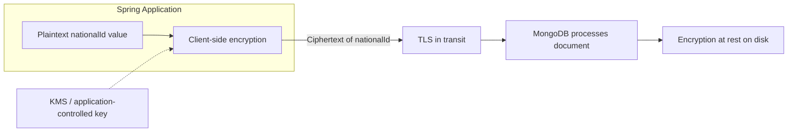
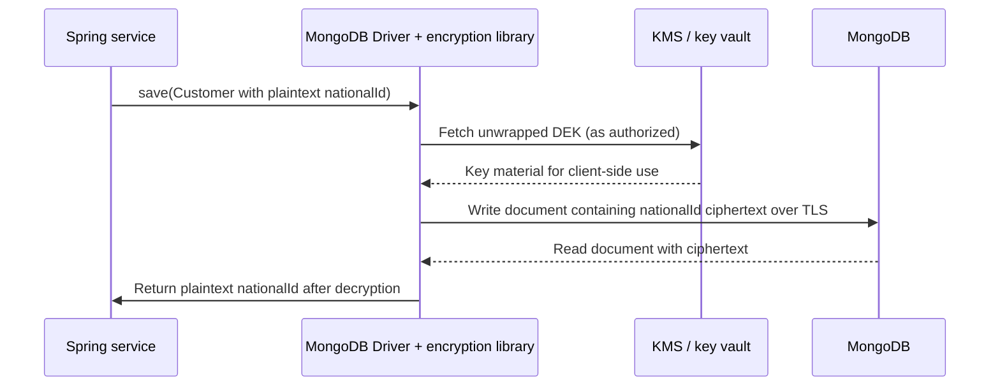

# Distinguishing TLS, Encryption at Rest, and Client-Side Encryption

## 1. Why Does a Spring Data MongoDB Application Need Multiple Encryption Layers?

A Spring Data MongoDB service can read and write customer records using `MongoTemplate`, `MongoRepository`, or `ReactiveMongoTemplate`. Records contain names, addresses, identification numbers, and contact details; the application must protect them in **three different states**:

1. **In transit** between the application, MongoDB, and network components: use **TLS** (*Transport Layer Security*).
2. **At rest** on the database disk: use **encryption at rest**.
3. **While being processed on the MongoDB server**, where certain values must still not be exposed to database administrators: use **client-side field encryption**, including Client-Side Field Level Encryption (CSFLE) and Queryable Encryption (QE).

These three mechanisms do not replace one another. TLS protects the data stream, but MongoDB still receives plaintext after decrypting the connection. Encryption at rest protects files on disk, but MongoDB can decrypt them when processing queries. Client-side encryption turns **sensitive fields** into ciphertext **before** data reaches MongoDB, so the server never holds the original values of those fields.

Running example: a Spring service has a `customers` collection where each document contains `name`, `email`, `nationalId`, and `createdAt`. The business needs to search by name, while only processes granted access to the key may read `nationalId`.

### 1.1. Data Flow Diagram



The diagram illustrates the `nationalId` field **with client-side encryption enabled**. The `name` field, which is not encrypted client-side, remains plaintext inside the MongoDB process after the TLS connection terminates; if encryption at rest is enabled, all data on disk is protected at the storage layer.

### 1.2. Quick Comparison Table

| Criterion | TLS (in transit) | Encryption at rest | Client-side encryption (CSFLE/QE) |
| --- | --- | --- | --- |
| Where does it protect? | Communication channel between application ↔ MongoDB, and other links if configured with TLS. | Data files, journal files, and storage scope supported by the deployment mechanism. | Values of designated fields before leaving the application. |
| Who decrypts? | Both ends of the TLS connection. | Storage engine/storage system when MongoDB reads data. | Authorized application/driver using the data key. |
| Direct read from MongoDB with a read-privileged account? | Can see plaintext. | Can see plaintext. | Only sees ciphertext for encrypted fields if lacking the client key. |
| Prevents network eavesdropping? | Yes, with proper certificate validation. | No. | Keeps encrypted fields confidential, but does not replace connection protection. |
| Prevents reading stolen disk files when machine is off? | No. | Yes, with proper key management. | Yes for encrypted fields; other fields still need protection. |
| Queries/aggregations on original values | Work as normal. | Work as normal. | Restricted by algorithm, field type, and server/driver version. |
| Primary key management | Certificates, CA, and TLS keys. | Storage encryption keys, master keys, or KMS. | Data Encryption Key (DEK), Customer Master Key (CMK), and KMS permissions. |

**A system handling sensitive data usually needs a combination of all three**, along with authentication, authorization, backup protection, and secrets management. Never assume "it is encrypted" is enough to skip access control.

## 2. TLS: Protecting Data in Transit

### 2.1. What Does TLS Do?

In a TLS connection, the MongoDB server presents a certificate; the client validates the trust chain from a CA (*Certificate Authority*) and the hostname. After the handshake, both sides use session keys to encrypt traffic over the network. TLS protects against eavesdropping and tampering in transit when properly configured and validated.

TLS **does not encrypt fields in the sense of document contents**: the driver may send `nationalId` as plaintext *inside* the TLS channel, and MongoDB then decrypts the channel to process it. On disk or inside the MongoDB process, this field can still be exposed without another protection layer.

### 2.2. Configuring a Spring Application to Connect Over TLS

In a Spring Boot project using URI configuration for MongoDB, you can place the URI in an environment variable:

```yaml
# application.yml (Spring Boot 3.x example)
spring:
  data:
    mongodb:
      uri: ${MONGODB_URI}
```

```text
# Example environment variable value; replace host and authentication method as appropriate.
MONGODB_URI=mongodb://db.example.internal:27017/customer_db?tls=true
```

`tls=true` instructs the Java MongoDB Driver to use TLS. A `mongodb+srv://...` URI enables TLS by default in the driver unless overridden by configuration; however, you should still verify the actual configuration. The MongoDB server must also be configured to accept or require TLS; adding `tls=true` on the client does not enable TLS on a server that does not support it.

If you need to configure the driver directly, here is a minimal example:

```java
import com.mongodb.ConnectionString;
import com.mongodb.MongoClientSettings;
import com.mongodb.client.MongoClient;
import com.mongodb.client.MongoClients;

public class TlsMongoConnection {
    public static MongoClient create() {
        MongoClientSettings settings = MongoClientSettings.builder()
            .applyConnectionString(new ConnectionString(
                "mongodb://db.example.internal:27017/customer_db"
            ))
            .applyToSslSettings(ssl -> ssl.enabled(true))
            .build();
        return MongoClients.create(settings);
    }
}
```

The example above only illustrates enabling TLS and does not include authentication or certificate trust configuration for a specific environment. In a Spring Boot application that already manages `MongoClient`, configure this via the URI or the `MongoClientSettingsBuilderCustomizer` of your Boot version to avoid creating an extra client unmanaged by Spring.

### 2.3. Validating Certificates Properly

- **Truststore** holds trusted CAs so the application can verify the server certificate. For public CAs already trusted by the JDK, a separate truststore is usually unnecessary; for internal CAs, you can configure `javax.net.ssl.trustStore` and related settings.
- **Keystore** on the client holds the application's private key/certificate and is only required when deploying client certificate authentication (*mutual TLS/mTLS* or X.509).
- Avoid `tlsInsecure=true`, `tlsAllowInvalidCertificates=true`, or disabling hostname verification in real environments. They weaken the ability to detect spoofed servers.
- TLS protects **each configured link**. If there are proxies, gateways, or cluster members, clearly identify TLS termination points and protect each relevant hop.

**Distinguish authentication:** TLS certificates verify the remote endpoint of the connection; MongoDB accounts, authentication mechanisms (SCRAM, X.509, etc.), and RBAC authorization decide *who may access data*. Having TLS does not mean all users are safely authorized.

## 3. Encryption at Rest: Protecting Files on Disk

### 3.1. The Storage Layer Decrypts When MongoDB Operates

Encryption at rest protects physical contents in data files. When MongoDB operates normally with the storage key available, the system decrypts the necessary blocks to query, update, and return results. Therefore:

- Someone who obtains an encrypted disk or data file **without the key** cannot easily read the data.
- A MongoDB administrator granted read permission on the collection can still run `find()` and retrieve plaintext from the server; encryption at rest does not prevent this access.
- An attacker who compromises the running process or the storage key can bypass the protection boundary of encryption at rest.

### 3.2. Options by Deployment Environment

| Where MongoDB Runs | Common Encryption at Rest Approach | Notes |
| --- | --- | --- |
| **MongoDB Atlas** | Atlas encrypts data at rest by default; customer-managed key options are available depending on service/tier. | Verify scope, key policies, and backups in the specific Atlas configuration. |
| **MongoDB Enterprise, self-managed** | WiredTiger's Encrypted Storage Engine, integrated with master key management such as KMIP or version-supported options. | Must enable and operate keys per server documentation; this is an Enterprise feature. |
| **MongoDB Community, self-managed** | Can use OS- or infrastructure-provided disk/volume encryption. | Do not confuse volume encryption with Enterprise's native encrypted storage engine. |

The encryption scope of **backups, snapshots, exports, logs, temporary files, dumps, and external storage** must be checked separately. For example, a JSON file exported via `mongoexport` may contain plaintext even if MongoDB's data files on disk are encrypted. Volume encryption also requires separate protection for backups and for key stores outside that volume.

### 3.3. Why Key Management Matters

File encryption is only meaningful when decryption keys are kept separate and strictly controlled. If an attacker obtains both a copy of the data and the key needed to decrypt it, the protective benefit drops significantly. When designing the system, define key custodians, KMS access permissions, key rotation, key backups, recovery plans, and the impact of key loss.

For example, an encrypted snapshot exported to another object storage bucket must be protected under that store's policy. Do not infer that simply because a collection resides on an encrypted disk, all data copied from it is automatically encrypted.

## 4. Client-Side Encryption: The Server Receives Only Ciphertext for Selected Fields

### 4.1. Encryption and Decryption Flow

With client-side encryption, the Java MongoDB Driver (or an application encryption component) converts sensitive values into ciphertext **before** calling MongoDB. The server stores ciphertext, while plaintext is only decrypted on authorized clients with access to the key. **Non-designated fields** can still be processed normally by MongoDB.



Key management components include:

- **DEK (Data Encryption Key):** the key used to encrypt/decrypt field values.
- **CMK (Customer Master Key):** the top-level key used to protect (*wrap*) DEKs; usually hosted in an enterprise-controlled KMS/HSM.
- **Key vault collection:** where DEK documents are stored in CMK-wrapped form. Storing wrapped DEKs in MongoDB does not mean the server can decrypt them on its own.
- **KMS provider:** can be AWS KMS, Azure Key Vault, Google Cloud KMS, KMIP, or a local provider for testing purposes. Never place CMKs, KMS credentials, or key material into source code or Git.

Client-side encryption **does not protect against compromise of the application itself** when the application can read plaintext and call the KMS. Sensitive information can still appear in application memory, logs, exceptions, traces, caches, or API responses if handled carelessly.

### 4.2. CSFLE and Queryable Encryption Are Two Different Approaches

MongoDB supports two *in-use* encryption approaches:

| Mechanism | Algorithm / Search Type | Best Suited When |
| --- | --- | --- |
| **Randomized CSFLE** | Same plaintext can produce different ciphertexts. Cannot query directly on the encrypted value. | Extremely sensitive fields mainly read by `_id` or another field. |
| **Deterministic CSFLE** | Same plaintext and same key yield the same ciphertext; supports equality lookup when properly configured. | Exact lookups are required, and leaking frequency information about duplicate values is acceptable. |
| **Queryable Encryption (QE)** | Randomized encryption with supporting structures for certain pre-declared queries, such as equality/range depending on version. | Sensitive fields need querying while avoiding duplicate-ciphertext linkage like deterministic CSFLE. |

Do not use **CSFLE and QE in the same collection**. Both impose limits on operators, data types, schema configuration, and performance. In particular, regex searches, sorting, aggregations, indexing, or updates on encrypted fields may not behave like those on plaintext fields. You must check the exact set of supported operations for the chosen **mechanism + version**.

Regarding MongoDB Server versions:

- **4.2 and later:** CSFLE was introduced; explicit encryption is available on Community and Enterprise, while automatic encryption depends on Enterprise or Atlas query-analysis features/capabilities and compatible drivers.
- **7.0 and later:** Queryable Encryption with **equality** queries reached GA. Do not use MongoDB 6.x public preview instructions for new deployments.
- **8.0 and later:** Queryable Encryption supports **range queries**; configuration requires specifying appropriate value ranges and data types.
- **9.0 and later:** Queryable Encryption extends to **prefix, suffix, and substring** queries for supported string fields; requires compatible driver versions and proper configuration.

**Distinguishing `automatic` and `explicit`:**

- *Automatic encryption* uses schemas/metadata and query analysis so the driver automatically encrypts outgoing values and decrypts incoming ones; with the Java driver, this typically configures `AutoEncryptionSettings`, a key vault, a KMS, and a compatible query-analysis library.
- *Explicit encryption* requires the application or a converter to explicitly invoke encryption/decryption; this gives more control but carries the risk of missing a write path. Especially on Community, account for the limitations of automatic encryption.

### 4.3. Spring Data MongoDB Does Not Enable Encryption Just Because of Annotations

Spring Data MongoDB integrates JSON Schema generation tools and annotations like `@Encrypted` for CSFLE, along with APIs/features for QE in supported versions. The Java snippet below **is only metadata declaration**, assuming a corresponding DEK already exists (not a standalone runnable example):

```java
import org.springframework.data.annotation.Id;
import org.springframework.data.mongodb.core.mapping.Document;
import org.springframework.data.mongodb.core.mapping.Encrypted;

@Document("customers")
@Encrypted(keyId = "REPLACE_WITH_BASE64_ENCODED_DEK_UUID")
public class Customer {
    @Id
    private String id;
    private String name;
    private String email;

    @Encrypted(algorithm = "AEAD_AES_256_CBC_HMAC_SHA_512-Random")
    private String nationalId;

    // Constructor, getters, and setters according to project conventions.
}
```

In practice, `keyId` must be a properly formatted DEK value existing in the key vault; manage/provision keys through a secure workflow and never commit real keys to source code. The `@Encrypted` annotation provides metadata for **encryption schema generation**, whereas actually encrypting data automatically requires configuring the driver properly.

Example **configuration skeleton** for an automatic CSFLE approach in Spring Data MongoDB (variables must be initialized and managed in the implementation):

```java
// Illustrates the concept from Spring Data MongoDB documentation; cannot be run standalone.
// mappingContext: MappingContext declared for the domain model.
// kmsProviders: secure KMS configuration; DO NOT hard-code real keys.
// extraOptions: compatible query analysis library configuration.

MongoJsonSchema schema = MongoJsonSchemaCreator.create(mappingContext)
    .filter(MongoJsonSchemaCreator.encryptedOnly())
    .createSchemaFor(Customer.class);

AutoEncryptionSettings encryptionSettings = AutoEncryptionSettings.builder()
    .keyVaultNamespace("security.__keyVault")
    .kmsProviders(kmsProviders)
    .extraOptions(extraOptions)
    .schemaMap(Map.of(
        "customer_db.customers", schema.schemaDocument().toBsonDocument()
    ))
    .build();

// Pass encryptionSettings to MongoClientSettings.builder()
// via autoEncryptionSettings(encryptionSettings).
```

Required steps to complete the example:

1. Choose a KMS, create a CMK and DEKs, and grant the application permission to use the keys.
2. Declare the key vault namespace and create the required index/setup for the key vault per driver guidelines.
3. Generate `MongoJsonSchema`/`schemaMap` (CSFLE) or `encryptedFields` (QE) matching the collection namespace and field types.
4. Enable `AutoEncryptionSettings` on **the actual `MongoClient` used by `MongoTemplate`, repositories, or the reactive stack**. For automatic encryption, a query analysis library and the corresponding permissions/features must be present.
5. Create the collection and configure encryption **before** real data is written, then verify ciphertext using a client **without the key**.

`@ExplicitEncrypted` is Spring Data's option to combine annotations with a property converter in the explicit CSFLE model, but it requires configuring `MongoEncryptionConverter` and a key-resolution mechanism. Do not treat `@ExplicitEncrypted`, `@Encrypted`, `@Queryable`, or `@RangeEncrypted` as annotations that work on their own without a compatible driver, key vault, KMS, and collection setup.

### 4.4. Consequences for Query Design and Data Modeling

Suppose the service needs to find a customer by `nationalId`:

- If using **randomized CSFLE**, you cannot write `repository.findByNationalId(value)` and expect the server to match against ciphertext. You can query by another field and decrypt on the client within an authorized data scope, or redesign the requirement.
- If using **deterministic CSFLE**, equality can be performed via an encryption-configured client; however, identical values produce identical ciphertexts, leaking frequency patterns.
- If using **QE**, you must declare which fields allow equality/range when creating the encrypted collection. Queries are handled by the driver using the corresponding mechanism and have constraints on operators, indexes, performance, and data formatting.

Specifically, Queryable Encryption can create additional metadata collections and indexes. Queries and writes on encrypted fields have different processing and storage costs compared to unencrypted data. Before converting a large collection, measure latency for repositories, `MongoTemplate` queries, aggregations, and actual reactive read paths; do not assume they have the same capabilities as on plaintext documents.

## 5. Choosing Encryption Layers for Real-World Scenarios

| Scenario | Layers to Consider | Explanation |
| --- | --- | --- |
| An attacker sniffs packets between the service and MongoDB | **TLS** | Protects data in transit and authenticates the server. |
| A MongoDB disk or volume copy is stolen | **At rest**; add client encryption if there are especially sensitive fields | An attacker cannot easily read files without the storage key. |
| Staff with database read access must not view personal IDs | **Client-side encryption** for sensitive fields, combined with RBAC | Both TLS and at rest decrypt before a database user reads query results. |
| The service must search by ID number, but DBAs must not see plaintext | **Deterministic CSFLE** or **QE equality**, depending on threat model | Must accept query limitations and weigh frequency leakage with deterministic. |
| The service needs to find monetary amounts within a range on an encrypted field | **QE range** on a supported version | Range queries are not equivalently supported by deterministic CSFLE. |
| Both backups and exports must be encrypted | **Separate backup/export protection** | Source disk encryption does not guarantee files exported from the DB remain encrypted. |

### 5.1. Residual Risks Even With All Three Layers Enabled

Encryption does not solve every form of data exposure:

- **Compromised application:** if an attacker executes code inside a service authorized to call KMS, they can read plaintext just like the legitimate service.
- **Logs and observability:** request bodies, exceptions, debug logging, traces, and APM can capture plaintext before or after client encryption.
- **Fields not selected for encryption:** `name`, `email`, `_id`, field names, metadata, and query patterns can still reveal information depending on design.
- **Overly broad permissions:** database or KMS accounts that violate least privilege expand the blast radius of an incident.
- **Key loss:** losing access to a CMK/DEK can render ciphertext undecryptable; changing or deleting keys requires a recovery plan and prior testing.

For CSFLE, automatic schema configuration should be pinned **on the client** via `schemaMap` where appropriate. Relying solely on a server-provided schema means a compromised server could alter encryption rules and risk sending plaintext. For QE, control `encryptedFields`/schemas and collection-creation permissions according to the corresponding model.

## 6. Testing Protection Boundaries Properly

### 6.1. Verifying TLS

Set up a test environment requiring TLS on MongoDB. Use the Java application with `tls=true` and a valid CA to execute `ping`, `find`, and `save`; then test connecting with an untrusted CA or mismatched hostname and expect the TLS handshake to be rejected. Never "fix" errors by disabling certificate verification.

### 6.2. Verifying Encryption at Rest

Verify the encryption options of the running cluster/storage, master key management location, and backup/restore policies. When testing snapshots/exports, distinguish files encrypted at the storage level from export files that may be plaintext. Never test by deleting real keys or copying sensitive data outside protected environments.

### 6.3. Verifying Client-Side Encryption

A meaningful test scenario:

1. Use an **encryption-configured** Spring Data client to write a document with a test `nationalId`.
2. Use a separate MongoDB client **without decryption/KMS configuration** to read the document; verify the sensitive field is stored as BSON ciphertext rather than plaintext, while `name` is stored normally if unencrypted.
3. Use a properly configured, key-authorized client to read the document back; verify the original `nationalId` is returned.
4. Revoke **KMS access in the test environment** or run a client without the key to verify decryption fails; ensure the application does not silently write plaintext into another field.
5. Test `findByNationalId`, range queries, and aggregations appropriate to the chosen encryption type; measure query time and metadata/index size.

Do not treat a successful `save()` call as proof that data was encrypted: if `AutoEncryptionSettings` is not attached to the client the repository uses, the document may still be sent as plaintext. Always read directly from a keyless client and compare the results.

## 7. Common Errors and How to Identify Them

| Symptom | Possible Cause | Resolution |
| --- | --- | --- |
| `tls=true` enabled but cannot connect | Server not configured for TLS, untrusted CA, or wrong hostname. | Check server TLS, certificates, CA, and hostname; do not disable certificate checks. |
| `find()` returns sensitive info in plaintext despite TLS | TLS only hides data on the network. | Determine whether client-side field encryption is needed and restrict read permissions. |
| Disk is encrypted, yet DBA accounts still read data | Storage engine decrypts before executing queries. | Use CSFLE/QE for fields DBAs must not see in plaintext. |
| `@Encrypted` is set, yet MongoDB stores plaintext | Schema and `AutoEncryptionSettings` not configured on the client actually used. | Check key vault/KMS, schema map, driver, and client wiring. |
| Repository cannot find values on a randomized field | Randomized CSFLE does not support direct equality queries. | Choose a search strategy upfront; consider deterministic CSFLE or QE. |
| QE fails on range queries | Server/driver or schema does not support that query type. | Check supported versions, `encryptedFields`, and field bounds. |
| Losing KMS permissions causes data reads to fail | Driver cannot unwrap the DEK. | Fix KMS permissions/credentials and verify recovery plan; never ignore errors to return ciphertext as plaintext. |
| Plaintext backups despite MongoDB encryption at rest | Exports/backups fall outside source disk encryption scope. | Establish separate backup encryption policies, restrict permissions, and set retention lifecycles. |

## 8. Practice Exercise

A Spring Data MongoDB application has a `payments` collection containing `paymentId`, `customerEmail`, `cardToken`, `amount`, and `createdAt`. Data is synced between the application and MongoDB over a private network; operations staff have backup permissions, and analysts may only view total amounts.

1. If there is a risk of network sniffing, which mechanism should be enabled and which side validates certificates? Does a private network eliminate the need for TLS?
2. If an attacker steals a MongoDB disk snapshot, does TLS protect that file? State the appropriate solution and how to verify export/backup files.
3. If database administrators must not view `cardToken`, is encryption at rest sufficient? Which layer must be added and where should the keys reside?
4. If business logic only reads `cardToken` by `paymentId`, should you consider randomized or deterministic CSFLE? If exact lookups by `cardToken` are needed, how does that choice change?
5. If you need range queries on `amount` while still hiding the data from the database, propose a QE approach, version requirements, operator limits, and performance impacts.
6. Write a test plan proving that the Spring repository is using **the actual encryption-configured `MongoClient`**, rather than merely checking annotations.

**Evaluation hints:** TLS protects transit; at-rest protects files; client-side encryption hides sensitive fields from the server. Choosing CSFLE/QE depends on query requirements and key access permissions. A good answer clearly explains where data transitions between plaintext and ciphertext, who can decrypt it, and how to verify this in practice.

## References

- [MongoDB Manual — Encryption](https://www.mongodb.com/docs/manual/core/security-data-encryption/)
- [MongoDB Manual — Encryption at Rest](https://www.mongodb.com/docs/manual/core/security-encryption-at-rest/)
- [MongoDB Java Driver — Enable TLS/SSL on a Connection](https://www.mongodb.com/docs/drivers/java/sync/current/security/tls/)
- [MongoDB Manual — Choosing an In-Use Encryption Approach](https://www.mongodb.com/docs/manual/core/queryable-encryption/about-qe-csfle/)
- [MongoDB Manual — Client-Side Field Level Encryption](https://www.mongodb.com/docs/manual/core/csfle/)
- [MongoDB Manual — Queryable Encryption](https://www.mongodb.com/docs/manual/core/queryable-encryption/)
- [MongoDB Manual — Encryption Keys and Key Vaults](https://www.mongodb.com/docs/manual/core/queryable-encryption/fundamentals/keys-key-vaults/)
- [Spring Data MongoDB — Encryption](https://docs.spring.io/spring-data/mongodb/reference/mongodb/mongo-encryption.html)
- [Spring Data MongoDB — JSON Schema](https://docs.spring.io/spring-data/mongodb/reference/mongodb/mapping/mapping-schema.html)
