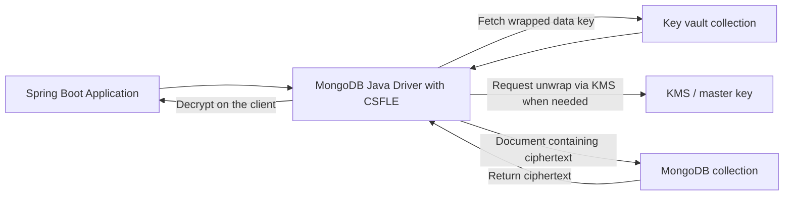

# Client-Side Field Level Encryption (CSFLE) and Deployment Prerequisites

## 1. What Problem Does CSFLE Solve?

In a **Spring Data MongoDB** application, developers typically use `MongoTemplate` or repositories to write and read documents from MongoDB. Beyond securing connections with TLS and protecting storage disks, a system may also need to keep certain fields confidential **even from users who only have read permissions in MongoDB**: personal emails, national IDs, medical records, or account numbers.

**Client-Side Field Level Encryption (CSFLE)** encrypts field values inside the MongoDB driver **before** the document is sent over the network to MongoDB. The server stores the encrypted value; when a client authorized to use the key reads the document back, the driver decrypts it so the application sees the original value.

Example logical document used by the application:

```javascript
{
  _id: "customer-102",
  tenantId: "tenant-a",
  fullName: "Nguyen An",
  email: "an@example.com",
  riskLevel: "LOW"
}
```

If only `email` is encrypted, on MongoDB that value is **BSON Binary subtype 6**, no longer a human-readable email string. The `tenantId`, `fullName`, and `riskLevel` fields remain in plaintext if configuration does not encrypt them.



Key points of the threat model:

- Anyone reading a collection copy, backup, or data leaked from MongoDB **cannot recover plaintext from encrypted fields using only the collection data** without the necessary keys.
- CSFLE **does not hide unencrypted fields**, collection names, certain metadata, document counts, or all access patterns.
- If an attacker compromises the application, an account authorized to decrypt, or obtains both the key and the ciphertext, CSFLE no longer protects the data that client can decrypt.
- TLS, MongoDB authentication, authorization, encryption at rest, and log controls remain necessary. CSFLE adds a field-level security boundary.

## 2. Distinguishing CSFLE From Other Protection Layers

| Mechanism | Protection Boundary | Can MongoDB Read Application Values? | When to Use |
|---|---|---|---|
| TLS | In transit between application and server | Yes, after receiving data | All production connections |
| Encryption at rest | Data files/disks or storage service | Yes, when the server processes data | Protecting storage media and disk copies |
| **CSFLE** | Selected fields encrypted client-side by the driver | No plaintext of encrypted fields in data received by the server | PII, financial data, sensitive information |
| Queryable Encryption | Client-side encryption with purpose-built query mechanisms | Does not need plaintext to run supported query types | When broader encrypted query capabilities than traditional CSFLE are needed |

**Traditional CSFLE differs from Queryable Encryption (QE).** With CSFLE, deterministic encryption primarily supports **equality** queries; randomized encryption does not allow matching plaintext via ordinary equality queries. QE is a separate feature with its own configuration mechanism, indexes, and limits. Do not treat CSFLE configuration as if it automatically supports range, prefix, or text search on ciphertext.

### Two Field Encryption Algorithms in CSFLE

| Property | Deterministic | Randomized |
|---|---|---|
| Same plaintext + same key | Usually produces the same ciphertext | May produce a different ciphertext each time |
| Server-side equality query | Supported under CSFLE's supported conditions | No ordinary plaintext equality queries |
| Pattern leakage | Can reveal equal values and occurrence frequency | Reduces equality linkage |
| Typical fields | Values requiring exact matching with sufficiently high cardinality | Fields only stored and read back without value-based search |
| Declared algorithm | `AEAD_AES_256_CBC_HMAC_SHA_512-Deterministic` | `AEAD_AES_256_CBC_HMAC_SHA_512-Random` |

For example, if you deterministically encrypt a `gender` or status field that has only a few values, someone holding the ciphertext can observe frequencies and infer the distribution. Therefore, **do not choose deterministic solely for query convenience**; evaluate sensitivity, cardinality, and frequency inference risk.

## 3. Prerequisites Required Before Deployment

CSFLE directly involves the **MongoDB server, driver, encryption library, key vault, and key management system**. Verify each layer before writing repositories or `MongoTemplate` code.

| Prerequisite | What to Check | Consequence if Missing |
|---|---|---|
| Compatible MongoDB | CSFLE is supported from MongoDB **4.2**; check actual server/driver versions | Unable to use the feature properly or hit incompatibility limits |
| Java driver with CSFLE support | The MongoDB Java Driver version used by Spring Data supports `ClientEncryption` and auto-encryption configuration | Cannot encrypt/decrypt with the chosen API |
| Encryption library | `libmongocrypt` via appropriate dependency/binary, typically `mongodb-crypt` in the Java driver ecosystem | Initialization or encryption call failure |
| Analysis component for auto encryption | Configure `crypt_shared` library or `mongocryptd` matching version, platform, and driver guidance | Errors when automatically identifying fields to encrypt |
| Distribution support | Verify conditions for **automatic encryption** on MongoDB Atlas/Enterprise Advanced; **explicit encryption** can run on Community | Choosing an approach unsupported in the environment |
| Key vault | MongoDB namespace storing wrapped data encryption keys (DEKs), e.g., `encryption.__keyVault` | Client cannot locate DEKs to encrypt/decrypt |
| KMS / master key | Service or key to wrap/unwrap DEKs; choose AWS KMS, Azure Key Vault, GCP KMS, KMIP, or local for appropriate purposes | Cannot unwrap keys when needed |
| Permissions and networking | Client needs appropriate permissions on the key vault and data collection, KMS permissions, and DNS/TLS/egress | Key access or operation failures |
| Query model | Identify which fields to encrypt, algorithm, BSON types, and required operations | Choosing an algorithm that breaks existing queries |

**Regarding versions and licensing:** delivery mechanisms for `crypt_shared`, `mongocryptd`, dependencies, and auto-encryption support vary by MongoDB and Java driver version. Always consult the exact **compatibility matrix at deployment time**, including Atlas tier, operating system, and CPU architecture. Never assume simply adding a Spring Data annotation makes CSFLE work automatically.

## 4. How Do the Key Vault, DEKs, and KMS Work?

CSFLE uses a hierarchical key model:

1. The application has a **KMS provider** and configuration permitting use of a master key or key-encryption key (KEK).
2. The client creates a **data encryption key (DEK)**; the DEK is wrapped using the master key and stored as a document in the **key vault collection**.
3. When encrypting a field, the driver fetches the appropriate DEK from the key vault, uses the KMS to unwrap it if needed, and encrypts the value client-side.
4. When reading, the driver uses the same key system to decrypt and return plaintext to the application.

KMS/KEK keys and DEKs have distinct roles. **The key vault stores wrapped DEKs**, not plaintext master keys; nor should master keys be written into source code, config files committed to Git, or logs. To recover the system, you need data backups, the key vault, and access to the corresponding KMS/KEK.

Example of a typical key vault layout:

```text
MongoDB:
  app.customers                 <- documents containing ciphertext
  encryption.__keyVault        <- wrapped DEKs, keyAltNames, KMS metadata

Outside MongoDB:
  KMS / HSM / master key        <- key wrapping/unwrapping permissions
Application:
  MongoClient with CSFLE        <- field encryption/decryption
```

Create an index to support `keyAltNames` lookups and prevent duplicate key names, as required by the driver's key-storage mechanism:

```javascript
db.getSiblingDB("encryption").__keyVault.createIndex(
  { keyAltNames: 1 },
  {
    unique: true,
    partialFilterExpression: { keyAltNames: { $exists: true } }
  }
);
```

A DEK can be referenced by its UUID/BSON Binary `_id` or by `keyAltName` in supporting APIs. Do not create a new DEK on every HTTP request or every document write: provision keys through a controlled process, manage their lifecycle, and store stable references.

### Local KMS Is Only for Suitable Environments

The `local` provider is convenient for learning, testing, and controlled environments. It requires a **96-byte local master key**, which can be loaded from an environment variable or secret manager rather than written directly in source code. The snippet below only shows reading a pre-provisioned key:

```java
import java.util.Base64;
import java.util.Map;

byte[] localMasterKey = Base64.getDecoder().decode(
    System.getenv("MONGO_LOCAL_MASTER_KEY_B64")
);
if (localMasterKey.length != 96) {
    throw new IllegalStateException("Local master key must be exactly 96 bytes");
}
Map<String, Object> localProvider = Map.of("key", localMasterKey);
Map<String, Map<String, Object>> kmsProviders =
    Map.of("local", localProvider);
```

In production, prefer a KMS/HSM and secret management system aligned with organizational policy. Separate database permissions from key-usage permissions; add auditing, rotation, and recovery procedures. If the master key is lost and DEKs cannot be unwrapped, ciphertext may **become permanently undecryptable**, even if the MongoDB replica remains intact.

## 5. Explicit Encryption: Active Encryption in Services

**Explicit encryption** means the service invokes specific encrypt/decrypt APIs for protected values. This approach is flexible and works with MongoDB Community, but requires every read/write path of the field to follow the rule consistently.

In the Java driver, key APIs include:

- `ClientEncryptionSettings`: configures connection to the key vault, namespace, and KMS providers.
- `ClientEncryptions.create(...)`: creates a `ClientEncryption` instance.
- `createDataKey(...)`: creates a DEK **once during provisioning**.
- `encrypt(BsonValue, EncryptOptions)`: returns BSON ciphertext.
- `decrypt(BsonBinary)`: returns the plaintext BSON value.

Example initializing an encryption client in Java (assuming `kmsProviders` was built from a secure secret and the URI has appropriate permissions):

```java
import com.mongodb.ConnectionString;
import com.mongodb.MongoClientSettings;
import com.mongodb.client.vault.ClientEncryption;
import com.mongodb.client.vault.ClientEncryptions;
import com.mongodb.ClientEncryptionSettings;

String mongoUri = System.getenv("MONGO_URI");

MongoClientSettings vaultConnection = MongoClientSettings.builder()
    .applyConnectionString(new ConnectionString(mongoUri))
    .build();

ClientEncryptionSettings encryptionSettings = ClientEncryptionSettings.builder()
    .keyVaultMongoClientSettings(vaultConnection)
    .keyVaultNamespace("encryption.__keyVault")
    .kmsProviders(kmsProviders)
    .build();

ClientEncryption clientEncryption = ClientEncryptions.create(encryptionSettings);
// Manage clientEncryption lifecycle (close) along with the application.
```

Creating a DEK in a separate provisioning job:

```java
import com.mongodb.client.model.vault.DataKeyOptions;
import org.bson.BsonBinary;
import java.util.List;

BsonBinary dataKeyId = clientEncryption.createDataKey(
    "local",
    new DataKeyOptions().keyAltNames(List.of("customer-email-v1"))
);
// Store the DEK ID in protected configuration; do not recreate on every request.
```

Encrypting and writing a document using the underlying collection from `MongoTemplate`:

```java
import com.mongodb.client.model.Filters;
import com.mongodb.client.model.vault.EncryptOptions;
import org.bson.BsonBinary;
import org.bson.BsonString;
import org.bson.Document;

String algorithm = "AEAD_AES_256_CBC_HMAC_SHA_512-Deterministic";
BsonBinary encryptedEmail = clientEncryption.encrypt(
    new BsonString("an@example.com"),
    new EncryptOptions(algorithm).keyId(dataKeyId)
);

Document customer = new Document("_id", "customer-102")
    .append("tenantId", "tenant-a")
    .append("email", encryptedEmail);

mongoTemplate.getCollection("customers").insertOne(customer);

// Equality lookup by encrypting the same plaintext, algorithm, and DEK.
BsonBinary encryptedLookup = clientEncryption.encrypt(
    new BsonString("an@example.com"),
    new EncryptOptions(algorithm).keyId(dataKeyId)
);
Document stored = mongoTemplate.getCollection("customers")
    .find(Filters.eq("email", encryptedLookup))
    .first();

if (stored != null) {
    BsonBinary ciphertext = stored.get("email", BsonBinary.class);
    String email = clientEncryption.decrypt(ciphertext).asString().getValue();
    // Only use email where plaintext is actually needed.
}
```

The snippet uses `MongoTemplate.getCollection(...)` to make the BSON Binary representation explicit. In a real application, a service should encapsulate encrypt/decrypt operations, validate inputs, and keep access APIs consistent. With `Random`, each encryption can produce a different ciphertext, so the equality lookup example above **would no longer apply**.

If using a Spring Data repository where `email` is still mapped as `String`, design converters/services so that the data actually written is `BsonBinary` and always decrypted on the read path. Never assume a repository encrypts automatically just because a field name sounds sensitive.

## 6. Automatic Encryption: Configuring at the MongoClient Level

**Automatic encryption** delegates field identification to the MongoDB driver based on an **encryption schema**. With a properly configured client, the application can continue saving/reading Java objects via `MongoTemplate` or repositories; the driver handles processing before sending commands and after receiving results.

Suppose the data namespace is `app.customers`, the `email` field has BSON type `string`, and it uses a provisioned DEK. The Java example below illustrates **core Java driver configuration**; `kmsProviders`, `mongoUri`, and `dataKeyId` come from application configuration/provisioning, and compatible dependencies and encryption libraries must be present:

```java
import com.mongodb.ConnectionString;
import com.mongodb.MongoClientSettings;
import com.mongodb.AutoEncryptionSettings;
import com.mongodb.client.MongoClient;
import com.mongodb.client.MongoClients;
import org.bson.BsonArray;
import org.bson.BsonBinary;
import org.bson.BsonDocument;
import org.bson.BsonString;
import java.util.List;
import java.util.Map;

BsonDocument emailRule = new BsonDocument("encrypt",
    new BsonDocument("bsonType", new BsonString("string"))
        .append("algorithm", new BsonString(
            "AEAD_AES_256_CBC_HMAC_SHA_512-Deterministic"))
        .append("keyId", new BsonArray(List.of(dataKeyId))));

BsonDocument schema = new BsonDocument("bsonType", new BsonString("object"))
    .append("properties", new BsonDocument("email", emailRule));

AutoEncryptionSettings auto = AutoEncryptionSettings.builder()
    .keyVaultNamespace("encryption.__keyVault")
    .kmsProviders(kmsProviders)
    .schemaMap(Map.of("app.customers", schema))
    .build();

MongoClientSettings settings = MongoClientSettings.builder()
    .applyConnectionString(new ConnectionString(mongoUri))
    .autoEncryptionSettings(auto)
    .build();

MongoClient encryptedClient = MongoClients.create(settings);
// Register MongoClient/MongoTemplate beans using this same client in Spring.
```

Notes when bringing this configuration into Spring Boot:

1. Use a `MongoClient` bean with `AutoEncryptionSettings` or the `MongoClientSettingsBuilderCustomizer` mechanism corresponding to your Spring Boot version. Ensure `MongoTemplate` and repositories actually use **the CSFLE-enabled client**.
2. `schemaMap` must point to the **exact `database.collection` name**. The `bsonType` rule must match the Java/BSON data type when writing.
3. Here `dataKeyId` is a `BsonBinary` referencing a provisioned DEK; do not enter a random UUID that does not exist in the key vault.
4. Automatic encryption requires an appropriate field-analysis/marking mechanism; depending on the environment version, you may need to supply `crypt_shared` or `mongocryptd`. Configuring `schemaMap` **does not automatically supply** the encryption binary/library.
5. Do not declare multiple diverging `MongoClient` configurations and only test through a non-CSFLE connection; verify the resulting BSON on the server.

When the driver decrypts automatically, services using `@Document` and repositories can receive `String email` normally. However, **clients without CSFLE enabled will see ciphertext** and in configurations lacking proper server-side validation could write plaintext. Therefore, control all write paths, including batch imports, maintenance scripts, ETL jobs, and services using other drivers.

## 7. Query, Index, and Business Data Limitations

Before choosing which fields to encrypt, audit **existing business operations**:

| Requirement | Traditional CSFLE | Design Suggestion |
|---|---|---|
| Store and read back a confidential field | Suitable with deterministic or randomized | Use randomized when value-based search is unnecessary |
| `email = ?` | Possible with deterministic using the same DEK | Check data cardinality and index conditions |
| `email LIKE '%abc%'` or full-text | Cannot query CSFLE ciphertext directly this way | Decouple search requirement, evaluate separate token indexes and leakage risks |
| `amount >= 1000`, `date BETWEEN ...` on encrypted field | Not supported by traditional CSFLE like plaintext ranges | Consider Queryable Encryption with suitable version/limits, or redesign |
| `$group` / `$sum` on encrypted field | Server lacks plaintext to compute normally | Aggregate client-side after decryption, or maintain approved summary metrics |
| Unique constraint on sensitive data | Cannot assume the same behavior as plaintext indexes | Verify version, algorithm, and uniqueness strategy |
| Sort by sensitive value | Does not yield equivalent plaintext order | Adjust query requirements or data model |

**An index on ciphertext does not turn every operation into a plaintext query.** With deterministic encryption, equality queries can be optimized with appropriate design, though index constraints and query planning must be tested on the deployed version. Do not put passwords, PINs, or low-cardinality fields into deterministic encryption just to support filtering.

For multi-tenant systems, include `tenantId` in business queries, decide whether DEKs are shared or per-tenant, and restrict who can access each DEK. Field encryption **does not replace tenant authorization**; an application able to decrypt for multiple tenants must still check authorization before returning data.

## 8. Operational Issues Often Overlooked

### 8.1 Consistency During Updates and Migrations

If plaintext data already exists in the collection:

1. Identify which records contain plaintext and determine the target schema.
2. Provision DEKs and deploy a CSFLE-configured client for a test scope.
3. Design a migration that reads plaintext, encrypts, and writes back in batches; use checkpoints, controlled retries, and count/data reconciliation.
4. Prevent legacy write paths from continuing to insert plaintext during the transition.
5. Inspect stored records directly on the server with a client **that does not auto-decrypt**; only then switch primary read paths.

Do not merely enable automatic encryption and expect old documents to be retroactively encrypted. Distinguish updates on encrypted fields from updates on plaintext fields, and run real tests for `update`, `findAndModify`, `bulkWrite`, transactions, and aggregations on your target version.

### 8.2 Key Rotation and Recovery

There are at least two distinct needs: rotating the master key/KEK used to **wrap DEKs**, and rotating the **DEK used to encrypt content**. Rewrapping a DEK with a new KEK **does not automatically re-encrypt all data with a new DEK**. Rotating a DEK may require decrypting and re-encrypting fields alongside safe data updates.

You must retain key history needed to decrypt old data, maintain scoped revocation procedures, and test restores in an isolated environment. Accidentally deleting the key vault or revoking a KMS key before migration finishes can render data permanently unreadable.

### 8.3 Observability and Troubleshooting

Avoid logging plaintext, master keys, KMS credentials, tokens, or full decrypted documents. Logs should focus on error codes, namespaces, operations, latency, and correlation IDs without PII. Common errors:

- **DEK not found**: wrong `keyVaultNamespace`, `dataKeyId`, or insufficient read permissions on the key vault.
- **Cannot reach KMS**: missing IAM permissions, DNS/TLS errors, egress restrictions, expired credentials.
- **Failed to load encryption library**: `mongodb-crypt` dependency, `crypt_shared` binary, or platform configuration mismatch.
- **Failed to encrypt/decrypt field**: `bsonType` mismatch, wrong algorithm configuration, invalid ciphertext payload, or wrong key.
- **Plaintext leakage**: a service/script uses a `MongoClient` without CSFLE enabled or skips explicit encryption.

Monitor encryption error rates, key vault/KMS access rates, MongoDB command latency, ciphertext size, and errors when KMS is unavailable. Recovery drills should include KMS permission loss, loss of a key vault replica, and service restarts before keys are cached.

## 9. Functional, Security, and Performance Testing

To accept an `email`-protection flow, you can run tests in this order:

| Test | Expected Result |
|---|---|
| Write `email = "an@example.com"` via configured client | Write command succeeds |
| Read record with a regular `MongoClient` without CSFLE enabled | `email` is BSON Binary ciphertext, not plaintext email |
| Read with a configured, key-authorized client | Receives exact original plaintext |
| Equality query with deterministic | Finds exact record by encrypting the query parameter |
| Use randomized for a read-back-only field | Data decrypts, but cannot use equality queries like deterministic |
| Access without key vault/KMS permissions | Decryption fails explicitly, never returning fake sensitive data |
| Create document with a BSON type differing from schema | Handled error; does not silently write off-schema |
| Retries, concurrent writes, and bulk operations | No plaintext appears from secondary write paths |
| Restore from backup with key vault/KMS available | Historical records decrypt successfully |
| Benchmark before and after enabling CSFLE | Quantifies extra client CPU, latency, KMS calls, and query impact |

An example of inspecting actual stored data using `mongosh` or a driver **without auto-decryption** (run with authorized credentials):

```javascript
const doc = db.getSiblingDB("app").customers.findOne(
  { _id: "customer-102" }
);
printjson(doc.email);
// Expected: BSON Binary subtype 6, without plaintext email.
```

The JSON record in the collection is not the only evidence: also inspect logs, audit trails, caches, event streams, data exports, backups, and newly introduced pipeline fields. Measure the actual overhead of explicit/automatic encryption, DEK fetch time, caching, and MongoDB operation throughput.

## 10. Decision and Deployment Checklist

1. **Identify sensitive fields** and why they must be encrypted client-side; distinguish them from data that still requires server-side querying, sorting, or aggregation.
2. **Select algorithm by query needs**: randomized when equality is unneeded; deterministic only when exact matching is genuinely required and frequency leakage has been assessed.
3. **Choose explicit or automatic** based on MongoDB distribution, level of control in services, and driver support.
4. **Standardize KMS and key vault**: permissions, secret management, DEK provisioning, `keyAltNames` index, backup, rotation, and restore.
5. **Configure `MongoClient` on the exact execution path**: Spring Data repositories, `MongoTemplate`, scripts/ETL, and batch jobs must follow the same policy.
6. **Verify encryption libraries work**: `mongodb-crypt`/`libmongocrypt` and `crypt_shared`/`mongocryptd` if needed; check the version compatibility matrix.
7. **Migrate legacy data** with ciphertext verification, not just encrypting documents written post-deployment.
8. **Test with least privilege** and simulate KMS failures, key vault outages, key loss, restarts, equality queries, and concurrent updates.
9. **Measure operational overhead**: latency, client CPU, key cache, query limitations, query metrics, and storage size.
10. **Define incident response procedures**: scope leaks, recover keys, rollback/migrate, and verify logs contain no plaintext.

With **SPRING_DATA_MONGODB**, CSFLE is a responsibility at the boundary between the driver and MongoDB: Spring Data handles document mapping and repository organization, while the **MongoDB Java Driver and key system govern encryption and decryption**. A compliant deployment must prove three things independently: sensitive fields are truly ciphertext on the server; authorized clients still read and query within supported bounds; and data remains recoverable after failure or key-change scenarios.
