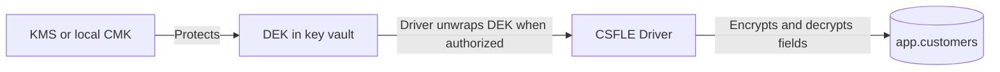

# `@Encrypted`, JSON Schema, and `AutoEncryptionSettings` in Spring Data MongoDB

## Lesson Objectives

When an application stores national ID numbers, sensitive contact details, or medical notes in MongoDB, restricting access only at the collection level may be insufficient. **Client-Side Field Level Encryption (CSFLE)** lets you encrypt selected fields **on the client** before sending data to MongoDB and decrypt them when reading through a properly configured client.

In Spring Data MongoDB, three components typically appear together:

- **`@Encrypted`**: declares encryption metadata directly on a Java document property.
- **JSON Schema**: expresses the rules for which fields are encrypted, their pre-encryption data type, algorithm, and key.
- **`AutoEncryptionSettings`**: configures the **MongoDB Java Driver** to actually encrypt/decrypt automatically when going through the configured `MongoClient`.

After this lesson, you will be able to design *schema-based* CSFLE configurations, manipulate data via `MongoTemplate` or repositories, evaluate query limitations, test actual stored data, and troubleshoot configuration errors.

> **Scope:** Examples focus on JSON Schema-based CSFLE (often called FLE 1) with the two algorithms `AEAD_AES_256_CBC_HMAC_SHA_512-Deterministic` and `AEAD_AES_256_CBC_HMAC_SHA_512-Random`. **Queryable Encryption (FLE 2)** uses a different configuration model and query capability set; do not treat these examples as drop-in replacements for Queryable Encryption's `encryptedFieldsMap`.

## 1. Where the Three Components Fit in the Data Path

An application can create a Java entity `Customer` containing `identityNumber` as a `String`. The repository layer or `MongoTemplate` converts the entity to BSON via `MappingMongoConverter`. The **driver** checks the JSON Schema bound to the `database.collection` namespace, encrypts fields covered by the rules, and sends ciphertext to MongoDB.

```mermaid
flowchart TD
  A[Java entity with original value] --> B[Spring Data MongoDB mapping]
  B --> C[MongoDB Java Driver with AutoEncryptionSettings]
  D[@Encrypted on model] --> E[MongoJsonSchemaCreator]
  E --> F[JSON Schema by namespace]
  F --> C
  G[Data Encryption Key in key vault] -. Key lookup .-> C
  H[KMS / Customer Master Key] -. Protects DEK .-> G
  C -->|Encrypt before write| I[(MongoDB: ciphertext, BSON Binary subtype 6)]
  I -->|Read via decrypting client| C
  C --> B
  B --> A
```

Key takeaway: annotations and schemas **do not encrypt on their own**. If you only add `@Encrypted` but use a `MongoClient` without CSFLE enabled, the driver has no reason to encrypt the field. Conversely, once the client is configured properly, `MongoTemplate` and repositories can work with normal Java types for operations supported by CSFLE.

Distinguish three data protection concepts:

| Mechanism | Where It Runs | What Problem Does It Solve? |
| --- | --- | --- |
| TLS in transit | Network connection | Prevents eavesdropping on data in transit |
| Server-side encryption at rest | MongoDB storage layer | Protects data stored on disk/volumes |
| CSFLE | Application's MongoDB Driver | Keeps selected fields as ciphertext before reaching the server |

CSFLE does not replace TLS, database authorization, access auditing, or key management.

## 2. Declaring Encrypted Fields With `@Encrypted`

Suppose the `customers` collection has two sensitive fields: an identity number requiring exact lookups and a private note that does not need searching.

```java
import org.springframework.data.annotation.Id;
import org.springframework.data.mongodb.core.mapping.Document;
import org.springframework.data.mongodb.core.mapping.Encrypted;
import org.springframework.data.mongodb.core.mapping.Field;

@Document("customers")
public class Customer {

    @Id
    private String id;

    private String displayName;

    @Field("identity_number")
    @Encrypted(algorithm = "AEAD_AES_256_CBC_HMAC_SHA_512-Deterministic")
    private String identityNumber;

    @Encrypted(algorithm = "AEAD_AES_256_CBC_HMAC_SHA_512-Random")
    private String privateNote;

    // Constructors and getters/setters omitted to focus on configuration.
}
```

`@Field("identity_number")` tells Spring Data to store the `identityNumber` property under the BSON field name `identity_number`. The JSON Schema must reference the **actual BSON field name**, not merely the Java property name.

### Choosing the Right Algorithm

| Algorithm | Same Plaintext, Same Key and Configuration | Typical Query Behavior |
| --- | --- | --- |
| `...-Deterministic` | Produces the same ciphertext | Can support equality comparisons (`equals`) under supported CSFLE query conditions |
| `...-Random` | May produce a different ciphertext each time | Not used for equality matching via the deterministic mechanism |

For `identityNumber`, which requires exact lookups, deterministic is a conditional option. For `privateNote`, which is only stored and read back, random is the better choice.

**Security trade-off:** deterministic encryption reveals repeated value patterns. Values with small domains, such as gender, toggle flags, or low-cardinality codes, are vulnerable to frequency analysis. Never pick deterministic solely for query convenience; evaluate sensitivity, value domain, and threat model first.

Note that "supporting equality comparison" does not mean all MongoDB operators work on encrypted fields. Range queries (`$gt`/`$lt`), regex, sorting, and string transformations on ciphertext do not behave as they do on plaintext.

## 3. JSON Schema Describing Encryption Rules

`MongoJsonSchemaCreator` can read Spring Data MongoDB mapping metadata to generate a JSON Schema for an entity type. Conceptually, the example's encryption rules look like this:

```json
{
  "bsonType": "object",
  "encryptMetadata": {
    "keyId": [
      {
        "$binary": {
          "base64": "<BASE64_OF_DATA_KEY_UUID>",
          "subType": "04"
        }
      }
    ]
  },
  "properties": {
    "identity_number": {
      "encrypt": {
        "bsonType": "string",
        "algorithm": "AEAD_AES_256_CBC_HMAC_SHA_512-Deterministic"
      }
    },
    "privateNote": {
      "encrypt": {
        "bsonType": "string",
        "algorithm": "AEAD_AES_256_CBC_HMAC_SHA_512-Random"
      }
    }
  }
}
```

This is a **structural template**; `<BASE64_OF_DATA_KEY_UUID>` is a placeholder, not a usable key. At runtime, use the **BSON binary UUID subtype 4** returned when creating the Data Encryption Key (DEK); do not convert the UUID into a plain string and expect the driver to recognize it automatically.

Main parts:

- `properties.<field>.encrypt`: specifies the field to encrypt.
- `bsonType` inside `encrypt`: the BSON type of the **plaintext** received from the client before encryption (e.g., `string`).
- `algorithm`: the algorithm used for that field.
- `encryptMetadata.keyId`: list of default DEK IDs applied to encrypted fields that do not declare their own key. Individual fields can specify separate keys if policy requires.

An encrypted field in actual stored data has a `BinData` ciphertext representation (BSON binary subtype 6), distinct from the plaintext `bsonType` in the `encrypt` rule. A JSON Schema for CSFLE should not be confused with an ordinary validator that merely sets `required` or `bsonType` on unencrypted fields.

### Generating the Schema From Spring Data Mapping

The example below illustrates the core configuration once you have a `MongoMappingContext` and a valid `BsonBinary dataKeyId`:

```java
MongoJsonSchemaCreator creator =
        MongoJsonSchemaCreator.create(mongoMappingContext);

MongoJsonSchema generated =
        creator.createSchemaFor(Customer.class);

// Convert the mapping-generated schema into a BSON schema for the driver.
BsonDocument encryptionSchema =
        BsonDocument.parse(generated.toDocument().toJson());

// Apply the same default DEK to both fields in this example.
encryptionSchema.put(
        "encryptMetadata",
        new BsonDocument("keyId",
                new BsonArray(List.of(dataKeyId)))
);
```

`MongoJsonSchemaCreator` belongs to Spring Data MongoDB, while `BsonDocument`/`BsonBinary` belong to the MongoDB Java Driver. The `dataKeyId` object must be a key ID already present in the **key vault**; key creation is shown in the next section.

Always **inspect `generated.toDocument()`** before applying it: the schema must contain both `encrypt` blocks, the mapped BSON field name `identity_number`, and the intended algorithms. Schema generation from the model only verifies that the metadata representation is supported by your Spring Data version; it does not prove that the key vault, driver, and KMS are configured successfully.

### Where Is the JSON Schema Stored?

Two approaches should be distinguished:

1. **Client-side `schemaMap`:** the driver receives the schema from the application and applies it to the `database.collection` namespace. This is the primary approach in these examples, letting the application control encryption rules without relying on a server-supplied schema.
2. **Collection-side schema:** MongoDB can store validator rules in collection metadata, and CSFLE-capable clients can use a compatible schema to encrypt automatically. However, the server itself **does not execute encryption algorithms for clients** just because a schema has `encrypt`.

Both approaches have different precedence and operational rules. When using `schemaMap`, ensure namespace names, schema versions, and deployment artifacts remain consistent across application instances.

## 4. Key Mechanism: CMK, DEK, and Key Vault

CSFLE has two key layers:

- **Customer Master Key (CMK)** managed by a KMS system or a local key in development; used to protect data keys.
- **Data Encryption Key (DEK)** used to encrypt field data. The protected DEK is stored in the **key vault collection** (e.g., namespace `encryption.__keyVault`).

Key management diagram:



`encryption.__keyVault` is an example namespace for key documents; it is not a customer data collection. The application needs permissions to access the key vault and the business collection, while key administration, key rotation, and KMS monitoring should be restricted by role.

### Example Creating a DEK for Practice

The following snippet uses the `local` provider to demonstrate the API flow. The 96-byte master key is Base64-encoded and loaded from an environment variable; **never use sample values and never commit keys to Git or logs**.

```java
String mongoUri = System.getenv("MONGODB_URI");
String masterKeyBase64 = System.getenv("LOCAL_MASTER_KEY_B64");

// Environment variable must hold a properly formatted local key, 96 bytes
// after Base64 decoding.
Map<String, Map<String, Object>> kmsProviders = Map.of(
        "local", Map.of("key", masterKeyBase64)
);

String keyVaultNamespace = "encryption.__keyVault";

MongoClientSettings vaultClientSettings = MongoClientSettings.builder()
        .applyConnectionString(new ConnectionString(mongoUri))
        .build();

ClientEncryptionSettings keySettings = ClientEncryptionSettings.builder()
        .keyVaultMongoClientSettings(vaultClientSettings)
        .keyVaultNamespace(keyVaultNamespace)
        .kmsProviders(kmsProviders)
        .build();

BsonBinary dataKeyId;

try (ClientEncryption clientEncryption =
             ClientEncryptions.create(keySettings)) {
    // Run once during key initialization; reuse the existing DEK
    // on subsequent application startups.
    dataKeyId = clientEncryption.createDataKey(
            "local", new DataKeyOptions());
}
```

**Do not create a new DEK every time the application starts.** If the schema switches to a new key ID without handling old data accordingly, the application may suffer decryption failures or mismatched queries. In real systems, store and manage key IDs through a controlled workflow, govern key lifecycles, plan rotation/rewrap, and test data recovery.

In production, use a suitable KMS provider (such as AWS KMS, Azure Key Vault, or Google Cloud KMS) per system policy. The `kmsProviders` configuration and authentication parameters differ from the `local` provider; never carry a local example straight into production.

## 5. Enabling CSFLE With `AutoEncryptionSettings`

Once you have `encryptionSchema` and the DEK, map the schema to the **exact namespace**. For an entity `@Document("customers")` in database `app`, the map key must be `app.customers`.

```java
String namespace = "app.customers";

Map<String, BsonDocument> schemaMap =
        Map.of(namespace, encryptionSchema);

AutoEncryptionSettings autoEncryption = AutoEncryptionSettings.builder()
        .keyVaultNamespace("encryption.__keyVault")
        .kmsProviders(kmsProviders)
        .schemaMap(schemaMap)
        .build();

MongoClientSettings encryptedClientSettings = MongoClientSettings.builder()
        .applyConnectionString(new ConnectionString(mongoUri))
        .autoEncryptionSettings(autoEncryption)
        .build();

com.mongodb.client.MongoClient encryptedClient =
        MongoClients.create(encryptedClientSettings);

// Use the auto-encryption-enabled client for the Spring Data layer.
MongoDatabaseFactory factory =
        new SimpleMongoClientDatabaseFactory(encryptedClient, "app");

MongoTemplate mongoTemplate =
        new MongoTemplate(factory, mappingMongoConverter);
```

These snippets illustrate configuration components, not a complete standalone Java class with full imports/bean wiring. Objects such as `mongoUri`, `kmsProviders`, `encryptionSchema`, `mappingMongoConverter`, and keys are assumed to have been prepared in earlier steps.

Meaning of configuration fields:

| Property | Role | Common Mistake |
| --- | --- | --- |
| `keyVaultNamespace` | Where DEKs are located | Differs from the namespace used when creating the key |
| `kmsProviders` | How DEKs are accessed/unwrapped | Missing credentials, or local key differs from the one used when creating the DEK |
| `schemaMap` | Encryption rules per namespace | Map key written as `customers` instead of `app.customers` |
| `autoEncryptionSettings(...)` in `MongoClientSettings` | Enables driver auto-encryption/decryption | Accidentally using an unconfigured client |
| `SimpleMongoClientDatabaseFactory(..., "app")` | Selects the template's business database | Database does not match `schemaMap` |

**Important boundary:** CSFLE is configured on the **MongoClient/driver**, not merely on the `MongoTemplate` class. If the application creates another client for a repository, job, or reactive stack, examine the encryption configuration of **that client**. Modifying `@Encrypted` or the Java model after the client is constructed does not update the `schemaMap` held by an existing client.

### Runtime Requirements

Auto-encryption requires native components related to **libmongocrypt** and a query-analysis mechanism compatible with your driver/deployment version, such as the **crypt_shared library** or `mongocryptd`. Verify the MongoDB Java Driver version, runtime environment, supporting libraries, and KMS/key vault access permissions before startup. Missing libraries, failing to load DEKs, or failing to reach KMS can surface at client creation or on the first query.

Enabling `bypassAutoEncryption` changes automatic encryption behavior; never use it to "work around an error" while still assuming data is protected. Always inspect actual stored records after any configuration change.

## 6. Writing and Querying With `MongoTemplate` or Repositories

When `MongoTemplate` is constructed from a CSFLE client with the proper namespace, most business code continues working with plaintext Java properties:

```java
Customer customer = new Customer();
// Set id, displayName, identityNumber, and privateNote.
mongoTemplate.save(customer);

Query query = Query.query(
        Criteria.where("identityNumber").is("0123456789"));

Customer found = mongoTemplate.findOne(query, Customer.class);
```

In this example, Spring Data maps property `identityNumber` to BSON field `identity_number`. With a deterministic schema, the driver can encrypt the filter value using the same mechanism before sending the equality query. Only certain query/aggregation forms are supported by CSFLE: never assume all query operators apply to encrypted fields.

Example with a repository:

```java
interface CustomerRepository
        extends MongoRepository<Customer, String> {
    Optional<Customer> findByIdentityNumber(String identityNumber);
}
```

This repository uses CSFLE **only** if the MongoDB infrastructure backing the repository references an encryption-configured client/template. Neither entity annotations nor the `findByIdentityNumber` method signature guarantee this on their own.

### What Happens in the Database?

When written properly, MongoDB stores `identity_number` and `privateNote` as BSON Binary subtype **6** ciphertext. When read via a client capable of decryption and authorized to access the DEK, the application receives the corresponding `String` values back. Reading with an observer client **without auto-decryption enabled** reveals ciphertext instead of plaintext (except for unencrypted fields like `displayName`).

Do not use `privateNote` with ordinary equality queries, because random fields do not produce the same ciphertext for equal values. Additionally, `$regex`, `$range`, sorting, grouping, or full-text search on ciphertext do not provide plaintext semantics. If business requirements call for search beyond equality, design an appropriate strategy and evaluate Queryable Encryption separately.

## 7. Testing Real Behavior, Not Just Annotations

A system can boot and read/write successfully while still storing plaintext if `schemaMap` has the wrong namespace or a regular client is used. Combine three layers of testing:

1. **Mapping/schema test:** generate the JSON Schema from `Customer` and assert it contains two `encrypt` rules, the right BSON names, algorithms, and `keyId`.
2. **Integration test with CSFLE client:** write `Customer`, read it back and assert plaintext in the domain object, and verify equality queries on `identityNumber` return expected results.
3. **Storage observation with a separate non-decrypting client:** verify encrypted fields are truly BSON Binary subtype 6 and do not contain plaintext strings; verify ordinary fields remain readable.

Example test scenarios:

| Scenario | Expectation |
| --- | --- |
| Write customer via CSFLE client | Configured fields are encrypted on the write path |
| Read with the same DEK-authorized client | Receives entity with decrypted Java values |
| Read with an observer client without auto-decryption | Receives subtype 6 ciphertext |
| Equality search on deterministic field | Returns matching document if query and schema are supported |
| Equality search on random field | Not expected to work like deterministic |
| Wrong `keyVaultNamespace` / missing KMS credentials | Fails explicitly when the driver needs the key |
| Misspelled namespace in `schemaMap` | Risk of unencrypted data; test must catch it |
| Two instances using different schemas/DEKs | Query/decryption results may be inconsistent or error |

Observation with a standard client should be restricted to test/audit environments with appropriate permissions. Never print sensitive values or intact ciphertext payloads into public test logs.

### Minimal Practice Workflow

1. Prepare MongoDB and compatible CSFLE libraries; configure key vault and KMS to create one DEK.
2. Define `Customer`, generate JSON Schema, add `encryptMetadata.keyId`, and verify collection/field names.
3. Build a `MongoClient` using `AutoEncryptionSettings` with `schemaMap` bound to `app.customers`.
4. Use `MongoTemplate` to save a document containing an identity number and a private note.
5. Read back with the encrypted client to verify business data; read with an observer client to check subtype 6.
6. Test an equality query on `identityNumber`; then deliberately break `schemaMap` to confirm tests catch the misconfiguration.
7. Run tests when key vault/KMS is unavailable and verify error messages, recovery behavior, and no fallback to storing plaintext.

## 8. Common Errors and How to Diagnose Them

### 8.1. `@Encrypted` Is Present, Yet Data Is Still Plaintext

Typical causes are missing `AutoEncryptionSettings` on the `MongoClient` actually running, a missing namespace in `schemaMap`, or a repository bound to a different template. Trace the wiring chain from repository/`MongoTemplate` to `MongoDatabaseFactory` and the exact `MongoClient` instance, then inspect stored data using an observer client.

### 8.2. Encryption Fails at Client Creation or First Write

Check loading of `libmongocrypt` / query analysis components, driver version, KMS configuration, key vault namespace, and connection permissions. Distinguish **library load failure**, **DEK not found**, **cannot unwrap DEK**, and **unsupported query operation**, since each has a different fix.

### 8.3. Query Returns Empty Even Though the Document Exists

Check whether the queried field is deterministic, whether the query path uses the right client/schema, whether BSON names are mapped accurately, whether `keyId` matches the encrypted data, and whether older documents were saved before CSFLE was enabled. Never assume "not found" proves a document does not exist.

### 8.4. Schema Changes Between Deployments

When renaming fields, changing algorithms, rotating DEKs, or changing mappings, already stored data **is not automatically re-encrypted**. Plan migrations or decrypt-and-re-encrypt workflows when necessary; roll out schemas consistently and run cross-version compatibility tests. Rotating the CMK (protecting DEKs) differs from re-encrypting all documents with a new DEK.

### 8.5. Interaction With Aggregations, Indexes, and Transactions

Deterministic fields can support equality queries or indexing within CSFLE limits, while random fields do not support the same query patterns. Do not assume arbitrary aggregation pipelines, updates, sorts, or range queries work on encrypted fields. Inside transactions, the driver still needs to locate DEKs and apply namespace encryption rules; test with your actual transaction manager configuration, MongoDB version, and driver.

If a service has multiple databases or tenants, `schemaMap` must include **the exact namespace of every collection requiring encryption**; data keys and access permissions must be managed according to tenant policy. Configuring a schema for `app.customers` does not automatically apply to `tenant_b.customers`.

## 9. Security and Operational Notes

- **Encrypt only what is necessary:** encrypt fields holding sensitive information; avoid blindly encrypting every field and losing query/index capabilities the application needs.
- **Key management:** never commit local master keys, key IDs bundled with KMS access details, or passwords to the repository; use a secret manager and least-privilege policies.
- **Separation of privileges:** the application needs appropriate permissions for the key vault and business data; reporting tools, backups, and operators may require different permissions.
- **Safe logging:** never write pre-encryption plaintext, decrypted values, keys, KMS details, or tokens into logs or exception messages.
- **Error monitoring:** watch KMS/key vault errors, encryption/decryption latency, schema drift, and unsupported-operation errors; add integration tests to your release pipeline.
- **Prevent plaintext writes:** consider adding collection-level schema validator controls where appropriate and inspect stored data directly; never rely solely on code annotations.
- **Reactive access:** if using `ReactiveMongoTemplate` or reactive repositories, verify encryption configuration on the corresponding **reactive `MongoClient`** and driver version support; configuration on a blocking client does not transfer to a reactive client.
- **Historical data:** enabling encryption for a field does not retroactively encrypt previously stored documents. Plan backfills/migrations and verify final data state.
- **Protection limits:** CSFLE does not conceal all access metadata, collection names, document counts, or every query pattern. Keep authorization, TLS, and data governance policies in place.

## 10. Summary of Choices and Self-Check Questions

| Need | Choice / Action |
| --- | --- |
| Declare sensitive fields directly on the model | Use `@Encrypted` with an appropriate algorithm |
| Generate rules from Spring Data mapping | Use `MongoJsonSchemaCreator` and verify the generated schema document |
| Specify default key for fields in a schema | Use `encryptMetadata.keyId` with the DEK's BSON UUID |
| Enforce automatic encryption/decryption | Configure `AutoEncryptionSettings` on the right `MongoClient` |
| Exact-match lookup on an encrypted field | Consider deterministic and assess frequency-leakage risk |
| Only store/read back a sensitive field | Prefer randomized when suitable |
| Prove the system actually encrypts | Read storage via an observer client to see BSON Binary subtype 6 |
| Change schemas or keys | Plan migration/rotation and test against historical data |

**Self-check:**

1. Why is adding `@Encrypted` to a property without configuring `MongoClient` insufficient?
2. In `schemaMap`, what is the difference between the key `customers` and `app.customers`?
3. Why might `identityNumber` be chosen as deterministic while `privateNote` should be random?
4. Does a test that calls `mongoTemplate.findById(...)` and sees plaintext prove that MongoDB stores encrypted data?
5. When changing a DEK or a field name mapped by `@Field`, what must you consider regarding existing stored data?

The core lesson of **Data Encryption** is keeping these three layers aligned: `@Encrypted` expresses domain-model intent; JSON Schema describes encryption rules and keys per field/collection; `AutoEncryptionSettings` makes the driver enforce those rules on **the right `MongoClient`**. Effective protection must be verified against actual stored data and tested under your Spring Data MongoDB application's operational paths.
