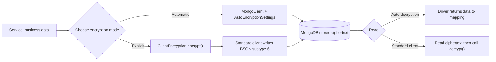

# Automatic vs. Explicit Encryption Based on Application Needs

In a SaaS application storing customer records, each MongoDB document may contain names, identification numbers, tax IDs, payment details, or sensitive business data. **Spring Data MongoDB** supports document mapping and operations via `MongoTemplate` or repositories, but repositories **do not enable field-level encryption automatically**. To protect selected fields before data reaches MongoDB, the application must configure client-side encryption in the MongoDB Java Driver or call explicit encryption APIs.

This lesson belongs to the **Data Encryption** chapter and focuses on choosing between **automatic encryption and explicit encryption** based on application needs, along with impacts on queries, aggregations, indexes, transactions, reactive access, testing, and performance diagnostics.

## 1. Distinguishing Data Protection Layers

| Mechanism | Where Does It Protect? | Limitations |
| --- | --- | --- |
| TLS | Data in transit between client and server | Does not protect plaintext after it reaches the server |
| Encryption at rest | Data on storage devices or backups per deployment configuration | Does not mean fields are encrypted before reaching MongoDB |
| **Client-Side Field Level Encryption (CSFLE)** | Java Driver encrypts fields client-side | Supported query types on ciphertext are limited |
| **Queryable Encryption (QE)** | Client-side encryption with mechanisms supporting specific query types on encrypted fields | Requires specific versions and configuration; differs from deterministic CSFLE |

Example business document:

```json
{
  "_id": "customer-101",
  "displayName": "Customer A",
  "taxId": "0123456789",
  "tier": "GOLD"
}
```

If only `taxId` is sensitive, you can encrypt that field alone; `displayName` and `tier` remain in normal form. When viewed through a client **without auto-decryption enabled**, a field encrypted by MongoDB client-side encryption is stored as **BSON binary subtype 6**. The server still sees document structure, field names, and related metadata; field encryption does not hide everything.

In this lesson, **automatic** means the driver identifies fields to encrypt from a schema/configuration and automatically encrypts on write and decrypts on read. **Explicit** means code calls `ClientEncryption.encrypt(...)`/`decrypt(...)` at chosen points. Writing custom AES-GCM in Java is also application-level encryption, but it is a different design that does not inherit CSFLE features, DEKs, key vaults, or MongoDB's query mechanisms.

## 2. When to Use Automatic vs. Explicit Encryption?

| Criterion | Automatic Encryption | Explicit Encryption |
| --- | --- | --- |
| Integration point | `AutoEncryptionSettings` on `MongoClient`, with matching schema | `ClientEncryption` invoked by the application |
| Writing documents | `MongoTemplate.save(...)` / repository `save(...)` with normal business values; driver encrypts before sending if schema matches | Select field, algorithm, and key, then generate ciphertext before writing |
| Reading documents | Driver can decrypt before returning to the mapper | Code explicitly decrypts when using a non-auto-decrypting client |
| Control level | Centralized policy by namespace and field | Flexible per business flow or individual operation |
| Configuration risk | Wrong field name in schema, repository using wrong client/template, missing runtime crypto components | Forgetting to encrypt on one write path; forgetting to decrypt or double encryption |
| Best suited for | Common CRUD with uniform policies | Integration import/export flows, rarely used fields, conditional encryption requirements |



Both models still require authorization at the business layer. Having a key to decrypt does not mean every user should be allowed to view sensitive information.

## 3. Preparing Keys and Encryption Components

MongoDB client-side encryption typically requires these components:

1. **Data Encryption Key (DEK):** key that encrypts fields; documents holding DEKs are stored in the **key vault collection** wrapped by a master key.
2. **Key vault namespace:** e.g., `encryption.__keyVault`, requiring proper access control and backups.
3. **KMS provider/master key:** can be AWS KMS, Azure Key Vault, GCP KMS, KMIP, or the `local` provider suitable for testing. With `local`, the master key is a **96-byte** key that must stay secret and never be written into source code, Git, or logs.
4. **Java Driver and crypto components:** client-side encryption requires the `libmongocrypt` supporting library; automatic encryption may require `crypt_shared` or `mongocryptd` depending on version and environment.
5. **Namespace and BSON type configuration:** the schema must match the exact database, collection, stored MongoDB field name, and input BSON type.

A sensible deployment workflow:

- Provision KMS, key vault, and access permissions.
- Create DEKs during tenant onboarding or security policy setup; store DEK IDs/key alternate names in trusted configuration.
- Configure the driver for automatic encryption or provide `ClientEncryption` to services.
- Test using a client without automatic decryption to confirm ciphertext actually resides in the database.

Example creating a DEK during **provisioning** with the `local` provider for a test environment:

```java
import com.mongodb.ClientEncryptionSettings;
import com.mongodb.ConnectionString;
import com.mongodb.MongoClientSettings;
import com.mongodb.client.model.vault.DataKeyOptions;
import com.mongodb.client.vault.ClientEncryption;
import com.mongodb.client.vault.ClientEncryptions;
import org.bson.BsonBinary;

// uri: connection string; kmsProviders: provider config loaded from secrets.
// For the "local" provider, kmsProviders["local"]["key"] is a
// byte[96] master key, used only when managed securely.
MongoClientSettings vaultConnection = MongoClientSettings.builder()
        .applyConnectionString(new ConnectionString(uri))
        .build();

ClientEncryptionSettings encryptionSettings =
        ClientEncryptionSettings.builder()
                .keyVaultMongoClientSettings(vaultConnection)
                .keyVaultNamespace("encryption.__keyVault")
                .kmsProviders(kmsProviders)
                .build();

try (ClientEncryption encryption =
             ClientEncryptions.create(encryptionSettings)) {
    BsonBinary dataKeyId =
            encryption.createDataKey("local", new DataKeyOptions());
    // Store dataKeyId in secure metadata and reuse it across encryption calls.
}
```

Create a DEK **once per policy/key lifecycle**; do not call `createDataKey` per request. With a real KMS service, master key declarations and provider authentication differ and require proper IAM/KMS permissions. If the key vault or master key decryption permissions are lost, MongoDB data may remain intact yet undecryptable.

## 4. Automatic CSFLE With `MongoTemplate` and Repositories

### 4.1. Creating a `MongoClient` With `AutoEncryptionSettings`

Suppose collection `app.customers` needs to encrypt `taxId` of type `string` and the application has provisioned a `BsonBinary keyId`. This example uses **deterministic CSFLE** to also illustrate equality queries.

```java
import com.mongodb.AutoEncryptionSettings;
import com.mongodb.ConnectionString;
import com.mongodb.MongoClientSettings;
import com.mongodb.client.MongoClient;
import com.mongodb.client.MongoClients;
import org.bson.BsonArray;
import org.bson.BsonBinary;
import org.bson.BsonDocument;
import org.bson.BsonString;
import org.springframework.data.mongodb.core.MongoTemplate;

import java.util.List;
import java.util.Map;

// keyId: provisioned BsonBinary DEK ID.
// kmsProviders: KMS config loaded from a secure secret source.
BsonDocument rule = new BsonDocument()
        .append("bsonType", new BsonString("string"))
        .append("algorithm", new BsonString(
                "AEAD_AES_256_CBC_HMAC_SHA_512-Deterministic"))
        .append("keyId", new BsonArray(List.of(keyId)));

BsonDocument schema = new BsonDocument()
        .append("bsonType", new BsonString("object"))
        .append("properties", new BsonDocument(
                "taxId", new BsonDocument("encrypt", rule)));

AutoEncryptionSettings autoEncryption =
        AutoEncryptionSettings.builder()
                .keyVaultNamespace("encryption.__keyVault")
                .kmsProviders(kmsProviders)
                .schemaMap(Map.of("app.customers", schema))
                .build();

MongoClientSettings settings = MongoClientSettings.builder()
        .applyConnectionString(new ConnectionString(uri))
        .autoEncryptionSettings(autoEncryption)
        .build();

MongoClient encryptedClient = MongoClients.create(settings);
MongoTemplate template = new MongoTemplate(encryptedClient, "app");
```

This is the core configuration snippet: in a Spring Boot application, declare `MongoClient`/`MongoTemplate` as beans, manage connection lifecycles, and ensure repositories bind to **the encryption-configured template**. Repositories themselves do not have a separate encryption toggle.

**Note:** `schemaMap` uses the full `database.collection` namespace. If code writes to a different collection, the driver may not apply the expected schema. Access paths using another `MongoClient` or `bypassAutoEncryption` may skip automatic encryption on write. Setting `bypassAutoEncryption` only affects automatic encryption; it does not implicitly disable automatic decryption on an encryption-configured client.

### 4.2. Operating Like a Normal Document

```java
import org.springframework.data.annotation.Id;
import org.springframework.data.mongodb.core.mapping.Document;

@Document(collection = "customers")
public record Customer(
        @Id String id,
        String displayName,
        String taxId,
        String tier
) {}
```

```java
Customer input = new Customer(
        "customer-101", "Customer A", "0123456789", "GOLD");

template.save(input);

Customer restored =
        template.findById("customer-101", Customer.class);
// With proper driver encryption/decryption, taxId is restored as a String.
```

The `@Document` annotation only describes collection/mapping metadata and does not encrypt on its own. If a `MongoRepository<Customer, String>` is backed by the template above, CRUD commands flow through the auto-encrypting driver. If the application defines multiple templates, verify that repositories and query code use the intended template.

### 4.3. Deterministic and Randomized in CSFLE

| Algorithm | Characteristics | Searching |
| --- | --- | --- |
| `AEAD_AES_256_CBC_HMAC_SHA_512-Deterministic` | Same plaintext, DEK, and BSON type yield the same ciphertext; exposes duplicate patterns | Can support equality on encrypted fields |
| `AEAD_AES_256_CBC_HMAC_SHA_512-Random` | Same plaintext can produce different ciphertexts, reducing pattern leakage | Cannot be used for equality queries on ciphertext |

With a deterministic schema, equality queries from `MongoTemplate` can have their lookup value encrypted by the driver:

```java
import org.springframework.data.mongodb.core.query.Criteria;
import org.springframework.data.mongodb.core.query.Query;

Query query = Query.query(
        Criteria.where("taxId").is("0123456789"));
Customer found = template.findOne(query, Customer.class);
```

Do not generalize working equality into support for all operations on encrypted fields. Range queries, regex, sorting, grouping, aggregation expressions, string manipulation, or arithmetic on ciphertext are restricted. For low-cardinality data (such as gender or membership tier), deterministic encryption risks exposing value distribution; evaluate the threat model before choosing it.

## 5. Explicit Encryption With `ClientEncryption`

When only a few flows require encryption, a service can call `ClientEncryption.encrypt(...)` directly. For instance, a service might store tax IDs as **randomized ciphertext** and decrypt only when the caller is authorized.

Assume you have configured a `ClientEncryption encryption` bean, a `MongoTemplate rawTemplate` **without automatic encryption/decryption**, and a provisioned DEK `BsonBinary keyId`:

```java
import com.mongodb.client.model.vault.EncryptOptions;
import com.mongodb.client.vault.ClientEncryption;
import org.bson.BsonBinary;
import org.bson.BsonDocument;
import org.bson.BsonString;
import org.springframework.data.mongodb.core.MongoTemplate;

public class ExplicitCustomerStore {
    private final MongoTemplate rawTemplate;
    private final ClientEncryption encryption;
    private final BsonBinary keyId;

    public ExplicitCustomerStore(
            MongoTemplate rawTemplate,
            ClientEncryption encryption,
            BsonBinary keyId) {
        this.rawTemplate = rawTemplate;
        this.encryption = encryption;
        this.keyId = keyId;
    }

    public void save(String customerId, String taxId) {
        BsonBinary ciphertext = encryption.encrypt(
                new BsonString(taxId),
                new EncryptOptions(
                        "AEAD_AES_256_CBC_HMAC_SHA_512-Random"
                ).keyId(keyId));

        BsonDocument document = new BsonDocument(
                "_id", new BsonString(customerId))
                .append("taxId", ciphertext);

        rawTemplate.getCollection("customers")
                .withDocumentClass(BsonDocument.class)
                .insertOne(document);
    }

    public String findTaxId(String customerId) {
        BsonDocument stored = rawTemplate.getCollection("customers")
                .withDocumentClass(BsonDocument.class)
                .find(new BsonDocument(
                        "_id", new BsonString(customerId)))
                .first();

        if (stored == null) {
            return null;
        }
        return encryption.decrypt(stored.getBinary("taxId"))
                .asString().getValue();
    }
}
```

The example uses the driver API via `MongoTemplate.getCollection(...)` to preserve **BSON ciphertext**. If you call `MongoTemplate.save(new Customer(...))` with a standard client, `String taxId` will **not be encrypted automatically**. To use POJOs in explicit mode, implement suitable converters/representations or build the BSON document directly; always verify the actual data written.

`ClientEncryption` is created via `ClientEncryptions.create(encryptionSettings)` as in the provisioning example, but in a Spring application manage its lifecycle as a bean and close resources on shutdown. Do not repeatedly create and close crypto objects on every business call.

If choosing **deterministic CSFLE** in an explicit flow and needing equality queries, the application must encrypt **the exact search value** with the same algorithm, DEK, and BSON type, then match ciphertexts. Randomized encryption does not allow comparing ciphertexts across separate encryptions of the same plaintext. With an auto-decrypting client, read results may already be decrypted; avoid calling `decrypt` a second time on plaintext.

## 6. Queryable Encryption: A Dedicated Option for Search Requirements

**Queryable Encryption (QE)** differs from deterministic CSFLE; it is designed to support specific query patterns on encrypted fields without simply relying on identical plaintext always producing identical ciphertext.

- Automatic CSFLE usually configures `encrypt` rules in `schemaMap`; deterministic CSFLE supports equality within allowed limits but leaks duplicate patterns.
- QE uses **`encryptedFields`/`encryptedFieldsMap`**, keys, and dedicated metadata. QE options like `Indexed`, `Unindexed`, or `Range` (where version-supported) are **not** aliases for CSFLE deterministic/randomized algorithms.
- QE query sets, index constraints, and server/driver versions have specific requirements. Equality is common; range capabilities depend on version and supported data types. Arbitrary sorting, regex, or aggregations on ciphertext are not supported by default.
- QE can generate internal metadata collections and indexes, so do not manually modify or delete them or apply ordinary plaintext index assumptions.

When the application needs search on sensitive data, evaluate QE after identifying the exact **required operators, MongoDB/driver versions, and threat model**. When you only need to store and later display a secret value, randomized CSFLE usually offers a simpler model.

## 7. Key Considerations When Integrating Spring Data MongoDB

### Mapping and BSON Field Names

Spring Data MongoDB uses `MappingMongoConverter` and can rename fields:

```java
import org.springframework.data.mongodb.core.mapping.Field;

@Document("customers")
public record CustomerDocument(
        @Id String id,
        @Field("tax_id") String taxId
) {}
```

In this example the BSON field is named `tax_id`, so if the auto-encryption schema still specifies `taxId`, there is a risk of **failing to encrypt the field actually written**. Verify nested field paths, arrays, BSON types, converters, and actual collection names.

### Indexes, Aggregations, and Transactions

An index on ciphertext does not turn ciphertext into plaintext for computation. Only use operators and index types supported by your encryption mechanism and version. If complex aggregations are needed, operate on unencrypted fields or safely designed derived data; bulk-decrypting in the application requires evaluating memory, network, and access permissions.

`MongoTransactionManager` manages MongoDB sessions/transactions on the configured factory. Transactions do not protect sensitive fields by themselves and do not resolve KMS permissions. Provision DEKs before running business logic; test transactions against a MongoDB deployment that supports transactions and an actual encryption-configured client.

### Reactive Access

With `ReactiveMongoTemplate`/reactive repositories, use the **reactive MongoDB driver** with matching encryption capabilities and check version compatibility. Configuration on synchronous `com.mongodb.client.MongoClient` **does not apply** to `com.mongodb.reactivestreams.client.MongoClient`. When business logic must enforce decryption authorization in WebFlux, pass user/tenant identity via parameters or Reactor `Context` rather than relying on `ThreadLocal`.

## 8. Testing to Prove a Field Was Encrypted

If you only call `save` then `findById` and see the same value back, the test can **still PASS even when data was never encrypted**. You need an inspection client **without auto-encryption/auto-decryption** to verify the actual BSON.

Example checking ciphertext in MongoDB with a raw client:

```java
import org.bson.BsonBinarySubType;
import org.bson.BsonDocument;
import org.bson.BsonString;

// rawClient: standard MongoClient WITHOUT AutoEncryptionSettings.
BsonDocument stored = rawClient.getDatabase("app")
        .getCollection("customers", BsonDocument.class)
        .find(new BsonDocument(
                "_id", new BsonString("customer-101")))
        .first();

if (stored == null || !stored.get("taxId").isBinary()) {
    throw new AssertionError("taxId was not stored as BSON binary");
}

if (stored.getBinary("taxId").getType()
        != BsonBinarySubType.ENCRYPTED.getValue()) {
    throw new AssertionError("taxId is not encrypted binary subtype 6");
}
```

Recommended integration test cases:

| Case | Expectation |
| --- | --- |
| Write via automatic `MongoTemplate` | Raw client reads BSON subtype 6, not plaintext |
| Read via auto-decrypting template | Value is decrypted and mapped to `String` properly |
| Field renamed with `@Field("tax_id")` | Rule matches actual BSON field; no accidental plaintext storage |
| Deterministic CSFLE equality | Valid equality query retrieves the right document |
| Randomized CSFLE | Do not expect equality queries to behave like deterministic |
| Explicit encryption | Service stores only ciphertext along designed write paths |
| Loss of key vault/KMS access | Operation fails explicitly; no fallback to plaintext writes |
| Update, upsert, bulk write, and other repositories | No write path bypasses encryption settings |
| Backup/restore and key rotation | Data and keys recover properly per plan |

Test with synthetic data; real personal data is unnecessary. Avoid accidentally printing plaintext to logs while trying to prove encryption works.

## 9. Troubleshooting and Operations

| Symptom | Likely Cause | What to Check |
| --- | --- | --- |
| Document stored as plaintext | Wrong `schemaMap`, BSON field name, namespace, repository using wrong client, `bypassAutoEncryption` | Inspect raw BSON and template/repository wiring |
| Auto-encryption initialization error | Missing native library, `crypt_shared`/`mongocryptd` error, or version mismatch | Check dependencies, runtime config, driver startup logs |
| Cannot decrypt | Wrong key ID, key vault or KMS unreachable | Verify permissions/key metadata; do not log secrets |
| Query finds nothing | Using randomized for equality, or different key/BSON type | Verify algorithm and supported query operators |
| High latency | Crypto overhead, KMS/key vault calls, larger ciphertext than plaintext | Measure actual load and latency, review encrypted field count, caching, network |
| Sort, range, aggregation fails | Operator limits on ciphertext | Check CSFLE/QE capabilities and installed version |

Back up both data and the key vault, and ensure master key access remains intact after restoration. **Changing a wrapping key** and **re-encrypting documents with a new DEK** are separate operations: build a proper rotation/migration plan rather than assuming all data is automatically re-encrypted.

Keep TLS, MongoDB authorization, secret management, and sensitive log restrictions active even with CSFLE/QE enabled. Client-side encryption does not protect plaintext once the application decrypts it for processing or display.

## 10. Selection Rules for Applications

1. **Automatic:** suitable when many CRUD paths with `MongoTemplate` and repositories share a schema-based encryption policy. Ensure every code path uses the encryption-enabled `MongoClient`.
2. **Explicit:** suitable when business logic actively decides when to encrypt, which fields to protect, or when integrating with external systems. Encapsulate key selection, encryption, and decryption in a centralized service.
3. **Querying:** prefer randomized CSFLE when only storing/reading back; consider deterministic CSFLE when duplicate-pattern leakage is acceptable for equality lookups; evaluate QE separately when supported query patterns require stronger confidentiality.
4. **Verification:** always inspect raw BSON, protect DEK/key vault/KMS, and verify decryption authorization, indexes, transactions, reactive access, and error behavior before moving sensitive data into production.

In Spring Data MongoDB, **the driver performs client-side encryption**, while `MongoTemplate`/repositories handle mapping, querying, and document operations through that driver. Choose an encryption mechanism based on query and authorization needs, then prove with tests that **values are genuinely encrypted before being written to MongoDB**.
