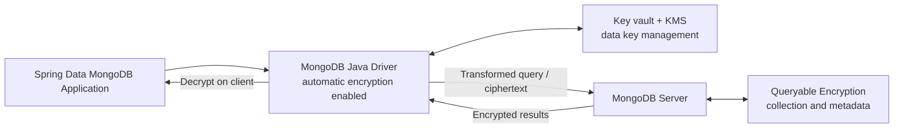

# Queryable Encryption and Operator / Data Type Limitations

In systems using **Spring Data MongoDB**, certain fields must be encrypted inside the application before being sent to MongoDB: national IDs, financial details, customer codes, medical records, or other sensitive information. If you simply store ordinary ciphertext, the application often has to fetch data, decrypt it, and only then search by content. That approach is both costly and hard to scale as document counts grow.

**Queryable Encryption (QE)** is MongoDB's client-side encryption mechanism that enables *specific supported query types* over encrypted fields without the server holding the keys to decrypt original contents. However, QE **does not turn an encrypted field into an arbitrarily queryable field**: BSON types, operators, encrypted index configurations, MongoDB versions, drivers, and key distribution all govern which queries can run.

This lesson focuses on selecting protected fields, distinguishing **equality** and **range queries**, reading the operator/data-type limitation matrix, integrating with `MongoTemplate`/repositories, and testing and diagnosing unsupported query cases.

## 1. Distinguishing Queryable Encryption From Other Encryption Types

| Mechanism | Where Is Data Protected? | Can You Search Encrypted Content? |
| --- | --- | --- |
| TLS between application and MongoDB | Data in transit | Adds no new query capability |
| Storage system encryption at rest | Data on disk | Server still processes fields normally |
| Randomized Client-Side Field Level Encryption (CSFLE) | Field values encrypted at the client | Cannot filter by plaintext value via ordinary equality |
| Deterministic CSFLE | Field values encrypted at the client | Supports equality matching, with specific limits and leakage traits |
| **Queryable Encryption** | Field values and search-supporting structures handled via client/driver and encrypted metadata | Supports configured query types, notably **equality** and **range** on compatible versions |

Important distinction: **QE does not simply produce identical ciphertext for identical plaintext** like deterministic encryption. It uses MongoDB's dedicated search metadata and mechanisms so the server can process supported queries. Therefore, do not infer QE's capabilities, security properties, or limits from deterministic CSFLE.

Client-side field encryption also differs from **hashing**. Hashing can assist matching in certain custom designs, but it provides no decryption, does not support ranges out of the box, and does not replace QE's key management and leakage-analysis model.

## 2. How Does QE Work?

Conceptually, the data flow proceeds as follows:



Main components:

1. **Application and `MongoTemplate`/repositories:** build queries against Java properties as usual, but only using QE-supported expressions.
2. **MongoDB Java Driver configured with automatic encryption:** uses encrypted field configuration to encrypt values on write, transform compatible query predicates, and decrypt results on read.
3. **Data Encryption Key (DEK):** the actual key protecting the field. DEKs are stored protected in the **key vault collection**; a KMS-managed key protects the DEKs.
4. **Encrypted fields configuration:** defines field paths, BSON types, `keyId`, and permitted query forms. This is the data contract across application, driver, and collection.
5. **MongoDB Server:** processes ciphertext and QE's internal metadata/indexes without needing plaintext or DEKs to execute designed queries.

The server can still observe operational information such as document counts, access timing and patterns, data sizes, or query characteristics depending on deployment. **Queryable** does not mean all information about data and queries is concealed.

### Key Vault and KMS Are Not the Same Thing

- **Key vault** stores protected DEK records and related metadata; it is not where the application stores plaintext.
- **KMS** (a key management service supported by your MongoDB/driver environment) protects the key used to wrap DEKs. Depending on the environment, organizations may use an external KMS or a local KMS for testing.
- Key vault permissions, KMS usage permissions, network connectivity, and client authentication all affect encryption/decryption. If the client lacks permission to use the required key, queries or decryption can fail even if the database user has read permission on the collection.

Never put keys, master keys, or credentials into study files, source code, logs, or committed test fixtures. The examples below show structure only; keys must be created, managed, and supplied from an appropriate environment.

## 3. Two Core Query Groups: Equality and Range

### 3.1. Equality Query

The goal is to find documents where a sensitive field **equals a specific value**, such as looking up a record by identification number:

```javascript
// Illustrates a query sent by a QE-configured client.
// Predicates are handled by the driver according to encryptedFields.
db.employees.find({ citizenId: "012345678901" });
```

This predicate is only meaningful as a QE query when `citizenId` has been declared **encrypted + queryable equality**, the client connects through a matching driver/configuration, and the query goes through the encryption pipeline. A `mongosh` session or client without automatic encryption **does not automatically translate** plaintext in a filter into an encrypted lookup.

Equality suits exact-lookup values: national IDs, secret transaction IDs, reference keys, or identifiers needing exact matches. It does not grant substring search, fuzzy search, prefix matching, or greater-than/less-than comparisons.

### 3.2. Range Query

Range queries filter over intervals, such as salaries from 5,000 up to (excluding) 10,000:

```javascript
// Illustrative query syntax. Runs only when field, BSON type,
// MongoDB/driver versions, and range configuration are all compatible.
db.employees.find({
  salary: {
    $gte: NumberDecimal("5000.00"),
    $lt: NumberDecimal("10000.00")
  }
});
```

Range queries on encrypted fields are a **version- and configuration-dependent capability**. Equality has been stably supported in modern QE generations; range support was added and matured in later releases. When designing systems, verify the **exact server version, Java Driver, encryption library, and feature release status** rather than assuming any range example works in every MongoDB version.

For range queries, beyond `queryType: "range"`, specifying the **BSON type, `min`/`max` bounds, `precision` (if applicable), and parameters affecting performance/metadata size** may be mandatory depending on the version. Wider bounds or higher precision can increase search and storage overhead. Therefore, design range settings around concrete business requirements.

## 4. Operator Matrix: How Far Can You Go?

There is no single fixed operator list that applies across all MongoDB versions. The table below is a **safe design guideline** for common QE queries:

| Need | Operator or Syntax | Assessment on QE Fields |
| --- | --- | --- |
| Equal to a value | `{ field: value }` / `$eq` | **Yes**, when the field is declared for equality queries and the environment is compatible |
| Greater than, greater/equal, less than, less/equal | `$gt`, `$gte`, `$lt`, `$lte` | **Conditional**, when the field is declared for range and version/BSON type match |
| Set membership, not equal, or exclusion | `$in`, `$ne`, `$nin` | **Do not assume from equality**; check the support matrix and test on your running version |
| Case sensitivity or collation-based text matching | Collation, accent-insensitive search | Cannot assume behavior identical to plaintext queries |
| Prefix, suffix, substring, regex | `$regex`, string expressions | **Not part of basic equality/range**; if your version has a dedicated string-search feature, check its exact conditions and support status |
| Full-text, geospatial, vector | `$text`, `$geoWithin`, vector search | Not supported out of the box by QE equality/range on ciphertext |
| Sorting by sensitive value | `sort({ field: 1 })` | **Do not treat ciphertext as a plaintext sort key** |
| Sum, average, grouping directly on plaintext | `$sum`, `$avg`, `$group` on encrypted field | Cannot be inferred from equality/range filtering; the server lacks plaintext to compute normally |
| Joins, lookups, complex expressions on encrypted fields | `$lookup`, `$expr`, arbitrary pipelines | Heavily constrained by version, pipeline shape, and field type; requires dedicated design |
| Filtering/sorting on **unencrypted** fields | Normal MongoDB conditions on plaintext fields | Usable per collection permissions and query capabilities; no QE needed for those fields themselves |

**Core rule:** enabling a **query type on a field** does not mean all operators in that logical family are supported. For example, equality lookup does not prove `$in` or `$ne` works; range support does not prove the server can `$sort` or `$avg` on plaintext.

To build compound queries, also check support for combining `$and`, `$or`, multiple conditions on the same field, and update/delete operations using encrypted filters on your exact version. Frequent queries on unencrypted fields can continue serving pagination or sorting if chosen as keys and indexed properly.

## 5. BSON Data Type Limitations

BSON type selection must happen **before defining an encrypted field**, not solely based on the Java type.

| Actual Value Type | Considerations for QE |
| --- | --- |
| `String` | Common choice for identifier equality. Does not automatically offer contains, substring, or plaintext collation |
| `Int32` / `Int64` | Candidates for range if supported by the version and given proper bounds; `int` and `long` are distinct BSON types |
| `Decimal128` | Suitable for exact decimal numbers; range requires checking bounds and precision config. Java `BigDecimal` must map to BSON Decimal128 |
| `Double` | Must account for floating-point inaccuracy and supported `precision`/bounds rules; avoid casually using for money |
| `Date` | Candidate for time ranges; normalize timestamps and time zones before storing |
| `Boolean` / `ObjectId` / other BSON scalars | Equality capability depends on the QE supported types list in your version; do not assume range capability |
| `null`, missing fields, `Array`, nested `Document`, special BSON | **Do not assume** you can declare or query them like QE-protected scalars; check structural, path, type, and null-value rules |

Subtle design pitfalls:

- A Java `Integer` property queried with a `Long` or `String` value: the driver may generate an expression that mismatches the encrypted field's BSON contract.
- A monetary field in Java using `BigDecimal` that gets stored as a BSON String due to a converter; range requiring BSON Decimal128 will not work as expected.
- Mixed `int`, `long`, `double`, `decimal` data in the same field; enabling encryption does not automatically normalize legacy data.
- Storing dates or numbers as `String` and expecting range comparisons to behave like timestamps or numbers.
- Storing multiple sensitive elements in an array and expecting `$elemMatch` or ordinary array operators to search plaintext.

The supported type list varies by *query type* and version. When deciding on less common BSON types such as `BinData`, `Timestamp`, `Regex`, or composite types, consult the official support table for your deployed MongoDB and Java Driver.

### Normalizing Range Bounds

Suppose `salary` uses `Decimal128` with two decimal places and non-negative pay. Before finalizing range settings, answer:

1. What are the valid business minimum and maximum values? If actual numbers fall outside the declared bounds, writes or queries may fail.
2. Do you need precision to cents, whole units, days, seconds, or milliseconds? `precision` must match business needs and driver limits.
3. If the schema changes to widen bounds or alter types, will you need a new field/collection and data migration?
4. Do queries search wide intervals or many very narrow intervals? This affects QE overhead, information leakage, and configuration choices.

For example, if the system only needs lookups by **salary tier**, storing a non-sensitive classification field (such as `salaryBand`) may fit better than enabling range QE on exact numeric values. However, bucketing can still reveal information: assess risk on business data before deciding.

## 6. Defining Queryable Fields

Suppose the `employees` collection has `citizenId` needing exact lookup and `salary` needing range filtering. A conceptual schema design can be written as:

```javascript
// ILLUSTRATIVE SCHEMA TEMPLATE, not a direct deployment command:
// UUIDs must point to real DEKs managed by key vault/KMS.
const encryptedFields = {
  fields: [
    {
      path: "citizenId",
      bsonType: "string",
      keyId: /* DEK UUID for citizenId */ null,
      queries: { queryType: "equality" }
    },
    {
      path: "salary",
      bsonType: "decimal",
      keyId: /* DEK UUID for salary */ null,
      queries: {
        queryType: "range",
        min: NumberDecimal("0.00"),
        max: NumberDecimal("1000000.00"),
        precision: 2
        // Additional parameters depend on version.
      }
    }
  ]
};
```

Notes:

- `path` is the **BSON field name**, which may differ from the Java property name due to `@Field`.
- `bsonType` must match the serialized value; `"decimal"` is BSON Decimal128, distinct from `"double"` and `"string"`.
- `keyId` is a **real** DEK identifier. `null` in the sample is only an illustrative placeholder and must be replaced via the encrypted-collection/DEK creation flow for your version.
- `queries` defines searchability. **Encrypting without declaring a query type** differs from encrypting with equality/range support.
- Collection settings, client `encryptedFieldsMap` (if used), and the deployed schema must remain consistent. Do not arbitrarily change `queryType`, BSON type, or range bounds on a populated field without a migration plan.

In practice, create the QE collection and metadata using a **compatible driver's encrypted collection creation API**, provision DEKs via the configured KMS/key vault, and open clients with the resulting configuration. The schema example above merely clarifies the relationship among field, BSON type, and query type; it does not replace key provisioning or version-specific valid parameters.

Never manually create or edit internal metadata collections managed by QE to "fix indexes." Those collections and their metadata are integral to encryption and search mechanics.

## 7. Connecting Spring Data MongoDB to a QE-Enabled Client

`MongoTemplate` and repositories rely on the **MongoDB Java Driver**. Spring Data maps entities and builds queries; automatic encryption/decryption is performed by the driver when the client is configured properly.

### 7.1. Configuring `MongoClient`

Skeleton client initialization example:

```java
import com.mongodb.ConnectionString;
import com.mongodb.MongoClientSettings;
import com.mongodb.AutoEncryptionSettings;
import com.mongodb.client.MongoClient;
import com.mongodb.client.MongoClients;
import org.bson.BsonDocument;
import org.springframework.data.mongodb.core.MongoTemplate;

import java.util.Map;

// These values are loaded from real security configuration:
String mongoUri = /* connection URI */ null;
String keyVaultNamespace = "encryption.__keyVault";
Map<String, Map<String, Object>> kmsProviders =
    /* KMS configuration, do not hardcode secrets */ null;
BsonDocument encryptedFields =
    /* valid provisioned QE schema */ null;

AutoEncryptionSettings encryptionSettings =
    AutoEncryptionSettings.builder()
        .keyVaultNamespace(keyVaultNamespace)
        .kmsProviders(kmsProviders)
        .encryptedFieldsMap(Map.of("appdb.employees", encryptedFields))
        .build();

MongoClientSettings settings = MongoClientSettings.builder()
    .applyConnectionString(new ConnectionString(mongoUri))
    .autoEncryptionSettings(encryptionSettings)
    .build();

MongoClient encryptedClient = MongoClients.create(settings);
MongoTemplate mongoTemplate = new MongoTemplate(encryptedClient, "appdb");
```

**This is an integration skeleton, not a standalone runnable program:** you must provision valid DEKs, replace placeholders with real configuration, declare compatible driver/crypt shared library dependencies, and set up KMS/key vault permissions. Option names and shapes can vary by MongoDB Java Driver version; check your project version's API.

If the Spring Boot application already creates `MongoClient`/`MongoTemplate`, ensure repositories and templates use **that exact client with automatic encryption configured**. A `MongoTemplate` bean pointing to a default client without QE will not encrypt filters just because an entity holds sensitive fields.

Avoid keeping two clients accessing the same collection where one silently bypasses encryption. A client with database read access but no keys is also not a plaintext query fallback for QE.

### 7.2. Entity Mapping and Equality Queries

```java
import java.math.BigDecimal;
import org.springframework.data.annotation.Id;
import org.springframework.data.mongodb.core.mapping.Document;
import org.springframework.data.mongodb.core.mapping.Field;
import org.springframework.data.mongodb.core.mapping.FieldType;

@Document("employees")
public class Employee {
    @Id
    private String id;

    private String fullName;   // Unencrypted in this example
    private String citizenId;  // QE equality

    @Field(targetType = FieldType.DECIMAL128)
    private BigDecimal salary; // QE range when supported by environment

    // Constructors/getters/setters omitted.
}
```

Looking up with `MongoTemplate`:

```java
Query query = Query.query(
    Criteria.where("citizenId").is("012345678901")
);
Employee employee = mongoTemplate.findOne(query, Employee.class);
```

Key imports:

```java
import org.springframework.data.mongodb.core.query.Criteria;
import org.springframework.data.mongodb.core.query.Query;
```

The application builds a `Query` using ordinary Java data types. When `MongoTemplate` uses a QE-enabled client with a consistent schema, the driver handles encryption for compatible predicates and decrypts results. Still, **never log plaintext** such as `citizenId` in performance timings, debug statements, or exception handlers.

Example with a Spring Data repository:

```java
import java.util.Optional;
import org.springframework.data.mongodb.repository.MongoRepository;

public interface EmployeeRepository
        extends MongoRepository<Employee, String> {
    Optional<Employee> findByCitizenId(String citizenId);
}
```

Derived queries here usually express simple equality, but whether they execute on ciphertext is still determined by **the encrypted field configuration, driver, and generated MongoDB query shape**. Do not extend this assumption to arbitrary `findBy...Containing`, `IgnoreCase`, `Between`, or complex derived queries.

### 7.3. Range Query Example

When `salary` is declared for range on BSON Decimal128 and the environment supports it:

```java
import java.math.BigDecimal;
import java.util.List;

Query query = Query.query(
    Criteria.where("salary")
        .gte(new BigDecimal("5000.00"))
        .lt(new BigDecimal("10000.00"))
);

List<Employee> employees = mongoTemplate.find(
    query, Employee.class
);
```

`@Field(targetType = FieldType.DECIMAL128)` expresses the intent to map `BigDecimal` to BSON Decimal128 in Spring Data MongoDB. However, the annotation alone **does not enable QE, create DEKs or QE indexes**, nor guarantee that a range statement is supported by the driver. Test values at `min/max` boundaries, negative/out-of-bounds values, and inclusive vs. exclusive comparisons.

## 8. Limits With Aggregations, Sorting, and Indexes

A query with an equality filter may be supported by QE while a subsequent pipeline stage requires server-side plaintext processing. For example:

```javascript
// Do not expect the server to compute plaintext statistics
// directly on the salary field encrypted with QE.
db.employees.aggregate([
  {
    $group: {
      _id: null,
      totalSalary: { $sum: "$salary" }
    }
  }
]);
```

QE encryption does not give the server permission to decrypt so `$sum`, `$avg`, `$min`, `$max`, `$sort`, `$regex`, or `$lookup` can run as on plaintext. Some operations are restricted even when a pipeline only filters on an encrypted field. Check server/driver compatibility documentation and test on a real encrypted collection to know whether a given pipeline is accepted.

**Unencrypted fields** such as `departmentId`, `createdAt`, or `isActive` can continue serving normal filtering, sorting, pagination, statistics, and indexing needs. This is one reason to encrypt **only the genuinely sensitive fields**, rather than encrypting the entire document regardless of query needs.

QE indexes have their own mechanism. The command:

```javascript
db.employees.createIndex({ citizenId: 1 });
```

is **not** how you enable equality queries on an encrypted `citizenId`. QE lookup capabilities must be declared in the field configuration and set up through the Queryable Encryption workflow. Standard B-tree indexes remain useful for unencrypted fields and queries outside ciphertext scope.

For pagination, prefer non-sensitive, stable, well-indexed sort keys. Being able to filter with QE does not mean you can paginate in plaintext order on an encrypted field.

## 9. Threat Model and Information Leakage

Queryable Encryption protects **sensitive values** from parties lacking the appropriate keys, but it is not a tool that hides all application behavior. When assessing risk, examine:

- **Who holds the keys?** DEKs, KMS, key vault, permissions, and KMS access logs must be managed independently of database privileges.
- **What remains observable?** Query frequency, result counts, document sizes, access timing, field presence, and metadata can reveal structural or behavioral patterns.
- **Is the value domain wide or narrow?** A field taking only a few states like `true/false` or a tiny enum needs careful frequency and inference assessment; not every field should be QE-encrypted.
- **Does range increase exposed information?** Supporting range comparisons requires metadata and carries different leakage/cost characteristics than equality; enable it only when truly needed.
- **Does the application expose plaintext elsewhere?** HTTP logs, tracing, error messages, client-side backups, auxiliary search systems, and data exports can contain decrypted content.

Do not treat QE as an authentication or authorization mechanism. Application users may only query information permitted by their business roles; Spring Security authorization, database authentication, and key management must all be deployed together.

## 10. Query Testing and Diagnostics

Build an integration test suite **against MongoDB/driver and encryption libraries matching your deployment versions**. Use test DEKs isolated from production. Key test cases:

| Scenario | Outcome to Verify |
| --- | --- |
| Write document with equality-encrypted `citizenId` | Database stores ciphertext; key-authorized client reads exact plaintext |
| Lookup by exact `citizenId` | Returns matching document via QE-enabled client |
| Lookup nonexistent `citizenId` | Returns no document, leaks no extra info |
| `findByCitizenId` via repository | Behavior matches `MongoTemplate` query on the same encrypted client |
| `salary` as `BigDecimal`/Decimal128 within bounds | If range is supported, filters interval boundaries accurately |
| `salary` using wrong String/Double type | Rejected or errors per BSON/config rules; not silently treated as the same type |
| `salary` outside range bounds | System reports an appropriate error; malformed data is not written |
| `$regex` or `Containing` on `citizenId` | Do not expect plaintext-like results; catch limitations directly in tests |
| Client without KMS/key vault permission | Encryption/decryption query fails per permission config |
| Query on unencrypted `departmentId` | Works as a normal MongoDB query |

When troubleshooting errors, check in order:

1. **Schema:** do `path`, `bsonType`, `queries.queryType`, `keyId`, and range bounds match the collection?
2. **Serialization:** are Java values actually serialized to the declared BSON type?
3. **Client:** are `MongoTemplate`/repositories using the `MongoClient` with automatic encryption enabled? Do driver, encryption library, and MongoDB Server versions support that query type?
4. **Key management:** can the client reach the key vault/KMS and does it hold permissions for the needed DEK and master key?
5. **Operators:** does the Spring Data-generated query use permitted operators and shapes? `findBy...IgnoreCase`, for example, can generate an incompatible query.
6. **Resources:** do client encryption CPU, KMS latency, metadata, storage size, and actual query volume fit your performance budget?

In test environments, you can verify server-stored BSON using a client **without decryption permissions**, holding only read access on the test collection. Never look at output from a QE-enabled client and conclude the database stores plaintext: the driver automatically decrypted it before returning it to the application.

To analyze overhead, separately measure query latency, key service access time, client CPU, document/metadata size, throughput, and p95/p99 latency. Do not expect `explain` output or server logs to look identical to plaintext queries; some observability tools have limitations with QE.

## 11. Migration and Operations

You cannot turn a plaintext collection into a complete QE collection simply by adding `@Field` to an entity. A typical migration workflow:

1. **Classify fields to encrypt** and define actual query needs: exact, range, or non-queryable.
2. **Finalize BSON types** and check legacy data consistency; convert types before encrypting if needed.
3. **Verify version support**, choose KMS, provision DEKs, and build the encrypted fields schema via a compatible API.
4. **Create the target QE-enabled collection** and required metadata structures following MongoDB/driver procedures.
5. **Migrate data through an encryption-enabled client** in controlled batches; reconcile document counts, decrypted values, query permissions, and response times.
6. **Cut over application read/write paths** to the new collection and client, ensuring no legacy instances keep writing plaintext.
7. **Monitor operations**: KMS errors, query speed, metadata size, backup/restore integrity, and key rotation plans.

When backing up or restoring QE collections, coordinate ciphertext, metadata, and key management according to product procedures. Restoring encrypted documents alone without the required key vault/metadata can render data unqueryable or undecryptable.

In distributed applications, avoid instances running mismatched `encryptedFieldsMap` definitions. Queries can fail or data can be written inconsistently if one service has not rolled forward.

## 12. Hands-On Exercise

**Problem:** a Spring Data MongoDB application manages employees with `citizenId`, `salary`, `departmentId`, and `createdAt`. Requirements: protect `citizenId` and `salary`, look up by national ID, filter salary by range, and sort employees by creation date.

Tasks:

1. Classify fields requiring QE equality, QE range, and unencrypted fields; explain why `createdAt` can still serve as a sort key.
2. Design a conceptual encrypted fields schema, specifying `bsonType` and bounds for `salary`.
3. Write the `Employee` entity, one `MongoTemplate` equality query, one conditional range query, and one derived equality repository method.
4. Attempt a `Containing` or `regex` query on `citizenId`; document the observed limitation rather than trying to "force" the driver to process it.
5. Create a test proving a key-authorized client sees plaintext, server-stored data is encrypted, and a client without decryption config cannot read that plaintext.
6. Measure latency and compare against a query on unencrypted `departmentId`; analyze overhead and propose an architecture for a report that sums total salaries.

**Completion criteria:** distinguish *permission to read plaintext* from *ability to query ciphertext*; choose equality/range for the right fields and BSON types; use only genuinely supported operators; explain the role of automatic encryption and how to verify it on a real system.

## 13. Key Takeaways

- **Queryable Encryption provides controlled querying over encrypted fields**, not a full drop-in replacement for traditional MongoDB queries.
- **Equality** serves exact matching; **range** is used only when version, BSON type, and bounds configuration permit.
- Actual BSON data types matter more than Java declarations; for currency, pay close attention to `BigDecimal` ↔ `Decimal128`.
- `$regex`, sorting, computational aggregations, joins, text/geo searches, and complex operators **do not automatically work** on encrypted fields just because equality/range works.
- `MongoTemplate` and repositories must use a driver with consistent QE, DEK, KMS, and schema configuration; Java annotations do not enable encryption on their own.
- QE design must account for **version compatibility, metadata leakage, performance, authorization, migration, and data recoverability**.

> **Version note:** Queryable Encryption support—especially range and advanced string search modes—evolves across MongoDB Server/Atlas, Java Driver, and encryption library releases. Examples in this lesson illustrate general principles and common syntax; before deploying to production, verify the support matrix and valid configuration for your exact running versions.
