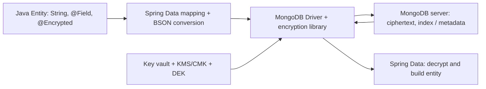

# Impact of Encryption on Indexing, Searching, and Mapping

> **Chapter:** Data Encryption  
> **Scope:** Spring Data MongoDB — document mapping, querying with `MongoTemplate` and repositories, index design, testing, and performance diagnostics when data is encrypted.

## 1. Why Can Encryption Change How You Query?

Suppose an application manages patient records with these fields:

```json
{
  "_id": "p-1001",
  "tenant_id": "clinic-a",
  "email": "an@example.com",
  "medical_note": "Medical history...",
  "age": 32
}
```

If `email` and `medical_note` are **encrypted client-side**, MongoDB stores only ciphertext as BSON Binary; the server does not know the original strings. This protects the data, while changing matching, indexing, sorting, searching, and aggregation capabilities. Spring Data can still map Java `String` fields when the client decrypts successfully, but it cannot make the server understand plaintext on its own.

Before designing indexes or repository queries, distinguish **three protection layers**:

- **TLS in transit:** encrypts the network channel; data is still processed normally by MongoDB once received. Usually does not change query/index semantics.
- **Encryption at rest:** encrypts storage files/disks; MongoDB can still process values and standard B-tree indexes. This is not a mechanism for hiding plaintext from the MongoDB server.
- **Client-side encryption (CSFLE or Queryable Encryption):** driver/library encrypts before sending to MongoDB and decrypts on clients with key access. This is the primary case that changes operations on encrypted fields.

Do not treat `@Encrypted` as a way to turn every ordinary index and query into queries that run over confidential data. **Support levels depend on encryption mechanism, algorithm, query configuration, and MongoDB/driver version.**

## 2. Impact Map for Indexing and Searching

| Field Protection | What the Server Sees | Search by Original Value | Range/Sort by Plaintext | Appropriate Indexing Approach |
| --- | --- | --- | --- | --- |
| TLS / encryption at rest only | Original BSON values during processing | Like standard MongoDB | Like standard MongoDB | Standard MongoDB indexes |
| **Deterministic CSFLE** | Repeatable ciphertext for the same value, key, and BSON type | Yes, with supported match operators via an encryption-configured client | No plaintext ordering for true `$gt`, `$lt`, or `sort` | Can index ciphertext to support suitable equality lookups; measure and verify constraints |
| **Randomized CSFLE** | Ciphertext changes on every encryption | Cannot search directly by original value | No | Cannot use an index on ciphertext to enable plaintext search |
| **Queryable Encryption (QE), non-queryable field** | Randomized ciphertext and related metadata | No, must query by other fields | No | Do not add ordinary indexes on encrypted fields to search plaintext |
| **QE, queryable field** | Randomized ciphertext with query-supporting metadata | Equality; range or specialized string queries when enabled and version-supported | Only configured query types; do not infer general `sort` support | QE's own encrypted index/metadata mechanism; do not use ordinary ciphertext indexes as a workaround |

### 2.1. Deterministic CSFLE: Same Plaintext Can Yield Same Ciphertext

With the same Data Encryption Key (DEK), algorithm, value, and BSON type:

```text
encrypt("an@example.com", key-A) -> cipher-X
encrypt("an@example.com", key-A) -> cipher-X
encrypt("binh@example.com", key-A) -> cipher-Y
```

Because equal values share the same ciphertext, the driver automatically encrypts equality query parameters and MongoDB can compare ciphertexts. Supported operators under **automatic CSFLE** include `$eq`, `$ne`, `$in`, `$nin`, and corresponding logical combinations; check constraints by BSON type. For instance, comparing against `null` or running regex on encrypted fields is restricted or errors. Queries on ciphertext can leverage appropriate indexes, but those indexes store **encrypted values**, not plaintext sort order.

Security trade-off: because ciphertexts repeat, an observer can infer **occurrence frequency**. Deterministic encryption is unsuitable if you want to conceal repetition in low-cardinality fields, such as gender, `yes/no` flags, or blood types; consider randomized encryption or another design after evaluating search requirements.

### 2.2. Randomized CSFLE: Better Pattern Protection, No Equality Search

```text
encrypt("an@example.com", key-A) -> cipher-R1
encrypt("an@example.com", key-A) -> cipher-R2
```

Same plaintext yields two different ciphertexts, so:

- `findByMedicalNote("...")` cannot perform plaintext equality search on a randomly encrypted field.
- `db.collection.createIndex({ medical_note: 1 })` does not enable MongoDB to understand or search note contents.
- You can look up records by `_id`, `tenant_id`, or other valid queryable fields and decrypt `medical_note` on the client.

Randomized encryption typically fits **data that only needs to be read after locating a document via another key**.

### 2.3. Queryable Encryption (QE): Queryable Does Not Mean Plaintext Index

QE differs in design from deterministic CSFLE: ciphertext remains randomized, while MongoDB uses specialized metadata/indexes for configured query types. Depending on the supporting MongoDB versions, QE can declare:

- `equality` for exact-match searches;
- `range` for supported numeric/date BSON fields;
- `prefix`, `suffix`, `substring` for strings on versions supporting string queries.

This does not mean every SQL/MongoDB operator is available. For example, **arbitrary regex, full-text search, plaintext sorting, or arbitrary aggregations** do not automatically work with QE. When creating the collection, each field must declare the right `bsonType` and `queryType` along with specific parameters (such as contention, min/max bounds, or string query config). Exact support also depends on **MongoDB Server, driver, encryption library, and feature availability in the running release**.

Do not create ordinary B-tree indexes directly on a QE-encrypted field: such an index does not make ciphertext queryable as plaintext and can degrade performance. QE manages supplementary metadata collections and query-helper data, such as the `__safeContent__` field; manage indexes per your MongoDB version's guidance and actual QE configuration.

## 3. Indexes and Uniqueness: Common Pitfalls

### 3.1. Indexes Cannot Turn Ciphertext Into a Searchable String

For instance, when `email` uses deterministic CSFLE, applications commonly query by tenant and email:

```javascript
// Example index only for a collection using deterministic CSFLE:
db.patient_records.createIndex({ tenant_id: 1, email_cipher: 1 })
```

The index can serve predicates on `tenant_id` and email ciphertext once the driver properly encrypts the query value. However, when `email` uses **randomized encryption**, a similar index does not enable lookups by original email. When migrating to QE, redesign around QE's encrypted field/index mechanism instead of carrying over CSFLE index assumptions.

Furthermore, Spring Data's `@Indexed` and `@CompoundIndex` only describe ordinary MongoDB indexes. They **do not activate CSFLE/QE**, create Data Encryption Keys, or overcome search limits on encrypted fields. Whether indexes exist in practice also depends on auto-index creation settings and migration procedures.

### 3.2. A Unique Index on Ciphertext Does Not Always Equal Business Uniqueness

With **randomized CSFLE** and **QE**, identical plaintext produces different ciphertexts; a unique index directly on ciphertext **cannot guarantee** two records do not share the same plaintext. Even with deterministic encryption, results depend on the DEK, BSON type, string normalization, and tenant rules. If each tenant encrypts the same email with its own key, ciphertexts will not match across tenants.

If the application must enforce unique emails per tenant, design a consistent constraint mechanism—for example, a normalized, properly protected auxiliary lookup key, or a write-check workflow with concurrency control. Even a keyed HMAC lookup token carries pattern-leakage risk; model the risk and protect the key. **Do not substitute business uniqueness requirements by putting `unique = true` on a ciphertext field and assuming it works.**

### 3.3. Collation, Sorting, and Data Analytics

Ciphertext preserves neither lexicographical nor numeric order of plaintext. An index on ciphertext does not provide `sort` by name/email, `age > 30` filtering, case-insensitive matching, or `^an` regex. MongoDB collations apply to what the server sees and cannot turn ciphertext back into original strings. Some `$group` forms on deterministic CSFLE work under limited conditions, while arithmetic operations on encrypted fields are meaningless.

If you need aggregations, full-text search, or BI reporting, decide explicitly which fields must be encrypted, which can remain plaintext or safely transformed for indexing, and which are processed client-side after decryption. Auxiliary fields can leak information, so evaluate them as part of sensitive-data design.

## 4. Spring Data Mapping: Annotations, JSON Schema, and Encryption Driver

With Spring Data MongoDB, distinguish **Java ↔ BSON mapping**, **encryption rule schemas**, and **the driver/encryption library performing encryption**.

### 4.1. Mapped Entities Still Use Ordinary Java Types

Automatic CSFLE example with two properties:

```java
import org.springframework.data.annotation.Id;
import org.springframework.data.mongodb.core.mapping.Document;
import org.springframework.data.mongodb.core.mapping.Encrypted;
import org.springframework.data.mongodb.core.mapping.Field;

@Document("patient_records")
@Encrypted(
    // Placeholder: replace with the actual DEK ID as valid Base64.
    keyId = "REPLACE_WITH_BASE64_DEK_UUID",
    algorithm = "AEAD_AES_256_CBC_HMAC_SHA_512-Random"
)
class PatientRecord {
    @Id
    String id;

    @Field("tenant_id")
    String tenantId;              // Unencrypted; used to scope queries.

    @Field("email_cipher")
    @Encrypted(algorithm = "AEAD_AES_256_CBC_HMAC_SHA_512-Deterministic")
    String email;                 // Equality search per CSFLE configuration.

    @Field("note_cipher")
    @Encrypted
    String medicalNote;           // Inherits Random algorithm.
}
```

This is a **mapping illustration**, not a standalone runnable configuration. Before running, provision a real DEK in the key vault, configure KMS/CMK, key vault namespace, and connect an encryption-enabled driver. The `keyId` value is a placeholder and must not be used in real environments.

In the entity, `email` remains a `String`. When a client has decryption permissions, Spring Data reads `email` into `String` normally. On the server, the BSON field is named **`email_cipher`** per `@Field` and its value is `BinData` ciphertext, not a plaintext email string.

### 4.2. `@Encrypted` Does Not Replace Driver Configuration

Spring Data can generate a `MongoJsonSchema` from `@Encrypted` annotations:

```java
MongoJsonSchema schema = MongoJsonSchemaCreator.create(mappingContext)
    .filter(MongoJsonSchemaCreator.encryptedOnly())
    .createSchemaFor(PatientRecord.class);

AutoEncryptionSettings settings = AutoEncryptionSettings.builder()
    .keyVaultNamespace("security.__keyVault")
    .kmsProviders(kmsProviders)
    .schemaMap(Map.of(
        "health.patient_records",
        schema.schemaDocument().toBsonDocument()
    ))
    .build();

// Pass settings into MongoClientSettings builder, e.g., inside
// MongoClientSettingsBuilderCustomizer of the Spring Boot application.
```

`mappingContext` and `kmsProviders` must be initialized in application configuration. `schemaMap` uses the actual **`database.collection`** namespace; a wrong namespace, BSON field name, or `bsonType` can break encryption/decryption or queries. The client must configure the crypt library (or matching shared library), key vault, and key access permissions per your version's docs.

Key point: **`@Encrypted` provides metadata to generate a schema; it does not supply keys or enable automatic encryption by itself**. When relying on server-side schemas, consider the risk of schema tampering; enforce trusted schemas client-side and govern migrations carefully.

### 4.3. Query Mapping in `MongoTemplate` and Repositories

With a client running **automatic CSFLE**, the equality query below works because `email` is a deterministic field:

```java
import org.springframework.data.mongodb.core.MongoTemplate;
import org.springframework.data.mongodb.core.query.Criteria;
import org.springframework.data.mongodb.core.query.Query;

class PatientService {
    PatientRecord findByEmail(MongoTemplate template,
                              String tenantId, String email) {
        Query query = Query.query(
            Criteria.where("tenantId").is(tenantId)
                    .and("email").is(email)
        );
        return template.findOne(query, PatientRecord.class);
    }
}
```

`MongoTemplate` maps property `email` to `email_cipher`, while the **encryption driver** encrypts the email parameter before sending the query using the right schema, algorithm, and DEK. A repository method `findByEmail(String email)` must likewise use **the same encryption-configured `MongoClient`**; method names or `@Query` do not configure encryption.

The two query forms below do not substitute for the equality lookup above under CSFLE:

```java
// Do not assume this runs on a deterministic CSFLE field:
Query prefixQuery = Query.query(Criteria.where("email").regex("^an"));
// Valid Spring Data syntax, but regex queries on deterministic
// CSFLE fields are not among the supported operators.
// Criteria.where("age").gt(30) on a deterministic field also does not
// become a plaintext range query.
```

This snippet is an **example of a query unsupported on deterministic CSFLE**: Spring Data syntax is valid, but the automatic CSFLE driver will not turn a regex expression into a valid prefix search. If you need prefix/suffix/substring search, check Queryable Encryption support in an appropriate version or design an auxiliary search field with a security review.

### 4.4. Explicit Encryption Is a Separate Path

Spring Data provides `@ExplicitEncrypted` backed by property converters and the MongoDB encryption engine. On this path, developers must configure `ClientEncryption`, `MongoEncryptionConverter`, and DEK resolution. Values stored in documents can be encrypted/decrypted by a property's converter, but **do not assume arbitrary query filters are automatically encrypted** the way automatic encryption does.

If you annotate a whole `Address`, `List`, or `Map` with `@ExplicitEncrypted`, the converter can encrypt **the entire value as one blob**, preventing individual indexing on inner properties. To query nested fields individually, design encryption at the specific field level and check BSON type limits.

## 5. Queryable Encryption and Metadata Collections

Do not reuse the same collection for CSFLE and QE: the two mechanisms have different configurations. With QE, developers/operations declare `encryptedFields` when creating the collection. Conceptual example:

```javascript
// In mongosh, replace the sample UUID with the real DEK UUID
// and prepare a client with full Queryable Encryption enabled.
use health
db.createCollection("patients_qe", {
  encryptedFields: {
    fields: [
      {
        path: "email",
        bsonType: "string",
        keyId: UUID("11111111-1111-4111-8111-111111111111"),
        queries: { queryType: "equality" }
      }
    ]
  }
})
```

This configures **one equality field**; it is insufficient for an end-to-end flow without a real DEK, `AutoEncryptionSettings` or `encryptedFieldsMap` config, and a compatible driver. Depending on version, Spring Data supports building QE configuration via `CollectionOptions.encryptedCollection(...)`, `@Encrypted` combined with `@Queryable`, or `@RangeEncrypted`. Verify compatibility for your Spring Data version before using these annotations.

Operationally, QE collections require associated metadata (such as collections storing encryption state) and can generate a `__safeContent__` field inside documents. These components increase storage/write overhead and must be accounted for in backups, migrations, monitoring, and performance tuning. Never arbitrarily delete or alter metadata collections. Changing a field from `none` to `equality` or `range` usually requires a schema/collection and encrypted-data migration workflow, not simply adding `@Indexed`.

**Important limitation:** QE supports *declared query types*, not the equivalent of Elasticsearch/MongoDB Search on plaintext. Full-text search, linguistic analysis, arbitrary regex, and general sorting still require other solutions and separate risk assessments.

## 6. Designing Queries in Applications With Encrypted Data

Suppose a system must protect medical notes while allowing fast record lookup:

| Requirement | Viable Design | Security and Performance Notes |
| --- | --- | --- |
| Read notes by `patientId` | Keep `_id`/`tenant_id` queryable; encrypt `medical_note` with randomized | Requires tenant authorization and protecting identifier metadata |
| Exact email lookup | Deterministic CSFLE or QE equality; synchronized schema and keys | Deterministic CSFLE leaks frequency; QE incurs its own metadata overhead |
| Find age between 30–40 | QE range if version, BSON type, and config support it | Do not replace with deterministic CSFLE + `$gte` |
| Find email starting with a string | QE string query if version-supported; or change search design | Do not expect regex on ciphertext to run |
| Sort by name, full-text note search | Consider adjusting features, choosing auxiliary fields, or client-side processing after narrow filtering | Never create plaintext duplicates just for indexing without assessing leakage |
| Enforce unique email per tenant | Design business constraint with write-concurrency control | Unique ciphertext indexes may not enforce plaintext uniqueness |

### Query Fan-Out and Compute Overhead

When a field is non-queryable, an application might fetch many documents via other predicates and decrypt/filter client-side. This is a poor substitute if the other predicates are not selective enough: it raises network traffic, decryption CPU, memory, latency, and exposure of decrypted data. **Always narrow queries using valid unencrypted keys first** (e.g., tenant and ID), decrypting only needed documents.

Conversely, QE's supported searches use dedicated metadata; measure execution time, memory, round trips, and update cost rather than looking only at ordinary MongoDB index counts. Performance can differ noticeably from equivalent plaintext queries.

## 7. Consequences for Updates, Aggregations, and Conversion

1. **Updates:** With automatic CSFLE, certain updates like `$set`, `$unset`, and `$rename` are supported under specific conditions; update expressions and operations on unsupported types may be rejected. `MongoTemplate.updateFirst(...)` does not remove this restriction. Avoid assuming `$inc` on encrypted numbers or pipeline updates behave like plaintext.
2. **Aggregations:** `Aggregation.match(...)` predicates on encrypted fields must use valid query types/operators. Computing `avg`, `sum`, or sorting on ciphertext values is not plaintext math. Some grouping cases on deterministic CSFLE work conditionally; consult actual MongoDB documentation.
3. **BSON types and custom conversions:** `String`/`Integer`/`Date`/`Decimal128` have different encryption and query limits. If a converter turns `BigDecimal` into `String`, the schema `bsonType` must match. Changing converters, date formats, or string normalization can alter equality matching.
4. **Nested fields/arrays:** Deterministic CSFLE does not encrypt whole objects or arrays the same way as scalars. Explicit converters may encrypt an entire object/collection as one block, losing inner queryability. QE has its own limits on objects/arrays; do not assume every element remains queryable after encryption.
5. **Projections/DTOs and auditing:** Key-authorized clients can decrypt readable results, but DTOs/projections do not protect secrets if logs or APIs lack authorization. Avoid writing plaintext, DEKs, KMS connection strings, or secrets into `toString()`, tracing, or exceptions.

## 8. Pre-Production Testing and Diagnostics

Test at least these scenarios in an environment with **MongoDB and drivers supporting the chosen encryption mode**:

1. **Verify stored data:** write a document with an encryption-enabled client, read it back with a non-decrypting client to verify the sensitive field is stored as `BinData` (without printing secret plaintext to logs), then read with a key-authorized client to verify mapping back to the expected Java type.
2. **Test equality:** store two documents with the same email under deterministic CSFLE or QE equality; query via `MongoTemplate` and repositories, verifying results and proper index/metadata setup.
3. **Test unsupported queries:** attempt regex, range, or sort on an unsupported field in the test environment; record errors or behavior instead of assuming plaintext equivalence.
4. **Verify BSON names:** set `@Field("email_cipher")`; cross-check it against JSON Schema/`encryptedFields` and MongoDB indexes. A misspelled field name can leave data unencrypted.
5. **Test wrong keys:** simulate missing KMS/key vault permissions or wrong DEKs; the application must fail explicitly and never fall back to writing plaintext.
6. **Measure performance:** compare insert/update/find times, document/index/metadata sizes, client CPU, DEK caching, KMS latency, number of decrypted documents, and client-side filtered records. Use `explain("executionStats")` on server-executed portions; do not infer from `explain` that MongoDB saw plaintext.
7. **Test data lifecycle:** schema/driver upgrades, key rotation, backup-restore, legacy unencrypted data, and migration plans. Rehearse changes before running against real collections.

### A Mental Model for Debugging



When queries return wrong results, check in order: **property-to-BSON mapping** → **schema/`encryptedFields` namespace match** → **algorithm and DEK** → **supported operators** → **indexes/metadata and `explain`**. This separates Spring Data mapping bugs from security config mistakes or MongoDB query limits.

## 9. Takeaways

- **Encryption at rest and TLS** normally do not alter index semantics; **client-side field encryption** is what changes how the server processes fields.
- **Deterministic CSFLE** supports equality lookups while leaking duplicate patterns and lacking plaintext order; **randomized CSFLE** protects duplicate patterns better and cannot be queried directly by original content.
- **Queryable Encryption** supports configured query types via dedicated encrypted indexes; avoid creating ordinary indexes on ciphertext and do not assume every search style is available.
- **Spring Data mapping and the encryption driver are separate stages**: `@Encrypted`, `@Field`, `@Queryable`, and converters must align with BSON schemas, DEKs, and MongoDB settings; repositories/`MongoTemplate` work properly only when client and query type are compatible.
- Index, uniqueness, and performance designs must be grounded in **threat models, MongoDB version, and genuinely needed queries**, and then verified by tests.

## References

- [Spring Data MongoDB — Encryption](https://docs.spring.io/spring-data/mongodb/reference/mongodb/mongo-encryption.html): automatic/explicit CSFLE, `@Encrypted`, `@ExplicitEncrypted`, QE, and converter configuration.
- [Spring Data MongoDB — JSON Schema](https://docs.spring.io/spring-data/mongodb/reference/mongodb/mapping/mapping-schema.html): generating encryption schemas from annotations and mappings.
- [MongoDB — Choosing an In-Use Encryption Approach](https://www.mongodb.com/docs/manual/core/queryable-encryption/about-qe-csfle/): distinguishing CSFLE and QE.
- [MongoDB — CSFLE Encryption Algorithms](https://www.mongodb.com/docs/manual/core/csfle/fundamentals/encryption-algorithms/): deterministic, randomized, and security trade-offs.
- [MongoDB — Supported Operations for Automatic CSFLE](https://www.mongodb.com/docs/manual/core/csfle/reference/supported-operations/): operator, update, aggregation, and BSON type limits.
- [MongoDB — Queryable Encryption Supported Operations](https://www.mongodb.com/docs/manual/core/queryable-encryption/reference/supported-operations/): supported query types, operators, and data types.
- [MongoDB — Queryable Encryption Limitations](https://www.mongodb.com/docs/manual/core/queryable-encryption/reference/limitations/): indexing, uniqueness, collation, and operational limits.
- [MongoDB — Create an Encrypted Collection](https://www.mongodb.com/docs/manual/core/queryable-encryption/qe-create-encrypted-collection/): declaring `encryptedFields` and metadata.
