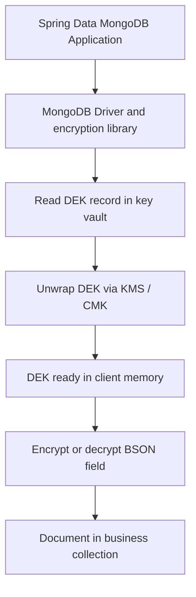
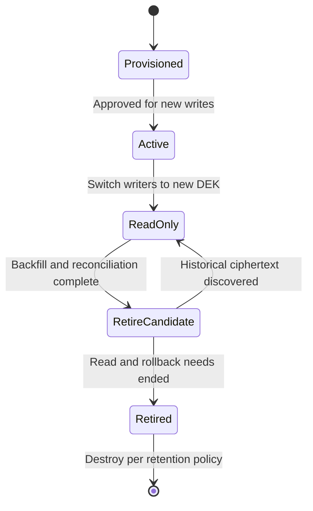
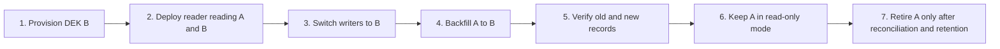

# Key Lifecycle Management and Testing Historical Data Decryption

## 1. The Problem: Encrypted Data Must Remain Readable Across Deployments

In a **Spring Data MongoDB** application, you read and write documents using `MongoTemplate` or repositories combined with MongoDB's client-side encryption to protect sensitive fields. The application may run smoothly on day one, yet months later need to rotate keys, change KMS accounts, upgrade the MongoDB Driver, change document formats, restore from backups, or migrate environments. If you only test freshly encrypted data with the current key, a critical failure can emerge: **old documents still exist but can no longer be decrypted**.

Example `customerSecrets` collection storing a confidential field as encrypted BSON binary:

```javascript
{
  _id: "customer-101",
  keyEpoch: 1,
  secretCiphertext: BinData(6, "..."),
  updatedAt: ISODate("2026-01-20T00:00:00Z")
}
```

Here `BinData(6, "...")` is only an **illustrative notation** for BSON binary subtype 6 of MongoDB client-side field-level encryption (CSFLE), not a usable ciphertext string. The `keyEpoch` field is custom application metadata tracking key-rollout waves; it does not replace the key identifier embedded in the encrypted payload.

Key lifecycle management aims to simultaneously guarantee:

- **Security:** only authorized processes can decrypt; raw keys never live in source code, logs, or uncontrolled backup artifacts.
- **Availability:** data written by earlier application versions remains decryptable across deployments, rollbacks, key rotations, and restores.
- **Operational integrity:** key migration jobs can resume after interruption, avoid losing concurrent updates, and emit reconciliation metrics.
- **Verifiability:** you maintain historical encrypted fixtures and tests that actually decrypt with the new configuration, rather than merely running encrypt → decrypt within a single session.

MongoDB field encryption differs from TLS protecting data in transit and disk/storage encryption at rest. All three layers can work together without replacing each other's roles. This lesson focuses on **client-side encryption keys**, especially how that lifecycle integrates with Spring Data MongoDB.

## 2. Distinguishing CMK, DEK, KMS, and Key Vault

In *envelope encryption*, data is encrypted with a **data encryption key (DEK)**; the DEK itself is protected by a **customer master key (CMK)** or wrapping key in KMS. Exact terminology may vary by KMS provider.

| Component | Role | What Must Be Maintained |
| --- | --- | --- |
| **DEK** | Actual key used to encrypt/decrypt field values; has a unique ID | Old DEK records and the ability to unwrap them remain intact |
| **CMK / KMS key** | Top-level key protecting DEKs; typically managed by AWS KMS, Azure Key Vault, Google Cloud KMS, or a compatible mechanism | Key versions, access permissions, recovery policies, and key state |
| **Key vault collection** | MongoDB collection holding metadata and protected `keyMaterial` of DEKs | Consistent backup/restore; authorization; required indexes |
| **KMS credentials** | Identity and permissions allowing clients to access the top-level key | Least privilege, safe credential rotation, avoiding log exposure |
| **MongoDB client/driver** | Executes encryption/decryption and accesses key vault/KMS | Compatible configuration, supported crypto library, ability to read old ciphertext |



With CSFLE, ciphertext carries metadata so the driver can identify which key is needed for decryption. Therefore, **the key used for new writes does not have to be the key that decrypts old data**. Applications can switch to a new active DEK while keeping historical DEKs read-only. However, if you delete old DEK records, destroy the KMS key used to unwrap them, or lose access permissions, documents encrypted with that DEK may become permanently undecryptable.

`keyAltNames` can provide friendly aliases to look up a DEK; do not assume renaming an alias automatically moves all ciphertext onto a new key. A DEK's ID and the business schema version are also separate concepts:

| Field / Concept | Question It Answers |
| --- | --- |
| `schemaVersion` | Which business structure does the document follow? |
| Application-managed `keyEpoch` | Which key-rollout wave processed this document? |
| DEK ID inside encrypted payload | Which specific DEK is needed to decrypt this ciphertext? |
| CMK version in KMS | Which KMS key version is needed to unwrap the DEK record? |

Do not infer the DEK ID solely from `keyEpoch`. Application-written metadata can be stale or out of sync; decryption correctness must be verified against real ciphertext.

## 3. Define the Key Lifecycle From Design Time

A key policy can define the following states. This is an **operational model chosen by your project**, not states automatically managed by MongoDB:



| Governance State | New Writes | Decrypt Old Data | Transition Condition |
| --- | --- | --- | --- |
| Provisioned | Not yet | Only in testing/verification | DEK created and permissions verified |
| Active | Yes | Yes | Application actively uses DEK as write key |
| ReadOnly | No | **Yes** | All writers switched to the new key |
| RetireCandidate | No | Yes during holding window | Reconciliation finds no referencing data; rollback window passed |
| Retired | No | No longer guaranteed | Permitted only after inventory, retention checks, and formal approval |

For every DEK or CMK, track ownership, data scope, creation timestamp, activation date, compatible app versions, backup location, rotation history, retention period, and incident contacts. Operational metadata like `keyEpoch` can sit alongside the document; secrets like raw DEKs, raw CMKs, or credentials must **never** be stored there.

Practical rules:

1. Separate **document read/write** permissions, **key vault** access, and **KMS usage** permissions; grant each on a need-to-know basis.
2. Never generate a new key on every application startup. Provision keys through controlled workflows, store IDs, and check existence before use.
3. Never destroy an old key just because every live document in the collection has been upgraded: backups, event archives, snapshots, and queued jobs may still depend on it.
4. Define key retention durations matching data policies, including recovery and rollback windows.
5. Audit key operations, but never emit raw keys, plaintext, or sensitive ciphertext into business logs.

## 4. Two Types of Key Rotation Have Very Different Impacts

| Operation | What Changes | Must Documents Be Re-Encrypted? | Main Risk |
| --- | --- | --- | --- |
| **KMS-side CMK rotation** via provider-supported mechanism | KMS rotates wrapping key material or version, usually preserving key identity per provider policy | Usually **no**, as long as KMS still unwraps existing DEKs | Accidentally disabling old CMK versions, KMS permissions, or recovery policies |
| **Rewrap DEK** to another CMK | Changes protection on `keyMaterial` in the key vault; DEK and DEK ID can stay unchanged | **No**, if only rewrapping while preserving the DEK | Missing permissions on old/new CMK, failed key vault update, losing recovery path |
| **Rotate DEK** to a new DEK | New writers encrypt with the new DEK | Old documents **must be re-encrypted** if the goal is ending dependence on the old DEK | Broken compatibility, batch failures, write contention, missed snapshots/backups |
| **Destroy old key** | Removes path to use the key | Consequences cannot be fixed by config changes alone | Permanent decryption loss if dependent data remains |

*Rewrapping data keys* is supported by certain driver versions and CSFLE setups, though exact APIs, KMS providers, and permissions depend on your deployed stack. Check driver documentation and test against your target provider before using in production.

With **Queryable Encryption**, keys and query metadata are also tied to internal search structures and tokens. Do not copy an explicit CSFLE DEK-rotation script verbatim onto a Queryable Encryption collection. Changing encrypted field settings, keys, or algorithms may require a dedicated collection and index migration workflow for your exact MongoDB/driver version.

## 5. Preparing a Test Environment That Can Decrypt After Restarts

To test cleanly, you can use the MongoDB Java Driver's **explicit encryption** API alongside `MongoTemplate`. The example below uses the `local` KMS provider **only for development/testing**. Production systems typically integrate a dedicated KMS; credentials and permissions must be provisioned by infrastructure rather than hardcoded.

In this lesson, the key vault is `encryption.__keyVault`. You must persist and restore both the key vault and the exact KMS key material; keeping ciphertext alone is insufficient to decrypt historical data.

```java
import com.mongodb.ConnectionString;
import com.mongodb.MongoClientSettings;
import com.mongodb.ClientEncryptionSettings;
import com.mongodb.client.vault.ClientEncryption;
import com.mongodb.client.vault.ClientEncryptions;

import java.util.Base64;
import java.util.Map;

public final class TestEncryptionFactory {
    private TestEncryptionFactory() {}

    public static ClientEncryption create(String mongoUri, String keyBase64) {
        byte[] localMasterKey = Base64.getDecoder().decode(keyBase64);
        if (localMasterKey.length != 96) {
            throw new IllegalArgumentException("Local KMS key requires exactly 96 bytes");
        }

        Map<String, Map<String, Object>> kmsProviders = Map.of(
            "local", Map.of("key", localMasterKey)
        );

        MongoClientSettings keyVaultClient = MongoClientSettings.builder()
            .applyConnectionString(new ConnectionString(mongoUri))
            .build();

        ClientEncryptionSettings settings = ClientEncryptionSettings.builder()
            .keyVaultMongoClientSettings(keyVaultClient)
            .keyVaultNamespace("encryption.__keyVault")
            .kmsProviders(kmsProviders)
            .build();

        return ClientEncryptions.create(settings);
    }
}
```

This example requires encryption dependencies compatible with your chosen MongoDB Java Driver and `libmongocrypt`/cryptography setup per that version's documentation. If registering `ClientEncryption` as a Spring bean, ensure it closes on application shutdown. With the `local` provider, generating a new random `keyBase64` on a later startup **will make previously encrypted data undecryptable**. In tests, persist test key material in a controlled way and restore it accurately; never promote test keys to production.

Before creating DEKs, create the unique partial index on `keyAltNames` in the key vault per MongoDB guidance:

```javascript
db.getSiblingDB("encryption").__keyVault.createIndex(
  { keyAltNames: 1 },
  {
    unique: true,
    partialFilterExpression: { keyAltNames: { $exists: true } }
  }
);
```

Create keys **once during provisioning**, retain their IDs, and configure which key writers actively use:

```java
import com.mongodb.client.model.vault.DataKeyOptions;
import com.mongodb.client.vault.ClientEncryption;
import org.bson.BsonBinary;

import java.util.List;

public class ProvisionEncryptionKeys {
    public static BsonBinary createOldKey(ClientEncryption encryption) {
        return encryption.createDataKey(
            "local",
            new DataKeyOptions().keyAltNames(List.of("customer-secrets-v1"))
        );
    }

    public static BsonBinary createNewKey(ClientEncryption encryption) {
        return encryption.createDataKey(
            "local",
            new DataKeyOptions().keyAltNames(List.of("customer-secrets-v2"))
        );
    }
}
```

Never call `createOldKey()`/`createNewKey()` on every request or startup. In real systems, applications load provisioned DEK IDs from trusted config or the key vault, verify permissions, and handle missing-key conditions. Manage `keyAltNames` consistently to avoid duplicate aliases or pointing to the wrong key epoch.

## 6. Writing and Reading Encrypted Documents With `MongoTemplate`

The snippet below illustrates **explicit CSFLE**: the application encrypts into `BsonBinary`, stores it through the native collection provided by `MongoTemplate`, and explicitly calls `decrypt`. This is not an auto-encryption schema-map pattern. If automatic encryption is already configured for the same field, design carefully to avoid double encryption.

```java
import com.mongodb.client.model.Filters;
import com.mongodb.client.model.UpdateOptions;
import com.mongodb.client.model.Updates;
import com.mongodb.client.vault.ClientEncryption;
import com.mongodb.client.model.vault.EncryptOptions;
import org.bson.BsonBinary;
import org.bson.BsonString;
import org.bson.BsonValue;
import org.bson.Document;
import org.springframework.data.mongodb.core.MongoTemplate;

import java.util.NoSuchElementException;

public final class CustomerSecretStore {
    private static final String ALGORITHM =
        "AEAD_AES_256_CBC_HMAC_SHA_512-Random";

    private final MongoTemplate template;
    private final ClientEncryption encryption;
    private final BsonBinary activeDekId;
    private final int activeKeyEpoch;

    public CustomerSecretStore(
            MongoTemplate template,
            ClientEncryption encryption,
            BsonBinary activeDekId,
            int activeKeyEpoch) {
        this.template = template;
        this.encryption = encryption;
        this.activeDekId = activeDekId;
        this.activeKeyEpoch = activeKeyEpoch;
    }

    public void save(String customerId, String plainSecret) {
        BsonBinary ciphertext = encryption.encrypt(
            new BsonString(plainSecret),
            new EncryptOptions(ALGORITHM).keyId(activeDekId)
        );

        template.getCollection("customerSecrets").updateOne(
            Filters.eq("_id", customerId),
            Updates.combine(
                Updates.set("secretCiphertext", ciphertext),
                Updates.set("keyEpoch", activeKeyEpoch)
            ),
            new UpdateOptions().upsert(true)
        );
    }

    public String load(String customerId) {
        Document row = template.getCollection("customerSecrets")
            .find(Filters.eq("_id", customerId))
            .first();
        if (row == null) {
            throw new NoSuchElementException("customerId not found");
        }

        BsonBinary ciphertext = row.get("secretCiphertext", BsonBinary.class);
        if (ciphertext == null) {
            throw new IllegalStateException("Missing secretCiphertext");
        }
        BsonValue plaintext = encryption.decrypt(ciphertext);
        if (!(plaintext instanceof BsonString value)) {
            throw new IllegalStateException("Decrypted value is not a BSON string");
        }
        return value.getValue();
    }
}
```

With `-Random`, encrypting the same plaintext twice can produce different ciphertexts; you cannot search for values by encrypting plaintext once and comparing raw bytes. If queries on the encrypted field are needed, choose a mechanism matching your security requirements and MongoDB limits (such as deterministic CSFLE where supported, or Queryable Encryption), while assessing leakage and rotation procedures.

**Key contract of `load()`:** it depends only on the DEK identified inside the ciphertext and access to the key vault/KMS, not on the writer's `activeDekId`. Once writers switch to a new key, older records remain readable as long as the old DEK stays accessible.

## 7. DEK Rotation Workflow While Keeping Old Data Decryptable

Suppose initially DEK **A** is the write key and documents carry `keyEpoch: 1`. The goal is to use DEK **B** for new writes and eventually reduce dependence on A.



### Step 1: Provision and Test DEK B

Create B in the key vault and test encrypting/decrypting a sample value with B; confirm the right environment, KMS policies, and permissions across application instances. At the same time, verify that a historical ciphertext encrypted with A **still decrypts** under the configuration about to be deployed.

### Step 2: Enable Reading Both A and B Before Switching Writers

Upgrade the application and background workers so they can decrypt both ciphertexts. In explicit CSFLE, read compatibility typically comes from retaining the old DEK record and its KMS permissions. Test rolling deployments because legacy instances cannot naturally handle every encryption, format, or validation change introduced by a newer build.

### Step 3: Switch All New Write Paths to B

Update configuration to `activeDekId = B`, `activeKeyEpoch = 2`, then confirm every active writer is using B. Check API services, scheduled jobs, consumers, import scripts, document edit flows, and admin tools. **Do not** destroy A at this point: legacy data still requires A.

### Step 4: Re-Encrypt Legacy Data With B in Batches

The snippet below illustrates a backfill operation on a collection following the `secretCiphertext` and `keyEpoch` contract above:

```java
import com.mongodb.client.MongoCollection;
import com.mongodb.client.model.Filters;
import com.mongodb.client.model.Updates;
import com.mongodb.client.result.UpdateResult;
import com.mongodb.client.vault.ClientEncryption;
import com.mongodb.client.model.vault.EncryptOptions;
import org.bson.BsonBinary;
import org.bson.BsonValue;
import org.bson.Document;
import org.bson.conversions.Bson;
import org.springframework.data.mongodb.core.MongoTemplate;

public final class CustomerSecretRekey {
    private static final String ALGORITHM =
        "AEAD_AES_256_CBC_HMAC_SHA_512-Random";

    private final MongoCollection<Document> collection;
    private final ClientEncryption encryption;
    private final BsonBinary newDekId;

    public CustomerSecretRekey(
            MongoTemplate template, ClientEncryption encryption, BsonBinary newDekId) {
        this.collection = template.getCollection("customerSecrets");
        this.encryption = encryption;
        this.newDekId = newDekId;
    }

    public long migrateOneBatch(int batchSize) {
        Bson oldEpoch = Filters.or(
            Filters.exists("keyEpoch", false),
            Filters.eq("keyEpoch", 1)
        );

        long updated = 0;
        for (Document row : collection.find(oldEpoch).limit(batchSize)) {
            BsonBinary oldCiphertext = row.get("secretCiphertext", BsonBinary.class);
            if (oldCiphertext == null) {
                // Log ID and cause to error channel; do not increment epoch.
                continue;
            }

            BsonValue value = encryption.decrypt(oldCiphertext);
            BsonBinary newCiphertext = encryption.encrypt(
                value, new EncryptOptions(ALGORITHM).keyId(newDekId)
            );

            UpdateResult result = collection.updateOne(
                Filters.and(
                    Filters.eq("_id", row.get("_id")),
                    Filters.eq("secretCiphertext", oldCiphertext),
                    oldEpoch
                ),
                Updates.combine(
                    Updates.set("secretCiphertext", newCiphertext),
                    Updates.set("keyEpoch", 2)
                )
            );
            updated += result.getModifiedCount();
        }
        return updated;
    }
}
```

**Scope of this example:** this is an illustrative batch method, not a complete production job. It assumes all epoch 1 documents use decryptable explicit CSFLE and that `keyEpoch` is always updated accurately by writers. Error records must be counted, quarantined, and investigated; a document missing ciphertext must never be marked as migrated.

The update predicate checks `_id`, **the originally observed ciphertext**, and the old epoch. If another writer modified the ciphertext before the batch wrote back, `modifiedCount == 0` and the job does not overwrite newer data. Record such conflicts for rescanning. For large datasets, partition by `_id` ranges or checkpointed cursors, throttle throughput, monitor KMS/CPU/replication lag, and define termination conditions for persistent failures. Avoid infinite retry loops on a permanently failing document; route it to an exception list and continue remaining batches.

With `keyEpoch`, records updated to `2` are excluded from epoch `1` batches, making the job re-runnable. However, never rely **solely** on `keyEpoch: 2` counts to assume key B was truly used: audit writer configuration, run trial decrypts, and verify values are neither empty nor corrupted. If data was written by inconsistent writers, inventory the actual DEK IDs embedded in ciphertexts using supported tools or mechanisms before retiring A.

### Step 5: Reconcile, Retain A, and Decide Retirement

After re-encryption finishes, verify record counts, decryptability, and business integrity. Keep A decryptable long enough to cover rollbacks, snapshot restores, old queues, and long-term archival reads. Only retire/destroy A once you prove **no remaining ciphertext requires A** across the entire storage scope and retention, audit, and approval requirements are met.

## 8. Decryption Compatibility Testing Must Use Real Historical Ciphertext

A test like `decrypt(encrypt(value, activeKey)) == value` only proves the current key works in the same session. It does **not** prove old documents stay readable after a deployment or rotation. Retain fixtures encrypted with **the old DEK** alongside a restorable test key vault/KMS setup, or generate historical fixtures prior to key rotation and persist them across restarts and config changes.

Design a fixture suite covering:

| Fixture | Context | Mandatory Check |
| --- | --- | --- |
| A-01 | Ciphertext created with DEK A from an earlier application version | New application decrypts to identical original content |
| A-02 | Document with legacy schema structure and ciphertext A | Both document mapping and decryption succeed |
| B-01 | New ciphertext written with DEK B | Instance with new config reads and writes accurately |
| MIX-01 | Collection holding both A and B simultaneously | Queries/aggregations do not drop documents due to schema drift |
| FAIL-01 | KMS credentials lack permission or DEK record is missing | Read returns a diagnosable error; **never** returns default plaintext |
| RESTORE-01 | Restore business collection and matching key vault | Decrypts both A-01 and B-01 records with reachable KMS |
| RESTART-01 | Restart application and recreate client | Still reads ciphertext created before restart |
| BACKFILL-01 | Interrupt batch job mid-run and resume | No data loss; newer documents are not overwritten |

### Conceptual JUnit Test Example

The example below intentionally focuses on the rotation invariant; `oldClient`, `newClient`, `oldDekId`, and `newDekId` must be provisioned by an integration fixture from a configured key vault/KMS sharing the same key store across two sessions:

```java
import static org.junit.jupiter.api.Assertions.assertEquals;

import com.mongodb.client.model.vault.EncryptOptions;
import com.mongodb.client.vault.ClientEncryption;
import org.bson.BsonBinary;
import org.bson.BsonString;
import org.junit.jupiter.api.Test;

class HistoricalDecryptTest {
    private static final String ALGORITHM =
        "AEAD_AES_256_CBC_HMAC_SHA_512-Random";

    // Provided by integration fixture; do not create new keys in every test.
    ClientEncryption oldClient;
    ClientEncryption newClient;
    BsonBinary oldDekId;
    BsonBinary newDekId;

    @Test
    void oldCiphertextMustRemainReadableAfterActiveKeyChanges() {
        BsonBinary oldCiphertext = oldClient.encrypt(
            new BsonString("test-payload-2025"),
            new EncryptOptions(ALGORITHM).keyId(oldDekId)
        );

        BsonBinary newCiphertext = newClient.encrypt(
            new BsonString("test-payload-2026"),
            new EncryptOptions(ALGORITHM).keyId(newDekId)
        );

        assertEquals(
            "test-payload-2025",
            newClient.decrypt(oldCiphertext).asString().getValue()
        );
        assertEquals(
            "test-payload-2026",
            newClient.decrypt(newCiphertext).asString().getValue()
        );
    }
}
```

This is a **test structure template**: fixture fields must be initialized beforehand, and production-grade tests should use historical ciphertext persisted across deployments/restarts rather than values generated in the same method. You can use Testcontainers for MongoDB with a mock or controlled test KMS; for real cloud KMS permissions, policies, and rotation, run a dedicated integration test suite against the target provider.

### Prove Correct Content, Not Just Absence of Errors

Successful decryption alone is not enough: results must match the BSON type, value, encoding, length, and structure expected by the business version. Compare against expected values or checksums/HMACs of synthetic test fixtures; **never** write sensitive production plaintext into test reports. If a data migration also changes schemas, test legacy schema → current DTO mapping and corresponding queries too.

## 9. Testing Non-Decryptable Failures and Recoverability

Failure cases worth including in integration test suites:

1. **KMS key disabled or lacking permission:** requests cannot read plaintext, errors are classified as permission/KMS issues, and the system never silently substitutes an empty string.
2. **Missing DEK record in the key vault:** application detects failure to retrieve the key, alerts contain only safe metadata, and restoring the original key vault record recovers decryption on retry.
3. **Wrong local master key in tests:** decryption fails; restoring the exact 96-byte legacy key restores decryption. Never generate a new DEK expecting to read old ciphertext.
4. **Restoring business data without restoring the key vault:** dataset is incomplete; restore all components together and verify access to historical KMS keys.
5. **Application rollback:** the build rolled back to must still read both A and B data; otherwise a simple code rollback can cause read failures.
6. **Interrupted re-encryption batch or write conflict:** resuming processes remaining records without re-encrypting newer documents or losing latest updates.

*Disable* or *revoke* key drills must stay strictly in isolated test environments. Never use production keys for fault injection. Recovery must be proved by **decrypting historical documents** after restoring permissions or backups, not merely seeing an admin KMS API call return success.

## 10. Monitoring Rotation Progress and Diagnosing Performance

Using the `keyEpoch` convention above, you can track progress at the application level:

```javascript
db.customerSecrets.aggregate([
  {
    $group: {
      _id: { $ifNull: ["$keyEpoch", 1] },
      documents: { $sum: 1 }
    }
  },
  { $sort: { _id: 1 } }
]);
```

This count **cannot replace inspecting real encryption keys**; documents lacking `keyEpoch` are grouped into epoch 1 under the example's assumption. Separately check documents with missing/mismatched types/duplicate epochs, failed trial decrypts, error records, and writer status.

| Metric | Operational Meaning |
| --- | --- |
| Decryption error rate by error type | Separates data, key vault, KMS, and driver config issues |
| Document count per `keyEpoch` | Estimates migration progress and spots stale writers |
| Documents rekeyed, skipped, failed, conflicted | Tracks batch progress and retry behavior |
| p95/p99 encrypt/decrypt duration | Detects latency from crypto/KMS operations or queries |
| KMS throttling and permission errors | Controls migration throughput and IAM/policy health |
| Key vault read rate and cache hit rate | Diagnoses key store load or client key caching |
| Replica lag, CPU/IO load, query latency | Prevents backfill jobs from degrading live traffic |

For large collections, choose bounded batch sizes, checkpoint on a stable identifier (e.g., `_id`), and monitor with `explain()` and real metrics. Do not blindly add an index on `keyEpoch` without measuring the benefit: indexes increase write amplification during bulk re-encryption. Transactions make sense only when multi-document invariants are required and supported by infrastructure; single-document updates are already atomic at the document level, whereas an entire batch is **not** a transaction by default.

## 11. Checklist Before, During, and After Key Rotation

**Before rotating keys:**

- Inventory collections, encrypted fields, schema versions, historical ciphertexts, backups, and all places storing data dependent on the old key.
- Confirm old DEKs, KMS/CMKs, key vault, and permissions remain recoverable.
- Provision the new DEK, test decrypting both old and new fixtures, and verify rollback-build compatibility.
- Decide reader/writer rollout order, backfill rate, checkpointing, and exception handling.

**During key rotation:**

- Deploy compatible read paths first, then switch all writers to the new key.
- Monitor decryption errors, KMS throttling, database load, and appearance of old-epoch documents.
- Run batches conditionally against current values, log reconciliation counts, and avoid overwriting concurrent changes.
- Retain decryption access for old DEKs for as long as dependent data exists.

**After key rotation:**

- Reconcile record counts, remaining errors, decryptability, and real business values.
- Test restoring data together with the key vault and corresponding KMS access.
- Verify legacy writers have stopped and any rollback builds can read new data.
- Keep old DEKs read-only until historical access needs and retention windows expire.

## 12. Comprehensive Hands-On Lab

Set up a test MongoDB, a test key vault, and two DEKs **A** and **B**. Use `CustomerSecretStore` to encrypt records with A at `keyEpoch: 1`, retaining a set of ciphertexts across a restart. Then switch the writer to B and execute `CustomerSecretRekey` batch by batch.

**Expected deliverables:**

1. Evidence that the updated application decrypts ciphertext A saved before restart, as well as newly created ciphertext B.
2. Interrupting the backfill mid-way, resuming it, and confirming data remains intact without overwriting concurrent updates or bumping the epoch on errored documents.
3. Temporarily removing KMS permissions or the DEK record **in the test environment**, verifying errors are reported clearly; restoring all components and reading back the exact historical document.
4. Document counts by epoch, verification of a sample dataset against expected values, and recorded counts of errors and conflicts.
5. A clear answer to the critical question before retiring A: **does any ciphertext in live data, backups, or historical archives still require A for decryption?**

Once completed, the application can rotate write keys without losing access to historical data. Retiring old keys happens only after proving no dependent data remains and all recovery, retention, and security requirements are satisfied.
