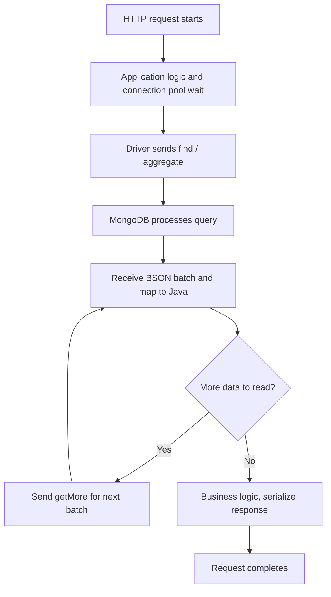

# Measuring Time, Command Count, Document Count, and Data Transfer Size

An API using **Spring Data MongoDB** can be slow even when the query looks simple: a single `find()` may scan hundreds of thousands of documents, a single request may issue dozens of commands, or a query may execute quickly yet still download very large documents. To locate the real bottleneck, you need to measure four groups of signals: **time**, **command count**, **processed document count**, and **data transfer size**.

This lesson belongs to the **Performance** chapter and applies to connection handling and document mapping via `MongoTemplate`, repositories, aggregations, or reactive access. Examples use Java 17+, Spring Boot 3.x, Spring Data MongoDB, Micrometer, and `mongosh`. Metric names and values in the examples are illustrative only; real benchmarks must be run on representative datasets and load levels.

## 1. Distinguishing the four measurement groups

| Measurement group | Question | Signals to inspect | Source |
| --- | --- | --- | --- |
| Time | How long does the user have to wait? | Request `p50/p95/p99`, use case duration, command duration | HTTP metrics, timers, driver monitoring |
| Command count | How many requests does a use case send to MongoDB? | `find`, `aggregate`, `getMore`, `update`, `count`… | MongoDB Java Driver `CommandListener` / tracing |
| Document count | How many records must MongoDB examine to return results? | `totalDocsExamined`, `totalKeysExamined`, `nReturned` | `explain("executionStats")` |
| Data transfer size | How much data travels over the connection? | Total BSON returned; network bytes received/sent | BSON size, network metrics |

These metrics are not interchangeable. A query returning 20 documents may have examined 20,000 documents; a single call to `MongoTemplate.find(...)` may generate multiple commands because the cursor needs to fetch subsequent batches; 20 large documents may consume more bandwidth than 2,000 small documents.

### 1.1. Each layer has its own time scope



- **HTTP latency** measures the entire duration from request to response; it may include multiple MongoDB calls, caching, and other services.
- **Service latency** measures a specific use case; it is suitable for understanding how MongoDB optimizations affect business operations.
- **Driver command duration** measures the duration of each command from the driver's perspective; it does not cover the entire connection pool wait time and result processing in the application.
- **`executionTimeMillis` in explain** reflects the execution time reported by MongoDB for the explain operation; it is not the HTTP latency or the total read time in Java.

To compare measurements, you must specify the scope, units, dataset, number of runs, load level, and cache state.

## 2. Running example: an API fetching 50 orders

Suppose the API `GET /customers/c-001/orders?limit=50` queries the `orders` collection. Each document contains several large fields not needed in the list view:

```javascript
{
  _id: "o-1001",
  customerId: "c-001",
  createdAt: ISODate("2026-11-01T10:00:00Z"),
  status: "PAID",
  total: NumberDecimal("350000"),
  items: [ /* many line items */ ],
  audit: { /* internal audit details */ }
}
```

The requirement only needs `_id`, `createdAt`, `status`, and `total`. MongoDB query:

```javascript
db.orders.find(
  { customerId: "c-001" },
  { _id: 1, createdAt: 1, status: 1, total: 1 }
).sort({ createdAt: -1 }).limit(50)
```

Equivalent with `MongoTemplate`:

```java
import java.util.List;
import org.bson.Document;
import org.springframework.data.domain.Sort;
import org.springframework.data.mongodb.core.MongoTemplate;
import org.springframework.data.mongodb.core.query.Criteria;
import org.springframework.data.mongodb.core.query.Query;

Query query = Query.query(Criteria.where("customerId").is("c-001"))
        .with(Sort.by(Sort.Direction.DESC, "createdAt"))
        .limit(50);
query.fields()
        .include("_id")
        .include("createdAt")
        .include("status")
        .include("total");

List<Document> result = mongoTemplate.find(query, Document.class, "orders");
```

`limit(50)` caps the number of returned records; projection restricts the fields. Both affect data transfer size, while server-side scanning depends on filters, sorts, and indexes. When measuring before/after, keep filter, sort, limit, projection, and collation identical for a fair comparison.

## 3. Measuring time at the Spring Data MongoDB layer

### 3.1. Using Micrometer to measure a use case

With `MongoTemplate.find(...)` returning a `List`, you can measure the call duration from start until the Java list is built:

```java
package example.orders;

import io.micrometer.core.instrument.MeterRegistry;
import io.micrometer.core.instrument.Timer;
import org.bson.Document;
import org.springframework.data.domain.Sort;
import org.springframework.data.mongodb.core.MongoTemplate;
import org.springframework.data.mongodb.core.query.Criteria;
import org.springframework.data.mongodb.core.query.Query;
import org.springframework.stereotype.Service;
import java.util.List;

@Service
public class OrderQueryService {
    private final MongoTemplate mongoTemplate;
    private final MeterRegistry registry;

    public OrderQueryService(
            MongoTemplate mongoTemplate, MeterRegistry registry) {
        this.mongoTemplate = mongoTemplate;
        this.registry = registry;
    }

    public List<Document> recentOrders(String customerId) {
        Query query = Query.query(Criteria.where("customerId").is(customerId))
                .with(Sort.by(Sort.Direction.DESC, "createdAt"))
                .limit(50);
        query.fields()
                .include("_id")
                .include("createdAt")
                .include("status")
                .include("total");

        Timer.Sample sample = Timer.start(registry);
        try {
            return mongoTemplate.find(query, Document.class, "orders");
        } finally {
            sample.stop(registry.timer(
                    "app.mongo.order_list.duration",
                    "operation", "recent_orders"));
        }
    }
}
```

The metric is recorded even if the operation throws an exception. When you need to distinguish failures from successes, add an `outcome` tag with a small set of values. Never use `customerId`, document IDs, query strings, or BSON content as tags because that will cause massive cardinality growth.

Timings that should be tracked together:

1. **HTTP request**: latency histogram by route pattern (e.g., `/customers/{id}/orders`), status, and `p50/p95/p99`.
2. **Use case**: database call time plus business processing in the service.
3. **Driver command**: duration of `find`, `getMore`, `aggregate`, and other commands.
4. **Connection pool**: connection wait latency, active connections, timeout errors.
5. **Post-read**: DTO mapping, transcoding/decompression, response serialization if CPU or memory is suspected.

Do not draw conclusions from the average alone: an average latency of 20 ms can accompany a `p99` over 400 ms. To view reliable percentiles, configure appropriate histograms/distributions; a timer without distribution configuration will not automatically provide all percentiles.

### 3.2. Be careful with cursors, streams, and reactive types

Measurements around a call returning `Stream<T>`, `CloseableIterator<T>`, or `Flux<T>` may finish **before all data is fetched**. In these cases, measure from the start of consumption until completion, error, or cancellation, and close the cursor properly. With reactive access, place the measurement inside the publisher lifecycle—do not call `block()` just to measure time in a reactive request.

With Spring Data repositories, a call returning `Page<T>` may execute an additional total count query; this should be verified via command counts. If the UI only needs to know whether a next page exists, consider `Slice<T>` or keyset pagination with a stable sort order.

## 4. Counting the MongoDB commands actually sent

### 4.1. Java calls and wire commands are not always one-to-one

Suppose a query returns 50 documents. MongoDB may return the initial batch in the `find` command and the driver fetches the rest:

```text
find        -> 1 command, opens cursor and receives initial batch
getMore     -> may be 0, 1, 2, ... commands to fetch remaining batches
killCursors -> may occur when closing a cursor before consuming all results
```

The number of `getMore` commands depends on `batchSize`, document size, MongoDB batch limits, and how the application consumes the cursor. A service calling `findById` for each order inside a loop can also generate dozens of `find` calls: the classic N+1 pattern.

### 4.2. Instrumenting with `CommandListener`

The MongoDB Java Driver emits events when commands succeed or fail. A Spring Boot 3.x example registers the listener via `MongoClientSettingsBuilderCustomizer`; for other Spring Boot versions, check the corresponding imports/customizer:

```java
package example.monitoring;

import com.mongodb.event.CommandFailedEvent;
import com.mongodb.event.CommandListener;
import com.mongodb.event.CommandSucceededEvent;
import io.micrometer.core.instrument.MeterRegistry;
import org.springframework.boot.autoconfigure.mongo.MongoClientSettingsBuilderCustomizer;
import org.springframework.context.annotation.Bean;
import org.springframework.context.annotation.Configuration;
import java.util.Set;
import java.util.concurrent.TimeUnit;

@Configuration
public class MongoCommandMetricsConfig {
    private static final Set<String> TRACKED = Set.of(
            "find", "getMore", "aggregate", "count",
            "distinct", "insert", "update", "delete");

    @Bean
    MongoClientSettingsBuilderCustomizer commandMetrics(MeterRegistry registry) {
        return builder -> builder.addCommandListener(new CommandListener() {
            @Override
            public void commandSucceeded(CommandSucceededEvent event) {
                record(event.getCommandName(), "success",
                        event.getElapsedTime(TimeUnit.NANOSECONDS));
            }

            @Override
            public void commandFailed(CommandFailedEvent event) {
                record(event.getCommandName(), "failure",
                        event.getElapsedTime(TimeUnit.NANOSECONDS));
            }

            private void record(
                    String command, String outcome, long durationNanos) {
                if (!TRACKED.contains(command)) {
                    return;
                }
                registry.counter(
                        "mongodb.driver.command.count",
                        "command", command, "outcome", outcome).increment();
                registry.timer(
                        "mongodb.driver.command.duration",
                        "command", command, "outcome", outcome)
                        .record(durationNanos, TimeUnit.NANOSECONDS);
            }
        });
    }
}
```

`CommandListener` counts **completed commands**, not business logic operations or HTTP requests. If the driver retries an operation, the listener may record multiple commands. `getMore` is counted separately. If the project already enables telemetry/observation from the driver or Spring Boot, check for duplicate metric recording before adding the listener.

To calculate **commands per request**, correlate command spans with the HTTP request trace using tracing/observability that supports the driver, or measure an isolated scenario. Do not divide total system-wide commands by the requests of a single API when other APIs, background jobs, connections, and retries are running. Do not rely on a simple `ThreadLocal` to attribute commands to requests in reactive/async code.

Do not log entire BSON commands because filters, documents, and tokens may contain sensitive data; logging the command name, duration, outcome, and trace ID is sufficient for most investigations.

## 5. Measuring the number of documents MongoDB must examine

### 5.1. Analyzing with `explain("executionStats")`

Run in `mongosh` with the same filter, projection, sort, and limit as the application:

```javascript
db.orders.find(
  { customerId: "c-001" },
  { _id: 1, createdAt: 1, status: 1, total: 1 }
).sort({ createdAt: -1 })
 .limit(50)
 .explain("executionStats")
```

Key fields:

| Field | Meaning | How to read |
| --- | --- | --- |
| `nReturned` | Number of results returned by the explained query | Not the number of documents examined |
| `totalDocsExamined` | Number of server-side document examinations | High relative to results can signal an inefficient scan |
| `totalKeysExamined` | Number of index entries examined | Shows the amount of work done on the index |
| `executionTimeMillis` | Execution time reported by the server | Not equivalent to application or HTTP latency |
| `winningPlan` | Selected plan | Look for `COLLSCAN`, `IXSCAN`, `FETCH`, `SORT`… |

**Illustrative** example for the same 50 results:

| Plan | `nReturned` | `totalDocsExamined` | `totalKeysExamined` |
| --- | ---: | ---: | ---: |
| Collection scan | 50 | 120,000 | 0 |
| Suitable index | 50 | 50 | 50 |

You can try an index supporting the filter and sort:

```javascript
db.orders.createIndex({ customerId: 1, createdAt: -1 })
```

This is not a recommendation to create an index in every case; you must consider selectivity, existing indexes, collation, index size, and write cost per insert/update. Use `explain` on representative data to verify effectiveness.

An exploratory ratio:

```text
scanAmplification = totalDocsExamined / max(nReturned, 1)
```

If 10,000 documents are examined to return 10 documents, the ratio is 1,000. When `nReturned = 0`, the ratio is merely a convention; look directly at the examined counts. A query completely covered by an index (covered query) can have `totalDocsExamined = 0` while still returning results, so this number does not mean the server did zero work.

### 5.2. Aggregations and distributed queries

With `$match`, `$lookup`, `$sort`, `$group`, or `$facet`, statistics may appear per stage, and the query may generate many intermediate results before returning a few final documents. In a sharded cluster, metrics may also appear per shard. Do not mechanically add or compare fields from different scopes; inspect the exact stage and shard causing high CPU, memory, scan, or disk usage.

### 5.3. Documents returned to the application are a different quantity

With `List<Document>`, `result.size()` counts the documents the Java call actually received. With a cursor or `Flux`, count what was **consumed or emitted**. This number is not `totalDocsExamined`, nor does it necessarily match `nReturned` from a separate `explain` run if data or timing changes. Calling `countDocuments()` itself also has a cost and may issue an extra command.

## 6. Measuring BSON size and network bytes

### 6.1. Estimating received data via BSON

In `mongosh`, you can sum the BSON size of each received document:

```javascript
let count = 0;
let bsonBytes = 0;

const cursor = db.orders.find(
  { customerId: "c-001" },
  { _id: 1, createdAt: 1, status: 1, total: 1 }
).sort({ createdAt: -1 }).limit(50);

while (cursor.hasNext()) {
  const doc = cursor.next();
  count++;
  bsonBytes += Object.bsonsize(doc);
}

printjson({ documentCount: count, estimatedBsonBytes: bsonBytes });
```

`Object.bsonsize(doc)` reports the BSON representation size of a document. Total BSON is **not** the actual number of bytes sent over the network: beyond BSON, there are protocol envelopes, cursor metadata, client-side commands, and the effects of compression, TLS, and batching. The JSON size returned over HTTP also differs from BSON.

Compare with the same filter and `limit` before/after selecting only the required fields. If documents have very large `items` and `audit` fields, projection can significantly reduce bytes received and decoding overhead. To conclude how many actual network bytes were saved, measure at the network layer.

### 6.2. Measuring network bytes at the right scope

| Source | Useful value | Limitation |
| --- | --- | --- |
| Sum of `Object.bsonsize()` | Estimates returned BSON data size | Excludes protocol overhead and compression |
| `db.serverStatus().network.bytesIn/bytesOut` | Cumulative byte counters at the MongoDB process level | Includes many clients and other operations |
| Infrastructure / OS / exporter metrics | Bytes per interface, connection, or instance | Must accurately identify direction and scope |
| Authorized proxy or packet capture | Actual bytes on the wire | TLS/compression makes payload inspection harder and adds overhead |
| HTTP response metrics | Bytes from application to user | Not the bytes between the Java driver and MongoDB |

From the **MongoDB server perspective**, `bytesIn` is bytes received by the server, and `bytesOut` is bytes sent by the server. Taking the difference between two `serverStatus()` samples is only reliable if you understand background traffic and other clients. Never take a cluster-wide `bytesOut` delta and attribute it to a single API request.

To evaluate the impact of projection, record **documents received**, **total BSON of returned documents**, and **measured network bytes** separately. These three measurements clarify whether payload reduction translates into actual traffic savings.

## 7. Reading all four metric groups to diagnose

Consider an endpoint fetching 50 orders and related customer info. Before optimization, each order triggers an additional `findById`; after optimization, the service batches related queries and applies projection/indexing. The following table is **purely hypothetical** to illustrate interpretation:

| Metric | Before | After | Meaning |
| --- | ---: | ---: | --- |
| HTTP `p95` | 420 ms | 110 ms | Users wait less |
| MongoDB commands / request | 51 | 2 | Eliminated N+1 repeated queries |
| Total `docsExamined` across measurements | 18,000 | 60 | More efficient query/index |
| Documents received by application | 60 | 60 | Equivalent business records |
| Total returned document BSON | 380 KB | 45 KB | Projection removed unnecessary large fields |

Do not use these illustrative numbers as absolute targets for other systems. Reducing commands via `$lookup` or `$in` can trade off for a more complex query or larger intermediate BSON; always measure the overall impact.

### Common patterns

1. **High command count, latency scales with record count:** suspect N+1, repository calls in a loop, or frequent `getMore` due to a tiny batch size.
2. **Few commands but very high `docsExamined`:** check for `COLLSCAN`, index key order, filter conditions, sorts, and aggregations.
3. **Small `docsExamined` but large BSON:** use projection, limit record counts, paginate, and avoid loading unnecessary fields.
4. **Fast commands but slow HTTP:** check connection pool waits, Java decoding/mapping, DTOs, JSON serialization, CPU, and other dependencies.
5. **Fast queries under low load but slow under high concurrency:** check throughput, pool, CPU, I/O, page faults, queues, and cluster resources.

A larger `batchSize` can reduce `getMore` calls but increases each batch size and memory pressure; a smaller `batchSize` can increase round trips. Test on the same dataset. Deep `skip` forces the server to walk past many results; with a suitable index and stable sort key, consider keyset/range pagination with a unique tie-breaker when `createdAt` values collide.

## 8. Running repeatable benchmarks

A test run must record:

| Component | Parameters to record |
| --- | --- |
| Data | Document count, document size, selectivity, ratio of large fields |
| Query | Filter, sort, projection, collation, limit, batch size, read preference |
| Infrastructure | MongoDB, driver, Spring Data versions; topology, indexes, connection config |
| Load | Requests/second, concurrency, warm-up, measurement duration, sample count |
| State | Connection pool, warm/cold cache, presence of write workload |
| Results | HTTP `p50/p95/p99`, commands, `docsExamined`, `nReturned`, BSON and network bytes |

**Measurement procedure:**

1. Pick a use case with problematic latency or data transfer; define the business output that must remain unchanged.
2. Measure the baseline: application timer, command metrics, `explain("executionStats")`, and BSON size on the exact same scenario.
3. Change one cause group at a time (e.g., index, N+1, or projection) and document the change.
4. Re-run after warm-up with the same load, duration, dataset, and pool/cache conditions; compare percentiles, commands, server work, and bytes.
5. Check side effects: CPU, heap, I/O, write throughput, and index maintenance cost.

Sample result template:

```text
case: recent_orders_50
dataset: 1_200_000 orders
filter: customerId = c-001
sort: createdAt descending
projection: _id, createdAt, status, total
load: 100 requests/second; concurrency 20
samples: 10_000 measured requests after warm-up
http_p95_ms: <measured>
command_per_request_p95: <measured>
find_getMore_counts: <measured>
explain_docs_examined: <measured>
explain_keys_examined: <measured>
explain_n_returned: <measured>
estimated_bson_bytes: <measured>
network_bytes: <measured and scope specified>
```

`explain` does not replace request-level measurements. Never take `executionTimeMillis` from a single low-load run and claim it represents the exact share of HTTP latency under high application load.

### Profiler, slow queries, and production observability

The MongoDB profiler, slow query logs, or APM can provide fields such as `millis`, `docsExamined`, `keysExamined`, and `nreturned` for recorded operations. Fields vary by operation type, server version, and configuration. Detailed profiling has overhead; enable it only with appropriate thresholds/sampling and avoid storing query parameters containing unnecessary sensitive data.

## 9. Common measurement pitfalls

| Wrong measurement | Consequence | Remedy |
| --- | --- | --- |
| Measuring averages only | Hides slow tail requests | Use histograms and `p95/p99` |
| Treating one Java `find()` as one command | Misses `getMore` and retries | Count driver events |
| Mistaking `nReturned` for `docsExamined` | Misjudges scan volume | Read both from `executionStats` |
| Treating `executionTimeMillis` as HTTP latency | Misses pool, network, and Java logic | Measure each scope separately |
| Calling `countDocuments()` just to measure result count | Adds extra workload and commands | Separate count queries from stats of the query being tuned |
| Treating JSON size as MongoDB bytes | Confuses BSON with JSON/protocol | Measure BSON and network bytes |
| Using `serverStatus().network` for one request | Shared counter across all clients | Isolate scenario or measure per connection |
| Stopping timer right when creating stream/Flux | Excludes data consumption time | Measure until complete/error/cancel |
| Comparing cold-cache baseline against warm-cache new run | Biased conclusion | Warm up and record cache state |
| Logging full commands to measure | Increases I/O and risks data exposure | Log command name, outcome, duration, trace ID |

## 10. Hands-on exercises

**Exercise 1 — Reduce document scans.** Seed 100,000 synthetic orders, with 1,000 orders belonging to one customer. Run the query fetching the 50 newest orders before/after adding an index matching the filter/sort. Record `totalDocsExamined`, `totalKeysExamined`, `nReturned`, winning plan, and `p95` under identical conditions.

**Exercise 2 — N+1 queries.** Write a service that reads a list of orders and looks up each related record using a repository. Count commands in an isolated scenario, switch to an `$in` query or suitable aggregation, and compare command counts, latency, and BSON.

**Exercise 3 — Data size.** Measure total `Object.bsonsize()` of 50 orders with all fields versus a four-field projection. Explain why the BSON reduction does not necessarily equal the actual network byte or HTTP JSON response reduction.

**Exercise 4 — Reactive streaming.** With a `Flux` returning thousands of documents, measure the duration from subscribe to complete/error/cancel and count emitted documents. Test different batch sizes; compare `getMore` counts, completion time, and memory/backpressure behavior.

**Completion criteria:** You can instrument application, driver, and server measurement points; distinguish command count, documents examined, documents returned, and bytes transferred; explain a query using `explain`; and evaluate an optimization on a repeatable scenario.
