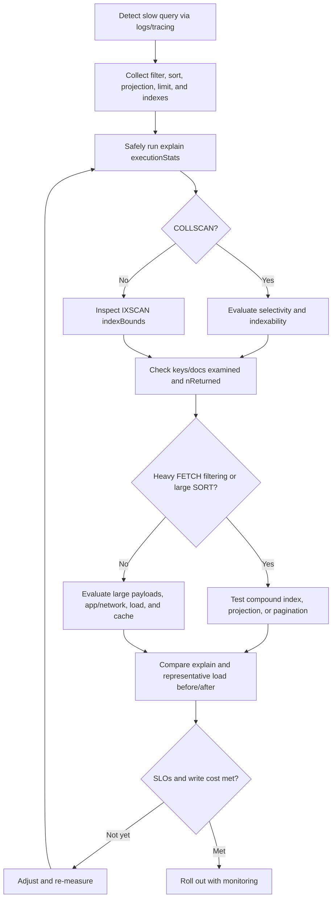

# Reading COLLSCAN, IXSCAN, FETCH, SORT, and Examined Document/Index Key Counts

> **Chapter:** Performance · **Module:** `SPRING_DATA_MONGODB`. When using Spring Data MongoDB to query via repositories, `MongoTemplate`, or reactive access, merely having an index does not prove a query runs fast. MongoDB might scan the entire collection, traverse many index keys, fetch extra documents, or sort in memory. This lesson walks through reading `explain()` to identify the root cause, quantify the work performed, and verify query or index changes.

## 1. The problem: same 20 results, vastly different costs

An API returns the 20 most recent paid orders for a tenant:

```javascript
db.orders.find({
  tenantId: "t-3",
  status: "PAID"
}).sort({ createdAt: -1 }).limit(20);
```

Both executions return **20 documents**, yet very different things can happen:

| Plan | Index keys examined | Documents examined | Returned | Meaning |
|---|---:|---:|---:|---|
| `COLLSCAN`, filter then sort | 0 | 500,000 | 20 | Must inspect a massive volume of documents |
| `IXSCAN → FETCH`, filter `status` at FETCH | 6,000 | 6,000 | 20 | Uses an index but still reads many non-matching documents |
| `IXSCAN → FETCH`, index matches filter/sort | 20 | 20 | 20 | Hits exact index range, fetches 20 documents |
| `IXSCAN`, projection covered by index | 20 | 0 | 20 | No need to read documents from the collection |

These numbers are **illustrative scenarios only**, not measurements from a specific database. The key is looking simultaneously at **the plan**, **read operation counts**, and **result counts**. You cannot conclude a query is efficient simply because `IXSCAN` appears.

### Three questions before optimizing

1. Does the query target a narrow index range, or must it traverse many documents/keys?
2. Does MongoDB have to **FETCH** documents to evaluate remaining predicates or return projections?
3. Do results go through a **SORT** that collects/sorts data, or can they follow index order?

`explain` helps answer these, though it must be paired with actual application latency, data distribution, and server load.

## 2. Using `explain()` properly

Syntax in `mongosh`:

```javascript
db.orders.find({
  tenantId: "t-3",
  status: "PAID"
}).sort({ createdAt: -1 }).limit(20)
  .explain("executionStats");
```

MongoDB supports three common verbosity modes:

| Mode | Contents | When to use |
|---|---|---|
| `"queryPlanner"` | Winning plan structure, index, bounds, and any rejected plans | See how the planner intends to run the query |
| `"executionStats"` | Plan info + metrics collected while executing the winning plan | Diagnose how many index keys/documents were examined |
| `"allPlansExecution"` | Adds stats from evaluating candidate plans | Investigate why the planner picked a plan; consumes extra analysis resources |

**`executionStats`** is the best starting point for this lesson. It shows measured execution stats, though `explain()` is not completely identical to regular application queries: explaining a plan bypasses plan-cache selection and does not populate cache entries like normal execution. On systems under load, run diagnostic queries only after weighing their scope and cost.

### 2.1. Key sections in the JSON

An `explain("executionStats")` result generally looks like:

```javascript
{
  queryPlanner: {
    namespace: "shop.orders",
    parsedQuery: { /* parsed filter */ },
    winningPlan: { /* chosen stage tree */ },
    rejectedPlans: [ /* other candidates, if any */ ]
  },
  executionStats: {
    executionSuccess: true,
    nReturned: 20,
    executionTimeMillis: 3,
    totalKeysExamined: 59,
    totalDocsExamined: 59,
    executionStages: { /* execution tree and per-stage stats */ }
  }
}
```

Example values do not imply every query takes 3 ms. Depending on version, query engine, and topology, plans may appear under different paths and names:

- **Classic engine:** typically shows `winningPlan.stage` and nested `inputStage`/`inputStages`.
- **Slot-Based Execution (SBE):** may show `winningPlan.queryPlan` and `slotBasedPlan`; `executionStages` uses different stage names and stats than classic, such as `scan`, `ixseek`, `seek`, `filter`, or `sort`.
- **Sharded cluster:** includes `SHARD_MERGE`, `SHARDING_FILTER`, and per-shard plans and statistics.

Therefore, **read the execution tree** instead of writing parser scripts tied to `winningPlan.stage === "IXSCAN"` at a fixed path.

### 2.2. Extracting key numbers for a quick view

```javascript
const report = db.orders.find({
  tenantId: "t-3",
  status: "PAID"
}).sort({ createdAt: -1 }).limit(20)
  .explain("executionStats");

printjson({
  nReturned: report.executionStats?.nReturned,
  totalKeysExamined: report.executionStats?.totalKeysExamined,
  totalDocsExamined: report.executionStats?.totalDocsExamined,
  executionTimeMillis: report.executionStats?.executionTimeMillis,
  winningPlan: report.queryPlanner?.winningPlan
});
```

On some aggregation or sharded execution plans, detailed stats sit elsewhere. If top-level numbers are absent, check `stages`, `$cursor.executionStats`, or per-shard reports.

## 3. Understanding `COLLSCAN`: scanning collection documents

`COLLSCAN` (*collection scan*) iterates through documents in the collection to find matching records. Because no index is used to locate results, a collection-scan-only plan typically shows:

- `totalKeysExamined = 0`;
- large `totalDocsExamined` if many documents must be inspected;
- `nReturned` potentially very small or 0 when filters are selective.

Diagram:

```text
COLLSCAN (scan documents) → FILTER predicates → LIMIT / SORT / results
```

Example looking up a customer code without an index:

```javascript
db.orders.find({ customerCode: "C-0042" })
  .explain("executionStats");
```

If the collection has 600,000 documents and only 100 match, the engine may read nearly the entire collection. Yet **`COLLSCAN` is not always a bug**:

- Very small collection: a single scan can be cheaper than reading an index and fetching documents one by one.
- Query returns most of the collection: an index may offer no benefit.
- Batch/reporting job intentionally reading all data: sequential scanning may fit best.
- Unfiltered query with small limit: a scan plan may have acceptable cost.

Ask the right question: **is it scanning way too much relative to returned results and required load?** If yes, design an index matching the filter, sort, and projection—not just blindly indexing any field mentioned in the query.

## 4. Understanding `IXSCAN`: scanning index keys

`IXSCAN` (*index scan*) traverses **index keys** across one or more bound intervals. With B-tree indexes, MongoDB can jump directly to the matching key range and scan forward or backward. Useful fields include:

- `indexName`: name of the index used.
- `keyPattern`: field order and sort directions of the index.
- `indexBounds`: value intervals the engine traverses on each index field.
- `direction`: forward or backward traversal along index order, when shown.
- `keysExamined`: number of index keys examined by this stage.

Example index:

```javascript
db.orders.createIndex(
  { tenantId: 1, status: 1, createdAt: -1 },
  { name: "idx_tenant_status_created" }
);
```

With query:

```javascript
db.orders.find({
  tenantId: "t-3",
  status: "PAID"
}).sort({ createdAt: -1 }).limit(20)
  .explain("executionStats");
```

Illustrative `indexBounds` might correspond to:

```javascript
{
  tenantId: ["[\"t-3\", \"t-3\"]"],
  status: ["[\"PAID\", \"PAID\"]"],
  createdAt: ["[MaxKey, MinKey]"]
}
```

This is a **conceptual illustration of bounds**, not exact JSON strings across every version/direction. The first two fields are equality-bounded, while `createdAt` is scanned in index order; the newest orders can be fetched without a separate `SORT`.

Conversely, index `{tenantId:1,createdAt:-1}` omits `status`; it may scan every status for that tenant and leave `FETCH` to filter `status`. Seeing `IXSCAN` here has not fully solved the problem.

### 4.1. `IXSCAN` can still be very expensive

Signs:

- `totalKeysExamined` much larger than `nReturned`: scanning too many keys before finding results.
- Overly wide `indexBounds`, showing `MinKey`/`MaxKey` on an important field the query fails to narrow.
- Effective predicate sits on an unindexed field or follows a range condition that weakens prefix selectivity.
- **Multikey** indexes on arrays can generate multiple index keys per document; thus examined keys can exceed examined documents.
- Deep `skip(N)` pagination can walk through many keys before returning a few results.

Do not assume `totalKeysExamined` equals the number of **unique documents**. It counts key checks during execution, and stages may handle duplicates in scenarios like multikey indexes.

## 5. Understanding `FETCH`: reading actual documents

`FETCH` typically sits **above `IXSCAN`** when MongoDB must retrieve documents from the collection to:

1. Evaluate filters the index could not fully resolve; or
2. Return requested fields absent from the index.

Example:

```text
LIMIT
  └── FETCH                // filter status or retrieve Order fields
        └── IXSCAN         // tenantId + createdAt
```

With index `{tenantId:1,createdAt:-1}` and filter `{tenantId:"t-3",status:"PAID"}`, the engine knows the tenant from the index but not `status` from the index key; reading the document and checking `status` typically happen at `FETCH`.

An abbreviated, illustrative `executionStages` tree:

```javascript
{
  stage: "LIMIT",
  nReturned: 20,
  inputStage: {
    stage: "FETCH",
    nReturned: 20,
    docsExamined: 58,
    filter: { status: { $eq: "PAID" } },
    inputStage: {
      stage: "IXSCAN",
      indexName: "idx_tenant_created",
      keysExamined: 58
    }
  }
}
```

Here `FETCH` reads 58 documents to return 20 documents. Those 38 documents are not broken; they simply did not pass the post-index filter.

### 5.1. `FETCH` is not always bad

If the API needs full order documents to return JSON, fetching roughly `nReturned` documents is completely normal. What warrants attention is **many fetches yielding very few results**, as random fetches can drive up I/O and cache misses.

An index containing every field needed for filtering, sorting, and projection can achieve a **covered query**, where data comes exclusively from the index:

```javascript
db.orders.find(
  { tenantId: "t-3", status: "PAID" },
  { _id: 0, tenantId: 1, status: 1, createdAt: 1 }
).sort({ createdAt: -1 }).limit(20)
  .explain("executionStats");
```

If `{tenantId:1,status:1,createdAt:-1}` covers everything without hitting multikey/collation/filter limitations, `totalDocsExamined` can be **0**. Classic explain sometimes shows `PROJECTION_COVERED` and `IXSCAN` without `FETCH`; SBE uses a different stage shape. Projecting `_id: 0` matters because MongoDB returns `_id` by default, whereas the example compound index does not include it.

**Do not build overly wide indexes just to cover every query:** large indexes inflate storage and write overhead. Prioritize key query shapes and measure total cost.

## 6. Understanding `SORT`: results must be sorted

When the index does not provide the order requested by the query, MongoDB may use a `SORT` stage to sort intermediate results. Unlike sequentially reading an already-ordered index, an unindexed sort typically collects records/sort keys before emitting the first result.

Example:

```javascript
db.orders.find({
  tenantId: "t-3",
  status: "PAID"
}).sort({ amountCents: -1 }).limit(20)
  .explain("executionStats");
```

If only `{tenantId:1,status:1,createdAt:-1}` exists, it cannot supply `amountCents` order. The plan may be `IXSCAN → FETCH → SORT`, or the planner might pick `COLLSCAN → SORT`. Display structure, execution order, and auxiliary stages depend on the query engine.

### 6.1. When is `SORT` unnecessary?

Suppose the index is:

```javascript
{ tenantId: 1, status: 1, createdAt: -1 }
```

Query:

```javascript
db.orders.find({
  tenantId: "t-3",
  status: "PAID"
}).sort({ createdAt: -1 }).limit(20);
```

Because fields before `createdAt` are equality-bound, MongoDB can traverse the index in the desired order, avoiding a separate `SORT` stage. If you change the sort to `amountCents`, or structure the filter such that index order no longer aligns, a sort may become necessary.

**Absence of `SORT` does not prove a query is fast.** For example, an index with the right sort order but weak filtering might still scan hundreds of thousands of keys before collecting 20 matches.

### 6.2. Does `SORT` always consume huge memory?

No. MongoDB can optimize a **sort + limit** combination into a top-k sort keeping only the needed candidates. Still, it may have to **read a huge number of inputs** to identify the top 20 elements; `totalDocsExamined`/`totalKeysExamined` reveal that work. Memory limits and spill-to-disk behavior vary across MongoDB versions and query types; monitor sort metrics and logs rather than guessing from a single default limit.

If `SORT` happens over large datasets on frequent queries, consider:

- Designing a compound index supporting **equality then sort**, accounting for range fields.
- Aligning the sort field with query capabilities and business requirements.
- Switching large `skip` pagination to keyset/cursor pagination where appropriate.
- Reducing intermediate data early with selective filters.

## 7. Reading the three numbers: `nReturned`, `totalKeysExamined`, `totalDocsExamined`

These three numbers typically live in `executionStats`:

| Field | Interpretation | Notes |
|---|---|---|
| `nReturned` | Number of results returned at the measured level | With `limit(20)`, usually at most 20, not total matching documents |
| `totalKeysExamined` | Total index keys checked | Can be 0 with `COLLSCAN`; high with wide bounds/multikey |
| `totalDocsExamined` | Total document examinations/reads during execution | Not necessarily **distinct** documents; can be 0 when covered |
| `executionTimeMillis` | Execution time reported in `explain` | Not HTTP latency; depends on cache, load, version, and measurement |

### 7.1. Scan-to-result ratios

When `nReturned > 0`, you can calculate:

```text
keysPerResult = totalKeysExamined / nReturned
docsPerResult = totalDocsExamined / nReturned
```

Example comparing plans that each return 20 results:

| Plan | `nReturned` | `totalKeysExamined` | `totalDocsExamined` | Keys/result | Docs/result |
|---|---:|---:|---:|---:|---:|
| A: IXSCAN + late-filter FETCH | 20 | 8,000 | 8,000 | 400 | 400 |
| B: IXSCAN + selective FETCH | 20 | 22 | 22 | 1.1 | 1.1 |
| C: Covered query | 20 | 20 | 0 | 1 | 0 |
| D: COLLSCAN | 20 | 0 | 500,000 | 0 | 25,000 |

Ratios help spot **read amplification**; there is no universal threshold like "over 10 is always broken." Account for low-result queries, small datasets, query type, projection, tenant skew, and latency SLAs. When `nReturned = 0`, **do not divide by zero**: inspect raw examined keys/docs directly to see the work spent proving no matches exist.

### 7.2. Interpreting common combinations

- **`keys = 0`, very high `docs`, small `nReturned`:** likely `COLLSCAN`; check filters and candidate indexes.
- **Very high `keys`, very high `docs`, small `nReturned`:** wide `IXSCAN` with heavy `FETCH`; inspect `indexBounds` and `FETCH.filter`.
- **High `keys`, `docs = 0`:** query may be covered yet have wide bounds; index-only does not automatically mean efficient.
- **`keys` close to `nReturned`, `docs` close to `nReturned`:** potentially a solid plan if document fetching is required; verify whether `SORT` or other heavy work exists.
- **`keys` close to `nReturned`, `docs = 0`:** typically a well-tuned covered query; still verify resources and real latency.
- **`nReturned = 0`, `docs = 0`:** the index may have quickly determined zero matches; check bounds and plan before concluding.
- **High `docs` when `nReturned` is also high:** can be normal for batch jobs intentionally reading many documents; optimize within the task's resource budget.

### 7.3. How do stage-level and top-level metrics differ?

Within `executionStages`, each stage can report its own `nReturned`. `IXSCAN` might emit many index entries, `FETCH` filters some out, `SORT` forwards a subset, and `LIMIT` caps at 20. Never sum `nReturned` across all stages: they represent **the same data stream passing through steps**, not distinct documents. In sharded clusters, inspect per-shard plans/stats before inferring from aggregates.

If outputs include `works`, `advanced`, `needTime`, `seeks`, or `saveState`, those are engine-dependent auxiliary counters. For initial comparisons across versions, rely on the steadier top-level metrics first, then drill into stage counters when needed.

## 8. Hands-on exercises to run in `mongosh`

The exercises use a dedicated **`explain_lab`** database and **`ordersExplainLab`** collection—not for production. Indexes are created after seeding data to observe differences. Run the seed block **once on an empty collection**; re-running with the same `_id` values will fail with duplicate key errors.

### 8.1. Seed 6,000 documents with varied distribution

```javascript
use explain_lab

db.ordersExplainLab.insertMany(
  Array.from({ length: 6000 }, (_, i) => ({
    _id: i,
    tenantId: "t-" + (i % 12),
    status: ["NEW", "PAID", "CANCELLED"][Math.floor(i / 12) % 3],
    createdAt: new Date(Date.UTC(2026, 0, 1) + i * 60_000),
    amountCents: 1000 + ((i * 37) % 50000),
    customerCode: "C-" + String(i % 300).padStart(4, "0")
  }))
);

db.ordersExplainLab.countDocuments({});
```

Because `status` rotates every 12 documents, every tenant has all three statuses. For example, `tenantId = "t-3"` has roughly 500 documents, one-third with `status = "PAID"`.

### 8.2. Case A — `COLLSCAN` on an unindexed field

```javascript
const a = db.ordersExplainLab
  .find({ customerCode: "C-0042" })
  .explain("executionStats");

printjson({
  plan: a.queryPlanner.winningPlan,
  n: a.executionStats.nReturned,
  keys: a.executionStats.totalKeysExamined,
  docs: a.executionStats.totalDocsExamined
});
```

Without an index on `customerCode`, on a standard collection you expect `COLLSCAN`, `keys = 0`, and a high examined document count. Inspect the actual output, as plan shapes may contain wrapper/auxiliary stages.

### 8.3. Case B — `IXSCAN + FETCH`, filtering status after index scan

```javascript
db.ordersExplainLab.createIndex(
  { tenantId: 1, createdAt: -1 },
  { name: "idx_tenant_created" }
);

const b = db.ordersExplainLab.find({
  tenantId: "t-3",
  status: "PAID"
}).sort({ createdAt: -1 })
  .limit(20)
  .hint("idx_tenant_created")
  .explain("executionStats");

printjson({
  plan: b.queryPlanner.winningPlan,
  n: b.executionStats.nReturned,
  keys: b.executionStats.totalKeysExamined,
  docs: b.executionStats.totalDocsExamined
});
```

Here `hint` is used **strictly to isolate index choice while learning**. Because `status` is absent from v1 of the index, finding 20 `PAID` documents may examine many documents with other statuses. Expect examined keys and docs to exceed `nReturned`; exact counts depend on data ordering.

### 8.4. Case C — compound index matching filter and sort

```javascript
db.ordersExplainLab.createIndex(
  { tenantId: 1, status: 1, createdAt: -1 },
  { name: "idx_tenant_status_created" }
);

const c = db.ordersExplainLab.find({
  tenantId: "t-3",
  status: "PAID"
}).sort({ createdAt: -1 })
  .limit(20)
  .hint("idx_tenant_status_created")
  .explain("executionStats");

printjson({
  plan: c.queryPlanner.winningPlan,
  n: c.executionStats.nReturned,
  keys: c.executionStats.totalKeysExamined,
  docs: c.executionStats.totalDocsExamined
});
```

Since equality filters match the first two fields and sort uses the third, the new index can fetch roughly the 20 needed documents without scanning other statuses, and without a separate `SORT`. Compare `b.executionStats` and `c.executionStats`, especially `totalKeysExamined`/`totalDocsExamined`.

### 8.5. Case D — covered query, `totalDocsExamined = 0`

```javascript
const d = db.ordersExplainLab.find(
  { tenantId: "t-3", status: "PAID" },
  { _id: 0, tenantId: 1, status: 1, createdAt: 1 }
).sort({ createdAt: -1 })
  .limit(20)
  .hint("idx_tenant_status_created")
  .explain("executionStats");

printjson({
  plan: d.queryPlanner.winningPlan,
  n: d.executionStats.nReturned,
  keys: d.executionStats.totalKeysExamined,
  docs: d.executionStats.totalDocsExamined
});
```

When returning only indexed fields without coverage-breaking conditions, `docs` is expected to be **0**. Changing the projection to `{_id:0,tenantId:1,status:1,amountCents:1}` forces `FETCH` because `amountCents` is not in the index.

### 8.6. Case E — `SORT` outside the index

```javascript
const e = db.ordersExplainLab.find({
  tenantId: "t-3",
  status: "PAID"
}).sort({ amountCents: -1 })
  .limit(20)
  .hint("idx_tenant_status_created")
  .explain("executionStats");

printjson({
  plan: e.queryPlanner.winningPlan,
  n: e.executionStats.nReturned,
  keys: e.executionStats.totalKeysExamined,
  docs: e.executionStats.totalDocsExamined
});
```

Because the index lacks `amountCents`, MongoDB must sort by that field and `SORT`/`sort` may appear in the tree. Having `limit(20)` does not limit reading to 20 documents: it must locate the 20 largest `amountCents` across the **entire filtered subset**.

### 8.7. Consistent summary comparison

```javascript
for (const [name, x] of [
  ["A_COLLSCAN", a],
  ["B_FETCH_LATE_FILTER", b],
  ["C_GOOD_COMPOUND", c],
  ["D_COVERED", d],
  ["E_SORT", e]
]) {
  const s = x.executionStats;
  printjson({
    case: name,
    returned: s.nReturned,
    keysExamined: s.totalKeysExamined,
    docsExamined: s.totalDocsExamined,
    ms: s.executionTimeMillis,
    keysPerResult: s.nReturned ? s.totalKeysExamined / s.nReturned : null,
    docsPerResult: s.nReturned ? s.totalDocsExamined / s.nReturned : null
  });
}
```

Base conclusions on **actual output** and multiple representative runs. With 6,000 documents, latency differences may be tiny because everything fits in RAM; differences in examined counts show the trend to validate on larger datasets.

## 9. Connecting to Spring Data MongoDB: repositories, `MongoTemplate`, and reactive

Spring Data maps Java property names to BSON field names via metadata, building filters/sorts from repositories and `Query`. To read the right plan, inspect the **query actually sent to MongoDB**, not just the repository method name.

### 9.1. Equivalent query in `MongoTemplate`

```java
import java.util.List;

import org.springframework.data.domain.Sort;
import org.springframework.data.mongodb.core.MongoTemplate;
import org.springframework.data.mongodb.core.query.Criteria;
import org.springframework.data.mongodb.core.query.Query;

public List<Order> newestPaidOrders(MongoTemplate mongoTemplate, String tenantId) {
    Query query = new Query(
        Criteria.where("tenantId").is(tenantId)
                .and("status").is("PAID")
    );
    query.with(Sort.by(Sort.Direction.DESC, "createdAt")).limit(20);
    return mongoTemplate.find(query, Order.class);
}
```

The example assumes `Order` is an entity mapped with `@Document("orders")`. With a repository, an equivalent derived method might look like:

```java
import java.util.List;
import org.springframework.data.mongodb.repository.MongoRepository;

public interface OrderRepository extends MongoRepository<Order, String> {
    List<Order> findTop20ByTenantIdAndStatusOrderByCreatedAtDesc(
        String tenantId, String status
    );
}
```

The actual BSON shape depends on `@Field`, collation, projection, query options, and mapping. With `@Field("tenant_id")`, MongoDB indexes and `explain` must use the stored name `tenant_id`, even though Java names the property `tenantId`.

### 9.2. Obtaining explain via the MongoDB Java Driver from `MongoTemplate`

For explicit diagnostics on the `orders` collection, use a callback accepting `MongoCollection`:

```java
import com.mongodb.ExplainVerbosity;
import com.mongodb.client.model.Filters;
import com.mongodb.client.model.Sorts;
import org.bson.Document;
import org.springframework.data.mongodb.core.MongoTemplate;

public final class OrderExplainDiagnostics {

    private final MongoTemplate template;

    public OrderExplainDiagnostics(MongoTemplate template) {
        this.template = template;
    }

    public Document explainNewestPaidOrders(String tenantId) {
        return template.execute("orders", collection ->
            collection.find(
                    Filters.and(
                        Filters.eq("tenantId", tenantId),
                        Filters.eq("status", "PAID")
                    )
                )
                .sort(Sorts.descending("createdAt"))
                .limit(20)
                .explain(ExplainVerbosity.EXECUTION_STATS)
        );
    }
}
```

This snippet uses the **MongoDB sync driver** inside `MongoTemplate`. It produces an explain report, **not a list of Orders**; keep it separate from normal API request paths. For applications using only `ReactiveMongoTemplate`, ensure diagnostics do not block the event loop; run a separate debug task or use the compatible reactive driver API.

Read metrics safely even when the driver returns numeric types in varying formats:

```java
Document report = diagnostics.explainNewestPaidOrders("t-3");
Document execution = report.get("executionStats", Document.class);

System.out.println("nReturned = " + execution.get("nReturned"));
System.out.println("keysExamined = " + execution.get("totalKeysExamined"));
System.out.println("docsExamined = " + execution.get("totalDocsExamined"));
System.out.println("winningPlan = "
    + report.get("queryPlanner", Document.class).get("winningPlan"));
```

If output fields do not sit at these paths in a specific version/topology, inspect the full JSON. Do not send explain JSON containing sensitive data to public logs; filters and namespaces can contain business values.

### 9.3. Diagnostics must distinguish application queries from test queries

Spring Data may add collation, projection, or tenant/soft-delete conditions. An index that works well for `tenantId + status` might not work well if the app applies another `sort`. Therefore:

1. Confirm the **BSON filter, sort, projection, collation, and limit** the application actually sends.
2. Run explain against a database with representative indexes and data.
3. Record `indexName`, bounds, filter at FETCH, and examined/returned counts.
4. When adjusting an index, re-test the exact same query shape and compare before/after.
5. Re-measure latency at the application layer, including serialization, network, connections, and concurrent load.

Do not call `explain("executionStats")` on every production request; it creates extra work and does not accurately reflect every aspect of the normal execution path.

## 10. Reading the plan tree by symptom

### Case A. `COLLSCAN` and very high `docsExamined`

**Symptom:** `COLLSCAN`, `totalKeysExamined = 0`, `totalDocsExamined` near collection size, low `nReturned`.

**What to check:** are the filter conditions selective and backed by an index? Account for sort and projection too. For queries intentionally reading most of a collection, consider that COLLSCAN might actually be right.

**Action:** test an index tailored to the real query shape in a test environment, measure examined/returned counts, write overhead, and disk usage, and avoid creating numerous unused single-field indexes.

### Case B. `IXSCAN` yet very high `keysExamined`

**Symptom:** `IXSCAN` is present, yet `totalKeysExamined / nReturned` is high.

**What to check:** are `indexBounds` wide on an important field? Is the query using an index whose leading field does not match the filter? Are there ranges, multikey fields, or large skips?

**Action:** review compound index field ordering along equality, sort, range; test matching queries/indexes and inspect selectivity and pagination.

### Case C. `FETCH` filters out many documents

**Symptom:** tree shows `FETCH.filter` on a field absent from the index, `docsExamined` much higher than `nReturned`.

**What to check:** was the filter pushed to FETCH because the index lacks the field, or because the predicate/expression cannot use an index? Does collation or data structure prevent effective indexing of that field?

**Action:** consider a compound index bringing the selective condition into the index, trim returned fields with a sensible projection, and re-measure. If the application needs whole documents and `docsExamined` is close to `nReturned`, keeping FETCH makes sense.

### Case D. `SORT` with large input

**Symptom:** `SORT` stage appears; the query sorts by an unindexed field, or the index does not provide the needed order.

**What to check:** do equality filters bind the fields preceding the sort field in the index? Does a multi-field sort match the scan direction of the compound index? Is there a large `skip`?

**Action:** consider an index aligned with filter + sort, or adjust the query or pagination. Never drop a sort if ordering carries business meaning.

### Case E. Index looks "right" yet the application is still slow

**Symptom:** low `keysExamined`/`docsExamined`, low explain `executionTimeMillis`, yet high API p95/p99.

**What to check:** are connection pools, thread pools, serialization, network, replica lag, round trips, document size, contention, concurrency, or cache dominating?

**Action:** combine Spring Boot/Actuator metrics, MongoDB driver command monitoring, profiler/slow query logs, and traces. `explain` only explains **part** of latency and never replaces end-to-end measurement.

## 11. Common interpretation traps

| Common assumption | Fact to verify |
|---|---|
| "Having `IXSCAN` means the query is fast" | It can scan millions of keys and still FETCH/SORT |
| "`COLLSCAN` must always be eliminated" | On small collections or bulk reads, scanning can be optimal |
| "Seeing `FETCH` means the index is wrong" | Fetching is required when returning fields absent from the index |
| "No `SORT` means zero sort cost" | It may have scanned many keys to maintain order |
| "`docsExamined` equals unique documents" | It counts examination events, which can repeat or span stages |
| "`keysExamined = 0` means nothing was read" | COLLSCAN can read many documents while examining zero index keys |
| "`nReturned = 20` means only 20 docs match the filter" | `limit(20)` caps what the plan returned |
| "`executionTimeMillis` is REST request latency" | Excludes full network, serialization, app logic, and real load |
| "Using `hint` is always better to force an index" | Hints can lock in bad plans and fail if an index is hidden/dropped |
| "A plan for 1 tenant represents all tenants" | Data skew and selectivity differences can alter plans/costs |

### Note on versions, engines, and topology

MongoDB changes `explain` formats across versions and execution engines. When consulting older docs or scripts, cross-check against the MongoDB Manual for your running version. An aggregation pipeline can report stages in multiple places; a sharded cluster performs merge and sort work at the router and shards. Do not treat a simple classic tree as the mandatory layout of every result.

## 12. End-to-end slow query troubleshooting workflow



A short diagnostic worksheet helpful during reviews:

| Field | Example entry |
|---|---|
| Query shape | `tenantId + status`, sort `createdAt:-1`, limit 20 |
| Target | API returning newest orders, p95 below agreed SLO |
| Current plan | `IXSCAN idx_tenant_created → FETCH(status)` |
| Stats | `nReturned=20`; `totalKeysExamined=60`; `totalDocsExamined=60` |
| Hypothesis | Index lacks `status`, forcing filtering at FETCH |
| Trial change | Index `{tenantId:1,status:1,createdAt:-1}` |
| Post-change evidence | Lower keys/docs examined; no SORT; latency and write overhead acceptable |
| Decision | Roll out index controlled, monitor, and keep rollback plan |

Numbers in the worksheet only illustrate the report structure. For real decisions, substitute actual measurements, query shapes, and load conditions.

## 13. Exercises and self-check questions

1. A plan returns `nReturned=10`, `totalKeysExamined=0`, `totalDocsExamined=300000`. Which stage is most likely? When is this plan still reasonable?
2. An `IXSCAN → FETCH` plan returns 20 results while reading 5,000 keys and 5,000 documents. How would you inspect `indexBounds` and `FETCH.filter`?
3. Why can index `{tenantId:1,createdAt:-1}` avoid `SORT` yet still fetch many documents when the query also filters on `status`?
4. Why can adding a projection containing only indexed fields plus `_id:0` drop `totalDocsExamined` to 0? Under what cases is it still not covered?
5. A query has `SORT` and `limit(20)`. Why might MongoDB still read tens of thousands of documents?
6. When `nReturned=0`, how do you evaluate query efficiency if you cannot divide to compute ratios?
7. When `explain` looks great but API p99 is high, what additional measurements do you need in the application, driver, and cluster?
8. On SBE or a sharded cluster, why can checking only `winningPlan.stage` miss the real plan?
9. After adding a new index, why should you inspect write latency and index size rather than read speed alone?
10. Why should `hint("idx_tenant_status_created")` only be used deliberately during diagnostics, especially in continuously deployed systems?

## 14. Key takeaways

- **`COLLSCAN`**: scans collection documents; `totalKeysExamined` is typically 0, `totalDocsExamined` can be high.
- **`IXSCAN`**: scans index keys; inspect `indexBounds` and examined key count to tell if the index is selective.
- **`FETCH`**: reads actual documents, either to filter predicates unresolved by the index or to return unindexed fields.
- **`SORT`**: the engine must sort inputs if the index does not provide the required order; `limit` does not guarantee reading few documents.
- **`nReturned` + `totalKeysExamined` + `totalDocsExamined`**: read together to spot read amplification and verify optimizations.
- **Reliable diagnostics**: interpret plans according to version/topology, verify the real query shape, and measure under realistic Spring Data MongoDB load.

### References

- [MongoDB Manual — Explain Results](https://www.mongodb.com/docs/manual/reference/explain-results/)
- [MongoDB Manual — `explain` command](https://www.mongodb.com/docs/manual/reference/command/explain/)
- [MongoDB Manual — Query Plans](https://www.mongodb.com/docs/manual/core/query-plans/)
- [MongoDB Manual — Indexes](https://www.mongodb.com/docs/manual/indexes/)
- [MongoDB Manual — Index Use and Sort](https://www.mongodb.com/docs/manual/tutorial/sort-results-with-indexes/)
- [MongoDB Manual — Covered Queries](https://www.mongodb.com/docs/manual/core/query-optimization/#covered-query)
- [Spring Data MongoDB — Querying Documents](https://docs.spring.io/spring-data/mongodb/reference/mongodb/template-query-operations.html)
- [MongoDB Java Driver — Explain Query Plans](https://www.mongodb.com/docs/drivers/java/sync/current/logging-monitoring/explain/)
