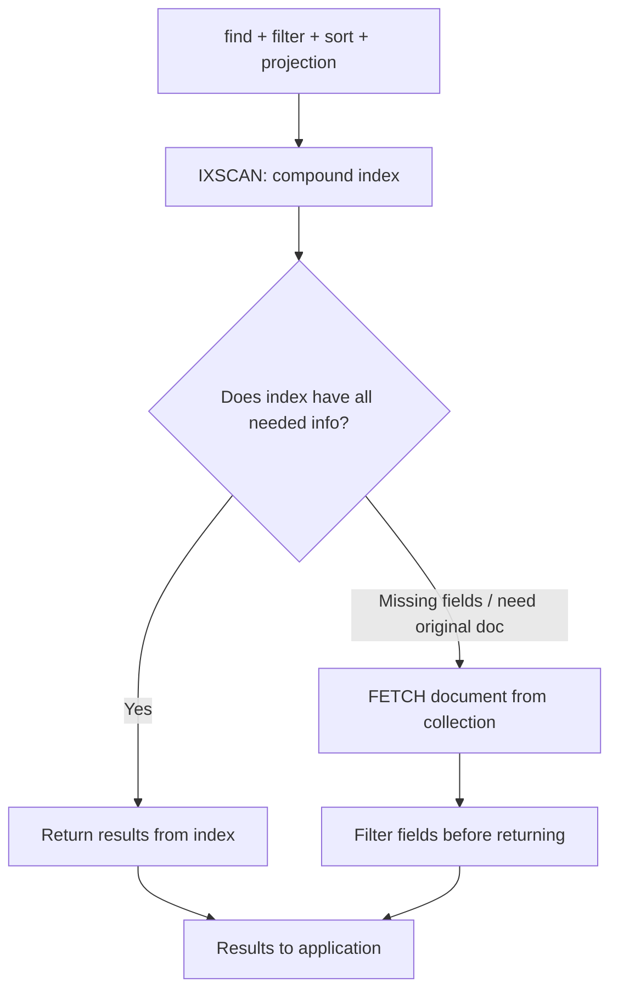

# Covered Queries and Limiting Returned Fields

## 1. Why does this topic matter?

In applications using **Spring Data MongoDB**, a common requirement is fetching summary lists from collections with many fields: orders, transactions, profiles, or audit logs. If the application only needs order ID, status, creation date, and amount, reading entire documents—including long notes, shipping addresses, and detailed line-item arrays—can waste significant resources.

There are two related but distinct techniques:

1. **Field projection:** asks MongoDB to return only the fields a screen or API needs; generally reduces network payload and object mapping cost.
2. **Covered query:** MongoDB satisfies the filter conditions and retrieves all returned fields **directly from an index**, without fetching the original documents from the collection.

A good projection **does not automatically** produce a covered query. A query may still fetch documents first and discard unwanted fields afterward. The optimization goal is designing filters, sorts, projections, and indexes as a cohesive whole, while verifying the execution plan.

After this lesson, you will be able to:

- Identify the requirements for a query to be covered by an index and cases that break coverage.
- Create compound indexes matching filters, sorts, and returned fields.
- Write projections with Spring Data MongoDB `MongoTemplate` or `@Query(fields = ...)`.
- Use `explain("executionStats")` to verify actual document examination counts.
- Evaluate trade-offs between wide indexes, read performance, and write cost.

## 2. Data model for following the examples

Suppose the system stores orders in the `orders` collection. A tenant's paid-orders list API only needs `tenantId`, `status`, `createdAt`, and `amountMinor`, while real documents hold much more information.

```javascript
db.orders.insertMany([
  {
    tenantId: "tenant-a",
    status: "PAID",
    createdAt: ISODate("2026-11-18T09:30:00Z"),
    amountMinor: NumberLong("125000"),
    customer: { name: "Customer A", email: "a@example.test" },
    shippingAddress: { city: "Da Nang", detail: "Long details" },
    items: [
      { sku: "BOOK-01", quantity: 2, priceMinor: 62500 }
    ],
    internalNote: "Internal system note"
  },
  {
    tenantId: "tenant-a",
    status: "PAID",
    createdAt: ISODate("2026-11-19T13:00:00Z"),
    amountMinor: NumberLong("210000"),
    customer: { name: "Customer B" },
    items: [{ sku: "BOOK-02", quantity: 1, priceMinor: 210000 }]
  },
  {
    tenantId: "tenant-b",
    status: "PAID",
    createdAt: ISODate("2026-11-19T14:00:00Z"),
    amountMinor: NumberLong("89000")
  }
]);
```

`amountMinor` represents the monetary amount in the smallest currency unit as an integer (VND in this example). Consistent numeric types and currency conventions avoid floating-point mistakes. Documents having differing fields merely illustrate MongoDB's schema flexibility; production systems should enforce schema conventions.

Business requirement:

> List up to 20 `PAID` orders for `tenant-a`, sorted by newest `createdAt` first; return only the four summary card fields.

### Query with projection

```javascript
db.orders
  .find(
    { tenantId: "tenant-a", status: "PAID" },
    {
      tenantId: 1,
      status: 1,
      createdAt: 1,
      amountMinor: 1,
      _id: 0
    }
  )
  .sort({ createdAt: -1 })
  .limit(20);
```

The second argument to `find()` is the **projection document**. `1` requests returning a field; `0` requests excluding a field. MongoDB returns `_id` by default, so specify `_id: 0` when the result does not need the ID. You can exclude `_id` while including other fields; do not arbitrarily mix inclusions and exclusions for regular fields in the same projection.

This projection ensures the API receives only needed data. However, to eliminate the document fetch step altogether, an index must satisfy coverage requirements.

## 3. What is a covered query?

A **covered query** is a query that can be satisfied purely using data in an index: MongoDB does not need a **FETCH** step to read original documents for additional filtering or retrieving output fields.

In this example, a suitable compound index is:

```javascript
db.orders.createIndex(
  {
    tenantId: 1,
    status: 1,
    createdAt: -1,
    amountMinor: 1
  },
  { name: "idx_orders_tenant_status_date_amount" }
);
```

Role of each component:

| Component | Role in the example |
| --- | --- |
| `tenantId: 1` | Equality predicate, also scopes data by tenant |
| `status: 1` | Equality predicate |
| `createdAt: -1` | Supports descending order after equality predicates |
| `amountMinor: 1` | Stores the value directly in the index for projection, even though not used for filtering |

Every field used in the filter (`tenantId`, `status`), sort order (`createdAt`), and projection (`tenantId`, `status`, `createdAt`, `amountMinor`) appears in the index. `_id` is excluded from the output, allowing the sample query to be covered without adding `_id` to the index.



### Core requirements

For a typical query to be covered, consider:

1. **Every filter field** can be resolved from the index being used.
2. **Every returned field** exists in that **same index**.
3. The query does not require reading documents to distinguish special values, such as equality against `null`.
4. Characteristics like multikey indexes, collations, query predicates, and projection syntax do not force the engine to access documents.
5. MongoDB actually picks an execution plan capable of coverage; simply seeing an index name is not proof.

If the sort is also satisfied by index key order, the query can avoid an extra memory-intensive `SORT` stage. Index coverage and avoiding an in-memory sort are two separate properties to verify independently.

### Using an index does not mean it is covered

The query below can still use the compound index for filtering, yet also needs `customer.name`:

```javascript
db.orders.find(
  { tenantId: "tenant-a", status: "PAID" },
  {
    createdAt: 1,
    amountMinor: 1,
    "customer.name": 1,
    _id: 0
  }
);
```

Because the sample index lacks `customer.name`, MongoDB must fetch original documents to supply that field. This step can increase examined document counts and I/O, especially with large documents.

## 4. Reading `explain()` to verify coverage

The definitive check is **execution statistics**, not guessing from code.

```javascript
db.orders
  .find(
    { tenantId: "tenant-a", status: "PAID" },
    {
      tenantId: 1,
      status: 1,
      createdAt: 1,
      amountMinor: 1,
      _id: 0
    }
  )
  .sort({ createdAt: -1 })
  .limit(20)
  .explain("executionStats");
```

What to inspect in the output:

| Property / indicator | Interpretation |
| --- | --- |
| `queryPlanner.winningPlan` | Winning plan; structure may vary across MongoDB versions and execution engines |
| `IXSCAN` | Index scan is occurring; insufficient by itself to prove coverage |
| `FETCH` | Original documents are being retrieved in this plan |
| `PROJECTION_COVERED` | An indicator of coverage in some execution plan shapes |
| `executionStats.totalKeysExamined` | Number of index entries examined |
| `executionStats.totalDocsExamined` | Number of documents examined; **0** is the decisive signal of a covered query in this measurement |
| `executionStats.nReturned` | Number of result records returned |
| `SORT` | Separate sort stage present; check whether index order can eliminate it |

With matching index and data in this example, `totalDocsExamined: 0` is expected. `totalKeysExamined` may exceed `nReturned` depending on execution mechanics and scan bounds. Do not assume those two values are always equal.

An abbreviated **illustrative** snippet might look like:

```javascript
{
  executionStats: {
    nReturned: 2,
    totalKeysExamined: 2,
    totalDocsExamined: 0
  }
}
```

This is not live output from a specific MongoDB instance. In practice, read numbers from your own database's `explain()`; stage names and plan nesting change across versions.

### Changing one field to observe coverage loss

Keep the filter, sort, and index identical, but add `internalNote` to the projection:

```javascript
db.orders
  .find(
    { tenantId: "tenant-a", status: "PAID" },
    { createdAt: 1, amountMinor: 1, internalNote: 1, _id: 0 }
  )
  .sort({ createdAt: -1 })
  .limit(20)
  .explain("executionStats");
```

`internalNote` is not in the index, so the plan must fetch documents to return it. `totalDocsExamined` typically rises for the retrieved documents. The index still locates matching orders quickly; only the **covered** property is lost.

To compare query paths across indexes in a **test environment**, you can try `hint()`:

```javascript
db.orders
  .find(
    { tenantId: "tenant-a", status: "PAID" },
    { createdAt: 1, amountMinor: 1, _id: 0 }
  )
  .sort({ createdAt: -1 })
  .hint("idx_orders_tenant_status_date_amount")
  .explain("executionStats");
```

`hint()` forces the optimizer to use the specified index and is useful for controlled comparisons. Avoid pinning `hint` in production based on a single benchmark: data distribution, collection size, and query patterns change over time.

## 5. Projection with Spring Data MongoDB: `MongoTemplate`

In Java applications using `MongoTemplate`, `Query` combines `Criteria` for filtering, `Sort` for ordering, and `Field` for declaring projections. Example fetching list-screen data only:

```java
import java.util.List;

import org.bson.Document;
import org.springframework.data.domain.Sort;
import org.springframework.data.mongodb.core.MongoTemplate;
import org.springframework.data.mongodb.core.query.Criteria;
import org.springframework.data.mongodb.core.query.Query;
import org.springframework.stereotype.Service;

@Service
public class OrderSummaryReader {

    private final MongoTemplate mongoTemplate;

    public OrderSummaryReader(MongoTemplate mongoTemplate) {
        this.mongoTemplate = mongoTemplate;
    }

    public List<Document> findPaidOrderSummaries(String tenantId) {
        if (tenantId == null || tenantId.isBlank()) {
            throw new IllegalArgumentException("tenantId must not be blank");
        }

        Query query = Query.query(
                Criteria.where("tenantId").is(tenantId)
                        .and("status").is("PAID")
        );

        query.fields()
                .include("tenantId")
                .include("status")
                .include("createdAt")
                .include("amountMinor")
                .exclude("_id");

        query.with(Sort.by(Sort.Direction.DESC, "createdAt"));
        query.limit(20);

        return mongoTemplate.find(query, Document.class, "orders");
    }
}
```

Explanation of each part:

- `Criteria.where("tenantId").is(tenantId)` and `and("status").is("PAID")` correspond to the MongoDB filter.
- `query.fields().include(...)` declares needed fields; `exclude("_id")` drops the default ID.
- `query.with(Sort...)` and `query.limit(20)` prevent returning excessive records while aligning order with the sample index.
- `MongoTemplate.find(query, Document.class, "orders")` returns projected BSON documents, making it easy to verify exact returned fields. In real applications, map these to an API-appropriate DTO.

The projection is sent down to MongoDB at query execution time; it is not merely calling Java getters and discarding fields after downloading full documents.

### Creating indexes via Spring Data

The matching index can be defined using `Index` and `IndexOperations`:

```java
import org.springframework.data.domain.Sort;
import org.springframework.data.mongodb.core.MongoTemplate;
import org.springframework.data.mongodb.core.index.Index;

Index index = new Index()
        .on("tenantId", Sort.Direction.ASC)
        .on("status", Sort.Direction.ASC)
        .on("createdAt", Sort.Direction.DESC)
        .on("amountMinor", Sort.Direction.ASC)
        .named("idx_orders_tenant_status_date_amount");

mongoTemplate.indexOps("orders").ensureIndex(index);
```

This snippet uses the same configured `mongoTemplate` bean. In real projects, execute index creation via controlled schema/deployment migrations; on large collections, building indexes takes time and resources. If an index with the same key pattern and options already exists, do not duplicate it.

**Why is `amountMinor` at the end of the index?** It only needs to be returned and participates in neither equality filtering nor sorting for the sample query. Placing it after filter and sort fields makes sense for this query; however, optimal ordering must be validated against real workloads, especially when other query shapes exist.

## 6. Projection with Spring Data Repositories

With `MongoRepository`, you can declare filters and returned fields via `@Query`, while accepting a `Sort` parameter:

```java
import java.time.Instant;
import java.util.List;

import org.bson.types.ObjectId;
import org.springframework.data.domain.Sort;
import org.springframework.data.mongodb.repository.MongoRepository;
import org.springframework.data.mongodb.repository.Query;

interface OrderCardView {
    String getTenantId();
    String getStatus();
    Instant getCreatedAt();
    Long getAmountMinor();
}

public interface OrderRepository extends MongoRepository<Order, ObjectId> {

    @Query(
        value = "{ 'tenantId': ?0, 'status': ?1 }",
        fields = "{ 'tenantId': 1, 'status': 1, " +
                 "'createdAt': 1, 'amountMinor': 1, '_id': 0 }"
    )
    List<OrderCardView> findCards(
            String tenantId, String status, Sort sort);
}
```

`Order` is the entity mapped to the `orders` collection (e.g., via `@Document(collection = "orders")` and `@Id ObjectId id`). `OrderCardView` is a closed interface projection declaring only the required getters; in practice, interfaces may live in separate Java files per project conventions.

Usage:

```java
Sort newestFirst = Sort.by(Sort.Direction.DESC, "createdAt");

List<OrderCardView> cards = orderRepository.findCards(
        authenticatedTenantId,
        "PAID",
        newestFirst
);
```

This method demonstrates restricting **fields**. To restrict **result count** on production endpoints, add `Pageable` or define a query with an appropriate limit. When switching from `Sort` to `Pageable`, verify the backend enforces the intended limit rather than reading everything and slicing in Java.

Another variant returning entities:

```java
@Query(
    value = "{ 'tenantId': ?0, 'status': ?1 }",
    fields = "{ 'createdAt': 1, 'amountMinor': 1, '_id': 0 }"
)
List<Order> findPartialOrders(String tenantId, String status);
```

**Caution:** entities hydrated from projections may lack `id` and remaining fields, receiving `null` or default values. Never pass a partially loaded entity back to update/`save()` as if it were a full document. DTOs or explicit projection interfaces are safer for read-only APIs.

### Projecting nested fields

You can project fields inside subdocuments:

```java
query.fields().include("customer.name").exclude("_id");
```

MongoDB returns only the needed branch under `customer`. However, if the index does not contain `customer.name`, the query is no longer covered. Adding a single field to a projection can drastically increase examined documents even when the result count stays the same.

## 7. Common reasons queries lose coverage

### 7.1. Forgetting to exclude `_id`

Projection including only `createdAt` and `amountMinor`:

```javascript
db.orders.find(
  { tenantId: "tenant-a", status: "PAID" },
  { createdAt: 1, amountMinor: 1 }
);
```

MongoDB still returns `_id`. In the sample index, `_id` **is not included** as an index key for projection, so this query usually must `FETCH` documents. Two options:

- ID not needed: add `_id: 0` to the projection.
- ID truly needed: consider including `_id` in the index and re-checking coverage, e.g. `{ tenantId: 1, status: 1, createdAt: -1, amountMinor: 1, _id: 1 }`. This makes a larger index and is only worthwhile if read gains outweigh storage/write costs.

### 7.2. Conditions matching `null` or missing fields

Example:

```javascript
db.orders.find(
  { tenantId: "tenant-a", status: null },
  { tenantId: 1, status: 1, _id: 0 }
);
```

In MongoDB, `{ status: null }` matches both explicit `null` values and documents missing the field. That forces MongoDB to inspect documents to disambiguate, preventing typical covered query execution. If business logic distinguishes missing fields from `null`, express the predicate explicitly and check `explain()`.

### 7.3. Array fields and multikey indexes

An index on an array field becomes a **multikey index**. MongoDB supports some coverage with multikey indexes under important constraints: the query must not return the array field itself, cannot use `$elemMatch` in cases requiring document access, and must satisfy all other coverage rules.

Therefore, do not project `items`—a potentially huge line-item array—and expect an index to cover it. Stuffing every field into a compound index cannot solve every case either: indexes have limits on field count, key size, and array semantics.

### 7.4. Projection includes a field missing from the index

This is the most frequent mistake. The index still helps select records quickly, yet adding a single unindexed field (such as `shippingAddress.detail`) forces MongoDB to fetch documents.

Do not blindly fix this by adding every field to the index. Weigh endpoint frequency, field size, index width, and write volume.

### 7.5. Sort does not match index order

Index `{ tenantId: 1, status: 1, createdAt: -1, amountMinor: 1 }` serves the requirement well: equality on the first two fields, then descending `createdAt`.

Switching to `sort({ amountMinor: -1 })` prevents this index from providing that sort order because `createdAt` precedes `amountMinor` without an equality constraint. MongoDB may perform a `SORT`. A mismatched sort can also steer the optimizer to another plan; inspect `explain()` rather than assuming from "we have a compound index."

### 7.6. Mismatched collations between index and query

For string fields requiring locale-aware or case-insensitive comparisons, collation affects index usability. When a query specifies a collation incompatible with the index, the optimizer may not use the index as hoped. Define consistent collations for the workload and verify execution plans with real data.

## 8. Is a covered query always the fastest option?

No. Sometimes a wide index avoids `FETCH` yet increases overall system cost due to:

- **Index size:** each extra field expands index storage and cache footprint.
- **Write overhead:** inserts, updates, and deletes must maintain affected indexes; too many indexes degrade write throughput.
- **Selectivity:** low-selectivity queries may scan huge index ranges; `totalDocsExamined = 0` does not mean `totalKeysExamined` is small.
- **Endpoint frequency:** a rarely called API may not justify a dedicated covering index.
- **Field width:** long strings, rarely used fields, or high-variance values can bloat indexes.

Comparison table:

| Approach | Reduces network payload? | Can avoid FETCH? | Trade-off |
| --- | --- | --- | --- |
| `find()` returning whole document | No | Usually no | Simple code, prone to over-fetching |
| `find()` with projection | Yes | Depends on index | Smaller payload, may still read documents |
| Projection + covered compound index | Yes | Yes, if plan achieves coverage | Larger index size and maintenance cost |
| Index for filter/sort without covering | Yes, with projection | No | Often a good balance without overly wide indexes |

Metrics to measure before and after optimization include: `nReturned`, `totalKeysExamined`, `totalDocsExamined`, latency percentiles (e.g., p95), payload size, CPU/I/O, index size, and write throughput. `executionTimeMillis` from a single `explain` is reference data only; it varies with cache, machine load, data, and test setup.

### Practical decision workflow

1. Select a read-heavy or slow endpoint; identify exact filter, sort, and returned fields.
2. Narrow projections first, especially when documents hold arrays or large fields.
3. Measure `explain("executionStats")` on representative data; record selected index, `totalKeysExamined`, and `totalDocsExamined`.
4. Evaluate a compound index covering equality predicates, sort order, and key output fields; test in a safe environment.
5. Weigh read gains against index memory and write load, deploying only if net results are favorable.
6. Monitor query plans and latency as data grows or API requirements evolve.

## 9. Data security and pagination

**Projection is not an authorization mechanism.** A query returning only names and amounts can still leak another tenant's data if the filter omits tenant access checks. `tenantId` must come from authenticated credentials/authorization context, never trusted blindly from client-supplied parameters.

Furthermore, projection removes unnecessary sensitive fields from responses but does not replace access control at the API, repository, and service layers.

For pagination, apply limits and a deterministic sort order. If multiple documents share `createdAt`, sorting by timestamp alone is not stable enough for cursor pagination. You can append `_id` as a tie-breaker, though index and projection designs must then be re-evaluated; if `_id` must be returned, factor it into the index and verify coverage. Large `skip` values force MongoDB to step over many entries, making cursor/keyset pagination preferable for deep lists.

## 10. Exercises with suggested answers

### Exercise 1: Finding why coverage was lost

Query:

```javascript
db.orders.find(
  { tenantId: "tenant-a", status: "PAID" },
  { createdAt: 1, amountMinor: 1 }
).sort({ createdAt: -1 });
```

With index `{ tenantId: 1, status: 1, createdAt: -1, amountMinor: 1 }`, is this query covered?

**Suggested answer:** likely not; the projection does not exclude `_id`, so MongoDB includes the ID by default while the index excludes `_id`. Try adding `_id: 0` and compare `explain()` between both versions.

### Exercise 2: Writing a Spring Data Query

Write a method using `MongoTemplate` listing up to 10 `PAID` orders for a tenant, sorted by `createdAt` descending, returning `createdAt` and `amountMinor` without ID.

**Reference answer:**

```java
Query query = Query.query(
        Criteria.where("tenantId").is(authenticatedTenantId)
                .and("status").is("PAID")
);
query.fields()
        .include("createdAt")
        .include("amountMinor")
        .exclude("_id");
query.with(Sort.by(Sort.Direction.DESC, "createdAt"));
query.limit(10);

List<Document> cards = mongoTemplate.find(
        query, Document.class, "orders"
);
```

Verify the index contains the filter, sort, and output fields. A covered query does not need to project `tenantId` or `status`; what matters is that **they are in the index to resolve the filter**.

### Exercise 3: Measuring before/after changes

On a test collection with a large enough record count:

1. Run `explain("executionStats")` with projection containing only `createdAt`, `amountMinor`, and `_id: 0`.
2. Re-run after adding `customer.name` to the projection.
3. Compare `totalDocsExamined`, `totalKeysExamined`, `nReturned`, and the `FETCH` stage.
4. Assess whether adding `customer.name` to the index makes sense given API traffic and current write costs.

Expected: the first version can reach `totalDocsExamined = 0` when the optimizer chooses the matching index. The second version typically fetches documents because the field is missing from the index. Always verify real numbers instead of assuming.

## 11. Frequently asked questions

**Does projection reduce the number of documents read?** Not necessarily. Projection usually reduces returned payload size. How many documents MongoDB reads still depends on indexes and the execution plan; inspect `totalDocsExamined` to know.

**Can one index cover every query on a collection?** No. Coverage is evaluated **per specific query**, including filter, sort, and projection. Adding a single returned field can break coverage.

**Should we put every field into a compound index to achieve coverage?** No. Overly wide indexes consume extra storage, raise write overhead, and may hit index limits or array restrictions. Only add fields when gains are measurable.

**Can `_id` automatically be read from any secondary index?** You cannot assume `_id` is available as an output field from a compound index that does not declare `_id`. If IDs are needed, include `_id` in the index or accept the document fetch and measure performance.

**Does `totalDocsExamined = 0` guarantee a fast query?** Not necessarily. A query can still scan too many index keys, sort, or return huge numbers of rows. Always inspect full stats and real latency.

**Can covered queries work with nested fields?** Yes, if the filtered/returned field paths are fully stored in the index and satisfy coverage constraints. Array fields and operators like `$elemMatch` require separate verification.

## References

- [MongoDB Manual — Covered Queries](https://www.mongodb.com/docs/manual/core/query-optimization/#covered-queries)
- [MongoDB Manual — Query Plans](https://www.mongodb.com/docs/manual/core/query-plans/)
- [MongoDB Manual — Explain Results](https://www.mongodb.com/docs/manual/reference/explain-results/)
- [MongoDB Manual — Multikey Indexes](https://www.mongodb.com/docs/manual/core/indexes/index-types/index-multikey/)
- [Spring Data MongoDB — Template Query Operations](https://docs.spring.io/spring-data/mongodb/reference/mongodb/template-query-operations.html)
- [Spring Data MongoDB — Query Methods](https://docs.spring.io/spring-data/mongodb/reference/mongodb/repositories/query-methods.html)
- [Spring Data MongoDB — Index Creation](https://docs.spring.io/spring-data/mongodb/reference/mongodb/mapping/mapping-index-management.html)
