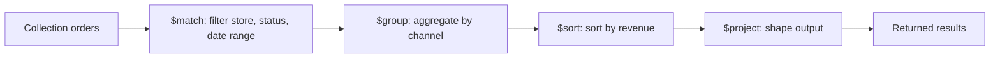

# Placing `$match` and `$project` Appropriately in Aggregation Pipelines

## Objectives

In the **Performance** chapter of **SPRING_DATA_MONGODB**, we optimize aggregation pipelines when using **Spring Data MongoDB** to map documents, query with `MongoTemplate` or repositories, build summary reports, and diagnose performance. Two ubiquitous stages are `$match` (filtering documents) and `$project` (selecting, renaming, or computing output fields). Placing them in the wrong order can force a pipeline to read far more data than necessary, miss indexes, or even **return wrong results**.

After this lesson, you will be able to:

- Distinguish the roles of `$match` and `$project`, especially which fields are created or dropped at each stage.
- Place `$match` early when filtering on original fields to reduce processed documents and enable index usage.
- Place `$project` late to shape returned data; understand why putting `$project` first **does not automatically** make a pipeline faster.
- Identify cases where `$match` must remain after `$group`, `$set`/`$addFields`, `$unwind`, or `$lookup`.
- Write pipelines in `mongosh` and `MongoTemplate`, and use `explain("executionStats")` plus real measurements to validate changes.

## 1. How does a pipeline work?

An aggregation is a sequential processing chain: each stage receives documents from the previous stage and passes results to the next. A revenue reporting pipeline looks like:



| Stage | Purpose | Key performance impact |
| --- | --- | --- |
| `$match` | Keeps documents matching criteria; generally uses `find()` syntax | Reduces input documents; can use indexes when at the start or hoisted by the optimizer |
| `$project` | Includes, excludes, renames, or computes fields | Defines output schema; reduces network transfer when returning only needed fields |
| `$group` | Groups records, `$sum`, `$avg`, `$count`... | Can consume significant memory and CPU on large inputs |
| `$sort` | Sorts documents | Can use an index under suitable conditions; otherwise performs intermediate sorting |
| `$unwind` | Splits array elements into separate documents | Can multiply document counts inside the pipeline |
| `$lookup` | Joins another collection | Expensive if processing many documents or lacking a foreign collection index |

**Foundational rules:**

1. Filter **as early as reasonably possible** on existing fields whose semantics remain intact.
2. Compute, join, or group only over the dataset that is genuinely needed.
3. Place `$project` **near the end** to specify exact output fields.
4. **Never trade correctness for stage reordering.** A field that does not exist yet cannot be filtered on; a field dropped by `$project` is unavailable to subsequent stages as before.

MongoDB performs a **pipeline optimization** phase: the server can split `$match`, push filters independent of computed fields ahead of `$project`/`$set`, or coalesce certain stages. Therefore, **the stage order you write is not always the physical execution order**. Optimizer capabilities vary across MongoDB versions; inspect `explain()` on your running version.

## 2. Practical scenario: paid orders report

Suppose the `orders` collection stores millions of orders. Each order contains store, sales channel, status, timestamp, total amount, and a potentially large `items` array.

Sample **synthetic** data in a test database:

```javascript
db.orders.insertMany([
  {
    _id: "o1", storeId: "store-a", channel: "web",
    status: "PAID", createdAt: ISODate("2026-11-02T10:00:00Z"),
    totalMinor: NumberLong(120000),
    items: [{ sku: "P1", qty: 2 }], note: "Morning delivery"
  },
  {
    _id: "o2", storeId: "store-a", channel: "app",
    status: "PAID", createdAt: ISODate("2026-11-03T09:00:00Z"),
    totalMinor: NumberLong(80000),
    items: [{ sku: "P2", qty: 1 }]
  },
  {
    _id: "o3", storeId: "store-a", channel: "web",
    status: "REFUNDED", createdAt: ISODate("2026-11-04T08:00:00Z"),
    totalMinor: NumberLong(50000)
  },
  {
    _id: "o4", storeId: "store-b", channel: "web",
    status: "PAID", createdAt: ISODate("2026-11-05T08:00:00Z"),
    totalMinor: NumberLong(90000)
  },
  {
    _id: "o5", storeId: "store-a", channel: "web",
    status: "PAID", createdAt: ISODate("2026-11-20T08:00:00Z"),
    totalMinor: NumberLong(40000)
  },
  {
    _id: "o6", storeId: "store-a", channel: "web",
    status: "PAID", createdAt: ISODate("2026-11-06T08:00:00Z"),
    totalMinor: NumberLong(45000)
  }
]);
```

Here `totalMinor` is an **integer representing the smallest currency unit** in the example (to avoid floating-point rounding errors), not a universal revenue formula for every system. The report needs total revenue for `PAID` orders in `store-a` from the start of 2026-11-01 up to (excluding) 2026-11-15 (UTC), grouped by `channel`.

### Recommended pipeline: `$match → $group → $sort → $project`

```javascript
const pipeline = [
  {
    $match: {
      storeId: "store-a",
      status: "PAID",
      createdAt: {
        $gte: ISODate("2026-11-01T00:00:00Z"),
        $lt: ISODate("2026-11-15T00:00:00Z")
      }
    }
  },
  {
    $group: {
      _id: "$channel",
      orderCount: { $sum: 1 },
      revenueMinor: { $sum: "$totalMinor" }
    }
  },
  { $sort: { revenueMinor: -1 } },
  {
    $project: {
      _id: 0,
      channel: "$_id",
      orderCount: 1,
      revenueMinor: 1
    }
  }
];

db.orders.aggregate(pipeline);
```

Expected output on the dataset above, independent of `items` or `note`:

```javascript
[
  { channel: "web", orderCount: 2, revenueMinor: NumberLong(165000) },
  { channel: "app", orderCount: 1, revenueMinor: NumberLong(80000) }
]
```

Why does this arrangement make sense?

- **`$match` before `$group`**: only orders matching store, status, and time range enter aggregation; 3 of 6 example documents remain.
- **`$group` before `$sort`**: channels must be sorted by **total revenue**, a field created only after grouping.
- **`$project` at the end**: renames the group `_id` to `channel`, drops `_id`, and returns exactly the two business metrics.
- A suitable index makes the initial collection read cheaper; `$project` cannot replace `$match` or indexes.

### Pipeline with a logic bug from projecting too early

```javascript
db.orders.aggregate([
  { $project: { channel: 1, totalMinor: 1 } },
  {
    $match: {
      status: "PAID",
      createdAt: { $gte: ISODate("2026-11-01T00:00:00Z") }
    }
  },
  { $group: { _id: "$channel", revenueMinor: { $sum: "$totalMinor" } } }
]);
```

The first stage **already dropped** `status` and `createdAt`. The second stage filters on fields no longer present in the documents, breaking the query logic; under these conditions it typically returns nothing. This is a **semantic bug**, not just a performance issue. The optimizer must preserve pipeline semantics and cannot guess your intent to restore dropped fields.

Writing an early `$project` that **still preserves every needed field** may produce correct results, yet it rarely runs faster because MongoDB already tracks field dependencies across internal stages automatically. An early `$project` also obscures data flow and can hinder index utilization for stages like `$sort`.

## 3. Placing `$match` properly: filtering on available data

`$match` takes a query predicate like `find()`, for example:

```javascript
{ $match: { status: "PAID", totalMinor: { $gte: 50000 } } }
```

Putting `$match` at the beginning enables MongoDB to use an index to bound documents read from the collection:

```javascript
// Run once in a test database.
db.orders.createIndex({ storeId: 1, status: 1, createdAt: 1 });
```

This key order illustrates two **equality** predicates (`storeId`, `status`) followed by a **range** predicate (`createdAt`). It fits the report above well, though it is not optimal for every query; evaluate selectivity, competing filters, sorts, write speed, index size, and actual execution plans.

| Situation | Suggested `$match` placement | Reason |
| --- | --- | --- |
| Filter on original fields `status`, `createdAt`, `storeId` | Start of pipeline | Filters early; enables index usage and shrinks `$group` input |
| Filter on `revenueMinor` created by `$group` | After `$group` | Aggregated field does not exist before grouping |
| Filter on `netMinor` computed via `$set` | Semantically after `netMinor` is computed | Depends on computed field; optimizer may push independent parts earlier |
| Filter **specific elements** after `$unwind` | After `$unwind`, often paired with an earlier parent filter | Filtering parent documents and filtering unwound elements are distinct operations |
| Filter attributes from `$lookup` joined docs | Once joined fields exist, or inside lookup subpipeline | Cannot reference foreign fields before joining |
| Shared `$facet` input filtering | Before `$facet` when all branches share the condition | Shrinks data for every branch and enables index use |

There is no rigid rule that every `$match` must sit on line one. What matters is whether **the field exists at that point** and whether **filtering before or after a stage changes semantics**.

### Two `$match` stages for input filtering and post-group filtering

New requirement: return only channels whose total revenue is at least `100000` minor units.

```javascript
db.orders.aggregate([
  {
    $match: {
      storeId: "store-a", status: "PAID",
      createdAt: {
        $gte: ISODate("2026-11-01T00:00:00Z"),
        $lt: ISODate("2026-11-15T00:00:00Z")
      }
    }
  },
  {
    $group: {
      _id: "$channel",
      orderCount: { $sum: 1 },
      revenueMinor: { $sum: "$totalMinor" }
    }
  },
  { $match: { revenueMinor: { $gte: 100000 } } },
  { $project: { _id: 0, channel: "$_id", orderCount: 1, revenueMinor: 1 } }
]);
```

The first condition filters **orders**, while the second filters **aggregated groups**. Moving `revenueMinor` before `$group` is invalid. In this example, only channel `web` remains.

## 4. Using `$project` properly: shaping schemas and payloads

`$project` does more than pick fields. It can:

- **Include fields:** `{ $project: { channel: 1, totalMinor: 1 } }`.
- **Exclude fields:** `{ $project: { note: 0, items: 0 } }`.
- **Rename fields:** `{ $project: { customer: "$customerId" } }`.
- **Compute fields:** `{ $project: { netMinor: { $subtract: ["$totalMinor", "$discountMinor"] } } }`.

Example returning a compact API result:

```javascript
db.orders.aggregate([
  { $match: { storeId: "store-a", status: "PAID" } },
  { $sort: { createdAt: -1 } },
  { $limit: 20 },
  {
    $project: {
      _id: 0,
      orderId: "$_id",
      createdAt: 1,
      channel: 1,
      totalMinor: 1
    }
  }
]);
```

This `$project` shrinks the result returned to the application, especially when documents hold large `items` or `note` fields. `_id` is **included by default** unless excluded; specify `_id: 0` when omitting it. You can reference `_id` to populate `orderId` while simultaneously excluding `_id` from output.

**Semantic notes:**

1. Do not arbitrarily mix inclusions (`field: 1`) and exclusions (`field: 0`) in the same `$project`; `_id` is the common exception. `$unset` is often clearer when merely dropping a few fields.
2. Computed `$project` stages need source fields preserved until that stage. `{ $project: { price: 1 } }` early on would deprive later stages of `discount`.
3. `$project` after `$group` can access `_id` and `$group` accumulators, not ungrouped original fields omitted from accumulators.
4. `$project` does not guarantee index usage or make a pipeline a *covered query*. Coverage also depends on accessed fields and index design.
5. Use final projection to avoid sending large documents over the wire; to reduce processed documents, place `$match` and computational stages carefully.

### A case where `$project` before `$match` is semantically required

```javascript
db.orders.aggregate([
  {
    $project: {
      storeId: 1,
      netMinor: {
        $subtract: [
          "$totalMinor",
          { $ifNull: ["$discountMinor", 0] }
        ]
      }
    }
  },
  { $match: { netMinor: { $gte: 100000 } } }
]);
```

`netMinor` exists only after `$project`; you cannot swap `$match` and `$project` without rewriting an equivalent expression. If filtering by `storeId` or `createdAt` too, add a separate `$match` on **original fields** upfront to shrink the set requiring computation.

Optimizer note: MongoDB can hoist filters **independent** of computed fields earlier. Starting in MongoDB 9.0, some `$match` predicates on computed fields can even move **together with the computation** across earlier stages when dependencies allow. Never assume every version does this; confirm with `explain()`.

## 5. Coordinating with `$sort`, `$unwind`, `$lookup`, and `$facet`

### `$match` and `$sort` to leverage indexes

For a recent-orders list query, this pipeline readily uses an index:

```javascript
db.orders.createIndex({
  storeId: 1, status: 1, createdAt: -1
});

db.orders.aggregate([
  { $match: { storeId: "store-a", status: "PAID" } },
  { $sort: { createdAt: -1 } },
  { $limit: 20 },
  { $project: { _id: 0, createdAt: 1, channel: 1, totalMinor: 1 } }
]);
```

Two equality predicates followed by the sort field follow the **Equality–Sort–Range** guideline where appropriate. An early `$sort` can use an index, whereas placing it after `$group`, `$unwind`, or a field-transforming `$project` curtails that opportunity. Do not create numerous indexes just for example variants; choose based on primary queries and `explain` evidence.

### Before and after `$unwind`: filtering parents differs from filtering elements

Suppose `items` is an array of products where one order can hold both `P1` and `P2`:

```javascript
db.orders.aggregate([
  // Filter orders containing at least one P1 item.
  { $match: { status: "PAID", "items.sku": "P1" } },
  // After this stage, each items element becomes a separate document.
  { $unwind: "$items" },
  // Keep only P1 line items, dropping P2 from the same order.
  { $match: { "items.sku": "P1" } },
  { $project: { _id: 0, orderId: "$_id", sku: "$items.sku", qty: "$items.qty" } }
]);
```

The first `$match` reduces **orders** entering `$unwind` (potentially aided by a multikey index), while the second `$match` filters **line items**. Omitting the second filter would leak other SKU lines from matched orders after `$unwind`. When multiple conditions must match the same array element prior to `$unwind`, consider `$elemMatch`.

### Filtering before `$lookup`, and filtering on joined data

```javascript
db.orders.aggregate([
  { $match: { status: "PAID", storeId: "store-a" } },
  {
    $lookup: {
      from: "customers",
      localField: "customerId",
      foreignField: "_id",
      as: "customer"
    }
  },
  { $unwind: "$customer" },
  { $match: { "customer.segment": "GOLD" } },
  { $project: { _id: 1, channel: 1, "customer.segment": 1 } }
]);
```

This is an extended example referencing `customers`; ensure real data contains `customerId` and the `customers` collection. The first `$match` shrinks orders requiring joins, while the `customer.segment` filter needs data produced by `$lookup`. MongoDB may coalesce `$lookup` → `$unwind` → `$match` on joined fields into an internal lookup; inspect `explain()` to verify. Indexes on the **foreign collection** also heavily impact lookup cost.

### With `$facet`: shared filtering before branching

```javascript
db.orders.aggregate([
  { $match: { storeId: "store-a", status: "PAID" } },
  {
    $facet: {
      byChannel: [
        { $group: { _id: "$channel", orders: { $sum: 1 } } }
      ],
      dailyTotal: [
        { $group: { _id: { $dateTrunc: { date: "$createdAt", unit: "day" } },
                     revenueMinor: { $sum: "$totalMinor" } } }
      ]
    }
  }
]);
```

A shared filter before `$facet` reduces data for every branch and lets the initial stage use an index if suitable. If `$facet` is the **very first** stage, MongoDB must perform a `COLLSCAN` for it. If branches need differing datasets, identify the common intersection to filter upfront and keep branch-specific predicates inside each branch.

### Exceptions where stages must come first

Some stages have strict placement rules—for instance, `$geoNear` must appear first in a pipeline, while Atlas Search `$search` and `$vectorSearch` enforce their own positioning constraints. When using them, supply filters via stage-supported syntax or afterward as specified, verified against documentation for your version. Never force a `$match` ahead of such a stage blindly just to "filter early."

## 6. Writing with Spring Data MongoDB and `MongoTemplate`

Spring Data provides `Aggregation.match(...)`, `Aggregation.group(...)`, `Aggregation.sort(...)`, and `Aggregation.project(...)`. `TypedAggregation` uses entity metadata to translate Java field names to BSON fields, including `@Field` annotations.

Sample entity matching the `orders` collection:

```java
import java.time.Instant;
import org.springframework.data.annotation.Id;
import org.springframework.data.mongodb.core.mapping.Document;

@Document("orders")
public class OrderDocument {
    @Id
    private String id;
    private String storeId;
    private String channel;
    private String status;
    private Instant createdAt;
    private long totalMinor;

    // Getters/setters/constructors per project conventions.
}
```

Building the same report pipeline from section 2:

```java
import java.time.Instant;
import java.util.List;
import org.bson.Document;
import org.springframework.data.domain.Sort;
import org.springframework.data.mongodb.core.MongoTemplate;
import org.springframework.data.mongodb.core.aggregation.Aggregation;
import org.springframework.data.mongodb.core.aggregation.TypedAggregation;
import org.springframework.data.mongodb.core.query.Criteria;

// Assume template is a configured MongoTemplate bean.
Instant from = Instant.parse("2026-11-01T00:00:00Z");
Instant to   = Instant.parse("2026-11-15T00:00:00Z");

Criteria paidOrders = Criteria.where("storeId").is("store-a")
    .and("status").is("PAID")
    .and("createdAt").gte(from).lt(to);

TypedAggregation<OrderDocument> aggregation =
    Aggregation.newAggregation(
        OrderDocument.class,
        Aggregation.match(paidOrders),
        Aggregation.group("channel")
            .count().as("orderCount")
            .sum("totalMinor").as("revenueMinor"),
        Aggregation.sort(Sort.Direction.DESC, "revenueMinor"),
        Aggregation.project("orderCount", "revenueMinor")
            .and("_id").as("channel")
            .andExclude("_id")
    );

List<Document> results = template
    .aggregate(aggregation, Document.class)
    .getMappedResults();
```

The entity's `createdAt` is an `Instant`, mapped by Spring Data to a BSON Date. `MongoTemplate.aggregate` executes the pipeline on MongoDB, while `Document.class` receives the mapped output. In real applications, substitute a structured summary DTO to avoid string-keyed field lookups.

If the entity annotates `storeId` with `@Field("store_id")`, `TypedAggregation` translates references appropriately to the stored field name. When comparing against `mongosh`, inspect **actual MongoDB field names** and the mapped pipeline, particularly after aliasing stages. Since Spring Data MongoDB 3.2, missing field references in typed aggregations may not fail by default; enable `strictMapping` in `AggregationOptions` if stricter validation is required.

### When using repositories

Repositories are convenient for straightforward reads and writes, whereas when pipelines combine multiple stages and execution plan tuning, `MongoTemplate` gives clearer control over stage ordering. With `@Aggregation` repository methods, field and stage-ordering rules **are still governed by MongoDB**, unchanged by the wrapper API.

## 7. Verifying with `explain("executionStats")`

Never judge purely by a shorter pipeline definition. Test on data matching production in distribution, document counts, array sizes, and indexes. Starting with the pipeline from section 2:

```javascript
// Run in a test environment with representative indexes and data.
const plan = db.orders.explain("executionStats").aggregate(pipeline);
printjson(plan);
```

Fields and patterns to read:

| Item | Meaning |
| --- | --- |
| `IXSCAN` / `DISTINCT_SCAN` | Index-based access occurred; inspect which index and bounds were used |
| `COLLSCAN` | Collection scan; fine for tiny datasets or unselective filters, worth investigating on large sets |
| `totalDocsExamined` | Total documents examined during query execution; lower is generally better for equivalent work |
| `totalKeysExamined` | Total index keys scanned; can be high if the index lacks selectivity |
| `nReturned` | Documents returned at a stage; do not confuse post-`$group` row counts with input documents |
| `executionTimeMillis` | Execution time reported in `explain`; influenced by cache, load, version, and engine |
| `stages`, `queryPlanner`, `winningPlan` | Shows how MongoDB optimized and ran the pipeline; output structure varies across versions |

In some versions, stats sit under `stages[...].$cursor.executionStats`, while others expose `queryPlanner` and **slot-based execution engine (SBE)** plans. Do not hardcode scripts to a single JSON path if supporting multiple MongoDB versions.

### A/B measurement workflow

1. Run pipeline version A, recording output and `explain("executionStats")`.
2. Run pipeline version B with reordered filters/projections, **verifying business output parity first**; both pipelines must produce identical result sets and aggregates.
3. Compare selected index, `docsExamined`, `keysExamined`, intermediate `SORT` stages, and document counts entering `$group`/`$lookup`.
4. Measure wall-clock time multiple times under comparable conditions; isolate cache effects and payload size. On large datasets, monitor CPU, RAM, disk spill, and network payload.
5. Interpret results alongside your exact MongoDB and Spring Data versions. Because the optimizer rewrites pipelines, two different source pipelines can compile into the **exact same execution plan** with identical performance.

`executionTimeMillis` from a single explain run is **not enough** to declare A faster than B in production. `allowDiskUse` allows certain stages to spill temporarily to disk when needed, yet does not replace shrinking input datasets and designing proper indexes.

## 8. Common errors and fixes

| Symptom | Likely cause | Fix |
| --- | --- | --- |
| Empty results after adding `$project` | Dropped `status`, `createdAt` before `$match` | Retain filtered fields or move `$match` before projection |
| Wrong revenue total when filtering by channel | Put accumulator `$match` before `$group` | Filter input documents and aggregated groups in separate stages |
| Still scanning huge numbers of documents | Missing index, low-selectivity filter, or field/type mismatch | Verify indexes, predicate syntax, BSON types, and execution plan |
| Filtering array elements still outputs unwanted SKUs | Only placed `$match` before `$unwind` | Add element-level `$match` after `$unwind` |
| Early `$project` brought no speedup | MongoDB already optimizes field dependencies | Prefer late `$project`; compare execution plans |
| `$sort` sorts many records | Index cannot satisfy sort, or follows `$group`/`$unwind` | Put `$match` first; review sort order, index, and necessity |
| Translating Java code to `mongosh` uses wrong fields | `@Field` mapping or post-aggregation aliases | Inspect entity mappings and actual stored fields; inspect mapped BSON pipeline |
| Fast on a few docs, slow at scale | Test dataset lacked production scale | Test on representative data; watch `docsExamined`, spills, indexes, and load |

## 9. Pipeline design checklist

Before deploying an aggregation to production, verify:

1. Which `$match` conditions filter **original fields** and can run early? Is there an index supporting them?
2. Which `$match` conditions depend on **newly created fields** from `$group`, `$project`, `$set`, `$lookup`, or `$unwind`?
3. Does any `$project` drop fields needed by later stages? Does `_id` need to be kept?
4. Is `$unwind`/join/group processing more documents than necessary?
5. Can `$sort` leverage an index, or is it sorting computed aggregates?
6. Have both **result correctness** and execution plan been verified on real MongoDB?
7. Does `MongoTemplate`/repository output match the expected DTO schema?

## 10. Exercises

Using the sample dataset from section 2 in a test MongoDB instance:

1. Run the standard pipeline, explain why `o3`, `o4`, `o5` are excluded, and verify `web = 165000`, `app = 80000`.
2. Write an early-`$project` pipeline that **retains** `storeId`, `status`, `createdAt`, `channel`, `totalMinor`; compare results and `explain` against the standard pipeline.
3. Drop `status` from the early `$project` and explain why the query breaks. Restore correctness by adjusting stage positions.
4. Add a `$match` after `$group` to keep only channels with `revenueMinor >= 100000`; explain why that predicate cannot move to the top.
5. Add index `{ storeId: 1, status: 1, createdAt: 1 }`. Compare `winningPlan`, `totalDocsExamined`, and `totalKeysExamined` with and without the index on a sufficiently large test dataset—avoid drawing conclusions from 6 documents.
6. Insert documents whose `items` hold two distinct SKUs; construct a pipeline with `$match` both before and after `$unwind` to emit only `P1` lines.
7. Implement the revenue report with `TypedAggregation<OrderDocument>` and `MongoTemplate`. Compare Java and `mongosh` results, noting field name mapping.

**Completion criteria:** You can not only recite "`$match` early, `$project` late," but also explain **why**, recognize exceptions, catch dropped-field bugs, and validate with `explain` on realistic data.

## References

- [MongoDB — Aggregation Pipeline Optimization](https://www.mongodb.com/docs/manual/core/aggregation-pipeline-optimization/)
- [MongoDB — `$match` aggregation stage](https://www.mongodb.com/docs/manual/reference/operator/aggregation/match/)
- [MongoDB — `$project` aggregation stage](https://www.mongodb.com/docs/manual/reference/operator/aggregation/project/)
- [MongoDB — `$unwind` aggregation stage](https://www.mongodb.com/docs/manual/reference/operator/aggregation/unwind/)
- [MongoDB — `$facet` aggregation stage](https://www.mongodb.com/docs/manual/reference/operator/aggregation/facet/)
- [MongoDB — Query Optimization](https://www.mongodb.com/docs/manual/core/query-optimization/)
- [MongoDB — Explain Results](https://www.mongodb.com/docs/manual/reference/explain-results/)
- [Spring Data MongoDB — Aggregation Framework Support](https://docs.spring.io/spring-data/mongodb/reference/mongodb/aggregation-framework.html)
