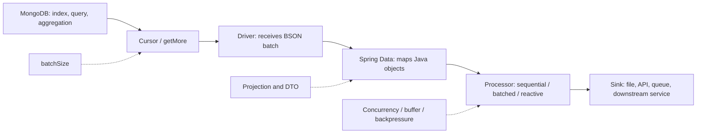

# Choosing Batch Size, Cursor, and Processing Style to Control Memory

## 1. Why can a fast query still run an application out of memory?

In **Spring Data MongoDB**, a query might return millions of documents from MongoDB very quickly yet cause the Java service to hit **`OutOfMemoryError`**, suffer long garbage collection (GC) pauses, or become unresponsive. Often the reason is that the program buffers the entire result set in a `List`, converts every item into DTOs, and only then exports CSV or runs calculations.

For example, a system needs to export a report of 3 million order records. Each document averages 1 KiB over the wire, yet mapped Java objects, strings, and reference graphs can occupy much more heap. If you write:

```java
List<Order> orders = mongoTemplate.find(query, Order.class);
for (Order order : orders) {
    export(order);
}
```

the application holds every element of `orders` until processing finishes. **Increasing heap size merely delays the failure** as data continues to grow.

This lesson combines three aligned decisions:

1. **Batch size**: how many documents MongoDB returns per cursor batch within protocol limits.
2. **Cursor**: how the client reads data incrementally, manages resources, and closes the cursor on completion or error.
3. **Processing style**: keeping one document, a bounded batch, a single page, or the whole dataset in memory, while controlling concurrent task execution.

Data flows through multiple stages, each capable of holding memory:



**No single `batchSize` parameter automatically caps total RAM.** Memory also depends on document size, Java object overhead, queues, worker threads, caches, aggregations, and downstream consumption speed.

## 2. Understanding `batchSize`, `limit`, and business batch size

Three concepts are easily confused:

| Setting | Meaning | Limits total returned results? |
|---|---|---|
| `cursorBatchSize(256)` on Spring Data `Query` | Hints driver/server to deliver cursor results in batches of that size | **No**; can still read millions of documents |
| `limit(256)` | Caps the total documents returned by the query | **Yes**, at most 256 |
| Reactor `buffer(256)` or custom list batching | Groups up to N items into a chunk **on the application side** | Does not necessarily limit total stream items |
| `BulkOperations` / `bulkWrite` | Groups multiple write operations for efficient submission | Does not govern query result batch size |

MongoDB streams `find` results via a **cursor**: the initial batch accompanies the command response, and subsequent batches arrive via `getMore` as needed. Batch size requests **document count per batch**, not an absolute byte count. The MongoDB wire protocol also enforces response/batch byte limits, so an actual batch can contain **fewer documents than requested** due to payload size limits. MongoDB also imposes a **16 MiB limit per BSON document**, meaning a few huge documents can consume substantial RAM even with a tiny batch size.

When no batch size is set, MongoDB and the driver use version-appropriate defaults. Typically the first `find` batch has default document and byte thresholds; do not treat one historical default number as a fixed guarantee across all drivers and commands.

### Effects of increasing or decreasing batch size

| Batch size | Potential benefit | Cost / risk |
|---|---|---|
| Small, e.g. 32–128 | Less data in flight per round trip; suits huge documents or slow consumers | More `getMore` calls, round-trip overhead, lower throughput |
| Medium, e.g. 256–1,024 | Sensible **starting point for testing** with medium documents | Still need to measure object and queue memory |
| Large, e.g. several thousand | Fewer round trips; can help under high RTT and fast processing | Higher peak memory, mapping bursts, batch wait time, and GC pressure |

These ranges are **benchmark starting points only**, not mandatory standards. For documents holding multi-MB arrays, a batch of 32 might still be too big; for tiny 200-byte documents with fast CPU processing, a larger batch may win.

Never raise batch size to compensate for an unindexed query; the server still has to locate and sort data efficiently.

## 3. Choosing a read strategy to fit the requirement

| Read style | Memory profile | Suitable use cases |
|---|---|---|
| `MongoTemplate.find(...)` returning `List<T>` | Memory scales with the entire result set | Small results with an **explicit upper limit** |
| `MongoTemplate.stream(...)` | Pulls elements incrementally via cursor; retains fewer objects | Data exports, sync jobs, sequential bulk processing |
| Repository returning `Stream<T>` | Can read incrementally, must close stream/cursor | When repository APIs fit and resources are closed reliably |
| Paged reads (`Page`/`Slice` or keyset) | Holds only one page at a time; independent queries | Long jobs needing checkpoints, retries, and resumption |
| `ReactiveMongoTemplate.find(...)` returning `Flux<T>` | Supports demand/backpressure; still uses buffers/prefetch | Async pipelines where consumers regulate demand |
| Server-side aggregation | Client receives only reduced/aggregated rows | When data can be condensed before shipping to Java |

Core rule: unless total results have a known small bound, **never call `findAll()` or `find(...)` returning a `List` and filter in Java afterward**. Filter, project, and either limit or stream directly in MongoDB.

## 4. Streaming with `MongoTemplate` and closing cursors properly

Suppose the `orders` collection stores `tenantId`, `createdAt`, `amountCents`, and `_id`. The application exports orders for one tenant over a time range, processing each document without accumulating a list.

```java
import java.time.Instant;
import java.util.Date;
import java.util.function.Consumer;

import org.bson.Document;
import org.springframework.data.domain.Sort;
import org.springframework.data.mongodb.core.MongoTemplate;
import org.springframework.data.mongodb.core.query.Criteria;
import org.springframework.data.mongodb.core.query.Query;
import org.springframework.data.util.CloseableIterator;

public final class OrderExportService {
    private final MongoTemplate mongoTemplate;

    public OrderExportService(MongoTemplate mongoTemplate) {
        this.mongoTemplate = mongoTemplate;
    }

    public void export(
            String tenantId,
            Instant from,
            Instant to,
            Consumer<Document> sink) {

        Query query = Query.query(
            Criteria.where("tenantId").is(tenantId)
                .and("createdAt").gte(Date.from(from)).lt(Date.from(to))
        );
        query.fields()
            .include("_id")
            .include("tenantId")
            .include("createdAt")
            .include("amountCents");
        query.with(Sort.by(Sort.Direction.ASC, "createdAt", "_id"));
        query.cursorBatchSize(256);

        try (CloseableIterator<Document> cursor =
                 mongoTemplate.stream(query, Document.class, "orders")) {
            while (cursor.hasNext()) {
                Document order = cursor.next();
                sink.accept(order);  // Finish processing before pulling the next item.
            }
        }
    }
}
```

This illustrates Spring Data MongoDB's imperative streaming API:

- **Query pushed to MongoDB**: filters tenant and `[from, to)` interval before returning data.
- **Projection**: retrieves only export fields, shrinking network, BSON decoding, and heap usage.
- **Sort with `_id` tie-breaker**: keeps ordering stable when documents share `createdAt`; pair with a matching index.
- **`cursorBatchSize(256)`**: requests 256-document batches, yet does not replace `limit` or stop `sink` from retaining objects.
- **`try-with-resources`**: closes `CloseableIterator` upon completion or if `sink.accept` throws, releasing the cursor and client resources.

Candidate index for this workload:

```javascript
db.orders.createIndex({
  tenantId: 1,
  createdAt: 1,
  _id: 1
});
```

Select real indexes based on queries, selectivity, and `explain("executionStats")`; added indexes increase storage and write costs.

### When streaming actually saves RAM

`sink.accept(order)` should write straight to a throttled destination: `BufferedWriter`, output stream, running aggregator, or a **bounded** queue. It must not do:

```java
List<Document> all = new ArrayList<>();
service.export(tenantId, from, to, all::add);  // Still retains every record!
```

Also avoid calling `cursor.stream().toList()` or terminal collectors that materialize the entire dataset. A cursor only provides incremental reads; **how the consumer processes items determines memory retention**.

### Cursor lifecycle and timeouts

A server-side cursor is a tracked resource. If a job pauses too long between batch fetches, the cursor or its server session can time out. Never enable infinite cursor lifetimes by default: `noCursorTimeout` (where available) does not protect against all session timeouts and risks resource leaks if the client crashes.

If each order triggers a multi-second external API call, processing **directly inside the cursor loop** can stretch a short cursor into an hours-long job. Instead, switch to **checkpointed keyset pagination** or a bounded queue/worker architecture.

## 5. Using the MongoDB Java Driver directly for explicit cursor control

`MongoTemplate` suffices for most cases. To illustrate the MongoDB Java Driver cursor directly, you can work with `MongoCollection`:

```java
import com.mongodb.client.MongoCollection;
import com.mongodb.client.MongoCursor;
import com.mongodb.client.model.Filters;
import com.mongodb.client.model.Projections;
import com.mongodb.client.model.Sorts;
import org.bson.Document;

MongoCollection<Document> orders =
    mongoTemplate.getCollection("orders");

try (MongoCursor<Document> cursor = orders.find(
        Filters.eq("tenantId", "tenant-a"))
        .projection(Projections.include("createdAt", "amountCents"))
        .sort(Sorts.ascending("createdAt", "_id"))
        .batchSize(256)
        .iterator()) {

    while (cursor.hasNext()) {
        Document order = cursor.next();
        processOne(order);
    }
}
```

`processOne(order)` represents per-document service handling. Place this snippet inside a method with `processOne` and a configured `mongoTemplate` bean.

`MongoCursor` reads sequentially without materializing the full result set. However, a `processOne` pushing documents into an unbounded `ConcurrentLinkedQueue` recreates the exact same memory exhaustion as `findAll()`.

**Distinction:** streaming here refers to bounded query result cursors. **Tailable cursors** on capped collections and **change streams** are continuous event-watching mechanisms with distinct lifecycles, wait timeouts, and reconnect logic. Do not blindly apply "drain cursor until exhausted" patterns to continuous event streams.

## 6. Long-running jobs: use keyset pagination for checkpoints

Streaming works well when a job processes everything in a single pass. For jobs running for hours, facing network blips, needing restarts, or splitting work across workers, holding a single open cursor is fragile. Instead, fetch **one finite page at a time** and persist the last completed position.

### Why avoid deep `skip`?

```javascript
db.orders.find({ tenantId: "tenant-a" })
  .sort({ createdAt: 1, _id: 1 })
  .skip(2_000_000)
  .limit(500);
```

Even with a matching sort index, MongoDB must walk past all preceding entries to reach the target page. Cost scales with offset depth. `skip` is fine for shallow UI pages, not multi-million-document exports.

### Keyset with a stable sort key

Create index:

```javascript
db.orders.createIndex({ tenantId: 1, createdAt: 1, _id: 1 });
```

First page:

```javascript
db.orders.find({ tenantId: "tenant-a" })
  .sort({ createdAt: 1, _id: 1 })
  .limit(500);
```

After **successfully processing** the final document, persist `lastCreatedAt` and `lastId`. Next page:

```javascript
db.orders.find({
  tenantId: "tenant-a",
  $or: [
    { createdAt: { $gt: lastCreatedAt } },
    { createdAt: lastCreatedAt, _id: { $gt: lastId } }
  ]
})
  .sort({ createdAt: 1, _id: 1 })
  .limit(500);
```

Each page returns at most 500 logical documents, which can be processed and freed before fetching the next page. On job restart, resume from the saved checkpoint rather than starting over.

Requirements for correctness:

1. `createdAt` and `_id` must always exist with consistent types and remain immutable during traversal. `_id` breaks ties on duplicate timestamps.
2. Advance the checkpoint only after output succeeds. For retried jobs, **output must be idempotent** or deduplicated, because crashing between writing output and saving the checkpoint can replay a page.
3. If records are concurrently inserted, deleted, or modified on sort fields, separate pages do not form a point-in-time snapshot. When a fixed dataset is needed, record an upper bound `to` or adopt a snapshot strategy fitting system requirements and capabilities.
4. `limit(500)` bounds **total documents per page**; `batchSize` can still be tuned separately to control how the server delivers that page.

In Spring Data, express `$or` with `Criteria.orOperator(...)`, add `Sort`, and set `Query.limit(500)`. Retain only the active page rather than appending pages into a giant `List`.

## 7. Reactive: backpressure does not mean zero memory

With **`ReactiveMongoTemplate`**, `find(query, Document.class, "orders")` returns a `Flux<Document>`. Subscribers request items on demand (*backpressure*), and the MongoDB Reactive Streams Driver coordinates cursor fetches. Even so, Reactor operators can still **prefetch, buffer, or launch excessive concurrent tasks**.

Example processing items sequentially through an async function:

```java
import java.util.function.Function;

import org.bson.Document;
import org.springframework.data.mongodb.core.ReactiveMongoTemplate;
import org.springframework.data.mongodb.core.query.Query;
import reactor.core.publisher.Mono;

public Mono<Void> processOrders(
        ReactiveMongoTemplate reactiveMongoTemplate,
        Query query,
        Function<Document, Mono<Void>> processAsync) {

    query.cursorBatchSize(128);

    return reactiveMongoTemplate
        .find(query, Document.class, "orders")
        .concatMap(processAsync)  // Complete each operation before starting the next.
        .then();
}
```

If writing in batches, group into finite chunks:

```java
return reactiveMongoTemplate.find(query, Document.class, "orders")
    .buffer(250)
    .concatMap(batch -> writeBatchAsync(batch))
    .then();
```

Here `writeBatchAsync(List<Document>)` is a service method returning `Mono<Void>` after persisting the batch. This is an **application-level batch**, distinct from `query.cursorBatchSize(128)`. Both driver buffers and the 250-item list may exist in memory at once.

Watch out for:

- Unbounded `collectList()`, `sort()`, and collection-building `reduce` negate streaming benefits.
- `flatMap(..., concurrency)` boosts throughput for independent tasks yet increases in-flight items/tasks; set **explicit finite concurrency and prefetch** and benchmark.
- `buffer(n)` holds up to `n` items *per batch*, while concurrent active batches also multiply RAM usage.
- `limitRate(n)` shapes *request demand* in the Reactor pipeline; it **does not replace** MongoDB's `cursorBatchSize(n)`.
- Never `block()` on an event-loop thread; offload blocking work like file I/O or sync libraries to an appropriate scheduler while keeping queues/concurrency bounded.
- When a subscriber cancels or errors, ensure cursor resources are closed per API contract; never leave subscriptions hanging open when consumers stop reading.

**Reactive regulates flow between components; it cannot fix missing indexes or computations buffering everything in RAM.**

## 8. Optimizing at MongoDB first: filter, projection, sort, aggregation

Before tuning batch size, confirm MongoDB returns **only the needed rows and fields**:

```javascript
const from = ISODate("2026-11-01T00:00:00Z");
const to = ISODate("2026-11-20T00:00:00Z");

db.orders.find(
  {
    tenantId: "tenant-a",
    createdAt: { $gte: from, $lt: to }
  },
  {
    _id: 1,
    createdAt: 1,
    amountCents: 1
  }
).sort({ createdAt: 1, _id: 1 });
```

If daily totals are needed, **push appropriate aggregation to MongoDB** instead of downloading all orders and calling `groupingBy` in Java:

```javascript
db.orders.aggregate([
  {
    $match: {
      tenantId: "tenant-a",
      createdAt: { $gte: from, $lt: to }
    }
  },
  {
    $group: {
      _id: {
        $dateTrunc: { date: "$createdAt", unit: "day", timezone: "UTC" }
      },
      count: { $sum: 1 },
      totalAmountCents: { $sum: "$amountCents" }
    }
  },
  { $sort: { _id: 1 } }
]);
```

The client now reads only daily summary rows. However, aggregations can demand substantial **server-side memory**, especially `$sort`, `$group`, `$setWindowFields`, and array accumulators. Disk spilling, when supported and enabled, helps stages survive RAM caps at the cost of extra I/O and cannot replace sound query design.

Use `explain("executionStats")` to inspect `totalDocsExamined`, `totalKeysExamined`, `IXSCAN`/scan plans, sort execution, and timing. Verify `allowDiskUse`/aggregation options against your MongoDB version. If projections still include multi-MB arrays, redesign the DTO or schema before merely tweaking batch size.

## 9. Estimating working set and choosing batch size by measurement

As a starting point, estimate memory for **in-flight data**:

```text
workingSet ≈
    (documents held in driver + mapping + queues + processing)
    × average Java object size
    + buffer, thread, I/O, cache, and runtime overhead
```

This is a mental model, **not an exact heap prediction formula**. Wire BSON size differs from Java heap object size; the driver holds batches, Spring allocates objects, and downstream stages may retain copies. Nor does batch size cap items accumulated inside a consumer.

Hypothetical example: if each mapped Java object averages 3 KiB, one worker holding 256 objects uses roughly **768 KiB**; eight such workers use around **6 MiB**. That figure **excludes BSON buffers, queues, JVM/GC overhead, auxiliary objects, caches, and document size spikes**. Always measure on real data or simulations matching production distributions.

A practical benchmark cycle:

1. Build a dataset covering small docs, large docs (p95/p99), tenant skew, and realistic filter selectivity.
2. Start with `batchSize = 128`, `256`, `512`, `1,024` (scaled to document size), holding filter, projection, indexes, concurrency, and sink constant.
3. Measure **throughput (docs/s), p95/p99 latency, peak heap/RSS, GC frequency/duration, `getMore` counts/round trips, CPU, network, and cursor errors**.
4. Scale concurrency **in a separate pass** to expose memory scaling per worker.
5. Test slow consumers, mid-stream aborts, network errors, subscription cancellations, and checkpointed restarts.
6. Choose the setting meeting latency and throughput goals **within memory budgets**, leaving headroom for spikes and concurrent traffic.

Sample results template (cells denote metrics to measure, not synthetic values):

| Test configuration | Throughput | Peak heap/RSS | GC pause | `getMore` count | Errors/timeouts |
|---|---|---|---|---|---|
| Batch 128, 1 worker | Measure | Measure | Measure | Measure | Measure |
| Batch 256, 1 worker | Measure | Measure | Measure | Measure | Measure |
| Batch 512, 1 worker | Measure | Measure | Measure | Measure | Measure |
| Batch 256, 8 workers | Measure | Measure | Measure | Measure | Measure |

Never optimize solely for throughput. If a configuration gains 5% speed while pushing heap against `-Xmx`, GC thrashing and OOM risk outweigh the speedup.

## 10. Diagnosing common failures

| Symptom | Root cause to investigate | First action |
|---|---|---|
| OOM immediately after `findAll()` | Materialized a `List` holding all documents | Add limits, projection, streaming, or keyset pagination |
| Using a cursor yet heap grows continuously | Consumer accumulates items, unbounded queue, cache, or `collectList()` | Use streaming sink, bounded buffers, bounded concurrency |
| Small batches run very slowly | Excessive `getMore` round trips, high RTT, heavy mapping CPU | Benchmark larger batches, verify indexes and projections |
| Large batches spike GC pauses | Delivering/mapping too many objects at once | Shrink batch size, trim projected fields, cap workers |
| Cursor times out mid-job | Processing per document takes too long, idle cursor/session | Switch to checkpointed pages or shorten cursor hold time |
| High MongoDB CPU despite low Java RAM | Wide scans, server sort/group, missing indexes | Run `explain`, redesign filters/indexes/aggregations |
| Deeper pages get slower | Large-offset `skip` | Switch to keyset pagination with matching sort-key index |
| Reactive pipeline still hits OOM | `collectList`, huge `buffer`, high `flatMap` concurrency/prefetch | Constrain operators, demand, and downstream buffers |
| Restart duplicates exported output | Late checkpoint or non-idempotent retries | Make outputs idempotent and persist checkpoint after commit |
| Export hangs indefinitely | Slow sink, network stall, backpressure stall, or blocked thread | Set timeouts, add per-stage telemetry, avoid blocking event loops |

Low application memory alone does not prove a healthy system: cost may simply have shifted to the database server, disk, network, or downstream queues. Inspect the entire pipeline end to end.

## 11. Implementation checklist for Spring Data MongoDB

1. **Estimate result volume**: document count, mean/p99 size, runtime duration, concurrent consumers.
2. **Filter and project in MongoDB**: fetch only required fields; index filters and sort keys.
3. **Match read style to lifecycle**: bounded `List` for small data; `MongoTemplate.stream` for sequential passes; keyset for long/resumable jobs; `Flux` for async pipelines.
4. **Pick a starting batch size**: begin with a moderate value and tune by document size, RTT, sink speed, and observed RAM.
5. **Close resources**: use `try-with-resources` for `CloseableIterator`, `MongoCursor`, and repository `Stream`; manage reactive subscriptions.
6. **Keep buffers and concurrency bounded**: never accumulate unbounded items in collections, queues, or Reactor pipelines.
7. **Define error policies**: bounded retries, explicit timeouts, checkpoints, and idempotent reprocessing.
8. **Separate client and server concerns**: streaming lets Java process incrementally but will not cure heavy server-side sorts or groups.
9. **Measure under representative load**: heap/RSS, GC, throughput, p95/p99, `getMore` counts, scans/indexes, and cursor timeouts.
10. **Ensure operability**: log checkpoint progress, alert on memory and stall durations, and test restarts and cancellations.

With **SPRING_DATA_MONGODB**, the objective is establishing a clearly bounded memory path from `MongoTemplate`/repositories or the reactive driver to the sink. **Batch size tunes delivery cadence; cursors enable incremental reads; processing style and concurrency govern how long data stays in memory.** Combined with proper queries and indexes, applications can process massive document volumes without loading everything onto the heap.
