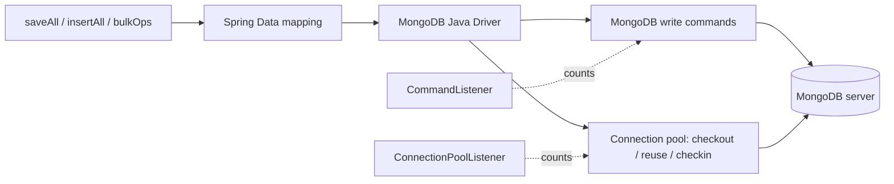

# Evaluating saveAll, Bulk Operations, and Connection Usage by Measurement

When a Spring Data MongoDB service needs to write thousands of documents, common questions arise: **Does `saveAll(...)` send one command per document? Is `bulkOps(...)` always faster? Does each save open a new MongoDB connection?** To answer reliably, you must measure **duration, command counts, connection pool checkouts, and connections created**, while distinguishing **inserting new documents** from **updating existing ones**.

This lesson belongs to the **Performance** chapter of the `SPRING_DATA_MONGODB` module: using Spring Data MongoDB to map documents, operate via `MongoTemplate` or repositories, optimize indexes, handle transactions, reactive access, testing, and performance diagnostics. The goal is a repeatable experimental method rather than guessing from Java method call counts.

## 1. Distinguishing the quantities to measure

| Quantity | Meaning | Observation method |
| --- | --- | --- |
| Logical document/operation | How many documents are inserted, replaced, updated, or deleted | Inputs, operation results, stored document verification |
| **MongoDB write command** | An `insert`, `update`, or `delete` command sent by the driver | `CommandListener` or server monitoring |
| **Connection checkout** | Driver borrowing a connection from the connection pool | `ConnectionPoolListener.connectionCheckedOut` |
| **Connection created** | A new physical connection initialized by the pool | `ConnectionPoolListener.connectionCreated` |
| **Checked-out connections** | Concurrent connections checked out, and peak value | Checkout/checkin events and pool metrics |
| **Latency** | Time to complete an operation or batch | Monotonic `System.nanoTime()`, tracing |
| **Throughput** | Documents completed per second | `successfulDocuments / elapsedSeconds` |

**One command can carry many documents. One connection can be reused across many commands.** A pool checkout does not equal creating a new TCP connection. The driver also maintains topology monitoring connections, and replica sets or sharded clusters may maintain separate pools per server.



Moreover, observed write commands **do not always equal physical round trips** when retries, network errors, batching, or other mechanisms occur. Always inspect actual write outcomes alongside latency.

## 2. Does `saveAll` always save entities one by one?

In standard Spring Data MongoDB repository implementations, `saveAll(Iterable<S>)` branches depending on whether **all entities are detected as new**:

- **All new**: the repository can use a batch `insert` path, allowing the driver to pack multiple documents into commands.
- **Any entity detected as existing**: the repository typically falls back to saving entities individually, producing multiple independent write operations.
- What counts as "new" depends on `@Id`, `@Version`, `Persistable.isNew()`, and entity mapping. A newly instantiated entity with a pre-assigned ID **may be treated as existing**.

Simple model for benchmarking:

```java
import org.springframework.data.annotation.Id;
import org.springframework.data.mongodb.core.mapping.Document;

@Document("perf_orders")
public class OrderDoc {
    @Id
    public String id;
    public String sku;
    public int quantity;

    public OrderDoc() { }

    public OrderDoc(String id, String sku, int quantity) {
        this.id = id;
        this.sku = sku;
        this.quantity = quantity;
    }
}
```

These two workloads can take different code paths:

```java
List<OrderDoc> newDocs = List.of(
        new OrderDoc(null, "SKU-1", 1),
        new OrderDoc(null, "SKU-2", 2));
repository.saveAll(newDocs);  // Null ID: usually detected as new inserts.

List<OrderDoc> existingDocs = List.of(
        new OrderDoc("order-001", "SKU-1", 2),
        new OrderDoc("order-002", "SKU-2", 3));
repository.saveAll(existingDocs); // Assigned ID: usually saved entity by entity.
```

For entities with pre-assigned IDs, `save` may perform an upsert/replace depending on mapping. Never extrapolate `saveAll(new)` timings to `saveAll(existing)`, or vice versa. If your domain uses `@Version` or auditing, benchmark a separate scenario since both alter "new" detection and add client/server work.

## 3. Comparing `saveAll`, `insertAll`, and bulk operations

| Spring Data MongoDB API | Scenario | Caveats |
| --- | --- | --- |
| `repository.saveAll(docs)` | Inserts all-new entities, or saves existing ones | Check all-new vs. existing branching and callbacks |
| `mongoTemplate.insertAll(docs)` | Inserts many entities grouped by collection | Not for updates; duplicate keys fail |
| `mongoTemplate.bulkOps(mode, OrderDoc.class).insert(docs).execute()` | Explicit bulk insert | Driver may split across commands; ordered/unordered modes |
| `mongoTemplate.bulkOps(...).updateOne(...).execute()` | Multiple conditional updates | Different semantics from full entity `save`; does not auto-preserve optimistic locking |
| `mongoTemplate.save(doc)` | Single entity | Do not infer connection count from call count |

Bulk insert example:

```java
import org.springframework.data.mongodb.core.BulkOperations;

List<OrderDoc> docs = List.of(
        new OrderDoc(null, "SKU-1", 1),
        new OrderDoc(null, "SKU-2", 2));

mongoTemplate.bulkOps(
        BulkOperations.BulkMode.UNORDERED, OrderDoc.class)
        .insert(docs)
        .execute();
```

- `ORDERED` preserves declared order and generally stops at the first write error.
- `UNORDERED` permits flexible execution order, can continue independent operations after errors, and reports aggregated failures.
- **Unordered is not automatically faster**: server load, shard distribution, indexes, errors, and batch size determine real speed.
- One `bulkOps.execute()` call **does not guarantee a single wire command**: the driver splits batches according to server operation limits, document sizes, and message size limits.

Bulk operations do not replicate the full repository lifecycle. When switching from `saveAll` to bulk, evaluate requirements: auditing, entity callbacks, per-document error handling, optimistic locking with `@Version`, validation, and domain events. **Being faster while violating data-write invariants is a failing result.**

## 4. Designing measurements with concrete metrics

A benchmark run for a batch of `N` documents should record:

- **Elapsed time**: from just before starting writes until completion, using `System.nanoTime()`.
- **Throughput**: `N_success / (elapsedNanos / 1_000_000_000.0)` documents/second.
- **Batch p50/p95/p99 latency**: computed across many runs under identical conditions; never label `elapsedMs / N` as per-document p95.
- **Write commands started/succeeded/failed**: counted by command name via `CommandListener`.
- **Pool checkouts**: connection borrows; **connections created**: new physical connections.
- **Peak checked-out**, checkout failures, and pool wait times where metrics exist.
- App CPU/heap/GC, MongoDB CPU/disk/network/index load, write outcomes, and final document count.

The results template below contains **no measurements yet**; populate it with real benchmark data:

| Workload | N | p50 batch (ms) | p95 batch (ms) | Docs/s | Write commands | Checkouts | Created | Peak in use |
| --- | ---: | ---: | ---: | ---: | ---: | ---: | ---: | ---: |
| `saveAll`, new | … | … | … | … | … | … | … | … |
| `insertAll`, new | … | … | … | … | … | … | … | … |
| `bulkOps.insert`, new | … | … | … | … | … | … | … | … |
| `saveAll`, existing | … | … | … | … | … | … | … | … |
| `bulkOps`, update/replace existing | … | … | … | … | … | … | … | … |

Record the environment alongside: Spring Data, Java Driver, MongoDB, and JDK versions, document size, indexes, `WriteConcern`, concurrency, batch size, warm-up rounds, transactions, and network RTT. **Never fabricate numbers** to fill in the table.

## 5. Counting commands and connections with the MongoDB Java Driver

### 5.1. Writing an event counter

The sample below uses event listener interfaces from the synchronous MongoDB Java Driver. Because events can fire across multiple threads, counters use atomic primitives.

```java
import com.mongodb.event.*;
import java.util.Set;
import java.util.concurrent.atomic.AtomicInteger;
import java.util.concurrent.atomic.AtomicLong;

public final class WriteMetrics
        implements CommandListener, ConnectionPoolListener {

    private static final Set<String> WRITES =
            Set.of("insert", "update", "delete");

    public final AtomicLong writesStarted = new AtomicLong();
    public final AtomicLong writesSucceeded = new AtomicLong();
    public final AtomicLong writesFailed = new AtomicLong();
    public final AtomicLong checkouts = new AtomicLong();
    public final AtomicLong created = new AtomicLong();
    public final AtomicLong closed = new AtomicLong();
    public final AtomicLong checkoutFailures = new AtomicLong();

    private final AtomicInteger inUse = new AtomicInteger();
    public final AtomicInteger peakInUse = new AtomicInteger();

    @Override
    public void commandStarted(CommandStartedEvent event) {
        if (WRITES.contains(event.getCommandName())) {
            writesStarted.incrementAndGet();
        }
    }

    @Override
    public void commandSucceeded(CommandSucceededEvent event) {
        if (WRITES.contains(event.getCommandName())) {
            writesSucceeded.incrementAndGet();
        }
    }

    @Override
    public void commandFailed(CommandFailedEvent event) {
        if (WRITES.contains(event.getCommandName())) {
            writesFailed.incrementAndGet();
        }
    }

    @Override
    public void connectionCheckedOut(ConnectionCheckedOutEvent event) {
        checkouts.incrementAndGet();
        int n = inUse.incrementAndGet();
        peakInUse.accumulateAndGet(n, Math::max);
    }

    @Override
    public void connectionCheckedIn(ConnectionCheckedInEvent event) {
        inUse.decrementAndGet();
    }

    @Override
    public void connectionCreated(ConnectionCreatedEvent event) {
        created.incrementAndGet();
    }

    @Override
    public void connectionClosed(ConnectionClosedEvent event) {
        closed.incrementAndGet();
    }

    @Override
    public void connectionCheckOutFailed(ConnectionCheckOutFailedEvent event) {
        checkoutFailures.incrementAndGet();
    }

    public Snapshot snapshot() {
        return new Snapshot(
                writesStarted.get(), writesSucceeded.get(),
                writesFailed.get(), checkouts.get(), created.get(),
                closed.get(), checkoutFailures.get(), peakInUse.get());
    }

    public record Snapshot(
            long started, long succeeded, long failed,
            long checkouts, long created, long closed,
            long checkoutFailures, int peakInUse) {}
}
```

For `started`, `succeeded`, `failed`, `checkouts`, `created`, and `closed`, subtract snapshots taken before and after the workload. Here `peakInUse` tracks the **all-time peak since listener creation**, not automatically a per-scenario peak; if per-scenario peaks are required, measure within a controlled reset window or isolate each run. Never reset counters while concurrent requests are running.

### 5.2. Attaching the listener before creating MongoClient

```java
import com.mongodb.ConnectionString;
import com.mongodb.MongoClientSettings;
import com.mongodb.client.MongoClient;
import com.mongodb.client.MongoClients;

WriteMetrics metrics = new WriteMetrics();
MongoClientSettings settings = MongoClientSettings.builder()
        .applyConnectionString(new ConnectionString(mongoUri))
        .addCommandListener(metrics)
        .applyToConnectionPoolSettings(
                pool -> pool.addConnectionPoolListener(metrics))
        .build();

MongoClient client = MongoClients.create(settings);
// Share this client with the benchmarked MongoTemplate/repository.
// Reuse and close the client over the application lifecycle; never create per request.
```

If Spring Boot auto-configures `MongoClient`, register the listener via a version-compatible customizer **before the client bean initializes**. Creating a new client per write run measures DNS, handshakes, and pool warm-up instead of `saveAll` or bulk performance.

In replica set or sharded topologies, the driver keeps per-server pools and dedicated monitoring connections; `connectionCreated` counts only pool events seen by this listener, not every OS socket or network connection.

## 6. Measuring an actual write pass

Create a measurement helper capturing before/after snapshots around a **synchronous** acknowledged write:

```java
public record Sample(
        String name, int documents, double milliseconds,
        double docsPerSecond, long writeCommands,
        long successfulCommands, long checkouts, long created) {}

public static Sample measure(
        String name, int documents,
        WriteMetrics metrics, Runnable write) {

    WriteMetrics.Snapshot before = metrics.snapshot();
    long start = System.nanoTime();

    write.run(); // Measure only synchronous acknowledged writes.
    long elapsed = System.nanoTime() - start;

    WriteMetrics.Snapshot after = metrics.snapshot();
    double seconds = elapsed / 1_000_000_000.0;

    return new Sample(
            name, documents, elapsed / 1_000_000.0,
            documents / seconds,
            after.started() - before.started(),
            after.succeeded() - before.succeeded(),
            after.checkouts() - before.checkouts(),
            after.created() - before.created());
}
```

Benchmarking the three new-insert strategies (this is a **test harness sketch**; `repository`, `mongoTemplate`, and `metrics` must be wired in the benchmark class sharing one client):

```java
int n = 1_000;

// Prepare empty test collection/indexes outside the measurement window; NEVER run in production.
prepareEmptyCollection();
List<OrderDoc> docsA = newItems(n);
Sample a = measure("saveAll-new", n, metrics,
        () -> repository.saveAll(docsA));

prepareEmptyCollection();
List<OrderDoc> docsB = newItems(n);
Sample b = measure("insertAll-new", n, metrics,
        () -> mongoTemplate.insertAll(docsB));

prepareEmptyCollection();
List<OrderDoc> docsC = newItems(n);
Sample c = measure("bulk-insert-new", n, metrics,
        () -> mongoTemplate.bulkOps(
                BulkOperations.BulkMode.UNORDERED, OrderDoc.class)
                .insert(docsC).execute());

System.out.println(a);
System.out.println(b);
System.out.println(c);
```

`newItems` must construct identical document counts, sizes, and business data across all runs:

```java
static List<OrderDoc> newItems(int n) {
    List<OrderDoc> docs = new java.util.ArrayList<>(n);
    for (int i = 0; i < n; i++) {
        docs.add(new OrderDoc(null, "SKU-" + i, 1));
    }
    return docs;
}
```

`prepareEmptyCollection()` is a test helper for a **test database only**: it clears test data and recreates identical indexes before each approach. Fixture preparation in Java is excluded from write timing. For production-like measurements, isolate mapping/serialization cost from network/server cost when deeper breakdown is needed.

### Interpreting the numbers

- If **1 write command** appears for 1,000 documents, it is likely a batch insert; do not infer "1,000 connections."
- If `created = 0` while `checkouts` is positive, existing pool connections were reused.
- If `writesStarted` is high while `created` is low, the bottleneck lies in command count, network RTT, indexes, or server work—not socket creation.
- If `writesStarted` differs from `writesSucceeded`, inspect exceptions, retries, and write concern; never compute throughput from `n` when a batch only partially succeeded.
- If `checkouts` far exceeds write commands, look for other commands (reads, auth/key vault, metadata, or background tasks) during the measurement window.

`CommandListener` counts **commands**; `BulkWriteResult`, actual stored document counts, and exceptions show logical outcomes. With retryable writes enabled, driver events and elapsed times may include retries; factor network errors and failovers into conclusions.

## 7. Designing fair benchmarks: inserts and updates are different problems

Never lump both operations into a single "write 10,000 documents" number. Build at least two distinct scenario groups.

### Group A: Inserting new documents (insert)

1. Instantiate objects with `@Id == null` so the repository recognizes them as new. If using `@Version` or `Persistable`, document the `isNew` rule.
2. Use the same test collection and identical indexes for `saveAll`, `insertAll`, and `bulkOps.insert`. Reset fixtures outside the measurement window before each run.
3. Test batch sizes like 100, 1,000, and 10,000 with equivalent BSON size/fields.
4. For every batch, verify saved row counts and duplicate/partial errors. Fast runs missing data are invalid.
5. Measure cold-start separately from steady-state. Ensure both client and connection pool are warmed up when comparing steady-state write paths.

### Group B: Updating existing documents (update)

1. Pre-seed a set of documents with fixed `_id` values, identical indexes, and initial state for every approach.
2. Call `saveAll` with entities detected as existing. Measure write commands and final document state.
3. For bulk, run `updateOne`/`replaceOne` matching business semantics and identical filters. If `saveAll` replaces full documents while `updateOne` updates one field, that is **comparing two different semantics** and must be stated explicitly.
4. If the system relies on `@Version`, auditing, entity callbacks, or optimistic locking, verify those constraints separately. Bulk paths do not replicate every safeguard of the `save` path.
5. For upserts, measure lookup overhead, insert-vs-update ratio, and unique index contention separately; do not mix into a pure-insert table.

Bulk update example for order quantities:

```java
import org.springframework.data.mongodb.core.BulkOperations;
import org.springframework.data.mongodb.core.query.Criteria;
import org.springframework.data.mongodb.core.query.Query;
import org.springframework.data.mongodb.core.query.Update;

BulkOperations ops = mongoTemplate.bulkOps(
        BulkOperations.BulkMode.UNORDERED, OrderDoc.class);

for (OrderDoc order : existingDocs) {
    Query query = Query.query(
            Criteria.where("_id").is(order.id));
    Update update = new Update().set("quantity", order.quantity);
    ops.updateOne(query, update);
}

ops.execute();
```

When using bulk updates modifying only `quantity`, **verify all other fields stay intact**. If requirements demand full document replacement, choose the appropriate replace API for your Spring Data version and verify behavior under concurrent deletes. Every valid performance test includes **data-output assertions** alongside millisecond timings.

## 8. Running multiple rounds and computing latency distributions

A single run is never enough. The JVM has JIT compilation, GC, and codec/mapping warm-up; MongoDB has caches, journaling, replication, networking, and connection pools, causing run-to-run variance.

Recommended experimental procedure:

1. Record **MongoDB server, Java Driver, Spring Data MongoDB, Spring Boot, and Java** versions, topology, RTT, disk/indexes, payload size, write concern, and pool settings.
2. Warm up APIs on separate test data; never mix warm-up rounds into reported numbers.
3. Run multiple independent rounds per approach, **interleaving/rotating execution order** of `saveAll`/`insertAll`/bulk to mitigate cold-cache or ordering bias.
4. Build fixtures and Java objects outside the timer; measure only the comparison scope. To measure HTTP or serialization end-to-end, run a **separate, clearly scoped benchmark**.
5. Test representative batch sizes and concurrency—e.g., concurrency 1, 4, 16—alongside CPU/RAM/server ceilings. Never extrapolate production capacity from a single-threaded loop.
6. Collect dozens of samples or more per configuration when possible; report p50/p95/p99, throughput, error rate, commands, and pool metrics. Small sample counts easily distort p99.
7. Repeat on production-like data and indexes, cross-checking network and server metrics when explaining outcomes.

To compute **batch latency** percentiles, store each round's duration (in ms), sort ascending, and pick positions per a stated percentile method. Java snippet illustrating *nearest-rank*:

```java
import java.util.ArrayList;
import java.util.Collections;
import java.util.List;

static double percentile(List<Double> samplesMs, double p) {
    if (samplesMs.isEmpty() || p < 0 || p > 1) {
        throw new IllegalArgumentException("Invalid samples or percentile");
    }
    List<Double> sorted = new ArrayList<>(samplesMs);
    Collections.sort(sorted);
    int rank = (int) Math.ceil(p * sorted.size());
    int index = Math.max(0, rank - 1);
    return sorted.get(index);
}

// Data must come from real measured runs under identical workload/configuration.
// double p50 = percentile(latenciesMs, 0.50);
// double p95 = percentile(latenciesMs, 0.95);
// double p99 = percentile(latenciesMs, 0.99);
```

When 1,000 documents execute in one bulk batch, the measured timing is **batch latency**, from which you cannot automatically derive per-document latency distributions. For per-request services, measure end-to-end request latency using tracing/metrics and histograms.

### Result logging template

```text
Environment
  Java/JDK: ...
  Spring Data MongoDB / Driver: ...
  MongoDB Server / Topology: ...
  Indexes: ...
  WriteConcern / RetryWrites / Transaction: ...
  Documents per batch / payload size: ...
  Threads / maxPoolSize: ...

Scenario: saveAll(new) / bulkOps.insert / ...
  Warmup rounds: ...
  Measured rounds: ...
  Successful documents: ...
  Batch latency p50/p95/p99 (ms): ...
  Throughput (docs/s): ...
  Write commands started/succeeded/failed: ...
  Pool checkouts / created / closed: ...
  Peak checked-out / checkout failures: ...
  Client CPU/GC and server CPU/IO: ...
  Errors / final document count: ...
```

Never present placeholder figures as verified measurements. If a test has not run yet, keep the template unfilled.

## 9. Tuning the connection pool from measurements

The MongoDB Java Driver maintains **a pool per server inside each `MongoClient`**; a pooled connection serves many operations over time. Hence, **never instantiate a new `MongoClient` per batch or request**. Factors to monitor:

| Factor | Effect | Signals to watch |
| --- | --- | --- |
| `maxPoolSize` | Caps open connections in a pool | Checkout wait, peak in-use, throughput, server load |
| `minPoolSize` | Keeps minimum idle connections ready | Warm-up time, idle connections, socket overhead |
| `maxConnecting` | Caps concurrent connection establishments | Pool ramp-up speed during cold-start/bursts |
| Checkout wait timeout | How long threads wait for an available connection | Checkout failures, p95/p99 when pool saturates |
| Max idle / max lifetime | Controls closing and reopening connections | Connection created/closed churn after idle periods |
| Number of `MongoClient` instances | Each client owns separate pools | Unexpectedly high pool and socket counts |
| Replica set / sharded topology | Driver connects to multiple servers and monitors | Break down metrics per server/pool |

Java Driver pool configuration syntax:

```java
MongoClientSettings settings = MongoClientSettings.builder()
        .applyConnectionString(new ConnectionString(mongoUri))
        .applyToConnectionPoolSettings(pool -> pool
                .maxSize(80)
                .minSize(4)
                .maxConnecting(4))
        .build();
```

Numbers **80 / 4 / 4 illustrate syntax only**, not universal defaults. Raising `maxPoolSize` helps only when **pool checkout is genuinely the bottleneck** and MongoDB has spare capacity; if the server is already saturated on CPU, I/O, locks, or indexes, opening more connections worsens contention and p95. When in doubt, correlate listener data with server metrics like `connections.current` and queue/latency stats in your monitoring stack.

Example metric interpretation:

- `writeCommands = 1`, `checkouts = 1`, `created = 0` for 1,000 inserts: the driver likely reused an existing connection to send one batch write command. Does not prove "only one TCP socket exists across the whole system."
- `writeCommands = 1,000`, high `checkouts`, `created = 0`: the app is sending many individual commands through the existing pool—inspect entity-by-entity save branching and network RTT.
- `created` rises during warm-up then flattens: expected initial pool connection establishment.
- `peakInUse` near the limit, checkout failures, rising p95: inspect pool saturation, server capacity, and concurrency before tweaking settings.

## 10. Variables that can skew conclusions

### Indexes and data

Inserts and updates must maintain affected indexes. A collection with only the default `_id` index writes significantly faster than one carrying multiple compound/unique indexes. Use identical indexes across all scenarios and realistic BSON document sizes. For updates matching non-`_id` filters, verify index usage via `explain` on an equivalent query.

### Write concern and retries

`WriteConcern.W1` and `WriteConcern.MAJORITY` exhibit different latencies, especially under replication lag. Never weaken durability solely to improve benchmark numbers if business requirements demand majority acknowledgment. Retryable writes also alter command counts and latency on transient network errors or failovers; a client exception does not prove nothing was written on the server. For partially failed batches, inspect `BulkWriteResult`, exceptions, and final state, designing idempotent retries accordingly.

### Transactions

Transactions add session, commit, conflict, and retry overhead. If production uses `MongoTransactionManager` or `@Transactional`, benchmark under the **exact same transaction boundaries and write concern**. Never compare transactional `saveAll` against non-transactional bulk writes and attribute the entire gap to the API.

### Mapping, callbacks, and versioning

Bulk APIs can bypass or behave differently from repository/template hooks such as auditing, entity callbacks, optimistic locking, and custom domain logic. For `@Version` entities, test real write concurrency; never accept an optimization that skips version checks if it permits lost updates.

### Reactive access

With `ReactiveMongoTemplate` or reactive repositories, creating a `Mono`/`Flux` has not executed the write yet. Measure through the terminal signal (completion or error) and control pipeline concurrency. Timing publisher construction does not measure MongoDB performance. The reactive driver maintains its own client/pool; do not apply synchronous client pool metrics to reactive workloads.

### Observer effect

Instrumentation itself adds overhead. Lightweight atomic counters have minimal impact, yet keep the same listeners enabled across every scenario. Never log full commands or documents containing sensitive data during benchmarks; events can carry business payloads. Cross-check client stats with server metrics/tracing whenever anomalies appear.

## 11. Turning measurements into engineering decisions

| Observed measurement | Interpretation and decision |
| --- | --- |
| `saveAll(new)` has write commands and throughput near `bulk insert` | Repository already leverages batch insert; switching APIs may yield little gain |
| `saveAll(existing)` issues many write commands; bulk cuts commands/p95 sharply | Consider bulk for independent updates if semantics and error handling remain valid |
| Many `checkouts` yet very few `created` | Pool connection reuse is healthy; inspect command count, RTT, and server load |
| High `created` at startup, flat afterward | Separate cold-start and steady-state benchmarks |
| Checkout failures, peak in-use near cap, high p95 | Measure pool wait time and server load before tuning pool size or concurrency |
| Bulk is fast yet drops documents or skips validation | Solution fails business invariants; fix correctness before benchmarking speed |
| Wildly fluctuating results across rounds | Uncontrolled warm-up, GC, cache, external load, network, or errors |

Final hands-on exercise:

1. Create three batches of 10,000 new `OrderDoc` instances with null IDs; benchmark `saveAll`, `insertAll`, and `bulkOps.insert`.
2. Pre-seed 10,000 existing `OrderDoc` records; measure `saveAll(existing)` vs. bulk update/replace with equivalent data logic.
3. Repeat each scenario at concurrency 1, 4, 16 and batch sizes 100, 1,000, 10,000 with warm-up, rotated execution order, and multiple rounds.
4. Record p50/p95/p99, throughput, write commands, pool checkouts, connections created, errors, and final record counts on production-like indexes and write concern.
5. Document findings using **workload → conditions → measurements → explanation → chosen approach**, stating measurement limitations.

Conclusion template once benchmarks **have actually run**:

> On MongoDB [version], batch of [N] documents, [k] indexes, and write concern [level], `saveAll(new)` achieved p95 [x] ms, throughput [y] docs/s, [a] write commands; `bulkOps.insert` achieved p95 [u] ms, throughput [v] docs/s, [b] commands. The pool created [c] and [d] new connections respectively during the measurement window. Under these conditions and business constraints, we choose [API] because [evidence and trade-offs].

All bracketed fields must be filled with **real measured values**, never guesses.

**Key takeaway:** To evaluate `saveAll` and bulk writes in Spring Data MongoDB, separate **new vs. existing** entities, match write semantics, measure **write commands** via `CommandListener` and **checkouts/connections created** via `ConnectionPoolListener`, then correlate with throughput, latency, server metrics, and verified stored data. **Java method calls, database operations, and network connections are three distinct quantities.**
