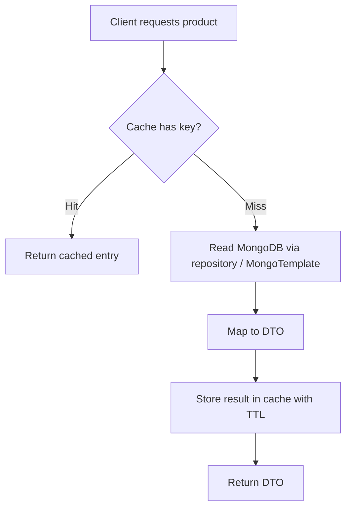
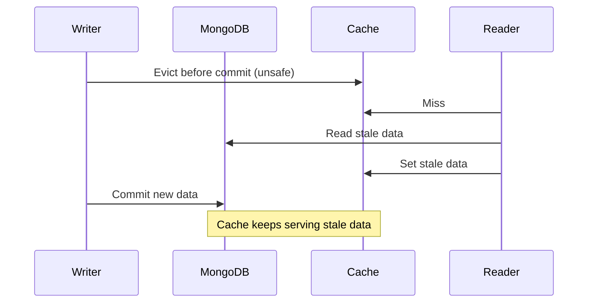
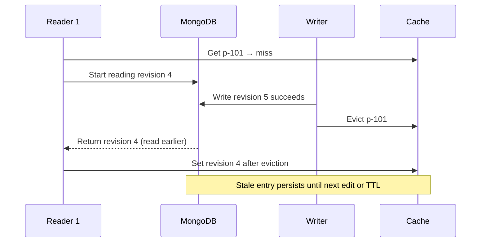
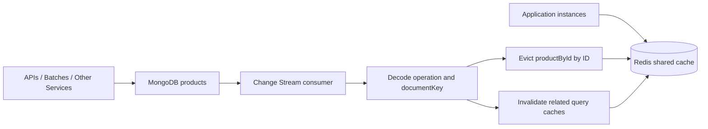
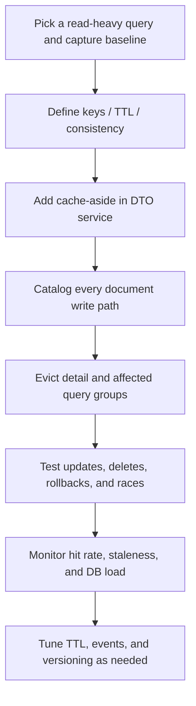

# Caching Results and Invalidation Policies When Documents Change

## 1. Why does a cache require an invalidation strategy?

In a **Spring Data MongoDB** application, the same query may run thousands of times: fetching a product by ID, rendering active product listings, reading tenant configuration, or computing summaries via `MongoTemplate.aggregate()`. Caching retains computed results to cut MongoDB round trips, document mapping time, and aggregation cost. In return, cached data is a **copy** of database state.

Suppose a store has this document:

```json
{
  "_id": "p-101",
  "name": "Mechanical Keyboard",
  "price": 1500000,
  "visible": true,
  "revision": 4
}
```

At 10:00, the app reads and caches price `1,500,000`. At 10:01, an admin updates the price to `1,350,000` in MongoDB. If the app keeps serving the cached copy without evicting or updating it, users see stale pricing. It gets even trickier when one document appears across multiple cached views: ID detail, category listings, keyword searches, and aggregated reports.

The problem is not merely *storing results for fast reads*, but answering:

1. Which results should be cached, and under what cache keys?
2. When a document changes, which cache entries are affected?
3. When does invalidation execute relative to the MongoDB write?
4. When multiple instances, background jobs, or external services write data, do all caches learn about changes?
5. If cache connectivity or an invalidation event fails, how long is stale data tolerable?

**Distinguish two controls:** *TTL* bounds an entry's lifetime; *invalidation* actively removes stale results when source data changes. TTL is a valuable safety net, yet a short TTL alone does not provide immediate consistency.

## 2. Cache-aside and where to place caching in Spring Data MongoDB

In the **cache-aside** (*lazy loading*) pattern, the application checks the cache before querying the database. On a miss, it reads MongoDB, maps a DTO, and stores the result in cache.



When data changes via an API, the usual write flow is **successfully update MongoDB → evict affected cache entries**. Subsequent reads repopulate fresh values. Spring Cache (`@Cacheable`, `@CacheEvict`, `@CachePut`) or direct cache APIs make this straightforward to implement.

| Cache placement | Best suited for | Watch out for |
| --- | --- | --- |
| Service layer returning DTOs | Business results combining repositories or `MongoTemplate` | Key must capture every parameter affecting the DTO |
| Repository method level | Simple reads with clear rules | Hard to manage results spanning transformations or non-repository writes |
| Shared Redis | Multiple instances sharing a unified cache | Requires network, serialization, namespaces, TTL, and recovery policies |
| In-memory cache (Caffeine, etc.) | Small datasets, local workloads, ultra-low latency | Each instance holds its own copy; requires broadcast invalidation for external writes |

This guide uses **Spring Cache + Redis** for illustration, because Spring Data MongoDB and Redis serve distinct roles: MongoDB is the authoritative data store; Redis is the cache. Never treat Redis as the source of truth while the system still writes documents to MongoDB.

## 3. Choosing what to cache and defining consistency levels

Caching pays off when a result is read frequently, expensive to compute, changes relatively rarely compared to reads, and has clear invalidation boundaries. One-off queries or values changing every millisecond are rarely worth caching.

| Result type | Reference policy | Rationale |
| --- | --- | --- |
| Infrequently changing public config | Cache by ID, relatively long TTL; evict on edit | High read rate, rare writes |
| Product details | Cache by ID or ID + locale/currency; evict on update/delete | High read ratio, simple key |
| Search, pagination, filter/sort | Short TTL, bounded key-space; consider group invalidation | One document can affect many result pages |
| Aggregated statistics | Cache by parameters and time window; consider periodic refresh | Expensive computation over many documents |
| Inventory for reservation/checkout | Avoid caching on the decision path; re-verify during write transactions | Demands higher accuracy than read-only displays |
| Tenant/permission-scoped data | Cache only with strict tenant/scope isolation in keys | Prevents cross-tenant data leakage |

Examples of freshness targets:

- **Eventual consistency:** catalog pages tolerate brief staleness per product requirements.
- **Read-your-writes:** after a user edits a product, their own next request must reflect the change; requires write-path eviction/updates and race mitigation.
- **Strong consistency:** billing or quota enforcement must read an authoritative source; standard cache-aside cannot guarantee this alone.

No single TTL fits every application. Pick TTLs from staleness tolerance, mutation rate, read frequency, and measured miss cost.

## 4. Designing cache keys, TTL, and serialization

A valid key must distinguish every input variable affecting the output. Examples:

```text
productById::p-101
productById::tenant-7::p-101::vi-VN::VND
productSearch::tenant-7::category=keyboard::sort=price-asc::page=0::size=20
salesSummary::tenant-7::2026-11::VND
```

These are **illustrative formats**, not strict Redis naming rules. If multiple tenants share `p-101`, keying only by `id` leaks data across tenants. Whenever results depend on locale, currency, roles, feature flags, algorithm versions, or regions, include every influencing factor in the key. Canonicalize filter objects with deterministic field ordering and hash them to bound key length, keeping collision risk acceptable.

Cap key proliferation from high-cardinality inputs (free-text search, deep pagination, per-second timestamps). Never put access tokens, passwords, or sensitive PII directly into cache keys, as keys frequently surface in metrics, logs, and ops tooling.

Example enabling Spring Cache with Redis in Spring Boot:

```java
import org.springframework.cache.annotation.EnableCaching;
import org.springframework.context.annotation.Configuration;

@Configuration
@EnableCaching
public class CacheConfiguration {
}
```

```yaml
spring:
  cache:
    type: redis
    redis:
      time-to-live: 60s
      cache-null-values: false
      use-key-prefix: true
  data:
    redis:
      host: localhost
      port: 6379
```

This config is an **example for learning environments**. Production Redis deployments require proper connection limits, TLS, authentication, timeouts, and resource caps. Use `RedisCacheManager` to configure per-cache TTLs: `productById` and `productSearch` rarely share the same TTL. Define serialization formats and deployment compatibility upfront: default Java serialization can break across class or serializer changes. Treat cached data as **disposable and rebuildable**, bumping key namespaces/versions or flushing affected caches on breaking schema deploys.

**Never cache mutable entities directly** if other code paths can mutate in-memory objects without updating MongoDB. Cache immutable DTOs instead; if using a serializer requiring `Serializable`, implement it or configure an explicit JSON serializer.

## 5. `@Cacheable` example for reads by ID

Suppose `products` documents hold `_id`, `name`, `price`, `visible`, and a `revision` field for optimistic locking:

```java
import java.math.BigDecimal;
import org.springframework.data.annotation.Id;
import org.springframework.data.annotation.Version;
import org.springframework.data.mongodb.core.mapping.Document;

@Document("products")
public class ProductDocument {
    @Id
    private String id;

    private String name;
    private BigDecimal price;
    private boolean visible;

    @Version
    private Long revision;

    protected ProductDocument() {}

    public String getId() { return id; }
    public String getName() { return name; }
    public BigDecimal getPrice() { return price; }
    public boolean isVisible() { return visible; }
    public Long getRevision() { return revision; }
    public void changePrice(BigDecimal newPrice) { this.price = newPrice; }
}
```

```java
import java.math.BigDecimal;
import java.io.Serializable;

public record ProductView(
    String id,
    String name,
    BigDecimal price,
    boolean visible,
    Long revision
) implements Serializable {
    public static ProductView from(ProductDocument document) {
        return new ProductView(
            document.getId(),
            document.getName(),
            document.getPrice(),
            document.isVisible(),
            document.getRevision()
        );
    }
}
```

```java
import org.springframework.data.mongodb.repository.MongoRepository;

public interface ProductRepository
        extends MongoRepository<ProductDocument, String> {
}
```

```java
import org.springframework.cache.annotation.Cacheable;
import org.springframework.stereotype.Service;

@Service
public class ProductReadService {
    private final ProductRepository products;

    public ProductReadService(ProductRepository products) {
        this.products = products;
    }

    @Cacheable(cacheNames = "productById", key = "#p0",
               unless = "#result == null")
    public ProductView findById(String id) {
        return products.findById(id)
            .map(ProductView::from)
            .orElse(null);
    }
}
```

When `findById("p-101")` is invoked through the Spring bean proxy, the first call queries MongoDB; subsequent calls can return `ProductView` from cache. `unless = "#result == null"` avoids caching missing entries here. Systems needing negative caching can apply a very short TTL for "not found" results, accounting for newly created documents right afterward.

Notes on `@Cacheable`:

- Works only when **Spring caching is enabled** and calls pass through the proxy; self-invocation via `this.findById(...)` inside the same bean bypasses the cache interceptor in default proxy mode.
- `#p0` targets the first parameter without relying on bytecode parameter-name retention. If methods take `tenantId` or `locale`, include all of them in the key.
- Cache hits skip method execution entirely—including authorization checks if those checks live inside the cached method. Enforce authorization before caching or isolate keys appropriately.
- Caching does not eliminate the need for MongoDB indexes; cache misses still rely on well-indexed queries.

## 6. Invalidating cache on document updates or deletes

Updating a product price can affect both detail caches and search list caches. Spring Cache supports evicting multiple caches upon successful writes:

```java
import java.math.BigDecimal;
import java.util.NoSuchElementException;

import org.springframework.cache.annotation.CacheEvict;
import org.springframework.cache.annotation.Caching;
import org.springframework.stereotype.Service;

@Service
public class ProductWriteService {
    private final ProductRepository products;

    public ProductWriteService(ProductRepository products) {
        this.products = products;
    }

    @Caching(evict = {
        @CacheEvict(cacheNames = "productById", key = "#p0"),
        @CacheEvict(cacheNames = "productSearch", allEntries = true)
    })
    public ProductView changePrice(String id, BigDecimal newPrice) {
        ProductDocument product = products.findById(id)
            .orElseThrow(() -> new NoSuchElementException("Product not found"));

        product.changePrice(newPrice);
        ProductDocument saved = products.save(product);
        return ProductView.from(saved);
    }

    @Caching(evict = {
        @CacheEvict(cacheNames = "productById", key = "#p0"),
        @CacheEvict(cacheNames = "productSearch", allEntries = true)
    })
    public void deleteById(String id) {
        products.deleteById(id);
    }
}
```

By default, `@CacheEvict` uses `beforeInvocation = false`: eviction runs **after the method completes successfully**. If `save()` or `deleteById()` throws an exception, this annotation does not evict the cache. For example, when using `repository.save` with `@Version` optimistic locking and a concurrent write occurs, Spring Data throws `OptimisticLockingFailureException` instead of overwriting newer data. To retry, **reload the current document and reapply the change**—never blindly re-save the stale object.

`allEntries = true` helps when one document spans many query cache entries, yet it can wipe thousands of entries across unrelated tenants, hurting hit rates and spiking load. When queries partition cleanly by tenant or category, prefer scoped group eviction, version/generation keys, or short query-cache TTLs instead of wiping everything.

Important note: the code above shows operations **without a wrapping service transaction**. If the method is `@Transactional`, ordering between database commit and cache eviction depends on transaction/cache interceptor order. Never assume `@CacheEvict` automatically waits for actual transaction commit—see the consistency section below.

### When to use `@CachePut`?

`@CachePut` always runs the method and writes the return value into the cache key. It fits when a write reliably produces the exact updated DTO—for instance, placing the newly saved `ProductView` directly into `productById` after a price change instead of evicting. However, `@CachePut` risks **overwriting newer data** if two requests finish out of order or external writers update the DB without updating cache. Evicting and letting the shared read path reload is simpler to start; if using proactive cache updates, guard against stale overwrites via document revision or version checks.

### Account for every write path

`ProductWriteService` only intercepts writes passing through that bean. `MongoTemplate.updateFirst(...)`, `updateMulti(...)`, `findAndModify(...)`, `BulkOperations`, import scripts, edits from another microservice, or manual edits via MongoDB Shell **do not trigger** this service's `@CacheEvict`. Map every write path that can alter cached state and attach matching invalidation policies.

## 7. Invalidating query, pagination, and aggregation caches

ID-keyed caches have a near one-to-one link between document and entry. For lists and aggregations, one document affects many entries:

```text
Document p-101:
  ├─ productById::p-101
  ├─ productSearch::category=keyboard::sort=price-asc::page=0
  ├─ productSearch::category=keyboard::sort=price-asc::page=1
  ├─ productSearch::query=mechanical::page=0
  └─ catalogSummary::category=keyboard
```

If price changes, price-sorted search results change both **ordering and page membership**. If `visible` flips from `true` to `false`, the product vanishes from numerous filtered views. Evicting only entries that contained `p-101` may miss earlier entries whose page boundaries shifted.

| Result type | Common invalidation strategy | Trade-offs |
| --- | --- | --- |
| Detail by ID | Evict exact key on related insert/update/delete | Simple, narrow blast radius |
| Category listings | Evict affected category namespace or bump generation | Must know both old and new categories |
| Free-text search | Short TTL, bounded keys, or full query-cache flush when required | Easy to implement, prone to broad invalidation |
| Aggregation stats | Scheduled refresh or event-driven invalidation on source edits | Must define acceptable metric lag |
| Multi-collection views | Invalidate from all participating source collections | More complex dependency graph |

Three common approaches:

1. **Exact eviction:** ideal when keys map cleanly to IDs and all affected keys can be computed.
2. **Namespace/generation invalidation:** when a category changes, increment a group version such as `catalog:keyboard:v18`; new reads use the bumped key while old entries expire via TTL. Design generation reads/writes carefully so stale versions do not linger.
3. **TTL or periodic refresh:** works when lists or aggregations only need approximate freshness over a short window with bounded compute cost.

For `MongoTemplate` aggregations, cache the **normalized final results** keyed by actual pipeline parameters, never mutable `Aggregation`/`Query` objects. Whenever pipeline logic, calculations, or projections change, bump the key namespace/version so old cached shapes are ignored.

## 8. Invalidation timing vs. MongoDB transactions

In multi-step writes, **MongoDB commit → cache invalidation** order matters. Evicting cache **before** transaction commit lets a concurrent reader hit a cache miss, read pre-commit stale state from the database, and repopulate the cache with stale data right before commit.



When using Spring-managed MongoDB transactions (requiring `MongoTransactionManager`, a transaction-capable deployment, and matching config), register cache eviction **after successful commit** using `TransactionSynchronizationManager`. Illustrative post-commit mechanism:

```java
import org.springframework.cache.Cache;
import org.springframework.cache.CacheManager;
import org.springframework.transaction.support.TransactionSynchronization;
import org.springframework.transaction.support.TransactionSynchronizationManager;

public final class CacheInvalidation {
    private final CacheManager cacheManager;

    public CacheInvalidation(CacheManager cacheManager) {
        this.cacheManager = cacheManager;
    }

    public void evictAfterCommit(String cacheName, Object key) {
        Runnable operation = () -> {
            Cache cache = cacheManager.getCache(cacheName);
            if (cache == null) {
                throw new IllegalStateException("Cache not configured: " + cacheName);
            }
            cache.evict(key);
        };

        if (TransactionSynchronizationManager.isActualTransactionActive()
                && TransactionSynchronizationManager.isSynchronizationActive()) {
            TransactionSynchronizationManager.registerSynchronization(
                new TransactionSynchronization() {
                    @Override
                    public void afterCommit() {
                        operation.run();
                    }
                }
            );
        } else {
            operation.run();
        }
    }
}
```

This demonstrates **event ordering**, yet cannot guarantee eviction always succeeds: Redis might lose connectivity after MongoDB commits. Monitor failures and plan retries, reconciliation, or durable eventing. Also verify an actual transaction is active if registering from an outer layer. Another option is `TransactionAwareCacheManagerProxy` or transaction-aware cache config that defers `put`, `evict`, and `clear` until commit. Always verify actual interceptor ordering in your running application.

Without transactions, after a single acknowledged MongoDB write, evict **after** the write succeeds. Still, a gap remains between the two operations, and network errors can intervene; Redis and MongoDB do not form a distributed ACID transaction.

## 9. Race conditions: post-write eviction can still leak stale data

Consider a different sequence from the transaction case above:



This is a **stale fill race**: a reader populates the cache with an older revision after the writer already evicted the key. Therefore, "write succeeds then evict" typically yields **eventual consistency**, not strict strong consistency.

Mitigations matched to system requirements:

- **Sensible TTL:** caps how long an accidentally repopulated stale entry survives; not a guarantee of strict read-after-write.
- **Embed revision in cached results:** aids detecting regressions, observability, and comparison; merely storing a field does not stop the race.
- **Versioned keys backed by a reliable version source:** e.g., `product:p-101:v5`, where readers fetch the latest revision from a consistent source so old keys cannot serve newer revisions. Weigh the cost of tracking/reading version pointers.
- **Atomic conditional cache updates/evictions:** use compare-and-set or backend scripts allowing writes only if the revision is no older than what is stored. Handle event ordering and deletes carefully.
- **Read the source of truth when correctness is critical:** payment confirmation, transfers, and inventory commits must verify against MongoDB/authoritative write flows.

Never treat `@Cacheable(sync = true)` as a cure-all for races: `sync = true` coordinates concurrent cache loads within a cache provider's scope to reduce stampedes on a single miss; it **does not** provide a global distributed lock across all nodes or stop concurrent writers from updating data mid-read.

## 10. Documents modified outside the service: Change Streams and events

Multi-service architectures have many writers: HTTP APIs, batch imports, consumers, and admin tools. One way to react to changes without routing every writer through `@CacheEvict` is **MongoDB Change Streams**.



Change Streams emit insert, update, replace, and delete events for collections or databases. Events normally carry `documentKey` with `_id`, even when deletes lack `fullDocument`. For updates, `updateDescription` reveals modified fields to scope cache invalidation. Still, be conservative when dependencies are ambiguous: an event might lack enough information to reconstruct **both old and new** categories of a document when only the new state is available.

Design requirements when adopting Change Streams:

1. MongoDB must run in a Change-Stream-capable topology (typically replica set or sharded cluster); standalone instances do not support it.
2. Consumers must persist **resume tokens** durably and advance checkpoints only after handling events, enabling recovery across restarts.
3. Resume tokens remain valid only while the oplog retains that history window; if history expires, trigger a **broad cache invalidation/rebuild** before serving stale data.
4. Handle duplicate events, consumer restarts, network outages, event schema changes, key namespace bumps, and multiple competing consumers.
5. When instances share **one Redis**, a single Change Stream consumer can evict shared keys; when using local in-memory caches, broadcast invalidations to all instances or adopt another consistency mechanism.
6. Change Streams introduce lag and operational consumer dependencies; never assume zero-latency delivery or strong consistency between MongoDB and Redis.

For **reliable business change events**, pair writes with a *transactional outbox*: save the business document and outbox record in the same MongoDB transaction (where supported), then have a worker publish invalidation events with ID/revision. Consumers must implement idempotency, retries, and backlog alerting. An outbox prevents losing commit notifications, yet **does not** eliminate lag, duplicate deliveries, or stale-fill races; correctness still rests on consumer design and read policies.

## 11. Easy-to-miss invalidation scenarios

| MongoDB change | Potentially affected caches | Mitigation to consider |
| --- | --- | --- |
| `insert` new product | Listings, searches, counts | Evict query caches or bump generation; uncached detail keys need no eviction |
| Update `price` | Detail, price-sorted lists, price aggregations | Evict detail and all price-dependent views |
| Update `visible` | Detail, public catalogs, active-product counts | Invalidate pages where the item appears or disappears |
| Move `categoryId` from A to B | Category A and Category B | Track both old and new categories; evicting only B misses A |
| `delete` document | Detail, lists, stats | Evict detail, invalidate queries; handle negative caches |
| `updateMulti` / bulk updates | Many detail and query entries | Use batch invalidation, group keys, or epoch/TTL |
| Change in joined/referenced collection | Aggregations or multi-source DTOs | Invalidate derived views from every source collection |
| Index or query pipeline changes | Results/ordering if semantics shift | Bump key namespace when computation logic changes |

For bulk updates, enumerating every `_id` and deleting keys individually can cost more than bumping a cache region's generation. Conversely, `allEntries` triggers mass cache misses. Measure hit rates, invalidation counts, and MongoDB load after cache flushes.

## 12. Cache stampedes, cache outages, and fallbacks

A **cache stampede** strikes when a hot key expires or is evicted, sending waves of concurrent requests straight to MongoDB for the exact same computation. For heavy aggregations, synchronized misses can spike CPU and I/O.

Mitigations:

- Add **TTL jitter** per key or load time so entries do not expire in lockstep.
- Use `@Cacheable(sync = true)` where supported for single-node load coalescing; across multiple instances, consider bounded single-flight/distributed locking with wait timeouts and safe error handling.
- Proactively **warm** known hot keys after deploys or invalidations where warranted, avoiding pre-loading rarely accessed keys.
- Enforce concurrency caps, timeouts, and circuit breakers around expensive queries/aggregations.
- For read views tolerating slight staleness, consider bounded stale-while-revalidate with background refresh, documenting clearly when stale responses are allowed.

When Redis is unavailable, define explicit behavior: fail over to MongoDB (with load shedding/rate limits) or return errors where caching is strictly required by contract. Test cache timeouts too, because a hanging cache can add far more latency than hitting MongoDB directly. `CacheErrorHandler` can classify and absorb cache errors to fall back to the database if allowed, provided it does not silently mask critical consistency failures.

## 13. Measuring effectiveness and diagnosing issues

Never evaluate caching by hit rate alone. High hit rates can accompany unacceptably stale data or mis-scoped keys. Conversely, overly short TTLs waste Redis writes while leaving MongoDB handling most traffic.

| Metric | What it reveals |
| --- | --- |
| Cache hit/miss by cache name | Which keys pay off and which entries see low reuse |
| Read path p50/p95/p99 latency | Whether caching actually improves user-facing latency |
| MongoDB query count and duration | Whether DB load dropped, or spiked after bulk evictions |
| Redis memory, evictions, network timeouts | Whether cache capacity and connectivity are healthy |
| Invalidation counts, failures, event lag | Whether caches refresh promptly after document edits |
| Change Stream lag, resume failures, outbox backlog | Whether changes are delayed or dropped |
| Cached data age vs. MongoDB revision | Whether real freshness meets SLOs |
| Key counts and per-query efficiency | Whether cardinality exploded or a query is not worth caching |

For instance, if `productById` enjoys a high hit rate while `productSearch` misses constantly and explodes key counts across shifting filters, stop caching arbitrary free-text searches, cache only popular filter combinations, or shorten TTLs. If DB CPU spikes after every `allEntries=true`, partition caches or selectively warm hot keys.

Still run `explain()` on common queries to inspect index usage, examined documents, and execution times on **cache misses**. Caching masks query cost on hits; it cannot fix missing indexes or full-collection aggregations.

## 14. Functional and consistency testing

Use Spring Boot Test with Testcontainers for real MongoDB and Redis instances. Verify actual read/write behavior rather than mocking cache annotations.

| Scenario | Expected behavior |
| --- | --- |
| Two consecutive `findById` calls | Second call hits cache; returns identical valid data |
| `changePrice` via service then read | Detail entry evicted; newly saved price returned |
| Delete document | Cached DTO is no longer returned |
| Change `visible`/`categoryId` | Affected list and stats caches do not serve stale data beyond policy |
| `repository.save` fails | Change is not treated as committed; cache does not store uncommitted state |
| Write via `MongoTemplate` or external process | External invalidation/event mechanism still refreshes/evicts cache |
| Multiple instances sharing Redis | Updates propagate across all instances per policy |
| Transaction rollback | Does not publish updates or evictions assuming DB commit |
| Concurrent reader miss during writer price change | Race is handled/bounded; consistency matches design |
| Redis outage and recovery | App executes fallback cleanly and never serves stale data indefinitely |
| DTO/schema/key namespace changes on deploy | Old entries do not break deserialization or new logic |

A minimal integration test for `ProductWriteService`: seed `p-101` at `1,500,000`, call `ProductReadService.findById()` to warm cache, update price to `1,350,000`, then call again via the **Spring bean** to assert the new price and verify `productSearch` eviction. Running unit tests by manually calling `new ProductReadService(...)` bypasses Spring proxies and produces misleading passes.

For transactions, write a test forcing a rollback after modifying a document and verify the cache does not reflect uncommitted data. For Change Streams, run against a MongoDB replica set, process live events, and verify resume-token recovery across consumer restarts.

## 15. Adoption roadmap for a real service



Start with `productById`, where the document-to-entry mapping is clearest. Next add `productSearch` with filter, sort, page, and size; mutate `price`, `visible`, and `categoryId` to see firsthand why evicting one ID key is insufficient. Then simulate two app instances plus a direct `MongoTemplate` update to validate cross-writer invalidation.

**Completion criteria:** You have evidence that caching lowers MongoDB query counts and read latency on repeated reads, returns accurate updates after document mutations, accounts for staleness from races or event lag, and recovers safely from cache or consumer failures. Final TTL and consistency choices must align with business requirements and measured metrics.
