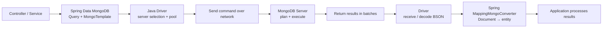

# Distinguishing Server, Network, Driver, and Object Conversion Time

When a `MongoTemplate.find(...)` call takes 450 ms, you cannot assume MongoDB spent 450 ms executing the query. User-perceived latency can comprise many steps: server selection, waiting for a connection, sending the command over the network, executing on MongoDB, receiving batches, decoding BSON, mapping `Document` into Java entities, and application processing. A query taking only a few milliseconds on the server can still feel slow in the application.

In the **Spring Data MongoDB** module, separating these timing layers directs you to the right fix: tune queries/indexes when MongoDB is slow; inspect network, batch counts, and payload size when transfer is slow; adjust connection pool settings when the driver waits; or cut object-mapping cost when Java processing is the bottleneck. This lesson explains how to model latency, collect measurements via `explain`/profiler, the MongoDB Java Driver, and Spring Data code, and cross-check evidence before changing the system.

## 1. Which layers does a database call pass through?

For a synchronous multi-document read, the general flow is:



A simplified model for **one read fetching all results**:

```text
T_end_to_end
≈ T_app_before_query
  + T_server_selection
  + T_connection_wait
  + Σ T_command(find / getMore)
  + T_object_mapping
  + T_app_after_query

T_command ≈ T_request_send + T_server_execution
            + T_result_return + T_driver_protocol_handling
```

This is a **mental model**, not an equation whose terms always separate cleanly. BSON decoding, entity mapping, batch reception, and execution can overlap; with reactive/async flows, schedulers and concurrent work also interleave. Furthermore, one repository call can trigger **multiple server commands** due to cursors, reference loading, or auxiliary operations.

Definitions of the four commonly cited components:

| Component | Typically includes | Do not confuse with |
| --- | --- | --- |
| **Server time** | Plan selection, index/document scans, filtering, sorting, aggregation, and building results on MongoDB | Full HTTP or Java request duration |
| **Network time** | Request/response transit, RTT, byte transfer, latency between app and MongoDB | `executionTimeMillis` from `explain` |
| **Driver time** | Server selection, connection wait, protocol framing, command send/receive, BSON reading, cursor management, retries | Server-only command execution time |
| **Object conversion** | Spring Data mapping from BSON/`Document` to entity/DTO; converters, callbacks, nested field mapping | Driver `CommandSucceededEvent` duration |

`CommandSucceededEvent` measures a **driver command** at command-monitoring boundaries. It generally includes network round trips and related handling, yet **does not represent the entire `MongoTemplate.find(...)` call**: pre-command pool wait/server selection and post-command Spring Data mapping sit outside it.

## 2. Four different clocks and how to ask the right questions

Suppose `GET /orders?status=PAID` returns 100 orders in 320 ms. Three monitoring tools might report:

- The application logs endpoint latency of 320 ms.
- A driver-emitted `find` command completes in 120 ms.
- `explain("executionStats")` on an equivalent query reports 18 ms.

**You cannot subtract 320 − 120 = 200 ms and declare all 200 ms is mapping**, nor subtract 120 − 18 = 102 ms and claim the network took exactly 102 ms. Measurements may come from different moments and mechanisms; the endpoint also performs auth, JSON serialization, and potentially multiple `getMore` commands.

Before concluding, clarify:

1. **Where do the clocks start and stop?** HTTP request, driver command, server-side `find`, or full cursor consumption?
2. **Are you measuring one command or the entire cursor?** `find` may return only the first batch; remaining batches need `getMore`.
3. **How much data is returned?** Document count, byte size, object depth, nested arrays, and projections heavily impact network, BSON decoding, and mapping.
4. **Under what load conditions were they captured?** Busy pools, cold caches, DNS/TLS, app CPU, garbage collection, database write traffic, or resource contention.
5. **Are query shape, BSON filter, and indexes identical?** An `explain` run with a different shape, projection, or sort cannot directly explain the live request.

## 3. Measuring processing time on MongoDB Server

### 3.1. Using `explain("executionStats")` to analyze a query

Suppose `orders` stores `status`, `createdAt`, `customerId`, and `totalAmount`. The app needs the 100 most recent paid orders:

```javascript
db.orders.find(
  { status: "PAID" },
  { _id: 1, customerId: 1, createdAt: 1, totalAmount: 1 }
).sort({ createdAt: -1 }).limit(100).explain("executionStats");
```

Key fields to inspect:

| Field | Practical meaning |
| --- | --- |
| `queryPlanner.winningPlan` | Selected plan; look for stages like `IXSCAN`, `COLLSCAN`, `FETCH`, `SORT` |
| `executionStats.executionTimeMillis` | Time reported by MongoDB for planning/execution during that `explain` |
| `executionStats.nReturned` | Result documents returned by the query |
| `executionStats.totalDocsExamined` | Document examinations during execution |
| `executionStats.totalKeysExamined` | Index key examinations |
| Per-stage statistics | Pinpoint heavy work: scans, sorts, filters, lookups, groups… |

For example, returning 100 records while examining hundreds of thousands of documents signals reviewing indexes, selectivity, and query shape. Conversely, examining 100 keys to return 100 results when the endpoint remains slow points toward bottlenecks elsewhere.

A compound index matching filter and sort:

```javascript
// Candidate index to evaluate with explain,
// not assumed optimal for every workload.
db.orders.createIndex({ status: 1, createdAt: -1 });
```

A tight projection shrinks read and transfer volume; under matching conditions, a query can even be covered by the index. Still, requesting `_id`, unindexed fields, or certain operations can necessitate `FETCH`.

**Limitations of `explain`:** output reflects an *explain* run, not the end-to-end clock of a Java request. Calling `explain` behaves differently regarding plan cache/selection and execution context; live timings vary with caches, load, data, and batch counts. Never rely solely on `executionTimeMillis` instead of production measurements.

### 3.2. Profiler and server slow queries

When the profiler or slow-operation logging is enabled per operational policy, you can inspect timings of **actual operations** on MongoDB. For database `appdb`:

```javascript
// Read profiler data only if enabled and authorized.
use appdb;
db.system.profile.find(
  { ns: "appdb.orders" },
  { ts: 1, op: 1, millis: 1, command: 1, planSummary: 1 }
).sort({ ts: -1 }).limit(10);
```

`millis` in the profiler is the operation duration recorded on MongoDB, **excluding full network latency and Java mapping**. `getMore` calls can appear as separate operations. Most production setups use slow query logs or MongoDB monitoring tools per operational guidance, as verbose profiling adds overhead and can capture sensitive query parameters.

To correlate requests with server operations, attach a trace ID/`comment` free of personal or sensitive data to link both sides. Verify comment forwarding and recording behavior on your driver/server version.

## 4. Measuring command time in the MongoDB Java Driver

The Java Driver provides **Command Monitoring** via `CommandStartedEvent`, `CommandSucceededEvent`, and `CommandFailedEvent`. This is ideal for observing durations of individual `find`, `aggregate`, `getMore`, `update`, etc., independent of Spring Data entity mapping.

Example registering a `CommandListener` when constructing `MongoClient`:

```java
import com.mongodb.ConnectionString;
import com.mongodb.MongoClientSettings;
import com.mongodb.client.MongoClient;
import com.mongodb.client.MongoClients;
import com.mongodb.event.CommandFailedEvent;
import com.mongodb.event.CommandListener;
import com.mongodb.event.CommandStartedEvent;
import com.mongodb.event.CommandSucceededEvent;

import java.util.concurrent.TimeUnit;

public class MongoClientFactory {
    public static MongoClient create(String uri) {
        CommandListener listener = new CommandListener() {
            @Override
            public void commandStarted(CommandStartedEvent event) {
                // Can record command name / requestId for correlation.
                // Never log full event.getCommand() as it may contain sensitive data.
            }

            @Override
            public void commandSucceeded(CommandSucceededEvent event) {
                double elapsedMs =
                    event.getElapsedTime(TimeUnit.NANOSECONDS) / 1_000_000.0;
                System.out.printf(
                    "mongo.command=%s duration_ms=%.3f%n",
                    event.getCommandName(), elapsedMs
                );
            }

            @Override
            public void commandFailed(CommandFailedEvent event) {
                double elapsedMs =
                    event.getElapsedTime(TimeUnit.NANOSECONDS) / 1_000_000.0;
                System.err.printf(
                    "mongo.command=%s failed_ms=%.3f%n",
                    event.getCommandName(), elapsedMs
                );
            }
        };

        MongoClientSettings settings = MongoClientSettings.builder()
            .applyConnectionString(new ConnectionString(uri))
            .addCommandListener(listener)
            .build();

        return MongoClients.create(settings);
    }
}
```

`System.out` here is for learning observation only. In production, emit metrics to your monitoring system aggregated by command name/collection/status and avoid verbose hot-path logging. Never log raw filters, ciphertexts, credentials, or document bodies.

Command events tell you:

- **How long a command took** once dispatched by the driver; duration reflects combined driver/protocol handling, network, and server time within driver instrumentation boundaries.
- **Which commands are slow**: `find`, `aggregate`, `getMore`, writes, etc.
- **Whether multiple commands occurred**: reading a large list may emit one `find` and many `getMore` calls, spreading latency across commands.

They **do not directly isolate** server-only time, network RTT, connection pool wait, or `MappingMongoConverter` entity creation. Logging only `find` while ignoring `getMore` can severely underestimate total read work.

### 4.1. Server selection and connection pool belong to driver time

Before dispatching a command, the driver may:

1. Select a server matching read preference, topology, replica set state, and cached server descriptions.
2. Wait for an available pooled connection—possibly opening a new connection, completing TLS handshake, and authenticating.
3. Transmit the command over that connection.

The Java Driver exposes **Connection Pool Monitoring** events: `connectionCheckOutStarted`, `connectionCheckedOut`, `connectionCheckOutFailed`, and connection creation/closure events. Measure from *checkout started* to *checked out* to spot pool wait times, alongside active connections, wait queues, and timeouts. Match events using each checkout attempt's identifier rather than subtracting timestamps of arbitrary events.

Settings like `maxPoolSize`, `minPoolSize`, `maxConnecting`, `maxWaitTime`, and server selection timeouts govern high-load behavior. Blindly raising `maxPoolSize` cannot cure a slow database or leaked cursors; excessive connections can overload the database further.

If only the first call after deployment is slow, inspect DNS, TCP connect, TLS, auth, pool warm-up, classloading/JIT, and cold caches before blaming MongoDB query execution.

## 5. Measuring end-to-end at `MongoTemplate`

At the Spring Data layer, start the timer **right before execution** and stop **after all results are retrieved**. For synchronous APIs:

```java
import java.util.List;
import java.util.concurrent.TimeUnit;

import org.springframework.data.domain.Sort;
import org.springframework.data.mongodb.core.MongoTemplate;
import org.springframework.data.mongodb.core.query.Criteria;
import org.springframework.data.mongodb.core.query.Query;

public class OrderReadService {
    private final MongoTemplate mongoTemplate;

    public OrderReadService(MongoTemplate mongoTemplate) {
        this.mongoTemplate = mongoTemplate;
    }

    public List<Order> loadPaidOrders() {
        Query query = Query.query(Criteria.where("status").is("PAID"))
            .with(Sort.by(Sort.Direction.DESC, "createdAt"))
            .limit(100);

        long started = System.nanoTime();
        List<Order> orders = mongoTemplate.find(query, Order.class);
        long elapsedNs = System.nanoTime() - started;

        System.out.printf(
            "mongo.template.find count=%d total_ms=%.3f%n",
            orders.size(), elapsedNs / 1_000_000.0
        );
        return orders;
    }
}
```

`Order` is the example domain entity mapped with `@Document("orders")` and required fields; this snippet illustrates service-level timing rather than a standalone app. `System.nanoTime()` suits elapsed intervals, whereas `System.currentTimeMillis()` reflects wall-clock time subject to clock adjustments.

Here `mongoTemplate.find(...)` timing typically spans driver, network, MongoDB, and conversion into `List<Order>`. It **excludes** controller JSON serialization after returning; if HTTP responses lag, measure serialization and web handling separately.

Endpoints using `Page<T>` may execute both a data query and a count query; `@DBRef` or lazy references can emit extra queries upon property access. Account for all generated work rather than assuming "one repository call equals one command."

### 5.1. Comparing raw `Document` retrieval vs. entity mapping

To gauge mapping overhead, run the exact same filter, sort, projection, and limit via the driver into raw `Document` instances and compare against `MongoTemplate`:

```java
import java.util.ArrayList;
import java.util.List;
import org.bson.Document;
import com.mongodb.client.model.Filters;
import com.mongodb.client.model.Sorts;

long rawStart = System.nanoTime();
List<Document> raw = mongoTemplate.getCollection("orders")
    .find(Filters.eq("status", "PAID"))
    .sort(Sorts.descending("createdAt"))
    .limit(100)
    .into(new ArrayList<>());
double rawMs = (System.nanoTime() - rawStart) / 1_000_000.0;

// Time mongoTemplate.find(query, Order.class) for the exact same BSON filter/sort/limit
// across multiple independent runs to compare time distributions.
```

The raw driver path **still pays** for server execution, network transit, and BSON decoding into `Document`. Thus the difference between the two measurements is **only a directional estimate**, not a pure measurement of `MappingMongoConverter`. For a fair comparison, keep data, projection, and sort identical so neither path fetches extra fields. Warm up the JVM first, run many iterations under steady load, interleave runs, and compare distributions rather than single samples.

If high mapping cost is suspected, check:

- Deeply nested structures, huge lists, heavy constructors, custom converters, or entity lifecycle callbacks during hydration.
- Fetching full documents when only two or three fields are used—apply projections, DTOs, or interface projections to cut wire bytes and object allocation.
- `@DBRef` or lazy references triggering secondary N+1 queries—verify command counts via driver monitoring.
- Post-`find` DTO conversion, JSON serialization, or service enrichment being misattributed to Spring mapping.

Projections trim data effectively, yet ensure entities/DTOs retain all fields required by constructors or domain invariants; never apply projections blindly if they break object invariants.

## 6. Cursors, batch size, and streaming

A query returning 50,000 documents rarely arrives in one response. The driver receives the first batch with `find` and issues `getMore` calls as the app iterates the cursor. This creates three observable effects:

- Short **time to first result** yet long **time to consume all**.
- Individual `find` logs look small while summed `getMore` work is large.
- BSON decoding and mapping consume CPU concurrently with batch fetching and iteration.

Synchronous cursor example:

```java
import com.mongodb.client.MongoCursor;
import org.bson.Document;

long started = System.nanoTime();
int count = 0;

try (MongoCursor<Document> cursor =
         mongoTemplate.getCollection("orders")
             .find(Filters.eq("status", "PAID"))
             .batchSize(500)
             .iterator()) {
    while (cursor.hasNext()) {
        Document doc = cursor.next();
        // Keep per-item work minimal so the benchmark does not measure business logic.
        count++;
    }
}

double allMs = (System.nanoTime() - started) / 1_000_000.0;
System.out.printf("rows=%d consume_all_ms=%.3f%n", count, allMs);
```

`batchSize` hints document count per batch; wire message size limits and server rules can yield fewer documents per batch. Small batches raise round trips; large batches raise memory usage and per-batch pauses. Tune it based on document size, record volume, and consumption pattern.

If an endpoint needs only 20 records, limit and paginate at the database instead of downloading everything and slicing in Java. For deep pages, large `skip` forces the server to step over many entries; stable-keyset/seek pagination fits deterministic ordered streams better.

## 7. Reactive queries: timing is especially easy to mismeasure

`ReactiveMongoTemplate` returns `Flux` or `Mono` Publishers: constructing the publisher **has not executed the query yet**. Wrapping a timer around `Flux` creation reports near-zero time and does not measure MongoDB access.

Example **test-environment** measurement capturing full consumption:

```java
import java.time.Duration;
import java.util.List;
import reactor.core.publisher.Flux;

long started = System.nanoTime();
List<Order> result = reactiveMongoTemplate
    .find(
        Query.query(Criteria.where("status").is("PAID")).limit(100),
        Order.class
    )
    .collectList()
    .block(Duration.ofSeconds(15));

double totalMs = (System.nanoTime() - started) / 1_000_000.0;
```

`block(...)` here is **strictly for illustration in synchronous tests/benchmarks**; never call `block` inside non-blocking WebFlux request threads. In production reactive apps, measure from subscription to completion/error via lifecycle operators or Micrometer Observation/Tracing, alongside driver command metrics.

In reactive flows, elapsed time also includes event-loop/scheduler queuing, backpressure, and downstream consumption speed. Operators like `elapsed()` or inter-`onNext` intervals do not isolate MongoDB Server time. If a downstream sink is slow, a long-running `Flux` does not mean the database spent that time executing the query.

## 8. Spotting bottlenecks from measurement patterns

Entries below use **hypothetical diagnostic patterns**, not universal thresholds:

| Observation | Likely cause to investigate first | Next verification |
| --- | --- | --- |
| Slow explain/profiler, very high `docsExamined` | Missing index, low selectivity, expensive sort/group | Inspect `winningPlan`, indexes/filters/sorts, DB resources |
| Fast server, slow individual driver commands | Network latency, huge payloads, link saturation, or driver/protocol | Check deployment RTT, bytes transferred, `getMore`, pool, network metrics |
| Fast commands, slow service return time | Pool/server selection wait, mapping, auxiliary commands, or Java work | Pool events, command counts, `Document` vs. entity, JVM profiler |
| Fast `find`, slow full cursor consumption | Many `getMore` calls, tiny batches, huge record volume | Count batches/rows, measure consume-all, tune batch size |
| First call slow, subsequent calls steady | Connection setup, TLS/auth, JIT, caches, warm-up | Compare cold vs. warm, checkout time, caches, server load |
| Low p50, high p99 under concurrency | Pool queuing, burst load, GC pauses, or contention | Checkout p95/p99, active connections, GC, CPU, disk |
| Repository slower than raw driver query | Mapping, converters, differing projections, `@DBRef`, or extra commands | Match exact query shapes, compare commands, profile Java |
| Only HTTP response slow; MongoDB read fast | JSON serialization, business logic, client–API network | Trace spans across service, controller, and network |

Distinguishing p50, p95, and p99 is critical: a low mean can mask a tail of slow requests users feel as lag. Segment metrics by route, command name, collection, result size, and concurrency. Never collapse all queries into one histogram and optimize from averages.

## 9. Layer-by-layer diagnostic workflow

Practical steps for a slow `find` in staging or production:

1. **Verify end-to-end latency:** time the full `MongoTemplate` call and web request, separating business logic/JSON. Record row counts and response sizes.
2. **Count commands and driver durations:** enable bounded command monitoring; record `find`, `getMore`, auxiliary commands, error rates, and p50/p95/p99.
3. **Measure pool and server selection:** if service duration exceeds observed commands, check checkout waits, timeouts, topology/server selection, and connection counts.
4. **Check MongoDB-side evidence:** pull slow ops/profiler entries for the request; run `explain("executionStats")` with exact filter/projection/sort to check plan and examined counts.
5. **Measure batches and payloads:** inspect network RTT, bytes, document size, `getMore` frequency, and what fields the endpoint truly needs.
6. **Isolate Java overhead:** test tighter projections, compare raw `Document` vs. entity reads, profile CPU/allocations/GC, and audit custom converters and references.
7. **Change one variable at a time:** e.g., add a candidate index or shrink projection; re-measure under equivalent load to confirm improvement and prevent regressions.

Avoid changing `maxPoolSize`, `batchSize`, indexes, thread pools, and mapping simultaneously. Changing multiple variables makes it impossible to know which helped or hurt.

### A controlled diagnostic example

Suppose an endpoint reading 500 documents takes 600 ms in testing. Driver monitoring reports roughly 70 ms across commands, and `explain` on the exact query shape shows reasonable `nReturned` and low `totalDocsExamined`. That alone does not prove mapping took 530 ms.

Further measurement uncovers:

- Connection pool checkouts occasionally wait ~250 ms during peak traffic.
- A custom converter performs heavy CPU work and allocates many temporary objects.
- JSON serialization of 500 entities also takes substantial time after `find`.

The fix must address each verified root cause: review concurrency/pool sizing, simplify the converter or project fewer fields, and benchmark serialization separately. Adding another index would do little when the server already returns results fast.

## 10. Designing trustworthy measurements

**Consistent conditions** matter more than obtaining one attractive number:

- Use datasets matching production distributions: record count, document sizes, filter hit rates, nesting depth, and indexes.
- Warm up JVM and connection pools adequately before measuring steady state; if studying cold starts, report cold-start latency separately.
- Control concurrency; test both light load and realistic concurrency, since pool and server queuing emerge only under concurrent demand.
- Run multiple iterations and report p50/p95/p99 distributions and sample counts; never conclude from one `explain` and one `find`.
- Correlate requests/traces across layers while **never logging** PII, sensitive query parameters, or full document bodies.
- Record timestamps of index changes, pool settings, driver/Spring Data versions, node counts, deployment regions, and workload profiles.
- For elapsed durations, use monotonic clocks within the JVM; across hosts, rely on trace spans/correlation instead of subtracting wall clocks subject to clock skew.

Every metric has **its own boundary**. Server, driver, and Java measurements offer complementary perspectives; add or subtract them directly only when they belong to the same operation, time window, and reliable correlation context.

## 11. Hands-on exercise

Create an `orders` collection holding tens of thousands of documents with varied `status` distributions, `createdAt`, `customerId`, and variable-sized `items` arrays. Build a Spring Data MongoDB endpoint fetching the newest `PAID` orders.

Proceed in order:

1. Use `MongoTemplate.find` with explicit filter, sort, limit, and projection; time from before the call until `List<Order>` returns.
2. Register `CommandListener` and observe emitted commands. Run `explain("executionStats")` for the exact query shape, recording `nReturned`, `totalDocsExamined`, and plan.
3. Test two cases: fetching 20 small documents vs. several thousand documents with large `items` arrays. Compare command times, `getMore` counts, and full consumption duration.
4. Query the same BSON filter via the driver into `Document` to compare against entity mapping, using identical projection/sort/limit across multiple iterations.
5. Increase concurrency deliberately while watching pool checkout waits and p95/p99; determine whether slowdowns stem mainly from the server or connection waits.
6. Propose and test **one** evidence-backed improvement (index, projection, batch size, or converter optimization). Re-measure and explain the difference.

Results template:

| Scenario | Documents/bytes | Server profiler or explain (ms) | Total commands (ms) | Checkout wait (ms) | `MongoTemplate.find` (ms) | Notes |
| --- | --- | --- | --- | --- | --- | --- |
| 20 small orders | Measure | Measure | Measure | Measure | Measure | `getMore` count |
| Many large orders | Measure | Measure | Measure | Measure | Measure | Batch count/size |
| High concurrency | Measure | Measure | Measure | Measure | Measure | p95/p99 and timeouts |

If `explain` is run separately, note explicitly that it is a **query plan evaluation sample**, not the server time of the exact measured request. Without profiler access, mark "no corresponding operation measurement" rather than guessing.

**Completion criteria:** You can distinguish end-to-end, command, server, checkout, and mapping timings; recognize multi-batch cursors; combine `explain`, driver monitoring, and app timing to prove root causes; and pick an optimization backed by observed data.

## 12. Key takeaways

- **A fast server does not guarantee a fast endpoint.** Network, pooling, BSON decoding, Spring mapping, and application processing all add cost.
- **`explain.executionTimeMillis` is not `MongoTemplate.find` time.** Each measures a different scope.
- **Command monitoring alone omits pool waits and entity mapping.** Combine with connection-pool events and service-level timers.
- **One query can emit multiple commands.** Always watch `getMore`, reference loading, total counts, and auxiliary steps.
- **Keep `Document` vs. entity comparisons fair.** Match query shape, data volume, load, warm-up, and result consumption.
- **Optimize where the measured bottleneck lives.** Use indexes when the server scans too much; trim payloads/batches when network and cursors dominate; tune pools when waiting; improve projections/converters when Java mapping is heavy.
