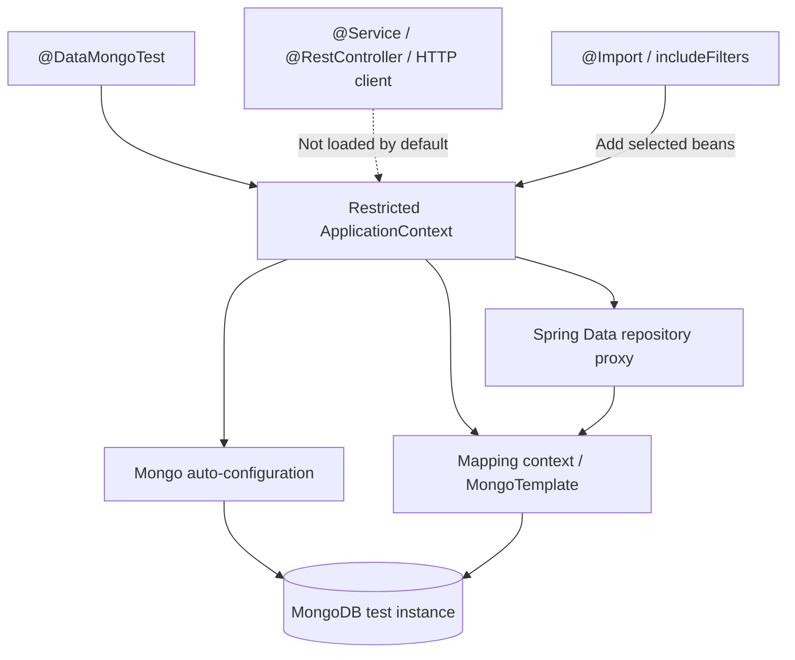

# `@DataMongoTest` and Loaded Bean Scope

> **Chapter:** Testing  
> **Scope:** Spring Data MongoDB, focusing on testing document mapping, `MongoTemplate`, repositories, indexes, and queries with Spring Boot's test slice.

## 1. Purpose of `@DataMongoTest`

An application using Spring Data MongoDB typically has many components: REST controllers, business services, security, external API clients, message brokers, scheduled jobs, and the data access layer. When you only want to test repositories or how `MongoTemplate` writes and reads BSON, loading the entire application can make tests slow, dependent on many systems, and hard to diagnose when failures occur.

`@DataMongoTest` is Spring Boot's **test slice** for the MongoDB layer. Instead of starting the entire application context like `@SpringBootTest`, this annotation limits component scanning and enables MongoDB-related auto-configurations. As a result, tests focus on mapping, repositories, and database operations.

Examples of questions suited for `@DataMongoTest`:

- Does a `findByEmail(...)` method on `MongoRepository` return the right document?
- Does `@Field("email_address")` map to the right BSON field name?
- Does `MongoTemplate` execute `Criteria` filters, updates, or aggregations correctly?
- Do `@Indexed`, custom conversions, or MongoDB callbacks work when configured in the test context?

Important point: **the test slice limits which Spring beans are created; it does not mock MongoDB**. A `@DataMongoTest` still requires an actual reachable MongoDB instance, such as MongoDB running via Testcontainers or a prepared test environment.

## 2. Which Beans Does `@DataMongoTest` Load?

Conceptually, Spring Boot uses component filtering to keep types needed for MongoDB and exclude ordinary application components. In a typical setup, the following components are created or discovered:

| Component | Typical status in `@DataMongoTest` | Meaning |
| --- | --- | --- |
| `MongoClient` and MongoDB connection config | Present, when auto-configuration and connection settings are satisfied | Connects to real MongoDB |
| `MongoTemplate` | Present | Writes, reads, queries, updates, aggregations for synchronous MongoDB |
| `MappingMongoConverter`, mapping context, and data infrastructure | Present | Converts Java objects ↔ BSON, applies `@Field`, `@Id`, etc. |
| Interfaces extending `MongoRepository` | Present, if within repository scan scope | Spring Data creates repository proxies |
| Classes annotated with `@Document` | Discovered as mapping entities | **Does not mean** the class itself is a singleton Spring bean |
| Reactive MongoDB infrastructure | Depends on classpath and version configuration | May support `ReactiveMongoTemplate`/reactive repositories |
| Ordinary business `@Service`, `@Component` | Not loaded by default | Do not test service orchestration in this slice unless imported |
| `@Controller`, `@RestController`, web filters | Not loaded by default | Does not start the full MVC or web security chain |
| Application HTTP clients, Kafka listeners, mail senders, schedulers | Not loaded by default | Outside the slice's data-testing scope |
| Custom `@Configuration`, user `@Bean`s, auditing, converters, migrations | Depends on declaration and imports | Inspect the context and include them explicitly when tests need them |

Some details depend on the Spring Boot version, dependencies on the classpath, beans supplied by auto-configuration, and imported configurations. Thus the table reflects the **default scope**, not a guarantee that every project gets the exact same bean list.

### 2.1. Distinguishing Entity, Repository, and Service

Three types are commonly confused:

1. `@Document` tells Spring Data that a class is a **data mapping type**. `Customer` is mapped during MongoDB operations, but `@Document` itself does not turn every document into a bean in the application context.
2. `interface CustomerRepository extends MongoRepository<Customer, String>` is turned by Spring Data into a **repository proxy bean** if repository scanning finds the interface.
3. `@Service CustomerService` is a business-layer bean. The MongoDB slice **does not scan and instantiate services** merely because a service calls `CustomerRepository`.

If a repository test fails because `CustomerService` cannot be found, the test is very likely pulling service-layer logic into the wrong scope, or an imported configuration is dragging in unwanted services.

### 2.2. Test Slice Context Diagram



The diagram illustrates **bean scope inside the JVM**. Making MongoDB available to connect to is a separate step of the test environment.

## 3. Hands-on Example: Testing a Repository with Testcontainers

The example below uses **Spring Boot 3.x, JUnit Jupiter, AssertJ, and Testcontainers 1.x**. Packages for `@DataMongoTest` or Testcontainers may change in other major versions; verify imports and dependencies for your project.

Suppose the application has this structure:

```text
com.example.shop
├── ShopApplication.java           // @SpringBootApplication
└── customer
    ├── Customer.java
    ├── CustomerRepository.java
    └── CustomerRepositorySliceTest.java
```

Place tests in the same package or a subpackage of the application so Spring Boot finds the appropriate `@SpringBootApplication` configuration. Avoid manually scanning the entire application package, as that can defeat the purpose of the test slice.

### 3.1. Entity with BSON Mapping

```java
package com.example.shop.customer;

import org.springframework.data.annotation.Id;
import org.springframework.data.mongodb.core.mapping.Document;
import org.springframework.data.mongodb.core.mapping.Field;

@Document("customers")
public class Customer {

    @Id
    private String id;

    @Field("email_address")
    private String email;

    protected Customer() {
        // Used by Spring Data when instantiating from BSON.
    }

    public Customer(String email) {
        this.email = email;
    }

    public String getId() {
        return id;
    }

    public String getEmail() {
        return email;
    }
}
```

In Java, the property name is `email`; in MongoDB, the actual stored field is `email_address`.

### 3.2. Repository Created as a Bean

```java
package com.example.shop.customer;

import java.util.Optional;
import org.springframework.data.mongodb.repository.MongoRepository;

public interface CustomerRepository extends MongoRepository<Customer, String> {
    Optional<Customer> findByEmail(String email);
}
```

Spring Data parses `findByEmail` against the **Java** property `email`, then maps it to the BSON field using entity metadata. There is no need to write a manual `@Query` for this simple case.

### 3.3. Test Slice Loading Only the Repository and MongoDB Infrastructure

```java
package com.example.shop.customer;

import static org.assertj.core.api.Assertions.assertThat;

import org.junit.jupiter.api.BeforeEach;
import org.junit.jupiter.api.Test;
import org.springframework.beans.factory.annotation.Autowired;
import org.springframework.boot.test.autoconfigure.data.mongo.DataMongoTest;
import org.springframework.boot.testcontainers.service.connection.ServiceConnection;
import org.springframework.data.mongodb.core.MongoTemplate;
import org.testcontainers.containers.MongoDBContainer;
import org.testcontainers.junit.jupiter.Container;
import org.testcontainers.junit.jupiter.Testcontainers;
import org.testcontainers.utility.DockerImageName;

@DataMongoTest
@Testcontainers
class CustomerRepositorySliceTest {

    @Container
    @ServiceConnection
    static final MongoDBContainer mongo =
        new MongoDBContainer(DockerImageName.parse("mongo:7.0"));

    @Autowired
    CustomerRepository repository;

    @Autowired
    MongoTemplate mongoTemplate;

    @BeforeEach
    void clean() {
        repository.deleteAll();
    }

    @Test
    void savesAndFindsByMappedProperty() {
        Customer saved = repository.save(
            new Customer("mai@example.test")
        );

        assertThat(saved.getId()).isNotBlank();
        assertThat(repository.findByEmail("mai@example.test"))
            .isPresent()
            .get()
            .extracting(Customer::getEmail)
            .isEqualTo("mai@example.test");

        // Read raw BSON to verify the field name defined by @Field.
        org.bson.Document stored = mongoTemplate
            .getCollection("customers")
            .find(new org.bson.Document("email_address", "mai@example.test"))
            .first();

        assertThat(stored).isNotNull();
        assertThat(stored.getString("email_address"))
            .isEqualTo("mai@example.test");
        assertThat(stored.containsKey("email")).isFalse();
    }
}
```

This test verifies three things against a real database: the repository proxy is created, `save`/`findByEmail` run through Spring Data, and the `email` → `email_address` mapping persists properly. It **does not instantiate** controllers or test HTTP endpoints.

`@ServiceConnection` (Spring Boot 3.1+) extracts connection details from the container and supplies them to auto-configuration; it requires the `spring-boot-testcontainers` and Testcontainers/JUnit Jupiter dependencies. Docker must be running on the machine executing the tests. On different Spring Boot/Testcontainers versions, verify the `MongoDBContainer` package and corresponding connection details mechanism.

### 3.4. `@DynamicPropertySource` Alternative

If the project does not use `@ServiceConnection`, you can pass the Testcontainers URI to Spring Boot via `@DynamicPropertySource`:

```java
@DataMongoTest
@Testcontainers
class CustomerRepositoryWithDynamicPropertiesTest {
    @Container
    static final MongoDBContainer mongo =
        new MongoDBContainer(DockerImageName.parse("mongo:7.0"));

    @DynamicPropertySource
    static void mongoProperties(DynamicPropertyRegistry registry) {
        registry.add("spring.data.mongodb.uri", mongo::getReplicaSetUrl);
    }

    @Autowired
    CustomerRepository repository;

    // Test methods...
}
```

Additional imports: `org.springframework.test.context.DynamicPropertyRegistry`, `org.springframework.test.context.DynamicPropertySource`, along with the imports from the previous example. **Choose one connection-provisioning mechanism** for your tests to avoid conflicting URI configurations. The `spring.data.mongodb.uri` property in this example follows Spring Boot 3.x.

## 4. Verifying Which Beans Are Actually Loaded

You can inspect the application context directly rather than guessing:

```java
@Autowired
ApplicationContext applicationContext;

@Test
void loadsMongoInfrastructureButNotBusinessService() {
    assertThat(applicationContext.getBeansOfType(MongoTemplate.class))
        .isNotEmpty();
    assertThat(applicationContext.getBeansOfType(CustomerRepository.class))
        .isNotEmpty();

    assertThat(applicationContext.getBeansOfType(CustomerService.class))
        .isEmpty();
}
```

Here `CustomerService` is an ordinary application `@Service` that is not imported into the slice. You must import `org.springframework.context.ApplicationContext` and have a `CustomerService` class in the project for the example to compile. This check is useful when a test unexpectedly invokes an HTTP client, starts a scheduler, or fails due to business-layer dependencies: inspect which beans entered the context and why.

**Distinguish two error types:**

- **Missing bean:** `NoSuchBeanDefinitionException` or `UnsatisfiedDependencyException` usually appears when a test requires a service/converter/config not loaded in the slice.
- **Cannot connect to MongoDB:** timeouts or server selection errors can occur even when `MongoTemplate` is already a valid bean. In that case, check the URI, container, credentials, TLS, replica set, and MongoDB status.

## 5. When Do You Need to Load Additional Beans?

`@DataMongoTest` should contain only the beans needed for the test question. There are three common options:

### 5.1. `@Import`: Add the Exact Configuration or Component Needed

Suppose a query depends on a custom Mongo converter defined in `MongoConversionConfig`. You can import it intentionally:

```java
@DataMongoTest
@Import(MongoConversionConfig.class)
class CustomerConversionTest {
    @Autowired MongoTemplate mongoTemplate;

    // Verify converter and BSON are read/written properly.
}
```

`MongoConversionConfig` must actually define the required beans/conversions. If that configuration pulls in numerous services or other infrastructure beans, split the converter part into a small configuration focused on persistence. `@Import` is preferable to broadening whole-application scanning.

### 5.2. `includeFilters` and `excludeFilters`

`@DataMongoTest` provides attributes like `includeFilters`, `excludeFilters`, and `useDefaultFilters` to customize component scanning. For example, a converter bean declared with `@Component` that is excluded from the slice can be added explicitly:

```java
@DataMongoTest(
    includeFilters = @ComponentScan.Filter(
        type = FilterType.ASSIGNABLE_TYPE,
        classes = CustomerValueConverter.class
    )
)
class CustomerConverterSliceTest {
    // CustomerValueConverter is a standalone component in the application.
}
```

Related imports are `org.springframework.context.annotation.ComponentScan` and `org.springframework.context.annotation.FilterType`. The example assumes `CustomerValueConverter` exists and its dependencies can be satisfied within the slice.

`excludeFilters` is useful when a component type should not appear; `useDefaultFilters = false` changes the discovered set and should be used carefully. Do not use filters to pull controllers/services into the context if the goal is still persistence testing.

### 5.3. `@TestConfiguration` and Mocks for External Dependencies

An extra bean needed solely for testing can be declared in a nested `@TestConfiguration`. For instance, when a Mongo callback needs a `Clock`, the test can provide `Clock.fixed(...)` to freeze time. If a required component depends on an external collaborator, consider mocking that collaborator instead of calling a real system.

However, if the test actually verifies coordinated logic across services, transactions, security, web, and MongoDB, using `@SpringBootTest` or combining specialized test slices gives a clearer scope. Trying to import every dependency into `@DataMongoTest` usually forfeits the slice's isolation benefits.

## 6. What `@DataMongoTest` Does Not Do Automatically

| Common assumption | Reality | How to handle |
| --- | --- | --- |
| “Adding the annotation starts MongoDB automatically” | The slice builds a context; it does not guarantee a server | Use Testcontainers or a MongoDB test instance with a URI or `@ServiceConnection` |
| “All `@Service` and `@Controller` beans are loaded” | They are excluded from the default scope | Use `@SpringBootTest` for application-flow tests, or import needed beans |
| “`@Document` is a bean that can be `@Autowired`” | It is a mapping entity type, not a Spring component | Inject repositories/template and instantiate entities as data |
| “`@Indexed` always creates indexes” | Auto index creation depends on `auto-index-creation` or migrations | Enable intentionally in tests, use index operations/migrations, and verify on the server |
| “All converters/callbacks/auditing in the app are active” | Only beans/configs actually loaded are active | Import config, check context, and inspect resulting BSON |
| “Every `@Test` automatically rolls back data” | The MongoDB test slice does not roll back every write by default | Clean up data between tests; use a dedicated database/container |
| “`@DataMongoTest` simulates transactions” | MongoDB transactions need sessions, topology, and a compatible server | Use a suitable replica set/container and test transactions intentionally |
| “Repository passing means HTTP/security works” | The slice does not test the full request pipeline | Write separate web/controller or `@SpringBootTest` tests |

### 6.1. Indexes Do Not Appear Automatically

`@Indexed(unique = true)` is metadata for Spring Data to create an index when index creation is enabled or when an index-management process runs. In modern Spring Data MongoDB configurations, **auto index creation is off by default**; review your version and configuration:

```java
@DataMongoTest(properties = "spring.data.mongodb.auto-index-creation=true")
class CustomerIndexTest {
    // Use repository/MongoTemplate to trigger mapping and inspect
    // db.customers.getIndexes() or IndexOperations.
}
```

This property example follows the Spring Boot 3.x line. If the application manages indexes via migrations, run those migrations or declare the indexes to test; avoid arbitrarily mixing both mechanisms in the same environment. For a `unique` index, the test must attempt duplicate writes and verify the error from MongoDB to prove the constraint is enforced.

### 6.2. Test Data Is Not Automatically Isolated

`@DataMongoTest` contexts can be cached and reused by Spring Test across test methods; the MongoDB server can also retain data across multiple tests. Do not rely on test execution order or expect `@Transactional` to auto-rollback as is common with some relational databases.

In the example above, `@BeforeEach repository.deleteAll()` is simple and effective when the collection belongs exclusively to that test. For large, parallel, or multi-collection tests, use a dedicated database, separate collection names, fixtures, and an explicit cleanup strategy. Never wipe data on a shared MongoDB outside a test environment.

## 7. Choosing the Right Test Level

| Test objective | Usually suitable tool | What does it verify? |
| --- | --- | --- |
| Pure Java logic, no MongoDB needed | JUnit + mock/fake | Business conditions, input handling, calculation rules |
| Repository queries, `@Field`, converters, indexes, and `MongoTemplate` | **`@DataMongoTest` + MongoDB test instance** | Mapping and persistence behavior with real MongoDB |
| Reactive repositories, `ReactiveMongoTemplate` | `@DataMongoTest` with appropriate reactive dependencies | Real reactive queries, backpressure/cancellation within tested scope |
| Service coordinating multiple repositories and infrastructure | `@SpringBootTest` or integration test with full beans | Component interactions in a broader context |
| REST API, HTTP validation, serialization/controller | `@WebMvcTest` or HTTP integration test | Request/response, controller, HTTP status, and web mechanics |
| Transactions, sessions, change streams, failover, sharding | Integration test with suitable MongoDB topology | Database- and driver-specific features |

Do not treat a unit test using a mocked repository as evidence that MongoDB queries work. Nor should you expect `@DataMongoTest` to prove that the entire product is properly configured.

### 7.1. Reactive MongoDB

If the project uses the reactive driver and Spring Data reactive, inject `ReactiveMongoTemplate` or `ReactiveMongoRepository` and use `StepVerifier` to wait for and verify publishers. Simply creating a `Mono` without subscribing/verifying can leave the database command unexecuted. Reactive beans depend on the actual classpath and auto-configuration; inspect the application context rather than assuming every slice includes both blocking and reactive beans.

### 7.2. Transactions and Sessions

A successful `MongoTemplate.save` on a standalone MongoDB does not prove multi-document transactions work. Transactions require a supporting MongoDB topology (such as a replica set), `MongoTransactionManager` or an appropriate transaction setup, and an execution path that actually opens a session/transaction. `@DataMongoTest` does not automatically establish all these conditions; transaction tests should explicitly declare the required beans and environment.

## 8. Checklist for Debugging Context Load Failures

When encountering failures, work through this short sequence:

1. **Check the test annotation:** are you using `@DataMongoTest` or `@SpringBootTest`? Are `@Import`, `includeFilters`, or a custom `@ComponentScan` altering the scope?
2. **Check bootstrap configuration:** is the test located under the package containing `@SpringBootApplication`? Are multiple `@SpringBootConfiguration` classes causing ambiguity, or is a custom configuration pulling in extra beans?
3. **Verify dependencies:** is `spring-boot-starter-data-mongodb` or the reactive starter on the classpath? Is the repository interface discovered and proxied?
4. **Verify connection:** is the MongoDB container running? Does `@ServiceConnection` or `@DynamicPropertySource` provide the right URI? Are database name, TLS, credentials, and replica set compatible?
5. **Verify mapping:** does the entity have proper `@Document`, `@Id`, `@Field` annotations? Are any required custom converters or listeners imported into the context?
6. **Verify queries and indexes:** do derived query methods use the exact **Java property** names? Does raw BSON in MongoDB have the expected fields? Have indexes/migrations run? Is leftover test data interfering?
7. **Inspect actual results:** read via the repository and read raw BSON via `MongoTemplate.getCollection(...)`; inspect query plans when performance is the goal of the test.

For example, a `NoSuchBeanDefinitionException` for a `@Service` may be completely consistent with `@DataMongoTest`'s purpose; it is a signal to change the test scope or import the minimal bean needed. Meanwhile, `MongoTimeoutException` points to a different investigation path: database connectivity.

## 9. Practice Exercises

Starting from the `Customer` and `CustomerRepository` example, implement three tests yourself:

1. **Mapping:** save `Customer("mai@example.test")`, read the raw `Document`, and assert `email_address` is present while `email` is absent.
2. **Repository query:** save two distinct emails, check that `findByEmail` returns the matching customer and `Optional.empty()` when the email does not exist.
3. **Index:** declare `@Indexed(unique = true)` on `email`, enable index creation intentionally or create it with `IndexOperations`; save two customers with the same email and assert the unique constraint error from MongoDB. Then remove the index and observe how the test result changes.

Ask yourself after each test: “Did I just prove **real mapping/query/database behavior** works, or only that a bean was instantiated?”. That keeps expectations aligned for every test scope.

## 10. Key Takeaways

- `@DataMongoTest` is **Spring Boot's MongoDB test slice**: it normally loads `MongoTemplate`, MongoDB mapping infrastructure, and scanned repository proxies.
- `@Document` is entity metadata; `MongoRepository` becomes a repository bean; application `@Service`s and controllers are **not loaded by default**.
- MongoDB still needs somewhere to connect: use Testcontainers or a test instance and configure the connection appropriately; the slice does not replace the database.
- Expand the context with `@Import`, test configurations, or filters only when genuinely needed; use `@SpringBootTest` for multi-layer integration behavior.
- Verify with actual BSON data, queries, indexes, and real errors; control test data, server version, and topology to avoid false conclusions.

## References

- [Spring Boot — Auto-configured Spring Data MongoDB Tests](https://docs.spring.io/spring-boot/reference/testing/spring-boot-applications.html#testing.spring-boot-applications.autoconfigured-spring-data-mongodb): test slice scope and auto-configuration characteristics.
- [Spring Boot 3.x — `@DataMongoTest` API](https://docs.spring.io/spring-boot/3.3/api/java/org/springframework/boot/test/autoconfigure/data/mongo/DataMongoTest.html): annotation, `includeFilters`, `excludeFilters`, and configuration attributes.
- [Spring Boot — Testcontainers](https://docs.spring.io/spring-boot/reference/testing/testcontainers.html): `@ServiceConnection`, `@DynamicPropertySource`, and connection details.
- [Spring Data MongoDB — Object Mapping](https://docs.spring.io/spring-data/mongodb/reference/mongodb/mapping/mapping.html): `@Document`, `@Field`, mapping context, and converters.
- [Spring Data MongoDB — Index Creation](https://docs.spring.io/spring-data/mongodb/reference/mongodb/mapping/mapping-index-management.html): index creation conditions and automatic index creation.
- [Spring Data MongoDB — MongoTemplate](https://docs.spring.io/spring-data/mongodb/reference/mongodb/template-api.html): template operations, queries, and mapping.
