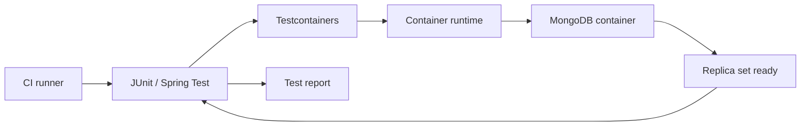
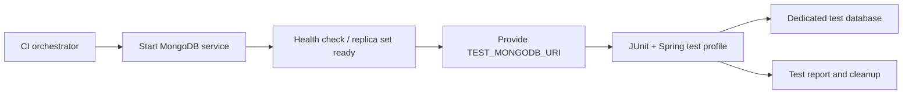

# Providing MongoDB for Tests via Testcontainers or a Test Service

When testing applications built with **Spring Data MongoDB**, mocking `MongoRepository` or `MongoTemplate` only verifies how the business layer invokes its dependencies. Mocks cannot prove that field names map properly, aggregations run on the server, indexes exist, or transactions roll back as expected. Those behaviors require a **real MongoDB** instance provisioned and managed during test execution.

Two common approaches are **Testcontainers** (the test suite starts MongoDB inside a container itself) and a **test service** (MongoDB already provisioned by Docker Compose, CI, or dedicated infrastructure). This lesson walks through both approaches—from connection setup, writing integration tests, and data isolation to handling replica sets, reactive APIs, and performance testing.

## 1. Choosing the Right Test Level

| Test type | Real MongoDB needed? | Verifiable characteristics |
| --- | --- | --- |
| Unit test for pure functions | No | Validation, data transformations, conditions, and business calculations |
| Unit test with mocked repository | No | Dependency call flows and simulated error handling |
| MongoDB data slice test | Yes | BSON mapping, derived queries, `MongoTemplate`, indexes, aggregations |
| Full-application integration test | Yes | Interactions across services, repositories, controllers, and transactions |
| Performance testing | Yes, representative data/load | Latency, documents scanned, commands, throughput, payload size |

Choose the smallest scope that verifies the requirement. Testing an email format validator does not need MongoDB; testing that a Java `email` field is stored as `email_address` in BSON requires a real database.

A MongoDB test environment should satisfy:

1. **Deterministic configuration**: explicit MongoDB version, topology, URI, indexes, and input data.
2. **Isolation**: tests can re-run or change order without interference from stale data.
3. **Readiness**: the test runner knows when MongoDB is accepting connections and has completed required setup.
4. **Safety**: test accounts and addresses cannot be confused with production; cleanup touches only test-owned databases.
5. **Reproducibility in CI**: the same suite runs in automation with logs available when setup fails.

## 2. Testcontainers vs. a Dedicated MongoDB Test Service

| Criterion | Testcontainers | Dedicated MongoDB test service |
| --- | --- | --- |
| Who provisions MongoDB? | Tests ask Docker to start a container | Docker Compose/CI/infrastructure starts it beforehand |
| Runtime prerequisites | Supported container runtime, Docker engine access, and image pull | Network, URI, credentials, and ready service |
| Lifecycle | Typically per test class or test suite | Per CI job, Compose stack, or environment policy |
| Isolation | Easy to start an isolated container; data still needs resetting | Requires a separate database/instance per job or class |
| Startup cost | Time to pull image and start container | Can be fast if the service is already running |
| Transactions | MongoDBContainer supports replica set initialization | Service needs an appropriate replica set/sharded topology |
| CI | Runner must have access to a container runtime | Runner needs network/credentials to the test MongoDB |
| Best suited for | Self-contained, repeatable repository/integration tests | Teams with an existing MongoDB service, special topologies, or Docker-less jobs |

**Typical choice:** If CI provides a container runtime, Testcontainers lets the suite manage its own dependency and avoids relying on a fixed MongoDB install on developer machines. If the organization already maintains MongoDB test infrastructure, provisioning via an environment URI is easy to share and works well for specialized topologies. Both choices use **the exact same repository code and verification criteria**; they differ only in how the connection is provisioned.

## 3. Sample Application Under Test

The examples below use **Java 17+, Spring Boot 3.x, and Spring Data MongoDB**. The application already includes the main `spring-boot-starter-data-mongodb` dependency. Create the entity and repository in package `example.accounts`.

**`CustomerAccount.java`**

```java
package example.accounts;

import java.time.Instant;
import org.springframework.data.annotation.Id;
import org.springframework.data.mongodb.core.mapping.Document;
import org.springframework.data.mongodb.core.mapping.Field;

@Document(collection = "accounts")
public record CustomerAccount(
        @Id String id,
        @Field("email_address") String email,
        Instant createdAt
) {}
```

**`AccountRepository.java`**

```java
package example.accounts;

import java.util.Optional;
import org.springframework.data.mongodb.repository.MongoRepository;

public interface AccountRepository
        extends MongoRepository<CustomerAccount, String> {
    Optional<CustomerAccount> findByEmail(String email);
}
```

Here the Java property is `email`, while the field stored in the document is `email_address`. A meaningful test must verify both that the repository queries properly **and** that BSON in MongoDB contains the expected field name.

## 4. Provisioning MongoDB with Testcontainers

### 4.1. Declaring Libraries and Image

With **Spring Boot 3.x and Testcontainers Java 1.x**, Maven test dependencies are:

```xml
<dependencies>
    <dependency>
        <groupId>org.springframework.boot</groupId>
        <artifactId>spring-boot-starter-test</artifactId>
        <scope>test</scope>
    </dependency>
    <dependency>
        <groupId>org.testcontainers</groupId>
        <artifactId>junit-jupiter</artifactId>
        <scope>test</scope>
    </dependency>
    <dependency>
        <groupId>org.testcontainers</groupId>
        <artifactId>mongodb</artifactId>
        <scope>test</scope>
    </dependency>
</dependencies>
```

The example assumes the Spring Boot BOM or Testcontainers BOM manages compatible dependency versions. If the project uses a newer Testcontainers major release, check that version's **artifacts and packages**: the snippet here uses the 1.x API with `org.testcontainers.containers.MongoDBContainer`. For Gradle, add the corresponding dependencies under `testImplementation`.

Pin an image such as `mongo:7.0` so tests do not silently shift behavior with the `latest` tag. Pick a MongoDB version matching the application and target deployment environment. CI needs a Docker engine or container runtime supported by Testcontainers, access permissions to the runtime, and ability to pull images.

### 4.2. Starting MongoDB and Passing the URI to Spring

**`AccountRepositoryContainerTest.java`**

```java
package example.accounts;

import com.mongodb.client.model.Filters;
import java.time.Instant;
import org.bson.Document;
import org.junit.jupiter.api.BeforeEach;
import org.junit.jupiter.api.Test;
import org.springframework.beans.factory.annotation.Autowired;
import org.springframework.boot.test.autoconfigure.data.mongo.DataMongoTest;
import org.springframework.data.mongodb.core.MongoTemplate;
import org.springframework.test.context.DynamicPropertyRegistry;
import org.springframework.test.context.DynamicPropertySource;
import org.testcontainers.containers.MongoDBContainer;
import org.testcontainers.junit.jupiter.Container;
import org.testcontainers.junit.jupiter.Testcontainers;
import org.testcontainers.utility.DockerImageName;

import static org.assertj.core.api.Assertions.assertThat;

@DataMongoTest
@Testcontainers
class AccountRepositoryContainerTest {

    @Container
    static final MongoDBContainer MONGO =
            new MongoDBContainer(DockerImageName.parse("mongo:7.0"));

    @DynamicPropertySource
    static void mongoProperties(DynamicPropertyRegistry registry) {
        registry.add("spring.data.mongodb.uri", MONGO::getReplicaSetUrl);
    }

    @Autowired
    AccountRepository repository;

    @Autowired
    MongoTemplate mongoTemplate;

    @BeforeEach
    void clearAccounts() {
        repository.deleteAll();
    }

    @Test
    void storesAndFindsAccountWithMappedField() {
        CustomerAccount saved = repository.insert(new CustomerAccount(
                null, "alice@example.test",
                Instant.parse("2026-01-01T00:00:00Z")));

        assertThat(saved.id()).isNotBlank();
        assertThat(repository.findByEmail("alice@example.test"))
                .hasValueSatisfying(account ->
                        assertThat(account.id()).isEqualTo(saved.id()));

        Document raw = mongoTemplate.getCollection("accounts")
                .find(Filters.eq("email_address", "alice@example.test"))
                .first();
        assertThat(raw).isNotNull();
        assertThat(raw.containsKey("email_address")).isTrue();
        assertThat(raw.containsKey("email")).isFalse();
    }

    @Test
    void returnsEmptyForUnknownEmail() {
        assertThat(repository.findByEmail("missing@example.test")).isEmpty();
    }
}
```

Key takeaways:

- `@DataMongoTest` creates only the Spring context for the MongoDB data layer. Services/controllers outside the slice are normally excluded; use `@SpringBootTest` when testing the full application.
- `@Testcontainers` and `@Container` let the JUnit extension manage the container. A `static` field starts MongoDB once for the class lifecycle rather than per test method.
- `@DynamicPropertySource` supplies `spring.data.mongodb.uri` from the container. Host/port are assigned dynamically by Docker; do not assume `localhost:27017`.
- `getReplicaSetUrl()` retrieves the URI for the replica set configured by MongoDBContainer, useful later when testing transactions or change streams.
- `@BeforeEach` clears data owned by this class; this is safe only when no parallel tests share the same collection.
- Adding a driver query against raw BSON confirms `@Field("email_address")` actually took effect.

### 4.3. Alternative: `@ServiceConnection`

With **Spring Boot 3.1+**, add the `spring-boot-testcontainers` test dependency:

```xml
<dependency>
    <groupId>org.springframework.boot</groupId>
    <artifactId>spring-boot-testcontainers</artifactId>
    <scope>test</scope>
</dependency>
```

In a test class annotated with `@DataMongoTest` or `@SpringBootTest`, replace `@DynamicPropertySource` registration with `@ServiceConnection` on the container:

```java
import org.springframework.boot.testcontainers.service.connection.ServiceConnection;
import org.testcontainers.containers.MongoDBContainer;
import org.testcontainers.junit.jupiter.Container;
import org.testcontainers.utility.DockerImageName;

@Container
@ServiceConnection
static final MongoDBContainer MONGO =
        new MongoDBContainer(DockerImageName.parse("mongo:7.0"));
```

Keep `@Testcontainers` on the test class. Spring Boot uses the container's connection details to configure the client, avoiding manual URI registration via `@DynamicPropertySource` for the same connection. Pick **one** connection mechanism to prevent conflicting configuration sources.

### 4.4. Speed, Container Sharing, and Context Caching

A separate container per class provides isolation at the cost of startup time. Sharing a container across multiple classes can save time, in exchange for carefully managing data resets, indexes, databases, and parallel execution.

Spring TestContext caches application contexts. If multiple test classes have equivalent configurations yet each uses its own container, the cache might retain a `MongoClient` pointing to a previous class's stopped container. Align container lifecycles with context caching, or produce a fresh context when the URI changes. Do not enable container reuse in CI just for speed if it causes tests to inherit data from an earlier run.

## 5. Using a MongoDB Test Service

When MongoDB is started via Docker Compose, a CI service container, or a standalone test cluster, the application simply needs the URI. This fits runners that cannot spawn containers themselves or scenarios needing a specific topology.

### 5.1. Configuring Through the Environment

Example **`src/test/resources/application-test.yml`**:

```yaml
spring:
  data:
    mongodb:
      uri: ${TEST_MONGODB_URI}
```

Set `TEST_MONGODB_URI` before running tests. The URI must point to a **dedicated test database** provisioned by CI/infrastructure. For MongoDB requiring authentication, supply username/password via environment secrets and avoid committing credentials into the repository or logs.

Test using the same entity and repository:

```java
package example.accounts;

import org.junit.jupiter.api.BeforeEach;
import org.junit.jupiter.api.Test;
import org.springframework.beans.factory.annotation.Autowired;
import org.springframework.boot.test.autoconfigure.data.mongo.DataMongoTest;
import org.springframework.test.context.ActiveProfiles;
import java.time.Instant;

import static org.assertj.core.api.Assertions.assertThat;

@DataMongoTest
@ActiveProfiles("test")
class AccountRepositoryServiceTest {
    @Autowired
    AccountRepository repository;

    @BeforeEach
    void resetOwnCollection() {
        repository.deleteAll();
    }

    @Test
    void queriesDatabaseProvidedByEnvironment() {
        repository.insert(new CustomerAccount(
                null, "ci@example.test", Instant.EPOCH));
        assertThat(repository.findByEmail("ci@example.test")).isPresent();
    }
}
```

Here JUnit **does not start MongoDB**. CI must provision the service, network, permissions, readiness check, and test database before the Spring context initializes. Do not add `@Testcontainers` when the environment already supplies an independent service.

### 5.2. Choosing the Hostname Based on Where Tests Run

| Where Java tests run | Illustrative URI | Notes |
| --- | --- | --- |
| Tests on host, MongoDB container publishes port | `mongodb://127.0.0.1:27018/accounts_test?directConnection=true` | Host port mapped to 27017 inside container |
| Tests on the same Docker Compose network | `mongodb://mongo-test:27017/accounts_test?directConnection=true` | `mongo-test` is the service DNS name in that network |
| CI with MongoDB service | URI supplied by CI | Read exact host, port, credentials, and network for the job |
| Replica set/managed test cluster | Provider URI with replica set, TLS/auth | Do not force `directConnection=true` if topology discovery is needed |

The localhost or service-name examples above apply to unauthenticated MongoDB in controlled test environments. If tests use a replica set, CI must initiate the replica set and wait for readiness before executing tests; a standalone server may not support transaction or change stream tests.

### 5.3. Shared Test Services

If multiple CI jobs connect to the same MongoDB instance, give each job its own database, such as `test_accounts_<run-id>`. The `run-id` should be generated/supplied in CI and injected into the URI before Spring builds `MongoClient`. Never let two jobs call `deleteAll()` or `dropDatabase()` on the same database.

Test credentials should only have permissions within the test database, sufficient for the operations under verification. Before running cleanup or creating indexes, confirm the database/hostname belongs to the test environment; never fall back to a production URI as a default when configuration is missing.

## 6. Seeding Data and Isolating Tests

A real database solves only half the problem; test outcomes must also be **repeatable**.

### 6.1. Loading Goal-Appropriate Fixtures

For repository tests, seed via `repository.insert(...)` or `repository.save(...)`. For legacy documents, non-standard BSON types, missing fields, or migrations, seed raw documents to test the reader:

```java
import org.bson.Document;
import java.time.Instant;
import java.util.Date;

mongoTemplate.getCollection("accounts").insertOne(
        new Document("_id", "legacy-001")
                .append("email_address", "legacy@example.test")
                .append("createdAt", Date.from(
                        Instant.parse("2020-01-01T00:00:00Z"))));
```

Also test error paths: duplicate data, missing fields, wrong BSON types, `null`, and renamed fields. For migrations, insert multiple document versions and assert backward-compatible reads or versioned updates.

### 6.2. Cleanup Strategies

| Strategy | Suitable for | Limitations |
| --- | --- | --- |
| `repository.deleteAll()` before each test | Sequential tests owning one collection | Does not clear auxiliary collections; dangerous with parallel tests |
| Delete specific collections owned by the test | Multi-collection tests wanting to preserve indexes | Must track every affected collection accurately |
| Drop a database dedicated to a single job | Complete suite reset | Indexes are also dropped and must be recreated |
| Separate container/database per class | Strong isolation | Higher startup time or provisioning cost |
| Fixtures with unique IDs/namespaces | Shared MongoDB service | Requires cleanup even when tests fail |

Do not assume tests automatically roll back just because `@Transactional` is present. MongoDB requires a configured transaction manager, a transaction-capable topology, and operations that participate in the transaction. Most ordinary repository tests can clean data directly for clarity.

### 6.3. Parallelism and Determinism

When tests run in parallel against the same collection, one test's `@BeforeEach deleteAll()` can wipe data just inserted by another. Either disable parallelism for tests sharing a database or allocate separate databases; prefer deterministic data, IDs, and timestamps. Do not assume return ordering unless the query specifies a `sort`. For time-based checks, use a fixed `Instant.parse(...)` instead of the system clock when business logic does not depend on “now”.

## 7. Features Requiring Verification Against Real MongoDB

### 7.1. Indexes and Unique Constraints

`@Indexed(unique = true)` only takes effect if index creation is enabled or indexes are deployed explicitly. To test uniqueness behavior, create the index explicitly in the test database:

```java
import com.mongodb.client.model.IndexOptions;
import com.mongodb.client.model.Indexes;
import org.springframework.dao.DuplicateKeyException;
import java.time.Instant;
import static org.assertj.core.api.Assertions.assertThatThrownBy;

mongoTemplate.getCollection("accounts").createIndex(
        Indexes.ascending("email_address"),
        new IndexOptions().unique(true));

repository.insert(new CustomerAccount(
        null, "dupe@example.test", Instant.EPOCH));

assertThatThrownBy(() -> repository.insert(new CustomerAccount(
        null, "dupe@example.test", Instant.EPOCH)))
        .isInstanceOf(DuplicateKeyException.class);
```

This snippet assumes old data was cleaned before creating the index. Spring Data translates database errors into `DataAccessException` subclasses; if versions differ, check the underlying cause/error code rather than matching message text verbatim.

For compound, text, or TTL indexes, inspect index metadata and actual data. The TTL monitor runs periodically, so do not write tests asserting a document disappears the exact millisecond it expires. For performance-sensitive queries, check `explain("executionStats")` along with `totalDocsExamined` and `totalKeysExamined` on representative data.

### 7.2. Transactions and Replica Sets

MongoDB multi-document transactions require a supporting topology, usually a replica set or sharded cluster. `MongoDBContainer` in the examples creates a replica set for testing; a simple standalone MongoDB may suffice for CRUD but cannot support transaction tests.

To use Spring-managed MongoDB transactions, configure `MongoTransactionManager`:

```java
import org.springframework.context.annotation.Bean;
import org.springframework.context.annotation.Configuration;
import org.springframework.data.mongodb.MongoDatabaseFactory;
import org.springframework.data.mongodb.MongoTransactionManager;

@Configuration
class MongoTransactionConfiguration {
    @Bean
    MongoTransactionManager mongoTransactionManager(
            MongoDatabaseFactory databaseFactory) {
        return new MongoTransactionManager(databaseFactory);
    }
}
```

Import/load this configuration into the Spring test context. Create a `@Transactional` service that performs two writes, intentionally throws an error after the first write, and verifies no data is committed. Distinguish rollbacks managed by Spring Test from service-level transaction rollbacks; always inspect real state in MongoDB.

### 7.3. Aggregations, BSON Mapping, and Migrations

Cases to cover in database tests:

- `Criteria`, `Query`, sorting, paging, and derived query methods.
- `$group`, `$lookup`, `$unwind`, `$project`, date/time expressions, and Decimal128 in aggregations.
- `@Field`, custom `@ReadingConverter`, `@WritingConverter`, `MongoConverter`, `ObjectId`, `Date`, and decimal types.
- V1/V2/V3 documents from legacy schemas, backward-compatible readers, and idempotent migrations.
- Real indexes: unique, compound, TTL, and indexes selected by the query planner.

Mock unit tests cannot detect BSON mapping mistakes or aggregation syntax errors that the server validates only at execution time.

### 7.4. Reactive MongoDB and Change Streams

With `ReactiveMongoTemplate` or `ReactiveMongoRepository`, tests must **subscribe to the publisher**. Add the `reactor-test` test dependency and use `StepVerifier` to assert emitted items and lifecycle signals:

```java
import reactor.test.StepVerifier;

// Assumes account has already been seeded in the test database.
StepVerifier.create(
        reactiveRepository.findByEmail("reactive@example.test"))
        .assertNext(account ->
                org.assertj.core.api.Assertions.assertThat(account.email())
                        .isEqualTo("reactive@example.test"))
        .verifyComplete();
```

Change streams require a supporting replica set or sharded deployment, deterministic event generation, bounded timeouts, and subscription cleanup. Do not benchmark a reactive pipeline by measuring how long it takes just to construct the `Flux`, because data is normally only read upon subscription.

## 8. Running the Test Suite in CI

**Testcontainers in CI:**



CI needs container runtime access, networking, and image pull capability. Set reasonable startup timeouts and collect container logs on failure. Use the tool's readiness check or real health checks rather than fixed-duration sleeps based on guesses.

**MongoDB service in CI:**



CI handles starting/stopping the service and supplying the URI. If tests run inside a container, `localhost` refers to that container itself; use the appropriate network service DNS name. If tests run on the host, connect via the port published to the host.

| Symptom | Possible cause | Check |
| --- | --- | --- |
| Docker not found | Runner lacks permissions or Docker engine | Container runtime, socket, permissions |
| Startup timeout | Slow image pull, MongoDB not yet ready | Logs, CPU/RAM, wait strategy |
| `Connection refused` | Wrong host/port, service not listening yet | URI, port mapping, service readiness |
| `Authentication failed` | Wrong user/password/auth database | Test credentials, `authSource` |
| `NotPrimary` or discovery error | Replica set not ready, incomplete URI | Replica set status, advertised host |
| Data leaks across tests | Two jobs share one database | Database namespace, cleanup, parallelism |
| Transactions unsupported | Standalone MongoDB, missing manager | Topology and transaction config |
| Passes locally, fails in CI | Different version, network, or state | Image, secret-free URI, CI config |

## 9. Integration Tests Differ from Benchmarks

Running real MongoDB verifies semantics. However, tests with a handful of documents do not prove a query will be fast across millions of documents or a sharded cluster. Performance testing requires a large enough dataset, production-like indexes, warm-up, concurrent load, and repeated measurements.

| Goal | Test | Evidence |
| --- | --- | --- |
| Mapping | Save/read entity and inspect raw BSON | Field names, BSON types |
| Repository | Filter, sort, projection, paging | Results, ordering, limits |
| Aggregation | Grouping and join pipelines | Actual server output |
| Index | Unique/compound and query planner | Index metadata, `explain` |
| Transaction | Multiple writes and rollback | Collection state after error |
| Reactive | Subscribed publisher | `StepVerifier` and complete/error signals |
| Performance | Large dataset, concurrency, warm-up | p95/p99, commands, docsExamined, BSON bytes |

In Spring Data MongoDB performance diagnostics, combine `explain("executionStats")` with application/driver telemetry: HTTP latency is not server execution time, returned document count is not scanned document count, and BSON size is not identically the raw bytes sent over the wire.

## 10. Practice Exercises

**Exercise 1 — Testcontainers repository test.** Using `CustomerAccount` and `AccountRepository`, run two tests for save/find and not-found. Read raw BSON to verify `email_address`. Explain the roles of `@DataMongoTest`, `@Container`, and `@DynamicPropertySource`.

**Exercise 2 — Switch to a MongoDB service.** Provision MongoDB via Docker Compose or CI, pass `TEST_MONGODB_URI`, and re-run the same tests under profile `test`. Demonstrate that the tests do not depend on a hardcoded MongoDB port and can re-run cleanly on a fresh database.

**Exercise 3 — Isolation check.** Run two test classes in parallel against the same database using `deleteAll()`. Identify the conflict bug and implement either per-job databases or controlled parallelism.

**Exercise 4 — Transactions.** Write a transactional service that performs two writes and then throws an exception. Run it on a MongoDB replica set, assert rollback, and explain how a standalone service differs.

**Exercise 5 — Indexes and performance.** Generate a sufficiently large mock dataset and measure `nReturned`, `totalDocsExamined`, `totalKeysExamined`, and the winning plan before and after adding an index. Explain why a mocked repository cannot prove index effectiveness.

**Completion criteria:** The learner can select and provision MongoDB for tests via Testcontainers or a MongoDB service; verify mapping and queries against a real database; seed/clean test data independently; test indexes, transactions, and reactive flows according to topology; run tests in CI; and distinguish integration test results from performance benchmarks.
