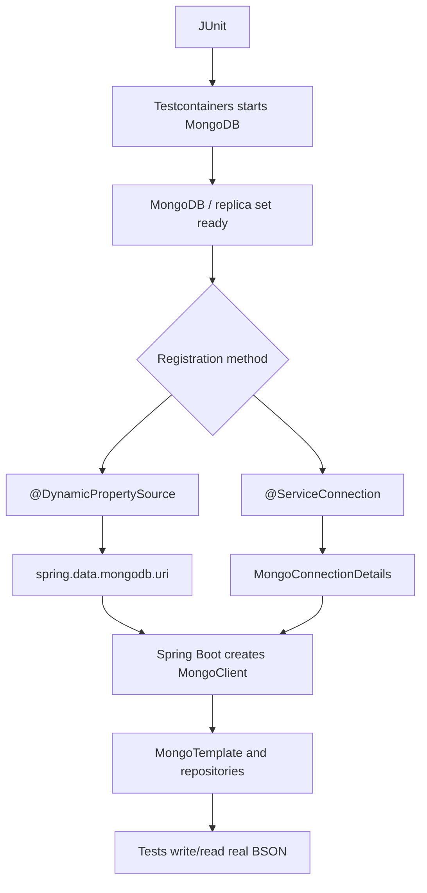

# `@DynamicPropertySource` or `@ServiceConnection` by Spring Boot Version

When testing applications using **Spring Data MongoDB**, a common challenge is that MongoDB started by Testcontainers gets a dynamically assigned host and port. Tests must provide connection details to Spring **before** creating `MongoClient`, `MongoTemplate`, and repositories. Two common approaches are **`@DynamicPropertySource`** in Spring Test and **`@ServiceConnection`** in Spring Boot.

This lesson belongs to the **Testing** chapter of `SPRING_DATA_MONGODB`. We use the same entity and repository to verify saving/reading documents, BSON mapping, and queries; then we analyze choosing the right annotation by Spring Boot version, container lifecycle, CI setup, indexes, transactions, and reactive access.

> **Applicable versions:** The complete code examples below target **Java 17+, Spring Boot 3.x, and Testcontainers Java 1.x**. `@DynamicPropertySource` has existed since Spring Framework 5.2.5; `@ServiceConnection` was introduced in Spring Boot **3.1**. When using Spring Boot 4.x or Testcontainers 2.x, re-verify packages, dependencies, and MongoDB configuration for that release line.

## 1. Why Must Test Connections Be Dynamic?

A MongoDB container uses port `27017` internally, but Docker may map it to a random host port such as `49183`. Hardcoding `mongodb://localhost:27017` can cause tests to hit a local MongoDB on a developer machine by mistake or fail in CI. For replica sets, the connection string also carries parameters helping the driver discover topology.

A reliable test needs to:

1. Receive a dedicated MongoDB instance for testing with the right version and topology.
2. Configure the connection **before** Spring constructs MongoDB beans.
3. Avoid depending on a fixed host/port on the runner machine.
4. Seed and clean data so tests are repeatable and order-independent.
5. Surface environment startup failures clearly instead of masking them as business bugs.



**`@DynamicPropertySource` registers properties** (such as `spring.data.mongodb.uri`) in the test environment via a supplier. **`@ServiceConnection` registers connection details** for Spring Boot based on a supported container type. Both use real MongoDB; neither mocks the database or handles resetting data automatically.

## 2. Quick Selection by Spring Boot Version

| Scenario | Solution | Requirement |
| --- | --- | --- |
| Spring Boot 2.7, 3.0 | `@DynamicPropertySource` | Use the connection property key for that Boot version |
| Spring Boot 3.1+ with supported `MongoDBContainer` | `@ServiceConnection` | Add `spring-boot-testcontainers` in test scope |
| Boot 3.1+ needing extra custom dynamic properties | `@DynamicPropertySource` for those properties | Can coexist with `@ServiceConnection` if MongoDB sources do not conflict |
| MongoDB provisioned by CI/Compose | Test profile and URI from environment | Neither annotation needed if URI is already known |
| Application defines a custom `MongoClient` bean | Configure the custom bean | Verify whether the bean consumes properties or connection details |

With Spring Boot 3.1+ and the official `MongoDBContainer`, `@ServiceConnection` is usually shorter. `@DynamicPropertySource` is useful for older Boot versions or when registering flexible dynamic properties. Avoid configuring **two URI sources** for the same MongoDB instance.

## 3. Entity and Repository Used in Both Examples

Place the entity, repository, and tests in package `example.customer` beneath the Spring Boot application root.

**`Customer.java`**

```java
package example.customer;

import java.time.Instant;
import org.springframework.data.annotation.Id;
import org.springframework.data.mongodb.core.mapping.Document;
import org.springframework.data.mongodb.core.mapping.Field;

@Document(collection = "customers")
public record Customer(
        @Id String id,
        @Field("email_address") String email,
        Instant registeredAt
) {}
```

**`CustomerRepository.java`**

```java
package example.customer;

import java.util.Optional;
import org.springframework.data.mongodb.repository.MongoRepository;

public interface CustomerRepository
        extends MongoRepository<Customer, String> {
    Optional<Customer> findByEmail(String email);
}
```

The Java property `email` is stored under the BSON field `email_address`. Tests will verify both the derived query and the raw document; mocking `MongoRepository` cannot prove data was mapped properly on the MongoDB server.

### 3.1. Required Dependencies

The application uses the main `spring-boot-starter-data-mongodb` dependency. For Spring Boot 3.x and **Testcontainers 1.x**, add to Maven `<dependencies>`:

```xml
<dependency>
    <groupId>org.springframework.boot</groupId>
    <artifactId>spring-boot-starter-test</artifactId>
    <scope>test</scope>
</dependency>
<dependency>
    <groupId>org.testcontainers</groupId>
    <artifactId>junit-jupiter</artifactId>
    <scope>test</scope>
</dependency>
<dependency>
    <groupId>org.testcontainers</groupId>
    <artifactId>mongodb</artifactId>
    <scope>test</scope>
</dependency>
```

Versions should be managed by the Spring Boot BOM/Testcontainers BOM or pinned compatibly. For Gradle, declare equivalent dependencies under `testImplementation`. Pick a fixed image like `mongo:7.0` for examples; in real projects, use a MongoDB version matching your application's support matrix and avoid relying on `latest`.

## 4. Approach 1 — `@DynamicPropertySource`

### 4.1. Complete Repository Test Example

**`CustomerDynamicPropertyTest.java`:**

```java
package example.customer;

import com.mongodb.client.model.Filters;
import java.time.Instant;
import org.bson.Document;
import org.junit.jupiter.api.BeforeEach;
import org.junit.jupiter.api.Test;
import org.springframework.beans.factory.annotation.Autowired;
import org.springframework.boot.test.autoconfigure.data.mongo.DataMongoTest;
import org.springframework.data.mongodb.core.MongoTemplate;
import org.springframework.test.context.DynamicPropertyRegistry;
import org.springframework.test.context.DynamicPropertySource;
import org.testcontainers.containers.MongoDBContainer;
import org.testcontainers.junit.jupiter.Container;
import org.testcontainers.junit.jupiter.Testcontainers;
import org.testcontainers.utility.DockerImageName;

import static org.assertj.core.api.Assertions.assertThat;

@DataMongoTest
@Testcontainers
class CustomerDynamicPropertyTest {

    @Container
    static final MongoDBContainer MONGO =
            new MongoDBContainer(DockerImageName.parse("mongo:7.0"));

    @DynamicPropertySource
    static void configureMongo(DynamicPropertyRegistry registry) {
        registry.add("spring.data.mongodb.uri", MONGO::getReplicaSetUrl);
    }

    @Autowired
    CustomerRepository repository;

    @Autowired
    MongoTemplate mongoTemplate;

    @BeforeEach
    void resetData() {
        repository.deleteAll();
    }

    @Test
    void readsMappedFieldFromRealMongoDb() {
        Customer saved = repository.insert(new Customer(
                "c-101",
                "alice@example.test",
                Instant.parse("2026-01-01T00:00:00Z")));

        assertThat(repository.findByEmail("alice@example.test"))
                .contains(saved);

        Document stored = mongoTemplate.getCollection("customers")
                .find(Filters.eq("_id", "c-101"))
                .first();

        assertThat(stored).isNotNull();
        assertThat(stored.getString("email_address"))
                .isEqualTo("alice@example.test");
        assertThat(stored.containsKey("email")).isFalse();
    }

    @Test
    void returnsEmptyForUnknownEmail() {
        assertThat(repository.findByEmail("missing@example.test")).isEmpty();
    }
}
```

**Execution sequence:**

1. `@Testcontainers` and `static @Container` let the JUnit extension manage the MongoDB container lifecycle before the Spring context uses it.
2. The `@DynamicPropertySource` method registers a URI supplier with `DynamicPropertyRegistry`.
3. When Spring Boot configures `MongoClient`, the supplier returns `MONGO.getReplicaSetUrl()` containing the assigned port and replica set details.
4. `@DataMongoTest` loads Spring Data MongoDB config, `MongoTemplate`, and repositories for the data slice.
5. The test inserts, queries via the repository, and uses the driver to inspect raw BSON and confirm mapping.

### 4.2. Why Use a Supplier?

A method annotated with `@DynamicPropertySource` must be `static` and accept `DynamicPropertyRegistry`. Calling `add(key, supplier)` stores a **Supplier** whose value is evaluated when the property is resolved:

```java
@DynamicPropertySource
static void dynamicProperties(DynamicPropertyRegistry registry) {
    registry.add("spring.data.mongodb.uri", MONGO::getReplicaSetUrl);
}
```

Because host and port are known only after container startup, never hardcode `localhost:27017` or concatenate host and port manually while omitting replica set details. `getReplicaSetUrl()` produces the client URI matching the `MongoDBContainer` configuration of your Testcontainers version.

Dynamic properties have high precedence in the Spring Test `Environment` and normally override the same key from `application-test.yml` or environment variables. Avoid registering the test URI in multiple places where it becomes unclear which source takes effect.

When extra dynamic properties are needed, this annotation works there too:

```java
@DynamicPropertySource
static void dynamicProperties(DynamicPropertyRegistry registry) {
    registry.add("spring.data.mongodb.uri", MONGO::getReplicaSetUrl);
    registry.add("app.integration-test-mode", () -> true);
}
```

This is an advantage of `@DynamicPropertySource`: it is not limited to MongoDB and does not require Boot to have a service connection factory for the tested resource.

## 5. Approach 2 — `@ServiceConnection` in Spring Boot 3.1+

### 5.1. Add Dependency

Keep the dependencies from the previous section and add:

```xml
<dependency>
    <groupId>org.springframework.boot</groupId>
    <artifactId>spring-boot-testcontainers</artifactId>
    <scope>test</scope>
</dependency>
```

This library supplies Spring Boot's Testcontainers integration, including `@ServiceConnection`. Do not confuse it with `spring-boot-starter-test`.

### 5.2. Equivalent Example Without Manual URI Registration

**`CustomerServiceConnectionTest.java`:**

```java
package example.customer;

import com.mongodb.client.model.Filters;
import java.time.Instant;
import org.bson.Document;
import org.junit.jupiter.api.BeforeEach;
import org.junit.jupiter.api.Test;
import org.springframework.beans.factory.annotation.Autowired;
import org.springframework.boot.test.autoconfigure.data.mongo.DataMongoTest;
import org.springframework.boot.testcontainers.service.connection.ServiceConnection;
import org.springframework.data.mongodb.core.MongoTemplate;
import org.testcontainers.containers.MongoDBContainer;
import org.testcontainers.junit.jupiter.Container;
import org.testcontainers.junit.jupiter.Testcontainers;
import org.testcontainers.utility.DockerImageName;

import static org.assertj.core.api.Assertions.assertThat;

@DataMongoTest
@Testcontainers
class CustomerServiceConnectionTest {

    @Container
    @ServiceConnection
    static final MongoDBContainer MONGO =
            new MongoDBContainer(DockerImageName.parse("mongo:7.0"));

    @Autowired
    CustomerRepository repository;

    @Autowired
    MongoTemplate mongoTemplate;

    @BeforeEach
    void resetData() {
        repository.deleteAll();
    }

    @Test
    void readsBsonWithServiceConnection() {
        repository.insert(new Customer(
                "c-202",
                "bob@example.test",
                Instant.parse("2026-01-01T00:00:00Z")));

        assertThat(repository.findByEmail("bob@example.test")).isPresent();

        Document stored = mongoTemplate.getCollection("customers")
                .find(Filters.eq("_id", "c-202"))
                .first();

        assertThat(stored).isNotNull();
        assertThat(stored.getString("email_address"))
                .isEqualTo("bob@example.test");
    }
}
```

Spring Boot detects the `MongoDBContainer` annotated with `@ServiceConnection` and generates connection information for MongoDB auto-configuration. In Boot 3.x, this uses `MongoConnectionDetails`; the test does not register `spring.data.mongodb.uri` manually. `@Testcontainers` and `@Container` still handle container lifecycle management.

### 5.3. How Do Connection Details Differ from Spring Properties?

Information from `@ServiceConnection` does not necessarily appear as a new property in `Environment`. Spring Boot auto-configuration consumes **connection details** to build the MongoDB client. If `spring.data.mongodb.uri` is still declared in a test profile, that setting is not necessarily the actual target when Boot is using `MongoConnectionDetails` from Testcontainers.

That is also why you should not use `@DynamicPropertySource` for MongoDB URI **at the same time** as `@ServiceConnection` on the same container: it may happen to work, yet causes confusion during debugging or configuration migrations.

If the application defines its own `@Bean MongoClient` and bypasses auto-configuration, Boot's connection details will not automatically update that custom bean. When tests still connect to the wrong target, check where the custom bean reads its connection source from.

### 5.4. Container Type Must Be Recognized

A field of type `MongoDBContainer` is straightforward because Spring Boot includes a factory for the supported MongoDB service. A `GenericContainer<?>` with a custom image may need a service name via `@ServiceConnection(name = "...")`, and you must verify whether your Boot version's factory supports that name/type. Do not assume every generic container produces valid connection details.

## 6. Migrating from `@DynamicPropertySource` to `@ServiceConnection`

| Criterion | `@DynamicPropertySource` | `@ServiceConnection` |
| --- | --- | --- |
| Provided by | Spring Framework Test | Spring Boot Testcontainers |
| Version baseline | Spring Framework 5.2.5+ | Spring Boot 3.1+ |
| Core mechanism | Supplier for property | Service-specific connection details |
| Key line | `registry.add("spring.data.mongodb.uri", ...)` | `@ServiceConnection` on container |
| Requires knowing MongoDB key | Yes | Not needed for supported containers |
| Supports arbitrary custom properties | Yes | Not its primary purpose |
| Extra Boot dependency | No | `spring-boot-testcontainers` |
| Common mistakes | Wrong key, supplier, context cache | Missing dependency, unrecognized container type |

To migrate a Spring Boot 3.1+ project:

1. Confirm `org.testcontainers:mongodb` and the JUnit extension are present and stable.
2. Add `spring-boot-testcontainers` in test scope.
3. Keep `@Testcontainers` and `static @Container`. Add `@ServiceConnection` to the container field.
4. Remove the `@DynamicPropertySource` method **that registers the URI for that container**. Keep other dynamic properties if still needed.
5. Re-run the same assertions, confirm the right database is hit, then verify CI and replica set tests.

Minimal diff:

```diff
 @Container
+@ServiceConnection
 static final MongoDBContainer MONGO =
         new MongoDBContainer(DockerImageName.parse("mongo:7.0"));

-@DynamicPropertySource
-static void configureMongo(DynamicPropertyRegistry registry) {
-    registry.add("spring.data.mongodb.uri", MONGO::getReplicaSetUrl);
-}
```

This annotation does not replace `@DataMongoTest`, does not load business services, does not create application-managed indexes, and does not reset collections.

## 7. Lifecycle and Data Isolation Between Tests

### 7.1. Container Lifecycle and Spring Context Caching

In these examples, `static @Container` lives for the duration of the test class. Spring TestContext can **cache** an application context across test classes with equivalent configuration. If a cached context holds a `MongoClient` pointing to stopped container A while a later class starts container B, reusing the old context causes connection errors.

Adopt a consistent strategy: either share a long-lived container across the suite/context, or isolate contexts when URIs differ and use `@DirtiesContext` when a fresh context is needed. In particular, if `@DynamicPropertySource` is inherited from a superclass while returning subclass-specific values, verify context cache key behavior carefully.

Do not call `MONGO.start()` manually while simultaneously relying on the JUnit extension to manage the same container without an explicit lifecycle design. Reusable containers meant for local development can retain state; do not enable them by default in CI when tests require isolation.

### 7.2. Cleanup Does Not Mean Rollback

`repository.deleteAll()` in `@BeforeEach` only works if the test owns that collection and no other test deletes data **in parallel**. With concurrent tests, each job or class needs its own database, collection namespace, or restricted parallelism.

MongoDB does not auto-rollback every test operation simply because `@Transactional` is present. Multi-document transactions require a compatible topology (typically a replica set or sharded cluster), an active transaction manager, and operations that participate in the transaction.

### 7.3. Seeding Representative Data Cases

Seed via repositories to test normal application behavior. When checking BSON types, legacy documents, missing fields, or migrations, seed via the driver:

```java
import org.bson.Document;
import java.util.Date;
import java.time.Instant;

mongoTemplate.getCollection("customers").insertOne(
        new Document("_id", "legacy-001")
                .append("email_address", "old@example.test")
                .append("registeredAt", Date.from(
                        Instant.parse("2020-01-01T00:00:00Z"))));
```

Proper container setup does not guarantee representative test data by itself. Test missing fields, `null` values, duplicates when unique indexes exist, sorting behavior, and BSON type mappings if the module relies on them.

## 8. Transactions, Reactive Access, and Multiple MongoClients

`MongoDBContainer` provides a replica set environment suitable for many transaction and change stream tests. The URI from `getReplicaSetUrl()` lets the driver discover the container's topology. If you use a standalone MongoDB service instead of Testcontainers, CRUD may work while multi-document transactions and change streams fail.

For Spring-managed blocking transactions, configure `MongoTransactionManager` on `MongoDatabaseFactory`. When testing rollback, perform two writes through a `@Transactional` service, intentionally throw an exception, and inspect actual MongoDB state. Never infer rollback solely from an exception or `@Transactional` on the test method itself.

With `spring-boot-starter-data-mongodb-reactive`, test connectivity against a real `ReactiveMongoTemplate` or reactive repository. Publishers execute only when subscribed to:

```java
import reactor.test.StepVerifier;

// Assumes reactiveRepository is injected and fixtures are already seeded.
StepVerifier.create(
        reactiveRepository.findByEmail("alice@example.test"))
        .assertNext(customer ->
                org.assertj.core.api.Assertions.assertThat(customer.email())
                        .isEqualTo("alice@example.test"))
        .verifyComplete();
```

This snippet requires a reactive repository and the `reactor-test` test dependency. Change streams are long-lived publishers requiring timeouts, actively emitted events, and subscription cleanup. Never benchmark reactive code by timing how long it takes just to build a `Flux`.

If the application connects to **multiple MongoDB clusters**, a single default connection details bean will not redirect every custom `MongoClient`. Define explicit beans, qualifiers, and configs per connection, and verify by reading/writing against the exact test databases.

## 9. CI and Pre-Provisioned MongoDB Services

### 9.1. CI Running Testcontainers

Runners need access to a Docker engine or compatible container runtime, image pull permissions, and networking. Avoid hardcoded ports. Use `MongoDBContainer` logs and exception causes to diagnose startup, health, and replica set issues. Avoid fixed sleeps when readiness signals are available.

| Error | Common cause | How to check |
| --- | --- | --- |
| Docker not found | CI lacks engine, socket, or permissions | Runner container runtime and permissions |
| Startup timeout | Slow image pull, low resources, not ready yet | Container logs and replica set status |
| `Connection refused` | Wrong URI/port, cached context pointing to old container | Connection source, lifecycle, and context cache |
| `UnknownHostException` | Hostname unresolvable on runner network | Where JUnit runs and container DNS |
| URI set in YAML yet connects elsewhere | Connection details or custom bean has different precedence | Actual auto-configuration in use |
| Transaction topology error | Standalone MongoDB or missing transaction manager | Replica set + Spring configuration |
| Flaky parallel tests | One test deletes another test's data | Separate databases, unique test IDs, parallelism |

### 9.2. CI Providing MongoDB as a Standalone Service

When MongoDB is provisioned by Docker Compose, a CI service, or a test cluster **before** JUnit starts, Testcontainers is unnecessary in test code. With Spring Boot 3.x, place in `src/test/resources/application-test.yml`:

```yaml
spring:
  data:
    mongodb:
      uri: ${TEST_MONGODB_URI}
```

In this configuration, `${TEST_MONGODB_URI}` is a Spring **placeholder resolved from the `TEST_MONGODB_URI` environment variable**, which must be set before the Spring context starts. Run tests with `@ActiveProfiles("test")`. Keep credentials out of source control. If JUnit runs inside its own container, `localhost` refers to that container; use the CI network service host/DNS name instead.

With a shared service, assign each job its own database and clean up only databases owned by that job. Never allow an unconfigured URI to silently fall back to a different environment.

## 10. Verifying Outcomes and Common Misconfigurations

Do not merely check that the Spring context starts. Integration tests should **write and read real documents**, verify BSON fields, and run twice consecutively to expose cleanup and context cache bugs.

| Misconception | Accurate understanding |
| --- | --- |
| `@DynamicPropertySource` starts MongoDB itself | The annotation only registers properties; the container/service has its own lifecycle |
| `@ServiceConnection` works on every Boot version | Available starting in Boot 3.1 with Testcontainers integration |
| Both annotations set URIs in `Environment` | Service connection provides connection details rather than simple properties |
| `@Container` exposes MongoDB on host port 27017 | Ports are dynamic; read the URI supplied by the container |
| `@DataMongoTest` loads the entire application | It loads only the MongoDB data slice; use `@SpringBootTest` for full integration |
| A dedicated container guarantees clean data | Still depends on context caching, database names, and parallel runs |
| Passing repository tests prove good performance | Benchmarks require large datasets and load; use `explain("executionStats")` and telemetry |

When the module uses aggregations, indexes, or performance diagnostics, testing on real MongoDB verifies queries, `$lookup`/`$group`, index metadata, and `totalDocsExamined`; latency, command counts, and BSON bytes must be measured separately on representative datasets.

## 11. Exercises

**Exercise 1 — Dynamic properties.** Use `@DynamicPropertySource` to supply the URI from `MongoDBContainer`. Run two tests for save/find and not-found; read raw BSON to confirm `email_address`. Explain why fixed ports are avoided.

**Exercise 2 — Service connection.** Upgrade the project to a compatible Spring Boot 3.1+ version, add `spring-boot-testcontainers`, and replace Exercise 1's dynamic property with `@ServiceConnection`. Keep assertions identical and identify which mechanism provides the connection.

**Exercise 3 — Configuration precedence.** Supply a different URI via a test profile and try each annotation. Observe which database is actually hit via reads/writes; explain why printing `Environment.getProperty("spring.data.mongodb.uri")` does not necessarily describe `MongoClient`'s target when service connection is active.

**Exercise 4 — Lifecycle and parallelism.** Have two test classes use different containers or databases. Run multiple times, inspect Spring context caching and errors caused by both calling `deleteAll()`. Adjust lifecycle or namespaces to isolate tests.

**Exercise 5 — Replica sets and transactions.** Create a service performing two writes inside a transaction and throwing an exception to roll back. Run on a Testcontainers replica set, then compare against a standalone MongoDB test service. Identify the required transaction manager and topology.

**Completion criteria:** The learner chooses appropriately between `@DynamicPropertySource` and `@ServiceConnection` by Spring Boot version; distinguishes dynamic properties from connection details; integrates Testcontainers into Spring Data MongoDB tests; verifies queries/BSON mapping and manages context, data, and CI; and understands limits around transactions, reactive access, and performance testing.
